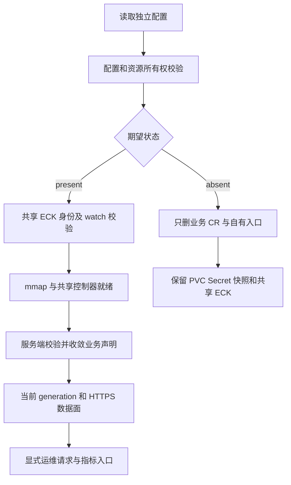
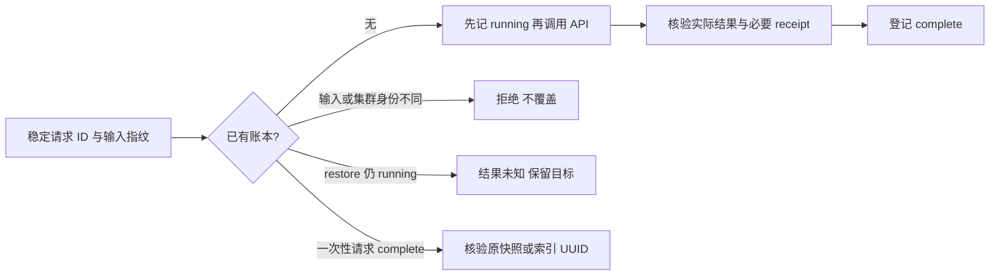

# Elasticsearch 开发手册

面向维护 kubeauto 的开发与发布人员，要求熟悉 Python、Ansible、Kubernetes 声明及 ECK 基本协调机制。目标是能沿配置追踪资源与请求、判断改动影响并完成相应验证；客户安装和业务使用从[用户与运维手册](operations-manual.md)进入。

首次维护按[固定版本](#1-版本源码与维护边界)→[产品入口](#2-产品入口与文件职责)→[配置与幂等](#3-配置与幂等语义)阅读；变更镜像查[六仓制品](#4-六仓制品路径)，变更门禁查[验证证据](#5-专项验证与证据)，日常命令查[维护入口](#6-维护检查入口)。机制与取舍见[技术白皮书](technical-whitepaper.md)。

## 1. 版本、源码与维护边界

本分支使用 ECK 3.5.0、Elasticsearch/Kibana 9.5.6、elasticsearch-py 9.5.1、社区 elasticsearch_exporter v1.11.0 和 Rally 2.13.0。Kubernetes 固定 1.33.6。上游版本兼容只用于确定研究和测试条件；交付资格取决于[专项矩阵](../../../tests/elasticsearch-test-matrix.yaml)及当前制品、业务和清理证据。

| 组件 | 固定来源 | 本项目消费接口 |
| --- | --- | --- |
| ECK | [commit 386c7b14](https://github.com/elastic/cloud-on-k8s/tree/386c7b14f2d1bbb7f2af1e7da997e64875f16e47) | 官方 CRD、Operator 清单、Elasticsearch/Kibana CR、卷与 TLS 协调 |
| Elasticsearch | [commit fd1e8011](https://github.com/elastic/elasticsearch/tree/fd1e8011342a0988e432b999cea4bf884ca120ed) | HTTPS REST、复制与快照语义、内置 S3、插件版本 |
| Kibana | [commit 6b06ce57](https://github.com/elastic/kibana/tree/6b06ce57188008d15d48928b2c828ecceaa7e8fd) | 同版 Kibana CR 与安全状态 |
| Python client | [commit 891a79ae](https://github.com/elastic/elasticsearch-py/tree/891a79aeeff105423915af652b53f09667cf996a) | TLS、连接、Bulk 和请求错误处理 |
| exporter | [v1.11.0](https://github.com/prometheus-community/elasticsearch_exporter/tree/v1.11.0) | `/metrics`、`/healthz`、`es.*` 参数、ES_USERNAME/ES_PASSWORD |
| Rally | [2.13.0](https://github.com/elastic/rally/tree/2.13.0) | Docker `benchmark-only`、本地 track/corpus、结果统计 |

官方解释清晰的机制按[技术白皮书](technical-whitepaper.md)使用；源码检查针对实际集成歧义，例如 PVC 删除策略、Operator watch 范围、探活路径和错误返回。升级必须重新阅读相关发布说明、已知问题、兼容性与安全公告，不把旧版本合同通过当作新版本通过。

滚动官网资料在 2026-11-04 核对，机制研究的文档仓基点为 [elastic/docs-content commit 435c60e5](https://github.com/elastic/docs-content/tree/435c60e5a8e5af1085678ceb3a7765eac949b731)，涉及 API/配置的最终行为再与上表固定实现核对。2026-11-08 补充核对 mapping、分析器、doc values、nested、BM25、查询/过滤、refresh 与 translog 官方主题，只采用适用的稳定机制；滚动参考中的 columnar、Planned 或 Preview 参数未纳入本项目配置。官网标注 Planned、Preview、Experimental 或商业许可的内容不由版本号自动转为本项目承诺；例如本分支没有把 searchable snapshots、CCR、自动分层/扩缩容或推理服务作为默认交付。文档仓包含多个产品的滚动内容，固定 commit 是来源定位，不表示其中所有内容均适用于 9.5.6。

## 2. 产品入口与文件职责

`conf/config.yml` 定义默认关闭的独立配置前缀；`common/constants.py` 的 `v_business_elasticsearch` 与 EFK 的 `v_elasticsearch` 分开。`service/cluster/manager.py` 只负责将业务版本占位符替换为固定版本。镜像组 `elasticsearch`、`elasticsearch-smartcn` 和 `elasticsearch-qualification` 分别服务正常安装、可选分析器和升级/压测夹具。

`roles/cluster-addon/tasks/elasticsearch.yml` 按校验、所有权、共享 ECK、主机前置、声明收敛、健康、运维请求、监控与网络策略的顺序调用产品辅助程序。`files/elasticsearch.py` 只处理本组件声明和显式请求，不直接编辑 ECK 生成的 StatefulSet。声明以 JSON List 保存到集群私有目录，JSON 是 Kubernetes 支持的清单格式，不再维护一套重复模板。

`files/eck.py` 是两个消费者共用的狭窄前置入口：校验固定官方清单 SHA256，检查唯一控制器、已知所有权、固定镜像和 watch 配置，然后首次安装或同版本复用。复用不反复应用原始上游镜像，不触发 set-image 往返。外来 Operator、版本不符或 watch 不覆盖业务命名空间时拒绝，禁止 `--force-conflicts` 接管。3.4.1→3.5.0 仅由 `eck-platform.yml` 的独立平台任务调用 `eck.py upgrade`，接受显式来源与稳定变更 ID。任务标记 `never,eck-platform`，默认安装和 `--tags elasticsearch` 均不会运行；业务旧升级字段非空会被拒绝。升级绑定全部已验收消费者的 UID、配置摘要，并等待当前代次健康恢复后才完成账本。



主路径在任何资源变更前完成拒绝检查。出现失败时应保留首个错误和渲染输入，再区分配置、制品、主机、Kubernetes/CSI、ECK、ES 数据面及测试门禁。不得为使测试通过而修改已有组件版本或扩大清理范围。

### 2.1 沿一个配置追到实际资源

以下以 `elasticsearch_data_count: 3` 为例说明维护时应该追踪的真实路径。候选节点列表可以是四台，但实际 count 仍为三；不能在配置读取、调度或证据生成时把两者混为一谈。

| 层次与入口 | 输入/输出 | 维护时要证明的契约 |
| --- | --- | --- |
| `conf/config.yml`、manager 版本替换 | 默认配置→客户集群配置 | 独立前缀、类型与固定版本，不修改 EFK 版本 |
| `tasks/elasticsearch.yml` | 仅导出 elasticsearch_ 字段到私有 input.json | 写入的只是非敏感值与引用；文件 0600 |
| `validate()` / `preflight()` | 校验 count、候选节点、资源、已有对象与请求 | 任何产品集群变更前拒绝非法输入或身份冲突 |
| `resources()` | 配置→JSON List 中的 CR/Service 等声明 | data nodeSet count=3；候选名单进入 affinity；角色与卷声明正确 |
| `converge()` / ECK | 服务端校验、声明提交→控制器协调 | 遵循字段所有权与并发前置；不手改生成的 StatefulSet |
| `health()` | 当前代次、实际成员、HTTPS→身份账本 | 实际成员数与角色、版本及 PVC 身份一致；不是仅观察 Pod Running |
| `operations()` / monitoring / network | 显式任务及自有入口 | 按列表顺序执行；请求结果与数据面、采集和权限分别核验 |

产品私有渲染目录为客户集群目录下的 `yml/elasticsearch/`，其中 `input.json` 与 `cluster.json` 用于诊断输入到资源的映射；它们不是另一个配置权威。客户修改 config.yml 后仍由 kubecli 收敛，不通过编辑渲染文件维护生产。下次生成会覆盖手工内容。

## 3. 配置与幂等语义

### 3.1 默认关闭、前置拒绝与健康身份

常规字段和容量取舍见运维手册。维护实现时须保持：默认 `elasticsearch_install: "no"` 完全惰性；同名外来资源拒绝；同一配置不重建 Secret、替换 PVC 或产生无意义滚动。新增字段必须在写入集群前校验类型、单位和边界，不能把 `bool("false")` 当作关闭。

健康检查同时要求当前 observedGeneration、ECK `phase=Ready`、`ReconciliationComplete=True`、绿色及预期成员数，再通过 HTTPS 核对实际成员版本和数据身份。固定 ECK 3.5.0 的 [`ElasticsearchStatus`](https://github.com/elastic/cloud-on-k8s/blob/386c7b14f2d1bbb7f2af1e7da997e64875f16e47/pkg/apis/elasticsearch/v1/status.go)把 Ready 定义为按期望 spec 运行；[`NewState`](https://github.com/elastic/cloud-on-k8s/blob/386c7b14f2d1bbb7f2af1e7da997e64875f16e47/pkg/controller/elasticsearch/reconcile/state.go)在开始协调时就写入 observedGeneration，因此该字段并非变更完成凭据。同版本镜像或配置滚动时，只看版本、绿色和成员数会接受滚动间隙的旧成员；不要用技术预览的 `inProgressOperations` 代替稳定完成条件。

### 3.2 声明所有权与并发变更

`health()` 同时收敛 `NAME-identity` ConfigMap，保存 cluster UUID、版本上限、拓扑与 PVC UID，因此它具有写入副作用。调用者必须使用产品的 `kubeauto-elasticsearch` field manager；测试专用 manager 仅管理夹具，不能替产品提交声明或身份账本。Kubernetes 1.33 的 [Server-Side Apply 所有权规则](https://v1-33.docs.kubernetes.io/docs/reference/using-api/server-side-apply/)规定，同值 apply 会形成共有字段，之后任一方改变该值都会冲突；不同 manager 名称本身不构成对象隔离。交接共有字段须先证明保留者已拥有全部字段，再通过原 manager 省略这些字段来放弃所有权，并核对服务端 dry-run、原 UID、resourceVersion 和完整内容；不通过强制覆盖或删除账本绕过冲突。

ECK 的 `nodeSets` 在固定 CRD 中按原子列表管理，不能把列表内某个初始化容器视为独立的 SSA 字段。固定控制器的 [`annotateResource`](https://github.com/elastic/cloud-on-k8s/blob/386c7b14f2d1bbb7f2af1e7da997e64875f16e47/pkg/controller/elasticsearch/elasticsearch_controller.go)会通过完整对象 Update 保存编排提示；其 Go 类型往返可为容器补出空 `resources`，使控制器成为整个列表的字段所有者。本分支显式渲染初始化容器的空资源对象，减少无意义差异。真正改变列表时，先验证只有本产品与固定 ECK 管理 spec，再分别完成普通 SSA 和目标 spec 的服务端 dry-run；随后用测试原 UID、resourceVersion 和完整 spec 的 JSON Patch 原子提交同次配置变化，最后执行普通 SSA 收敛其余声明。补丁保留控制器独有的默认项，移除本产品已管理但现已撤销的可选配置；版本、镜像与节点配置不拆成中间滚动状态。外来字段所有者、并发变化或任一验证失败均停止，不使用 force-conflicts 接管。

### 3.3 调度与容量解析

候选节点按 Kubernetes 对象名匹配：每个 `nodeSelectorTerms` 项只含一个 `matchFields / metadata.name / In` 单值条件，多项取“或”。Kubernetes 1.33.6 的 [`ValidateNodeFieldSelectorRequirement`](https://github.com/kubernetes/kubernetes/blob/v1.33.6/pkg/apis/core/validation/validation.go)要求此处 `In/NotIn` 恰有一个值，不能套用 label selector 的多值写法。使用对象名还避免将 `metadata.name` 与可能不同的 `kubernetes.io/hostname` 标签混同；后者在 Pod 反亲和性中用于分散宿主故障域。候选名单只限制可放置位置，`nodeSet.count` 才决定成员数，增加备用主机不应隐式扩容。

容量前置会读取选定节点上其他 namespace 的 Pod 请求。`quantity()` 因而需要识别 Kubernetes [1.33.6 Quantity](https://github.com/kubernetes/kubernetes/blob/v1.33.6/staging/src/k8s.io/apimachinery/pkg/api/resource/quantity.go) 与 [suffix 定义](https://github.com/kubernetes/kubernetes/blob/v1.33.6/staging/src/k8s.io/apimachinery/pkg/api/resource/suffix.go)中的十进制、二进制和指数单位，不能只接受本项目配置示例里的 Gi/Mi。该辅助函数用于容量近似比较，不重写 Kubernetes 的定点规范化或调度算法；最终放置仍由调度器和实际资源状态决定。

### 3.4 请求账本与恢复完成语义

运维请求放在 `elasticsearch_requests`，每个请求有稳定 DNS 形式 `id`。产品以 ConfigMap 保存非敏感输入指纹和阶段。相同 ID 与不同输入冲突时拒绝；完成的 snapshot/restore 不重复执行。中断的恢复存在结果未知，必须先检查目标数据，不能自动删除目标后重试。声明性 role/user/repository/SLM 请求允许重复收敛，密码始终通过 Secret 引用读取。

请求 ID 最长 40 个字符；它是一次确定输入的身份，不是可以反复改写的备注。ConfigMap 名为 `NAME-request-ID`，绑定配置指纹、ES cluster UUID、phase 和必要 receipt。`complete` 的 snapshot/restore 仍核验快照或恢复索引 UUID；外部删除了快照、替换了索引或切换到别的 ES 数据集群时，不能沿用旧成功记录。成功的一次性请求可在客户变更记录中保留后从当前配置列表移除，避免以后维护时仍要求一个已经按保留策略退役的恢复点存在；不要删除账本来重新使用同一变更身份。

| 请求 type | 消费输入与处理 | 完成或拒绝边界 |
| --- | --- | --- |
| repository | name、HTTPS endpoint、bucket、region、base_path、可选 path_style_access | 注册和 verify；writer 追加有界 analysis，reader 必须 readonly |
| snapshot | repository、snapshot、显式 indices、可选 feature_states/include_global_state | 等到 SUCCESS、非空且无失败分片，记录 snapshot UUID；同名外部快照拒绝 |
| restore | repository、snapshot、显式 indices、可选 feature_states | reader 空目标；同步完整恢复响应、精确索引集合、全部 primary 成功、绿色，记录索引/feature UUID |
| slm | name 及完整 policy | policy 含 schedule、name、repository、config、retention；声明完成不代表计划已执行 |
| role | name、definition | 原生角色 API 收敛，权限定义必须由安全管理员审查 |
| user | name、password_secret、roles | Secret 含 password；密码不进入配置指纹或正常日志 |
| reload-secure-settings | 只有 id/type | 全部预期节点 reload 成功且没有 reload_exception，随后仍须验证 S3 实际操作 |



图展示 snapshot/restore 的关键边界；role/user/repository/SLM 是可重复收敛的声明请求。先记 running 是为了让调用响应丢失后仍有操作身份，不是失败后自动删账本再试。API 返回成功但后续取证失败，同样不能直接补写 complete。

`indices` 禁止通配符，默认 `feature_states: [none]`；安全状态恢复必须由已实测可认证的 file realm superuser 发起。快照和 SLM 只能由 writer 执行。S3 凭据通过 ECK keystore 注入，endpoint/region/path_style_access 由 repository 非敏感设置消费：固定 9.5.6 的 [`S3ClientSettings.refine`](https://github.com/elastic/elasticsearch/blob/fd1e8011342a0988e432b999cea4bf884ca120ed/modules/repository-s3/src/main/java/org/elasticsearch/repositories/s3/S3ClientSettings.java) 支持从 repository metadata 覆盖这些客户端设置。该行为是需要在升级时重新核对的集成接口，不能仅凭滚动文档中的 `s3.client.default.*` 配置名推断下个版本仍接受 repository 覆盖。JVM truststore 复制发行版的默认 CA 后加入客户 CA，并按内容摘要触发 Pod 更新，避免只让客户端信任私有 S3。

恢复 receipt 的身份核验区分普通索引和系统 feature。普通索引从精确索引的 `_settings` 读取 UUID；系统 feature 从 `/_cluster/state/metadata?filter_path=metadata.indices.*.settings.index.uuid` 读取 UUID 元数据，再严格选取源快照声明的 feature 索引，任何缺项或空 UUID 均拒绝完成。固定版本的 [`IndexNameExpressionResolver`](https://github.com/elastic/elasticsearch/blob/fd1e8011342a0988e432b999cea4bf884ca120ed/server/src/main/java/org/elasticsearch/cluster/metadata/IndexNameExpressionResolver.java) 禁止普通 API 直接访问系统 data stream 的 backing index，file realm superuser 也不豁免；因此不能把 `_settings` 的此类 400 错误解释为需要扩大角色。上述元数据路径依据同版 [`TransportClusterStateAction`](https://github.com/elastic/elasticsearch/blob/fd1e8011342a0988e432b999cea4bf884ca120ed/server/src/main/java/org/elasticsearch/action/admin/cluster/state/TransportClusterStateAction.java) 的无索引选择器读取行为，响应仅保留 UUID，不输出完整集群配置。该内部元数据表示需随版本重新核对；完成账本重入时也使用相同路径检查身份，不能只在首次恢复时核验。

恢复提交使用 `wait_for_completion=true`，只提交一次，HTTP 等待预算取自本次 `elasticsearch_wait_seconds` 的剩余时间；其后的 green 等待共用同一截止时间，普通请求仍保留 60 秒超时。依据官方[恢复 API](https://www.elastic.co/docs/api/doc/elasticsearch/operation/operation-snapshot-restore)及固定 9.5.6 的 [`TransportRestoreSnapshotAction`](https://github.com/elastic/elasticsearch/blob/fd1e8011342a0988e432b999cea4bf884ca120ed/server/src/main/java/org/elasticsearch/action/admin/cluster/snapshots/restore/TransportRestoreSnapshotAction.java)、[`RestoreInfo`](https://github.com/elastic/elasticsearch/blob/fd1e8011342a0988e432b999cea4bf884ca120ed/server/src/main/java/org/elasticsearch/snapshots/RestoreInfo.java)，同步返回表示所有 primary 恢复尝试已结束，其中仍可能有失败；产品必须核对返回快照名、业务及 feature 索引的精确集合、正数总分片数、`successful == total` 和 `failed == 0`，再核对 green 与 UUID，不能只接受 HTTP 200 或 `accepted: true`。官方[恢复记录 API](https://www.elastic.co/docs/api/doc/elasticsearch/operation/operation-indices-recovery)只保留当前分片副本的最近一次恢复，后续 PEER 迁移会替换 SNAPSHOT 来源记录，因此该 API 用于诊断，不能充当本次恢复的完成收据。同步响应丢失或超时时，保留 `running` 账本和目标数据；重入继续拒绝未知结果，不重试变更请求或补写成功。

升级前恢复点不能仅凭 snapshot 的 `version` 字符串判断来源程序版本。固定 [`SnapshotInfo.toXContentExternal`](https://github.com/elastic/elasticsearch/blob/fd1e8011342a0988e432b999cea4bf884ca120ed/server/src/main/java/org/elasticsearch/snapshots/SnapshotInfo.java)将 `IndexVersion` 输出为数值 `version_id` 和发行版标签 `version`；多个程序版本可共享索引格式，9.5.5 的实际标签为 `9.5.2-9.5.5`、格式 ID 为 `9111000`。升级门禁分别核对全部三个来源成员的运行版本为 9.5.5、各自 `index_version` 与快照 `version_id` 一致，以及快照 SUCCESS、精确索引、非空 UUID 和全部分片成功。人类可读范围不代替运行版本检查，也不通过解析范围上限推断任意旧版恢复一定兼容；回旧版仍须在独立空目标实际恢复并对账。

### 3.5 S3 兼容条件与信任材料

可选布尔配置 `elasticsearch_repository_analysis_copy_during_write_contention` 未声明时为 `true`，资源声明保持上游默认；显式 `false` 才在每个 nodeSet 的原生 config 中增加 `repositories.blobstore.testkit.analyze.copy_during_write_contention: false`。配置通过同一 `elasticsearch_` 前缀输入路径消费，非法值在任何集群变更前拒绝，不从后端名称自动猜测。其适用依据是 [ES 官方 MinIO 测试修复 #135565](https://github.com/elastic/elasticsearch/pull/135565)：MinIO 在上传未完成时复制可能阻塞，官方测试关闭这一争用子探针；本项目实验后端采用相同条件，仍验证仓库分析、快照和独立恢复，不能将此证据外推为后端完整 S3 语义通过。该原生设置已标记 Deprecated，升级时须核对固定版本的 `BlobAnalyzeAction` 与官方 MinIO 测试，不能永久沿用兼容例外。旧默认配置的资源等价性与新分支的失败阻断分别由契约核验；现有现场证据只在冻结来源和未变依赖已证实时复用，兼容分支须另经产品入口验证。

固定 9.5.6 镜像中的默认 JVM `cacerts` 权限为 `0444`。S3 初始化容器以非 root 身份运行，必须先在自有临时卷中重新创建默认信任库的工作副本，赋予 `0644` 权限，再导入客户 CA；重试时也须能替换上一轮的只读副本。主容器只读挂载完成后的信任库，不修改镜像中的默认文件，不通过提升容器权限解决可写性。Pod 的 fsGroup 只解决卷的组权限，不会让复制而来的只读文件自动可写。该设计沿用官方[私有 S3 信任库配置](https://www.elastic.co/docs/deploy-manage/tools/snapshot-and-restore/cloud-on-k8s)，同时保留发行版默认 CA；升级固定镜像后须重新核对其文件路径、权限和实际 JVM 连接。

### 3.6 轮换、拒绝取证与共享边界

更新凭据、证书和 Secret 内容有各自生效机制：环境变量引用需要受控重启 exporter；ECK 负责证书和 secureSettings 协调；JVM truststore 挂载内容和 JVM 实际采用的信任状态必须分别证明。固定 ECK 3.5.0 的 [`buildAnnotations`](https://github.com/elastic/cloud-on-k8s/blob/386c7b14f2d1bbb7f2af1e7da997e64875f16e47/pkg/controller/elasticsearch/nodespec/podspec.go#L220) 将 `keystoreResources.Hash` 纳入 `config-hash`，secureSettings 内容变化会触发控制器滚动；不能将“无需人工重启”解释为本版本不会滚动，也不能用显式 reload 绕过其完成条件。不能用 Secret 的 resourceVersion 变化代替新连接成功。任何新增轮换入口应覆盖新身份允许、旧身份撤销、错误输入拒绝和恢复。

HTTP 自定义证书恢复为 ECK 默认签发时，渲染器明确输出 `spec.http.tls.certificate.secretName: ""`，保留不可为 null 的 `certificate` 对象。Server-Side Apply 在撤销原先管理的 `secretName` 时，空对象不能保证保留该对象。固定 ECK 3.5.0 的 [`GetSecretFromRef`](https://github.com/elastic/cloud-on-k8s/blob/386c7b14f2d1bbb7f2af1e7da997e64875f16e47/pkg/controller/common/certificates/secret.go#L181) 对空名称返回无自定义证书，HTTP 协调器随后走内部自签名分支。恢复仍须经配置与产品入口收敛，并验证新连接的 CA、服务主机名及原业务数据；确认不再被引用后才能回收自定义证书 Secret。

最小权限身份撤销自己签发的 API key 时，`manage_own_api_key` 的授权检查还要求请求明确归属。固定 9.5.6 的轮换及失败清理均向 `DELETE /_security/api_key` 提交精确 `ids` 与 `owner: true`；只传 ID 会被拒绝，不应通过扩大为 `manage_api_key` 权限修复。依据为官方[撤销 API key 的授权规则](https://www.elastic.co/docs/api/doc/elasticsearch/operation/operation-security-invalidate-api-key)及固定版本的 [`ManageOwnApiKeyClusterPrivilege`](https://github.com/elastic/elasticsearch/blob/fd1e8011342a0988e432b999cea4bf884ca120ed/x-pack/plugin/core/src/main/java/org/elasticsearch/xpack/core/security/authz/privilege/ManageOwnApiKeyClusterPrivilege.java)。密钥 ID 可用于限定撤销范围，密钥原文及 encoded 值不得进入日志或证据。

TLS 负向验证依据异常类型与证书校验原因，不解析异常的显示文字。固定 `elastic-transport 9.4.2` 的 [`Transport.perform_request`](https://github.com/elastic/elastic-transport-python/blob/v9.4.2/elastic_transport/_transport.py) 在零重试退出时会清空 `errors`，外层 `TlsError` 因而可能只显示 `TLS error`；原始异常链仍保留证书验证原因。门禁要求该链包含 Python 的 `SSLCertVerificationError` 或 urllib3 的主机名 `CertificateError`，DNS 失败、连接拒绝和缺少证书校验原因的 TLS 握手失败均不算通过。客户端首失败日志只输出异常类型、脚本函数/行号和原因类型链，不输出响应正文、异常原文或局部变量。

业务与 EFK 的预检还核对 namespace 所有权及实际 S3 access key；复制相同账号到另一名称的 Secret 不能建立隔离。EFK 的固定备份树 `elasticsearch/logging` 对业务写入与恢复保留。业务仓库写入归属使用平台 ConfigMap 和 Kubernetes create/replace 的资源版本条件更新；冲突或不确定错误保留归属，不先写 S3 再补账本，不随业务卸载释放旧备份。产品卸载向 API server 提交 UID/resourceVersion 删除前置条件，资源在检查后被替换时拒绝删除。上述检查不授予或替代 Kubernetes RBAC、对象存储 IAM；拥有管理权限的直接 API 操作仍属于平台权限边界。

## 4. 六仓制品路径

本分支实际影响主仓和 `kubeauto-ext-images-dockerfile`。产品打包、Kubernetes 二进制、ext-bin 和 sp1 只做兼容审计，不因新增中间件而重建无关制品。运行镜像保留已交付 EFK 9.5.1，并新增业务 9.5.6 和升级来源 9.5.5。

| 用途 | 固定交付 tag |
| --- | --- |
| 控制器 | `eck-operator:3.5.0`；升级来源 `3.4.1` |
| ES/Kibana | `elasticsearch:9.5.6`、`kibana:9.5.6`；升级来源 `9.5.5` |
| 分词插件 | `elasticsearch-smartcn:9.5.6-kubeauto.1` |
| 指标 | `elasticsearch-exporter:v1.11.0` |
| 业务客户端 | `elasticsearch-client:9.5.1-kubeauto.1` |
| 离线压测 | `elasticsearch-rally:2.13.0-kubeauto.1` |

Dockerfile 位于外部镜像仓的 `middleware/elasticsearch/`，由唯一 `catalog.json` 注册，使用官方上游。客户端固定 Python patch、全部依赖版本与 SHA256；Rally 将本地 track、mapping、语料和 SHA256SUMS 固化在镜像中。SmartCN 在构建期由同版官方插件安装器获取并校验，运行时不联网下载插件。

Rally 2.13.0 的报告选项是 `--show-in-report=all-percentiles`，含义是展示实际可用指标的全部支持分位；不是请求任意百分位，也不保证输出 P95。维护调用时对照固定版本的[命令行参考](https://esrally.readthedocs.io/en/2.13.0/command_line_reference.html#show-in-report)，并用原镜像的参数解析器及真实调用合同验证 argv。认证只通过权限受控的临时 client-options 文件传入，成功或失败均回收，不把密码放入命令行；Rally 的分位与独立客户端的分位分别保留负载和统计口径。

常规下载顺序为 TalkEdu、Docker Hub 与已知官方回退，工作负载消费项目本地 Registry 的固定 tag。自定义客户端/插件/压测镜像没有可以随意替换的上游等价品，不把其 tag 映射给不同镜像。制品必须完成两端 AMD64/ARM64 manifest/digest 核验；下载失败不得输出成功。临时网络代理只作为非持久化运行参数，不能写进默认配置、Dockerfile 或客户文档。

## 5. 专项验证与证据

### 5.1 从产品能力定位验证入口

开发者先读取[专项矩阵](../../../tests/elasticsearch-test-matrix.yaml)与[固定分路手册](../../../tests/README.md#elasticsearch-独立交付分路)。矩阵给出能力、产品入口、成功标志、最小反证和清理范围；它决定验证范围，不按测试脚本数量或回归运行次数计算交付。

| 变更对象 | 最便宜的先行证明 | 后续验证的实际边界 |
| --- | --- | --- |
| 新配置或渲染 | 类型/默认关闭、非法值、CRD schema、对象名/角色/namespace/卷与所有权合同 | 通过 config.yml+kubecli 的所属模块；相同输入重入及业务验证 |
| 请求/API 与恢复 | 输入指纹、先记账后调用、部分成功/超时/未知结果及同 ID 拒绝合同 | 最窄请求分路；独立目标与数据/身份复验 |
| 轮换与认证 | Secret 引用、无明文输出、异常类型及允许/拒绝断言 | 新身份生效、旧身份撤销、错误 CA/SAN 拒绝和恢复 |
| ECK 平台或共享边界 | 消费者入口不能升级；所有权、watch、版本、IAM/路径冲突合同 | 受影响共存、平台升级与日志路径；不扩成所有中间件回归 |
| runner/helper/assertion | 真实调用顺序、前后条件、首失败停止及限定清理合同 | 所属聚焦模块先通过，才准许所需最终完整回归 |
| 纯文档解释与编排 | 来源、正文、读者路径、图与代码块/链接检查 | 复用相符产品证据；不搭集群、不发布镜像、不重跑 GA |

任何现场验证前完成适用静态合同。固定 runner 负责租约、同步、监督、durable 状态、失败诊断和清理，不能用临时 SSH 安装或直接 Helm/kubectl 改变客户路径来替代产品证据。开发者在矩阵中声明差异，不再为每个新动作发明一套验收体系。

### 5.2 维护门禁时必须保留的技术条件

下面是已经落实在固定实现中的条件，供修改相应代码时复核；它们不是客户要执行的测试时间线。

| 场景 | 关键机制与断言 | 禁止的错误推论 |
| --- | --- | --- |
| 即时对账 | GET/_mget 实时读与 count/search 的 refresh 边界分开；需要立即搜索的探针用 refresh=wait_for | 固定 sleep 或 GET 成功不等于搜索视图已更新 |
| 客户端启动/中断 | 等自有 client 容器实际 running 且有启动标志，再中断与清理 | Job active 也包含尚未启动的 Pod |
| 故障与卷接管 | 保存 journal；证明旧进程隔离，再以 UID 前置退役；恢复原节点/卷/调度状态及账本 | NotReady 不证明 fencing，不能强拆原卷 |
| 控制器暂停恢复 | 先还原 ES 期望副本，再恢复原 ECK，等待实际 Ready 和业务 | ECK 暂停时不能先等其完成重启退出记录清理 |
| OnDelete StatefulSet | 等实际 Ready、副本数和 UID；由 ECK 负责滚动 | 原生 rollout status 不支持该策略，不能照搬 Deployment 等待 |
| 故障负载 | 双拓扑各至少 1800 秒，分别记录确认、拒绝、未知、重试、分位及完整数据 | 两条负载独立；不能把低 P99、无最终错误写成零扰动 |
| 运维与附加组件夹具 | 原配置是输入权威；复用已租约且健康的 CSI，临时开关成功/异常均恢复 | 不能假定附加 -e 覆盖配置，也不为一个模块重装存储 |
| 所有权取证 | 消费 managedFields 时显式 --show-managed-fields=true，同时查标签和 UID/resourceVersion | kubectl 默认隐藏该字段，缺失不证明无人管理 |
| 退役和重入 | 核对原 namespace/PVC/凭据/共享 ECK/快照/数据，按实际依赖复用 | 不能给失败父运行改签，单模块成功只签自己的范围 |

客户端故障负载的单条写入具有最多 300 秒、40 次尝试的双重上限，指数间隔最多 4 秒，单次请求另有超时；截止后不再发新请求，已发出的请求仍受单次超时约束。成功必须检查分片确认，未知结果按稳定 ID 内容核对，最后绿色、refresh 及全 ID/内容/数量对账。原业务账本与测试索引分别维护，清理不触及他方数据。

Kubernetes 状态、客户端异常及 exporter 参数均随固定版本核对。TLS 拒绝只接受证书校验原因链，不能把 DNS/连接失败计为负向通过；exporter 的布尔否定形式为 `--no-es.aliases`，不是 `--es.aliases=false`。异步 reindex 仍使用当前固定版本支持的 `_tasks/{id}` 查询，升级时重新核对持久结果与错误字段，不把新文档推荐路径直接当成旧接口已失效。

### 5.3 如何新增一个受支持配置或请求

1. 先定义客户任务、官方稳定接口与本项目支持边界，指出归属矩阵项和最小反证；不先改共享依赖。
2. 配置在 `conf/config.yml` 中保留安全默认，在 `validate()`/`validate_request()` 中先校验完整输入，再由渲染或显式请求消费；凭据只能引用 Secret。运维请求还须在 `OPERATION_FIELDS` 声明允许字段。
3. 说明幂等分类：声明重复收敛，还是一次性有副作用操作。后者在 API 前记录身份，并规定响应丢失、并发冲突、部分完成、重入和清理行为。
4. 同时补正常、拒绝、中断/结果未知与恢复合同，核对真实产品调用顺序。原证据按依赖复用，只将已证明受影响的矩阵项补测。
5. 按任务更新客户文档：用户如何使用、运维如何判断和恢复、机制如何解释、维护者如何扩展各有归属。仅有代码与单测不能扩成交付能力。
6. 聚焦模块通过后完成适用的完整回归与清理；制品变化遵循第 4 章增量路径。门禁失败先分层诊断，撤回被否定的修复和夹具，不从头重测无关模块。

### 5.4 当前版本成果如何复用

本版本最终干净完整 run 为 `4c218128b104420895c34370a975c0a5`，[证据收据](../../../tests/evidence/elasticsearch-only-20261108-003544-4c218128b104420895c34370a975c0a5.json)绑定原始日志、输入、归档源码与 durable 状态。其终态为 `ELASTICSEARCH_FULL_GATE_PASS`、退出 0、零失败标志和 `LAB_CLEAN_VERIFY_PASS`；共存与日志子模块均完成所属范围。能力对应的客户事实、测量与边界已整理在白皮书及运维任务，不要求客户读取内部流水理解产品。

后续代码变更须按真实依赖核对证据，不能仅沿用上一次 PASS。文档改写保留产品运行记录，另以当前文件摘要记录作者检查；不修改历史运行的源码、日志或结论，也不以作者文档检查代替客户签收。

## 6. 维护检查入口

在已安装项目依赖的开发环境、仓库根目录执行以下只读合同命令；它们不操作实验室。失败时停止现场门禁，保留日志并修正具体原因。完整单测为固定入口，聚焦命令用于开发期间缩小反馈范围。

```bash
set -euo pipefail
# 开发期间只运行受影响的确定性合同；本命令不访问实验室。
.venv/bin/python -m unittest tests.unit.test_elasticsearch_delivery tests.unit.test_elasticsearch_gate -v
# 提交产品代码前按项目要求运行完整单测；纯文档按下文处理。
bash tests/run_unit_tests.sh
git diff --check
```

纯文档更新按[统一文档质量标准](../../documentation-quality-standard.md)检查正文、来源、代码块、链接与图形，完成作者 review receipt 后使用本地固定 `--elasticsearch-documentation` 入口收证。该入口只验文档，不操作实验室。状态读取使用 `.venv/bin/python tests/helpers/validate_elasticsearch_matrix.py tests/elasticsearch-test-matrix.yaml --status`；计数和展示规则只引用主仓契约，不在本手册另设口径。

产品升级前盘点全局 CRD 消费者、运行与恢复版本、镜像摘要、快照兼容性及回退目标；修改哪个依赖就重验其实际受影响能力。不得以整批重测掩盖未完成的根因分析，也不得把前一次失败运行的残留当作新基线。
