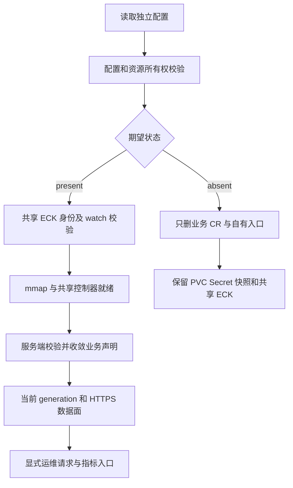

# Elasticsearch 开发手册

面向维护 kubeauto 的开发与发布人员，要求熟悉 Python、Ansible、Kubernetes 声明及 ECK 基本协调机制。目标是能沿配置追踪资源与请求、判断改动影响并完成相应验证；客户安装和业务使用从[用户与运维手册](operations-manual.md)进入。

首次维护按[固定版本](#1-版本源码与维护边界)→[产品入口](#2-产品入口与文件职责)→[配置与幂等](#3-配置与幂等语义)阅读；变更镜像查[六仓制品](#4-六仓制品路径)，变更门禁查[验证证据](#5-专项验证与证据)，日常命令查[维护入口](#6-维护检查入口)。机制与取舍见[技术白皮书](technical-whitepaper.md)。

## 1. 版本、源码与维护边界

本分支使用 ECK 3.5.0、Elasticsearch/Kibana 9.5.6、elasticsearch-py 9.5.1、社区 elasticsearch_exporter v1.11.0 和 Rally 2.13.0。Kubernetes 固定 1.33.6。上游版本兼容只用于确定研究和测试条件；交付资格取决于[专项矩阵](../../../tests/elasticsearch-test-matrix.yaml)及当前制品、业务和清理证据。

| 组件 | 固定来源 | 本项目消费接口 |
| --- | --- | --- |
| ECK | [commit 386c7b14](https://github.com/elastic/cloud-on-k8s/tree/386c7b14f2d1bbb7f2af1e7da997e64875f16e47) | 官方 CRD、Operator 清单、Elasticsearch/Kibana CR、卷与 TLS 协调 |
| Elasticsearch | [commit fd1e8011](https://github.com/elastic/elasticsearch/tree/fd1e8011342a0988e432b999cea4bf884ca120ed) | HTTPS REST、复制与快照语义、内置 S3、插件版本 |
| Kibana | [commit 6b06ce57](https://github.com/elastic/kibana/tree/6b06ce57188008d15d48928b2c828ecceaa7e8fd) | 同版 Kibana CR 与安全状态 |
| Python client | [commit 891a79ae](https://github.com/elastic/elasticsearch-py/tree/891a79aeeff105423915af652b53f09667cf996a) | TLS、连接、Bulk 和请求错误处理 |
| exporter | [v1.11.0](https://github.com/prometheus-community/elasticsearch_exporter/tree/v1.11.0) | `/metrics`、`/healthz`、`es.*` 参数、ES_USERNAME/ES_PASSWORD |
| Rally | [2.13.0](https://github.com/elastic/rally/tree/2.13.0) | Docker `benchmark-only`、本地 track/corpus、结果统计 |

官方解释清晰的机制按[技术白皮书](technical-whitepaper.md)使用；源码检查针对实际集成歧义，例如 PVC 删除策略、Operator watch 范围、探活路径和错误返回。升级必须重新阅读相关发布说明、已知问题、兼容性与安全公告，不把旧版本合同通过当作新版本通过。

滚动官网资料在 2026-11-04 核对，机制研究的文档仓基点为 [elastic/docs-content commit 435c60e5](https://github.com/elastic/docs-content/tree/435c60e5a8e5af1085678ceb3a7765eac949b731)，涉及 API/配置的最终行为再与上表固定实现核对。官网标注 Planned、Preview、Experimental 或商业许可的内容不由版本号自动转为本项目承诺；例如本分支没有把 searchable snapshots、CCR、自动分层/扩缩容或推理服务作为默认交付。文档仓包含多个产品的滚动内容，固定 commit 是来源定位，不表示其中所有内容均适用于 9.5.6。

## 2. 产品入口与文件职责

`conf/config.yml` 定义默认关闭的独立配置前缀；`common/constants.py` 的 `v_business_elasticsearch` 与 EFK 的 `v_elasticsearch` 分开。`service/cluster/manager.py` 只负责将业务版本占位符替换为固定版本。镜像组 `elasticsearch`、`elasticsearch-smartcn` 和 `elasticsearch-qualification` 分别服务正常安装、可选分析器和升级/压测夹具。

`roles/cluster-addon/tasks/elasticsearch.yml` 按校验、所有权、共享 ECK、主机前置、声明收敛、健康、运维请求、监控与网络策略的顺序调用产品辅助程序。`files/elasticsearch.py` 只处理本组件声明和显式请求，不直接编辑 ECK 生成的 StatefulSet。声明以 JSON List 保存到集群私有目录，JSON 是 Kubernetes 支持的清单格式，不再维护一套重复模板。

`files/eck.py` 是两个消费者共用的狭窄前置入口：校验固定官方清单 SHA256，检查唯一控制器、已知所有权、固定镜像和 watch 配置，然后首次安装或同版本复用。复用不反复应用原始上游镜像，不触发 set-image 往返。外来 Operator、版本不符或 watch 不覆盖业务命名空间时拒绝，禁止 `--force-conflicts` 接管。3.4.1→3.5.0 仅由 `eck-platform.yml` 的独立平台任务调用 `eck.py upgrade`，接受显式来源与稳定变更 ID。任务标记 `never,eck-platform`，默认安装和 `--tags elasticsearch` 均不会运行；业务旧升级字段非空会被拒绝。升级绑定全部已验收消费者的 UID、配置摘要，并等待当前代次健康恢复后才完成账本。



主路径在任何资源变更前完成拒绝检查。出现失败时应保留首个错误和渲染输入，再区分配置、制品、主机、Kubernetes/CSI、ECK、ES 数据面及测试门禁。不得为使测试通过而修改已有组件版本或扩大清理范围。

## 3. 配置与幂等语义

常规字段和容量取舍见运维手册。维护实现时须保持：默认 `elasticsearch_install: "no"` 完全惰性；同名外来资源拒绝；同一配置不重建 Secret、替换 PVC 或产生无意义滚动。新增字段必须在写入集群前校验类型、单位和边界，不能把 `bool("false")` 当作关闭。

健康检查同时要求当前 observedGeneration、ECK `phase=Ready`、`ReconciliationComplete=True`、绿色及预期成员数，再通过 HTTPS 核对实际成员版本和数据身份。固定 ECK 3.5.0 的 [`ElasticsearchStatus`](https://github.com/elastic/cloud-on-k8s/blob/386c7b14f2d1bbb7f2af1e7da997e64875f16e47/pkg/apis/elasticsearch/v1/status.go)把 Ready 定义为按期望 spec 运行；[`NewState`](https://github.com/elastic/cloud-on-k8s/blob/386c7b14f2d1bbb7f2af1e7da997e64875f16e47/pkg/controller/elasticsearch/reconcile/state.go)在开始协调时就写入 observedGeneration，因此该字段并非变更完成凭据。同版本镜像或配置滚动时，只看版本、绿色和成员数会接受滚动间隙的旧成员；不要用技术预览的 `inProgressOperations` 代替稳定完成条件。

`health()` 同时收敛 `NAME-identity` ConfigMap，保存 cluster UUID、版本上限、拓扑与 PVC UID，因此它具有写入副作用。调用者必须使用产品的 `kubeauto-elasticsearch` field manager；测试专用 manager 仅管理夹具，不能替产品提交声明或身份账本。Kubernetes 1.33 的 [Server-Side Apply 所有权规则](https://v1-33.docs.kubernetes.io/docs/reference/using-api/server-side-apply/)规定，同值 apply 会形成共有字段，之后任一方改变该值都会冲突；不同 manager 名称本身不构成对象隔离。交接共有字段须先证明保留者已拥有全部字段，再通过原 manager 省略这些字段来放弃所有权，并核对服务端 dry-run、原 UID、resourceVersion 和完整内容；不通过强制覆盖或删除账本绕过冲突。

ECK 的 `nodeSets` 在固定 CRD 中按原子列表管理，不能把列表内某个初始化容器视为独立的 SSA 字段。固定控制器的 [`annotateResource`](https://github.com/elastic/cloud-on-k8s/blob/386c7b14f2d1bbb7f2af1e7da997e64875f16e47/pkg/controller/elasticsearch/elasticsearch_controller.go)会通过完整对象 Update 保存编排提示；其 Go 类型往返可为容器补出空 `resources`，使控制器成为整个列表的字段所有者。本分支显式渲染初始化容器的空资源对象，减少无意义差异。真正改变列表时，先验证只有本产品与固定 ECK 管理 spec，再分别完成普通 SSA 和目标 spec 的服务端 dry-run；随后用测试原 UID、resourceVersion 和完整 spec 的 JSON Patch 原子提交同次配置变化，最后执行普通 SSA 收敛其余声明。补丁保留控制器独有的默认项，移除本产品已管理但现已撤销的可选配置；版本、镜像与节点配置不拆成中间滚动状态。外来字段所有者、并发变化或任一验证失败均停止，不使用 force-conflicts 接管。

候选节点按 Kubernetes 对象名匹配：每个 `nodeSelectorTerms` 项只含一个 `matchFields / metadata.name / In` 单值条件，多项取“或”。Kubernetes 1.33.6 的 [`ValidateNodeFieldSelectorRequirement`](https://github.com/kubernetes/kubernetes/blob/v1.33.6/pkg/apis/core/validation/validation.go)要求此处 `In/NotIn` 恰有一个值，不能套用 label selector 的多值写法。使用对象名还避免将 `metadata.name` 与可能不同的 `kubernetes.io/hostname` 标签混同；后者在 Pod 反亲和性中用于分散宿主故障域。候选名单只限制可放置位置，`nodeSet.count` 才决定成员数，增加备用主机不应隐式扩容。

容量前置会读取选定节点上其他 namespace 的 Pod 请求。`quantity()` 因而需要识别 Kubernetes [1.33.6 Quantity](https://github.com/kubernetes/kubernetes/blob/v1.33.6/staging/src/k8s.io/apimachinery/pkg/api/resource/quantity.go) 与 [suffix 定义](https://github.com/kubernetes/kubernetes/blob/v1.33.6/staging/src/k8s.io/apimachinery/pkg/api/resource/suffix.go)中的十进制、二进制和指数单位，不能只接受本项目配置示例里的 Gi/Mi。该辅助函数用于容量近似比较，不重写 Kubernetes 的定点规范化或调度算法；最终放置仍由调度器和实际资源状态决定。

运维请求放在 `elasticsearch_requests`，每个请求有稳定 DNS 形式 `id`。产品以 ConfigMap 保存非敏感输入指纹和阶段。相同 ID 与不同输入冲突时拒绝；完成的 snapshot/restore 不重复执行。中断的恢复存在结果未知，必须先检查目标数据，不能自动删除目标后重试。声明性 role/user/repository/SLM 请求允许重复收敛，密码始终通过 Secret 引用读取。

请求 ID 最长 40 个字符；它是一次确定输入的身份，不是可以反复改写的备注。ConfigMap 名为 `NAME-request-ID`，绑定配置指纹、ES cluster UUID、phase 和必要 receipt。`complete` 的 snapshot/restore 仍核验快照或恢复索引 UUID；外部删除了快照、替换了索引或切换到别的 ES 数据集群时，不能沿用旧成功记录。成功的一次性请求可在客户变更记录中保留后从当前配置列表移除，避免以后维护时仍要求一个已经按保留策略退役的恢复点存在；不要删除账本来重新使用同一变更身份。

| 请求 type | 消费输入与处理 | 完成或拒绝边界 |
| --- | --- | --- |
| repository | name、HTTPS endpoint、bucket、region、base_path、可选 path_style_access | 注册和 verify；writer 追加有界 analysis，reader 必须 readonly |
| snapshot | repository、snapshot、显式 indices、可选 feature_states/include_global_state | 等到 SUCCESS、非空且无失败分片，记录 snapshot UUID；同名外部快照拒绝 |
| restore | repository、snapshot、显式 indices、可选 feature_states | reader 空目标；等待指定快照的 primary 恢复完成及绿色，记录索引/feature UUID |
| slm | name 及完整 policy | policy 含 schedule、name、repository、config、retention；声明完成不代表计划已执行 |
| role | name、definition | 原生角色 API 收敛，权限定义必须由安全管理员审查 |
| user | name、password_secret、roles | Secret 含 password；密码不进入配置指纹或正常日志 |
| reload-secure-settings | 只有 id/type | 全部预期节点 reload 成功且没有 reload_exception，随后仍须验证 S3 实际操作 |

`indices` 禁止通配符，默认 `feature_states: [none]`；安全状态恢复必须由已实测可认证的 file realm superuser 发起。快照和 SLM 只能由 writer 执行。S3 凭据通过 ECK keystore 注入，endpoint/region/path_style_access 由 repository 非敏感设置消费：固定 9.5.6 的 [`S3ClientSettings.refine`](https://github.com/elastic/elasticsearch/blob/fd1e8011342a0988e432b999cea4bf884ca120ed/modules/repository-s3/src/main/java/org/elasticsearch/repositories/s3/S3ClientSettings.java) 支持从 repository metadata 覆盖这些客户端设置。该行为是需要在升级时重新核对的集成接口，不能仅凭滚动文档中的 `s3.client.default.*` 配置名推断下个版本仍接受 repository 覆盖。JVM truststore 复制发行版的默认 CA 后加入客户 CA，并按内容摘要触发 Pod 更新，避免只让客户端信任私有 S3。

可选布尔配置 `elasticsearch_repository_analysis_copy_during_write_contention` 未声明时为 `true`，资源声明保持上游默认；显式 `false` 才在每个 nodeSet 的原生 config 中增加 `repositories.blobstore.testkit.analyze.copy_during_write_contention: false`。配置通过同一 `elasticsearch_` 前缀输入路径消费，非法值在任何集群变更前拒绝，不从后端名称自动猜测。其适用依据是 [ES 官方 MinIO 测试修复 #135565](https://github.com/elastic/elasticsearch/pull/135565)：MinIO 在上传未完成时复制可能阻塞，官方测试关闭这一争用子探针；本项目实验后端采用相同条件，仍验证仓库分析、快照和独立恢复，不能将此证据外推为后端完整 S3 语义通过。该原生设置已标记 Deprecated，升级时须核对固定版本的 `BlobAnalyzeAction` 与官方 MinIO 测试，不能永久沿用兼容例外。旧默认配置的资源等价性与新分支的失败阻断分别由契约核验；现有现场证据只在冻结来源和未变依赖已证实时复用，兼容分支须另经产品入口验证。

恢复 receipt 的身份核验区分普通索引和系统 feature。普通索引从精确索引的 `_settings` 读取 UUID；系统 feature 从 `/_cluster/state/metadata?filter_path=metadata.indices.*.settings.index.uuid` 读取 UUID 元数据，再严格选取源快照声明的 feature 索引，任何缺项或空 UUID 均拒绝完成。固定版本的 [`IndexNameExpressionResolver`](https://github.com/elastic/elasticsearch/blob/fd1e8011342a0988e432b999cea4bf884ca120ed/server/src/main/java/org/elasticsearch/cluster/metadata/IndexNameExpressionResolver.java) 禁止普通 API 直接访问系统 data stream 的 backing index，file realm superuser 也不豁免；因此不能把 `_settings` 的此类 400 错误解释为需要扩大角色。上述元数据路径依据同版 [`TransportClusterStateAction`](https://github.com/elastic/elasticsearch/blob/fd1e8011342a0988e432b999cea4bf884ca120ed/server/src/main/java/org/elasticsearch/action/admin/cluster/state/TransportClusterStateAction.java) 的无索引选择器读取行为，响应仅保留 UUID，不输出完整集群配置。该内部元数据表示需随版本重新核对；完成账本重入时也使用相同路径检查身份，不能只在首次恢复时核验。

升级前恢复点不能仅凭 snapshot 的 `version` 字符串判断来源程序版本。固定 [`SnapshotInfo.toXContentExternal`](https://github.com/elastic/elasticsearch/blob/fd1e8011342a0988e432b999cea4bf884ca120ed/server/src/main/java/org/elasticsearch/snapshots/SnapshotInfo.java)将 `IndexVersion` 输出为数值 `version_id` 和发行版标签 `version`；多个程序版本可共享索引格式，9.5.5 的实际标签为 `9.5.2-9.5.5`、格式 ID 为 `9111000`。升级门禁分别核对全部三个来源成员的运行版本为 9.5.5、各自 `index_version` 与快照 `version_id` 一致，以及快照 SUCCESS、精确索引、非空 UUID 和全部分片成功。人类可读范围不代替运行版本检查，也不通过解析范围上限推断任意旧版恢复一定兼容；回旧版仍须在独立空目标实际恢复并对账。

固定 9.5.6 镜像中的默认 JVM `cacerts` 权限为 `0444`。S3 初始化容器以非 root 身份运行，必须先在自有临时卷中重新创建默认信任库的工作副本，赋予 `0644` 权限，再导入客户 CA；重试时也须能替换上一轮的只读副本。主容器只读挂载完成后的信任库，不修改镜像中的默认文件，不通过提升容器权限解决可写性。Pod 的 fsGroup 只解决卷的组权限，不会让复制而来的只读文件自动可写。该设计沿用官方[私有 S3 信任库配置](https://www.elastic.co/docs/deploy-manage/tools/snapshot-and-restore/cloud-on-k8s)，同时保留发行版默认 CA；升级固定镜像后须重新核对其文件路径、权限和实际 JVM 连接。

更新凭据、证书和 Secret 内容有各自生效机制：环境变量引用需要受控重启 exporter；ECK 负责证书和 secureSettings 协调；JVM truststore 挂载内容和 JVM 实际采用的信任状态必须分别证明。固定 ECK 3.5.0 的 [`buildAnnotations`](https://github.com/elastic/cloud-on-k8s/blob/386c7b14f2d1bbb7f2af1e7da997e64875f16e47/pkg/controller/elasticsearch/nodespec/podspec.go#L220) 将 `keystoreResources.Hash` 纳入 `config-hash`，secureSettings 内容变化会触发控制器滚动；不能将“无需人工重启”解释为本版本不会滚动，也不能用显式 reload 绕过其完成条件。不能用 Secret 的 resourceVersion 变化代替新连接成功。任何新增轮换入口应覆盖新身份允许、旧身份撤销、错误输入拒绝和恢复。

HTTP 自定义证书恢复为 ECK 默认签发时，渲染器明确输出 `spec.http.tls.certificate.secretName: ""`，保留不可为 null 的 `certificate` 对象。Server-Side Apply 在撤销原先管理的 `secretName` 时，空对象不能保证保留该对象。固定 ECK 3.5.0 的 [`GetSecretFromRef`](https://github.com/elastic/cloud-on-k8s/blob/386c7b14f2d1bbb7f2af1e7da997e64875f16e47/pkg/controller/common/certificates/secret.go#L181) 对空名称返回无自定义证书，HTTP 协调器随后走内部自签名分支。恢复仍须经配置与产品入口收敛，并验证新连接的 CA、服务主机名及原业务数据；确认不再被引用后才能回收自定义证书 Secret。

最小权限身份撤销自己签发的 API key 时，`manage_own_api_key` 的授权检查还要求请求明确归属。固定 9.5.6 的轮换及失败清理均向 `DELETE /_security/api_key` 提交精确 `ids` 与 `owner: true`；只传 ID 会被拒绝，不应通过扩大为 `manage_api_key` 权限修复。依据为官方[撤销 API key 的授权规则](https://www.elastic.co/docs/api/doc/elasticsearch/operation/operation-security-invalidate-api-key)及固定版本的 [`ManageOwnApiKeyClusterPrivilege`](https://github.com/elastic/elasticsearch/blob/fd1e8011342a0988e432b999cea4bf884ca120ed/x-pack/plugin/core/src/main/java/org/elasticsearch/xpack/core/security/authz/privilege/ManageOwnApiKeyClusterPrivilege.java)。密钥 ID 可用于限定撤销范围，密钥原文及 encoded 值不得进入日志或证据。

TLS 负向验证依据异常类型与证书校验原因，不解析异常的显示文字。固定 `elastic-transport 9.4.2` 的 [`Transport.perform_request`](https://github.com/elastic/elastic-transport-python/blob/v9.4.2/elastic_transport/_transport.py) 在零重试退出时会清空 `errors`，外层 `TlsError` 因而可能只显示 `TLS error`；原始异常链仍保留证书验证原因。门禁要求该链包含 Python 的 `SSLCertVerificationError` 或 urllib3 的主机名 `CertificateError`，DNS 失败、连接拒绝和缺少证书校验原因的 TLS 握手失败均不算通过。客户端首失败日志只输出异常类型、脚本函数/行号和原因类型链，不输出响应正文、异常原文或局部变量。

业务与 EFK 的预检还核对 namespace 所有权及实际 S3 access key；复制相同账号到另一名称的 Secret 不能建立隔离。EFK 的固定备份树 `elasticsearch/logging` 对业务写入与恢复保留。业务仓库写入归属使用平台 ConfigMap 和 Kubernetes create/replace 的资源版本条件更新；冲突或不确定错误保留归属，不先写 S3 再补账本，不随业务卸载释放旧备份。产品卸载向 API server 提交 UID/resourceVersion 删除前置条件，资源在检查后被替换时拒绝删除。上述检查不授予或替代 Kubernetes RBAC、对象存储 IAM；拥有管理权限的直接 API 操作仍属于平台权限边界。

## 4. 六仓制品路径

本分支实际影响主仓和 `kubeauto-ext-images-dockerfile`。产品打包、Kubernetes 二进制、ext-bin 和 sp1 只做兼容审计，不因新增中间件而重建无关制品。运行镜像保留已交付 EFK 9.5.1，并新增业务 9.5.6 和升级来源 9.5.5。

| 用途 | 固定交付 tag |
| --- | --- |
| 控制器 | `eck-operator:3.5.0`；升级来源 `3.4.1` |
| ES/Kibana | `elasticsearch:9.5.6`、`kibana:9.5.6`；升级来源 `9.5.5` |
| 分词插件 | `elasticsearch-smartcn:9.5.6-kubeauto.1` |
| 指标 | `elasticsearch-exporter:v1.11.0` |
| 业务客户端 | `elasticsearch-client:9.5.1-kubeauto.1` |
| 离线压测 | `elasticsearch-rally:2.13.0-kubeauto.1` |

Dockerfile 位于外部镜像仓的 `middleware/elasticsearch/`，由唯一 `catalog.json` 注册，使用官方上游。客户端固定 Python patch、全部依赖版本与 SHA256；Rally 将本地 track、mapping、语料和 SHA256SUMS 固化在镜像中。SmartCN 在构建期由同版官方插件安装器获取并校验，运行时不联网下载插件。

Rally 2.13.0 的报告选项是 `--show-in-report=all-percentiles`，含义是展示实际可用指标的全部支持分位；不是请求任意百分位，也不保证输出 P95。维护调用时对照固定版本的[命令行参考](https://esrally.readthedocs.io/en/2.13.0/command_line_reference.html#show-in-report)，并用原镜像的参数解析器及真实调用合同验证 argv。认证只通过权限受控的临时 client-options 文件传入，成功或失败均回收，不把密码放入命令行；Rally 的分位与独立客户端的分位分别保留负载和统计口径。

常规下载顺序为 TalkEdu、Docker Hub 与已知官方回退，工作负载消费项目本地 Registry 的固定 tag。自定义客户端/插件/压测镜像没有可以随意替换的上游等价品，不把其 tag 映射给不同镜像。制品必须完成两端 AMD64/ARM64 manifest/digest 核验；下载失败不得输出成功。临时网络代理只作为非持久化运行参数，不能写进默认配置、Dockerfile 或客户文档。

## 5. 专项验证与证据

矩阵记录每项能力、官方依据、产品入口、成功标志、最小反证、夹具与清理范围。`pending` 不属于通过。静态门禁包括 YAML/Python、官方 CRD schema、资源名称/namespace、所有权、版本、错误路径及模块交接。测试门禁改动先完成精确原因合同，再运行最窄固定分支；相关模块通过后才能做一次完整干净回归。

生产行为通过 `config.yml` 和 `kubecli` 验证。kubectl、直接 API、SSH 和客户端可以作为断言、夹具或诊断，不能代替配置入口收敛。故障验证使用确认写入账本；备份验证读取可恢复快照并在独立目标对账；扩容验证实际文件系统与业务结果；指标验证真实 Prometheus target、告警触发/恢复和缺失采样。

确认写入与搜索可见性必须在门禁中分别建立。`_mget` 可以实时读到刚确认的文档，`_count` 却仍使用上次 refresh 的搜索视图；固定版本的 [`RestCountAction`](https://github.com/elastic/elasticsearch/blob/fd1e8011342a0988e432b999cea4bf884ca120ed/server/src/main/java/org/elasticsearch/rest/action/search/RestCountAction.java)通过 SearchRequest 计算计数。需要立即对账的灾备探针写入及回切重放显式采用 `refresh=wait_for`，目标恢复校验则保留已有显式 refresh，不以固定 sleep 掩盖竞态，也不修改产品默认刷新策略。写隔离前中断，或隔离过程中失败但源已完整恢复时，只有源 CR/确认账本保持、目标 UUID 相同且无业务索引、两端健康、没有故障和路由残留，才允许复用准备好的空目标；仅允许 `before-isolation` 和 `source-isolating` 两个尚未恢复目标的阶段；原中断记录及时间原样归档。续跑以原 ID、相同内容和 sequence number/primary term 条件重新确认一次真实写入，使用该次确认测量 RPO，不能补造时间或删除健康平台来重试。

升级夹具的确认账本绑定一代索引 UUID。只有该代业务经产品入口退役、namespace 和卷均完成限定回收后，才删除对应拓扑的旧账本；下一代重新建账，不把旧 UUID 改成新值来接受替换。回收失败保留账本。退役前核对活动配置与实际 CR 的版本一致，并把当前版本交给原生卸载；安装时保存的旧版本不能覆盖升级后的版本，因为卸载前置仍执行降级保护。准备旧控制器时，零消费者且所有权、固定旧版 CRD schema、watch 和镜像全部匹配的 ECK 3.4.1 可以复用；只等待原控制器就绪，不重复安装或先换成新版再重建。未知来源和不匹配输入仍须拒绝，不能把恢复测试夹具的权限扩展为客户控制器降级能力。

故障负载的写入准入使用 `wait_for_active_shards=all`，因此成员恢复期间可以暂时拒绝新写入。客户端对单条稳定 ID 保留最多 300 秒、40 次尝试的双重上限，重试间隔指数增长且最多 4 秒，单次连接仍受客户端超时约束；期限到达后不再发起新尝试，已经发出的请求最多延续其单次超时。完整分片确认、分片响应不完整、连接结果未知、拒绝/冲突、读回确认和重试分别计数。固定 9.5.6 的 [`IndexResponse.status`](https://github.com/elastic/elasticsearch/blob/fd1e8011342a0988e432b999cea4bf884ca120ed/server/src/main/java/org/elasticsearch/action/index/IndexResponse.java)对新建文档返回 201，HTTP 状态不能代替分片检查；不完整响应须核对稳定 ID 的精确内容，不记为完整分片确认。读回也不能单独证明持久性：最终还须等待副本绿色、refresh 后对完整 ID/内容/数量对账，并核对原业务账本。30 分钟观察窗口保持独立，不因重试预算增加而缩短。

故障恢复保留原控制器 UID 和故障 journal，先还原 Elasticsearch 组的期望副本数，再恢复原共享 Operator，最后检查各组真实 Ready 副本数和业务账本；不得在 Operator 暂停时先等待全部 ES 成员 Ready。退出钩子登记的重启记录需要 Operator 协调清理，见白皮书的[故障域与就绪机制](technical-whitepaper.md#4-仲裁拓扑与故障域)。ECK 管理的 StatefulSet 使用 `OnDelete`，固定 Kubernetes 1.33.6 的 [`StatefulSetStatusViewer.Status`](https://github.com/kubernetes/kubernetes/blob/v1.33.6/staging/src/k8s.io/kubectl/pkg/polymorphichelpers/rollout_status.go)会拒绝对其执行 `rollout status`；恢复门禁应等待实际副本就绪、复核原 UID 与期望副本数，再回收对应 journal。恢复失败保留记录，不能把失败父运行改签为成功。

异步 reindex 是一个需要按版本核对的例子：滚动官方文档在 9.5+ 推荐专用 reindex 管理 API，而本分支 helper 使用 `GET /_tasks/{task_id}`。固定 9.5.6 的 [`AbstractBaseReindexRestHandler`](https://github.com/elastic/elasticsearch/blob/fd1e8011342a0988e432b999cea4bf884ca120ed/modules/reindex/src/main/java/org/elasticsearch/reindex/AbstractBaseReindexRestHandler.java) 仍为异步请求设置结果持久化并返回 task ID；[`TransportGetTaskAction`](https://github.com/elastic/elasticsearch/blob/fd1e8011342a0988e432b999cea4bf884ca120ed/server/src/main/java/org/elasticsearch/action/admin/cluster/node/tasks/get/TransportGetTaskAction.java) 明确保留 reindex 任务与迁移后的兼容查询。因此当前 helper 可以沿用该接口；升级时应重新核对，而不是仅凭旧示例或新文档目录推断接口已经失效。完成断言仍须检查 error、failures、数量及目标内容，不把任务完成等同于完整复制。

监控集成通过已有 `config.yml + kubecli setup 07` 安装产品 Prometheus 与 local-path 夹具，复用已经验证且持有租约的 CSI；该次监控调用暂时不重复收敛存储，并在成功或异常后恢复原存储开关。`ansible-runner` 将配置文件作为 extra vars 传入，不能假定附加命令行 `-e` 会覆盖它。exporter v1.11.0 的[启动入口](https://github.com/prometheus-community/elasticsearch_exporter/blob/v1.11.0/main.go)使用 kingpin v2.4.0；布尔参数按其[负形式语法](https://github.com/alecthomas/kingpin/blob/v2.4.0/README.md#boolean-values)写作 `--no-es.aliases`，不能使用会被该版本解析器拒绝的 `--es.aliases=false`。local-path 产品模板位于 `kube-system`，只有实际新建的 `monitor` 命名空间进入自有工作负载回收账本，不能把平台命名空间纳入删除范围。

共享 ECK 及日志清理变更影响既有 logging 分支，须完成该分支合同、聚焦验证和完整干净回归，包括 Loki；不重跑无关 Kafka/核心能力。资源租约必须覆盖所有测试与灾备目标，不能借用未声明的现存集群。正常、失败和中断均要回收本场景对象与故障；默认产品卸载保护客户 PVC/Secret，实验室最终回收则依照已验证的所有权和租约执行。

共存门禁的附加组件安装同样复用已验收且健康的 CSI。调用无 tags 的产品 setup 前，在本次配置中暂时关闭 Longhorn 重入，保留其现有实例和业务 PVC；成功或异常后恢复原存储配置。合同须沿真实配置文件与 Ansible 条件证明调用时不会进入存储安装，并覆盖异常恢复，不能只模拟成功 marker。这是测试调用范围控制，不改变客户存储默认值，也不替代共存后的业务、卷、凭据与共享 ECK 身份复验。

资源所有权检查若消费 `metadata.managedFields`，必须显式使用 `kubectl get --show-managed-fields=true`。固定 Kubernetes 1.33.6 的 [`JSONYamlPrintFlags.ToPrinter`](https://github.com/kubernetes/kubernetes/blob/v1.33.6/staging/src/k8s.io/cli-runtime/pkg/genericclioptions/json_yaml_flags.go)默认用 `OmitManagedFieldsPrinter` 隐藏这些字段；普通 JSON 输出中缺失它们不能证明资源没有产品 field manager。共存退役仍须同时核对标签和 manager，并以 UID/resourceVersion 前置条件提交原生删除。保留共存夹具时，固定入口先核对原 namespace、PVC、凭据、共享 Operator、哨兵与快照及两套业务账本，仅补反向退役与重入；这条修复分支不输出矩阵项成功标志，不将失败父运行补签为完整共存 PASS。

初次安装和修复重入共用完整 EFK 配置准备函数，不能只恢复 `logging_install` 开关。合同逐条执行实际 logging 任务的前置断言，覆盖路由、节点、容量、TLS、快照及监控输入。两个 EFK CR 都已退役时，先核对保留对象与独立快照，再直接进入产品重入；只有一个 CR 缺失时拒绝自动续跑，保留现场供限定恢复。

客户端中断清理的前置是自有 Job 的 `client` 容器实际进入 running，且日志出现启动标志。Job 的 `status.active` 包括尚未启动的 Pod，不能据此读取日志或宣布已经中断运行中的业务。固定 Kubernetes 1.33.6 的 [`ContainerState`](https://github.com/kubernetes/kubernetes/blob/v1.33.6/staging/src/k8s.io/api/core/v1/types.go)区分 waiting、running 与 terminated；门禁在原有超时内等待真实状态，不将 ContainerCreating 当作产品失败，也不吞掉启动后的日志错误。

证据需绑定输入身份、原始日志摘要、durable rc=0、零失败标志、业务标志和限定清理。完整交付还要求最终 `LAB_CLEAN_VERIFY_PASS`。官方 GA、部分场景、阶段进度和文档检查分别表述，不代替 100% 专项验收，也不代替客户签收。

## 6. 维护检查入口

在已安装项目依赖的开发环境、仓库根目录执行以下只读合同命令；它们不操作实验室。失败时停止现场门禁，保留日志并修正具体原因。完整单测为固定入口，聚焦命令用于开发期间缩小反馈范围。

```bash
set -euo pipefail
bash tests/run_unit_tests.sh
.venv/bin/python -m unittest tests.unit.test_elasticsearch_delivery -v
bash -n tests/helpers/logging-cleanup.sh
git diff --check
```

产品升级前盘点全局 CRD 消费者、运行与恢复版本、镜像摘要、快照兼容性及回退目标；修改哪个依赖就重验其实际受影响能力。不得以整批重测掩盖未完成的根因分析，也不得把前一次失败运行的残留当作新基线。
