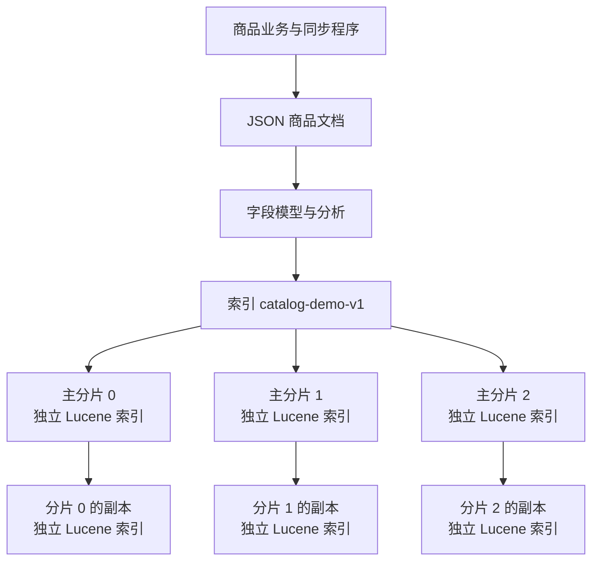
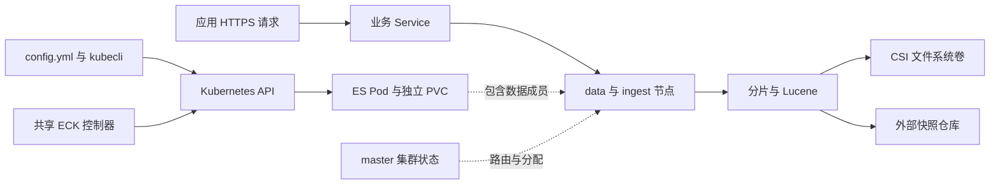
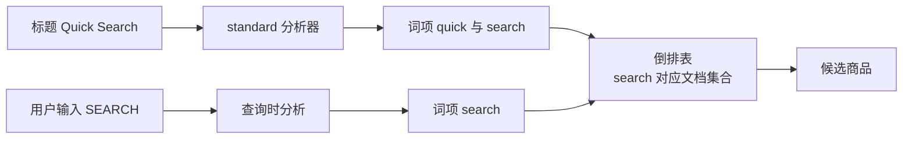
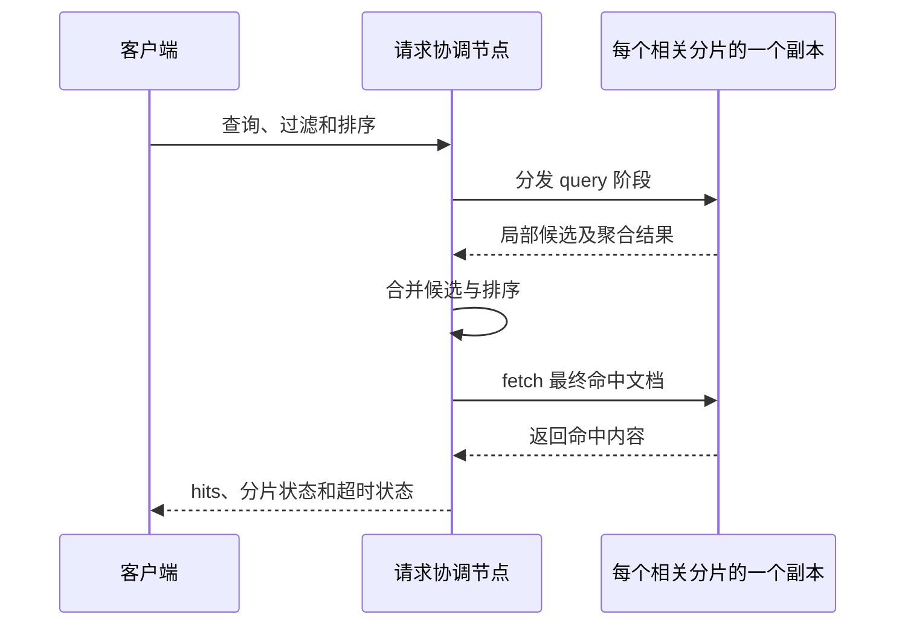
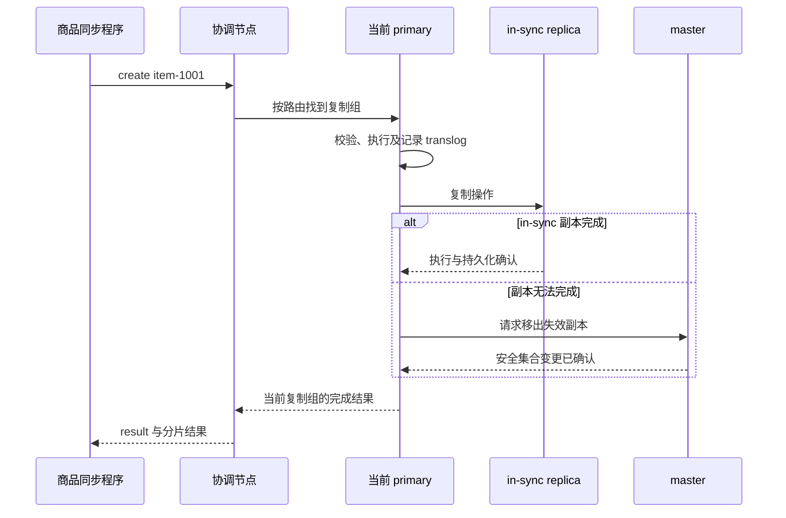
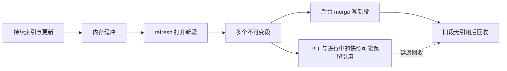
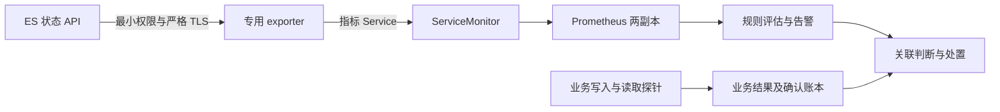
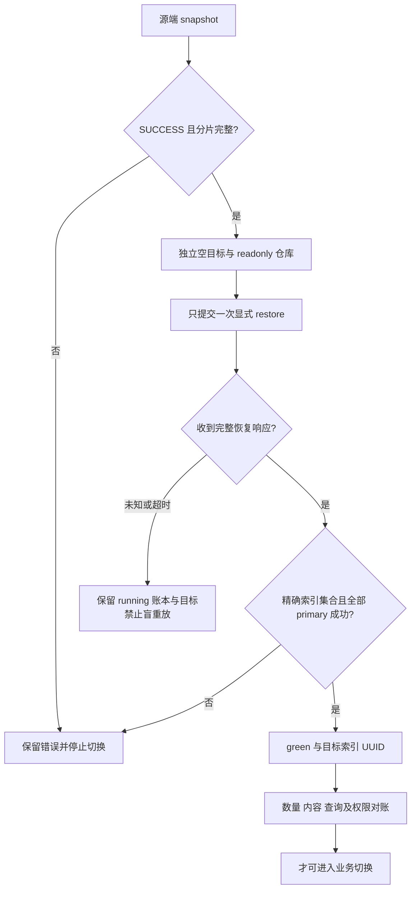
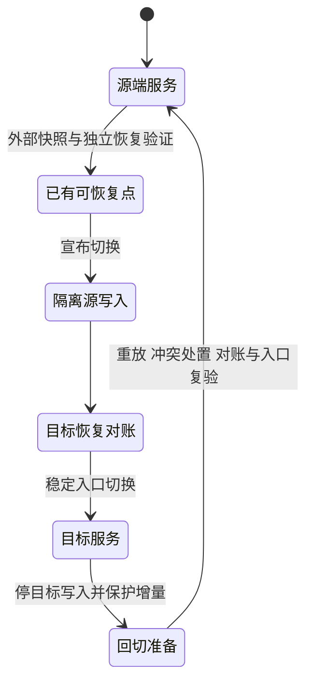

# Elasticsearch 技术白皮书

本白皮书面向架构师、搜索业务开发者和平台运维人员。适用版本为 Elasticsearch/Kibana **9.5.6**、ECK **3.5.0**、Kubernetes **1.33.6**，运行默认发行版，以 Basic 为许可基线。阅读后应能解释一条商品记录如何成为搜索结果、写入何时算确认、故障后哪些数据可以恢复，并据此选择拓扑、容量和保护方式。

建议先沿第 1–3 章理解对象、检索和写入，再读第 4–5 章决定部署与容量，第 6–8 章用于安全、灾备和生命周期决策。安装、业务示例和生产任务见[用户与运维手册](operations-manual.md)；实现与扩展见[开发手册](development-manual.md)。图中数据如未标为实测，均用于解释机制。

## 1. 产品边界与技术体系

### 1.1 从业务记录到搜索服务

商品库可以用业务数据库保存交易事实，用 Elasticsearch 保存面向检索的数据投影。例如商品 `item-1001` 的标题是“可靠的全文检索”，类别为 `books`，价格为 `79.0`。业务希望按标题找相关商品、限制类别、按价格排序并统计类别分布。这些访问方式需要不同的数据结构，不能把 ES 理解成一个只保存 JSON 的远程文件夹。

| 对象 | 商品检索中的含义 | 它决定什么 |
| --- | --- | --- |
| document（文档） | 一条 JSON 商品记录，`_id=item-1001` | 单文档读写身份；不是跨文档事务 |
| mapping（字段模型） | `title:text`、`category:keyword`、`price:double` | 分析、检索、排序和聚合所需结构 |
| index（索引） | `catalog-demo-v1` 这一组同模型文档 | 设置、分片、授权与生命周期边界 |
| primary shard（主分片） | 索引的一部分数据及其写入权威副本 | 路由、写入、恢复和并行度 |
| replica shard（副本分片） | 某个 primary 的另一份完整副本 | 数据冗余及可选读取位置 |
| node（节点） | 一个 ES 进程，本项目由一个 Pod 承载 | 承载分片、协调请求或维护集群状态 |
| cluster（集群） | 具有独立 UUID、状态和选主过程的 ES 成员集合 | 一套数据与管理权威；不是 Kubernetes 集群的同义词 |

一个索引声明三个 primary、一个 replica 时，共有六份分片副本；不是六个 primary，也不要求恰好六个 ES 进程。一个数据节点可以承载多个不同分片，但同一分片的 primary 与 replica 不应放在同一节点。增加 data 节点会提供放置和执行资源，已有索引的 primary 数不会因此自动增加。

图中的每个主分片分别处理自己的操作；索引没有把三组写入包成一个事务。业务数据库与 ES 的双写也不是一个事务。需要可靠投影时，应由应用采用可追踪的事件或变更记录，以稳定业务 ID、顺序控制、重试及对账推进；本项目交付 ES 平台，不提供通用 CDC、跨库事务或自动业务同步服务。删除、重放和更新顺序必须纳入应用设计。

### 1.2 哪一层负责什么

理解一次失败，先区分数据服务与承载它的平台：

Kubernetes 负责调度、网络、Secret 与卷挂载；CSI 负责存储生命周期；ECK 根据 ES/Kibana CR 协调节点、证书和滚动变更；Elasticsearch 自己完成选主、复制、检索和分片恢复。正常业务请求经过 Service 到 ES，不经过 ECK 转发。Operator 暂停时，已经运行的集群可能仍可读写，但节点重建、证书变更和完整协调会受阻。

本项目的业务 Service 只选择 data 成员，专用 master 不承接普通业务流量。任一收到请求的 ES 节点都可以承担该请求的协调角色；专用 coordinating 节点不是使用协调过程的前提，本分支也没有单独交付这种拓扑。

### 1.3 交付范围与官方能力的关系

本分支交付两种拓扑、HTTPS 与独立身份、业务索引/API 使用、监控、安全轮换、扩容、显式快照/SLM、普通索引及 security/Kibana 状态恢复、固定版本升级和 EFK 共存。最终干净完整回归已覆盖这些项目集成，结果与条件见各章及[专项矩阵](../../../tests/elasticsearch-test-matrix.yaml)。这不等于所有上游功能、所有 CSI 或任意规模已验收。

默认发行版遵循 Elastic License 2.0，Basic 不等于全部功能免费或整个镜像采用 Apache 2.0。Enterprise trial 不会自动启用。商业身份集成、CCR、searchable snapshots、自动冷热分层、自动扩缩容及向量/推理平台均不因上游存在而成为本项目已交付能力；采用它们须另核对许可、实现和验收范围。EFK 保持其既有独立版本，不被业务 ES 的版本字段联动升级。

依据：[节点与分片](https://www.elastic.co/docs/deploy-manage/distributed-architecture/clusters-nodes-shards)、[生产指导](https://www.elastic.co/docs/deploy-manage/production-guidance)、[许可说明](https://www.elastic.co/pricing/faq)。版本及源码基点集中在[开发手册第 1 章](development-manual.md#1-版本源码与维护边界)。

## 2. 文档、分析器与检索

### 2.1 同一份 JSON 为什么要多种索引结构

`_source` 保存文档的来源内容，供返回内容、更新或 reindex 等任务使用；搜索通常不逐条扫描 `_source`。全文倒排结构沿“词项 → 含词文档”寻找候选；doc values 沿“文档 → 字段值”支持排序和聚合。数值与日期还具有适合范围检索的索引结构。保存源内容与建立检索结构是不同成本。

| 字段与示例 | 推荐模型及用途 | 常见误用及后果 |
| --- | --- | --- |
| `product_id=item-1001` | keyword；精确标识、过滤、稳定次级排序 | 把业务 ID 分词会改变精确匹配语义；`_id` 不直接代替可排序字段 |
| `title=可靠的全文检索` | text；经 analyzer 做全文匹配 | term 查询不分析输入，直接查询整句通常不是预期全文效果 |
| `category=books` | keyword；term 过滤、terms 聚合 | 使用已分词 text 分组会得到词项语义；开启 fielddata 还会增加堆压力 |
| `price=79.0` | 本例 double；数值过滤与排序 | 字符串按字典序排序；真实金额宜评估整数最小货币单位或 scaled_float |

若一个标题既要全文检索又要按完整标题分组，可设计 text 与 keyword multi-field。同一源值由两种模型分别建立结构，不是查询时临时转换；后来才增加 multi-field，旧文档不会自动得到该子字段的历史索引内容，需要更新或 reindex 补齐。字段类型和索引分析器的实质变化通常走新索引迁移，不能把 mapping 当成能随时任意改写的关系表定义。

本例采用 `dynamic: strict`，新字段拼写错误会被拒绝，避免在数据量增长时悄悄产生大量字段。它不等于 JSON Schema：缺少业务必填字段、跨字段规则和金额精度仍须由应用检查。动态 mapping 可减少探索成本，但大量不受控 key 会扩大集群状态和内存负担，不能把每个业务 ID 作为字段名。

数组也影响正确性。若商品规格是 `[{color:red,size:S},{color:blue,size:L}]`，普通 object 数组会丢失同一数组元素内的关联，查询 `red AND L` 可能误命中。确需保留组合关联时可评估 nested，它把子对象作为隐藏 Lucene 文档索引，并要求 nested 查询/聚合；代价是更多文档和计算。该例解释官方建模机制，不代表项目对复杂 nested 工作负载已有性能验收。

### 2.2 分词不是模糊匹配开关

分析器由零到多个字符过滤器、一个 tokenizer、零到多个 token filter 组成。字符过滤器先处理原字符，tokenizer 产生词项和位置等信息，token filter 再归一化或处理词项。索引时产生什么词、搜索时如何分析输入，决定能否相遇。

这是英文机制示意：大小写归一后能匹配，并不表示任意同义词、拼写错误或中文词语都自动理解。`match` 使用字段分析器处理查询；`term` 查精确索引词项，适合本例 category。中文应先观察 `_analyze` 的 token，再用真实业务标注的查询判断召回率和排序；“包含中文”不等于已经获得符合领域语义的分词。

本项目默认使用内置分析器，SmartCN 是同版固定镜像中的可选官方插件。选择插件应基于词项和搜索质量，而不是仅看安装成功；切换插件镜像还会滚动成员。已有 title 字段不会因插件可用而自动重建，要以新模型 reindex 并对账后切换。IK 等第三方插件不属于默认交付。

### 2.3 从匹配到排序：每个查询条件承担不同职责

商品查询把标题 `match` 放在 `bool.must`，类别 `term` 放在 `bool.filter`。前者回答“有多相关”，后者回答“是否符合必须条件”。默认 BM25 评分综合词项稀有程度、出现频次及字段长度：罕见且匹配的词通常更有区分力，重复次数的收益会饱和，长文本也不会仅凭堆词无限获利。分数是这次查询下的相对相关性，不是跨查询通用的置信度。

运维手册的示例显式按 `price`、`product_id` 排序，因此展示的是满足全文条件的价格顺序，不是相关性从高到低。需要相关性排序时应明确排序策略及并列键，并用真实用户查询评估；不要只改 boost 就宣布搜索质量改善。filter 不参与评分，适合状态、类别、时间和授权范围的硬条件；它可能受益于缓存，但不能承诺任意过滤都命中缓存。

类别 terms 聚合统计的是本次查询范围中的桶。小而固定的测试类别可以精确核对；大量分布式高基数字段的 top terms 可能带截断或误差，不能把默认少量桶当成全量精确分类账。需要完整桶遍历时另评估 composite 等官方接口及其游标语义。金额对账还要考虑浮点精度；搜索聚合不承担交易数据库的跨文档事务职责。

### 2.4 跨分片搜索与稳定分页

一次普通搜索从每组相关分片选一个活跃副本执行，默认会依据历史响应、执行时间与队列自适应选择。replica 增加可选读取位置，但不会把同一分片的所有副本结果重复累加。没有 routing 的索引搜索通常要访问该索引全部相关分片；自定义 routing 能缩小范围，但读写规则必须一致，大租户仍可能造成热点。

深分页 `from=10000,size=20` 会让各分片保留前面页面所需候选，协调和堆开销随之增长。持续遍历宜使用 PIT（point in time，固定搜索视图）与 `search_after`：保持相同 query/sort，把上页末条完整 sort 数组传给下一页，并使用响应中的最新 PIT ID。完成或失败后关闭 PIT，避免旧段长期保留。PIT 不是外部备份，也不是节点数据丢失后仍可重建的恢复点。

HTTP 200 不保证完整结果。要求完整对账时，调用设置 `allow_partial_search_results=false`，并检查 `timed_out=false`、`_shards.failed=0`；大量命中的 total 还须检查 `relation=eq` 或显式要求精确统计。局部 shard 失败、任务超时和无命中是三种不同结果，不能统一展示为“没有商品”。

**项目验证。** 两拓扑分别用 100 条固定 ID、strict mapping、三个 primary 和一个 replica 验证 Bulk create、全文叠加过滤、排序和聚合：过滤结果 50 条，两类别各 50 条，价格总和 4950；reindex 后 100 条内容一致，alias 切换仍可读。这说明上述基础接口在本项目路径中成立，不证明任意分词质量、nested 性能或迁移中的增量已自动捕获。完整操作见[业务建模与客户端](operations-manual.md#6-业务建模与客户端)。

依据：[mapping](https://www.elastic.co/docs/manage-data/data-store/mapping)、[分析器组成](https://www.elastic.co/docs/manage-data/data-store/text-analysis/anatomy-of-an-analyzer)、[doc values](https://www.elastic.co/docs/reference/elasticsearch/mapping-reference/doc-values)、[BM25](https://www.elastic.co/docs/reference/elasticsearch/index-settings/similarity)、[nested](https://www.elastic.co/docs/reference/elasticsearch/mapping-reference/nested)、[查询与过滤](https://www.elastic.co/docs/reference/query-languages/query-dsl/query-filter-context)、[分页](https://www.elastic.co/docs/reference/elasticsearch/rest-apis/paginate-search-results)。仅采用适用的稳定机制，不采用滚动资料中的 Planned/Preview 配置。

## 3. 写入、复制与四个时间边界

### 3.1 一条写入如何得到确认

协调节点根据 `_id` 或显式 routing 确定复制组，把操作交给当前 primary。primary 检查模型、执行索引操作，再向当前 in-sync 副本复制。in-sync 集合由 master 维护，表示应包含所有已确认操作的安全副本；它不是静态地等于配置中的 replica 数。

图中正常副本确认与失效副本移除是两种路径。某个副本失联时，primary 不能自行忽略它返回成功，必须先让 master 确认安全集合的变更。primary term 区分任期，sequence number 标记操作；被替换的旧 primary 的复制会被新任期副本拒绝。客户端仍须检查结果、分片确认和错误，不能从一次成功响应推导永远有固定数量的物理副本。

`wait_for_active_shards=all` 是开始操作前要求全部配置副本活跃的准入条件；运行中副本仍可能变化。只剩唯一有效 primary 时，系统可能继续写入，但唯一数据副本的物理损坏仍会丢数据。master 的多数派、副本复制、卷持久化和外部快照防护的是不同故障。

### 3.2 确认、搜索可见、Lucene 提交与外部备份

| 边界 | 发生了什么 | 可以据此判断什么 | 仍不能保证什么 |
| --- | --- | --- | --- |
| 写入确认 | 操作按当时复制组处理；默认 request durability 完成相应 translog fsync | 收到且核验响应的这次操作已确认 | 立即被搜索命中、进入外部备份或底层硬件绝不丢写 |
| refresh | 打开包含新操作的 Lucene 搜索视图 | 搜索可以看到这些操作 | 完成 Lucene commit 或形成独立备份 |
| flush | 完成 Lucene commit 并开始新的 translog 代次 | 崩溃恢复所需重放范围推进 | 异地可恢复或跨分片事务一致 |
| snapshot | 保存可恢复段及所选元数据到仓库 | 指定恢复点可进入独立恢复验证 | 包含之后写入、任意时间点恢复或跨 shard 同一瞬间 |

Lucene commit 比每条操作的 translog 记录昂贵，因此 ES 在提交之间依靠 translog 重放恢复；refresh 可以先打开文件系统缓存中的新段，使其可搜索，而不要求每次完整 commit。默认 `index.translog.durability=request` 保留持久化确认；改为 async 会改变崩溃丢写窗口，不能作为无代价提速。

按 ID 的 GET 默认可实时读取，而 search/count 依赖 refresh。因而“写入成功、GET 找到、count 暂为零”可以是正常近实时行为。需要写后搜索的任务使用 `refresh=wait_for`，不要对每条写入强制 refresh 制造大量小段。并发读取甚至可能看到尚未确认的操作；业务提交账本应记录成功响应，不能用搜索命中补造确认。

### 3.3 超时与重试必须保持业务身份

Bulk 请求的 HTTP 200 不代表每项成功；必须逐 item 检查状态、错误与分片，保留原 ID，只重试允许重试的失败项。`create` 拒绝已存在 ID，`index` 可覆盖，`update` 中脚本累加等动作可能重复生效，三者不能采用同一个盲重试规则。

连接超时可能发生在服务端已提交之后，此时是“结果未知”。固定 ID 读回并核对内容可以判断是否已执行；同 ID 内容不同不能当作成功去重。需要并发更新时，先读取 `_seq_no`、`_primary_term`，再携带二者条件写入；409 表示期间已有变化，应按业务规则重新读取、合并或拒绝，并非应该无限重试的暂时故障。ES 不提供跨多文档的通用 ACID 事务。

429 也须分类：过载拒绝应限流、指数退避并加抖动；flood-stage 的 `cluster_block_exception` 应先恢复真实磁盘余量。认证、权限和模型错误应修输入，不交给无限重试。应用需要操作截止时间、最大尝试次数、结果未知队列和可对账的业务记录。

**项目验证。** 关闭自动 refresh 后，已确认文档 GET 可读、搜索计数为 0，显式 refresh 后为 1；旧条件更新和重复 create 返回 409。客户端夹具还验证两次注入 429 后成功、真实 create 成功后丢弃响应再按 ID 确认；前者不是服务端过载实测，后者不是物理断网实测。实际 primary 故障负载的响应与重试统计另见第 8 章。

依据：[复制模型](https://www.elastic.co/docs/deploy-manage/distributed-architecture/reading-and-writing-documents)、[translog](https://www.elastic.co/docs/reference/elasticsearch/index-settings/translog)、[近实时搜索](https://www.elastic.co/docs/manage-data/data-store/near-real-time-search)、[乐观并发](https://www.elastic.co/docs/reference/elasticsearch/rest-apis/optimistic-concurrency-control)。

## 4. 仲裁、拓扑与故障域

### 4.1 选主与数据可用性分别判断

master 保存集群元数据、投票配置和分片分配状态，不保存所有业务文档。多数派用于选主和提交集群状态；三个投票成员通常可以容忍一个不可用，失去多数派时不能安全完成依赖新状态的动作。某组数据分片是否可读写，还要看有效分片副本，不能从 master 正常直接推断业务数据齐全。

| 形态 | 本项目结构 | 适合条件 | 成本与边界 |
| --- | --- | --- | --- |
| standard | 3 专用 master，至少 3 data/ingest，宿主集合分开 | 需要数据层独立扩展、降低业务负载对选主的干扰 | 更多实例与资源；数据层仍需副本及 N−1 预算 |
| compact | 3 master/data/ingest 混合成员 | 已评估规模的小型业务 | 业务 GC、合并和选主共用进程；成员数固定为 3 |

两种形态均要求三个独立节点故障域，不交付单、双节点生产形态。节点名不同不等于机架、电源和可用区独立。客户应将实际基础设施故障域与调度、存储副本设计对齐，不跨高延迟链路随意拼接一个集群。

### 4.2 额外候选宿主为何必要

`elasticsearch_data_count` 决定实际 ES 数据成员数，`elasticsearch_data_nodes` 决定可调度的候选宿主。三个成员、三个候选宿主时，严格反亲和不允许故障成员挤到另外两台；三个成员、四个合格候选宿主才能保留一个迁移位置。备用宿主必须有真实 allocatable、存储连接、内核和污点资格，不只是名单中多一个名称。

CSI 跨节点重挂要求旧实例已安全停止写入、原附件释放、目标可访问存储并有容量。NotReady、SSH 不通或控制机看不到旧节点，都不是旧实例停止写入的证明。没有 fencing 证明时不能强删旧 Pod、强拆附件或强制空 primary。PDB 只控制自愿驱逐，不能阻止断电；反亲和也不能代替存储隔离。

### 4.3 健康状态如何解释

| 观察 | 能说明什么 | 仍需核对 |
| --- | --- | --- |
| Pod Running/Ready | 进程与探针达到相应条件 | 当前配置、成员身份、分片与业务 |
| green | 全部配置 primary/replica 已分配 | 当前代次、真实数据、查询、外部恢复点 |
| yellow | primary 全部分配，存在未分配 replica | 恢复中还是长期容量/故障域不足 |
| red | 至少一个 primary 未分配 | 受影响索引、有效副本和恢复路径；停止依赖完整数据的变更 |
| observedGeneration 已更新 | ECK 已观察输入 | `phase=Ready`、`ReconciliationComplete=True` 与实际成员状态 |

ECK 退出钩子会登记节点重启，原节点重新加入后仍可能存在 RESTART 记录。固定 ES 的 readiness 服务会据此关闭就绪端口，ECK 负责清理已完成的重启记录。因此暂停 Operator 后不能先要求所有节点 Ready，再恢复 Operator。看到 green 但个别成员不 Ready，应检查退出记录及控制器协调，不能改探针掩盖问题。

**项目验证。** 最终回归覆盖两拓扑的 primary Pod 重建、Operator 暂停恢复、数据宿主隔离迁移、多数派丢失和 standard 全部 data 不可用。各拓扑以 32 条确认数据作故障前后对账；多数派丢失返回明确 503/cluster block，数据层丢失返回 unavailable shards，恢复后被拒绝的 ID 未出现，原账本保持。宿主迁移使用 guest runtime 隔离，核对旧进程停止后才退役旧 Pod，原 PVC/PV/原生卷身份保持；不代表物理断电实测或生产迁移时限承诺。

依据：[集群协调](https://www.elastic.co/docs/deploy-manage/distributed-architecture/discovery-cluster-formation)、[ECK 节点编排](https://www.elastic.co/docs/deploy-manage/deploy/cloud-on-k8s/nodes-orchestration)。维护步骤见[单宿主维护](operations-manual.md#75-维护一个数据宿主)，实现限制见[开发手册](development-manual.md#3-配置与幂等语义)。

## 5. 存储、段合并与容量

### 5.1 为什么删除文档后磁盘不立即下降

Lucene 把索引组织为多个段。更新通常产生新版本并使旧版本不可见；删除首先标记旧内容，真正回收磁盘由后续 merge 完成。refresh 频繁会增加小段，merge 需要读旧段、写新段，在替换前同时占用空间和 I/O。正在进行的 PIT 或快照还可能使旧段继续被引用。

所以磁盘紧张时反复删除文档不一定马上获得预期空间，强制合并也可能加剧临时空间压力。先查实际占用、段与恢复任务、保留策略和最满节点，再决定扩容或迁移。low/high/flood 水位是最后的分配与写入保护，不能长期关闭来掩盖预算不足。

### 5.2 分片数、堆和文件系统缓存共同影响成本

分片是并行与恢复单元，也有固定元数据、segment、文件句柄和执行开销。过多小分片使轻负载也占堆与调度资源；过大分片则拉长恢复、放大热点。先按真实 mapping、保留数据和恢复窗口选择 primary 数，数据增长再通过索引生命周期或迁移改变布局，不把每个租户机械拆成独立小索引。

本项目显式配置 data heap，校验不超过 Pod 内存的一半，为文件系统缓存和堆外结构留空间。扩大 heap 会挤压缓存，不必然加快搜索；堆高、GC 频繁、磁盘读忙和线程池拒绝应分别定位。mmap 会映射段文件，选定宿主要求 `vm.max_map_count >= 1048576`；项目保留 mmap，不采用开发 quickstart 的关闭方式。

每个成员使用独立 RWO 文件系统 PVC。`ReadWriteOnce` 描述挂载访问模式，不等于后端自动具备副本、fsync 兑现、故障 fencing 或备份。生产 CSI 必须有与版本和 StorageClass 相符的资格，local-path、emptyDir 和未经验证共享目录不属于本分支持久化基线。

### 5.3 用有单位的预算代替“够大即可”

先通过代表性样本测量 primary 存储系数 `k=primary实际占用/源JSON大小`，保持 mapping、分析器、压缩、`_source` 和 doc values 条件一致。初步预算为：

`ES 活跃分片量 = 源数据保留量 × k × (1 + replica 数)`

若 N 个等容量 data 节点需要在失去一个节点后仍保留这些副本，单节点实际文件系统容量的初步下界可写成：

`C ≥ ES活跃分片量 / ((N − 1) × u)`

`u` 是客户选择的故障后最高使用率，须低于实际水位并留 merge、恢复、增长余量；公式假设可均匀放置，不能代替最满节点与分配约束检查。例如保留 100 GiB 源数据、样本系数 1.2、一个 replica，共 240 GiB；三个节点、故障后使用率预算 70%，每节点需至少约 171.4 GiB 实际文件系统。这是计算示例，未计业务增长和不均衡，不能直接当成 200Gi PVC 的生产准入证明。

若底层对全部卷做三份存储副本，上述 240 GiB 的逻辑活跃数据还可能产生约三倍底层副本占用，并叠加存储自己的快照与恢复开销；不能把 ES 与 CSI 副本数相加称为保护等级。master 元数据卷、Kibana、监控和外部快照仓库另行预算。

**项目验证。** Kubernetes 1.33.6／Longhorn 1.12.1 V1／ext4／三个存储副本下，探针卷完成 fsync、同卷跨节点重挂、1→2 GiB 在线扩容，原内容 SHA256 和卷身份保持。维护场景又将 standard 四个、compact 三个 data 卷从 4→6 GiB 扩容，核对 PVC、PV、原生卷和实际文件系统；standard 文件系统总容量由 4,143,677,440 增至 6,257,475,584 字节，缩卷被拒绝。实验使用专用 loop 后端，说明接口与身份闭环，不说明客户物理盘性能或断电可靠性。

容量操作见[增加成员](operations-manual.md#73-增加-standard-数据成员)和[扩大数据卷](operations-manual.md#74-在线扩大数据卷)。依据：[容量规划](https://www.elastic.co/docs/deploy-manage/production-guidance/optimize-performance/size-shards)、[ECK 卷管理](https://www.elastic.co/docs/deploy-manage/deploy/cloud-on-k8s/volume-claim-templates)。

## 6. 安全、信任与观测链

### 6.1 身份、网络与证书各解决一个问题

TLS 证明访问端点的身份并保护传输；用户、角色/API key 限定能操作哪些资源；NetworkPolicy 限定哪些网络来源可到达。这些控制互相补充：网络可达不意味着有权读索引，证书正确不意味着密码正确，应用权限也不能阻止有集群管理权的人直接改 Secret 或 CR。

本项目为业务 ES 与 EFK 使用不同 namespace、CR、PVC、凭据和索引。应用经带授权标签的 namespace 访问业务 Service，采用独立最小权限身份。监控账户只读需要的状态，不能读取业务文档；`elastic` 超级管理员不分发给普通应用。密码在受控 Secret/文件中引用，不写入配置明文、命令行或证据。

HTTP 自定义证书必须覆盖业务 Service、ECK 内部 HTTP Service 及实际外部访问域名；HTTP 与 transport 是不同连接面。轮换 CA 先分发新旧重叠信任，再切服务端、证明新连接，最后撤销旧 CA。Secret 更新、文件投射、进程采用新证书不是同一时刻，Ready 不代替新连接验证。exporter 环境变量中的密码需要受控滚动；S3 secureSettings 更新在固定 ECK 中也会引发滚动，不能把“无需手删 Pod”理解成没有维护窗口。

### 6.2 共享 ECK 的边界由代码和权限共同维持

EFK 的日志检索与业务商品检索不共用数据集群；共享的是唯一 ECK 和全局 CRD。这样能避免两个控制器争抢同一 CRD，但 ECK 的故障或不兼容升级仍是共同控制面风险。独立数据面不能被表述为所有层次绝不互相影响。

| 边界 | 产品自动控制 | 平台仍须提供 |
| --- | --- | --- |
| ECK 管理权 | 固定实例、版本、所有权与 watch 校验；消费者不能触发共享升级；升级仅走显式平台入口 | 最小 Kubernetes RBAC、变更权限和所有消费者资源预算 |
| 业务资源 | namespace/对象归属与身份校验；单边卸载保留 PVC、Secret 和共享控制器 | 不把 cluster-admin 或全局删除权限交给业务账户 |
| 备份身份 | 双向核对实际 S3 access key，不接受同凭据换 Secret 名 | 独立 IAM 身份及 bucket/前缀授权 |
| 仓库数据 | EFK 保留路径与业务隔离；单写归属账本拒绝相同或祖先/子路径冲突，卸载不释放旧备份归属 | 对象存储权限、保留和最终数据销毁审批 |

最终回归覆盖两种安装顺序、共享控制器越权拒绝、凭据/路径/仓库冲突拒绝、ECK 故障恢复、业务升级、双方分别恢复、双向卸载和重入。每个变更后核对双方哨兵数据、卷、凭据和仓库身份；日志分路另覆盖 EFK 直连、Kafka 缓冲与 Loki。它证明这些路径中的保护行为，不能豁免底层容量、IAM 或直接管理员操作边界。

### 6.3 监控必须贯通采集与业务

`up=1` 只证明 Prometheus 能抓到指标端点；还要确认 exporter 成功读取 ES、健康样本存在且新鲜，以及真实业务可用。空结果不同于零，累计 rejected/GC 时间不同于当前速率，集群平均磁盘低也可能掩盖最满节点。

项目默认每 60 秒抓取、scrape 最长 30 秒、ES 请求最长 20 秒；red 持续 1 分钟为 critical，未分配 shard 持续 5 分钟为 warning，采样不可用持续 2 分钟为 critical。它们是项目默认抑制窗口，须按客户 SLO 与实际评估/通知延迟调整。最终实测已覆盖两份 Prometheus 真实采样、red/未分配 shard、target 消失与恢复，指标身份读业务被 403 拒绝；不包含客户外部通知最终到达的保证。

生产步骤见[安全轮换](operations-manual.md#8-证书与凭据轮换)及[监控判读](operations-manual.md#72-判断监控链与告警)。依据：[安全权限](https://www.elastic.co/docs/reference/elasticsearch/security-privileges)、[ECK HTTP TLS](https://www.elastic.co/docs/deploy-manage/security/k8s-https-settings)、[exporter v1.11.0](https://github.com/prometheus-community/elasticsearch_exporter/tree/v1.11.0)。

## 7. 快照、恢复与灾备

### 7.1 副本不能替代备份

replica 会跟随正常删除和错误更新，不能让用户回到误操作之前。snapshot 将选定索引及元数据保护到外部仓库，按不可变段复用已经上传的内容；多个快照共享段，删除快照必须通过 ES API，由其判断哪些内容已无引用。手工删除对象存储文件可能破坏其他快照。

snapshot 不复制节点配置文件、Kubernetes Secret、CA、repository 注册定义或全部应用外部依赖。普通业务索引、security feature state、Kibana feature state、客户配置/凭据分别制定保护与复验。Kibana 普通 dashboard 与加密连接器也不同，后者还依赖原加密密钥和外部服务凭据。

每个 shard 在快照开始与结束之间取得自己的数据视图，整个 snapshot 不是跨 shard 同一瞬间的事务。需要跨索引业务一致性时，应用先建立停写或 checkpoint 与对账边界。PIT、复制目录、CSI 卷快照都不能替代官方 ES snapshot 恢复路径。

### 7.2 仓库为何要单写、多读及独立身份

源 writer 注册 HTTPS S3 repository，凭据进入 keystore，私有 CA 进入 ES JVM truststore。`_verify` 检查节点访问，`_analyze` 进一步反证并发存储语义；本项目注册时采用 10 个 blob、单个至多 1 MiB、总量至多 10 MiB 的有界分析。这不是完整后端认证或容量压测，仍须真实快照与独立恢复。

同一 bucket/base_path 只能有一个写入集群，恢复目标以 readonly 注册，避免两个集群同时改写仓库元数据。readonly 是 ES 仓库属性，不会替对象存储配置只读 IAM，也不会禁止恢复后的业务索引写入。两种权限须分别落实。

S3 兼容不是接口名称一致即可：需要真实读写、列举、删除、multipart 与元数据一致性。固定版本在 MinIO 测试中记录了上传尚未结束时提前复制可能相互等待的限制。项目默认保留争用探针；只有明确符合该限制时，才由显式配置缩小这一子探针，其他 verify/analysis 与独立恢复照常执行。该例外不是完整 S3 兼容结论，也不允许绕过校验或无限加超时。操作条件见[仓库接入](operations-manual.md#9-快照恢复与灾备)，实现依据见[开发手册](development-manual.md#3-配置与幂等语义)。

### 7.3 从“快照成功”到“恢复可用”

目标必须独立、为空且版本兼容，禁止用恢复覆盖现存同名索引。产品同步恢复响应要求精确索引集合、总 primary 数大于零、全部成功和零失败，再在同一截止时间内等 green、保存 snapshot/目标 UUID。`_recovery` 仅保留当前副本最近的恢复过程，后续 PEER 迁移会替换 SNAPSHOT 记录，因此它是诊断视图，不是永久完成收据。

security 恢复会覆盖 native 用户和 API key，不能依赖即将被覆盖的安全状态管理恢复。先建立独立 file realm 应急管理员并验证新连接，再恢复；Kibana 保持关闭直到系统状态与业务数据核对完成，随后同版启动并核对具体保存对象。普通索引恢复默认 `feature_states: [none]`，不为省事扩大到全部系统状态。

**项目验证。** 两拓扑各自的普通索引快照在独立三成员目标恢复，32 条文档逐条一致，SHA256 为 `974de9b07057a9af2099e1e8da06334bdcf37494e13d04106b548c47e04b0223`；feature 场景另外验证 native 用户原角色/密码、允许与越权查询、Kibana 具体 dashboard 的 ID/属性。错误 CA、错误身份和缺少删除权限的仓库均被拒绝，恢复原输入后业务保持。SLM 还实测连续三次执行后按 `max_count=2` 保留最新两个；未等待自然的一天或三十天，不声称测过完整日历过期周期。

### 7.4 灾备必须保持单一业务写入端

源不可达不证明源已停止写入。切换需要平台 fencing 或应用入口隔离证据，再开放目标。回切时目标的新记录不会因共用快照自动回到源，必须保存、按业务 ID 重放并处理同 ID 不同内容。没有隔离证明或增量处置方案时，保持当前已确认的唯一写入端。

最终受控 DR 演练在已准备独立 Kubernetes、CSI 与健康空目标的条件下，测得 **RTO 179.21 秒**：从故障声明到目标恢复、查询及带副本确认的新写入。该值不含平台建设、客户 DNS/LB 传播和回切时间。恢复点到源确认尾部的间隔为 **RPO 9074.25 秒，约 2.52 小时**，其中有一条快照外源写入；这是所用旧快照的年龄与确认间隔，不是测试持续时间或定时策略保证。

回切后原 32 条、源快照外 1 条、目标新增 1 条，共 34 条完整对账，目标继续写阻断。演练使用受控停成员，不代表网络分区时外部 fencing 已验证。本分支不提供任意时间点 PITR，客户应按备份周期、数据规模、隔离和恢复能力制定并测量自己的 RPO/RTO。

依据：[快照内容与兼容限制](https://www.elastic.co/docs/deploy-manage/tools/snapshot-and-restore)、[S3](https://www.elastic.co/docs/deploy-manage/tools/snapshot-and-restore/s3-repository)、[ECK 快照](https://www.elastic.co/docs/deploy-manage/tools/snapshot-and-restore/cloud-on-k8s)、[恢复 API](https://www.elastic.co/docs/api/doc/elasticsearch/operation/operation-snapshot-restore)。执行见[恢复与灾备任务](operations-manual.md#92-在独立空目标恢复)。

## 8. 生命周期与性能判断

### 8.1 模型迁移与时间序列分别管理

商品字段类型或 analyzer 变化，通常先建立明确 mapping 的新索引，再 reindex、对账、切 alias。reindex 不复制完整 mapping/settings，不持续追赶新增写入；切换必须有停写窗口或可靠增量补齐。一条 `_aliases` 请求可以集中 remove/add，但仍需检查 `acknowledged`、`errors`、逐项结果并读回精确目标；必要的 remove 用 `must_exist` 防止旧目标猜错。alias filter 不限制按 ID 读取，不能用于替代授权。

追加事件适合 data stream：逻辑名称不变，写入进入当前 write backing index，旧索引继续参与搜索。index template 声明 mapping、pipeline 和生命周期，ILM 异步推进 rollover/delete。模板变更不重写旧数据，rollover 后 `min_age` 以 rollover 时间计算，不是每条文档业务时间满 30 天立即删除。固定 ID 的 create 去重也不跨 backing index 自动全局生效。

项目已验证 pipeline 归一、非法字段类型拒绝、显式 rollover 和 `_ilm/explain` 管理状态，没有等待多天自然删除。普通索引的产品恢复入口不等于 data stream/模板/ILM 全套恢复能力。需要这种生产路径时须先补齐相应数据保护方案，不能把演示流直接当作已具备灾备的生产日志服务。

### 8.2 升级预算与回旧版本的真实含义

ECK/CRD 是平台变更，ES/Kibana 是业务版本变更。固定升级对为 ECK 3.4.1→3.5.0、ES/Kibana 9.5.5→9.5.6；先盘点全部 ECK 消费者、备份和资源，再分开执行。不把业务 ES 版本变化变成 EFK 自动升级。

本项目 ECK changeBudget 为 `maxSurge=1,maxUnavailable=1`。surge 限制可额外创建的 Pod；同一个 nodeSet 内重启稳定身份 Pod 时，不会凭该值自动先创建替身。控制器同时检查分片、仲裁与健康预算，外部故障仍可能叠加。受控滚动不等于零延迟或零业务错误。

数据格式升级后，改回旧 tag 不是回滚。项目拒绝原地降级；实际验证是在独立空 9.5.5 目标恢复升级前兼容快照，并核对 32 条数据。客户仍须保护升级后的增量，或按支持路径前滚。升级前没有可恢复点与增量处置能力，就没有完整回旧版方案。

### 8.3 短基准与故障负载回答不同问题

以下数据均来自 **2026-11-08 最终完整回归**，原始日志、退出状态和输入绑定见[最终验收证据](../../../tests/evidence/elasticsearch-only-20261108-003544-4c218128b104420895c34370a975c0a5.json)。使用 Kubernetes 1.33.6、Longhorn 1.12.1 V1、ext4、三个底层存储副本和实验室 loop 后端，启用 HTTPS、认证、三个 primary 与一个 replica。数据宿主多数为 8 vCPU/约 16 GiB，一台为 16 vCPU/约 16 GiB，共享负载和缓存未隔离。

Rally 2.13.0 以 benchmark-only 执行固定 10000 条、约 11.6 MB 原始 JSON 语料，4 个 bulk 客户端、每批 500 条；4 个 search 客户端各预热 100 次、正式 1000 次。standard 此时已维护扩为 3 master＋4 data，compact 为 3 混合成员；各 data 请求 1 CPU/4 GiB、heap 2 GiB、PVC 6 GiB，standard master 各请求 1 CPU/2 GiB。这些是缩小的测试资源，不是生产默认。

| Rally 结果 | standard | compact |
| --- | ---: | ---: |
| bulk 吞吐中位数（docs/s） | 6451.67 | 3485.91 |
| search 吞吐中位数（ops/s） | 186.68 | 143.08 |
| search latency P50 / P99（ms） | 14.26 / 32.70 | 15.66 / 57.24 |
| bulk / search 错误率 | 0% / 0% | 0% / 0% |

每种拓扑结束后读回全部 10000 条，内容 SHA256 为 `572c88638ae1d75a097fa43f0e8c2f45120960482d642016cccf870f9edc93cf`，原确认数据保持。两拓扑资源总量不同，不能据差异宣布等资源条件下架构优劣。Rally 未输出 P95 或独立重试数，不能用其他负载的 P95 补成同一分布，也不能从零错误率推出从无重试。

另一条故障负载对两拓扑并行各观察至少 1800 秒，每秒尝试一条稳定 ID create 与一次搜索。约第 600 秒分别注入一次 primary Pod 故障，故障注入串行互斥，负载持续运行；写入准入使用 `wait_for_active_shards=all`，允许有界重试。延迟从单次业务操作开始到确认完成，含该操作的重试等待；这是主动限速的小文档验证，不是最大吞吐压测。

| 故障负载结果 | standard | compact |
| --- | ---: | ---: |
| 实际窗口（秒） | 1800.80 | 1800.70 |
| 最终逐条对账 / 两份成功分片确认文档数 | 1718 / 1718 | 1718 / 1718 |
| 写入 P50 / P95 / P99（ms） | 32.41 / 45.18 / 61.34 | 34.16 / 49.68 / 62.76 |
| 搜索 P50 / P95 / P99（ms） | 15.56 / 22.05 / 28.31 | 17.25 / 27.33 / 34.04 |
| 写入拒绝或冲突响应 / 重试次数 | 10 / 10 | 10 / 10 |
| 结果未知 / 不完整分片响应 / 搜索重试 | 0 / 0 / 0 | 0 / 0 / 0 |

两拓扑最终内容摘要均为 `379ea9da85801d8f785942d322770656471559892dfdfa3a4bf2c4cdec00dea8`，全部 ID 和内容对账、原账本及清理通过。故障导致实际写入等待和重试，不能称为零扰动；少量最长等待可能落在 P99 之外，因此低分位也不能证明故障期间连续可写。资源只取窗口前后快照，没有连续峰值曲线。这些数据说明当前故障与客户端语义闭环，不构成生产容量、物理断电恢复或可用性 SLA。

### 8.4 如何把结果用于客户决策

客户应以自己的文档大小、字段与分析器、保留周期、读写比例、查询/聚合复杂度、并发及冷热缓存建立基线。在相同负载下关联 p95/p99、错误与重试、GC、CPU、磁盘、最满节点水位及恢复速度；发现瓶颈后只改变一个因素并复测。短基准测当前负载成本，N−1 和恢复负载测剩余预算，两者都不能仅凭 Pod 健康推导。

若磁盘读忙而堆并不紧张，先看缓存、查询与段；若 GC 和堆上升，先看高基数聚合、深分页和过多 shard；若写入拒绝上升，先看负载、merge 与恢复竞争，再决定限流或扩容。增大队列和结果窗口可能仅把快速拒绝变成长等待与 OOM。调优接受标准应包含业务收益、资源成本与撤回出口。

依据：[ECK 更新策略](https://www.elastic.co/docs/deploy-manage/deploy/cloud-on-k8s/update-strategy)、[reindex](https://www.elastic.co/docs/reference/elasticsearch/rest-apis/reindex-indices)、[alias](https://www.elastic.co/docs/manage-data/data-store/aliases)、[data stream](https://www.elastic.co/docs/manage-data/data-store/data-streams/set-up-data-stream)、[ILM](https://www.elastic.co/docs/manage-data/lifecycle/index-lifecycle-management/configure-lifecycle-policy)。生产变更从[运维任务](operations-manual.md#7-日常运维容量与性能)进入，不直接套用测试负载或缩小资源。
