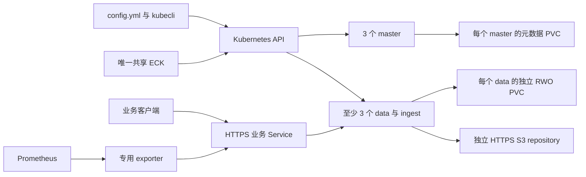
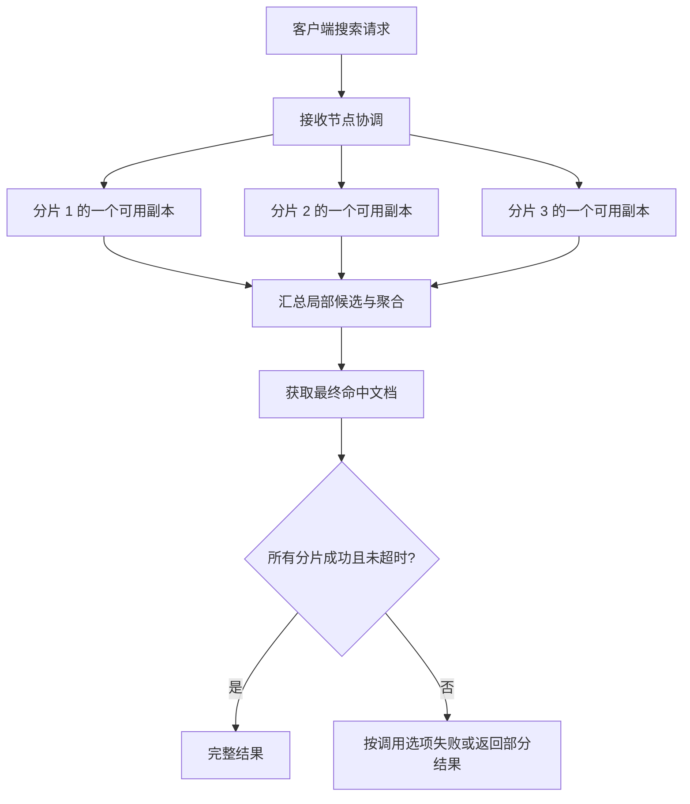
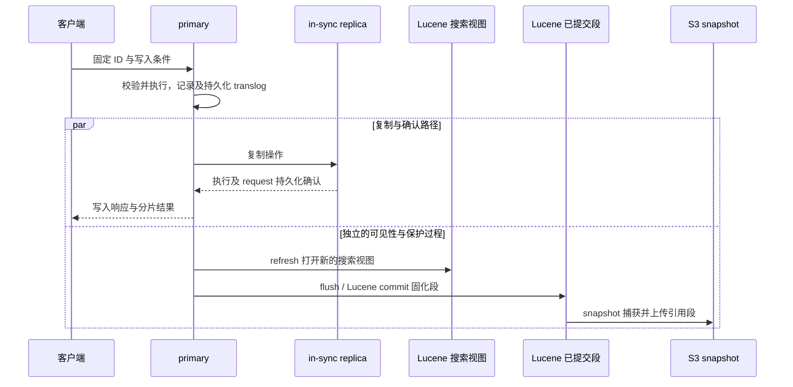
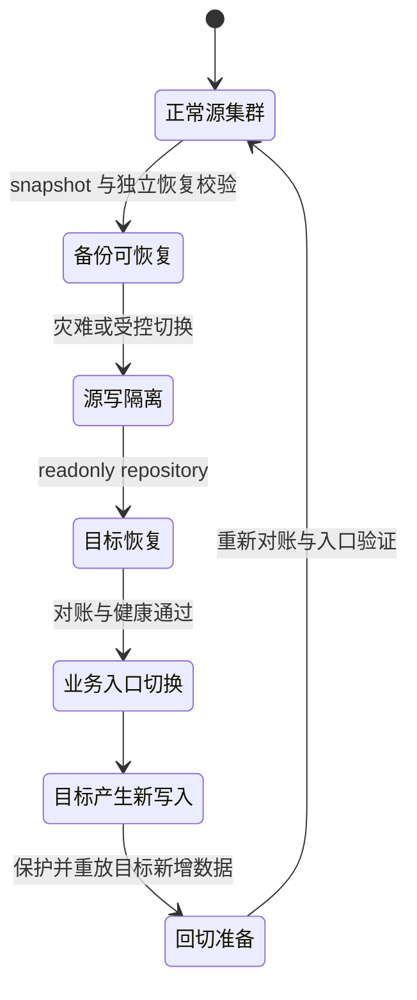

# Elasticsearch 技术白皮书

面向架构师、业务开发者与平台运维人员；读者应了解 Kubernetes、HTTPS 和基本索引概念。阅读后应能区分查询、确认写入、可搜索与可恢复的条件，并据此选择拓扑、容量与保护方式。

规划按[产品边界](#1-产品边界与技术体系)→[故障域](#4-仲裁拓扑与故障域)→[存储容量](#5-存储段合并与容量)阅读；解释业务行为从[检索](#2-文档分析器与检索)和[写入复制](#3-写入复制与四个时间边界)进入；安全、备份和变更分别见[信任与观测](#6-安全信任与观测链)、[快照灾备](#7-快照恢复与灾备)及[生命周期与性能](#8-生命周期与性能判断)。实际执行使用[用户与运维手册](operations-manual.md)，维护实现使用[开发手册](development-manual.md)。

## 1. 产品边界与技术体系

本分支提供独立业务检索集群，采用 Elasticsearch 9.5.6、ECK 3.5.0 和可选 Kibana 9.5.6，平台基线为 Kubernetes 1.33.6。运行默认发行版，遵循 Elastic License 2.0；Basic 是本分支许可基线，不自动启用 Enterprise trial。源码中部分目录的多许可选择不等同于整个发行镜像采用 Apache 2.0。商业支持、跨集群复制、企业身份集成和其他付费功能应另行确认许可与支持合同。

Elasticsearch 将 JSON 文档组织为索引，把索引拆为 primary shard，并为每个 primary 配置 replica。每个 shard 是一个 Lucene 索引，具有自己的段文件、刷新、合并和恢复过程。Kubernetes 提供调度与卷挂载，ECK 根据 CR 协调成员、证书和滚动变更；它们不能代替 Elasticsearch 的选主、复制和索引恢复。健康 Pod、绿色集群和业务结果正确分别对应不同判据。

下面的关系图用于区分控制路径与业务路径。实线表示调用或协调方向，不表示同步复制承诺。

master 保存并发布集群元数据，data 持有分片并执行检索和聚合，ingest 在索引前执行 pipeline。节点收到业务请求后也承担协调工作；本项目业务 Service 只选择具有 data 角色的 Pod，避免把普通业务入口指向专用 master。ECK 是集群内共享控制器，但 EFK 与本业务的 CR、namespace、PVC、凭据、索引和 repository base_path 分开。

共享控制器的隔离实践使用业务 ES 9.5.6 与 EFK 9.5.1：先建立 EFK 哨兵及独立快照，再分别经产品入口卸载、重入 standard 和 compact。两套业务原确认数据分别为 32、34 条，重入后逐条内容摘要保持；期间 EFK 哨兵、快照、卷、客户凭据及共享 ECK 身份保持。反向退役 EFK CR 后，保留原卷、凭据和外部快照，经产品配置重入仍读回原哨兵，两个业务集群保持健康。这说明隔离依赖消费者对象及数据身份，而非为每个业务再安装一个 Operator；共享 ECK 的升级与故障仍是共同控制面风险，不能据此承诺控制面故障完全隔离。项目将共享控制器升级限定在显式平台入口，普通消费者配置不能触发；平台对全部已验收消费者绑定身份和配置摘要，恢复健康后才完成升级账本。备份边界由产品拒绝 EFK 保留路径、双向比较实际 S3 账号及业务仓库写入归属共同约束，卸载保留备份归属，不能把命名空间隔离当作对象存储权限隔离。这些自动化保护不能消除共享 ECK 故障，也不替代底层 RBAC、IAM 和资源容量隔离。

上述实践由 2026-11-05 的共存运行与限定修复共同提供：首轮在退役所有权取证处停止，修复只完成反向退役、重入及清理，源与监督端均退出 0。它们分别证明实际完成的操作范围，不能合称一次完整共存 PASS；正式验收仍以当前矩阵及最终干净完整回归为准。维护者可从[共存入口及证据边界](../../../tests/README.md#elasticsearch-独立交付分路)定位原始记录。

版本依据是 [ECK 3.5 发布说明](https://www.elastic.co/docs/release-notes/cloud-on-k8s)、[Elasticsearch 发布说明](https://www.elastic.co/docs/release-notes/elasticsearch) 和 [9.5.6 源码](https://github.com/elastic/elasticsearch/tree/fd1e8011342a0988e432b999cea4bf884ca120ed)。本分支固定的 Kubernetes 1.33.6 和 Elasticsearch 9 系列处于 [ECK 3.5.0 固定源码声明的支持范围](https://github.com/elastic/cloud-on-k8s/blob/386c7b14f2d1bbb7f2af1e7da997e64875f16e47/README.md)内；其他平台版本不由本专项矩阵验收，上游兼容声明也不替代本项目安装和恢复验收。9.5.0–9.5.2 存在官方披露的 indexing pressure 副本分歧问题，业务基线选择包含相关修复的 9.5.6。现有 EFK 版本不会通过本分支的版本常量自动升级。

## 2. 文档、分析器与检索

文档 ID 确定文档身份；routing 确定 primary shard。默认 routing 使用 ID 的哈希，因此同一 ID 的重试到达同一分片，不能由此推导请求天然幂等：`index` 会替换已有文档，而 `create` 在 ID 已存在时返回冲突。业务重放应固定 ID，并明确重复是拒绝、覆盖还是条件更新。

mapping 定义字段如何索引。`text` 经 analyzer 形成倒排索引，适合分词匹配；`keyword` 保留精确值，适合过滤、分组与排序。数值、日期等字段具有各自的编码和查询路径。多数可排序、可聚合字段使用 doc values，以列式访问支持聚合；把分析后的 text 当作精确分类字段会导致语义和内存使用问题。本项目示例显式 mapping，并用独立 keyword 字段承担分类和业务 ID。

全文查询通常计算相关性分数，过滤条件只判断是否匹配。在商品检索中，标题匹配用于评分，租户、类别、上下架状态和价格区间应进入 filter。排序必须有稳定的次级键；分页结果会随索引内容变化，深分页应结合 PIT 与 `search_after`，而不是不断增大 `from`。PIT 是搜索视图，不是灾备恢复点，不能替代 snapshot。

一次跨分片搜索由接收请求的节点协调。它为每个相关分片选择一个可用副本，汇总局部候选和聚合结果，再获取最终命中文档。默认 adaptive replica selection 根据此前响应时间、执行时间与 search 队列选择副本；因此增加 replica 可提供更多可选读取位置，但一次普通检索不会把同一分片的全部副本都算一遍。`routing` 可以减少访问分片，但只有写入与读取采用相同 routing 规则才成立；丢失租户 routing 的读取可能遗漏文档，单个大租户也可能形成热点。

以下图示解释请求 fan-out 和部分失败的关系；这是官方机制示意，不是项目延迟测量。

查询越宽，协调节点需要汇总的候选越多；`from=10000,size=20` 并非只让各分片保留 20 条，而会保留前面页所需候选，增加堆与 CPU 压力。PIT 固定读取视图，`search_after` 使用上一页末条的完整 sort 数组继续，保持相同 query/sort、采用响应中最新 PIT ID，并在完成或失败时关闭 PIT。PIT 会让旧段继续保留，长时间不关闭会增加磁盘、文件句柄与堆压力；它也不能在节点数据丢失后重建视图。业务若要求完整结果，应设置 `allow_partial_search_results=false` 并检查 `timed_out=false`、`_shards.failed=0`；HTTP 200 和 hits 非空都可能来自部分成功，不足以支持完整对账。

这些选择分别对应业务成本：精确过滤缩小候选，doc values 支持排序/聚合，PIT 保持分页视图，分片数量决定 fan-out。遇到高尾延迟时先核对访问分片数、热点与队列，再决定调整查询、分片或副本；扩大线程池或最大结果窗口可能把过载转移为堆耗尽。依据：[搜索路由](https://www.elastic.co/docs/reference/elasticsearch/rest-apis/search-shard-routing)、[分页与 PIT](https://www.elastic.co/docs/reference/elasticsearch/rest-apis/paginate-search-results)。

默认中文示例使用内置 analyzer，用 `_analyze` 查看实际 token 后判断召回效果。SmartCN 是可选官方插件，使用与 9.5.6 同版构建的固定镜像；插件改变分词结果，已有字段的索引内容不会自动重建，变更 analyzer 通常需要新索引与 reindex。IK 等第三方插件不属于默认交付。完整向量、推理、GPU 与 AI 平台也不在本分支首期承诺范围。

相关机制见 [mapping](https://www.elastic.co/docs/manage-data/data-store/mapping)、[文本分析](https://www.elastic.co/docs/manage-data/data-store/text-analysis) 与 [Smart Chinese 插件](https://www.elastic.co/docs/reference/elasticsearch/plugins/analysis-smartcn)。

当前两种拓扑的相同业务语料各含 100 条文档，采用三个 primary、一个 replica、显式 strict mapping。Bulk 的 100 个 create item 均返回预期成功且包含至少两份成功分片；刷新后逐条内容和总数一致。全文匹配叠加偶数类别过滤、按价格与业务 ID 排序，均返回预期的 50 条；类别聚合为偶数/奇数各 50，价格总和为 4950。reindex 到预建目标后，内容摘要与源一致，alias 切换后的读取仍为 100 条。它说明这些查询与迁移在当前集成中的具体输入输出，不代表任意查询的性能或在线迁移期间增量写入已被捕获，见[业务验收证据](../../../tests/evidence/elasticsearch-business-20261104-153037-96ea5c9af1e4430c8644573de51f83e1.json)。

## 3. 写入、复制与四个时间边界

一次写入先由协调节点定位 primary，由 primary 校验并执行，再复制给当前 in-sync 副本集合。primary term 用来区分主分片任期，sequence number 标记操作顺序，in-sync allocation IDs 帮助控制可安全提升的副本。失去安全条件时应拒绝写入或等待恢复，不能强制分配空 primary 来制造绿色状态。

复制的确认边界由当前 in-sync 集合决定。某个副本在写入中失败时，primary 需要先让 master 确认将它移出该集合，才能在不违反“所有 in-sync 副本含已确认写入”的条件下返回成功。隔离后的旧 primary 发来的复制请求会被已知新任期的副本拒绝；primary 也不能自行宣布其他副本失效来绕过集群协调。如果所有 replica 都已失效、只有 primary 保持有效，仍可能继续写入，但此时仅存的一份数据受到物理故障破坏就无法靠复制恢复。副本数、投票仲裁与外部快照分别防护不同问题。

图中四个边界不能合并理解。第一，客户端收到成功响应意味着本次操作按当时复制组状态完成，仍应检查响应以及 `_shards`。第二，默认 `index.translog.durability=request` 在确认前进行相应 translog 持久化；这依赖真实存储兑现 fsync，不能外推为底层硬件绝不丢数据。第三，refresh 使新内容可被搜索，写入成功后立即搜索可能还看不到；需要同步可见性时使用 `refresh=wait_for`，避免把每条写入都强制 refresh。第四，snapshot 是另一条独立保护链，确认写入不会自动立即进入外部备份。

图中的并行分支表示这些周期不构成统一事务，不能读成“refresh 必定晚于写入响应”。并发读取可能看到尚未确认的操作，隔离 primary 上这种可见内容甚至可能最终未被确认；业务应以自己的成功响应和确认账本判断提交，而非用一次搜索命中替代写入确认。`refresh=wait_for` 显式把本次请求的返回与搜索可见性联系起来，也不会因此生成外部恢复点。

`wait_for_active_shards` 是操作开始前的活跃分片检查。例如设置 `all` 会在开始前要求全部配置副本活跃，但不能把它解释为一个固定副本数的分布式事务承诺。复制组可能在执行期间变化，调用方仍须处理每项结果、失败和结果未知。Bulk 的 HTTP 200 只表示请求被处理；`errors=true` 和各 item 的状态决定哪些文档应重试。

对外部调用超时，服务端可能已提交写入。客户端应按固定 ID 查询、使用 `create` 检查重放，或携带 `if_seq_no` 与 `if_primary_term` 进行条件更新。429 必须结合错误类型判断：线程池过载的 `es_rejected_execution_exception` 可按上限指数退避并加抖动，flood-stage 的 `cluster_block_exception` 则须先恢复磁盘余量并核验写保护解除；只重试不能修复容量不足。认证或权限错误必须进入凭据/权限诊断，不能无限重试。业务确认账本应区分成功、重试、结果未知和最终失败，故障演练恢复后逐项核对确认记录。

依据：[读写复制模型](https://www.elastic.co/docs/deploy-manage/distributed-architecture/reading-and-writing-documents)、[translog](https://www.elastic.co/docs/reference/elasticsearch/index-settings/translog)、[近实时搜索](https://www.elastic.co/docs/manage-data/data-store/near-real-time-search)。

在上述固定语料验证中，关闭自动 refresh 后，已确认文档能按 ID 实时读取，但搜索命中为 0；显式 refresh 后计数才为 1。条件更新完成后，再用原 sequence number/primary term 更新和重复 create 均返回 409。客户端边界还分别注入两次 429、一次已提交但丢弃响应：前者第三次请求写入成功，后者按稳定 ID 读回原内容并确认，没有盲目重放。这两项注入验证重试逻辑；429 没有发到 ES，丢响应由夹具在真实 create 成功后制造，因此不能据此声称实测过服务端过载或真实网络故障。两拓扑最终业务数据一致，测试索引及客户端已回收。

## 4. 仲裁、拓扑与故障域

`standard` 推荐三个专用 master，以及至少三个 data/ingest。master 数固定为三个，避免选主预算随数据扩容变化；数据层独立扩展，减少业务 GC、聚合和合并压力侵占选主资源。本分支要求两组宿主节点分开。`compact` 为三个混合角色成员，适合已评估规模的小型业务；同一进程承受选主和数据工作，资源故障更容易相关。两种拓扑均需三个独立节点故障域，不交付单节点、双节点生产形态。

Elasticsearch 的集群协调使用投票配置多数派选主和提交集群状态。三个有投票资格的 master 通常可容忍一个不可用；失去多数派后无法安全完成需要新集群状态的动作。数据分片可用性还取决于分片放置与副本存活，不能从 master 仲裁正常直接推导所有数据可读写。

节点已经加入、集群 green 与节点就绪也有不同的边界。ECK 的 pre-stop hook 在退出前登记节点重启；节点重新使用原数据身份加入后，Elasticsearch 仍可能保留该 `RESTART` 标记。固定 9.5.6 的[就绪服务](https://github.com/elastic/elasticsearch/blob/fd1e8011342a0988e432b999cea4bf884ca120ed/server/src/main/java/org/elasticsearch/readiness/ReadinessService.java)在本节点仍属于退出集合时关闭就绪端口；ECK 3.5.0 的[重启完成协调](https://github.com/elastic/cloud-on-k8s/blob/386c7b14f2d1bbb7f2af1e7da997e64875f16e47/pkg/controller/elasticsearch/driver/stateful/upgrade.go)负责清理已完成、已归队且不再终止的重启记录。因此暂停 Operator 后恢复进程，并不等于恢复了完整的控制闭环；等待所有节点 Ready 前必须让原控制器恢复协调。这个条件不意味着数据已经丢失，也不能据此删除 PVC、替换节点身份或手工绕过就绪探针。

一个数据节点失效后，replica 可提升，恢复和迁移会使用剩余节点的 CPU、内存、磁盘及网络。规划必须按 N−1 保留可承载的业务与恢复预算；三个节点在日常接近满载时，副本存在也不能保证故障后达到原吞吐。网络分区、多个副本同时丢失、底层共享存储故障是不同风险，需分别观察未分配分片、分片恢复和确认账本。

Kubernetes PDB 约束自愿驱逐，不阻止断电或内核故障；Pod anti-affinity 分散 Pod，不保证机架、电源或可用区独立。客户应把节点标签与真实故障域对应，并避免跨高延迟链路拼接单个集群。机制依据见 [集群协调](https://www.elastic.co/docs/deploy-manage/distributed-architecture/discovery-cluster-formation) 与 [节点角色](https://www.elastic.co/docs/deploy-manage/distributed-architecture/clusters-nodes-shards/node-roles)。

成员数量与允许调度的主机数量是两个维度。ECK `nodeSets[].count` 决定 ES 成员和卷的数量，node affinity 限定候选主机，required pod anti-affinity 阻止同组成员在同一主机叠放。本分支用 `elasticsearch_data_count` 和 `elasticsearch_data_nodes` 分别表达这两个维度。例如三个数据成员、四个合格候选主机保留一个重调度故障域；三个成员只有三个候选主机时，故障后的另外两台不会自动多接一个成员。CSI 的跨节点卷重挂还要求旧节点安全隔离、卷已解挂、目标可访问存储且调度容量充足，不能用“有副本”或“有 CSI”代替这些条件。依据：[ECK 节点编排](https://www.elastic.co/docs/deploy-manage/deploy/cloud-on-k8s/nodes-orchestration)。

在当前 standard 实践中，四个数据候选宿主仅创建三个 data/ingest 成员，另有三个专用 master；数据端点不包含专用 master。对三个 primary、一个 replica 的索引写入 32 条固定 ID 文档，并重复相同产品配置后，成员与卷、凭据和索引身份均保持，内容摘要一致。这把“成员数量独立于候选宿主数量”和“相同声明可重入”落实到本次集成结果，见[标准拓扑证据](../../../tests/evidence/elasticsearch-standard-20261104-151049-9a935e0dbcd84156be09a2e27a4ded3a.json)。该小数据集用于身份与内容核对，不是吞吐或故障恢复测量；备用宿主是否能接管仍取决于实际资源、CSI 与旧实例隔离状态。

相同平台上的 compact 实践创建三个 master/data/ingest 混合角色成员和三个 4 GiB PVC，三个成员分散到不同宿主。相同配置二次执行后，成员、卷、凭据与索引身份保持，32 条确认文档的摘要与数量一致，见[混合拓扑证据](../../../tests/evidence/elasticsearch-compact-20261104-152333-0b87f40d76e3456ba43ecd85854a8859.json)。两种拓扑证明各自的声明和重入路径；本次小数据验证没有衡量混合角色下的资源争用差异，不能据此推导两种拓扑在高负载下等效。

在同一 Kubernetes 1.33.6、Longhorn 1.12.1 V1 平台，两拓扑的故障实践以三个 primary、一个 replica 的 32 条确认数据为恢复基线，结果如下。

| 故障条件 | 实际观察与恢复结果 | 说明 |
| --- | --- | --- |
| 删除持有 primary 的 Pod | 两拓扑均产生新的 Pod UID；恢复后的确认数据数量、内容摘要与索引身份保持 | 验证进程重建与副本恢复，不代表整台主机断电 |
| 暂停共享 Operator | 两拓扑各自的 100 条业务验证仍通过；恢复控制器后确认账本一致 | 已运行的数据面不要求每次业务请求经过 Operator；配置变更与完整恢复仍依赖控制器 |
| 同时承载两拓扑成员的一个数据宿主失效 | 在证明旧 kubepods 进程全部停止后退役旧 Pod；两个成员各在另一候选宿主恢复，原 PVC、PV 和原生卷 UID 均保持，业务及确认账本一致 | 使用 guest runtime 隔离，未做断电隔离；CSI 重挂依赖旧实例隔离、附件释放与可用候选宿主 |
| 任一拓扑只保留一个投票成员 | 真实写入返回 503、`cluster_block_exception`；恢复后被拒绝的 ID 不存在，原 32 条确认数据保持 | 多数派丢失时验证拒绝行为，未将无响应当作已拒绝 |
| standard 保留 master、停止全部 data | 真实写入返回 503、`unavailable_shards_exception`；恢复后被拒绝的 ID 不存在，原确认数据保持 | 仲裁可用与数据分片可用分别判断 |

完整结果与限定恢复绑定[故障验收证据](../../../tests/evidence/elasticsearch-faults-20261104-163016-e9549ddac3484fc7b7f652189831b752.json)。迁移结束后原节点恢复 Ready、原调度状态及全部卷健康；故障 journal 已回收。这里证明所列输入和故障边界中的集成行为，没有测量任意负载下的恢复 SLA，也不覆盖物理断电、共享存储整体损坏或未隔离旧实例的安全接管。客户端仍须区分明确失败与结果未知，并按业务确认记录恢复。

## 5. 存储、段合并与容量

每个 ES 成员具有独立 RWO 文件系统 PVC。生产必须使用已验证能兑现 fsync、重挂与扩容的 CSI，不能把 local-path 或 emptyDir 当作本分支的持久化基线。mmap 会映射大量段文件，选定主机要求 `vm.max_map_count >= 1048576`。本分支保持 mmap 开启，提供显式主机前置收敛；不要复制开发 quickstart 的禁用 mmap 配置。

CSI 的可移植性需要同时观察数据、绑定身份和容量层级。当前 Kubernetes 1.33.6／Longhorn 1.12.1 V1 集成验证使用三个存储副本、ext4 与 RWO 卷，结果如下。

| 检查边界 | 实际结果 | 能得出的结论 |
| --- | --- | --- |
| 数据与重挂 | 1 MiB 数据完成文件及目录 fsync，同卷从首节点移至另一节点后 SHA256 一致；PVC、PV、原生卷 UID 保持 | 本次重挂复用了原数据卷，没有用一个新空卷替代 |
| 在线扩容 | 请求从 1 GiB 到 2 GiB；PVC、PV、原生卷和文件系统均达到目标，文件系统从 1,020,702,720 到 2,077,073,408 字节，原数据摘要保持 | 容量声明已落实到应用实际可见的文件系统，不只是在 API 中改了数值 |

结果绑定[CSI 验收证据](../../../tests/evidence/elasticsearch-csi-probe-20261104-151821-3ac2b904a51f4d4ab0c42321c8bf22e5.json)及原始日志，限定探针与 PV 已回收。文件系统容量小于声明块容量，是格式化元数据等开销的结果；生产水位应以实际文件系统统计为准。该验证的底层是实验室专用 loop 文件系统，且重挂发生在正常删除首个 Pod 后；它不证明物理盘吞吐、突发断电持久性或失联节点已经安全隔离。节点故障迁移仍须单独证明旧实例停止写入，避免双挂载风险。

写入产生内存缓冲和新段，refresh 发布可搜索段，后台 merge 合并段并回收删除文档占据的空间。删除文档不会立即释放等量磁盘；merge、snapshot 和恢复可能同时增加 I/O 与临时空间压力。分片过多会增加元数据、文件句柄、堆和调度成本；分片过大则延长恢复并放大热点。应根据固定数据模型、目标分片大小、恢复时间和实际负载共同选择 primary 数，不把每个租户机械拆成一个小索引。

初始业务示例采用一个 replica。容量计算先估计实际索引膨胀，再乘 Elasticsearch 副本数，并留出 merge、迁移与恢复余量。若底层存储也做多副本，底层占用还会进一步增加；这两层复制对应不同故障路径，不能任意删除其中一层或简单相加成“容灾等级”。

可以用下列容量关系做第一轮预算，再用客户 mapping 和样本修正：`ES 活跃索引总量 = 原始数据保留量 × 实测 primary 索引系数 × (1 + replica 数)`。这里的原始量与索引量均使用 GiB，系数来自相同字段、分析器、`_source` 和 doc values 配置的样本。每个 data 节点的可用文件系统还要在 N−1 时承载迁移，不能用全群平均占用替代最满节点。

例如仅作预算示意，原始保留量 100 GiB、假定实测系数为 1.2、一个 replica，会产生约 240 GiB 的 ES 分片数据。三个 data 节点、假定故障时仍要求各存活节点不超过 70% 占用，则每节点至少需要 `240 / (2 × 0.70) ≈ 171.4 GiB` 可用于 ES 的空间，随后还要追加 merge、translog、增长和恢复峰值的测量余量。70% 是此例的容量目标，不是官方磁盘水位默认值；`1.2` 也不是本项目实测系数。底层若有三个完整存储副本，这部分已写入块的物理占用还可能约为三倍，并另有底层元数据、快照及重建余量。压缩、稀疏、存储分配策略和副本拓扑会改变实际物理量，最终以底层测量为准。

默认规划建议为 master 每 Pod 2 CPU/4Gi，data 每 Pod 4 CPU/16Gi、heap 8g。它们是项目起步建议，不是上游最低要求或吞吐保证。heap 占 Pod 内存的一部分，余量支持文件缓存和进程其他分配；把 heap 调至全部内存会压缩这些空间并增加 OOM 风险。实验室缩小资源的结果必须单列，不能代表客户 16 CPU/32Gi 主机规划基线。

磁盘 low/high/flood-stage 水位控制分片分配和写保护。flood-stage 的 `read_only_allow_delete` 用于防止磁盘耗尽后扩大故障；优先恢复真实空间或扩容，等待恢复条件成立再核验解除，不能永久关闭水位保护。`DeleteOnScaledownOnly` 只在整个 CR 删除时保留 PVC；缩减 nodeSet 数量仍可删除对应 PVC，因此产品入口默认拒绝自动缩容。

当前[维护验证](../../../tests/evidence/elasticsearch-maintenance-20261104-220030-5a694a47444c45998faa196c20342b44.json)在同一固定平台完成 standard 数据成员从三个到四个的扩容，新成员接收了确认索引的真实分片，原 CR/PVC 身份和各 32 条确认数据保持。随后 standard 四个、compact 三个 data 卷均从 4 GiB 扩至 6 GiB；每卷实际文件系统总容量从 4,143,677,440 增至 6,257,475,584 字节，PVC、PV、Longhorn 原生卷及文件系统四层均达到目标，缩卷与缩减成员被产品拒绝。前后差值包含文件系统元数据开销，不把声明容量直接当作可用业务容量；该 loop 存储验证不代表客户物理盘扩容时延或性能。

水位实践没有填满物理磁盘，而是把 free-byte 阈值设在测得空闲空间以上，触发相同的原生保护机制。standard 测得最大空闲 6,238,224,384 字节，compact 为 6,240,075,776 字节；两拓扑的确认索引均自动出现 `read_only_allow_delete`，真实写入返回 429 `cluster_block_exception`。恢复原阈值后 block 自动解除，被拒绝 ID 不存在，原确认数据与业务验证通过，测试客户端及故障设置已回收。该结果验证阈值、拒绝和恢复的集成闭环，不证明文件系统写满、底层 I/O 失败或物理磁盘损坏时仍具备相同恢复条件；遇到保护时必须先恢复真实容量，不能把提高生产阈值当作扩容替代品。

依据：[生产建议](https://www.elastic.co/docs/deploy-manage/production-guidance)、[虚拟内存](https://www.elastic.co/docs/deploy-manage/deploy/self-managed/vm-max-map-count)、[ECK 卷声明](https://www.elastic.co/docs/deploy-manage/deploy/cloud-on-k8s/volume-claim-templates)。

## 6. 安全、信任与观测链

HTTP TLS 保护客户端连接，transport TLS 保护成员通信。校验 CA 只解决证书是否可信，还必须校验主机名与 SAN；通过 port-forward 诊断时，TCP 可连接本地端口，但 TLS server name 仍是证书中的 Service DNS。本分支辅助入口保留这一差异，不使用 `-k` 绕过校验。外部域名与 LB 需要客户提供覆盖真实访问名的证书，业务客户端在 Service/LB 后应禁用可能返回不可达 Pod 地址的 sniffing。

应用使用索引范围受限的角色或 API key。exporter 只获取集群监控和索引监控权限；它是 prometheus-community 的社区组件，不是 Elastic Operator 的内置指标。ECK `/metrics` 反映控制器行为，不能替代分片、恢复、磁盘和业务检索指标。Prometheus 采集失败、ES 不可达、指标缺失或陈旧必须分别判断，不能因 `up=1` 就认定 ES 业务正常。

证书和 CA 轮换先建立新旧信任重叠，再更新服务端和客户端，确认新连接成功后撤销旧信任。密码/API key 轮换同样先验证新身份，再撤销旧身份。S3 Secret 经 ECK secureSettings 注入；凭据 reload 与 JVM truststore 是两条机制，更新 CA 后还需保证各 ES JVM 采用新的信任库。security feature state 恢复会覆盖原安全状态，应准备不依赖该索引的 file realm 应急管理员，保护其 Secret，避免恢复过程中把管理入口一起锁死。

当前 standard 六成员、compact 三成员的[HTTP 证书验收](../../../tests/evidence/elasticsearch-security-certificates-20261104-184540-b119024474df482ebf69b01f839ec8fb.json)分别经过两次独立 CA 切换：先提供旧、新 CA 重叠信任，验证新连接与业务，再撤销旧 CA，并确认只信任旧 CA 的连接被拒绝。缺少正确 Service SAN 的候选证书由产品前置拒绝，CR、Pod、PVC 与凭据身份保持；恢复 ECK 默认证书后，两拓扑原确认索引仍各有 32 条相同内容，索引身份保持，测试证书 Secret 已回收。该结果证明当前产品入口的证书检查、切换及恢复闭环；测试 CA 不是客户 PKI，未覆盖外部 LB、全部应用连接池的信任分发或任意证书有效期内的自动续期。

在同一 Kubernetes 1.33.6/Calico 环境的[网络策略验证](../../../tests/evidence/elasticsearch-security-network-20261104-185936-418b93d9a5004303addd0a85dbb3fabc.json)中，两拓扑各使用独立客户端 namespace，依次验证未授权、添加授权标签、移除标签三种状态。拒绝必须先能解析产品 Service DNS，再观察至少两次连接超时；DNS 故障或连接拒绝不能冒充策略丢弃。授权后以正确 CA 和 Service 主机名完成 TLS，未携带凭据的 HTTP 请求返回 401，说明流量已经到达仍启用认证的 ES。测试 namespace 与客户端均已回收，原业务账本保持。这验证了当前 CNI 的 namespace 标签准入和撤销，不覆盖其他 CNI、外部防火墙或应用角色权限；客户仍需同时管理网络授权与业务身份。

当前两拓扑的 [S3 凭据轮换验证](../../../tests/evidence/elasticsearch-security-s3-20261104-191647-2d13b6b55b4c43b9ae8148020954e07c.json)使用独立 HTTPS 对象存储和私有 CA：ES JVM 采用包含发行版默认根及客户 CA 的工作信任库，经产品入口切换新凭据并 reload，停用旧对象存储账户后，两拓扑仍各自完成真实快照，状态为 SUCCESS、成功分片非空且失败为零。恢复原账户及 Secret 后，repository verify 与各 32 条原确认数据通过，测试快照已删除。固定 ECK 3.5.0 将 secureSettings 内容摘要纳入 Pod 配置 hash，因此凭据更新和恢复都触发受控滚动；无需人工重启不等于没有滚动，reload 成功也不代替成员就绪。该实践证明当前私有 CA 和凭据切换的集成闭环，不代表所有 S3 兼容后端已通过语义验证，也未验证外部凭据平台或客户密钥轮换周期。

当前[可观测性实践](../../../tests/evidence/elasticsearch-observability-20261105-030611-e3383c1ebf3749e4905c7b23fb7b810a.json)使用一个 v1.11.0 exporter 和产品双副本 Prometheus。两份 Prometheus 各自发现唯一 `search-metrics` target，抓取为 up 且真实 `elasticsearch_cluster_health_status{color="green"}` 为 1；专用账户能读取 cluster health，读取业务索引则收到明确的 403/security_exception。随后对独立探针索引设置无法满足的节点分配约束，两份 Prometheus 均经历 red 告警 firing 和未分配分片 warning 的完整 5 分钟持续窗口；回收探针后两类告警均恢复。再移除实际 ServiceMonitor target，确认两侧 `up` 样本消失、缺失采样告警由 pending 转为 firing，恢复原选择器后采样及全部告警再次恢复。源 standard 的 32 条确认记录及 SHA256 保持，故障、临时账户与 Secret 已回收。

这一结果分别证明了发现/采集、ES 权限及规则状态迁移，不能外推为 Alertmanager 外部通知、客户值班链或全部集群规模的采样负载已合格。采样间隔、评估间隔和规则 `for` 窗口共同决定告警时间；本次没有把窗口参数当成端到端通知延迟。固定 exporter 的 cluster-health collector 在访问 ES 失败时不输出状态序列，因而规则同时检查 target down、target 缺失和健康状态序列缺失；HTTP 抓取为 up 本身不足以说明 ES 可达。

依据：[ECK TLS](https://www.elastic.co/docs/deploy-manage/security/k8s-https-settings)、[访问控制](https://www.elastic.co/docs/deploy-manage/users-roles)、[exporter v1.11.0](https://github.com/prometheus-community/elasticsearch_exporter/tree/v1.11.0)。

## 7. 快照、恢复与灾备

Elasticsearch 原生 snapshot 把可恢复的索引段及选定集群状态写入 repository，并通过元数据引用复用已上传段。它是逻辑恢复机制，复制数据目录、CSI 卷快照或文件备份不能替代它。一次 snapshot 不是跨全部 shard 的严格同一瞬时视图；若业务需要跨索引一致边界，应先设计写入隔离、业务 checkpoint 与恢复后的对账。

S3 repository 在 9.x 发行版内置。生产接客户已有独立 HTTPS 对象存储；本分支不会顺便安装 MinIO。信任库进入 ES JVM，`_verify` 检查节点访问，`_analyze` 进一步检查存储操作语义；对象能列出、bucket 存在或任务显示 SUCCESS 均不足以证明可恢复。应读取快照元数据，并在独立空目标恢复索引，再核对数量、内容 hash 与查询结果。

项目注册入口的 analysis 使用 10 个 blob、单个至多 1 MiB、总量至多 10 MiB，目的是在生产收敛时提供有界的初步反证。该探测既不是容量压测，也不保证后端完全符合 S3 语义；正式接入仍需结合后端官方支持范围、并发/一致性条件及独立恢复证据。9.3 起 S3 线性化寄存器优先使用条件写入，缺少条件写入的后端可能依赖强一致 multipart 兼容路径；不能把“上传一个对象成功”推导为并发 repository 元数据安全。升级后端或 Elasticsearch 版本后，应重验相应兼容边界。

分析探针也有版本和后端条件。固定 9.5.6 的[官方源码](https://github.com/elastic/elasticsearch/blob/fd1e8011342a0988e432b999cea4bf884ca120ed/x-pack/plugin/snapshot-repo-test-kit/src/main/java/org/elasticsearch/repositories/blobstore/testkit/analyze/BlobAnalyzeAction.java)明确记录：MinIO 的上传与提前复制可能互相等待，导致分析超时；[官方 MinIO 集成测试](https://github.com/elastic/elasticsearch/pull/135565)为此禁用 `copy_during_write_contention`，仍执行其它对象分析。本项目默认保留该探针，只有操作者显式声明这一后端限制才采用相同条件，见[运维手册第 9 节](operations-manual.md#9-快照恢复与灾备)。这是一项缩小了上游分析适用范围的兼容条件，不是“完整 S3 语义已通过”的证明，更不豁免真实快照及独立恢复。

当前[仓库拒绝验证](../../../tests/evidence/elasticsearch-backup-refusal-20261104-220828-f48e04421233408c8e853cf1877ddf55.json)在 standard 的四个 data 与三个 master 上，分别通过错误访问身份、不信任实际后端的有效 CA，以及已正向核验读写能力但缺少删除权限的专用身份发起产品 repository 请求，三种情况均返回预期的 `repository_verification_exception`。每次恢复原 Secret/CA 后都重新验证仓库与原 32 条数据，最终内容 SHA256 与测试前一致，受限身份已回收。该实践说明 CA、身份和后端操作权限是独立的准入条件；尤其快照仓库需要删除临时对象及执行保留清理，只有上传能力不够。验证使用本项目独立 HTTPS S3 夹具，不证明任意对象存储的全部权限组合或并发一致性已合格。

同一个 repository base_path 只能有一个写入集群。灾备目标以 readonly 注册，避免多个集群并发改写 repository 元数据。S3 兼容服务对 SDK/checksum、原子性和并发语义的实现可能不同，不能仅凭“S3 compatible”判断通过，也不默认开启 `legacy_content_md5` 绕过兼容问题。

SLM 将快照创建与保留分开调度：创建计划决定何时产生恢复点，retention 任务按策略归属、年龄和数量删除候选快照，不负责清理手工快照。仅保存策略定义不能证明创建或删除真的发生。本项目的[源端备份实践](../../../tests/evidence/elasticsearch-backup-source-20261104-220408-6f48daf57cb945dcaceafbc554021d85.json)在 standard 与 compact 上分别通过产品入口注册 HTTPS S3 writer、执行 verify/有界 analysis，完成含非零成功分片且零失败的确认索引快照；两拓扑的原账本各为 32 条。随后各显式执行同一 SLM 策略三次，等待三个快照 SUCCESS，再触发 retention，实际只保留较新的两个，最旧的一个消失，与 `max_count: 2` 一致；配置同时为 `min_count: 1`、`expire_after: 1d`。本次没有等待一天或下一次定时调度，不能据此声称已验证按日过期；源端成功也不替代独立恢复和 feature states 验收。

这两份普通索引快照随后分别在独立的三节点 Kubernetes/CSI 平台上，通过产品入口恢复到新的三成员 ES 目标。两次均核对源快照 UUID、目标的独立 ES UUID、仓库 `readonly=true`，并读回 32 条文档、逐条内容及代表性查询；内容 SHA256 均为 `974de9b07057a9af2099e1e8da06334bdcf37494e13d04106b548c47e04b0223`，与各自源账本一致，源数据未改变，见[独立恢复证据](../../../tests/evidence/elasticsearch-backup-restore-20261105-013339-23ac6e224c1f427ea2d870a3313ca0cd.json)。目标依次创建，复用已准入平台，不复用源 PVC；这证明该固定版本下的普通索引恢复路径，不覆盖安全/Kibana 状态、对象存储侧独立只读 IAM 策略或任意规模的恢复时限。仓库只读是 ES 注册属性，生产仍应另配受限读取凭据，避免将其误解为后端已经收紧权限。

系统 feature 的保护边界也已单独验证。在 ES/Kibana 9.5.6 的源端，通过产品请求创建只读业务角色、native 用户和一个具有已知 ID/属性的 dashboard，再创建显式包含 `security`、`kibana` 非空状态的快照。独立三成员目标先保持 Kibana 关闭，以 file realm superuser 完成恢复；目标 cluster UUID 为 `58rRjcHBQK-KQN88j5mjZg`，与源不同，32 条业务文档的上述 SHA256 保持。随后恢复的 native 用户以原密码、原角色完成认证及业务计数，启用同版 Kibana 后读回原 dashboard 的精确 ID/属性，源配置及 Secret/CA 身份、内容和原数据均未改变，源临时身份与 dashboard 已回收，见[feature 恢复证据](../../../tests/evidence/elasticsearch-backup-features-20261105-011335-4c427bb6f488486bb942580891f202b6.json)。

这说明恢复业务文档、恢复安全索引和恢复 Kibana 保存对象是相互关联但须分别核对的任务。系统 data stream 的 backing index 不接受普通 `_settings` 访问，产品用只含 UUID 的集群元数据核验其身份，而非扩大管理员角色或直接修改系统索引。这里的保存对象是普通 dashboard，未验证加密连接器、外部服务凭据或全部 Kibana 插件状态；这些对象仍需原加密密钥和相应服务恢复流程。独立配置/Secret 保护也不代表客户凭据管理平台已经完成灾备，客户须保管原配置输入并实际验证其恢复出口。

本次独立三节点目标的[切换与回切实践](../../../tests/evidence/elasticsearch-dr-20261105-021409-b752d811ae0f459c81b8d58b92f0ae3c.json)先将源 compact 的三个 ES 成员及其控制器停到零，并确认客户端端点无就绪地址，再通过产品入口恢复只读仓库中的 32 条快照文档。目标原有独立 UUID 保持，文档 SHA256 与快照账本一致；源快照之后的 1 条已确认写入在目标不存在，说明恢复点边界真实生效。切换后目标新增 1 条记录，回切前对目标索引设置写阻断并读回确认，再恢复源、按稳定 ID 显式重放。源最终保留原 32 条、源快照外 1 条及目标新增 1 条，共 34 条；应用路由读回这两条新增记录，目标继续保持写阻断。

本次测得 RTO 为 163.04 秒，从源故障声明到目标完成恢复、查询及副本确认的新写入；独立 Kubernetes、CSI 和健康空目标已经预备，平台建设及回切时间不计入该值。RPO 为 14864.99 秒（约 4.13 小时），是本次保留的旧快照结束时间到源快照外探针确认时间的间隔，只有 1 条确认写入位于该恢复点之外；它不是测试时长，也不是定时备份可承诺的固定 RPO。客户须按实际备份频率、数据量、资源及隔离方式重新测量。演练采用受控停成员和私有客户端路由，不证明突然断电、网络分区时的外部 fencing 或客户 DNS/LB 的切换时限。

RPO 由已验证的恢复点与最后确认写入之间的差距决定，RTO 应覆盖隔离、恢复、对账及入口切换时间。本分支不提供任意时间点 PITR。回切时不能把旧源直接重新开放为第二个写入端；应确定目标新写入的权威记录、重放方式和冲突处置，再恢复单一写入入口。config、Secret、CA、repository 定义及 security/Kibana feature states 也需要独立保护，它们不都会自动随普通索引恢复。

依据：[snapshot 与恢复限制](https://www.elastic.co/docs/deploy-manage/tools/snapshot-and-restore)、[S3 repository](https://www.elastic.co/docs/deploy-manage/tools/snapshot-and-restore/s3-repository)、[ECK 快照配置](https://www.elastic.co/docs/deploy-manage/tools/snapshot-and-restore/cloud-on-k8s)。

## 8. 生命周期与性能判断

alias 将业务名称与物理索引分开，reindex 将文档重新写入目标索引，因此可以改变 mapping/analyzer；切换前须对账并处理迁移期间新增写入。data stream 把带时间戳的追加数据组织为 backing indices，rollover 建立新的写入索引，ILM 根据策略推进生命周期。它们不自动提供跨系统事务；删除阶段必须与备份保留和客户合规期限一致。

reindex 不会自动复制源索引的 mapping、分片配置或模板，也不会持续捕获源端后续写入。应先按目标模型建索引，选择停写窗口或可靠的增量补齐机制，再复制、核对和切换。异步响应中的 task ID 只是任务身份；完成时还需检查任务错误、逐项 failures、冲突、创建/更新数量和目标数据。alias 切换应在一个 `_aliases` 请求中完成 remove/add，并对必要的 remove 设置 `must_exist: true`；只检查 `acknowledged` 可能漏掉允许部分动作成功时的 `errors` 与 `action_results`。切换前后都要读回 alias 的精确目标，不能以“原子”推导错误动作也会整体拒绝。alias filter 也不是安全隔离机制：按 ID 获取文档时不应用该查询过滤器，授权仍由安全角色控制。

data stream 的逻辑名称不变，写入仅进入当前 write index，旧 backing indices 仍参与检索。匹配的 index template 必须启用 `data_stream`，文档含 `@timestamp`，写入使用 `create`；索引模板引用的 component template 负责复用 mapping 和 settings。ILM 则是独立的异步状态机，不是每次写入同步检查并立即删除。发生 rollover 后，后续阶段的 `min_age` 按 rollover 时间计算；例如 `delete.min_age: 30d` 不能解释成每条文档在其业务时间满 30 天时立即删除。模板变更主要影响新建索引，也不能反向修正旧 backing index 中已建立的字段类型。需要保留精确到文档的期限、频繁覆盖同一 ID 或跨索引事务的业务，应先评估这些语义是否适用。

上述边界依据官方[reindex](https://www.elastic.co/docs/reference/elasticsearch/rest-apis/reindex-indices)、[alias](https://www.elastic.co/docs/manage-data/data-store/aliases)、[data stream 建立过程](https://www.elastic.co/docs/manage-data/data-store/data-streams/set-up-data-stream)和[ILM 策略](https://www.elastic.co/docs/manage-data/lifecycle/index-lifecycle-management/configure-lifecycle-policy)。本分支使用本地 reindex、索引 alias 和基础 hot/delete 策略；远程 reindex、自动冷热分层与 searchable snapshot 不由这些示例自动扩展为交付能力。

当前两种拓扑的生命周期实践通过 pipeline 将类别归一，写入两条有效事件，拒绝非法整数且有效计数仍为 2；显式 rollover 后产生两个 backing index、原两条事件仍可检索，`_ilm/explain` 确认它们由声明的策略管理。策略的删除期限读回为 7 天，本轮没有等待 7 天，也没有测量自动轮询何时触发 rollover，不能把这些结果描述为已实测定时删除。在 compact 上另经产品入口切换同版 SmartCN，逐成员核对插件和 analyzer、重复配置核对幂等，最后恢复默认镜像并复验原确认数据，见[生命周期证据](../../../tests/evidence/elasticsearch-lifecycle-20261104-153237-4bcc3eab119046b1ad72007540139e5e.json)。

升级按 ECK/CRD 与 ES/Kibana 两条边界管理。固定夹具为 ECK 3.4.1→3.5.0、ES/Kibana 9.5.5→9.5.6；CRD 是集群全局资源，必须盘点包括 EFK 在内的所有消费者。数据格式升级后，不能把 `spec.version` 或镜像 tag 改回去完成降级。回旧版的路径是旧版空集群恢复升级前兼容快照，或按官方支持路径前滚；新增业务写入需要额外重放与对账。

当前[升级与兼容恢复实践](../../../tests/evidence/elasticsearch-upgrade-20261105-055359-527858c2428943c9b49ed1a9fff0ed1d.json)在独立三成员目标上先升级共享 ECK，再升级 ES/Kibana；期间删除一次 Operator Pod，恢复后以相同配置重入，原 CR、PVC、凭据和 32 条确认记录保持，最终三个 ES 成员均为 9.5.6 且绿色。原地改回 9.5.5 被拒绝；原生退役并回收该目标的 namespace/PV 后，另建独立空 9.5.5 目标实际恢复了兼容快照，32 条记录逐条一致，SHA256 为 `974de9b07057a9af2099e1e8da06334bdcf37494e13d04106b548c47e04b0223`。该过程说明“回旧版”需要恢复到新空目标，不能依赖复用升级后的数据卷。

本次聚焦验证复用的是 2026-11-05 05:03:47.802（UTC+8）开始的既有 `pre-upgrade` 恢复点，快照 UUID 为 `nR166Rn3TxGkwe58AjeupA`，并非本轮新建；它覆盖本轮全部 32 条确认数据。快照未记录原始来源集群 UUID，不能把本轮升级来源的 UUID 当成它的历史来源身份。实际旧版恢复与完整内容对账证明这个恢复点在本次条件下可用，不证明升级后新增写入也受保护，不提供任意版本回退或连续可写保证。

本分支把 ECK `changeBudget` 固定为 `maxSurge: 1`、`maxUnavailable: 1`，限制额外资源并允许单成员滚动重启。原 nodeSet 内变更会重启稳定身份的 Pod，不会因 `maxSurge` 为 1 就自动创建一个替代成员；把 `maxUnavailable` 设为 0 会阻止健康成员进入这条重启路径。一个成员正在恢复时，预算不允许再主动重启另一个健康成员，ECK 仍需检查分片安全、集群状态和 master 仲裁。该预算约束控制器主动操作，不保证外部故障不会同时发生，也不承诺零请求错误。依据：[ECK 更新策略](https://www.elastic.co/docs/deploy-manage/deploy/cloud-on-k8s/update-strategy)及固定 3.5.0 的[升级预算计算](https://github.com/elastic/cloud-on-k8s/blob/386c7b14f2d1bbb7f2af1e7da997e64875f16e47/pkg/controller/elasticsearch/driver/stateful/upgrade_pods_deletion.go)。

Rally 2.13.0 使用 `benchmark-only` 和固定离线合成语料衡量本项目路径。语料为 10000 条、约 11.6 MB 原始 JSON，主要用于可重放的集成基准，不代表真实生产分布。当前短基准在 Kubernetes 1.33.6、Longhorn 1.12.1 V1、实验室专有 loop 文件系统上运行，使用三个 primary、一个 replica；四个 bulk 客户端每批 500 条，四个 search 客户端各预热 100 次、正式执行 1000 次。启用 HTTPS、认证与副本，主机缓存和共享负载未作隔离。

| 测量条件或结果 | standard | compact |
| --- | ---: | ---: |
| 成员 | 3 个专用 master、4 个 data/ingest | 3 个混合成员 |
| 每个数据成员请求 / heap / PVC | 1 CPU、4 GiB / 2 GiB / 6 GiB | 1 CPU、4 GiB / 2 GiB / 6 GiB |
| bulk 吞吐中位数（docs/s） | 4315.57 | 2505.31 |
| search 吞吐中位数（ops/s） | 192.56 | 137.82 |
| search P50 / P99（ms） | 13.21 / 39.57 | 15.37 / 63.91 |
| bulk / search 错误率 | 0% / 0% | 0% / 0% |

这些数据来自固定场景 `rally-20261105-034911-11da246bfa504fd3b39cecf5158a90b5` 的两个独立 race；吞吐是 Rally 报告的样本中位数，延迟是 search 请求的 latency。数据宿主多数为 8 vCPU、约 16 GiB 内存，其中一台为 16 vCPU、约 16 GiB；standard 的专用 master 各请求 1 CPU、2 GiB。两拓扑的成员总量和资源总量不同，因此不能把表中差异解释为等资源架构优劣。每个 race 结束后读回全部 10000 条，规范化内容 SHA256 均为 `572c88638ae1d75a097fa43f0e8c2f45120960482d642016cccf870f9edc93cf`，原业务账本保持，压测索引及临时客户端和凭据已回收。

Rally 当前报告未提供 P95，也未单列客户端重试次数，不能从错误率为零推断没有重试；P95 由另一条至少 1800 秒、含 primary Pod 故障的稳态客户端负载独立计算，不能与本表拼成同一分布。短基准与故障负载解决不同问题。生产测量还须保存真实业务分布、窗口、资源峰值和恢复期表现；上述小数据、共享实验室及 loop 存储结果只用于集成基准，不能外推客户容量或 SLA。

同一版本、成员资源与存储条件下，另一条客户端负载在两拓扑并行运行，每秒尝试一条稳定 ID 的 create 和一次搜索；每条文档只有业务 ID、标题、类别和价格。它用于观察故障与对账，约一条每秒的主动限速不代表最大吞吐。观察期间各删除一次持有 primary 的 Pod，两次故障串行注入，客户端独立持续运行。写入使用 `wait_for_active_shards=all`，副本恢复期间允许有界重试，写入延迟从该业务操作开始计至确认完成，包含该操作的重试等待；搜索延迟单独采样。

| 故障负载测量 | standard | compact |
| --- | ---: | ---: |
| 实际观察窗口（秒） | 1800.75 | 1800.59 |
| 最终完整对账文档数 | 1714 | 1714 |
| 两份成功分片确认的写入数 | 1714 | 1714 |
| 写入 P50 / P95 / P99（ms） | 30.67 / 40.77 / 52.80 | 35.95 / 53.45 / 69.22 |
| 搜索 P50 / P95 / P99（ms） | 13.70 / 22.38 / 30.24 | 19.81 / 29.07 / 38.27 |
| 写入拒绝或冲突响应 / 重试次数 | 11 / 11 | 11 / 11 |
| 结果未知 / 不完整分片响应 / 读回确认 | 0 / 0 / 0 | 0 / 0 / 0 |

结果来自 `soak-20261105-041458-4acb8797860843268ff6ab5208938a7f`，见[故障负载证据](../../../tests/evidence/elasticsearch-soak-20261105-041458-4acb8797860843268ff6ab5208938a7f.json)。两拓扑恢复绿色后执行 refresh，再核对全部 ID、逐条内容及数量，规范化内容 SHA256 均为 `9fa2c404baf45e3dfd7465d243f017ef2d377ac53108f900decdf653e8f39a2d`；原业务索引分别保持 32、34 条，测试索引、客户端和临时凭据已回收。两条负载均无最终未完成操作或对账失败，搜索没有重试，但写入发生了实际重试，不能称为零扰动。故障等待集中在少量操作中，P99 不显示最慢的不足 1% 样本，因此这些分位不能替代恢复时序或保证连续可写。本次资源只记录窗口前后快照，没有连续资源峰值测量；也没有模拟主机断电、并发主节点故障或生产流量峰值。

正式操作见[用户与运维手册](operations-manual.md)，实现边界与版本依据见[开发手册](development-manual.md)。
