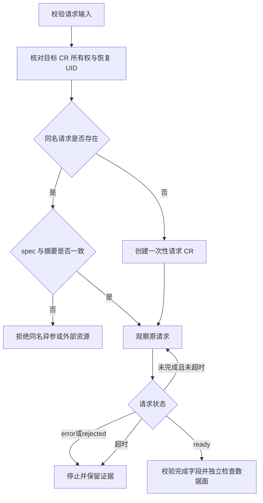

# Percona MongoDB 开发手册

本文面向 kubeauto 维护者，说明配置、资源所有权、供应链和验收的扩展边界。适用固定版本为 Operator 1.23.1 / Chart 1.23.2、PSMDB 8.0.32-14、PBM 2.15.0。业务机制见[技术白皮书](technical-whitepaper.md)，客户操作见[用户与运维手册](operations-manual.md)。

## 任务索引

- 修改配置：[配置到资源的路径](#配置到资源的路径)、[保持控制边界](#保持控制边界)。
- 修改备份/恢复：[不可变请求](#不可变请求)、[恢复状态与健康](#恢复状态与健康)。
- 更新版本或镜像：[六仓依赖和固定制品](#六仓依赖和固定制品)。
- 修改测试：[验证阶梯与清理](#验证阶梯与清理)。
- 维护实测结果与客户说明：[实测数据与客户文档的维护](#实测数据与客户文档的维护)。
- 发布文档和功能：[发布判据](#发布判据)。

## 配置到资源的路径

`kubecli new` 将固定版本填入部署目录的 `config.yml`。`kubecli download -E mongodb` 按组件镜像集合下载并灌入项目 Registry；`kubecli setup DEPLOYMENT 07 --tags mongodb` 执行独立 addon 任务。`DEPLOYMENT` 是部署目录名称，不是 MongoDB CR 名或命名空间，三者需要分别配置。

| 路径 | 责任和修改准则 |
| --- | --- |
| `common/constants.py` | Operator、Chart、数据库、PBM、Fluent Bit、Exporter 的固定版本，以及 `component_images.mongodb`；新增镜像先完成所属制品仓验收 |
| `service/cluster/manager.py` | 新部署配置版本替换；不替客户自动修改已有部署版本 |
| `conf/config.yml` | `mongodb_*` 公开输入；默认 `mongodb_install: no`，不使用隐式环境变量保存客户密码 |
| `roles/cluster-addon/tasks/main.yml` | 独立开关和 `mongodb` tag；关闭路径不改变既有组件 |
| `roles/cluster-addon/tasks/mongodb.yml` | 校验、预检、Chart/CRD、声明、健康和一次性请求的有序执行 |
| `roles/cluster-addon/files/mongodb.py` | 产品校验及 Kubernetes/MongoDB API 适配；复用控制节点既有 Python/PyYAML 和项目提供的 kubectl/mongosh，不引入 MongoDB Python 驱动 |
| `roles/cluster-addon/templates/mongodb/` | Operator values、集群 CR、入口网络策略、Exporter Service 和可选 ServiceMonitor |
| `roles/cluster-addon/files/psmdb-operator-*.tgz*` | 原版官方 Chart 和 SHA256；Chart 与 Operator 版本分别核验 |
| `tests/mongodb-test-matrix.yaml` | 43 项能力、入口、反证和证据的权威映射 |
| `tests/helpers/mongodb-*.py`、`mongodb-*.sh` | 固定实验室运行、夹具、断言、首失败诊断和限定清理；不是客户安装工具 |

新增输入时先明确类型、取值范围、默认来源、重启影响和错误行为，再修改校验及模板。不要仅向模板传递任意 YAML；这会绕过安全和幂等契约。例如已有集群改变 StorageClass、加密密钥或是否分片，会被预检拒绝，必须通过独立数据迁移设计提供新能力。

`mongodb_volume_expansion_enabled` 默认 false，旧配置缺字段时也保持关闭，模板不新增 `storageScaling`。开启后只设置 `storageScaling.enableVolumeScaling: true` 与 `autoscaling.enabled: false`，由 Operator 管理显式声明扩容。预检要求 StorageClass 允许扩容，比较已有各副本集及 config server 的卷声明：减小拒绝，增大必须显式开启。健康检查在启用时另外等待 PVC 实际 capacity 达到声明且 `Resizing`、`FileSystemResizePending` 不再为 True；文件系统、负载和数据完整性仍由容量场景独立验证。固定上游 `PerconaServerMongoDBSpec.IsVolumeExpansionEnabled` 优先读取 `storageScaling`，不能只写已废弃的 `enableVolumeExpansion` 字段。

## 保持控制边界

Operator Chart 保持官方原包及 SHA256。`mongodb.py operator-render` 使用已列入控制节点依赖的 PyYAML 读取 Helm 标准输入，通过 Helm 的 `--post-renderer python3` 与重复 `--post-renderer-args` 调用；它仅为固定名称、命名空间、容器和镜像均匹配的 Deployment 增加对象存储 CA 投射卷、只读挂载、信任目录与摘要注解，其余 Chart 对象保持。post-renderer 的标准输出只允许 Kubernetes 清单，校验失败必须非零退出，不能输出凭据或将日志混入清单。

预检汇总期望配置、同命名空间自有数据库和自有数据库保留备份状态中的 MinIO `caBundle`，按 Secret 名称及 key 去重排序，读取公开键计算摘要；只向渲染参数传递引用和摘要。变更一个数据库配置不能丢失另一个自有消费者的 CA，缺失输入不得降级为系统默认信任。`SSL_CERT_DIR` 保留常用系统目录并增加专用投射目录；CA 摘要变更触发 Operator 滚动，数据成员仍由 Operator 管理。静态入口须实际执行 Helm post-renderer 并检查最终投射键与 namespace/RBAC，不能只测试纯函数。

固定上游 `deleteBackupImpl` 对 MinIO 文件删除内部跳过证书验证，`DeletePITRChunks` 则验证进程 CA；该差异必须保留在客户能力边界中。补充控制器 CA 不能被描述为消除了前者，任何改变该行为的上游版本或镜像都需要重新审计源码和制品并补对应聚焦证据。

kubeauto 使用 `kubeauto-mongodb` field manager 管理声明；Operator 负责 StatefulSet、成员角色、PVC 和运行配置。测试也必须通过配置和 kubecli 创建/变更产品，不得用直接 Helm、kubectl patch 或 SSH 代替被验收入口。直接命令只用于业务客户端、只读诊断及有清晰所有权的测试夹具。

命名空间与产品资源使用 `app.kubernetes.io/managed-by: kubeauto`、`kubeauto.io/component: mongodb` 标记。测试夹具具有独立组件标记和 run ID。名称相似不足以证明所有权；删除前必须校验 UID，PVC 对应的 PV 还要检查完整 claimRef（namespace/name/UID）和 StorageClass。

Secret 是客户提供的稳定输入。系统用户必须彼此不同，应用用户显式指定 Secret/key 与数据库角色。预检把系统密码和 TLS 材料纳入 revision 摘要，使变更进入声明式滚动；加密主密钥单独摘要，禁止普通替换。摘要不是密钥托管，也不能替代证书链、SAN、有效期和业务认证验证。

数据卷由 StatefulSet 的固定名称引用。Kubernetes 1.33.6 的 `stateful_pod_control.go/createPersistentVolumeClaims` 查询到同名 PVC 时只检查是否正在删除，并不会核验本项目的数据所有权；固定 Operator 的 `volumes.go/reconcilePVCs` 还会协调卷标签。因此产品在发布 CR 前检查同名前缀的实际数据卷：新集群拒绝任何既存同名 PVC；已有自有集群核对 Operator/instance 标签、命名空间、StorageClass、删除状态及绑定 PV 的 namespace/name/UID。保留旧卷不授权新建同名 CR 自动接管，也不能通过修改标签绕过检查。客户提供的 Secret 只读消费，不能把 PVC 的接管规则误用于覆盖客户密钥材料。

Operator 只获得命名空间范围的工作负载权限，Chart 固定 `watchAllNamespaces: false`、关闭遥测。CRD 是共享集群资源：默认禁止 schema 变化，显式升级仅允许向当前固定 Chart 前进，并拒绝存在外部或共享消费者；升级前保存原 schema。不能把旧 schema 覆盖回去作为普通回滚。

`reconcile_crds` 处理 Helm 首装与产品升级之间的字段移交。[Percona 的 Helm 升级说明](https://docs.percona.com/percona-operator-for-mongodb/update-crd-helm.html)明确主 Chart 默认不更新 CRD；Kubernetes 的[字段冲突规则](https://kubernetes.io/docs/reference/using-api/server-side-apply/#conflicts)又会拒绝新 manager 覆盖原 Helm 字段。产品仅对已显式授权、消费者隔离且与校验通过的旧 Chart 一致的 schema 和版本标签移交所有权。提交内容限制为 `spec.versions`、版本标签及原 UID/resourceVersion，局部意图使用官方示例的 `--validate=false`，避免 kubectl 按完整 CRD 要求补齐未移交字段；API Server 仍校验合并后的对象。先 server dry-run，再保存私有备份并执行同一变更；不移交其它 spec、标签或注解。UID/resourceVersion 缺失或漂移、未知旧 schema/版本标签、预校验失败均须拒绝。契约覆盖真实两版 Chart、Helm 冲突、最小字段范围、预校验先于写入以及上述拒绝分支。

对应上游实现以 [Operator 固定源码](https://github.com/percona/percona-server-mongodb-operator/tree/a4367b91e914abe73bacf85e9a7f4b587addd40c)的 `pkg/controller/perconaservermongodb`、`pkg/psmdb` 及官方 Chart/CRD 为准。新版本需特别核验默认值、资源标签、StatefulSet 重建与系统用户角色，不能只修改版本常量。

分片扩缩继续使用同一配置与产品入口。新增副本集前检查内外 TLS 的新角色 SAN；测试不得通过跳过证书校验完成新增。缩容由固定上游 `psmdb_controller.go/checkIfUserDataExistInRS` 与 `mgo.go/removeRSFromShard` 管理：先排空业务数据及数据库元数据，产品声明再移除副本集，Operator 完成原生 removeShard 和 StatefulSet 删除。测试在退役卷前必须再次通过 TLS mongos 验证 shard 列表与数据、完整索引摘要，等待 donor 工作负载消失，并一次性校验全部 PVC/PV 的 UID、claimRef、StorageClass 与回收策略后才删除第一份卷。测试中的小卷仅用于独立夹具，不改变客户默认容量；分片 chunk 搬迁与未分片集合搬迁的证据分别判断。

`mongodb_logrotate` 默认空映射，不向 CR 注入自定义轮转。非空时校验三字段整数及范围，在启用日志收集的前提下生成 `spec.logcollector.logrotate.schedule/configuration`。配置必须同时包含 `/data/db/logs/mongod.full.log` 和 `mongos.full.log`，否则替换原生完整配置会漏掉 mongos。沿用固定上游的 `nocompress`、`copytruncate`、本地原生 `logRotate` 与七天原始日志清理，不接受任意脚本。依据为固定 Operator 源码的 `build/logcollector/logrotate/logrotate.conf`、`pkg/psmdb/logcollector/logrotate/container.go` 及[官方日志轮转主题](https://docs.percona.com/percona-operator-for-mongodb/logrotate.html)。契约需覆盖两版官方 CRD、实际 logrotate 解析及缺省兼容；现场通过配置与 kubecli 验证原生 ConfigMap、sidecar 周期、真实轮转、空间、业务与卷/凭据身份。

非空轮转配置同时生成官方 `spec.initContainerSecurityContext`：`runAsUser: 0`、`runAsNonRoot: false`、`allowPrivilegeEscalation: false`，能力先 `drop: [ALL]`，再仅增加 `CHOWN`、`DAC_OVERRIDE`。这是固定上游 `build/init-entrypoint.sh` 递归整理共享目录与轮转配置挂载点在重启后发生所有权冲突的兼容措施，不修改官方镜像或控制器生成的 StatefulSet。`pkg/psmdb/init/init.go` 消费该字段；`pkg/controller/perconaservermongodbrestore/physical.go` 中 PBM 初始化也复用它，因此维护此上下文须分析物理恢复影响。空映射不生成该字段；不得把同一权限扩散至数据库、Exporter 或其它长期运行的 sidecar。验收须包括启用自定义轮转后的真实节点重启与初始化重放，不能只以首次安装或 CRD 校验通过代替；Restricted 准入限制必须同步客户文档。

## 不可变请求

备份和恢复由 `mongodb_requests` 定义。请求名必须以目标 CR 名和连字符开头，同名异参或外部所有者拒绝执行。产品把规范化 spec 和目标 UID 编码为摘要；备份显式补充启动截止时间和 gzip 默认值，避免 API 默认字段造成虚假的身份差异。



恢复要求当前目标 CR 的 UID。新建同名目标会产生不同 UID，旧请求必须拒绝。`backup_name` 与外部 `destination` 二选一；外部来源还需显式备份类型，且只能位于配置的 bucket。时间点要求精确 UTC，产品不替用户推断本地时区。

一次请求完成后，从配置移除它只停止继续观察，不等于删除备份对象或对象存储数据；需要新操作时使用新的受控请求名。备份删除、保留策略和 PITR 链维护是独立生命周期，不能由“再次安装”隐式执行。

固定版本 `psmdb_backup_controller.go/deleteBackupFinalizer` 在 PBM 元数据存在时调用当前数据库的 `Backup.MainStorage()`；`psmdb_types.go` 在存储列表为空时返回 `main storage not found`。因此临时备份流程必须先关闭计划、保留已收敛的原存储，完成独立恢复和原生对象删除，最后恢复原配置。测试的保留备份恢复只允许精确匹配 journal 的暂停配置：源 UID、bucket/prefix、凭据与 CA 引用、TLS 和计划状态均须复验；普通恢复仍拒绝未完成的配置变更。已经提前恢复关闭配置的失败清理，须先通过 config+kubecli 重新启用该 journal 的存储，重新读取并验证剩余备份 UID，再继续原生删除；不直接修改 PBM 集合或解除 finalizer。

`mongodb_backup_schedule_enabled` 映射到 `spec.backup.tasks[].enabled`，与 PBM 的 `spec.backup.enabled` 分开。未配置新字段时保留 true 的原默认值；独立恢复目标显式设为 false，并关闭 PITR，避免空目标向源前缀产生新备份或归档。固定上游 `backup.go/reconcileBackupTasks` 跳过 disabled task，并回收不再启用的内存计划；它不等于删除历史备份或取消已经开始的请求。修改此映射需要分别验证任务声明与按需请求。

首次同时启用备份和计划时，`prepare-backup` 先用相同字段管理器发布暂停 tasks/PITR 的临时声明，等待每个数据成员的 `backup-agent` Ready 和完整数据面健康，再由原任务发布最终声明。临时文件只保存在私有目录，退出即回收；不改写客户配置，也不操作 PBM 内部元数据。已有集群且所有代理就绪时跳过准备，关闭计划或备份时也不进入该阶段。原因来自固定 Operator 1.23.1 的 `smart.go` 与 `backup.go/isBackupRunning`：`requested` 备份会阻止 SmartUpdate；若 cron 在加入代理前触发，两者会互相等待。代理健康检查同时覆盖分片的 config server，不能只看 CR 的 ready 数量。此编排只防止新请求提前开始；已有运行请求仍由 Operator 保护，不能通过移除 finalizer 或直接改数据库状态绕过。

## 恢复状态与健康

官方 1.23.1 的物理恢复在 PBM 和各副本集完成后设置 `state: ready` 与 `pbmName`，不保证提供 `completed`。因此恢复完成谓词与备份不同：备份还必须具备 `completed` 和 `destination`。这一差异需沿固定 `perconaservermongodbrestore/physical.go` 核验，不能把某个恢复状态字段推广到所有 CR。

`ready` 后的独立健康检查要求当前 CR generation 已观察、期望数量的 Pod Ready、主机故障域不同、数据 PVC Bound，以及各副本集恰有一个 Primary、其它成员正常、投票/majority 配置符合预期、静态加密启用。分片还需期望数量的 mongos。最终业务测试另外检查认证、数据类型、索引、摘要和恢复点前后边界。

物理恢复会删除和重建 StatefulSet、Pod 及关联 PDB，测试可以接受由已核验父 UID 所拥有的替代对象，不能接受任意同名对象。恢复时序诊断只读取目标 CR、Pod、StatefulSet、Service 与 EndpointSlice 的受限字段，以带超时的 API 请求采样；退出时停止并回收线程，不把 Secret 或任意 spec/status 写进报告。

当数据库持续 rollback、出现 stable timestamp 异常或 Operator crash recovery 时，先保存 PBM、控制器、逐成员和 DNS/端点的时序证据。禁止默认清卷、强制重配、自动升级到未发布镜像或放宽成员数量。修复应先确定因果层；没有受支持的修复，相关矩阵项继续失败。

## 六仓依赖和固定制品

六仓是兼容性审计单元，并不要求每次重建全部镜像。MongoDB 主要修改消费者 `kubeauto` 和外部镜像目录 `kubeauto-ext-images-dockerfile`；产品镜像仓消费 kubeauto release tag，扩展二进制仓提供既有 Helm/kubectl。未改变这些接口时保留它们已固定的制品。

生产、升级、回退、备份、性能及测试基础设施镜像必须事先盘点。新增制品进入所属功能目录的官方来源、固定版本 Dockerfile，注册双推 CI，执行 catalog validator，再核验 TalkEdu 与 Docker Hub 的 AMD64/ARM64 manifest/digest。国内优先 `hub.talkedu.cn/kubeauto`，保留已核验回退；动态发现的代理只能作为非持久化测试参数。

当前升级夹具为 Operator 1.23.0 / Chart 1.23.1、PSMDB 8.0.26-11 和 Fluent Bit 5.0.9-1；它们是受控验证输入，不是客户自动降级候选。PBM、MinIO/mc、CSI 和客户端镜像同样需要固定制品证据。测试基础设施的 PASS 不能替代数据库能力验收。

`preflight` 在已有 CR 所有权核验后，分别比较现有 `spec.image` 的数据库 tag 和 `spec.crVersion` 的 Operator 版本。仅允许固定版本对内保持或前进；新→旧及未知现有版本必须在发布声明前拒绝，不读取 FCV 来放行。两条拒绝路径需要确定性契约与实际 config+kubecli 拒绝证据，独立备份恢复另行验收。扩展允许版本时须先取得该精确组合的官方依据、制品及数据格式验证，不能只调整版本排序。恢复到兼容旧目标使用独立 CR 和新卷，不能撤销此保护后对现有卷试降级。

## 验证阶梯与清理

在源码仓根目录执行下面的本地检查。工具路径有隔离环境时通过 runner 已公开的运行参数提供，不修改生产默认值。

```bash
bash tests/run_unit_tests.sh
bash tests/run_enterprise_regression.sh --mongodb-static
```

静态检查应覆盖 Python/Shell/YAML、真实官方 Helm 与 Ansible 渲染、部署 inventory 绑定、命名空间/所有权/端口/镜像/标志/退出码，以及关闭路径。修改断言时先添加能反证具体错误的确定性契约，再进入对应最窄分支；语法或聚焦失败均阻断完整现场回归。

现场主机、租约和权限以项目 `AGENTS.md` 和 `tests/README.md` 为准，不从客户手册复制实验室机器。总 runner 持有共享租约后同步源码，并维护 durable PID、日志、退出码、心跳、诊断和清理。活动门禁期间不得并发同步或启动第二个现场模块。

```bash
bash tests/run_enterprise_regression.sh --mongodb-status
bash tests/run_enterprise_regression.sh --mongodb-follow
```

模块证据必须同时包含预期业务标志、限定清理标志、durable `rc=0` 和零失败标志。健康 runner 基线可以在身份、依赖、服务、数据和无故障残留复验后复用；失败的尝试不是新基线。按实际依赖使受影响项回到 pending，保留未受影响的当前证据。

清理先核验完整资源图与所有卷，再开始删除。外部资源、未知 finalizer、重新绑定的卷或改变的核心身份必须阻断删除。仅针对已进入删除流程的独立一次性目标，可在完整验证后以 UID/resourceVersion/旧 finalizer 的 JSON test 限定恢复；这个机制不授权修复客户数据库或解除正常集群保护。

无安装 journal 的清理也必须证明目标图和卷均不存在。核心已建而 MongoDB CRD 不存在时，只跳过不存在的自定义 API，继续验证 Kubernetes 原生资源；API 不可达不能当作对象不存在。

## 实测数据与客户文档的维护

客户文档的数据应能从当前能力证据定位回原始输入与输出。`tests/mongodb-test-matrix.yaml` 负责能力映射；`tests/evidence/mongodb-full-20261018.json` 记录完整运行的模块、日志 SHA256、退出状态与执行时冻结输入；文档评审记录单独绑定三手册正文。它们回答不同问题，不能用产品 PASS 替代文字评审，也不能把后来修改的文档摘要写回历史执行输入并声称重新运行。

| 客户说明 | 实现与结果定位 | 更新时必须保留的口径 |
| --- | --- | --- |
| 模型、类型、索引及事务 | M09/M10 与 M28；data、transactions、sharding-data 日志 | 199 条为 CRUD 后结果；区分正确性与查询性能，解释性订单模型不声称实测 |
| majority、故障和追赶 | M11–M14/M29/M33；failover、quorum、rebuild、capacity | 确认账本、角色/身份、拒绝原因与逐成员摘要；未测接管时间不填 RTO |
| 恢复、保留及原材料 | M17/M19–M26/M31；backup/restore、PITR、encryption、retention、disaster-recovery | 新目标、BSON/索引/账号、前后边界、对象 SHA；数据库源丢失与整站丢失分别判断 |
| 权限、轮换和告警 | M15/M16/M18/M34；security、rotation、network、observability | 允许与拒绝均验证；monitor 的跨库 find、MinIO 删除 TLS 例外不能删去 |
| 性能与持续负载 | M35/M36；`MONGODB_PERFORMANCE_PROFILE`、`MONGODB_STABILITY_PROFILE` | 精确阶段、负载、实际 elapsed、样本和账本；小数据集不外推容量，重试次数不当失败交易数 |
| 扩缩与升级 | M30/M32/M33/M37/M38 | 有数据的迁移、完整索引、投票、卷身份；固定版本对和独立恢复回退出口 |

性能 worker 位于 `tests/helpers/mongodb-scenarios.py` 的 `PERFORMANCE_WORKER`，每个 worker 建立独立连接并预热，窗口内四读一次账本 upsert，账本键包含 phase/worker/sequence。`performance_result` 汇总全部样本，以实际 elapsed 计算 ops/s，nearest-rank 取 P50/P95/P99；单操作样本包含首次尝试到最终成功的受控重试等待。`Performance` 和 `Stability` 随后逐条核对已确认写入，不仅检查总数。当前允许错误仅针对受控故障，不能据此替业务驱动定义一组任意可重试错误。

`Performance.resources()` 消费 kubelet stats summary，采样包含数据库 Pod 和客户端的 working set、累计 CPU、网络字节及卷占用。正文只能称时间点采样，不能称峰值或直接把 `cpu_ns` 当 CPU 使用率；Pod 重建后累计计数的差值也需核对 UID 与计时边界。稳定性测试客户端的内存及 TLS 状态维护是测试负载实现，不是产品新增连接能力。

维护流程先固定版本和客户问题，再复用相关官方主题与现有证据，在正文写出条件、实际结果、解释与边界。新增/改变生产操作时补最小验证；纯解释、图形或已有数据整理，执行文档检查，不新建实验室或重复 GA。必要的本地入口为：

```bash
bash tests/run_enterprise_regression.sh --mongodb-documentation
```

此入口校验已完成人工内容检查的记录与当前文本/证据绑定，不会自动判断解释是否透彻。作者须先完成一次全文内容检查、首次部署与熟练运维两条文档路径、图形实际渲染和图文核对，并分别记录来源、静态与操作证据；未安排独立评审或客户验收时不得冒称完成。文档修改后的新记录保留历史执行摘要，以明确的影响分析复用未变产品证据。

## 发布判据

完整入口为 `bash tests/run_enterprise_regression.sh --mongodb-only`，只有该分路全部模块实现并完成前置聚焦验证后才允许启动。尚未实现的模式必须明确拒绝，不能拼接部分模块日志创造完整成功结论。最终需干净完整运行、43 项当前证据、durable `rc=0`、零失败、终端成功标志和 `LAB_CLEAN_VERIFY_PASS`。

客户目录只保留本手册、用户与运维手册、技术白皮书。根 README 与中间件索引的三文档链接和状态一致；全部门禁完成前不能标记“已交付”。文档来源、内容、图形渲染、两类读者路径和操作证据分别评审，测试 PASS 不能代替说明是否准确、连续、可判断和可恢复。
