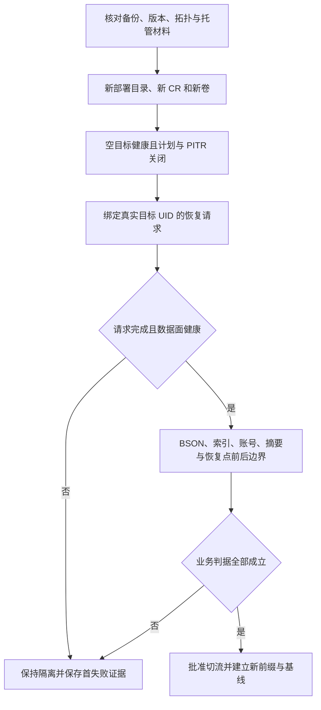
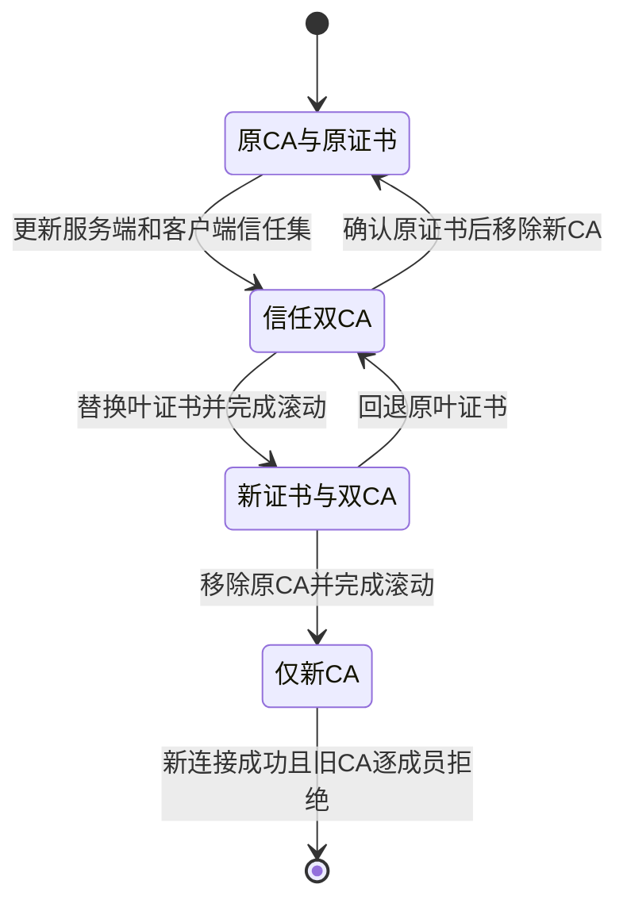

# Percona MongoDB 用户与运维手册

本文面向平台管理员、DBA 和业务开发者，覆盖 kubeauto 中 PSMDB 8.0.32-14、Operator 1.23.1 / Chart 1.23.2、PBM 2.15.0 的部署、使用与维护。管理员需掌握 Kubernetes、CSI、证书和 Secret 管理，业务开发者需掌握 BSON 与驱动会话。架构取舍见[技术白皮书](technical-whitepaper.md)，实现接口见[开发手册](development-manual.md)。

## 任务索引与准入

- 首次使用：[规划](#规划与前置检查) → [准备凭据](#准备命名空间和稳定凭据) → [产品安装](#配置并安装副本集) → [应用验证](#通过真实客户端验证业务)。
- 日常运维：[巡检与故障入口](#巡检与故障入口)、[密码与证书轮换](#密码与证书轮换)、[容量与变更](#容量扩缩与版本变更)。
- 数据保护：[备份](#备份与保留)、[独立恢复](#独立恢复和时间点恢复)、[下线](#下线与数据保留)。
- 熟练人员：[参数速查](#参数速查) → 对应任务的前置、验收与恢复分支。

本版本已在 Kubernetes 1.33.6 完成[43 项专项验收](../../../tests/mongodb-test-matrix.yaml)及[干净完整回归](../../../tests/evidence/mongodb-full-20261018.json)，包含逻辑/物理独立恢复、PITR、分片和源数据库集群丢失恢复。Operator 发布说明的主要云平台测试范围为 Kubernetes 1.34–1.36（GKE 为 1.34–1.35）；项目实测与厂商测试范围分别判断。客户上线仍须核对本地 CSI、故障域、PKI、数据规模与业务 SLO，不能只依据 Pod Ready 或复制实验室参数。

本手册中“本版本实践结果”均来自上述完整证据，用来说明步骤应产生什么业务结果；它们不是客户环境已验收的声明。推荐先完成三成员副本集主线，再建立数据保护，最后按实际需要启用分片或变更。核心机制与真实负载数据可直接查[白皮书](technical-whitepaper.md#容量与性能)。

## 规划与前置检查

推荐先使用三个有数据、有投票权的成员组成一个副本集；只有单副本集容量或处理能力无法满足需求，并完成分片键与运维成本评估后才使用分片。每个副本集需要至少三个可调度主机故障域。三个 Pod 分布在同一机架或共享故障域的存储上，仍可能同时失效。

客户平台基线按至少 16 CPU / 32 GiB 节点规划，再为数据库、PBM、Exporter、日志和重建峰值核算容量。这不是对所有负载的充分条件。默认每个数据成员 request 为 1 CPU / 2 GiB、limit 为 2 CPU / 4 GiB、WiredTiger cache 为 1 GiB，另有 sidecar 开销。100 GiB 是每个成员的卷容量，三副本可用业务容量不能相加。至少保留索引构建、oplog、恢复和 CSI 重建所需空间。

本节及后续 shell 命令由有权限的管理员在**已安装 kubeauto 的管理节点**的专用 Bash 会话执行，工作目录为 `/usr/local/kubeauto`。先启用失败停止；任何命令非零退出即停止该会话，排查后重新建立上下文，不继续粘贴后续步骤。输入 `DEPLOYMENT` 来自已经完成核心安装的 kubeauto 部署目录，其 `hosts` 必须绑定自身 `cluster_dir`，其 kubeconfig 必须指向目标生产集群。新平台先按[平台操作手册](../../operations-manual.md)完成 `kubecli new` 与核心安装；本手册从已健康的 Kubernetes 开始。

```bash
set -euo pipefail
cd /usr/local/kubeauto
read -r -p '已完成核心安装的部署目录名称: ' DEPLOYMENT
[[ "$DEPLOYMENT" =~ ^[a-zA-Z0-9][a-zA-Z0-9_-]*$ ]] || exit 1
test -s "clusters/$DEPLOYMENT/config.yml" || exit 1
test -s "clusters/$DEPLOYMENT/hosts" || exit 1
export KUBECONFIG="$PWD/clusters/$DEPLOYMENT/kubectl.kubeconfig"
test -s "$KUBECONFIG" || exit 1
kubectl config current-context
kubectl get --raw /readyz
kubectl get nodes
kubectl get storageclass
```

核对 context 与变更单一致，API `/readyz` 输出 `ok`；至少三台节点 Ready、可调度，且无 Memory/Disk/PID Pressure。StorageClass 必须来自平台团队，明确动态供给、故障域、卷扩容、回收与快照行为。使用能执行 NetworkPolicy 的 CNI；确认业务 Pod 到数据库 DNS、27017 和监控到 9216 的路径。所有节点时间同步，镜像 Registry 可访问。

> **停止与恢复：** API 不可达、存储能力不清楚、容量或故障域不足时，不执行数据库安装。先恢复平台或调整资源；不得通过关闭 TLS、认证、反亲和、持久化或多数派要求绕过准入。不要用开发机承担数据库节点。

## 准备命名空间和稳定凭据

以下主线使用命名空间 `mongodb`、集群 CR `mongodb-prod`、副本集 `rs0`、应用用户 `application` 和数据库 `appdb`。若改名，配置、SAN、URI 和 Secret 引用必须一起调整。

平台管理员事先通过组织 PKI 准备下列文件，存放在管理节点 `/var/lib/kubeauto/mongodb-prod/credentials`，目录 `0700`，私钥和密码文件 `0600`。已有 Secret 时从组织密钥托管系统复用原材料，不能重新运行生成步骤覆盖生产密码或主密钥。

| 文件 | 内容和来源 |
| --- | --- |
| `ca.crt` | PEM 信任链；分阶段 CA 轮换时可包含两套 CA |
| `tls.crt`、`tls.key` | 客户端入口的服务证书与匹配私钥，由 PKI 签发 |
| `internal.crt`、`internal.key` | 成员间证书与私钥，满足 MongoDB 成员证书主体属性及 server/client EKU 要求 |
| `system-users.env` | 五组系统账号与随机密码；初装时按下方生成，生产使用密钥托管系统保存原值 |
| `application.env` | 一行 `password=...` 的应用密码文件 |
| `encryption-key` | 文件内容为 32 个随机字节的 base64 字符串；另由独立密钥托管系统保管 |

证书 SAN 至少覆盖 `mongodb-prod-rs0.mongodb.svc.cluster.local` 和 `*.mongodb-prod-rs0.mongodb.svc.cluster.local`，并按实际连接补齐 Service 短名；分片还要覆盖 cfg、每个 shard 和 mongos 的相应 Service/Pod DNS。证书 O/OU/DC 等成员身份属性由 PKI 按 MongoDB 规则保持一致；单纯“PEM 能解析”不表示可以建立集群。CA 私钥不上传 Kubernetes，也不放入此目录的交付材料。

先完成 PKI 文件，再执行初装材料检查与**只生成一次**的随机凭据准备。该代码遇到已有密码或密钥文件立即停止，不覆盖它们。

```bash
export CREDENTIAL_DIR=/var/lib/kubeauto/mongodb-prod/credentials
test -d "$CREDENTIAL_DIR" || exit 1
chmod 700 "$CREDENTIAL_DIR"
for file in ca.crt tls.crt tls.key internal.crt internal.key; do
  test -s "$CREDENTIAL_DIR/$file"
  chmod 600 "$CREDENTIAL_DIR/$file"
done
openssl verify -CAfile "$CREDENTIAL_DIR/ca.crt" "$CREDENTIAL_DIR/tls.crt" "$CREDENTIAL_DIR/internal.crt"
openssl x509 -in "$CREDENTIAL_DIR/tls.crt" -noout -dates -ext subjectAltName
openssl x509 -in "$CREDENTIAL_DIR/internal.crt" -noout -dates -ext subjectAltName
for certificate in tls internal; do
  openssl pkey -in "$CREDENTIAL_DIR/$certificate.key" -check -noout
  diff <(openssl x509 -in "$CREDENTIAL_DIR/$certificate.crt" -pubkey -noout) \
       <(openssl pkey -in "$CREDENTIAL_DIR/$certificate.key" -pubout) || exit 1
done
python3 - <<'PY'
import base64, os, secrets
from pathlib import Path
p = Path(os.environ['CREDENTIAL_DIR'])
names = ('system-users.env', 'application.env', 'encryption-key')
if any((p/name).exists() for name in names):
    raise SystemExit('已有凭据文件：从托管系统核验并复用，不重新生成')
roles = {'BACKUP':'backup', 'CLUSTER_ADMIN':'clusterAdmin', 'CLUSTER_MONITOR':'clusterMonitor',
         'DATABASE_ADMIN':'databaseAdmin', 'USER_ADMIN':'userAdmin'}
values = '\n'.join(f'MONGODB_{role}_USER={user}\nMONGODB_{role}_PASSWORD={secrets.token_urlsafe(32)}'
                   for role,user in roles.items()) + '\n'
for name, value in [('system-users.env', values),
                    ('application.env', 'password='+secrets.token_urlsafe(32)+'\n'),
                    ('encryption-key', base64.b64encode(secrets.token_bytes(32)).decode()+'\n')]:
    fd = os.open(p/name, os.O_WRONLY | os.O_CREAT | os.O_EXCL, 0o600)
    with os.fdopen(fd, 'w') as stream:
        stream.write(value)
PY
```

逐一验证证书私钥与证书公钥一致、有效期覆盖维护周期，并把主密钥、系统用户原值、应用密码及必要 TLS 材料纳入受控离线备份。不要输出、提交或通过聊天传递密码文件。逻辑备份对象也可能包含用户数据，应分别加密和控制权限。

以下命令只适用于**全新且尚不存在**的数据库命名空间；`create` 遇到同名对象会失败，停止后核对归属，不能自动接管现有命名空间。

```bash
kubectl create namespace mongodb
kubectl label namespace mongodb app.kubernetes.io/managed-by=kubeauto kubeauto.io/component=mongodb
kubectl -n mongodb create secret generic mongodb-prod-users --from-env-file="$CREDENTIAL_DIR/system-users.env"
kubectl -n mongodb create secret generic mongodb-prod-app --from-env-file="$CREDENTIAL_DIR/application.env"
kubectl -n mongodb create secret generic mongodb-prod-encryption-key --from-file="encryption-key=$CREDENTIAL_DIR/encryption-key"
```

TLS Secret 同时需要 `ca.crt`，使用三文件一起创建的方式，避免中间对象缺少 CA。

```bash
kubectl -n mongodb create secret generic mongodb-prod-tls --type=kubernetes.io/tls \
  --from-file="ca.crt=$CREDENTIAL_DIR/ca.crt" --from-file="tls.crt=$CREDENTIAL_DIR/tls.crt" --from-file="tls.key=$CREDENTIAL_DIR/tls.key"
kubectl -n mongodb create secret generic mongodb-prod-tls-internal --type=kubernetes.io/tls \
  --from-file="ca.crt=$CREDENTIAL_DIR/ca.crt" --from-file="tls.crt=$CREDENTIAL_DIR/internal.crt" --from-file="tls.key=$CREDENTIAL_DIR/internal.key"
kubectl -n mongodb label secret mongodb-prod-users mongodb-prod-app mongodb-prod-encryption-key mongodb-prod-tls mongodb-prod-tls-internal \
  app.kubernetes.io/managed-by=kubeauto kubeauto.io/component=mongodb
```

> **停止与恢复：** 任何文件或 Secret 创建失败，先确认已经创建的对象及来源，再补齐缺失输入。不得重新生成一整套材料覆盖部分成功状态。主密钥丢失不能通过生成新密钥修复旧数据；丢失 CA/密码也不应通过放宽认证恢复业务。

## 配置并安装副本集

管理员编辑同一部署目录的 `config.yml`，保留原有核心和其它组件配置。以下是需要合入的配置模板：`production-csi` 必须替换成前置检查确认的 StorageClass；容量和资源按业务评审结果填写，不照搬小型实验室配置。

```yaml
mongodb_install: "yes"
mongodb_namespace: mongodb
mongodb_name: mongodb-prod
mongodb_storage_class: production-csi
mongodb_pvc_size: "100Gi"
mongodb_replsets: [{name: rs0, size: 3}]
mongodb_sharding_enabled: false
mongodb_users_secret: mongodb-prod-users
mongodb_tls_secret: mongodb-prod-tls
mongodb_tls_internal_secret: mongodb-prod-tls-internal
mongodb_encryption_key_secret: mongodb-prod-encryption-key
mongodb_users:
  - name: application
    db: appdb
    passwordSecretRef: {name: mongodb-prod-app, key: password}
    roles: [{name: readWrite, db: appdb}]
mongodb_network_policy_enabled: true
mongodb_client_selector: {kubeauto.io/mongodb-client: "true"}
mongodb_client_namespaces: []
mongodb_requests: []
```

在前面已定义 `DEPLOYMENT`、`KUBECONFIG` 的管理节点 shell 执行产品入口。下载采用已发布固定镜像，不能在客户配置里加入临时公共代理。

```bash
kubecli download -E mongodb
kubecli setup "$DEPLOYMENT" 07 --tags mongodb
kubectl -n mongodb get psmdb mongodb-prod
kubectl -n mongodb get pods,pvc -l app.kubernetes.io/instance=mongodb-prod -o wide
```

产品先校验输入、Chart SHA256、资源归属、Secret 和存储，再安装限定命名空间 Operator、发布 CR/策略，默认最多等待 1800 秒完成健康检查。成功时 setup 退出 0，Ansible 汇总 `unreachable=0 failed=0`。CR 必须观察到当前 generation，三个数据成员分布在不同主机、PVC Bound、复制配置符合多数派且静态加密启用。然后继续业务验证；此时尚不能结束验收。

**本版本实践结果：** 相同配置重复 setup 已验证 CR、PVC、Secret 身份保持；关闭安装开关不创建或改变数据库。外部同名 PVC、namespace、Service、NetworkPolicy 和共享 CRD 消费者的拒绝场景也验证了原对象及数据不变。部署成功后还须完成下一节的真实应用认证与读写。

相同输入再次执行同一 setup 应保持 CR、PVC、Secret 身份，避免意外滚动。Helm 可能产生新的 release 历史，因此只看 Ansible `changed` 数量不能判断数据库是否幂等。

> **安装失败：** 在首个失败前置处停止，保留渲染目录 `clusters/$DEPLOYMENT/yml/mongodb`、CR 状态、Pod events 与 Operator 日志，按[故障入口](#巡检与故障入口)分类。不要先删除 PVC 或重建 namespace。`mongodb_install: no` 只停止执行该分支，不卸载数据库，也不是安装失败的回滚命令。

## 通过真实客户端验证业务

业务客户端必须位于能解析集群 DNS 并满足 NetworkPolicy 的网络中。下面的临时 Pod 位于 `mongodb` 命名空间，使用数据库镜像自带的 mongosh；只挂应用密码和 CA，不挂系统账号或私钥。管理员在同一管理节点保存并创建此独立验证清单，确认同名 Pod 不存在后再执行。

```yaml
apiVersion: v1
kind: Pod
metadata:
  name: mongodb-validation
  namespace: mongodb
  labels:
    kubeauto.io/mongodb-client: "true"
    kubeauto.io/component: mongodb-validation
spec:
  restartPolicy: Never
  automountServiceAccountToken: false
  containers:
    - name: client
      image: registry.talkschool.cn:5000/brinnatt/percona-server-mongodb:8.0.32-14
      command: ["sh", "-c", "trap 'exit 0' TERM INT; sleep 3600 & wait"]
      env:
        - name: APP_PASSWORD
          valueFrom: {secretKeyRef: {name: mongodb-prod-app, key: password}}
        - name: MONGODB_URI
          value: "mongodb://mongodb-prod-rs0-0.mongodb-prod-rs0.mongodb.svc.cluster.local:27017,mongodb-prod-rs0-1.mongodb-prod-rs0.mongodb.svc.cluster.local:27017,mongodb-prod-rs0-2.mongodb-prod-rs0.mongodb.svc.cluster.local:27017/appdb?replicaSet=rs0&tls=true&tlsCAFile=/tls/ca.crt&serverSelectionTimeoutMS=10000"
      volumeMounts: [{name: ca, mountPath: /tls, readOnly: true}]
      resources:
        requests: {cpu: "50m", memory: "128Mi"}
        limits: {cpu: "1", memory: "512Mi"}
  volumes:
    - name: ca
      secret:
        secretName: mongodb-prod-tls
        items: [{key: ca.crt, path: ca.crt}]
```

把清单保存为管理节点当前受控工作目录的 `mongodb-validation.yaml`，确认内容与目标名称一致，再执行：

```bash
export VALIDATION_UID
VALIDATION_UID=$(kubectl create -f mongodb-validation.yaml -o jsonpath='{.metadata.uid}')
test -n "$VALIDATION_UID"
umask 077
printf '%s\n' "$VALIDATION_UID" > mongodb-validation.uid
kubectl -n mongodb wait --for=condition=Ready pod/mongodb-validation --timeout=180s
kubectl -n mongodb exec -i mongodb-validation -- mongosh --quiet --norc --nodb --file /dev/stdin <<'JS'
const c = new Mongo(process.env.MONGODB_URI), d = c.getDB('appdb');
if (!d.auth({user:'application',pwd:process.env.APP_PASSWORD})) throw Error('应用认证失败');
const name = 'validation_' + new ObjectId().toHexString(), wc = {w:'majority',j:true,wtimeout:10000};
const check = r => {if(r.ok!==1 || r.writeConcernError || r.writeErrors?.length) throw Error('业务操作未获确认');};
try {
  check(d.runCommand({insert:name,documents:[{_id:'invoice-1',amount:Decimal128('19.95')}],writeConcern:wc}));
  if(d.getCollection(name).findOne({_id:'invoice-1'}).amount.toString()!=='19.95') throw Error('BSON 数值不一致');
  check(d.runCommand({update:name,updates:[{q:{_id:'invoice-1'},u:{$set:{paid:true}}}],writeConcern:wc}));
  if(d.getCollection(name).findOne({_id:'invoice-1'}).paid!==true) throw Error('更新未复验');
  print('应用 TLS 认证、majority+j 写入、BSON 读取和更新通过');
} finally {
  const r=d.runCommand({drop:name,writeConcern:wc});
  if(r.ok!==1 && r.code!==26) throw Error('验证集合清理失败');
}
JS
```

成功同时要求命令退出 0、看到业务通过输出、验证集合清理成功。客户端连接失败时先检查 DNS/策略/TLS/SCRAM，不降低校验要求。无论验证成功还是失败，都需回收自己创建的临时 Pod。失败导致会话退出后，先从同一受控工作目录的 `mongodb-validation.uid` 恢复 `VALIDATION_UID`，重新建立目标 kubeconfig 上下文；不能把当前同名 Pod 的 UID 当作原创建记录。以下清理先核对 UID 与组件标签，再向 API 提交带 UID 前置条件的删除请求，防止误删同名替代对象：

```bash
export VALIDATION_UID
VALIDATION_UID=$(cat mongodb-validation.uid)
test -n "$VALIDATION_UID"
kubectl -n mongodb get pod mongodb-validation -o json | python3 -c '
import json, os, sys
p=json.load(sys.stdin); m=p["metadata"]
if (m["uid"] != os.environ["VALIDATION_UID"] or
    m.get("labels", {}).get("kubeauto.io/component") != "mongodb-validation"):
    raise SystemExit("验证 Pod 身份不符，停止删除")
'
python3 - <<'PY' | kubectl delete --raw /api/v1/namespaces/mongodb/pods/mongodb-validation -f -
import json, os
print(json.dumps({"apiVersion":"v1", "kind":"DeleteOptions",
                  "preconditions":{"uid":os.environ["VALIDATION_UID"]}}))
PY
kubectl -n mongodb wait --for=delete pod/mongodb-validation --timeout=180s
```

预期删除请求成功且等待命令退出 0。身份不符或超时则保留记录并检查 Pod 归属、终止状态和 events，不强制删除其它对象。清单及本地敏感中间材料按平台策略回收，不删除数据库 Secret。

**如何判读业务输出：** 上面的客户端仅验证本次创建的集合；它看到成功输出、退出 0 并完成清理，才证明目标入口具备应用 TLS/SCRAM、majority+j 和 BSON 更新能力。完整产品验收另使用 200 条初始业务记录，完成更新/删除后为 **199 条**，并校验 Decimal128/Int64、唯一索引重复拒绝、TTL 最终删除和摘要；客户端例子的单条成功不能代替这些专项结果。索引和模型设计见[数据模型与查询执行](technical-whitepaper.md#数据模型与查询执行)。

应用使用官方兼容驱动维护连接池及拓扑发现，副本集 URI 应携带多个种子和 `replicaSet=rs0`；不要把 Pod IP 写入业务配置。根据请求预算分别设置连接、服务器选择、socket/操作与 write concern 超时；服务器写入超时不等于操作撤销。业务以唯一 ID 查询或幂等重试确认结果。跨文档转账使用事务和提交结果处理，外部副作用采用发件箱等业务机制。

## 分片入口与业务约束

新建分片目标时，显式设置 `mongodb_sharding_enabled: true`、`mongodb_replsets: [{name: rs0, size: 3}, {name: rs1, size: 3}]`、`mongodb_config_size: 3`、`mongodb_mongos_size: 3`。准备独立命名与凭据，证书覆盖全部角色，再通过相同产品 setup 安装。两个 shard 加 config server 需要九个数据 PVC；mongos 是路由层，不是数据副本。

业务 URI 改为 `mongodb://mongodb-prod-mongos.mongodb.svc.cluster.local:27017/appdb?tls=true&tlsCAFile=/tls/ca.crt&serverSelectionTimeoutMS=10000`，去掉 `replicaSet=rs0`，并验证 `hello.msg` 为 `isdbgrid`。应用权限仍只授予实际业务库。由 DBA 在 mongos 上为需要分布的集合选择分片键并执行 sharding 管理；普通未分片集合不会因为增加 shard 就自动分散。

分片键应兼顾基数、写入热点和查询路由。唯一索引需满足分片键前缀约束；分片事务需要各参与 shard 和 config server 保持健康。迁移验收检查 chunk 元数据、两侧数据和索引摘要、客户端业务及源范围清理。移除 shard 前必须排空用户数据并核验迁移结果；不得只从配置删除一行。

> **拓扑变更边界：** 已有非分片集群不能通过开关原地改成分片，也不能更换 StorageClass 或加密密钥。建立独立目标并完成数据迁移、写入冻结、追平、验证和入口切换；未完成这套过程时保留原集群。分片故障、扩缩与备份恢复必须取得各自专项验收，不能复用副本集结论。

## 备份与保留

先按本节准备存储与基线，再进入[独立恢复](#独立恢复和时间点恢复)。三个开关对应不同任务，避免以关闭整个引擎代替停计划：

| 任务状态 | `backup_enabled` | `backup_schedule_enabled` | `pitr_enabled` | 结果与下一步 |
| --- | --- | --- | --- | --- |
| 每日备份，尚未启用 PITR | true | true | false | 计划产生备份，仍需独立恢复验证 |
| 只做按需备份/保留维护 | true | false | 按批准策略 | 停止新定时请求；保留引擎、存储与原历史 |
| 独立恢复目标读取源备份 | true | false | false | 防止空目标计划/归档污染源恢复链 |
| 完全关闭备份 | false | false | false | 必须先完成批准删除与保留备份复验；不能供恢复读取 |

表中省略公共前缀 `mongodb_`，实际配置必须使用完整名称。关闭计划不取消已经开始的请求，也不删除历史。

DBA 先确定业务 RPO/RTO、对象存储故障域、加密和保留策略，再配置备份。对象存储应独立于数据库所在故障域，提供 TLS、容量与访问审计。下面是需要替换为真实对象存储的配置模板：bucket 不带前缀，prefix 单独设置，凭据 Secret 包含 `AWS_ACCESS_KEY_ID`、`AWS_SECRET_ACCESS_KEY`，不得把密钥写入 YAML。

由对象存储管理员先创建 bucket 和专属服务账号，将权限限定到所选 bucket/prefix 的备份写入、列举、读取和受控删除；不能只授予写入而遗漏恢复读取与保留清理权限。在前文管理节点会话中，从组织密钥托管系统取得 `backup.env`，放入既有 `CREDENTIAL_DIR`。文件仅包含上述两个键各一行，值来自该服务账号，不使用数据库密码。以下步骤检查输入并创建全新 Secret，重复执行遇到同名对象时停止；已有 Secret 应核对 UID、引用及托管记录后复用，不覆盖它。命令最长等待 API 30 秒，全部退出 0 且最后出现标志才完成凭据准备；不输出密钥。

```bash
test -s "$CREDENTIAL_DIR/backup.env"
chmod 600 "$CREDENTIAL_DIR/backup.env"
python3 - <<'PY'
import os
from pathlib import Path
rows = Path(os.environ['CREDENTIAL_DIR'], 'backup.env').read_text().splitlines()
values = {}
for row in rows:
    key, separator, value = row.partition('=')
    if not separator or not value or key in values:
        raise SystemExit('备份凭据必须是两个不重复且非空的键值行')
    values[key] = value
if set(values) != {'AWS_ACCESS_KEY_ID', 'AWS_SECRET_ACCESS_KEY'}:
    raise SystemExit('备份凭据键名不符合要求')
PY
kubectl --request-timeout=30s -n mongodb create secret generic mongodb-prod-backup \
  --from-env-file="$CREDENTIAL_DIR/backup.env"
kubectl --request-timeout=30s -n mongodb label secret mongodb-prod-backup \
  app.kubernetes.io/managed-by=kubeauto kubeauto.io/component=mongodb
printf '%s\n' 'MONGODB_BACKUP_CREDENTIALS_PREPARED'
```

> **停止与恢复：** 创建或标记失败时停止，检查同名 Secret 的来源、UID 和引用。只由该对象持有者修复权限或补齐缺失标签；不删除已被其它集群引用的 Secret。后续备份失败时保留此身份和诊断，轮换须先在对象存储授权新账号，再更新受控 Secret 并复验备份与恢复读取，最后撤销旧账号。

```yaml
mongodb_backup_enabled: true
mongodb_backup_storage_type: s3
mongodb_backup_storage_name: main
mongodb_backup_bucket: company-mongodb
mongodb_backup_prefix: production
mongodb_backup_region: us-east-1
mongodb_backup_endpoint: https://objects.example.com
mongodb_backup_credentials_secret: mongodb-prod-backup
mongodb_backup_schedule_enabled: true
mongodb_backup_schedule: "0 2 * * *"
mongodb_backup_schedule_type: logical
mongodb_backup_retention_count: 7
mongodb_pitr_enabled: false
```

公有可信 CA 的 S3 接口使用 HTTPS URL；私有 CA 的兼容对象存储使用 `mongodb_backup_storage_type: minio`，endpoint 填 `hostname:port`（不带 scheme），通过 `mongodb_backup_ca_secret` 和 `mongodb_backup_ca_key` 提供 CA bundle。产品声明强制 HTTPS 且不设置跳过证书校验；备份代理根据该 CA 验证对象存储。控制器删除路径还有下述固定版本限制，不能据配置声明推断所有内部请求均验证证书。

> **MinIO 删除路径的版本边界：** Operator 1.23.1 的备份文件删除代码会在内部开启 `InsecureSkipTLSVerify`，即使 CR 中为 false；PITR 对象删除走另一条路径，仍验证控制器的 CA 信任。这是锁定上游实现的行为，本项目没有修改其镜像。要求所有对象操作都执行服务端证书验证的环境，应选择使用公有可信 CA 的 S3 路径，并完成相应删除及恢复验收；不能将 MinIO 路径签收为符合该要求。限制见[白皮书](technical-whitepaper.md#数据保护与恢复)。

私有 CA 分支还需由 PKI 管理员提供对象存储的真实 CA bundle，保存在 `$CREDENTIAL_DIR/object-store-ca.crt`；它可以与数据库 CA 不同，不能用数据库证书猜测代替。先核对对象存储证书链、有效期和 endpoint 主机名，再在同一 context 创建 Secret。以下步骤只创建信任材料，不修改数据库 TLS；任何失败即停止并按原 UID 核验已创建对象。

```bash
test -s "$CREDENTIAL_DIR/object-store-ca.crt"
kubectl --request-timeout=30s -n mongodb create secret generic mongodb-prod-backup-ca \
  --from-file="ca.crt=$CREDENTIAL_DIR/object-store-ca.crt"
kubectl --request-timeout=30s -n mongodb label secret mongodb-prod-backup-ca \
  app.kubernetes.io/managed-by=kubeauto kubeauto.io/component=mongodb
printf '%s\n' 'MONGODB_BACKUP_CA_PREPARED'
```

同时将配置中的 storage type 改为 `minio`，填写真实 `hostname:port`，设置 `mongodb_backup_ca_secret: mongodb-prod-backup-ca` 和 `mongodb_backup_ca_key: ca.crt`。CA Secret 创建成功只证明 Kubernetes 接收材料；后续备份与独立恢复读取均通过才证明该信任链和访问权限可用。轮换时先提供包含新旧信任链的 bundle 并复验，再更换服务端证书，最后移除旧 CA；不要同时替换信任和服务端证书而失去恢复入口。

同一 setup 也会把对象存储的**公开 CA 键**只读挂载到命名空间 Operator 的信任目录，保留系统证书库；不会挂载对象存储账号或 TLS 私钥。由于一个 Operator 服务同命名空间的多个集群，产品汇总该命名空间自有数据库及其保留备份 CR 引用的 CA，避免为一个集群执行 setup 时移除另一个集群的信任。CA 内容摘要变化会滚动 Operator，其 Helm 就绪等待最多 10 分钟；任一仍被引用的 CA Secret 缺失时停止，先恢复原材料。保留备份的 CR 和 CA 引用必须共同纳入数据保护记录，删除 CA 前先确认相应备份已经受控退役。

备份配置合入后，通过同一个 setup 入口收敛。计划开关默认 true；首次启用时，产品先暂停计划与 PITR，等待所有数据成员（分片模式包括 config server）的 PBM 代理就绪，再发布最终计划。这样可避免定时请求先占用备份锁，而 Operator 又为保护该请求暂停安装代理所需的滚动更新。准备和最终声明各受 `mongodb_ready_timeout`（默认 1800 秒）约束；准备失败即停止，不开放计划。生产时间区、维护窗口和对象存储写权限要事先确认。

只需按需备份、PITR 或恢复时，设置 `mongodb_backup_schedule_enabled: false` 并保持 `mongodb_backup_enabled: true`：产品保留 PBM 和存储配置，Operator 停止该定时任务，不影响已有备份或显式请求。重新设为 true 并 setup 后恢复计划。需要手动基线时，添加如下**一次性请求模板**，按变更单使用新的请求名，保留其身份记录：

```yaml
mongodb_requests:
  - {kind: backup, name: mongodb-prod-baseline-20261016, type: logical}
```

再次 setup 默认最多等待 7200 秒，命令需退出 0；备份还需 `state: ready`、完成时间及外部 destination。管理员使用 `kubectl -n mongodb get psmdb-backup "$REQUEST_NAME" -o yaml` 检查状态；`REQUEST_NAME` 指配置中真实请求名，在 shell 中先从变更单赋值。用对象存储客户端以受控文件认证独立读取元数据和非零数据对象并记录 SHA256，再进行独立恢复验证。不得输出包含凭据的完整 PBM 存储配置。

请求成功后从 `mongodb_requests` 移除该项并保留 CR 与存储证据；移除配置不会删除备份。schedule 的数量保留与手动备份删除分开处理。删除基线或 oplog 可能破坏 PITR 可恢复链，删除前验证保留范围、对象身份和仍可恢复的基线。不能用对象存储通配符直接清整个 bucket，也不能只看对象年龄决定保留安全。

**先完成备份删除，再关闭 PBM。** Operator 1.23.1 的原生删除流程在 PBM 中仍有该备份元数据时，会查询当前数据库 CR 的 main storage；备份 CR 自己保存了存储信息，也不能替代这个前置条件。DBA 应在前文管理节点会话中，将该部署的 `mongodb_backup_schedule_enabled` 设为 false，保持 `mongodb_backup_enabled: true` 及原 bucket、prefix、凭据和 CA 引用，执行 `kubecli setup "$DEPLOYMENT" 07 --tags mongodb`。命令须退出 0，源集群健康、全部 PBM 代理就绪，且已开始的备份完成后，才等待已批准的保留删除完成。按批准清单核对每个备份的 CR UID、destination 与恢复链；预期过期 CR、对应元数据和数据对象均消失，保留备份仍可读取和恢复。全部应删对象完成后才可改为 `mongodb_backup_enabled: false` 并再次 setup；仅停止计划时保持备份开启即可。

若已进入删除流程的 CR 停在 `percona.com/delete-backup`，且控制器报 `get main storage: main storage not found`，停止后续关闭或清理动作。由 DBA 核对原数据库 UID 和该备份的存储、凭据、CA 归属，恢复上述“备份开启、计划关闭、原存储不变”的配置并经同一产品入口收敛，再等待原 finalizer 最多 300 秒。成功须同时满足原 CR 消失和其批准删除的对象消失；超时保留 CR 与脱敏日志，继续定位该层原因，不移除 finalizer。删除不可回退；恢复服务或重新开启备份不会重建已删除的恢复材料。完成后重读保留备份并复验源业务，最后恢复批准的运行配置。

> **失败：** `error`、`rejected`、缺少完成字段、存储对象不可读或超时都不构成可恢复备份。先保留 CR、PBM Agent 与 Operator 的脱敏日志，区分认证、CA/DNS、权限、容量、仲裁或运行时问题。修复该层并使用新的请求身份复验；不得把失败的备份纳入灾备承诺。

## 独立恢复和时间点恢复

本任务按下面的顺序从可读备份走到业务切流。`ready` 只位于中间，不能跳过数据验收；每个失败分支都保持目标隔离。



恢复会覆盖目标数据库并导致停机。DBA 必须事先停止目标应用和写入，记录目标 CR UID、现有数据保护点及业务验收方法。优先使用新目标验证备份；不要直接覆盖唯一生产副本来测试备份。

新目标使用独立 kubeauto 部署目录、独立 CR 名与 PVC。以下准备路径适用于在同一健康 Kubernetes 上建立独立恢复目标，仍使用前置章节确认的源 `DEPLOYMENT`。若灾难已经破坏 Kubernetes，先按平台手册重建并验证平台，再在新平台准备目标，不能复用失效 kubeconfig。

管理员在管理节点的专用 Bash 会话运行，先重新建立源上下文并确认容量能够同时容纳源和目标。下面只准备本地目录，不安装数据库。目标 inventory 使用源节点，但将 `cluster_dir` 重新绑定到**新部署目录**；脚本只接受项目标准 INI inventory 中唯一的 `cluster_dir` 定义，格式不同则停止人工核对。

```bash
read -r -p '新的独立恢复部署目录名称: ' RECOVERY_DEPLOYMENT
[[ "$RECOVERY_DEPLOYMENT" =~ ^[a-zA-Z0-9][a-zA-Z0-9_-]*$ ]] || exit 1
test "$RECOVERY_DEPLOYMENT" != "$DEPLOYMENT"
test ! -e "clusters/$RECOVERY_DEPLOYMENT"
export DEPLOYMENT RECOVERY_DEPLOYMENT
kubecli new "$RECOVERY_DEPLOYMENT"
python3 - <<'PY'
import os, re, shutil
from pathlib import Path
source=Path('clusters')/os.environ['DEPLOYMENT']
target=Path('clusters')/os.environ['RECOVERY_DEPLOYMENT']
value='cluster_dir="{{ base_dir }}/clusters/'+target.name+'"'
hosts, count=re.subn(r'(?m)^cluster_dir\s*=.*$', lambda match:value, (source/'hosts').read_text())
if count != 1:
    raise SystemExit('非标准 inventory：停止并人工核对 cluster_dir')
(target/'hosts').write_text(hosts)
for name in ('config.yml', 'kubectl.kubeconfig'):
    shutil.copyfile(source/name, target/name)
for name in ('hosts', 'config.yml', 'kubectl.kubeconfig'):
    (target/name).chmod(0o600)
PY
ansible-inventory -i "clusters/$RECOVERY_DEPLOYMENT/hosts" --list | python3 -c '
import json, os, sys
v=json.load(sys.stdin)["_meta"]["hostvars"]
expected="/usr/local/kubeauto/clusters/"+os.environ["RECOVERY_DEPLOYMENT"]
if not v or any(x.get("cluster_dir") not in (expected, "{{ base_dir }}/clusters/"+os.environ["RECOVERY_DEPLOYMENT"]) for x in v.values()):
    raise SystemExit("恢复目标 inventory 路径不符")
print("恢复目标 inventory 路径核对通过")
'
```

继续前编辑目标 `config.yml`：把 `CLUSTER_NAME` 改为恢复部署名、`mongodb_name` 改为独立 CR 名（以下使用 `mongodb-recovery`），设置独立的 users/TLS/internal-TLS/key/app Secret 引用及相同备份拓扑，设置 `mongodb_requests: []` 和 `mongodb_users: []`。空目标不预建应用用户；恢复后先用备份中恢复出的账号验收，避免 Operator 的用户声明与恢复过程中写入的用户信息相互覆盖。设置 `mongodb_backup_enabled: true`、`mongodb_backup_schedule_enabled: false`、`mongodb_pitr_enabled: false`，避免空目标向源备份前缀写入定时备份或归档。沿用源的固定产品版本，配置足够的新卷容量；不把源 PVC 名写入目标。按[凭据准备](#准备命名空间和稳定凭据)创建目标专用 Secret，**复用托管系统中的源系统用户名/密码和恢复出的应用用户凭据，不能执行随机生成步骤**；证书 SAN 改为目标 DNS。命名空间已存在时跳过 namespace create/label，不更改其归属。

容量检查须同时核对目标成员可调度的故障域、StorageClass、CSI 配额及底层磁盘。启用容量感知调度的驱动会在 `CSIStorageCapacity` 中发布各拓扑域的 `maximumVolumeSize`，未提供该字段时调度器使用 `capacity`；缺失或不足会使新 PVC 和 Pod 等待。宿主机 `df` 剩余容量不包含驱动的预留、副本与已分配额度，不能单独证明能容纳恢复目标。每个所需故障域须容纳完整成员卷，并为恢复临时文件、oplog 和后续增长保留空间；不足时先扩充存储或按退役流程回收无关的已授权测试资源，再创建目标，不能放宽反亲和或缩小数据保护副本来强行通过。

切换到目标后核对 context，再使用产品入口安装空目标。没有完成上面的逐项编辑和凭据检查时不得执行：

```bash
export KUBECONFIG="$PWD/clusters/$RECOVERY_DEPLOYMENT/kubectl.kubeconfig"
kubectl config current-context
kubectl get --raw /readyz
kubecli setup "$RECOVERY_DEPLOYMENT" 07 --tags mongodb
kubectl -n mongodb get psmdb mongodb-recovery
kubectl -n mongodb get pods,pvc -l app.kubernetes.io/instance=mongodb-recovery -o wide
```

预期当前 generation 健康、三个目标成员和新 PVC 就绪，源 CR/PVC UID 未变。失败时保持目标隔离，停止提交恢复请求；先按故障入口排查。不要把直接 Helm 建目标替代产品安装。

恢复前核对固定数据库/PBM 版本、备份类型、拓扑、S3 前缀与访问权限；新目标系统用户名和密码与源备份环境匹配。物理恢复还要求原主密钥及兼容的存储引擎文件格式；持续 rollback、稳定时间戳异常或任一成员无法恢复时，保持目标隔离，停止业务验收并按[故障入口](#巡检与故障入口)保存时序证据。新 CA 可以独立签发，客户端使用目标 CA；系统密码与数据主密钥必须从受控托管材料取得，不能从猜测或重新生成获得。

在管理节点当前目标 kubeconfig 上读取目标身份：

```bash
read -r -p '恢复目标 CR 名称: ' RECOVERY_NAME
[[ "$RECOVERY_NAME" =~ ^[a-z0-9][a-z0-9-]*$ ]] || exit 1
RECOVERY_UID=$(kubectl -n mongodb get psmdb "$RECOVERY_NAME" -o jsonpath='{.metadata.uid}')
test -n "$RECOVERY_UID" || exit 1
```

以下为目标 config 的请求模板，不是可直接照抄的 UID：`cluster_uid` 填上一步真实值，`destination` 填经核验备份的完整 `s3://bucket/prefix/backup-name`；request 名必须以目标 CR 名和连字符开头。备份配置也需指向同一 bucket、endpoint 与凭据。

```yaml
mongodb_requests:
  - kind: restore
    name: mongodb-recovery-restore-20261016
    cluster_uid: "填写目标实际UID"
    destination: "s3://company-mongodb/production/实际备份名称"
    type: logical
```

把请求合入目标 config 后执行 `kubecli setup "$RECOVERY_DEPLOYMENT" 07 --tags mongodb`，用 `kubectl -n mongodb get psmdb-restore` 观察请求，直到请求完成及产品数据面健康检查通过，最长等待由 `mongodb_request_timeout` 和 `mongodb_ready_timeout` 分别控制。再按[客户端验证](#通过真实客户端验证业务)准备独立 Pod，将其 URI、Secret 和 CA 全部改为目标，使用恢复出的业务用户验证文档数、关键 BSON 类型、索引、业务总额/摘要、备份后记录缺失等边界。数据库状态通过但业务数据不符时，保持目标隔离并停止切流。

建立新 PITR 恢复链时，推荐先设置 `mongodb_pitr_enabled: true`，通过产品入口收敛，再提交并核验成功基线；没有成功基线时 PBM 不上传 oplog。已经存在的成功基线也可能可用，前提是基线到目标时间的 oplog 连续完整，不能用“先后开启”推断恢复能力。开启归档不会补回已经丢失的历史。首块上传受 `mongodb_pitr_oplog_span_min` 控制，项目和固定上游默认均为 10 分钟；等待至少一个上传间隔后检查 `latestRestorableTime`，未推进时先查基线、PBM 和对象存储错误，不提交恢复。恢复前确认该字段与完整可恢复区间覆盖目标时间；在上面的逻辑恢复请求中增加 `target_utc: "2026-10-16 00:00:00"`，将其替换为按业务变更记录选定的**UTC** 时间。验收必须同时证明目标前写入包含、目标后写入排除，而不只是请求 ready。

> **失败和回切：** 保留失败目标、请求状态与恢复日志，阻断业务连接；首先确定失败层。独立目标可在核对 UID、PVC/PV claimRef 和持有者后限定回收，保留健康源与备份。已在恢复目标接受新写入后不能直接把入口切回旧源，否则会产生两条业务历史；需先冻结写入、对账和重新迁移。原地恢复失败时不得自动解除隔离、删卷或强制重配。

### 本版本恢复实践与验收对照

以下结果帮助 DBA 判断前述步骤是否充分，操作仍使用上面的产品入口；测试标志是已归档结果的摘录，不是需要在客户终端执行的命令。

| 实践 | 实际结果 | 在客户演练中对应什么检查 |
| --- | --- | --- |
| 逻辑和物理分别恢复到独立 CR/PVC，目标未预建应用用户 | `bson=true index=true user-restored=true boundary=true` | 真实认证、类型/值、完整索引、业务摘要；目标备份后标记消失 |
| PITR，目标 UTC 前后分别写入标记 | `before=included after=excluded` | 不仅检查目标前数据存在，还检查目标后数据未混入 |
| 双 shard PITR | cfg/rs0/rs1 归档均覆盖目标；两 shard 前后标记正确，chunk 范围、placement 和各 shard UUID 正确 | 路由元数据与业务数据一起验，不能只比较总数 |
| 物理恢复密钥反例 | 缺密钥在 preflight 拒绝且 CR/PVC 不变；错误密钥触发原生解密错误；原托管密钥恢复成功 | 区分输入拒绝、真正解密失败和正确恢复；不能用任意失败充当安全校验 |
| 定时保留 2 份 | 过期 CR/对象消失，留下的备份独立恢复通过 | 数量正确且仍能恢复，两者缺一不可 |

以上覆盖固定版本与测试数据，不能替代客户业务总额、复杂索引或规模窗口的验收。性能、稳定性测量条件与数值见[实测结果](technical-whitepaper.md#固定负载的实测结果)。

### 原数据库集群丢失时的恢复

本路径用于数据库 CR、成员、Secret 和数据 PVC/PV 已经丢失，而管理节点、健康 Kubernetes 与独立对象存储仍可用的故障。由事件负责人确认故障范围并批准恢复，平台管理员准备目标，DBA 校验备份和业务，应用负责人批准切流。数据库集群丢失与 Kubernetes/站点整体丢失分别演练；本路径不能证明平台重建、异地链路或整站 RTO。

故障前必须把以下材料托管在数据库集群之外：版本与拓扑、原部署配置/节点规划、备份完整目的路径与类型、对象存储 endpoint/bucket/prefix/CA/访问凭据、系统用户名和密码、应用认证材料，以及物理备份所需的原加密主密钥。TLS 私钥和证书也应按组织策略托管；新目标若使用不同 DNS，须重新签发匹配 SAN 的叶证书。只保存备份 CR YAML 不够：该 CR 可能随集群一起丢失，真正的恢复输入是可读备份、完整元数据和相符的凭据/主密钥。材料应受独立权限、加密、完整性校验与取回审计保护，不能把明文 Secret 导出到工单或公开诊断包。

开始恢复前先隔离旧数据库可能重新出现的入口，冻结业务写入并保存业务确认记录，防止新旧集群同时接受流量。记录故障时刻、最后可核实的业务确认时间和备份/归档边界。用当前有效的平台 kubeconfig 证明 API、节点、CSI、DNS、网络与 Registry 健康；明确原数据卷是否真的丢失。若存在可访问的原数据或成员，由 DBA 判断是修复原集群还是独立恢复，不能为了演练“丢失”而清除生产源。读取对象存储的元数据、文件大小及已托管 SHA256，证明选中的恢复点可读且未变；取回系统密码和主密钥时核验版本与完整性。任何关键材料缺失或校验不符都停止。

随后从受控配置材料准备独立目标，按本节前文的[新目标准备步骤](#独立恢复和时间点恢复)完成部署目录、inventory、Secret 和空目标安装；原控制目录也丢失时，先按平台手册重新建立正确节点上下文，不能复制失效的 inventory。目标使用新的 CR UID 和新卷，不引用旧 PVC 名；系统密码及物理主密钥从托管材料恢复。目标不预建应用用户，不开启定时备份/PITR。读取新 CR 的真实 UID，使用 `destination` 提交外部备份恢复请求；不依赖已经丢失的原 Backup CR，也不填其旧 UID。物理备份将请求 `type` 改为 `physical`；数据库/PBM 版本、各副本集名称和分片拓扑须满足所选备份的恢复条件。

恢复等待、超时与失败隔离规则沿用前文。验收应同时证明：目标使用新身份与新卷；恢复后的系统/应用认证成立；关键 BSON 类型、业务数量/余额、完整索引定义和数据摘要符合恢复点；备份后记录不被错误带入；每个副本集及路由健康。状态 ready 但任一业务判据失败时不切流。以故障时刻减去真正恢复出的最后业务确认时间计算本次 RPO，把故障声明到应用复验并完成切流的时间作为本次端到端 RTO；只记录数据库恢复命令用时会遗漏材料取回、环境准备和业务验收。

经应用负责人批准后，先以受限流量核验新连接、事务、错误率和尾延迟，再逐步开放写入，配置新目标自己的备份前缀并生成/独立验证新基线。保存原恢复点直到新保护链验收及保留窗口结束。切流后如有异常，立即冻结新写入、保存增量业务记录并按前文回切分支对账；不能直接开放旧入口。清理仅针对有身份清单的一次性演练目标、临时客户端和临时权限，保留批准的证据与恢复材料。

**本版本实践结果：** 源数据库 CR、Pod、Secret、PVC/PV 和原 Backup CR 全部消失后，使用外部物理备份与托管材料在新目标恢复，Decimal128、Int64、唯一索引及应用账号正确，目标独有标记消失，原备份 SHA256 未变。该结果证明不依赖源集群对象的数据库恢复路径；未测量整站重建和业务切流时长。

整站灾备还需要异地对象存储、平台重建、外部依赖、凭据取回和切流演练；复制副本或同一故障域内的备份不能替代它。以实际数据规模和故障范围测量 RPO/RTO，不把数据库集群丢失演练的结果外推到整个站点。

## 密码与证书轮换

DBA 与 PKI 管理员在维护窗口合作，先记录各 Secret UID、原材料的托管版本、CR/PVC 身份和业务健康。变更原 Secret 的内容，保持名称和身份，重新运行同一产品 setup；不要删除 Secret 再随机重建，也不要只在数据库里改密码。客户端通过环境变量读取 Secret 时，必须更新或重建客户端进程才能加载新值。

密码轮换保持五类系统用户名不变，分别更新密码及业务应用 Secret，等待控制器更新并完成所需滚动。使用新连接验证新密码有效，旧密码产生明确认证拒绝；不能把 DNS/超时当作旧密码被拒绝。然后验证业务数据和备份 Agent 身份仍正常。失败时由托管系统恢复原 Secret 内容，再走产品收敛与新连接复验；保留未完成变更记录，不继续其它维护。

下面给出主线 `mongodb/mongodb-prod` 的原 Secret 更新入口。先按[前置检查](#规划与前置检查)重建管理节点上下文，确认三个成员健康、无备份/恢复或其它维护正在进行，并记录 CR、Pod、PVC 和五份输入 Secret 的 UID。从凭据托管系统取回本次批准的材料，保存到管理节点的私有目录；以下 `ROTATION_DIR` 由操作者输入该目录的绝对路径，不能指向仓库或共享目录。密码材料沿用[初装文件格式](#准备命名空间和稳定凭据)：`system-users.env` 含原五个用户名及新密码，`application.env` 含新的 `password`。不生成或更改 `encryption-key`。

```bash
umask 077
read -r -p '本阶段已核验材料的绝对目录: ' ROTATION_DIR
export ROTATION_DIR ROTATION_KIND=password
test -d "$ROTATION_DIR"
test "$(stat -c '%a' "$ROTATION_DIR")" = 700
```

每一阶段在同一 shell 执行下面的内联更新。它先读取并校验该阶段的全部输入和现有 Secret，再以 UID、resourceVersion 和原 data 的 JSON Patch 条件防止覆盖并发变更；密码、私钥及 API 错误正文均不输出。更新不是跨 Secret 事务，任何一步失败都须停止，用托管的原材料恢复已经成功更新的对象，再执行产品收敛。目录和文件必须归执行人所有、无符号链接，文件权限为 `0600`。

```bash
python3 - <<'PY'
import base64, json, os, stat, subprocess
from pathlib import Path
root = Path(os.environ['ROTATION_DIR'])
if not root.is_absolute() or any(p.is_symlink() for p in (root, *root.parents)):
    raise SystemExit('材料目录必须为无符号链接的绝对路径')
if root.stat().st_uid != os.geteuid() or stat.S_IMODE(root.stat().st_mode) != 0o700:
    raise SystemExit('材料目录属主或权限不符')
def content(name):
    p = root/name
    if p.is_symlink() or not p.is_file() or p.stat().st_uid != os.geteuid() or stat.S_IMODE(p.stat().st_mode) != 0o600:
        raise SystemExit('材料文件属主、类型或权限不符: '+name)
    value = p.read_bytes()
    if not value: raise SystemExit('材料文件为空: '+name)
    return value
def env(name):
    values = {}
    for line in content(name).decode().splitlines():
        key, sep, value = line.partition('=')
        if not sep or not value or key in values: raise SystemExit('凭据格式错误: '+name)
        values[key] = value.encode()
    return values
kind = os.environ['ROTATION_KIND']
if kind == 'password':
    roles = ('BACKUP','CLUSTER_ADMIN','CLUSTER_MONITOR','DATABASE_ADMIN','USER_ADMIN')
    users = env('system-users.env'); app = env('application.env')
    if set(users) != {'MONGODB_'+r+'_'+f for r in roles for f in ('USER','PASSWORD')} or set(app) != {'password'}:
        raise SystemExit('凭据键与主线配置不符')
    changes = {'mongodb-prod-users':users, 'mongodb-prod-app':app}
elif kind == 'tls':
    changes = {name:{'ca.crt':content('ca.crt'), 'tls.crt':content(cert), 'tls.key':content(key)}
               for name,cert,key in (('mongodb-prod-tls','tls.crt','tls.key'),
                                     ('mongodb-prod-tls-internal','internal.crt','internal.key'))}
else: raise SystemExit('未知轮换类型')
command = ['kubectl','--request-timeout=30s','-n','mongodb']
pending = []
for name, values in changes.items():
    result = subprocess.run(command+['get','secret',name,'-o','json'],capture_output=True,timeout=45)
    if result.returncode: raise SystemExit('读取 Secret 失败: '+name)
    obj = json.loads(result.stdout); meta = obj['metadata']; labels = meta.get('labels',{})
    if labels.get('app.kubernetes.io/managed-by') != 'kubeauto' or labels.get('kubeauto.io/component') != 'mongodb' or meta.get('deletionTimestamp') or obj.get('immutable'):
        raise SystemExit('Secret 归属或可更新条件不符: '+name)
    original = obj['data']; encoded = {k:base64.b64encode(v).decode() for k,v in values.items()}
    if kind == 'password' and any(original.get(k) != v for k,v in encoded.items() if k.endswith('_USER')):
        raise SystemExit('本流程禁止更改系统用户名')
    patch = [{'op':'test','path':'/metadata/'+k,'value':meta[k]} for k in ('uid','resourceVersion')]
    patch += [{'op':'test','path':'/data','value':original},
              {'op':'replace','path':'/data','value':original | encoded}]
    pending.append((name,meta['uid'],patch))
for name, uid, patch in pending:
    result = subprocess.run(command+['patch','secret',name,'--type=json','--patch-file=/dev/stdin','-o','jsonpath={.metadata.uid}'],
                            input=json.dumps(patch).encode(),capture_output=True,timeout=45)
    if result.returncode or result.stdout.decode() != uid: raise SystemExit('Secret 更新失败，停止并恢复原材料: '+name)
    print('Secret 已原位更新，UID 保持: '+name)
PY
kubecli setup "$DEPLOYMENT" 07 --tags mongodb
```

setup 必须退出 0，并在 `mongodb_ready_timeout` 内完成原 Secret、原卷上的健康检查。密码阶段完成后，应用先从 Secret 加载新口令，再用[真实客户端](#通过真实客户端验证业务)重新认证和读写；旧口令验证应从独立受控客户端读取托管的旧值，明确得到 `AuthenticationFailed`，不得把旧密码写入 URI 或命令参数。DBA 同样逐一新建连接验证五类系统账号，并核对 Backup Agent 就绪。确认成功后回收旧验证进程和本机材料，托管记录按保留策略处理。

CA 轮换按照下图逐阶段进行，两套 TLS Secret 与应用信任集必须协调。每个阶段等待所有预期成员加载新材料、Ready、复制仲裁健康和业务验证后才前进；仅检查 CR generation 不足以证明全部成员换证。



每次产品收敛最多等待 `mongodb_ready_timeout`；证书到期前预留足够的多阶段窗口。失败时保留双信任，恢复匹配的原叶证书及客户端材料，再移除新 CA。不可直接替换根 CA，也不可把数据库加密主密钥轮换当作证书轮换。

证书尚有效时，由 PKI 管理员按初装 SAN/用途要求核验证书链、私钥匹配和有效期，准备三个各自 `0700` 的阶段目录；每个目录均含 `ca.crt`、`tls.crt`、`tls.key`、`internal.crt`、`internal.key` 五个 `0600` 文件。第一阶段放新旧 CA bundle 与原叶证书/私钥，第二阶段放同一 bundle 与新叶证书/私钥，第三阶段放新 CA 与新叶证书/私钥。每阶段重新输入相应 `ROTATION_DIR`、执行 `export ROTATION_KIND=tls`，再执行上面的内联更新与同一 setup，不能连续更新三个目录后才等待。

先让应用信任双 CA，再进入第一阶段；第二阶段完成后逐个直连成员核对新叶证书的指纹、SAN、有效期和真实 TLS 认证，全部完成才进入第三阶段。第三阶段完成后重建验证客户端，使用仅新 CA 的连接验证业务，并用仅旧 CA 的新连接逐成员证明证书验证失败，最后移除应用中的旧 CA。整个过程中比较原 CR/PVC/Secret UID、复制健康和业务摘要。失败时停在当前阶段，按图恢复原叶证书及双信任并复验，禁止先移除恢复所需的 CA。证书已经过期时，此无停机路径不成立，应隔离业务并由 PKI/DBA 制定停机恢复，不能关闭 TLS 或删除数据库绕过。

**本版本实践结果：** 五个系统账号和一个应用账号的新密码均可建立连接，旧密码均明确认证拒绝；双信任、新叶证书、仅新 CA 三阶段各完成三成员验证，最后三个成员全部拒绝旧 CA。随后按反向信任顺序恢复原材料，原 PVC 和业务保持。客户执行时要逐成员复验这些结果，不能把最后一个 Secret patch 成功当作整个轮换完成。

## 日志保留与卷空间

日志收集默认开启。Operator 1.23.1 的原生策略每天检查一次，超过 100 MiB 时在下一次检查轮转，保留七份未压缩的完整日志；该阈值不是文件大小的硬上限。`mongod.full.log`、原始 `mongod.log` 及轮转文件占用数据库卷。分片的 config server 同样需要日志空间，mongos 也有独立日志。持续高日志量时，不能仅按数据集大小配置卷。

平台管理员与 DBA 在产品控制节点、既有 `DEPLOYMENT` 及其 kubeconfig 上操作，沿用[容量扩展](#容量扩缩与版本变更)中的卷检查与扩卷路径。先确认最近可恢复备份、三成员健康、PVC/PV 归属、底层 CSI 可用容量和日志留存要求。逐成员检查实际占用；以下是默认名称示例，成员名称来自当前 CR 和 Pod 清单：

```bash
kubectl -n mongodb exec mongodb-prod-rs0-0 -c mongod -- df -h /data/db
kubectl -n mongodb exec mongodb-prod-rs0-0 -c mongod -- du -h /data/db/logs
```

轮转沿用上游 `copytruncate`：先复制当前完整日志再截断，因此开始时必须有足够空间容纳当前文件的另一份副本，并留出业务写入、oplog 与 CSI 复制余量。空间不足时先按扩卷流程经配置和产品入口扩容并复验文件系统，不能靠删除数据库目录下的日志或数据文件恢复空间。容量扩展不可缩回。

`mongodb_logrotate: {}` 保持上游默认；需调整时，备份当前配置，在 `clusters/$DEPLOYMENT/config.yml` 中设置全部三个整数字段。例如每五分钟检查，完整日志超过 100 MiB 时轮转，保留三份：

```yaml
mongodb_logcollector_enabled: true
mongodb_logrotate:
  interval_minutes: 5
  max_size_mb: 100
  retain: 3
```

允许的范围依次为 1–30 分钟、1–1024 MiB、1–30 份。该受限配置为 mongod 和 mongos 同时生成完整原生规则，保留未压缩格式及原始日志七天清理规则；不提供自定义脚本或审计日志策略。新阈值不会追溯缩小已有文件：首次轮转的保留副本可以大于新阈值，后续达到轮转条件时才按新规则替换。保留量减少后，被轮转器删除的历史日志不可恢复；有合规或追溯要求时应先将批准范围的日志归档到组织日志平台，并按敏感数据管理。

启用前，平台管理员还须确认命名空间策略允许初始化容器以 UID 0 使用 `CHOWN`、`DAC_OVERRIDE`；项目移除其它 Linux 能力并禁止提权，不给长期运行的数据库容器增加这些权限。原因是固定 Operator 的初始化脚本会复制并整理日志程序目录，自定义轮转的挂载点可能在节点重启后由另一所有者保留，默认非 root 初始化会因 `chown ... conf.d: Operation not permitted` 停止。项目仅在非空 `mongodb_logrotate` 时通过官方 `initContainerSecurityContext` 设置上述权限；固定上游也把此上下文用于物理恢复的 PBM 初始化容器。强制 Restricted Pod Security 的命名空间不接受该配置，应在变更前停止并评审部署策略，不能以关闭日志保留或授予数据库容器特权临时绕过。空映射不增加此初始化上下文。机制与源码见[技术白皮书](technical-whitepaper.md#安全边界)。

```bash
kubecli setup "$DEPLOYMENT" 07 --tags mongodb
kubectl -n mongodb get psmdb mongodb-prod -o jsonpath='{.spec.logcollector.logrotate.schedule}{"\n"}'
kubectl -n mongodb get pods -l app.kubernetes.io/instance=mongodb-prod
kubectl -n mongodb logs mongodb-prod-rs0-0 -c logrotate --since=15m
```

变更会触发原生 Pod 滚动，setup 最多等待 `mongodb_ready_timeout`。随后至少观察两个检查周期；成功需所有成员恢复健康、sidecar 使用新周期、实际轮转文件与剩余空间符合规划，并以应用账号复验读写和数据。不能以命令返回或新 CR 字段代替空间检查。

> **失败与恢复：** 任何成员不健康、轮转脚本报错、卷空间继续逼近告警或业务失败均停止后续维护，保存脱敏日志、CR、Pod events 和卷占用。修复已证明的容量或控制器问题后用同一入口重新收敛。需要恢复策略时将配置改回先前批准值再执行同一入口，接受其再次滚动；这不会找回已经删除的历史日志，也不会缩小已扩容卷。恢复后重新检查成员、应用和空间。

## 巡检与故障入口

管理员每次重新进入 shell，按[前置检查](#规划与前置检查)重新建立部署和 kubeconfig 上下文。以下只读命令中的名称沿用主线；复制、备份和应用结果与 CR/Pod 状态分别检查。

```bash
kubectl -n mongodb get psmdb mongodb-prod -o yaml
kubectl -n mongodb get pods,pvc -o wide
kubectl -n mongodb get events --sort-by=.lastTimestamp
kubectl -n mongodb logs deployment/mongodb-operator --since=15m
kubectl -n mongodb logs mongodb-prod-rs0-0 -c mongod --since=15m
kubectl -n mongodb logs mongodb-prod-rs0-0 -c backup-agent --since=15m
```

日志可能包含业务数据或连接信息，诊断包使用受限目录并脱敏，不保存 Secret 正文。关注复制 Primary/Secondary 角色、lag、磁盘剩余、容器重启、证书有效期、最近备份及 oplog 连续区间，同时维护使用应用权限的业务探针。

| 客户现象 | 最小证据及分叉 | 处置和复验 |
| --- | --- | --- |
| 不能连接 | 同一业务网络解析 Service/成员 DNS，确认策略标签/namespace、TCP、CA、SAN，再看认证 code 18 | 按证据修 DNS/策略/PKI/凭据，使用新连接复验；不跳过 TLS |
| Pod Pending / PVC 不 Bound | Pod describe/events 与 StorageClass、PV topology、CSI 日志，区分反亲和无主机和卷不可供给 | 补容量或恢复 CSI；禁止删除健康数据卷“重装”，复验卷与原 UID |
| Pod Ready 但写入不能确认 | `replSetGetStatus`、投票配置、journal/磁盘、复制 lag，核对 write concern 超时 | 恢复多数派和存储，按唯一业务 ID 核对未知结果；不主动降低 w |
| CR 一直 initializing / error | 当前 generation、TLSSecretsReady、Operator 首个错误及 Secret 键名 | 恢复原输入并经 setup 收敛，随后验证所有成员与业务 |
| 持续 rollback / stable timestamp 异常 | 各成员日志、PBM/Operator 与重启/选主/端点时序 | 隔离恢复目标，保留证据；停止强制选主和清卷，走支持的独立恢复 |
| Exporter 有 Pod 但无数据 | Service 端点、9216 策略、monitor 用户、CA/SAN、Prometheus target 与 ServiceMonitor selector | 修采集链，区分缺失样本和指标值零，再验证实际 scrape 与告警恢复 |
| 备份 waiting/error / PITR 时间不推进 | 备份 CR、PBM Agent、对象存储 CA/凭据/权限/容量、时钟与 oplog | 修单一因果层，生成新基线/归档验证，保留旧可用恢复链 |

Exporter 默认启用，使用 monitor 账号和验证 CA 的本地成员连接，在 9216 发布指标。需要已有 Prometheus Operator 才启用 `mongodb_service_monitor_enabled`，并正确配置监控 namespace 与 release 标签。抓取周期 30 秒、超时 10 秒；样本陈旧、目标缺失与业务异常应分别告警。当前模板提供采集入口，不自动配置一整套已验证的生产告警阈值。

本版本以真实 Prometheus scrape 验证了以下告警的触发与恢复。它证明采集、故障可见和恢复判据已贯通；实验室规则与加速阈值不自动成为客户默认配置。

| 告警主题 | 已验证变化 | 生产阈值应依据 |
| --- | --- | --- |
| 最近备份陈旧 | 先 firing，新成功备份及对象校验后 resolved | 计划周期、最长备份耗时与可接受保护间隙 |
| 成员不可用、复制 lag | 隔离 Secondary 时 firing，恢复且逐成员数据追平后 resolved | 容错预算、oplog 窗口及可接受读取滞后 |
| 卷低空间 | 受控空间压力时 firing，回收自有压力数据并恢复余量后 resolved | 增长速率、索引/日志/重建临时空间和扩容响应时间 |

业务探针、target 缺失/陈旧和上述数据库告警分别保留。三成员失去两个成员时 majority 写入拒绝，恢复后业务通过；这是多数派保护生效，不应修改 write concern 隐藏告警。延迟上升、复制滞后与空间问题的因果关系见[优化层选择](technical-whitepaper.md#从现象选择优化层)。

这里的 monitor 是 Operator 管理的系统账号，不能视为只能读取指标的隔离身份。固定版本除 `clusterMonitor`、`local.read` 和 `directShardOperations` 外，还授予 `explainRole`；该角色允许跨库 `find`，包括应用数据和可能含对象存储认证信息的 `admin.pbmConfig`。它不具备应用写入权限，但泄露其密码仍可能泄露业务数据和备份凭据。仅将此账号用于受信的监控容器，限制系统 users Secret 的读取及 Pod exec 权限，不把密码提供给业务方或 Prometheus；Prometheus 只访问 9216。如安全策略要求独立且不能读取业务数据的采集身份，当前固定系统账号接法不满足该隔离要求，须先评审并验收专用采集账号集成，不能自行删改 Operator 管理的角色后宣称可用。依据见[系统用户说明](https://docs.percona.com/percona-operator-for-mongodb/system-users.html)和[固定版本的角色实现](https://github.com/percona/percona-server-mongodb-operator/blob/v1.23.1/pkg/controller/perconaservermongodb/mgo.go)。

## 容量、扩缩与版本变更

先按任务选择入口，不将资源、成员、分片和磁盘变更合在一次试调中：

| 要解决的问题 | 本手册入口 | 已有实践结果及边界 |
| --- | --- | --- |
| 单成员空间不足 | [显式扩大数据卷](#显式扩大已有数据卷) | 三卷 4→5 GiB，原身份与 830 条确认账本保持；不能缩回 |
| 增加故障容忍成员 | [副本集成员变更](#副本集增加和减少成员) | 五个主机域 3→5→3，投票、多数派、数据与索引正确；不代表写吞吐线性增长 |
| 横向分布数据 | [分片扩缩](#增加分片与安全退役分片) | 新增 rs2 实际承载两个 chunk，排空再退役；原 199 条数据与三个索引摘要不变 |
| 升级固定版本 | [两阶段升级](#固定版本升级与恢复选择) | 3600 秒负载、升级前后备份各自独立恢复；禁止原地试降级 |
| 查询慢或并发收益下降 | [性能数据与因果诊断](technical-whitepaper.md#容量与性能) | 先检查扫描、路由、客户端和资源等待，再选择变更层 |

扩容前先分析瓶颈：CPU/缓存、IOPS、磁盘水位、复制 lag、热点键和慢查询。固定数据、索引、读写比例与并发，在同一 TLS/持久化条件下测吞吐、P50/P95/P99、错误和恢复期。每次只调整一层，复测后接受或撤回；不能用平均延迟掩盖尾延迟。

调整 request/limit/cache 会触发声明式滚动，cache 不能超过 memory limit 的一半，仍需计入文件缓存、连接和 sidecar。增加副本集成员通过 `mongodb_replsets[].size` 从 3 到 5 或 7，并事先具备相同数量的可调度故障域及卷能力；减少前确认多数派、业务和数据完整，明确多余 PVC 的保留边界。不直接 scale StatefulSet。

PVC 不支持缩容。项目通过 `mongodb_volume_expansion_enabled: true` 显式允许声明扩容，映射上游 `storageScaling.enableVolumeScaling`，不启用自动扩容。StorageClass 必须具有 `allowVolumeExpansion: true`；在关闭开关时增大已有集群的卷声明会被预检拒绝，减小已有声明始终拒绝。扩容是不可逆的容量变更，不能通过恢复旧配置缩回原卷。该能力必须先满足专项容量验收，再用于生产变更；核验实际 PVC 与文件系统容量、负载下数据及恢复，不能把模板大小当作真实容量。

### 显式扩大已有数据卷

本任务由平台管理员和 DBA 在维护窗口执行，沿用[前置检查](#规划与前置检查)的管理节点、部署目录与 kubeconfig；以下检查针对主线的 `mongodb-prod/rs0` 三成员副本集。开始前须完成有效备份及独立恢复验证，确认多数派、三个成员、应用探针和 CSI 健康，评估扩容时的 I/O 竞争。存储平台须明确支持当前文件系统的在线或离线扩容；有些驱动需要重新挂载，不能把“支持 PVC 扩容”直接解释成业务无中断。

先核对本次 CR、StorageClass 和原卷身份，将不含 Secret 的变更证据保存到管理节点受限目录。路径由 `mktemp` 产生，不复用其它变更的记录。

```bash
CHANGE_DIR=$(mktemp -d /var/tmp/mongodb-volume-change.XXXXXX)
chmod 700 "$CHANGE_DIR"
cp "clusters/$DEPLOYMENT/config.yml" "$CHANGE_DIR/config-before.yml"
chmod 600 "$CHANGE_DIR/config-before.yml"
kubectl --request-timeout=30s -n mongodb get psmdb mongodb-prod -o json > "$CHANGE_DIR/cr-before.json"
kubectl --request-timeout=30s -n mongodb get pvc \
  -l app.kubernetes.io/instance=mongodb-prod -o json > "$CHANGE_DIR/pvc-before.json"
kubectl --request-timeout=30s -n mongodb get pvc \
  -l app.kubernetes.io/instance=mongodb-prod \
  -o 'custom-columns=NAME:.metadata.name,UID:.metadata.uid,SC:.spec.storageClassName,PV:.spec.volumeName,REQUEST:.spec.resources.requests.storage,CAPACITY:.status.capacity.storage'
```

从输出取得实际 StorageClass，在同一会话中输入并检查能力；名字必须与三个数据卷一致，不能为通过检查而临时更换类。

```bash
read -r -p '上表中数据卷实际使用的 StorageClass 名称: ' STORAGE_CLASS
[[ "$STORAGE_CLASS" =~ ^[a-z0-9][a-z0-9.-]*$ ]] || exit 1
test "$(kubectl --request-timeout=30s get storageclass "$STORAGE_CLASS" \
  -o jsonpath='{.allowVolumeExpansion}')" = true
```

由存储管理员确认底层配额、故障域和副本开销能够承受增长。每个成员都要增大，不能只为一块卷核算额度。初始 PVC 必须全部 Bound、请求容量等于实际 capacity，且无未完成的 resize 条件；已有扩容未完成时先恢复该任务，不叠加新的容量变更。

例如经容量评审决定将原来每成员 100 GiB 增至 150 GiB，编辑原部署的 `config.yml`，只调整以下两项，保留其它输入：

```yaml
mongodb_pvc_size: "150Gi"
mongodb_volume_expansion_enabled: true
```

`150Gi` 是该示例的目标容量，实施时替换为变更单批准且大于原声明的值。产品对该配置中的数据副本集和 config server 使用同一容量输入；分片任务必须同时核算所有角色，不照抄仅含 rs0 的检查范围。执行同一产品入口并等待其完成：

```bash
kubecli setup "$DEPLOYMENT" 07 --tags mongodb
kubectl --request-timeout=30s -n mongodb get pvc \
  -l app.kubernetes.io/instance=mongodb-prod \
  -o 'custom-columns=NAME:.metadata.name,UID:.metadata.uid,PV:.spec.volumeName,REQUEST:.spec.resources.requests.storage,CAPACITY:.status.capacity.storage,CONDITIONS:.status.conditions'
MEMBER_PODS=$(kubectl --request-timeout=30s -n mongodb get pod \
  -l app.kubernetes.io/instance=mongodb-prod,app.kubernetes.io/replset=rs0 \
  -o jsonpath='{range .items[*]}{.metadata.name}{"\n"}{end}')
test -n "$MEMBER_PODS"
mapfile -t MEMBER_NAMES <<< "$MEMBER_PODS"
test "${#MEMBER_NAMES[@]}" -eq 3
for pod in "${MEMBER_NAMES[@]}"; do
  kubectl --request-timeout=30s -n mongodb exec "$pod" -c mongod -- df -k /data/db
  kubectl --request-timeout=30s -n mongodb exec "$pod" -c mongod -- stat -f -c '%S %b %a' /data/db
done
```

setup 默认最多等待 `mongodb_ready_timeout` 的 1800 秒，失败或超时即停止；不要另起维护任务。成功还须逐项确认：所有原 PVC/PV 及 claimRef 身份保留，request 和 status capacity 均为目标容量，`Resizing` 与 `FileSystemResizePending` 不再为 True，全部预期成员恢复健康，并通过[应用验证](#通过真实客户端验证业务)或原业务探针核对数据。循环输出的成员数量必须与配置一致，空列表不是验证成功。

`stat` 的三个数依次是文件系统块大小、可报告总块数、非特权用户可用块数；`df` 和 `statfs` 统计的是文件系统空间。ext4 会从总块数扣除元数据开销，XFS 和不同格式也有自身开销，因此它们不一定等于 PVC 的原始块设备容量，不能用任意固定百分比判定成功。结果不清楚时，由存储管理员按原 PV/设备映射用对应文件系统的只读工具核对原始块数及开销；不得在不明设备上运行格式化、修复或手工调整文件系统命令。

全部检查完成后，将 `mongodb_volume_expansion_enabled` 恢复为变更前的 false 或缺省状态，**保留新的 `mongodb_pvc_size`**，再次执行相同 setup 并复验应用。受限证据目录按变更单归档，不能把旧 config 整体复制回去制造缩容请求。

> **部分完成与恢复：** 部分 PVC 已增大、其它卷仍等待，或者 PVC capacity 已变而文件系统未完成时，保留目标容量和开启的扩容声明，保存 PVC conditions/events、CSI 和 Operator 的首个错误。先解决配额、驱动或节点挂载问题，再重入相同 setup；需要重新挂载时遵循存储厂商和数据库逐成员维护流程，始终保留多数派，不同时删除成员。无法继续时停止变更并保留现有数据，不能自动缩回或清卷。只有另建目标、完成受支持的数据迁移及业务切换，才能退役较大的卷；这属于独立迁移任务。

### 副本集增加和减少成员

本任务由平台管理员和 DBA 在同一管理节点、原部署上下文执行，示例针对 `rs0` 从三成员增加为五成员，再按需要回到三成员。增加成员主要提高故障容忍能力和读取选择，不会使 Primary 写入能力按成员数增长。它还会触发初始同步，增加源成员、网络及 CSI 的读取和写入压力；先确认复制 lag、连接预算和业务延迟能容纳这段过程。

开始前完成有效备份及独立恢复，确认原三个成员、当前 generation、业务探针和卷健康，且具备**五个** Ready、可调度、无禁止性 taint 的主机故障域及五份数据卷的容量。五成员的多数派是三个，不能把三个可调度主机上的 Pending Pod 算成五成员部署。证书的 rs0 Pod wildcard SAN 必须覆盖新成员；CSI 也必须能在新增主机供给或挂载卷。

在受限变更目录保存原 config、CR、Pod 和 PVC/PV 身份清单，方法同[卷扩容](#显式扩大已有数据卷)。只把原配置中的 rs0 声明改为：

```yaml
mongodb_replsets:
  - {name: rs0, size: 5}
```

```bash
kubecli setup "$DEPLOYMENT" 07 --tags mongodb
kubectl -n mongodb get psmdb mongodb-prod -o yaml
kubectl -n mongodb get pods,pvc -l app.kubernetes.io/instance=mongodb-prod -o wide
```

setup 默认等待最多 1800 秒。成功要求五个成员分布在五个主机，五个 PVC Bound，复制配置和状态一致、只有一个 Primary、其余均为健康 Secondary，且应用新连接和 majority+j 写读正常。原三份 PVC/PV 身份和业务数据必须保留；只观察到五个 Pod 不足以验收。初始同步超过窗口时保存各成员状态、剩余同步量、存储和网络证据，先判断是否仍有进展；不并行删除成员或关闭反亲和。

减少至三成员前再次检查有效备份、所有五成员和业务健康，核对需要退役的成员与卷。只将同一列表的 rs0 size 改回 `3`，通过相同 setup 收敛，等待最多 `mongodb_ready_timeout` 并复验三成员多数派、新连接、数据与索引。由 Operator 修改复制配置和工作负载，不直接 scale StatefulSet，也不先删 ordinal 3/4 的 PVC。退役 PVC 可能保留；在确认对应 Pod 和 StatefulSet 声明不再使用它们后，按退役单核验原 UID、PV claimRef、StorageClass 和回收策略，另行决定保留或删除。保留期结束前不把这些卷重新分配给其它集群。

> **部分完成与恢复：** 新成员 Pending、初始同步失败或缩减未完成时，停止后续变更，保留当前实际拓扑与卷，不机械复制旧 config。先修复已证明的调度、存储或同步原因，再经同一 setup 收敛。只有确认保留成员构成健康多数派且数据完整后，才由 DBA 决定恢复原成员数；不能用强制复制配置、清卷或逐个删 Pod 来绕过失败。该路径需要五故障域专项验收，三故障域的安装结果不能替代。

### 增加分片与安全退役分片

本任务由平台管理员和 DBA 在维护窗口共同执行，沿用[前置检查](#规划与前置检查)的管理节点、部署目录和 kubeconfig。以下以已经健康的 `mongodb-prod` 分片集群为例：原有 `rs0/rs1`，增加三成员 `rs2`，随后按业务需求退役 `rs2`。不是把副本集原地转换为分片。增加 shard 提供新的数据分布位置；已有集合是否迁移、查询是否能定向、热点是否改善，仍取决于分片键和实际 chunk 分布。

开始前完成分片拓扑的备份及独立恢复，记录各副本集、config server、mongos、全部 PVC/PV 身份、集合分片键、chunk 和数据库 primary 归属，以及应用数据与完整索引定义的摘要。确认另外三份卷、初始同步及迁移的空间/IOPS预算，CA 和叶证书 SAN 已覆盖 `mongodb-prod-rs2` 的 Service/Pod DNS；缺少新 DNS 覆盖时先完成[证书轮换](#密码与证书轮换)，不能临时跳过校验。每个 shard 仍须分布在三个主机域。

先保存原配置，再仅增加一条成员声明，保留原两个 shard、config server 和 mongos 配置：

```yaml
mongodb_replsets:
  - {name: rs0, size: 3}
  - {name: rs1, size: 3}
  - {name: rs2, size: 3}
```

```bash
kubecli setup "$DEPLOYMENT" 07 --tags mongodb
kubectl -n mongodb get psmdb mongodb-prod -o yaml
kubectl -n mongodb get pods,pvc -l app.kubernetes.io/instance=mongodb-prod -o wide
```

setup 默认等待 1800 秒。准入要求新三个成员完成初始同步、PVC Bound、复制多数派及 TLS 正常，mongos 的 `listShards` 实际包含 rs2，且新连接的 majority+j 业务成功。下面是 DBA 的只读核验入口，使用产品 cfg Pod 中已有的系统凭据环境和公开 CA，经 mongos 读取权威目录；不把密码放入参数或输出。执行前确认 `mongodb-prod-cfg-0` 是当前目标集群的健康 config server Pod。

```bash
kubectl -n mongodb exec -i mongodb-prod-cfg-0 -c mongod -- \
  mongosh --quiet --norc --nodb --file /dev/stdin <<'JS'
const c=new Mongo('mongodb://mongodb-prod-mongos.mongodb.svc.cluster.local:27017/admin?tls=true&tlsCAFile=/etc/mongodb-ssl/ca.crt&serverSelectionTimeoutMS=10000');
const a=c.getDB('admin');
if(!a.auth({user:process.env.MONGODB_CLUSTER_ADMIN_USER,pwd:process.env.MONGODB_CLUSTER_ADMIN_PASSWORD})) throw Error('管理认证失败');
const shards=a.runCommand({listShards:1});
if(shards.ok!==1) throw Error('分片目录不可读');
printjson(shards.shards.map(s=>({_id:s._id,host:s.host})));
const cfg=c.getDB('config');
printjson({retiringShard:'rs2',chunks:cfg.chunks.countDocuments({shard:'rs2'}),primaryDatabases:cfg.databases.find({primary:'rs2'},{_id:1}).toArray()});
JS
```

迁移由 DBA 通过经过认证和 CA 验证的 mongos 连接执行；kubeauto 配置负责拓扑，MongoDB 原生命令负责数据放置。为每个已分片集合记录 namespace、UUID、分片键边界、当前 shard、目标 shard 和迁移前业务/索引摘要。`moveChunk` 的 `find` 必须使用该集合的真实分片键，不能用普通文档 `_id` 猜测范围。以下仅解释单个计划项的命令形状，`appdb.orders`、`tenantId` 和取值须由该迁移清单替换，不能直接作为任意生产集合的迁移脚本：

```javascript
// 在上述 DBA mongos 会话中；a 是 admin 数据库，命令最长执行 60 秒。
const result=a.runCommand({moveChunk:'appdb.orders',find:{tenantId:42},to:'rs0',_waitForDelete:true,maxTimeMS:60000});
if(result.ok!==1) throw Error('迁移未确认，停止后续计划项');
```

新增 shard 后可由 balancer 分布满足条件的 chunk，也可按批准的计划显式迁移；两种方式都要用实际目录和业务负载验收，不能把 rs2 出现在目录中当成容量问题已经解决。退役时先暂停会改变布局的并行变更，按计划将 rs2 的 chunk 全部迁往保留 shard，并等待源范围清理。每个命令超时或连接断开都表示结果未确认：停止下一项，先重新查询该 UUID/范围的当前归属及迁移状态，再决定是否重试。迁移阶段持续观察业务错误、尾延迟、复制 lag、磁盘余量及 config server 健康，超过变更单阈值就暂停迁移。

接着检查 `config.databases` 中以 rs2 为 primary 的数据库。空数据库可由 DBA 经 mongos 执行 `movePrimary` 到保留 shard，随后重新查询 primary；存在未分片用户集合时必须先完成其独立迁移方案。MongoDB 8 的未分片集合迁移与 chunk 迁移不是同一个动作，本路径不提供自动迁移或自动删除未分片用户集合。不能仅因 rs2 的 chunk 数为零就移除它。

固定 Operator 还会直连待退役 shard，拒绝其上存在任何非 `admin/config/local` 数据库，包括迁移后留下的空集合。DBA 使用既有 clusterAdmin 账号和验证 CA 的 rs2 副本集连接，先用 `listDatabases` 取得完整清单，并逐库用 `dbStats.objects` 核验其十进制值精确为 `0`。MongoDB 返回的 BSON Int64 不能与 JavaScript 数字按 JSON 序列化结果比较。只有数据库属于本次批准的迁移清单、权威目录已无 rs2 chunk/primary 引用、实际文档为空且全量数据/索引已在保留 shard 验收，才可按变更单删除 donor 上的这些空库。未知数据库、非空数据库或数据摘要不符均立即停止；不得批量 `dropDatabase` 排除保护。

所有排空条件满足后，只从原 `mongodb_replsets` 列表移除 rs2，运行相同 setup。由 Operator 执行 removeShard 和工作负载删除，不直接删除 StatefulSet、CR finalizer 或 PVC。setup 完成后再查询 `listShards` 确认只有 rs0/rs1，核验 rs2 工作负载已消失、保留副本集与路由健康、业务数据及完整索引定义摘要一致。余下三个 rs2 PVC 是否保留按退役单决定；删除前逐一核验原 UID、PV claimRef 的 namespace/name/UID、StorageClass、回收策略以及无工作负载引用。先核验全部待退役卷，再删除其中任何一块；未知归属或引用仍在时保留卷。

> **停止与恢复：** rs2 加入失败时保留实际配置和卷，修复已经证明的证书、调度、CSI 或同步原因后经同一 setup 重入。排空期间失败时保留 rs2 的配置成员和数据，按权威目录恢复迁移进度；不能先删 shard 再抢救数据。Operator 已移除 rs2 后不把旧卷直接作为新 shard 重新使用；需要恢复时建立独立受支持目标并验证备份。只有数据、索引、路由和业务复验都完成，才能关闭变更单和回收临时迁移客户端。

### 固定版本升级与恢复选择

本任务由平台管理员和 DBA 在维护窗口执行，仍使用原管理节点、部署目录和 kubeconfig。以下版本对限于 Operator 1.23.0 / Chart 1.23.1、PSMDB 8.0.26-11 到 Operator 1.23.1 / Chart 1.23.2、PSMDB 8.0.32-14；其它版本或大版本升级不能套用。开始前须有该版本对专项验收、源版本记录、足够资源、有效备份及独立恢复，记录 FCV、业务数据/索引摘要、Pod/PVC 身份和当前复制状态。数据库负责人同时确定允许的中断、错误率及恢复时限。

先核查整个 Kubernetes 中的 MongoDB CRD 消费者及其运维归属：

```bash
kubectl get psmdb,psmdb-backup,psmdb-restore --all-namespaces
kubectl get perconaservermongodbclustersyncs.psmdb.percona.com --all-namespaces
```

后一 API 在旧环境不存在时，先通过 `kubectl get crd` 证明确实缺失；其它 API 错误必须排查，不能当作没有消费者。CRD 是集群范围资源。本产品遇到 schema 差异时拒绝共享或外部消费者，也拒绝存在 ClusterSync 的升级；此时停止本路径，安排覆盖全部消费者的独立升级方案，不修改标签冒充归属，也不删除其它消费者以绕过检查。

先保留数据库、PBM 和业务配置，只将原 config 的 Operator/Chart 配对改为以下值。`mongodb_crd_upgrade` 只在已核对本集群全部消费者并确需 schema 更新时开启：

```yaml
mongodb_operator_ver: "1.23.1"
mongodb_operator_chart_ver: "1.23.2"
mongodb_crd_upgrade: true
```

```bash
kubecli download -E mongodb
kubecli setup "$DEPLOYMENT" 07 --tags mongodb
kubectl -n mongodb get deployment mongodb-operator
kubectl -n mongodb get psmdb mongodb-prod -o yaml
```

产品核对两版官方 Chart 校验和，只接受固定旧 schema 和版本标签；未知修改必须先停止并查明。产品按原 CRD UID 和 resourceVersion 做服务端预校验，通过后将变更前 CRD 保存到受限渲染目录，再更新确有差异的 schema 与版本标签。Helm 首次安装持有这些字段，因此此次显式升级会将这两类字段移交给产品；其它 CRD 配置及客户标签、注解保持原值。预校验拒绝、对象被替换或出现并发修改时停止，不手工加强制覆盖参数绕过。

CRD 更新并达到 Established 后，产品再收敛 Operator 和数据库声明。`crVersion`、init image 或配置摘要变化也可能引发数据 Pod 滚动；不能把本阶段视为绝无业务影响。setup 最多等待 `mongodb_ready_timeout`，完成后还须验证所有角色、应用业务、数据及索引，确认 Operator 日志没有持续协调错误。若部分 CRD 已成功前进，保留前进后的 schema，核对全部消费者与失败原因后经同一入口重入；不能用旧 CRD 备份直接覆盖作为回退。

本阶段成功后将 `mongodb_crd_upgrade` 恢复 `false`，保留新的 Operator/Chart，再只调整数据库和配套日志镜像为：

```yaml
mongodb_ver: "8.0.32-14"
mongodb_fluentbit_ver: "5.1.2-1"
mongodb_crd_upgrade: false
```

重新执行同一 `kubecli download -E mongodb` 和 setup。SmartUpdate 控制成员更新顺序，通常先 Secondary、后 Primary；选主与连接重建仍可能造成短暂错误。等待当前代次与全部角色就绪后，逐一核对实际运行镜像、复制状态、原 PVC/PV、FCV、完整数据/索引摘要、应用新连接及错误率，再生成并恢复验证一份新版本备份。保留升级前备份和密钥，覆盖批准的回退窗口。

项目关闭自动升级和自动 FCV 提升。**FCV 未变化不证明旧二进制能读取新数据**；也不能用 Helm release 回退代替数据库兼容检查。产品拒绝 CRD schema 回退，也拒绝已有集群的数据库从 8.0.32-14 改回 8.0.26-11、Operator 从 1.23.1 改回 1.23.0；已有版本不在项目固定版本对内时同样停止自动迁移。这是项目的自动化支持边界，不表示对 Percona 所有补丁组合的厂商降级政策作出推断。

需要回退时，先保全原集群与升级后的新写入，停止后续版本变更，使用升级前备份按[独立目标恢复](#独立恢复和时间点恢复)建立已知兼容的目标；原集群的数据卷不能挂给旧二进制试启动。验证原系统密码、物理备份主密钥、BSON、索引与业务边界，再由业务负责人决定切流。恢复到旧备份会丢失其后的变更，须明确数据补偿和可接受 RPO；不能无条件承诺无损回退。

> **失败停止：** 滚动失去健康、多数派、数据一致或出现存储格式错误时，冻结后续变更，保留原配置与脱敏证据。资源调优可在条件满足时恢复原配置再收敛；卷增大和数据格式变化不能按普通配置回退。升级/扩缩/容量/告警/性能能力需要分别验收，不能由安装结果推断。

## 下线与数据保留

下线由 DBA 和平台管理员按退役单执行。先停止应用写入，记录数据库摘要与最后可用备份，完成独立恢复验证，确认法规保留、密钥托管和回退窗口。使用 `kubectl get` 记录 CR、命名空间、PVC/PV UID、claimRef、StorageClass 回收策略与所有者；逐项核对，不以名称前缀代替归属。

`mongodb_install: no` 不删除任何数据。经确认后使用原生 Kubernetes 的精确对象删除流程删除数据库 CR，并等待有序 finalizer 完成；当前模板没有启用自动删 PVC finalizer，数据卷仍需按退役单独立处理。数据库退役不授权删除共享 CRD、其它集群、对象存储 bucket 或整个命名空间。无法完成有序删除时保留对象和证据，不随意清空 finalizer。

### 停止数据库并保留恢复材料

以下路径保留数据卷、Secret、备份对象和 Operator。它适用于主线 `mongodb/mongodb-prod` 的退役窗口，不能作为立即释放存储的流程。管理员先按[前置检查](#规划与前置检查)建立原部署上下文，确认写入入口已关闭、最后业务核对及独立恢复已经完成。将变更单中的 CR UID 与下面保存的 UID 比较；不一致时停止。记录目录包含配置和对象元数据，按敏感运维材料保管。

```bash
RETIRE_DIR=$(mktemp -d /var/tmp/mongodb-retire.XXXXXX)
chmod 700 "$RETIRE_DIR"
umask 077
cp "clusters/$DEPLOYMENT/config.yml" "$RETIRE_DIR/config-before.yml"
kubectl --request-timeout=30s -n mongodb get psmdb mongodb-prod -o json > "$RETIRE_DIR/cluster.json"
kubectl --request-timeout=30s -n mongodb get pvc \
  -l app.kubernetes.io/instance=mongodb-prod -o json > "$RETIRE_DIR/claims.json"
kubectl --request-timeout=30s get pv -o json > "$RETIRE_DIR/volumes.json"
kubectl --request-timeout=30s -n mongodb get psmdb-backup,psmdb-restore -o json > "$RETIRE_DIR/requests.json"
export RETIRE_DIR
python3 - <<'PY'
import json, os
from pathlib import Path
p=Path(os.environ['RETIRE_DIR'])
cr=json.loads((p/'cluster.json').read_text())
m=cr['metadata']
if (m['name']!='mongodb-prod' or m['namespace']!='mongodb' or m.get('deletionTimestamp') or
    m.get('labels',{}).get('app.kubernetes.io/managed-by')!='kubeauto' or
    m.get('labels',{}).get('kubeauto.io/component')!='mongodb' or
    m.get('finalizers')!=['percona.com/delete-psmdb-pods-in-order']):
    raise SystemExit('CR 归属或删除策略不符，停止退役')
for request in json.loads((p/'requests.json').read_text())['items']:
    if (request.get('spec',{}).get('clusterName')=='mongodb-prod' and
        request.get('status',{}).get('state') not in ('ready','error','rejected')):
        raise SystemExit('存在未完成的备份或恢复，停止退役')
print('待退役 CR UID: '+m['uid'])
(p/'delete.json').write_text(json.dumps({'apiVersion':'v1','kind':'DeleteOptions',
    'preconditions':{'uid':m['uid'],'resourceVersion':m['resourceVersion']}}))
PY
```

在原部署配置中将 `mongodb_install` 改为 `"no"`，防止后续平台 setup 再建数据库；保留其它 MongoDB 输入供恢复评估。核对退役单、快照和停止写入证据后执行一次删除：

```bash
kubectl delete --raw /apis/psmdb.percona.com/v1/namespaces/mongodb/perconaservermongodbs/mongodb-prod \
  -f "$RETIRE_DIR/delete.json"
kubectl -n mongodb wait --for=delete psmdb/mongodb-prod --timeout=1800s
kubectl -n mongodb get pods,statefulsets,pvc \
  -l app.kubernetes.io/instance=mongodb-prod -o wide
```

预期 CR 和数据库 Pod/StatefulSet 消失，原 PVC/PV 及所引用的 Secret 仍保留。逐项比较记录中的 PVC UID、绑定 PV 与 claimRef，不能只看卷数量。Operator 可以继续运行；保留的备份 CR 不应在未决定对象存储保留期前删除。若删除请求因资源版本冲突被拒绝，先检查期间发生的变更，重新完成快照和归属核对；若有序停止超时，保存 CR、各成员状态、events 与 Operator 日志，处理阻断原因后继续等待，不移除 finalizer 强行通过。

窗口内需要恢复业务时，先证明原 PVC/PV、系统密码、加密密钥、TLS 和原拓扑完整且未被其它工作负载使用，再由 DBA 选择独立备份恢复路径；原卷保留供受控取证或另行评审的数据恢复，不直接交给新 CR。产品在新建集群时拒绝同名已有 PVC，防止上游按名称隐式复用其它数据；已有自有集群也要求 PVC 标签、StorageClass 与完整 PV claimRef 一致。删除中的 CR 不能撤销删除；不要在其尚未消失时重新启用安装。重新部署并不免除逐成员复制、数据摘要及应用新连接验证，全部完成后才能重新开放写入。

回退窗口内保持备份、原 Secret 和加密主密钥可读取；PVC/PV 删除前核对回收策略，`Delete` 可能使后端数据不可恢复。最后核验自有客户端、任务、卷、临时权限和告警均已回收，外部资源未变。已经删除的数据卷只能通过受支持备份恢复，不能靠重新打开安装开关恢复原数据。

## 参数速查

参数位于部署目录 `config.yml`；版本默认由 `kubecli new` 从常量填充。下表区分输入检查和实际生产成立条件，后者仍需对应任务验收。

| 参数 | 默认/范围 | 作用、生效与边界 |
| --- | --- | --- |
| `mongodb_install` | `no` | 分支开关；关闭不卸载 |
| `mongodb_namespace` / `mongodb_name` | `mongodb` / `mongodb-prod` | 资源范围与身份，名称需符合 Kubernetes 规则；改名不迁移旧数据 |
| `mongodb_replsets` | `rs0:3`；成员 3/5/7 | 数据副本集或 shard 列表，Operator 收敛，需足够故障域 |
| `mongodb_sharding_enabled` | false | 只在独立新目标选择拓扑；已有目标转换拒绝 |
| `mongodb_config_size` / `mongodb_mongos_size` | 3 / 3 | config 为 3/5/7；mongos 3–32；分片角色独立容量 |
| `mongodb_storage_class` / `mongodb_pvc_size` | 必填 / `100Gi` | 动态 CSI 与新卷请求；只允许正整数 Gi/Ti；已有卷扩缩见容量章节 |
| `mongodb_cpu_*` / `mongodb_memory_*` | request 1 CPU/2 GiB，limit 2 CPU/4 GiB | 每个数据成员，request≤limit；变更可能滚动 |
| `mongodb_cache_size_gb` | 1；0.25–1024 GiB | WiredTiger cache，且≤内存 limit 一半；需按工作集复测 |
| `mongodb_write_timeout_ms` | 10000；1000–120000 ms | 默认写确认预算；超时不撤销写入 |
| `mongodb_users` | 空列表 | 显式用户名、库、Secret/key、角色；移除声明不自动删除已有用户 |
| `mongodb_volume_expansion_enabled` | false | 仅允许显式增大 `mongodb_pvc_size`；要求可扩容 CSI，不启用自动扩容，禁止缩容 |
| `mongodb_*_secret` | 主线的用户/TLS/主密钥名称 | 稳定外部材料；系统密码/TLS 变化参与滚动，主密钥变化拒绝 |
| `mongodb_network_policy_enabled` | true | 需要 CNI 支持；允许规则为并集，额外 deny 不能覆盖已有 allow |
| `mongodb_client_selector` / `mongodb_client_namespaces` | 业务标签 / 空 | 同命名空间匹配标签可接入；跨命名空间显式允许并同样匹配标签 |
| `mongodb_exporter_enabled` / `mongodb_service_monitor_enabled` | true / false | 9216 指标入口与可选 ServiceMonitor；不等于告警已经验收 |
| `mongodb_logcollector_enabled` / `mongodb_logrotate` | true / `{}` | 空映射沿用原生轮转；非空需三字段：interval_minutes 1–30、max_size_mb 1–1024、retain 1–30；滚动、空间及历史日志边界见日志章节 |
| `mongodb_backup_enabled` / `mongodb_pitr_enabled` | false / false | PITR 要求备份开启、成功基线及覆盖目标时间的连续 oplog；开启归档不能补回已丢失历史 |
| `mongodb_backup_retention_count` | 7；1–365 | 调度备份数量策略，不是所有手工备份的统一删除策略 |
| `mongodb_pitr_oplog_span_min` | 10；1–60 分钟 | oplog 分段配置，不等于可承诺的业务 RPO |
| `mongodb_ready_timeout` | 1800；60–14400 秒 | 产品数据面健康等待，不保证可在该时间收敛 |
| `mongodb_request_timeout` | 7200；60–86400 秒 | 每个一次性请求的完成等待，失败需保留诊断 |
| `mongodb_crd_upgrade` | false | 显式 schema 维护开关，拒绝外部共享消费者与 schema 回退 |
| `mongodb_requests` | 空；最多 20 项 | 同名同参复用、同名异参拒绝；恢复还需目标 UID |
| `mongodb_backup_schedule_enabled` | true | false 仅停计划；PBM、存储及显式备份/恢复请求仍由各自开关控制 |
