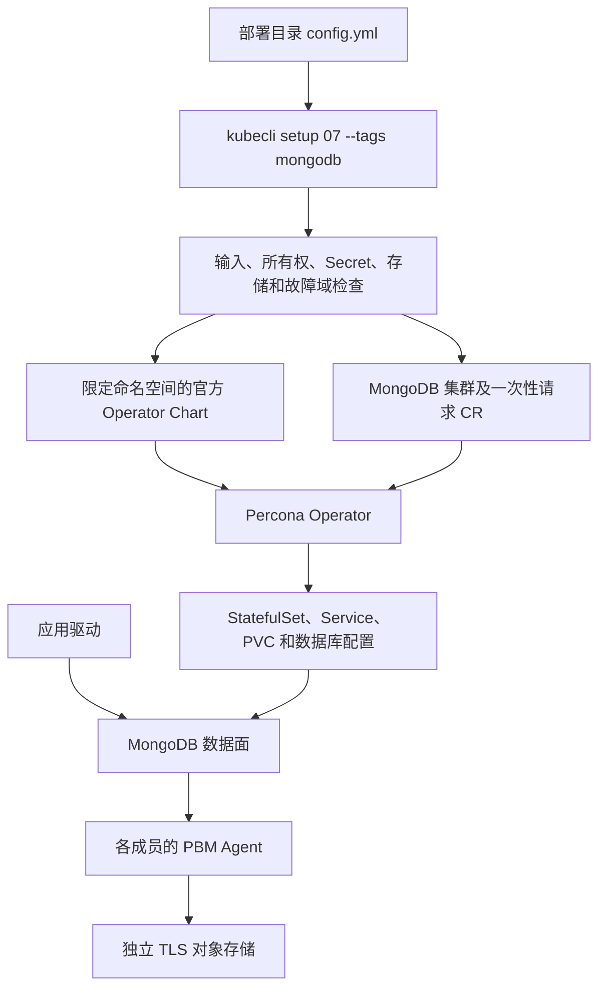
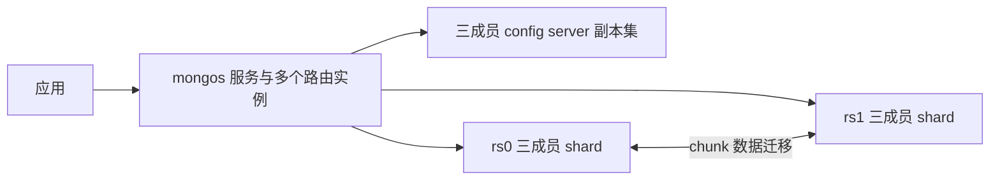
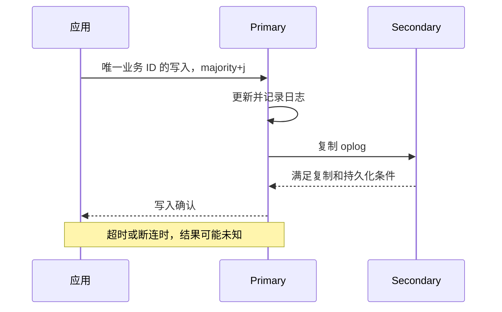

# Percona MongoDB 技术白皮书

本文面向架构师、DBA 和应用负责人，解释 kubeauto 中 MongoDB 的控制路径、数据一致性与恢复边界。部署和业务操作见[用户与运维手册](operations-manual.md)，实现维护见[开发手册](development-manual.md)。

## 阅读路径

- 评估架构：[版本和适用范围](#版本和适用范围) → [副本集与分片](#副本集与分片) → [容量与性能](#容量与性能)。
- 评估业务正确性：[写入确认与读取](#写入确认与读取) → [事务和分片键](#事务和分片键)。
- 评估风险：[安全边界](#安全边界) → [数据保护与恢复](#数据保护与恢复) → [变更与故障边界](#变更与故障边界)。

## 版本和适用范围

固定版本集合为 Operator 1.23.1、官方 Helm Chart 1.23.2、Percona Server for MongoDB（PSMDB）8.0.32-14、Percona Backup for MongoDB（PBM）2.15.0、Fluent Bit 5.1.2-1、MongoDB Exporter 0.53.0。Chart 版本与应用版本是不同身份，不能按字符串相同推断配套关系。

[Operator 1.23.1 发布说明](https://docs.percona.com/percona-operator-for-mongodb/RN/Kubernetes-Operator-for-PSMONGODB-RN1.23.1.html)列出 GKE 1.34–1.35、EKS/AKS/RKE2 1.34–1.36、OpenShift 4.19–4.22，以及 Minikube 上的 Kubernetes 1.37.0。它没有把所有发行版的任意版本都列为已测试。本项目的 Kubernetes 1.33.6 需要独立验收，不能据上游的 CNCF 兼容性设计宣称它在该版本的厂商测试范围内。

本分路提供副本集及显式分片拓扑的声明式入口。生产准入以[专项矩阵](../../../tests/mongodb-test-matrix.yaml)的完整结论为依据；安装成功不构成全部能力签收。物理备份的生成与物理恢复的可用性分别判断，独立恢复还受二进制、拓扑、原加密主密钥和目标 CSI 容量约束。恢复过程中若出现持续 rollback 或稳定时间戳异常，应停止业务验收并保留逐成员证据。逻辑恢复和 PITR 的限定验证也不能外推为所有 BSON 类型、数据规模和分片拓扑的保证。

PSMDB、Operator、PBM、Exporter 与 MongoDB 客户端分别具有各自许可证；采用 Percona 方案不改变上游 MongoDB 相关代码的许可证义务。交付镜像保留上游材料，提供服务、再分发或修改时，应按实际使用部分核对各固定源码的 LICENSE，而不能用“开源免费”代替许可证审查。Atlas、MongoDB 商业服务、PMM 托管能力不属于本分路。

## 控制路径与唯一所有者

kubeauto 管配置和声明，Operator 管数据库拓扑，MongoDB 管复制与事务。下面的箭头表示声明或请求流向，不表示数据库数据经过 kubeauto 转发。

Operator 的工作负载权限限定在数据库命名空间，CRD 本身仍是 Kubernetes 集群级资源。因此“只监控一个命名空间”不等于“CRD 可以随意修改”。已有 CRD 的结构变化需显式配置，且产品会检查共享消费者；不能为了部署第二套 MongoDB 覆盖其它团队依赖的 schema。

直接扩缩 StatefulSet 会产生与集群 CR 相冲突的期望状态。直接修改 MongoDB 配置也可能在下一轮协调时被覆盖。稳定配置必须回到部署目录的 `mongodb_*` 输入；原生数据库命令用于业务、诊断和明确的 DBA 操作。

## 副本集与分片

副本集由一个 Primary 和多个 Secondary 构成。Primary 接受写入，通过操作日志 oplog 复制到其它成员；多数派决定哪个成员能够继续担任 Primary。三个有投票权的数据成员最多容忍一个成员故障并保持多数派。五个成员提高故障容忍数量，但也增加复制、存储和选主成本，不等于单点写入吞吐线性增长。

项目要求每个副本集有 3、5 或 7 个数据成员，使用主机名反亲和，不使用仲裁节点代替数据副本。主机名分散只能隔离节点故障；若三台节点共享机架、电源或同一个存储故障域，仍可能同时失效。生产规划必须把数据库副本与 CSI 副本放置一起评估。

分片用于把数据集和请求分布到多个副本集。每个 shard 自身仍需多数派，config server 副本集保存路由与 chunk 元数据，`mongos` 根据元数据把请求发往相应 shard。

图中 config server 路径用于元数据查询和协调；普通文档存放在 shard，不能把 config server 当作额外数据副本。分片客户端必须接入 mongos，直连某个 shard 无法提供完整路由语义。项目要求至少三个 mongos；路由冗余不能补偿某个 shard 或 config server 失去多数派。

[上游分片说明](https://docs.percona.com/percona-operator-for-mongodb/sharding.html)允许拓扑转换，但项目主动限制已有集群的副本集/分片切换，要求建立独立目标并迁移验证。这是为了避免一次配置编辑同时改变数据分布、备份语义和客户端入口。增加 shard 也不会自动让一个未分片集合分布到新节点。

增加 shard 分为两个独立结果：Operator 按 `mongodb_replsets` 创建新副本集并加入路由目录，随后 balancer 或批准的 DBA 迁移才改变已有数据的放置。增加前必须让内外两套证书覆盖新副本集的 Service 与 Pod DNS，且新成员有足够的独立卷和调度域；原有 shard 的证书有效不能证明新成员可用。验收需要通过 mongos 核对路由目录、实际迁入有数据的 chunk，并比较迁移前后的业务数据和完整索引定义。

减少 shard 需要先迁走分片集合的 chunk、未分片集合和数据库 primary 元数据，再由产品声明移除该副本集。[固定版本的扩缩说明](https://docs.percona.com/percona-operator-for-mongodb/scaling.html#changing-the-number-of-shards)要求用户数据迁移完成；Operator 1.23.1 的 `checkIfUserDataExistInRS` 还会检查 donor 上的非系统数据库，空数据库残留也会阻断退役。它随后调用原生 `removeShard`，完成后删除 StatefulSet。路由目录无 chunk、donor 无用户数据、工作负载退出和保留卷退役是不同判据，不能用删除 Pod 代替。MongoDB 8.0 中 `movePrimary` 不代替未分片集合搬迁；存在这类集合时先按 [moveCollection](https://www.mongodb.com/docs/v8.0/reference/command/moveCollection/) 的版本条件和执行限制处理，再迁移 primary。只有空数据库的迁移证据不能证明该分支已验收。

## 写入确认与读取

项目默认 `writeConcern: {w: majority, wtimeout: 10000}`、默认读取 concern 为 `majority`。业务需要持久化确认时还应显式指定 `j: true`。三成员副本集的一次 majority 写入要求多数派满足写入条件；它不是“所有成员已经应用并对所有读取可见”。

服务器等待超时不撤销已经写入的数据；网络断连也可能发生在提交后、响应前。应用必须通过唯一业务 ID 查询结果，或采用符合驱动规则的 retryable writes，不能把超时直接记为业务失败后重复扣款。重试的 `$inc`、外部支付与消息发布尤其需要幂等或事务性发件箱设计。

`majority` 读取关注已提交状态，仍需结合 read preference 决定向哪个成员发起读取；Secondary 可能落后。需要会话内先写后读时，采用支持因果一致性的驱动会话和相应 concern。不能把多数派读取描述为对任意并发请求都线性一致；跨文档一致性需要事务或明确的数据模型。

失去多数派时，系统应停止确认不能满足 concern 的写入。PDB 只能限制自愿驱逐，不能防止断电、网络隔离或两台机器同时故障。Operator 停止时已有数据面通常可继续复制，但自动补建、配置收敛和备份编排会受影响。

## 事务和分片键

文档是 BSON 对象，应用应根据共同读取、更新及生命周期决定内嵌或引用。避免把无限增长的数组放入单个文档；MongoDB 的单文档大小限制是 16 MiB。Decimal128、64 位整数、日期和 ObjectId 不能随意经普通 JSON 转换，否则可能损失数值精度或类型。

索引把读取成本转移到写入、内存和存储。唯一索引用于建立业务身份约束，TTL 索引由后台任务异步清理过期文档，不是严格定时调度器。上线索引前检查基数、查询谓词、排序和 `explain`，保留索引构建期间的磁盘与复制余量。

跨文档或跨 shard 事务通过会话提交或回滚一组变更。采用 `snapshot` 读取 concern 和 `majority` 写入 concern，并处理驱动规定的瞬时事务错误和提交结果未知。长事务会占用资源并增加与 chunk 迁移冲突的机会；不能在数据库事务内执行不可回滚的外部 HTTP 操作。

分片键决定路由、热点和迁移粒度。单调递增范围键容易把新写入集中到一个区间；哈希键通常改善分布，却使范围查询更容易跨 shard。唯一索引在分片集合中受到分片键前缀约束，哈希分片键不能使用 `unique: true`。[MongoDB 8.0 shardCollection 参考](https://www.mongodb.com/docs/v8.0/reference/command/shardCollection/)说明了这些限制。

chunk 迁移包括复制、追赶、元数据切换和源范围清理。只看到目标 shard 上出现数据不能证明迁移完成。[moveChunk](https://www.mongodb.com/docs/v8.0/reference/command/moveChunk/)适用于明确的管理场景，普通生产分布由 balancer 管理；手工迁移需同时检查路由元数据、业务摘要和源范围清理，不能与退役 shard 操作相互替代。

## 安全边界

自定义日志轮转涉及初始化权限。固定 Operator 的 [初始化脚本](https://github.com/percona/percona-server-mongodb-operator/blob/v1.23.1/build/init-entrypoint.sh)在共享程序卷递归修改所有者；[轮转容器](https://github.com/percona/percona-server-mongodb-operator/blob/v1.23.1/pkg/psmdb/logcollector/logrotate/container.go)将配置挂到同一目录树的 `conf.d`。节点重启后挂载点可能保留其它所有者，非 root 初始化因权限错误无法重新启动。启用非空 `mongodb_logrotate` 时，项目使用官方 `initContainerSecurityContext`，仅为初始化容器设置 UID 0、`CHOWN` 与 `DAC_OVERRIDE`，移除其它能力并禁止提权；长期运行的数据库容器不因此增加权限。[物理恢复实现](https://github.com/percona/percona-server-mongodb-operator/blob/v1.23.1/pkg/controller/perconaservermongodbrestore/physical.go)也复用该上下文初始化 PBM。此方案要求命名空间允许这些初始化权限，不适用于强制 Restricted Pod Security；空映射保留上游默认初始化行为。平台须按[日志变更步骤](operations-manual.md#日志保留与卷空间)在变更前确认准入策略。

入口要求 TLS，并校验 CA 与主机名；密码通过 Kubernetes Secret 引用进入，系统账号与业务账号分开。`userProvidedOnly` 使证书丢失时不会自动生成新 CA，代价是证书供应、续期和备份由平台负责。Pod 仍在运行并不代表 Secret 丢失已经恢复，必须检查 `TLSSecretsReady` 条件。

项目默认允许通过密码认证且没有客户端证书的 TLS 应用连接，不要求业务客户端使用双向证书。PBM 及部分容器内本地探测使用上游自身的内部 TLS 行为，不能宣传所有内部连接均严格校验 CA。数据库入口、Exporter 连接、对象存储连接的验证边界需分别审查。

NetworkPolicy 只提供网络可达性限制；它既不替代 MongoDB 认证，也不能在不支持策略的 CNI 上自动生效。同命名空间内匹配业务标签的 Pod 和明确列出的业务命名空间可访问 27017；复制成员和本地 Operator 有专用允许规则。Exporter 的 9216 仅向监控命名空间开放。拥有修改 Pod 标签或策略权限的主体应纳入平台权限管理。

Exporter 复用上游系统 `clusterMonitor` 用户。Operator 1.23.1 的 `getRoles` 和系统角色初始化还给该用户授予 `explainRole`，其中跨库 `find` 支持查询诊断，同时使应用数据及 `admin.pbmConfig` 可读；账号不能写应用数据，但并非只读指标的安全边界。Kubernetes 监控服务账号的最小 RBAC 与数据库账号的读取范围是两套权限，不能相互替代。监控密码和容器执行权限应按敏感数据库凭据保护；需要禁止采集身份读取业务数据的环境，当前接法不满足要求。部署和隔离限制见[运维手册的巡检说明](operations-manual.md#巡检与故障入口)，固定实现见[官方源码](https://github.com/percona/percona-server-mongodb-operator/blob/v1.23.1/pkg/controller/perconaservermongodb/mgo.go)。

PSMDB 使用分层密钥保护 WiredTiger 数据：内部数据库密钥加密数据，外部主密钥保护密钥数据库。项目使用 Secret 中 base64 编码的 32 字节主密钥和 AES256-CBC。修改主密钥内容不能作为普通滚动变更；产品通过摘要拒绝这种变更。没有原密钥的物理数据副本不能按普通文件备份恢复。Kubernetes Secret 的 base64 本身不是加密，仍需 etcd 静态加密、RBAC 和离线密钥托管。

## 数据保护与恢复

复制避免单成员故障中断服务，但误删会复制到其它成员，因此必须有独立备份。PBM Agent 在各成员执行一致性备份，将数据与元数据写入指定对象存储。项目支持完整逻辑备份和物理备份请求；增量、外部物理备份、PVC 快照、Azure/GCP 身份集成和多存储切换未作为本分路配置接口交付。

逻辑备份保存可重放的逻辑数据，恢复过程会覆盖目标并重新建立数据及索引。物理备份复制存储引擎文件，对版本、加密密钥和拓扑的匹配要求更严格，恢复会重建 Pod。两者都必须让业务停止访问恢复目标，`Restore.ready` 后还要验证数据库仲裁、认证、数据摘要和业务边界。

PITR 在可用基线备份上重放 oplog 到指定时刻。[固定版本的 PITR 说明](https://docs.percona.com/percona-operator-for-mongodb/backups-pitr.html)要求先有成功基线，PBM 才上传 oplog；也可以先开启配置，再生成新基线并等待归档。已有成功基线不因开启时间较晚就必然失效，但必须证明从该基线的恢复边界到目标时间有连续可用的 oplog；开启开关不能补回已经从成员 oplog 滚出的历史。首个归档块要等上传间隔届满，固定上游默认间隔为 10 分钟。目标 UTC 必须落在连续可恢复区间内，不能只检查对象存储里有某个 oplog 文件或只看开关为 true。项目把时间点表示为精确 UTC `YYYY-MM-DD HH:MM:SS`，恢复请求同时绑定目标 CR UID，避免误操作同名重建集群。

备份传输要求 TLS，但这不等于备份对象已静态加密。逻辑备份尤其需要由对象存储提供加密、独立身份和访问审计；项目没有配置对象存储 SSE/KMS 的专用输入。对象生命周期策略不能独立删除 PITR 所依赖的基线或 oplog。保留策略应按可恢复链和业务 RPO 设计，并以真实恢复演练验证。

保留删除也有控制面依赖。Operator 1.23.1 在 PBM 仍有备份元数据时，会读取当前数据库 CR 的 main storage，再删除相关 PITR 与备份；备份 CR 中的历史存储状态不消除这个依赖。因此“停止定时任务”和“关闭 PBM、移除存储声明”是不同的状态转换：应先停计划，保持存储及认证材料可用，完成批准的原生删除与保留备份复验，再关闭备份。提前移除当前存储可能使删除 finalizer 保持等待；恢复相同存储配置可以恢复删除所需条件，不能恢复已经删除的备份。操作和故障恢复顺序见[用户与运维手册](operations-manual.md#备份与保留)。

私有对象存储 CA 有两个消费方：PBM 代理执行备份和恢复，Operator 进程执行保留删除。`caBundle` 的上游原生挂载仅覆盖代理；项目通过 Helm post-renderer 为控制器增加只含公开 CA 键的投射卷及 `SSL_CERT_DIR`，同时保留系统信任库。按 CA 摘要滚动控制器使 Go 的进程内信任缓存重新加载；保留备份仍可能触发删除，因此其 CA 引用也参与汇总。修改信任不会改写备份或 MongoDB 成员角色。

这项集成不能改变上游库的全部 TLS 行为。固定 Operator 源码 `pkg/psmdb/backup/pbm.go` 的 `deleteBackupImpl` 对 MinIO 备份文件删除明确设置 `InsecureSkipTLSVerify=true`，而 `DeletePITRChunks` 没有该覆盖，仍使用进程信任库。因此 MinIO 路径的备份、恢复和 PITR 删除可验证证书，备份文件删除仍存在上游的证书验证例外；传输加密不等于经过服务端身份验证。需要全部对象操作均验证证书时，应使用公有可信 CA 的 S3 路径并独立验收，不能以 CR 中的 false 或备份成功掩盖该边界。

定时计划、按需请求和 PITR 是三个独立控制项。停止定时计划不关闭 PBM，不删除历史备份，也不自动停止 PITR。独立恢复目标需要开启备份引擎以读取对象，同时关闭定时计划和 PITR；业务验收并确定新目标的存储前缀后，再按其角色启用数据保护，避免恢复前的空目标污染源恢复链。

RPO 是故障前最后一笔可恢复业务与故障时刻的距离，受备份完成、oplog 上传和异地复制影响。RTO 包括准备新环境、取回凭据/密钥、下载、恢复、索引构建、业务核验及入口切换。没有实际业务量和恢复窗口测量，不能给出固定 RPO/RTO 承诺。三副本或 `ready` 状态均不能代替这些测量。

## 容量与性能

每个数据成员均存放完整副本集数据，三个成员的 100 GiB PVC 不等于 300 GiB 业务容量。规划需计入数据、索引、oplog、临时索引构建、日志及重建余量；CSI 若再复制，会继续放大底层占用。两个三成员 shard 加三个 config server 至少需要九个数据卷，mongos 与日志还需单独计算资源。

持久日志与数据库竞争卷空间。默认每天执行轮转检查、100 MiB 阈值和七份未压缩保留并不限制单日增长；`copytruncate` 还需要当前完整日志大小的临时副本空间。项目提供可选 `mongodb_logrotate`，同时覆盖 mongod、config server 与 mongos 的原生规则；检查间隔、完整日志阈值和份数可调，原始日志七天清理保持上游行为。阈值只在检查时生效，不能替代磁盘告警、容量规划或合规归档。详见[日志保留与卷空间](operations-manual.md#日志保留与卷空间)。

WiredTiger cache 只是进程内存的一部分，连接、索引构建、压缩、PBM、文件缓存和 sidecar 都有额外开销。项目把显式 cache 限制在容器 memory limit 的一半以内，默认 cache 1 GiB、limit 4 GiB；这些是起始配置，不是按业务测得的最优值。平台还应满足节点系统和 Kubernetes 预留，不能把实验室较小容量当作客户生产基线。

容量验收同时观察 IOPS、吞吐、P95/P99、复制滞后、连接数、缓存驱逐、CPU 限流和磁盘水位。测试报告必须给出数据大小、索引、读写比例、并发、预热、持续时间、TLS 与持久化条件、失败和重建期间表现。没有这些条件的 ops/s 数字无法用于生产选型。

## 变更与故障边界

CRD 定义 Kubernetes 如何解释数据库声明，作用域覆盖整个集群。主 Helm Chart 在首次安装时创建 CRD，后续主 Chart 升级默认不更新它；产品需要单独协调 schema。Kubernetes 会跟踪字段的管理者，因此从 Helm 移交 schema 属于一次明确的控制权变更。项目仅在固定旧 schema、原对象身份、显式升级授权和消费者隔离均成立时，移交 schema 与版本标签；服务端预校验通过后才执行，客户其它配置保持原值。未知 schema、共享消费者和并发变更会阻断该路径。该边界不能替代跨团队共享 CRD 的统一升级方案。

SmartUpdate 按 Operator 的协调逻辑滚动成员，客户端仍需重连并处理短暂错误。密码轮换更新原 Secret，CA 轮换采用“信任新旧 CA → 新叶证书 → 仅新 CA”的重叠信任路径；恢复时反向执行，不能直接替换根证书。每阶段必须验证全部成员完成轮换和真实业务。

版本升级先处理 Operator/CRD，再处理数据库二进制，最后按计划决定是否提升 FCV（功能兼容版本）。项目关闭自动版本升级和自动 FCV 提升。FCV 未提升不能证明新的 WiredTiger 文件可被旧二进制安全打开。[MongoDB 8.0 降级说明](https://www.mongodb.com/docs/v8.0/release-notes/8.0/#downgrade-considerations)分别规定二进制与 FCV 的限制；[Percona 补丁升级说明](https://docs.percona.com/percona-server-for-mongodb/8.0/install/minor-upgrade.html)描述滚动升级，并未为本项目精确版本对提供自动降级承诺。项目因此拒绝已有集群的数据库 8.0.32-14→8.0.26-11、Operator 1.23.1→1.23.0 和未知现有版本的自动迁移，独立于 FCV 判断。该保护是项目支持策略，不能外推为 Percona 对所有补丁降级的统一结论。回退出口是用升级前备份恢复独立兼容目标，保留原集群以核对和补偿升级后的新写入；禁止直接用旧二进制打开现有卷。

故障诊断先区分供给链、调度/CSI、网络/TLS、Operator 协调和数据库运行时。恢复中的 Pod 重建是正常机制的一部分，但稳定时间戳缺失、持续 rollback 或副本分叉属于需要停止业务验收的异常。不得通过删除数据卷、强制重配或降低健康判据把异常改写为成功。

以上机制依据固定 [Operator 源码 a4367b9](https://github.com/percona/percona-server-mongodb-operator/tree/a4367b91e914abe73bacf85e9a7f4b587addd40c)、[Operator 文档 e81024c](https://github.com/percona/k8spsmdb-docs/tree/e81024c295e8ebaf9cc06766cb2564e6e3308b02)及 [PSMDB 8.0 文档 10bd40c](https://github.com/percona/psmdb-docs/tree/10bd40c99426316dfc264c16f2221d335876dbab)。版本或产品接口变化时，应针对受影响机制重新核验。
