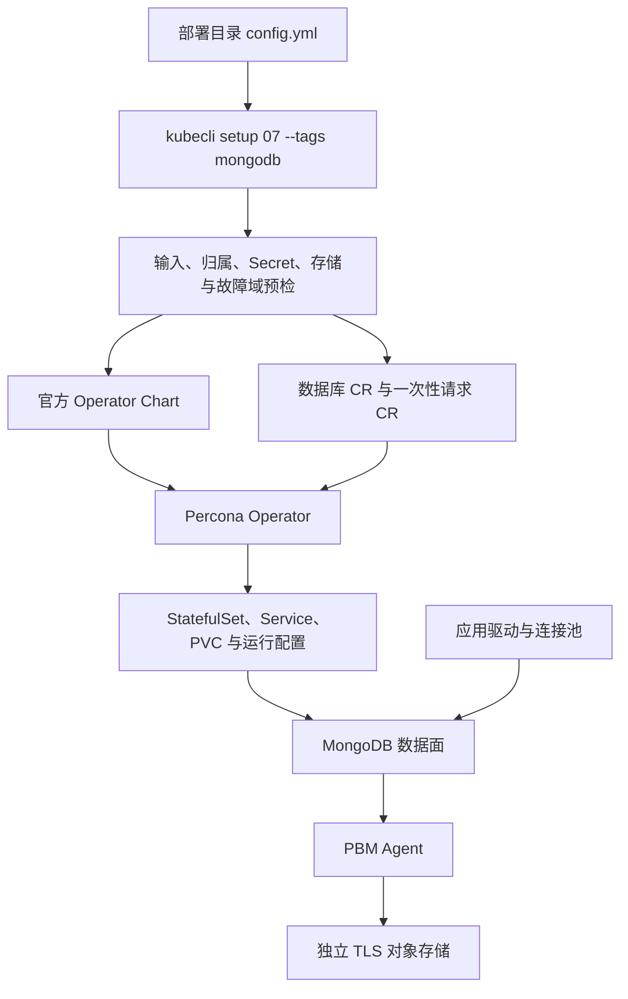
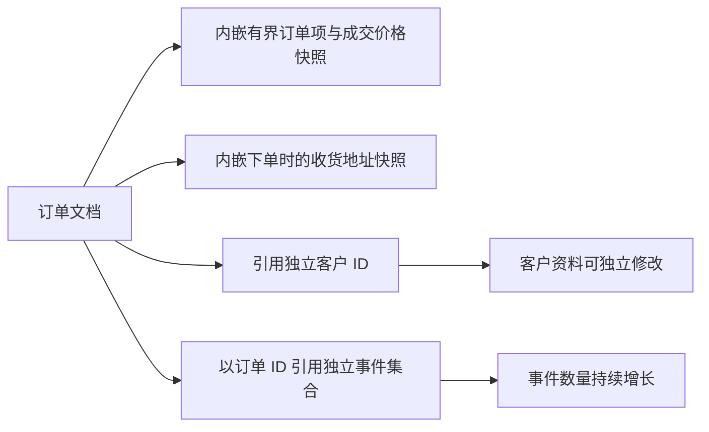
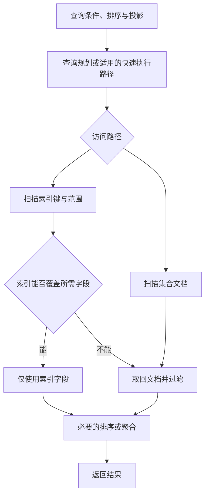
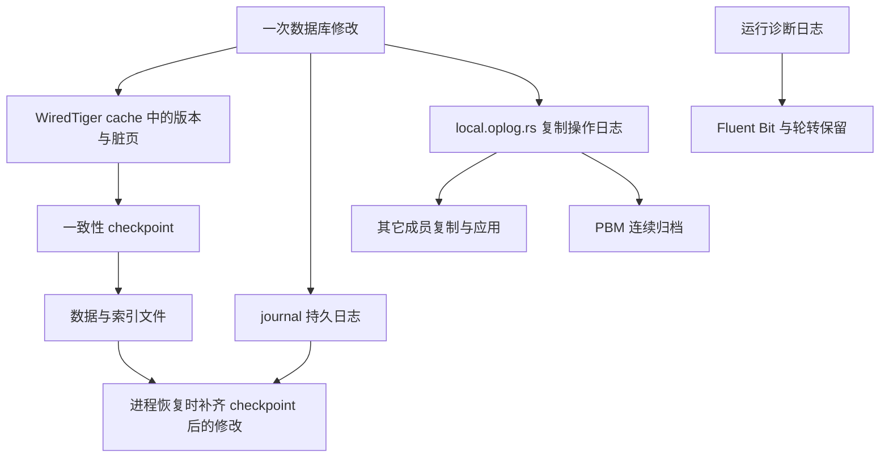
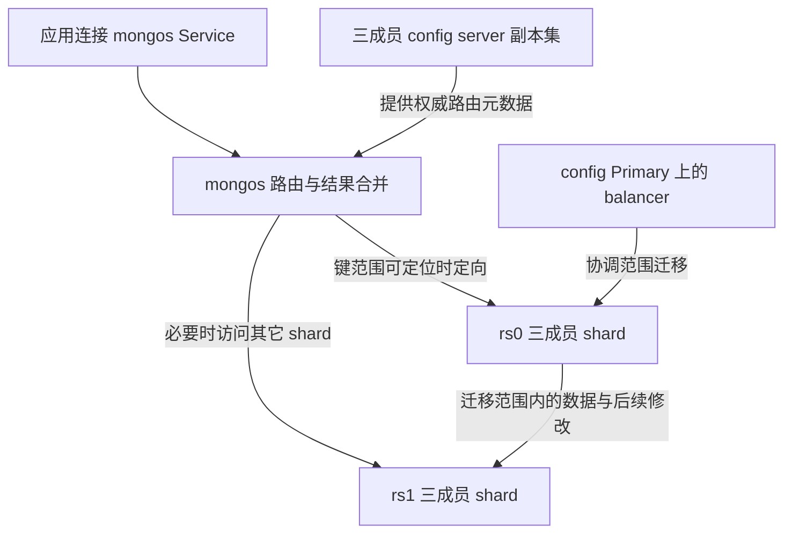
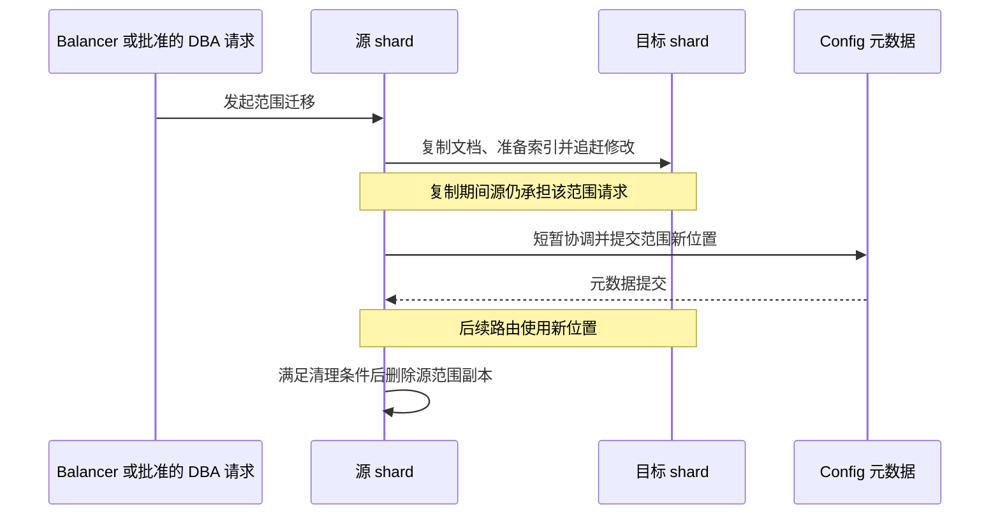
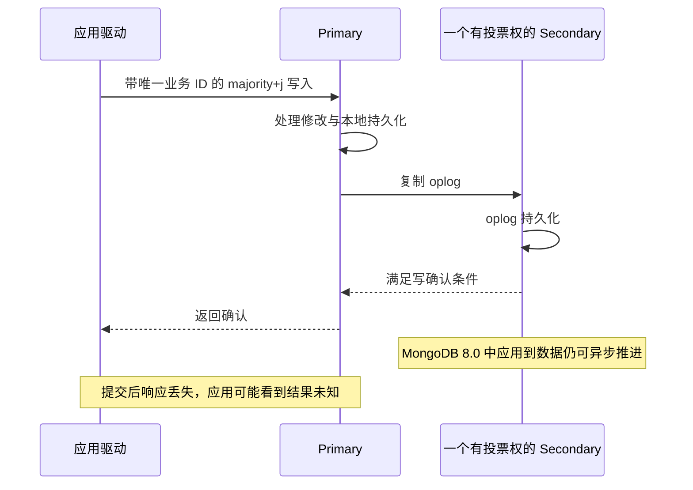
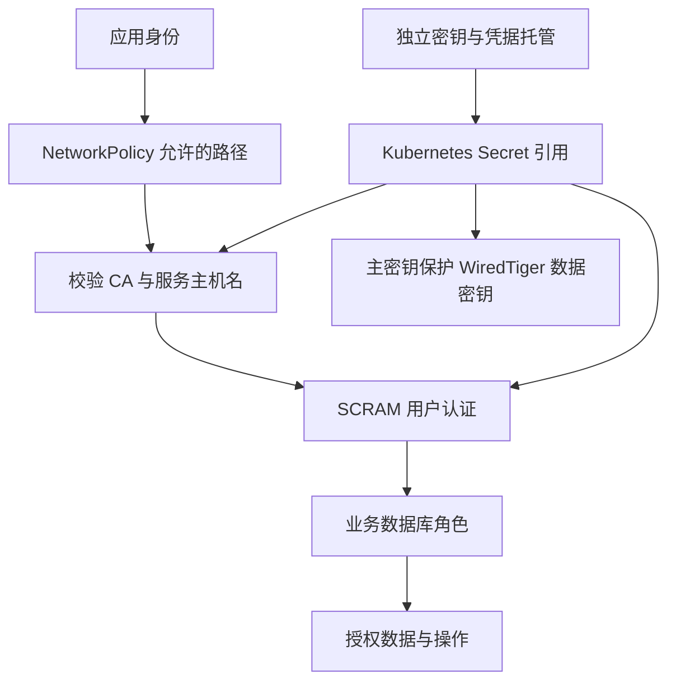
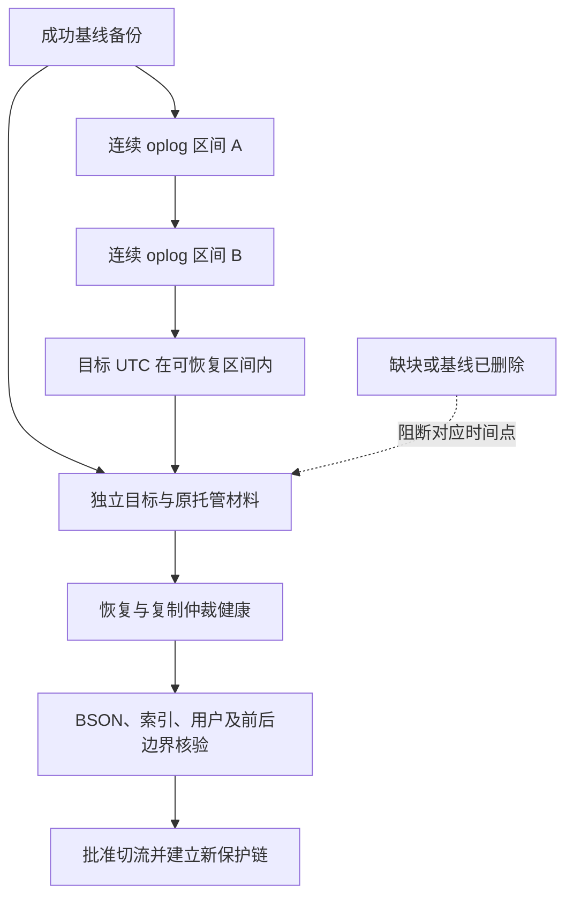

# Percona MongoDB 技术白皮书

本文面向架构师、DBA 和应用负责人，解释一条业务请求如何经过数据模型、查询、存储、复制及分片，以及这些机制如何决定一致性、性能和恢复能力。读者需了解基本的数据库与 Kubernetes 概念；读完后应能选择拓扑、解释运行现象并确定验收边界。连续部署和生产操作见[用户与运维手册](operations-manual.md)，控制器集成与版本维护见[开发手册](development-manual.md)。

## 阅读路径

| 客户任务 | 推荐路径 | 应得到的判断 |
| --- | --- | --- |
| 设计业务与查询 | [数据模型与查询执行](#数据模型与查询执行) → [写入确认与读取](#写入确认与读取) → [事务和分片键](#事务和分片键) | 文档边界、索引、幂等和事务如何配合 |
| 选择部署与容量 | [控制路径](#控制路径与唯一所有者) → [存储引擎](#存储引擎与三类日志) → [副本集与分片](#副本集与分片) → [容量与性能](#容量与性能) | 哪一层扩展、代价是什么、实测能证明什么 |
| 审查可靠性与安全 | [安全边界](#安全边界) → [数据保护与恢复](#数据保护与恢复) → [变更与故障边界](#变更与故障边界) | 故障后需要什么材料、何时必须停止、如何恢复 |

## 版本和适用范围

| 组件 | 固定版本 | 在方案中的责任 |
| --- | --- | --- |
| Percona Server for MongoDB（PSMDB） | 8.0.32-14 | MongoDB 数据面、WiredTiger 存储及静态加密 |
| Percona Operator / 官方 Helm Chart | 1.23.1 / 1.23.2 | Kubernetes 上的拓扑、滚动维护和请求编排；两个版本号分别管理 |
| Percona Backup for MongoDB（PBM） | 2.15.0 | 一致性备份、恢复和 oplog 归档 |
| MongoDB Exporter / Fluent Bit | 0.53.0 / 5.1.2-1 | 数据库指标与日志采集 |

[Operator 1.23.1 发布说明](https://docs.percona.com/percona-operator-for-mongodb/RN/Kubernetes-Operator-for-PSMONGODB-RN1.23.1.html)列出 GKE 1.34–1.35、EKS/AKS/RKE2 1.34–1.36、OpenShift 4.19–4.22，以及 Minikube 上的 Kubernetes 1.37.0。本项目在 **Kubernetes 1.33.6** 上完成了[43 项专项验收](../../../tests/mongodb-test-matrix.yaml)及[干净完整回归](../../../tests/evidence/mongodb-full-20261018.json)。这是项目对固定组合的实测，不能改称上游厂商测试范围，也不自动覆盖其它发行版或 CSI。

本方案交付副本集、显式分片、TLS/账号/网络隔离、数据静态加密、逻辑与物理备份、时间点恢复、显式卷扩容及版本维护。Atlas、商业托管服务、PMM 托管、增量/外部物理备份、PVC 快照备份、Azure/GCP 身份集成和多备份存储切换不属于本分路配置接口。下文的数据库机制依据 MongoDB 8.0 官方概念与参考资料、Percona 固定版本文档及必要源码核实重新组织；它们不是一份单独的上游白皮书，也不代表研究了所有 MongoDB 产品。

**实测结果的共同口径：** 本文数据来自 2026-10-18 的完整回归，各模块日志的 SHA256、退出状态和成功判据绑定在上述完整证据中。性能章节另列负载与资源条件；其它章节给出故障动作和业务结果。没有测出的接管时间、生产规模或端到端 RPO/RTO 不作推断。许可证分别按 PSMDB、MongoDB、Operator、PBM 与客户端的固定源码 LICENSE 核对；采用 Percona 方案不免除再分发和服务场景中的许可证义务。

## 控制路径与唯一所有者

kubeauto 把客户配置变成经过预检的声明，Operator 把声明变成数据库运行拓扑，MongoDB 自己完成复制、选主与事务。应用请求直接到数据库数据面；kubeauto 和 Operator 都不在每次查询的转发路径上。

| 权威状态 | 所有者 | 客户应如何变更 |
| --- | --- | --- |
| 期望版本、拓扑、资源、Secret 引用与备份策略 | 部署目录的 `mongodb_*` 输入 | 修改配置后执行同一 kubecli setup |
| 成员工作负载及数据库配置的协调 | Operator | 观察 CR 与数据面，不直接 scale StatefulSet |
| 当前 Primary、复制进度、索引及业务事务 | MongoDB | 经认证的数据库命令或应用驱动 |
| 密码、TLS 与加密主密钥原材料 | 客户 PKI 和密钥托管 | 原 Secret 受控更新；主密钥不能普通替换 |

直接扩缩 StatefulSet 会与 CR 的期望状态冲突；绕过声明修改受管数据库配置，也可能在下一轮协调时被覆盖。一次性备份/恢复请求按名称、参数及目标身份绑定；重跑相同输入观察原请求，不会把“再次安装”变成再次恢复。

Operator 的工作负载权限限定在数据库命名空间，CRD 则定义整个 Kubernetes 集群如何解释数据库声明。新命名空间不能隔离 CRD schema 的影响。项目对已有 schema 的变化要求显式授权并检查共享消费者；[CRD 升级操作](operations-manual.md#固定版本升级与恢复选择)不能用直接覆盖 schema 代替。全量中的外部 namespace、Service、NetworkPolicy、PVC 和共享 CRD 消费者反例均被拒绝，外部对象及其数据保持不变。

## 数据模型与查询执行

### 先决定一起访问的数据

BSON 文档是数据与单文档原子更新的基本边界。它可以包含嵌套对象、数组、Decimal128、64 位整数、日期和 ObjectId。灵活字段结构允许逐步演进模型，但字段类型、必填项和业务不变量仍须由应用或集合校验约束；不能把“无需固定表结构”理解为“无需数据设计”。

以订单为例，下图是**建模示意，并非新增的已压测业务**。选择依据是共同读取、修改与生命周期，而不是把关系表机械搬成集合。

| 设计 | 为什么这样放 | 必须承担的代价 |
| --- | --- | --- |
| 有界订单项、成交价和收货地址内嵌 | 一次读取取得交易事实，单文档更新保持相关字段原子性；历史价格不随商品变更 | 冗余字段占空间；有意保留历史快照，不能误作实时资料 |
| 客户资料引用 | 客户有独立生命周期，避免每次资料变更重写全部订单 | 需要额外查询或聚合连接，并决定读取一致性 |
| 无限增长的事件独立成集合 | 避免数组持续膨胀、热点更新和触及单文档 **16 MiB** 限制 | 需要订单 ID 索引、分页和独立保留策略 |

金额与账本不能经普通 JSON 随意来回转换；例如 Decimal128 与 Int64 的恢复验证必须比较 BSON 类型及值，不能只比较打印出来的十进制文本。项目的数据场景完成 CRUD、唯一索引重复拒绝、TTL 最终清理、BSON 与摘要校验，操作后为 199 条业务文档。TTL 是后台异步清理，不能承担精确到秒的业务调度或合规删除时限。

### 索引如何改变一次查询

假设订单常按 `customerId` 等值筛选，再按 `createdAt` 倒序取最近记录，复合索引 `{customerId: 1, createdAt: -1}` 会先按客户、再按该客户的时间组织键。索引是有序 B-tree；前缀使数据库可以缩小扫描范围，合适的字段与方向还可能避免额外排序。只按 `createdAt` 查询不能假定同样受益于这个前缀。这是索引设计示例，没有为其编造实测扫描数或加速比。

索引减少读取工作，却增加每次插入、更新和删除的维护工作及缓存、磁盘占用。不能靠“所有字段都建索引”解决慢查询。索引前缀、选择性、等值/排序/范围组合须一起判断；数组字段可能产生多键索引，唯一约束和分片还有额外条件。大规模构建也会与业务和复制争用 I/O，需要预留卷空间与维护窗口。

[MongoDB 8.0 explain 参考](https://www.mongodb.com/docs/v8.0/reference/explain-results/)把计划表示为执行阶段树，经典执行引擎、slot-based 引擎及 8.0 的 EXPRESS 路径可能有不同结构。判读不应依赖某一个固定层级的字段：

| 观测 | 它回答的问题 | 不能据此得出的结论 |
| --- | --- | --- |
| `COLLSCAN`、`IXSCAN`/适用 EXPRESS、`FETCH`、`SORT` | 是否扫描集合、走索引、回表或额外排序 | 出现索引阶段就一定足够快 |
| `nReturned` 与 `totalKeysExamined`、`totalDocsExamined` | 为少量结果做了多少扫描工作 | 返回零条时硬算扫描比；把扫描次数当不同文档数 |
| 聚合 `usedDisk` 与分片级执行信息 | 是否落盘、工作在哪个 shard 或合并位置执行 | `allowDiskUse` 能消除资源成本 |
| 应用 P95/P99 与服务端执行时间 | 排队、网络、连接池和重试是否放大延迟 | explain 的耗时等于用户请求耗时 |

`explain` 不使用已有计划缓存，也不缓存本次胜出的计划；其执行时间不包含把结果送回客户端的网络时间。因此它适合验证访问路径，再结合真实负载的扫描量、CPU、磁盘和应用尾延迟判断收益。项目已验证索引正确性及恢复完整性，未将上述示意查询作为专项调优基准。

## 存储引擎与三类日志

WiredTiger 用多版本并发控制（MVCC）为读取提供相应快照，并在文档层采用乐观并发。并发更新冲突可能在引擎/数据库内部重试；涉及业务事务时，驱动仍要按事务错误规则重试。单文档原子性并不自动组成跨文档事务。

图表示职责关系，不是每个内部写入的严格时间顺序。最容易混淆的是三种日志：

| 内容 | 解决什么问题 | 无法替代什么 |
| --- | --- | --- |
| WiredTiger journal 与 checkpoint | 本成员进程异常后的持久化恢复；上游默认约每 60 秒建立 checkpoint，journal 补齐其间修改 | 另一成员副本、独立备份或业务 RPO |
| oplog | 以可重复应用的操作记录推进复制，也是 PBM 时间点重放的来源 | 本地存储引擎 journal；未归档历史不能凭空补回 |
| mongod/mongos 运行日志 | 定位认证、慢操作、复制、初始化等问题 | 数据恢复材料、事务审计的完整保证 |

WiredTiger cache 中的文档与磁盘压缩文件不是同一容量口径；操作系统文件缓存还有独立作用。cache 之外还存在连接、执行、索引构建、压缩、PBM 与 sidecar 开销。项目默认 cache **1 GiB**、数据库容器 limit **4 GiB**，并限制显式 cache 不超过 limit 一半。这是防止挤占的起点，不是工作集的自动估算器。频繁驱逐、脏页写出、I/O 等待或内存超限应分别定位，不能看到磁盘文件小就断言内存够用。

## 副本集与分片

### 副本集解决成员故障与复制

Primary 接受写入并产生 oplog，Secondary 异步拉取、持久化和应用，复制源也可能是另一 Secondary。各成员的心跳用于发现故障；选举需要多数票，候选资格还受复制进度、优先级和成员状态约束。Primary 无法联系多数投票成员时会退位，多数派一侧才可能选出新 Primary；选举期间不能正常接受写入。驱动必须发现新拓扑并重连，Pod 重建本身不是选主算法。

| 有投票权的数据成员 | 多数派 | 保持多数派最多可失去的成员 | 项目要求 |
| --- | --- | --- | --- |
| 3 | 2 | 1 | 推荐起点，三个主机故障域 |
| 5 | 3 | 2 | 五个主机故障域，更多完整副本与同步开销 |
| 7 | 4 | 3 | 七个主机故障域，不能据成员数推导写吞吐增长 |

项目不使用仲裁节点替代数据副本，采用主机名反亲和。若主机共用机架、电源、交换机或 CSI 故障域，表中的成员数量不能证明能承受该共享故障。PDB 限制自愿驱逐，不防断电与网络分区。Operator 暂停时已有复制与查询可以继续，但补建、配置收敛和备份编排受影响。

oplog 是滚动窗口，窗口长度取决于修改速率与保留空间。大量原地更新或删除，即使业务数据净增长很小，也可能快速消耗历史。离线成员的最后复制位置仍在可用历史内时可以追赶；超过窗口需要 initial sync（初始同步），重新复制数据和索引并追平修改，增加源成员、网络和存储压力。flow control 可在多数派提交滞后时抑制写入，业务变慢不一定来自查询本身。卷剩余、复制 lag 与 oplog 时间窗口必须同时观察。

**实测如何验证这些机制：**

| 场景 | 动作与结果 | 对生产判断的意义 |
| --- | --- | --- |
| 单成员失效 | 分别丢失 Primary/Secondary，确认替代 Pod UID；每场景核验 201 条已确认账本 | 覆盖重新选主/重连及业务确认记录；没有据此给出固定接管秒数 |
| 失去多数派 | 隔离两个成员并关闭原复制连接，majority 写入被拒绝；恢复后仲裁与数据通过 | 拒绝是保护一致性的预期结果；不应降低 `w` 换取表面可用 |
| 落后成员追赶 | 隔离一个 Secondary，另两成员确认 512 条 majority+j 写入；隔离成员缺少全部 512 条且 optime 不变，恢复后逐成员摘要相同 | 多数派已确认不代表每个成员已应用；恢复要验数据，不能只验 Ready |
| 丢失单个从节点卷 | 换新 PVC/PV 后三成员摘要与重建前相同，旧 PV 消失 | 证明该条件下可从健康副本重建；生产不应通过删卷进行普通故障排查 |

对应操作入口为[巡检](operations-manual.md#巡检与故障入口)、[成员变更](operations-manual.md#副本集增加和减少成员)与[独立恢复](operations-manual.md#独立恢复和时间点恢复)。不把官方默认选举超时解释成端到端 RTO，实际还受检测、候选追赶、驱动选择、缓存和业务复验影响。

### 分片解决数据分布与路由

每个 shard 本身是副本集，config server 副本集保存路由与 chunk 元数据，`mongos` 缓存这些元数据并把操作送到目标 shard。mongos 没有业务数据的持久副本；其冗余不能补偿某个 shard 或 config server 失去多数派。项目要求至少三个 mongos。

查询包含可用分片键条件时，路由能缩小目标集合；无法定位时需 scatter/gather（向多个 shard 分发并汇总），整体延迟还受最慢参与者影响。各 shard 仍需本地合适的索引；分片键索引与查询索引解决的是不同问题。排序、聚合及分页可能需要分布式合并，深 `skip` 还会放大取数工作。因此横向增加机器不自动加速所有查询。客户端必须经 mongos 访问分片集群，直连某个 shard 没有完整路由语义。

balancer 按集合的数据分布和迁移条件决定是否迁移，并非每次写入都把文档平均放到所有 shard。新增 shard 先完成拓扑，再发生数据重分布；未分片集合不会因此自动分布。小数据集也可能尚未达到自动平衡阈值，不能以“新 shard 为空”直接判为失败。

复制到目标、提交元数据和清理源副本是不同阶段。迁移竞争网络、cache 与 I/O，关键切换有短暂阻塞；源范围清理也可能延后。长时间 Secondary 读取与迁移清理并发还有漏读风险，不能把任意从库长游标当作全局一致快照。[上游 balancer 原理](https://www.mongodb.com/docs/v8.0/core/sharding-balancer-administration/)说明了这些机制。

本项目通过真实 mongos 验证跨 shard 事务与已填充 chunk 迁移；迁移后 **199 条文档**摘要保持一致。扩缩场景向新增 rs2 放入 **2 个有数据的 chunk**，退役前确认 donor 的 chunk、primary database 和用户 database 均为 **0**，并比较 **3 个索引**的完整定义摘要，最后回收退役卷。这证明了实际数据搬迁，不能用仅创建空 shard 的结果替代。

减少 shard 先搬分片数据、未分片集合及数据库 primary 元数据，再从产品声明中移除副本集。MongoDB 8.0 的 `movePrimary` 不代替 `moveCollection`；固定 Operator 还会因空用户数据库残留而阻断移除。完整安全顺序与停步判据见[增加分片与安全退役](operations-manual.md#增加分片与安全退役分片)。已有非分片目标不支持编辑开关原地转换；建立独立目标迁移，以免一次配置变更同时改变分布、备份和入口。

## 写入确认与读取

本项目默认写 concern 为 `{w: majority, wtimeout: 10000}`、默认读 concern 为 `majority`；需要持久化确认的业务显式使用 `j: true`。在本项目没有仲裁节点的三投票数据成员中，多数派为两个。

MongoDB 8.0 的[写 concern 说明](https://www.mongodb.com/docs/v8.0/reference/write-concern/)区分多数投票数据成员已持久化 oplog 与 Secondary 已应用到数据；确认不要求全部成员已经应用。`j` 关注持久化，`w` 关注复制确认，read concern 关注读取可见性，read preference 决定读哪个角色。这四者不能互换。

| 业务要求 | 应用设计 | 仍然存在的边界 |
| --- | --- | --- |
| 已确认写入承受受支持的单成员故障 | majority+j，检查 write errors 与 writeConcernError | 不能防止误删、凭据丢失或整个故障域损毁 |
| 写后同一业务会话读取自己的结果 | 因果一致会话、majority concern 与适当 read preference | 任意新会话或任意 Secondary 不等于立即读到最新值 |
| 多文档状态作为一个整体读取/修改 | 短事务、snapshot/majority、驱动事务重试规则 | 单独多次 majority 读取不是同一快照 |
| 超时或断连后防重复扣款 | 唯一业务 ID、查询确认、适用的 retryable writes 或幂等事务 | `wtimeout` 不撤销已发生的修改；普通重放 `$inc` 会重复生效 |

失去多数派时不能满足 concern 的写入应停止确认；这与系统“进程还活着”可以同时发生。应用超时预算必须留出服务器选择、连接、执行及确认的空间。不能将服务器超时直接解释为失败并重复发起外部付款或消息发布。

## 事务和分片键

事务通过会话把多文档变更作为一组提交或中止。项目验证了提交、主动中止、snapshot 读取和 journal 确认；分片场景还把两条参与记录放在不同 shard 上验证提交与回滚。业务应在事务级设置 snapshot 读 concern 与 majority 写 concern，处理 `TransientTransactionError` 和提交结果未知；不要对事务内单条操作另设 write concern。

以账户转账为例，应用应先用唯一转账 ID 确定幂等边界，在短事务内检查余额并更新双方账本，提交结果未知时按驱动提交规则与业务 ID 查证。若重试整个事务，事务回调可能再次执行；付款、发邮件等外部 HTTP 副作用不能放在可重试回调内，可用事务性发件箱衔接。此例解释设计原则，不增加已验收支付业务的承诺。

分布式事务需要参与 shard 协调提交，增加网络往返和故障依赖；长事务还会保留旧版本并与迁移/维护竞争。优先通过有界文档聚合减少不必要的跨 shard 事务，保留需要一致性的不变量，不能以性能为由拆掉正确性要求。

| 分片键方案 | 获益 | 代价与选择依据 |
| --- | --- | --- |
| 范围键 | 范围条件便于路由，相关数据有局部性 | 单调增长键容易集中最新写入；低基数限制可分范围 |
| 哈希键 | 通常能分散单调输入 | 范围查询更可能跨 shard；不能用 `unique: true` 建哈希分片键 |
| 复合键 | 平衡租户定位、基数与热点 | 必须同时分析前缀查询和大租户倾斜，字段更多不自动均衡 |

分片集合的全局唯一索引受分片键前缀约束；`_id` 不在分片键中时，也不能假定各 shard 的局部 `_id` 索引替应用实现跨 shard 唯一性。上线前按真实查询、租户分布、增长和唯一规则选键，参考 [shardCollection 8.0](https://www.mongodb.com/docs/v8.0/reference/command/shardCollection/)。重分片、zones、change streams、全文或向量检索没有作为本项目专用配置和完整操作验收交付；其中原生能力需另行设计验证，不能从本章路由说明推导已支持。

## 安全边界

安全链由网络可达性、服务端身份、用户认证、数据库授权与材料托管共同组成，单独启用 TLS 或 NetworkPolicy 均不充分。

| 层级 | 本项目交付与已验证结果 | 需由客户承担或接受的边界 |
| --- | --- | --- |
| 网络 | 允许业务标签/显式业务 namespace 的 27017，监控 namespace 的 9216；实测允许、拒绝与恢复 | CNI 必须执行策略；有权改 Pod 标签/策略的主体仍需平台约束；策略允许规则为并集 |
| 入口 TLS/账号 | 正确信任与密码可用；错误 CA、主机名、明文和错误密码拒绝 | 应用默认允许只带密码的 TLS 连接，不要求客户端证书；内部 PBM/探测不应笼统宣称全部严格 CA 校验 |
| 凭据和证书轮换 | 5 个系统账号及 1 个应用账号新密码可用、旧密码拒绝；三阶段 CA 切换后三成员旧 CA 均拒绝，反向恢复通过 | `userProvidedOnly` 不自动补 CA；PKI、续期、客户端重载和离线托管由客户负责 |
| 静态加密 | AES256-CBC，Secret 中为 base64 编码的 32 字节主密钥；缺失密钥预检拒绝，错误密钥原生恢复报错，原密钥恢复成功 | Secret base64 不是加密；需 etcd 加密与 RBAC，不能随意替换主密钥；对象存储加密独立配置 |
| 监控权限 | 系统 monitor 用户可诊断和 `find`，应用写入被拒绝 | 固定 Operator 的 `explainRole` 允许跨库读取，包括应用数据和 `admin.pbmConfig`；不满足“采集账号不能读业务数据”的隔离要求 |
| 初始化权限 | 非空自定义日志轮转只为 init 容器设置 UID 0、CHOWN、DAC_OVERRIDE，长期容器不增加能力 | 不适用于强制 Restricted Pod Security；固定 PBM 物理恢复初始化也复用该上下文 |

轮换采用“信任双 CA → 新叶证书 → 仅新 CA”，保证旧连接、新进程及成员滚动之间存在共同信任。直接替换根 CA 会让尚未换证的参与者互不信任。原 Secret 名称和 UID 保持，数据卷也不应改变；按[轮换任务](operations-manual.md#密码与证书轮换)逐阶段验证新连接与旧材料拒绝。

上游 monitor 账号的数据库读取权与 Kubernetes 监控 ServiceAccount 的 RBAC 是两个边界，不能用后者的最小权限替前者背书。系统密码、Pod exec 权限及备份元数据按敏感材料保护。自定义轮转的初始化缘由、固定角色与源码入口见[开发手册](development-manual.md#保持控制边界)。

## 数据保护与恢复

### 复制和备份分别防什么

复制会传播误删，单成员 journal 与多副本都不能替代独立备份。PBM Agent 在各成员协作，选择执行成员生成一致备份，把数据与元数据保存到独立对象存储；分片还要协调 config server 与每个 shard。备份必须能被干净目标真实读取和恢复，文件存在或 CR ready 只证明其中一层。

| 恢复方式 | 如何工作 | 选择与恢复前提 |
| --- | --- | --- |
| 完整逻辑备份 | 保存逻辑数据、元数据及一致性所需信息，恢复重新建立数据与索引 | 有重建成本；BSON、用户、完整索引和恢复点均须核对，不保证任意版本互通 |
| 完整物理备份 | 复制 WiredTiger 文件并完成恢复所需协调，恢复过程重建目标 Pod | 更依赖兼容二进制、拓扑、足够 CSI 容量与**原加密主密钥**；不提供精确版本对外的任意迁移保证 |
| PITR 时间点恢复 | 先恢复兼容基线，再重放连续归档 oplog 到目标 UTC | 先有成功基线才开始归档；基线至目标之间每个参与副本集都需连续历史 |

开启 PITR 开关不能补回已经从 oplog 滚出的历史。固定默认分段为 10 分钟，首块需等待上传间隔；分段间隔不是业务 RPO 保证，还受上传完成、时钟、对象可用性与异地复制影响。判断目标可恢复要看连续区间和 `latestRestorableTime`，不是看某个文件或 `enabled: true`。分片恢复必须取 cfg、rs0、rs1 等全部角色共同覆盖的时间范围。

### 已验证的恢复结果如何使用

| 实践条件 | 正文可采用的真实结果 | 客户验收应沿用的判据 |
| --- | --- | --- |
| 逻辑与物理备份分别恢复到新 CR/新 PVC，目标不预建应用账号 | BSON 类型/值、索引和原应用账号恢复；目标备份后标记被排除 | 目标新身份、源不变、真实认证与业务边界；不能只等 ready |
| UTC 目标前后分别写标记，再做 PITR | 目标前包含、目标后排除 | 记录数据库时钟、目标 UTC、连续归档和两侧业务 ID |
| 双 shard PITR，包含范围迁移与后续元数据变化 | cfg/rs0/rs1 归档共同覆盖目标；两 shard 前后边界、chunk 范围、placement、各 shard UUID 正确 | 数据和路由目录一起验，不能只查总数 |
| 真实定时备份保留数量设为 2 | 过期 CR 与对应对象消失；保留备份独立恢复成功 | 删除结果和剩余恢复能力同时验 |
| 源数据库 CR、Pod、Secret、PVC、PV 及备份 CR 全部删除 | 外部备份与托管材料恢复 Decimal128、Int64、唯一索引和账号；原备份 SHA256 不变 | 证明数据库集群丢失恢复，不覆盖整个站点/Kubernetes 重建的 RTO |
| 错误恢复输入 | 错凭据、不可达存储、无仲裁、缺 oplog 按原因拒绝；适用分支目标原标记不变 | 拒绝原因必须匹配，普通网络超时不等于密钥或历史校验成功 |

完整步骤见[备份与保留](operations-manual.md#备份与保留)、[独立恢复与 PITR](operations-manual.md#独立恢复和时间点恢复)及[源集群丢失恢复](operations-manual.md#原数据库集群丢失时的恢复)。恢复前隔离目标业务；恢复后逐成员检查健康，持续 rollback 或 stable timestamp 异常时停止切流，保留 PBM、Operator 和成员时序，不通过清卷或放宽判据消除错误。

### 恢复链的依赖与安全例外

定时计划、备份引擎和 PITR 是三个开关。只停计划保留 PBM 和历史；独立恢复目标开启 PBM 读取源对象，但关闭计划/PITR，避免空目标污染源前缀。验收与切流后才建立新目标自己的前缀和基线。

保留删除还依赖当前数据库 CR 的 main storage、账号和 CA。先停计划，保持备份引擎与原存储配置，完成原生删除和保留备份恢复复验，再关闭 PBM；提前移除存储可能让 finalizer 停在 `main storage not found`。恢复原声明能补回删除条件，不能找回已删除对象。不直接移除 finalizer，也不让对象生命周期策略单独删掉恢复链所需的基线或 oplog。

私有对象存储 CA 同时供 PBM 代理和 Operator 的删除流程消费。项目给控制器增加只含公开 CA 键的信任投射，并按摘要滚动加载，保留系统信任库。固定 Operator 1.23.1 的 **MinIO 备份文件删除**仍在 `deleteBackupImpl` 内开启 `InsecureSkipTLSVerify`；`DeletePITRChunks` 不作此覆盖。备份/恢复及 PITR 删除可验证证书，不代表文件删除也验证了服务端身份。要求全部对象请求验证证书的环境，应选择公有可信 CA 的 S3 路径并独立验收，不能以 CR 中 false 掩盖该例外。备份对象静态加密也独立于传输 TLS 和数据库卷加密；本接口未提供专用 SSE/KMS 输入。

RPO 应以故障时刻到最后可恢复业务确认的差值衡量；RTO 从故障声明算到准备环境、取回材料、恢复、业务复验和入口切换完成。本文没有完整生产数据量与切流计时，不作固定数值承诺。

## 容量与性能

### 先确定容量放大的层次

三个成员各自存放一份完整数据，所以三个 100 GiB PVC 的业务容量仍受单成员约束；CSI 再复制时还会放大底层物理占用。两个三成员 shard 加三个 config server 至少九个数据卷，不能只计算两个 shard Primary。

单成员卷预算应覆盖“数据 + 全部索引 + oplog + 日志与轮转临时副本 + 构建/迁移/恢复余量”。再按成员数和 CSI 副本、快照及保留策略核算物理容量。压缩率、索引比例和增长由真实数据测量，不使用统一经验倍数保证足够。客户节点基线至少 16 CPU / 32 GiB，再计系统/Kubernetes 预留和所有容器；这与下面的较小实验室配置分开。

实测通过产品声明把三个数据卷从 4 GiB 扩到 **5 GiB**，逐成员原始容量均为 **5,368,709,120 bytes**，文件系统元数据开销均为 **168,132,608 bytes**；原 PVC/PV 身份与 830 条确认账本保持。文件系统可报告空间小于块设备不直接代表扩容失败。低空间场景完成 27 轮业务写入、摘要与安全余量恢复；不把逼近磁盘满的故障夹具作为客户压测步骤。

日志 `copytruncate` 先复制再截断，需要当前完整日志另一份空间。上游默认每天检查、100 MiB 阈值、七份未压缩保留不等于文件大小硬上限。自定义 `mongodb_logrotate` 同时覆盖 mongod、config server 与 mongos，检查时才生效，不能代替告警与合规归档。生产操作见[卷扩容](operations-manual.md#显式扩大已有数据卷)和[日志保留](operations-manual.md#日志保留与卷空间)。

### 固定负载的实测结果

以下为可追溯的**实验室行为基线**，用于理解并发、故障和确认账本；不作为复杂 OLTP、生产吞吐上限或 shard 横向加速比。

| 条件 | 本次测量口径 |
| --- | --- |
| 平台与数据面 | Kubernetes 1.33.6、PSMDB 8.0.32-14；Longhorn 1.10.1 网络复制 CSI，数据库副本在不同主机 |
| 资源 | 每数据成员 request 250m CPU / 1 GiB，limit 2 CPU / 2 GiB，cache 0.5 GiB；性能轮次数据卷已扩到 5 GiB；这是实验配置 |
| 基础数据与命令 | 4096 条基础文档，每条 payload 1024 bytes；每个 worker 循环四次按 `_id` 读取、一次独立账本 `$set` upsert，80% 读/20% 写 |
| 安全与一致性 | TLS 与认证，majority 读、`maxTimeMS: 3000`，majority+j 写、`wtimeout: 3000`；客户端及网络成本计入测量 |
| 计时与延迟 | 已认证连接预热后共用窗口；ops/s 按实际 elapsed 计算；汇总全部单操作样本取 nearest-rank P50/P95/P99，包含受控重试等待 |
| 正确性与边界 | 用 phase/worker/sequence 唯一键逐条核对确认写入；小数据集、短稳态、账本持续增长，不代表均匀随机大工作集或复杂事务负载 |

| 场景 | 并发 | 目标时长 | 操作数 | 确认写入 | ops/s | P50 / P95 / P99 ms | 业务错误 / 重试尝试 |
| --- | --- | --- | --- | --- | --- | --- | --- |
| 稳态 | 1 | 30 s | 8,990 | 1,798 | 299.54 | 2 / 8 / 10 | 0 / 0 |
| 稳态 | 4 | 30 s | 33,905 | 6,781 | 1,129.79 | 2 / 8 / 35 | 0 / 0 |
| 稳态 | 16 | 30 s | 42,800 | 8,560 | 1,425.43 | 6 / 42 / 88 | 0 / 0 |
| 单节点失效轮次 | 4 | 180 s | 238,555 | 47,711 | 1,325.25 | 2 / 8 / 15 | 0 / 0 |

从 4 增至 16 并发，吞吐增加约 **26%**，P99 从 **35 ms 到 88 ms**。这说明继续堆并发的边际收益下降且尾延迟增加，应该进一步观察客户端、CPU 限流、cache、I/O 和复制等待，而不能据此断言某一个具体瓶颈。故障轮次的窗口与稳态不同，不能因其 ops/s 较高就说故障提高性能。百分位也不揭示最大延迟或完整接管时间。

三个稳态阶段结束、节点故障轮次开始前，三个数据 Pod 的 working set 分别约 **469.6、372.7、382.1 MiB**，卷已用约 **360.1、390.6、397.2 MiB**。这些来自 kubelet stats summary 的时间点采样，既不是峰值，也不是仅 mongod 的内存，更不能证明大工作集所需容量；本记录未提供宿主 CPU 型号、底层盘基准及资源峰值，不用于硬件横评。累计 CPU 纳秒值不能直接当 CPU 利用率。详细测量与账本方法见[开发手册](development-manual.md#实测数据与客户文档的维护)。

### 持续负载与故障后的正确性

副本集与双 shard 分别运行四并发 **1800 秒**，沿用上述基础数据、读写比例和 TLS/concern；轮次中分别重启数据库成员、Operator 和受控 worker。结果如下：

| 拓扑 | 操作数 | 确认写入 | ops/s | P50 / P95 / P99 ms | 业务错误 | 重试尝试 |
| --- | --- | --- | --- | --- | --- | --- |
| 三成员副本集 | 2,445,270 | 489,054 | 1,358.48 | 2 / 8 / 13 | 0 | 0 |
| 双 shard | 970,895 | 194,179 | 539.38 | 5 / 13 / 46 | 0 | 107 |

两轮均逐条核对确认写入账本，最终基础 4096 条数据正确、原备份 SHA256 不变。107 是受控瞬时错误的重试尝试数，随后操作成功；它不等于 107 笔丢失或失败交易，也不说明整个窗口内从未发生停顿。客户端使用幂等账本并处理允许的故障错误，不能把结果扩大到任意应用的重试策略。

两个拓扑的路由、资源和故障过程不同，此表说明各自故障轮次的结果，不是增加 shard 的收益对照实验。生产压测仍要使用实际数据规模、索引、热点、事务和连接池，覆盖备份/迁移/重建与故障窗口，并先定义业务错误率、尾延迟及停止条件。

### 从现象选择优化层

| 现象 | 优先核对的证据 | 决策方向 |
| --- | --- | --- |
| 结果很少、扫描很多 | 查询形状、索引前缀、执行计划和统计 | 改查询或索引后按同负载复测，计入写放大 |
| 吞吐增长停滞而 P99 上升 | 客户端 CPU/池等待、数据库限流、I/O、cache、majority lag | 找到排队层再控制并发或扩资源，不盲调 cache |
| 某 shard 热、其它空闲 | 分片键分布、定向/广播、chunk 放置与迁移状态 | 先识别热点及路由，增加 shard 不能拆开不可分热点 |
| 数据未大增而副本追不上 | oplog 产生速率、窗口、应用速率和存储延迟 | 恢复复制能力及保留历史，评估 initial sync 的窗口与成本 |
| 磁盘告警但删除后空间未释放 | 文件系统、日志、WiredTiger 复用、CSI 快照与底层副本 | 分层核算后扩容或按存储厂商流程回收，不手工删除数据文件 |

本次可观测性验收经真实 scrape 验证最近备份陈旧、成员不可用、复制滞后和卷低空间四类告警均从 firing 回到 resolved；生产模板提供采集入口，未自动下发这套实验阈值。客户应按备份周期、oplog 窗口和容量增长设置告警，保留应用探针；指标缺失不等于值为零。故障入口见[巡检与故障入口](operations-manual.md#巡检与故障入口)。

## 变更与故障边界

SmartUpdate 由 Operator 协调成员滚动，驱动仍需重连。成员扩展 3→5→3 已验证五主机域、投票/多数派、数据与索引一致，原三卷保留且临时卷清理；它提高容错选择，不使 Primary 写入吞吐线性增长。配置变更、卷扩容和二进制升级的回退能力不同：

| 变更 | 本项目控制与实测 | 回退/停止边界 |
| --- | --- | --- |
| 密码、证书、资源与轮转 | 原 Secret/配置经产品收敛，按阶段检查成员与业务 | 恢复受控原材料/原值再收敛；已删除日志无法恢复 |
| 卷扩大 | 显式开关及可扩容 CSI，检查 PVC 与文件系统 | 不能缩回；部分完成保留目标声明，先修 CSI/容量 |
| Operator/CRD 与数据库升级 | 先 Operator/CRD，再数据库；1.23.0/Chart 1.23.1、8.0.26-11、Fluent Bit 5.0.9-1 到本版本，3600 秒负载、升级前后备份分别独立恢复通过 | 共享/未知 schema 拒绝；不覆盖回旧 schema；失败停止后续阶段 |
| 数据库/Operator 降级 | FCV 8.0 下仍拒绝 8.0.32-14→8.0.26-11、1.23.1→1.23.0；资源和数据未变 | 独立兼容目标恢复升级前备份，保留新写入供补偿，不用旧二进制打开现有卷 |
| 拓扑、StorageClass 或主密钥更换 | 已有目标的普通配置变更被拒绝 | 单独迁移设计、独立目标与业务切换，不能试改开关 |

该升级轮次的四并发负载完成 **4,934,955 次操作、986,991 条确认写入**，P50/P95/P99 为 **2/7/13 ms**，业务错误为 **0**、受控重试尝试为 **1**；滚动期间 1532 次采样均至少有两个数据成员 Ready，另完成数据/索引及前后备份恢复核验。Ready 采样本身不等于逐时刻业务连续性，确认账本才用于核对已成功操作。

项目关闭自动版本升级和自动 FCV 提升。FCV 控制功能兼容，不证明磁盘格式可被旧二进制安全打开；[MongoDB 8.0 降级说明](https://www.mongodb.com/docs/v8.0/release-notes/8.0/#downgrade-considerations)与[Percona 补丁升级说明](https://docs.percona.com/percona-server-for-mongodb/8.0/install/minor-upgrade.html)也不为本项目精确组合提供自动降级承诺。上述拒绝是项目支持策略，不能外推为厂商对所有补丁版本的政策。

诊断按“制品/供给链 → Kubernetes 调度与 CSI → DNS/网络/TLS → Operator 协调 → 数据库运行时 → 应用”寻找首个不成立的条件，保留原 UID、配置、逐成员及 PBM 日志。不同层可以出现相同的超时现象；不得先删卷、强制重配、清 finalizer 或降低 concern 后再称已恢复。退役保留卷也不授权同名新 CR 自动接管，见[下线与数据保留](operations-manual.md#下线与数据保留)。

版本相关集成依据固定 [Operator 源码 a4367b9](https://github.com/percona/percona-server-mongodb-operator/tree/a4367b91e914abe73bacf85e9a7f4b587addd40c)、[Operator 文档 e81024c](https://github.com/percona/k8spsmdb-docs/tree/e81024c295e8ebaf9cc06766cb2564e6e3308b02)、[PSMDB 8.0 文档 10bd40c](https://github.com/percona/psmdb-docs/tree/10bd40c99426316dfc264c16f2221d335876dbab)及 [PBM 2.15 源码 9641a91](https://github.com/percona/percona-backup-mongodb/tree/9641a911c853ecc79614816c0266cb53819cd5df)。[数据模型](https://www.mongodb.com/docs/v8.0/data-modeling/)、[复合索引](https://www.mongodb.com/docs/v8.0/core/indexes/index-types/index-compound/)、[WiredTiger](https://www.mongodb.com/docs/v8.0/core/wiredtiger/)、[选举](https://www.mongodb.com/docs/v8.0/core/replica-set-elections/)和 [oplog](https://www.mongodb.com/docs/v8.0/core/replica-set-oplog/)采用 MongoDB 8.0 主题资料；版本或接口变化时复核受影响机制及测量条件。
