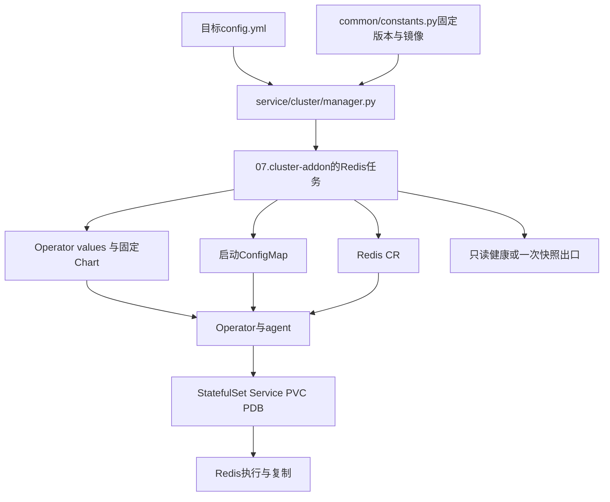
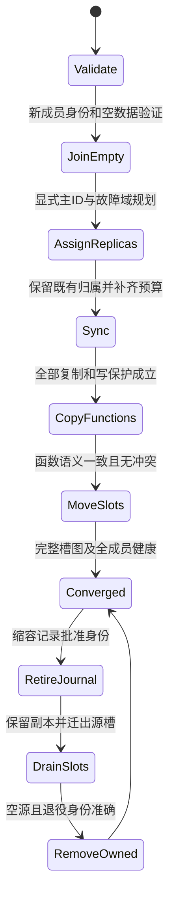
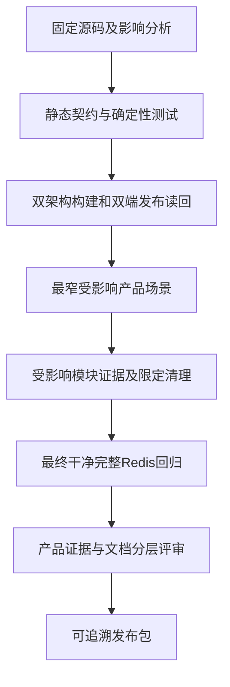

# Redis 开发手册

本手册面向 Kubeauto 维护开发者、制品维护者和交付验证人员，说明如何在既有 Redis 分支中实现变更、保持资源与数据身份并发布可追溯版本。读者需要掌握 Python/Ansible/Jinja、Helm、Kubernetes CRD/控制器以及 Redis 复制与分片语义。业务代码的 Redis API 使用见[用户与运维手册第 4 章](operations-manual.md#4-业务接入与上线验收)，协议与可靠性原理见[白皮书](technical-whitepaper.md)；不要将维护开发入口交给业务替代生产收敛。

适用集合是 Redis 8.10.2、Operator/Chart 0.27.0、Operator修订0.27.0-kubeauto.2、Cluster运行修订8.10.2-kubeauto.1、Exporter v1.93.0、Kubernetes 1.33.6。项目修订不改变上游版本名、数据格式或授权。

| 维护任务 | 阅读入口 | 必须保留的契约 |
| --- | --- | --- |
| 理解请求如何落到资源 | [代码边界](#1-代码边界)与[模板](#3-模板契约) | 权威配置、角色职责及控制器所有权 |
| 更新版本/镜像 | [制品](#2-版本和制品契约)、[发布](#6-开发与发布检查) | 固定源码、补丁范围、双架构双端身份 |
| 维护扩缩容 | [受保护生命周期](#24-受保护-cluster-生命周期) | 复制/故障域预算、Functions、退役身份 |
| 定位重复执行/漂移 | [幂等与所有权](#4-幂等和资源所有权) | 等值资源量、API默认化、PVC/Secret身份 |
| 新增参数或业务能力 | [扩展方法](#10-业务扩展与版本演进) | 源码依据、持久/动态一致、产品入口和专项验证 |
| 修复交付门禁 | [测试阶梯](#5-测试阶梯)与[静态/现场边界](#9-静态与现场执行边界) | 先分类，契约先行，最窄验证，清理可证明 |

## 1. 代码边界

Redis 入口由 `conf/config.yml`、`common/constants.py`、`service/cluster/manager.py`、`roles/cluster-addon/tasks/redis.yml` 和 `roles/cluster-addon/templates/redis/` 组成。制品放在 `roles/cluster-addon/files/` 并由 SHA256 文件校验。专项 runner、矩阵、cleanup 和单元/契约测试必须独立于 Kafka、PXC、日志和 `tools/`。



`kubecli download -E redis` 消费固定组件镜像集合，优先TalkEdu，保留Docker Hub回退，再核验客户Registry；`kubecli setup redis-prod-cluster 07 --tags redis` 进入Ansible限定分支。两者职责不同：下载不证明资源收敛，收敛不证明应用业务已接入。`--tags redis-snapshot` 是显式数据导出入口，不能通过安装时隐式执行备份。

| 实现层 | 所有权与主要输入 | 输出/职责 | 修改时的最小反证 |
| --- | --- | --- | --- |
| config/constants | 配置字段、版本集合、镜像映射 | 新部署默认与固定制品 | 创建目录后无版本占位符；六仓catalog一致 |
| redis.yml | 模式/资源/Secret等声明 | 参数拒绝、Chart/CR应用、健康与snapshot调用 | 非法输入在变更前被拒绝；关闭分支changed=0 |
| operator-values | 版本、watch namespace、feature gates/RBAC | 控制器Deployment与权限 | 真Chart渲染，不只检查模板文本 |
| config模板 | AOF、写保护、TLS/Cluster设置 | 挂载启动配置 | 重建后CONFIG GET与权威输入一致 |
| instances模板 | API字段、角色资源、PVC/域/PDB | RedisReplication/Sentinel或Cluster | 固定CRD接受字段；模式资源互斥 |
| health.py | 真实Pod/PVC/Redis状态与期望规模 | 有限等待的控制/数据健康 | 角色/槽/复制/域错误时不能输出PASS |
| snapshot.py | 本次目录、固定镜像、凭据引用 | 校验RDB、流式传输、manifest和清理 | 损坏/覆盖拒绝；restore_verified仍为false |
| crd.py / rbac.py | 固定Chart/API与release身份 | 安全schema更新、精确最小权限 | 外部消费者/未知身份拒绝，未匹配镜像不加权限 |

健康检查最多等待600秒；快照Redis导出有1800秒、RDB结构校验300秒的独立预算，Kubernetes命令另有超时。修改时要保持首次失败、退出码和阶段语义，不把长任务改成无界等待。客户端凭据优先读取agent的 `REDISCLI_AUTH`，兼容旧agent的 `REDIS_PASSWORD`，按官方CLI去除CR/LF后通过环境认证；日志只能记录非敏感身份与状态。

## 2. 版本和制品契约

| 组件 | 固定版本 | 官方来源 | 产品镜像 |
| --- | --- | --- | --- |
| Operator Chart/CRD | 0.27.0 | OT-CONTAINER-KIT/redis-operator | 固定 Chart 与 CRD 制品 |
| Operator runtime | 0.27.0-kubeauto.2 | 官方 v0.27.0 固定提交与受保护 Cluster 生命周期补丁 | `brinnatt/redis-operator:0.27.0-kubeauto.2` |
| Sentinel Redis/Sentinel runtime | 8.10.2 | `redis/redis` 官方镜像 | `brinnatt/redis:8.10.2` |
| Cluster Redis runtime | 8.10.2-kubeauto.1 | 官方 8.10.2 源码与 ASM 状态刷新补丁 | `brinnatt/redis:8.10.2-kubeauto.1` |
| Redis Exporter | v1.93.0 | `oliver006/redis_exporter` | `brinnatt/redis-exporter:v1.93.0` |

Redis 8.10.2 的[上游模块 manifest](https://github.com/redis/redis/blob/8.10.2/modules/modules.yaml)另行固定 Bloom v8.10.1、Search v8.10.1、JSON v8.10.0 与 TimeSeries v8.10.1，Vector Set 位于 Redis 树内。该表描述源码依赖；现场仍以精确镜像 digest、MODULE LIST 的名称/数值版本/路径和 COMMAND INFO 为准，不能用 manifest 代替镜像实测。升级核心或任一模块，都要复核依赖变化和持久化兼容性。

[Operator v0.27.0 发布说明](https://github.com/OT-CONTAINER-KIT/redis-operator/releases/tag/v0.27.0)要求先更新变更的 CRD，明确 Helm upgrade 不负责此步骤。本项目用第 2.2 节的显式请求和共享消费者检查承接，不能直接照搬上游公网 apply。该版本的 Sentinel 自身认证、ACL/default 校验、小写 AOF、FQDN 通告、CLI 客户端证书与环境凭据、PVC 模板名称及监控选择变化，分别影响接入、轮换、升级和诊断；后续维护须把这些依赖一起复核。发布说明中的其它 Chart、NodePort 或环境占位符能力不自动成为本项目开放参数。

### 2.1 Chart、镜像与发布身份

Chart 文件 `redis-operator-0.27.0.tgz` 与 `.sha256` 必须一起更新；不得运行时从公网拉 Chart、CRD 或动态发现镜像。新增或变更镜像必须在 `kubeauto-ext-images-dockerfile` 的 `middleware/redis/` 下注册并通过 `python3 scripts/validate_catalog.py`。

Chart 使用上游 `helm-charts` 的完整官方发布包，SHA256 为 `4eabe2cde88657f8b7b21c2ec5ddafa3a305d35c9877021f9be89ac3beeb0f7f`；相邻的 provenance 文件记录 release、asset ID 和来源。不得裁剪模板或自行重新打包后沿用官方制品身份。`rbac.aggregate: false` 明确关闭向 Kubernetes 内置 `view/edit/admin` 角色聚合 Redis CR 权限；Operator 自身仍使用专属 ClusterRole。

`redis_operator_ver` 选择 Chart/CRD，`redis_operator_image_ver` 选择 Operator 与初始化 agent 的同版本镜像，两者不能混用。镜像构建基于官方提交 `71954323c9191e6171f3eb04f80bb46a5f128306`，构建上下文位于制品仓 `middleware/redis/protected-operator/`；源码校验、零 fuzz 补丁、单元测试和 AMD64/ARM64 编译均在构建路径中执行，最终保留官方运行镜像基线。原 `0.27.0` 镜像仍作为独立制品保留。

### 2.2 CRD 的共享与并发边界

已有 release 的 CRD 更新使用显式 `redis_crd_upgrade_requested`，默认关闭。`redis-crd.py` 消费同一份固定 Chart 与 checksum 清单，读取四项 CRD 的全部消费者，拒绝其它命名空间或无本产品标签的 CR，拒绝删除存储 API 版本及接管外部 conversion webhook。全部 schema 先经过服务端 dry-run，再保存权限 `0600` 的原 schema，使用同一 field manager 更新并核验。UID/resourceVersion 作为并发前置条件；不使用 `--force-conflicts`。原 schema 备份在部署目录内，不能随源代码同步覆盖。kubectl 对多段清单可逐对象输出 JSON，解析器必须完整消费输出流并校验四项定义，不能假定输出一定是单个 `List`。


### 2.3 Cluster ASM 状态刷新修订

`redis_ver` 选择 Sentinel 模式的 Redis 与 Sentinel 镜像；`redis_cluster_image_ver` 独立选择 Cluster 运行镜像，快照校验使用所属模式的同一版本。Cluster 修订基于官方 8.10.2 完整源码，仅为 `ASM_EVENT_TAKEOVER` 既有的 `CLUSTER_TODO_BROADCAST_PONG` 追加 `CLUSTER_TODO_UPDATE_STATE`，使接收方在下一事件循环前重算主节点数量与仲裁状态。不能以放宽健康门禁、临时降低复制预算或改用传统迁移来掩盖状态缓存缺陷。源码依据为 [ASM takeover](https://github.com/redis/redis/blob/8.10.2/src/cluster_legacy.c) 与 [Redis CLI 迁移选择](https://github.com/redis/redis/blob/8.10.2/src/redis-cli.c)。

修订镜像的构建上下文为制品仓 `middleware/redis/state-refresh-redis/`。固定基础 image manifest、完整源码 archive SHA256、目标源码 SHA256 与零 fuzz 补丁；只替换 `redis-server`，保留官方 CLI、模块库、入口及 Sentinel/check symlink，匹配官方 TLS、protected-mode 与 jemalloc 构建设置。两种架构的原版负控、补丁正控、官方模块/JSON/TLS smoke 及进程回收必须全部通过，再双推与读回两端 digest。构建 fixture 的参数不得进入最终镜像或客户配置；ARM64 生产启动保留官方内核安全检查。

### 2.4 受保护 Cluster 生命周期

Cluster CR 显式声明 `kubeauto.io/protected-cluster-lifecycle: v1`，由同一个 Operator 控制扩缩。新增主必须是无槽、无数据、无 Functions 的独立成员；通过 `CLUSTER MEET` 接入后，为缺少副本的主显式指定新增副本，保留既有复制归属。全部主副本数量、在线复制和同步状态满足声明后，才复制 Functions 并迁移槽位。Functions 按名称、引擎、源码和函数定义比较，不以字典迭代顺序造成的二进制 dump 差异判定冲突；有冲突时拒绝覆盖。整个过程不降低 `min-replicas-to-write`。RedisReplication、RedisSentinel 与未声明该注解的 Cluster 保留上游处理路径。

`protected-topology.go` 将实际节点标签与 Redis 复制图关联，为每个尚无跨故障域副本的主预留一个独立名额，再用完整匹配规划剩余接入。逐个接入和控制器重入均须重新验证当前图；不重新分配已有副本，不接受未知 Pod、缺少标签或不可行的调度布局。原先按 node ID 排序补齐数量的逻辑不能证明故障域安全。官方 Chart 的 Role 不含节点读取权限；产品使用[Helm post-renderer](https://helm.sh/docs/v3/topics/advanced/#post-rendering) `redis-operator-rbac.py` 为精确的修订镜像添加唯一的 `list nodes` 规则，保留全部其它规则与 release 所有权。包装入口 `redis-operator-rbac.sh` 从产品任务接收 `ansible_playbook_python`，使用 Ansible 自身已具备 YAML 依赖的解释器，不能依赖系统 Python 或在执行中安装依赖。旧镜像的 RBAC 保持原样。解析、身份拒绝、幂等及真实 Chart 渲染均须过契约，不能直接修改现场 ClusterRole 代替产品入口。

缩容先记录待退役节点身份，再保留副本搬迁数据；源主不再持有槽位后，才删除已证明属于退役 Pod 预算的成员。持久化记录支持控制器中断重入。若计划包含应保留的副本、未知节点、未完成复制或仍有槽位的源主，控制器拒绝继续，而不是扩大删除范围。



每个转换都可能被安全前置拒绝；协调重入从实际Redis状态和持久化journal核实进度，不依赖上次日志中的“已开始”。迁移之后无法仅靠改回副本数撤销所有数据移动，恢复需要按当前身份、槽位和复制图重新收敛。新代码不得让通用资源删除逻辑扩大退役范围。

## 3. 模板契约

`operator-values.yaml.j2` 只配置 Operator image、namespace watch、RBAC、资源和 feature gates。`config.yaml.j2` 生成持久化启动配置，`instances.yaml.j2` 只生成 Redis CR，不能直接创建 StatefulSet。Sentinel 模式必须生成 RedisReplication 与 RedisSentinel；Cluster 模式只生成 RedisCluster。所有资源带组件和模式标签，Storage 保留策略显式为 `keepAfterDelete: true`。

### 3.1 启动配置与在线声明

固定 Operator 的 Cluster 启动配置由 `redisLeader.redisConfig.additionalRedisConfig` 与 `redisFollower.redisConfig.additionalRedisConfig` 分别挂载；根级 `redisConfig` 承载运行时 `dynamicConfig` 和内存水位。仅在根级引用 ConfigMap 会使角色 Pod 缺少启动配置，运行时参数收敛也不能证明重建前已生效。两角色必须引用同一声明配置，并验证 init/data 容器的真实挂载、生成配置的 include 与实际 `CONFIG GET`；不得输出包含凭据的完整生成配置。

密码 Secret、TLS Secret 和 ACL Secret 只通过名称和 key 引用。任何模板测试都要验证错误模式、空 StorageClass、非法副本数、Secret 泄漏和 Cluster/ Sentinel 资源互斥。

当前 Sentinel CR 的 `kubernetesConfig.redisSecret` 与 `redisSentinelConfig.redisReplicationPassword` 引用同一个产品密码 Secret：前者控制 26379 自身认证，后者用于访问被监控 Redis。它与 Redis `default` 管理密码相同，不构成独立发现凭据。用户手册因此采用 master Service 加受限 Redis 用户主线，并说明角色标签/Endpoint 的控制面依赖；未来拆分身份需核实 Sentinel API/ACL、控制器、探针、复制、SDK 两层认证与轮换全部消费者，不只增加一个 Secret 字段。相关源码见[固定 Service 选择](https://github.com/OT-CONTAINER-KIT/redis-operator/blob/v0.27.0/internal/k8sutils/redis-replication.go)与[角色协调](https://github.com/OT-CONTAINER-KIT/redis-operator/blob/v0.27.0/internal/controller/redisreplication/redisreplication_controller.go)。

### 3.2 调度布局与真实复制图

Cluster leader/follower 的拓扑分布显式采用 `nodeTaintsPolicy: Honor`，只计算待调度 Pod 可容忍的节点。两组成员使用 `apps.kubernetes.io/pod-index` 的双向硬反亲和，隔离相同序号的 leader 与第一轮 follower。上游默认流程以 leader `i % shards` 为新增 follower 的联系入口，但没有传递 `--cluster-master-id`；受保护流程显式选择缺少副本的真实主并指定其节点 ID。不能把联系入口或 Pod 序号当作固定复制归属，初始化、提升与扩缩之后均须核验真实复制图。leader 使用 `maxSkew: 1`；follower 使用 `maxSkew: 2`，为 OrderedReady 逐成员调度与反亲和保留可调度空间，仍要求至少三个域。将 follower 的差值强制为 1 可能使第三个成员既不能占据空域，也不能进入已有域。此约束依赖 StatefulSet 的序号标签及 Kubernetes 1.33 已 GA 的 `MatchLabelKeysInPodAffinity`。自定义区域拓扑还须验证集群准入允许该硬反亲和 topology key；默认使用主机名。故障提升可能改变真实复制图，健康检查仍须逐分片核验实际关系。

### 3.3 特性成熟度与跨版本初始化

Redis 8 的 `clusterVersion: v8` 必须与 Operator 0.27.0 的版本判断同时验证。Operator v0.27.0 将 `GenerateConfigInInitContainer` 作为 Alpha 特性；由于固定官方 Redis 镜像需要生成配置，渲染的 Helm values 会始终显式开启该 gate。现场必须把 gate 启动日志、maxmemory 实际值和 ACL/TLS 客户端结果纳入 focused gate；内存水位为 0 时也必须保留 gate，否则官方 Redis 镜像不会应用认证、TLS 和持久化配置。不能把 Alpha 特性写成上游 GA。

0.26.0 升级夹具使用独立官方 Chart，保留已安装的前向 CRD，不把控制器回退等同于 schema 降级。该 Chart 默认包含 `AvoidCommandLinePassword`，但固定 0.26.0 二进制只注册 `GenerateConfigInInitContainer`；模板仅在 0.26.0 分支将前者设为 YAML `null`，由 Helm coalescing 移除默认键。两版 Chart 必须分别真实渲染并核验最终 `FEATURE_GATES`。依据为 [0.26 特性注册](https://github.com/OT-CONTAINER-KIT/redis-operator/blob/ef33adb71ce1bffb0ab1fce593625c320dc6164e/internal/features/features.go) 与 [Helm 3.19.0 values 合并](https://github.com/helm/helm/blob/v3.19.0/pkg/chartutil/coalesce.go)。

启动配置显式固定 `appendfilename "appendonly.aof"`，避免初始化 agent 的默认值决定持久化文件身份。0.26 agent 使用 `Appendonly.aof`，0.27 使用 `appendonly.aof`；文件系统区分大小写，切换默认值可能创建空 AOF，PVC UID 保留也不能证明数据保留。两版 agent 都在最后 include 外部配置，因此产品声明覆盖该默认值。迁移资格须在任何版本变更前写入业务键、执行 `WAITAOF`，逐成员核验值及绝对过期时间，再验证回退。依据为 [0.26 初始化](https://github.com/OT-CONTAINER-KIT/redis-operator/blob/ef33adb71ce1bffb0ab1fce593625c320dc6164e/internal/agent/bootstrap/redis/config.go) 与 [0.27 初始化](https://github.com/OT-CONTAINER-KIT/redis-operator/blob/71954323c9191e6171f3eb04f80bb46a5f128306/internal/agent/bootstrap/redis/config.go)。

> **既有数据边界：** 只有自首次部署起使用相同 AOF 文件名的版本集合，才能进入原地迁移资格验证。对已经使用 `Appendonly.aof` 的外部旧部署，不得直接套用小写文件名或重命名多段 AOF；先核实 `CONFIG GET appendfilename`、manifest 与独立备份，再按运维手册在隔离目标恢复并迁移客户端。

### 3.4 参数版本与失败滚动

`cluster-bus-port-protected-mode` 在固定 8.10.2 的 `src/config.c` 中注册，8.10.1 没有该参数。启动模板按实际 Cluster 镜像的数值版本判断，仅对 8.10.2 及之后的版本输出该选项；不能以字符串字典序比较 patch 号，也不能把修订标签当作 Redis 服务端版本。当前生产组合保持总线保护，8.10.1 仅是受控固定拓扑迁移/回退资格材料，不能继承当前版本新增的安全能力。依据为 [8.10.1 参数注册](https://github.com/redis/redis/blob/8.10.1/src/config.c) 与 [8.10.2 参数注册](https://github.com/redis/redis/blob/8.10.2/src/config.c)。

Cluster 升级失败恢复遵循 Kubernetes [StatefulSet forced rollback](https://kubernetes.io/docs/concepts/workloads/controllers/statefulset/#forced-rollback)：先通过原 `config.yml + kubecli` 恢复 CR 和两组 Pod template，再以 UID/resourceVersion 前置条件删除仍使用旧错误镜像且未就绪的测试 Pod。固定 `--redis-upgrade-cluster-repair` 只消费已验证的原配置摘要、CR/集群 UID、私有部署目录归属和故障 UUID；不删除健康成员或 PVC，不以跳过产品健康任务代替恢复。原值、TTL、PVC 身份与限定清理通过后才移除 journal。

## 4. 幂等和资源所有权

Ansible 使用 `helm upgrade --install` 和固定 field manager。ConfigMap 使用 Server-Side Apply；Redis CR 采用上游文档的普通 `kubectl apply` 三方合并，保留未声明的控制器默认值与 status。Operator 使用 Kubernetes `resource.Quantity` 序列化资源量，会把 `1000m` 规范化为 `"1"`；不能把这种等值表达变化当成需要强制抢占字段的配置变更。模板将 CPU、内存请求和限制渲染为字符串，不自行实现 Kubernetes 数量解析器。

第二次执行必须比较 CR、PVC、业务 Secret、Service、Operator Deployment 和 Pod UID；无输入变化不得发生 PVC 替换、凭据重建或无意义滚动。Helm upgrade 会生成新的 release revision Secret，这是发布记录；仅排除本 release 的 `helm.sh/release.v1` 记录，仍检查其它全部 Secret。名称、版本或模式改变时应显式拒绝或要求 change ID。

生产 CR 默认保留 PVC。实验清理脚本只处理同时具备 `kubeauto.io/component=redis` 和 `kubeauto.io/managed-by=kubeauto` 的专属命名空间与 CR；删除命名空间会连同实验 PVC 一起删除，不能用于客户生产下线。失败、中断和升级回滚均必须复用同一 cleanup，并在删除前确认资源所有权。

## 5. 测试阶梯

### 5.1 静态前置

1. YAML、Jinja、Chart tar、SHA256、版本映射、镜像目录和文档链接静态校验。
2. `tests/unit/test_redis_delivery.py` 覆盖默认关闭、模式互斥、模板渲染、TLS/ACL 引用、资源数量、镜像 tag、Chart checksum、六仓 catalog 和入口命令。
3. 固定 runner 的 Redis focused gate：清洁命名空间、StorageClass、Registry digest、Operator、真实客户端业务读写和 scoped cleanup。

### 5.2 聚焦验证如何证明因果

每项场景通过 `config.yml + kubecli` 建立产品边界。直接kubectl/Redis协议仅作诊断、独立业务核验或runner自有夹具，不能替代产品入口。已有baseline复用前核验租约/所有权、版本、共享服务、业务数据和无故障残留。修复先保存首失败、durable状态和渲染输入，区分产品、门禁、环境、供应链、运行时或Kubernetes/控制器层；只修改被证明的单一因果层。

| 验证对象 | 必须有的有效证据 | 不能替代它的弱证据 |
| --- | --- | --- |
| 业务连接 | 实际发现、TLS/主机名、认证、值与TTL；负例有正常对照 | 仅PING或TCP可达 |
| 复制故障 | 链路确实断开、真实陈旧读/拒写、恢复追赶 | NetworkPolicy创建成功；CNI未必切既有连接 |
| 成员进程故障 | 拥有者、Pod UID/容器/进程身份、实际故障状态与限定恢复 | 信号命令rc=0 |
| Cluster完整性 | 每成员已知集合、全部槽位、各主副本预算与故障域 | 只用cluster check的槽成功或link up |
| 快照/恢复 | 手册原文路径、CRC/SHA、隔离加载、业务摘要、新写与进程更替 | 文件存在或源PVC保留 |
| 容量 | 实际水位拒写、复制滞后恢复、PVC请求/容量/文件系统/身份 | 只看CR字段或不可变模板 |
| 升级回退 | CRD资格、文件身份、原值/绝对TTL、限定失败Pod恢复 | 镜像Tag改回或Helm rollback |

夹具必须有限、可取消并在成功/失败/中断后清理，故障态证据先于恢复。官方限制如容器PID namespace、集群bus独立连接、DNS路径和TLS握手，须先按固定实现核实，不通过放宽断言制造成功。门禁新增/修复断言需精确原因的确定性契约，先通过最窄现场分支，再运行最终干净完整回归；未改变依赖不重复无关场景。

备份门禁直接抽取并执行运维手册唯一的 `REDIS_OFFLINE_RDB_VERIFY` 块，字符串输入与所有权清理属于操作契约；不能随意更改后继续复用旧证据。Cluster逐主RDB只证明各自产物，不能改成跨分片原子备份结论。新文档操作示例的执行证据单独记录，不拿已有GA笼统替代。

### 5.3 模块与完整验收

1. Sentinel：主发现、单副本/主故障、Sentinel 多数派拒绝、重连、复制追赶、凭据/TLS 轮换。
2. Cluster：槽位完整性、MOVED/ASK、跨槽拒绝、单节点故障、槽位迁移、扩缩容、PDB、磁盘压力和客户端拓扑刷新。
3. 备份恢复、性能、稳定性、升级/回滚和二次执行通过后，运行一次干净完整 Redis 回归。

每一项记录产品入口、期望标志、最小反证命令、故障分类、run ID、manifest digest、PVC/Secret UID、业务摘要和 cleanup 结果。备份项需要独立制品与隔离目标的恢复证据，不能由 PVC 保留或 RDB/AOF 文件存在替代。只有矩阵全部 PASS、durable `rc=0`、零失败标志和 `REDIS_CLEAN_VERIFY_PASS` 同时成立，才能标记已验证或已交付。

## 6. 开发与发布检查

开发命令在本仓根目录、已准备依赖的开发控制端执行。`--redis-static-only`只读静态，后续artifact模式只读供应链；`--redis-only`会在授权实验环境通过固定runner建立/清理专属基线，执行前读取 `tests/README.md` 与 `tests/redis-test-matrix.yaml`，核实租约及所有权，不能对客户生产环境运行测试清理。



现场不是发现语法/资源名错误的第一站；官方来源与制品前置、静态契约及最窄验证分别解锁下一层。产品PASS和文档可执行/可理解的签收是分开的门槛。

下列脚本是**当前聚焦资格已经完成后的最终检查**，不能作为首次开发测试的起点。先依照[运行手册的 Redis 聚焦入口](../../../tests/README.md#redis-独立交付分路)与[聚焦验证契约](#52-聚焦验证如何证明因果)完成矩阵前 23 项的当前模块资格；最后的 `--redis-only` 会核验这些证据，缺项以 `focused-qualification-pending` 拒绝，而不会自行跳过或补签。静态及制品命令可单独执行；聚焦阶段失败时停在该模块，不继续这个最终脚本。


```bash
bash <<'REDIS_DEVELOPMENT_1'
set -Eeuo pipefail
ext_image_repo="${KUBEAUTO_EXT_IMAGES_REPO:-../kubeauto-ext-images-dockerfile}"
python3 "$ext_image_repo/scripts/validate_catalog.py"
bash tests/run_enterprise_regression.sh --redis-static-only </dev/null
bash tests/run_enterprise_regression.sh --redis-artifacts </dev/null
bash tests/run_enterprise_regression.sh --redis-protected-artifacts </dev/null
bash tests/run_enterprise_regression.sh --redis-cluster-artifacts </dev/null
bash tests/run_unit_tests.sh </dev/null
bash tests/run_enterprise_regression.sh --redis-only </dev/null
REDIS_DEVELOPMENT_1
```

完整现场前，先通过受影响单元测试、模板渲染、矩阵 schema 和镜像 catalog。失败时保存首个失败、durable exit、Pod/CR 事件和 Operator 日志；修复单一因果层并清理错误代码及现场残留后，才允许重新执行 focused gate。

## 7. 维护约束

禁止在 Redis 分支引入 `common/` 之外的跨中间件共享状态，禁止复用 Kafka/PXC 的副本、事务、备份或清理语义。禁止使用 `latest`、动态镜像加速器、直接 Helm 代替产品入口或把 Pod `Running` 作为业务结果。任何新模块、跨地域复制、Active-Active、全局一致快照或 Valkey 替换都必须创建新的版本集合、能力边界和专项矩阵。

## 8. 固定源码对应关系

| 实现选择 | 官方版本依据 | 维护断言 |
| --- | --- | --- |
| 根级 featureGates | [Chart Deployment](https://github.com/OT-CONTAINER-KIT/redis-operator/blob/v0.27.0/charts/redis-operator/templates/operator-deployment.yaml) | 真 Helm 渲染的 FEATURE_GATES，不只匹配模板文字 |
| ConfigMap additionalRedisConfig | [Redis 配置生成](https://github.com/OT-CONTAINER-KIT/redis-operator/blob/v0.27.0/internal/agent/bootstrap/redis/config.go) | 启动合入与重建后实际 CONFIG GET 一致 |
| Sentinel 两层密码 | [Sentinel 资源参数](https://github.com/OT-CONTAINER-KIT/redis-operator/blob/v0.27.0/internal/k8sutils/redis-sentinel.go) | 自身 requirepass 与 Redis auth-pass 分别有效 |
| CR 字段/PDB/拓扑 | [固定 API](https://github.com/OT-CONTAINER-KIT/redis-operator/tree/v0.27.0/api) | 渲染 spec 每个字段被 vendored CRD 接受 |
| 维护中断与有序更新 | [Kubernetes 1.33 PDB](https://github.com/kubernetes/website/blob/b9ab6105d0e3b6824dc368d3dd3b101fb4774575/content/en/docs/tasks/run-application/configure-pdb.md)、[StatefulSet](https://github.com/kubernetes/website/blob/b9ab6105d0e3b6824dc368d3dd3b101fb4774575/content/en/docs/concepts/workloads/controllers/statefulset.md) | PDB 不约束直接删除和滚动更新；Ready 不是复制追赶屏障；更新策略、partition、PVC 保留与实际业务分别核验 |
| 网络准入和名字解析 | [Kubernetes 1.33 NetworkPolicy](https://github.com/kubernetes/website/blob/b9ab6105d0e3b6824dc368d3dd3b101fb4774575/content/en/docs/concepts/services-networking/network-policies.md)、[DNS](https://github.com/kubernetes/website/blob/b9ab6105d0e3b6824dc368d3dd3b101fb4774575/content/en/docs/concepts/services-networking/dns-pod-service.md) | 策略依赖 CNI，来源出口与目标入口同时允许；Service/Pod DNS 与证书 SAN 一致；拒绝路径用新连接验证 |
| 卷和凭据生命周期 | [Kubernetes 1.33 PV/PVC](https://github.com/kubernetes/website/blob/b9ab6105d0e3b6824dc368d3dd3b101fb4774575/content/en/docs/concepts/storage/persistent-volumes.md)、[Secret](https://github.com/kubernetes/website/blob/b9ab6105d0e3b6824dc368d3dd3b101fb4774575/content/en/docs/concepts/configuration/secret.md) | RWO 是单节点而非单 Pod 写锁；Filesystem 与裸 Block 分开；Retain、绑定和 finalizer 各自处理；Secret 编码/平台加密/材料验证/进程生效分别验收 |
| 安装前证书材料检查 | [OpenSSL 3.2.4 verify](https://github.com/openssl/openssl/blob/openssl-3.2.4/doc/man1/openssl-verify.pod.in)、[验证选项](https://github.com/openssl/openssl/blob/openssl-3.2.4/doc/man1/openssl-verification-options.pod)、[x509](https://github.com/openssl/openssl/blob/openssl-3.2.4/doc/man1/openssl-x509.pod.in)、[pkey](https://github.com/openssl/openssl/blob/openssl-3.2.4/doc/man1/openssl-pkey.pod.in) | 叶子有效期、key/cert 公钥配对、用途兼容与每个实际 DNS 分别检查；显式 SAN/EKU 与完整链审核不由用途兼容检查替代 |
| Cluster 副本分布 | [固定联系入口](https://github.com/OT-CONTAINER-KIT/redis-operator/blob/v0.27.0/internal/k8sutils/redis.go)、[Redis CLI 主选择](https://github.com/redis/redis/blob/8.10.2/src/redis-cli.c)、[污点域计算](https://github.com/kubernetes/kubernetes/blob/v1.33.6/pkg/scheduler/framework/plugins/podtopologyspread/common.go)、[动态反亲和 selector](https://github.com/kubernetes/kubernetes/blob/v1.33.6/pkg/registry/core/pod/strategy.go)、[1.33 特性状态](https://github.com/kubernetes/kubernetes/blob/v1.33.6/pkg/features/kube_features.go) | 可调度域和真实复制组同时满足，不以角色组均匀分布代替分片容错 |
| CR 应用与资源量 | [上游复制部署入口](https://github.com/OT-CONTAINER-KIT/redis-operator/blob/v0.27.0/docs/content/en/docs/Getting%20Started/Replication/_index.md)、[Kubernetes Quantity](https://github.com/kubernetes/apimachinery/blob/v0.33.6/pkg/api/resource/quantity.go) | 整数与等值单位经控制器规范化后，产品重复执行仍保留业务资源身份 |
| 真实成员与 Service | [StatefulSet 实现](https://github.com/OT-CONTAINER-KIT/redis-operator/blob/v0.27.0/internal/k8sutils/statefulset.go) | 主容器名来自 StatefulSet 名，不能硬编码 redis |
| Cluster bus 保护 | [Redis 8.10.2 配置](https://github.com/redis/redis/blob/8.10.2/redis.conf) | TLS 成员认证；未启用 TLS 的 Cluster 在产品校验拒绝 |
| 数据模型与版本差异 | [8.10.2 发布说明](https://github.com/redis/redis/blob/8.10.2/00-RELEASENOTES)、[命令定义](https://github.com/redis/redis/tree/8.10.2/src/commands)、[Hash 实现](https://github.com/redis/redis/blob/8.10.2/src/t_hash.c) | Array 已存在且仍须评估 preview；字段 TTL 与模板编码分别核实，不沿用旧版本结论 |
| Vector Set 投影与恢复 | [固定 vset.c](https://github.com/redis/redis/blob/498ecd0d6d007db11ddb3aea9428552598a78622/modules/vector-sets/vset.c) 的 `createProjectionMatrix`、`VADD_RedisCommand` 与 RDB 保存/加载 | 同维度确定性权重，RDB 保存矩阵；滚动教程的旧随机投影差异不作为当前事实。集合表示约束和业务召回仍需专项资格 |
| Search 查询预算 | [固定 Search 默认值](https://github.com/RediSearch/RediSearch/blob/v8.10.1/src/config.h)、[配置注册与校验](https://github.com/RediSearch/RediSearch/blob/v8.10.1/src/config.c) | 普通内存模式默认 500ms/RETURN，不能把部分返回当全量成功；官网 PARTIAL 描述不当作固定配置值 |
| Python 接入示例 | [redis-py v6.4.0 接口](https://github.com/redis/redis-py/blob/v6.4.0/redis/client.py)、[SSLConnection](https://github.com/redis/redis-py/blob/v6.4.0/redis/connection.py)、[Retry](https://github.com/redis/redis-py/blob/v6.4.0/redis/retry.py) | 示例显式验证 CA 与 hostname，使用命名用户、bytes 与有界连接池；覆盖默认命令重试，不将未知写入自动重放；仅声明示例基本 API 的范围 |
| CLI 回复与导出 | [固定 redis-cli.c](https://github.com/redis/redis/blob/498ecd0d6d007db11ddb3aea9428552598a78622/src/redis-cli.c) 的 `parseEnv`、`cliReadReply`、`getRDB` | REDISCLI_AUTH 只经环境传入；`-e` 检测顶层错误，不能代替 EXEC 逐项检查；`--rdb` 使用复制协议，传输完成不能代替独立恢复 |
| 进程崩溃诊断 | [官方进程调试](https://redis.io/docs/latest/operate/oss_and_stack/management/debugging/) | core 含全部进程内数据；attach 后目标先暂停。上游演示的 DEBUG SEGFAULT 与无优化构建不成为生产诊断主线，先保护业务与原制品身份 |
| CPU 性能分析 | [官方 CPU profiling](https://redis.io/docs/latest/operate/oss_and_stack/management/optimization/cpu-profiling/) | 先证明 CPU 瓶颈；符号和 build ID 匹配，保留优化等级，有界采样；on-CPU 栈不能解释全部 I/O 等待或直接替代业务 p99 |
| 监控名称和状态 | [Exporter v1.93.0 映射](https://github.com/oliver006/redis_exporter/blob/v1.93.0/exporter/exporter.go)、[状态数值转换](https://github.com/oliver006/redis_exporter/blob/v1.93.0/exporter/metrics.go)、[复制标签](https://github.com/oliver006/redis_exporter/blob/v1.93.0/exporter/info.go) | ok=1/err=0；副本 link 指标有主地址标签；Prometheus up 与 redis_up 各自判断，缺样本不等于健康 |
| 采集能力和成本 | [Exporter v1.93.0 README](https://github.com/oliver006/redis_exporter/blob/v1.93.0/README.md) | 模块/Search 指标默认关闭，产品模板未设置开关；Streams/key 分组采集另验权限、基数、扫描和 Lua 成本，HTTP 指标及 `/scrape` 只向监控网络开放 |
| 控制器指标语义 | [Operator 指标实现](https://github.com/OT-CONTAINER-KIT/redis-operator/blob/v0.27.0/internal/monitoring/redisreplication.go)、[监控入口](https://github.com/OT-CONTAINER-KIT/redis-operator/blob/v0.27.0/docs/content/en/docs/Monitoring/_index.md) | connected_slaves_total 实际为 gauge；8080 控制器指标与 9121 数据 Exporter 分开，检查重复服务抓取与 leader election |
| 镜像身份 | [skopeo inspect](https://github.com/containers/skopeo/blob/v1.20.0/docs/skopeo-inspect.1.md) | index 与两个架构 child digest 均核验 |
| 证书签发者与信任窗口 | [OpenSSL X.509 v3 扩展](https://docs.openssl.org/1.1.1/man5/x509v3_config/) | 两代 CA 主体可区分，AKI/SKI 明确；实际客户端库分别验证两代证书链 |
| 失败滚动回退 | [Kubernetes 1.33 StatefulSet forced rollback](https://v1-33.docs.kubernetes.io/docs/concepts/workloads/controllers/statefulset/#forced-rollback)、[kubectl 0.33.6 raw delete](https://github.com/kubernetes/kubectl/blob/v0.33.6/pkg/cmd/delete/delete.go) | 先恢复正确配置，再仅重建归属和 UID 已核验的未就绪成员，保留全部 PVC |
| RDB 加载与资源采样 | [Redis 8.10.2 loadDataFromDisk](https://github.com/redis/redis/blob/8.10.2/src/server.c)、[kubelet 1.33.6 Summary schema](https://github.com/kubernetes/kubernetes/blob/v1.33.6/staging/src/k8s.io/kubelet/pkg/apis/stats/v1alpha1/types.go) | 独立目标明确关闭 AOF 后加载 RDB；统计绑定真实 Pod UID，不以缺失数据或重置计数器生成结果 |
| 复制断链与 DNS 路径 | [CLIENT 类型与断链](https://github.com/redis/redis/blob/8.10.2/src/networking.c)、[立即重连](https://github.com/redis/redis/blob/8.10.2/src/replication.c)、[同步地址解析](https://github.com/redis/redis/blob/8.10.2/src/anet.c) | 上游连接确实断开；保留实际 DNS；正常对照、真实旧值、恢复最新值均须验证 |
| 在线卷扩容 | [Operator HandlePVCResizing](https://github.com/OT-CONTAINER-KIT/redis-operator/blob/v0.27.0/internal/k8sutils/pvc.go)、[StatefulSet 不可变模板处理](https://github.com/OT-CONTAINER-KIT/redis-operator/blob/v0.27.0/internal/k8sutils/statefulset.go)、[Kubernetes 1.33 PVC expansion](https://v1-33.docs.kubernetes.io/docs/concepts/storage/persistent-volumes/#expanding-persistent-volumes-claims) | 通过 CR 扩容，核验 PVC、文件系统与业务；不请求缩容，不要求替换原 StatefulSet 模板 |
| 删除与保留 | [固定 finalizer 实现](https://github.com/OT-CONTAINER-KIT/redis-operator/blob/v0.27.0/internal/k8sutils/finalizer.go) | 数据 CR 的 keepAfterDelete 决定控制器是否主动删除 PVC；Sentinel 清除自己的 finalizer；关闭 redis_install 只跳过本项目任务，不触发删除 |

生产健康检查由 `roles/cluster-addon/files/redis-health.py` 执行，只读访问 Kubernetes API 与成员 Redis CLI。健康及快照 CLI 优先读取 agent 的 `REDISCLI_AUTH`，缺失或为空时兼容 0.26 的 `REDIS_PASSWORD`，按上游语义去除 CR/LF 后仅通过进程环境认证。独立 TLS 客户端成功但产品 CLI 返回 `NOAUTH` 时，先核对 agent 的环境变量名称与入口兼容性；禁止把密码补入命令参数或输出 Secret 来诊断。依据为 [0.26 StatefulSet 环境](https://github.com/OT-CONTAINER-KIT/redis-operator/blob/ef33adb71ce1bffb0ab1fce593625c320dc6164e/internal/k8sutils/statefulset.go) 与 [Redis CLI 认证环境](https://redis.io/docs/latest/develop/tools/cli/#host-port-password-and-database)。`tests/helpers/redis-config.py` 用 YAML 解析目标部署目录的配置，拒绝未解析版本占位符；不得恢复 sed/awk 解析配置或 shell eval。日志只能记录对象名称、状态、数量和摘要，不能记录凭据值。

## 9. 静态与现场执行边界

`--redis-static-only` 不进行 SSH、源码同步、镜像拉取或集群变更。它执行 shell/Python/YAML、专项契约、真 Helm 渲染、Ansible syntax/list-tasks 与默认关闭 check。开发机可通过临时 `REDIS_HELM`、`REDIS_ANSIBLE_PLAYBOOK` 指定已校验工具，不能把临时路径写入生产默认配置。

`--redis-artifacts` 是只读双端制品核验，要求 TalkEdu 与 Docker Hub 同时具备 AMD64/ARM64，完整 index 与架构 manifest 身份一致。国内执行可使用已核验的 Actions 双推 artifact：必须绑定 run、SHA、构建指纹、artifact SHA256 和两端双架构 digest，再将当前 TalkEdu manifest 与该证据比对。此路径不重复访问不可达的 Docker Hub；没有完整发布证据时仍需读取两端。网络失败不是成功，TalkEdu 单端存在不构成双推验收。

矩阵允许已完成模块先登记 PASS，整体保持 PENDING，直到最终完整回归完成。聚合 PASS 必须全部 case 为 pass；每项必须绑定当前证据。基础安装 smoke 的标志是 `REDIS_INSTALL_SMOKE_PASS`，不能发出全分支交付标志。

`--redis-only` 要求前 23 项聚焦资格全部通过，随后在同一实验资源租约下按依赖顺序清理 Redis、PV、CSI 和专属 Kubernetes 基线，重新通过 `config.yml + kubecli` 安装并执行全部业务、故障、维护、升级和稳定性阶段，最后完整清理。阶段失败、业务标志缺失或清理失败立即阻断后续场景。各阶段独立保存 durable 退出状态、日志摘要和启动时源码清单；长门禁期间的本地编辑不得被写成该次执行的源码身份。`redis-full-evidence.py` 在所有阶段、完整清理和当前源码身份均符合契约后，才更新 24 项矩阵。

Redis 8.10.2 的模块资格检查须同时核验四个官方共享库与内置 `vectorset`。`MODULE LIST` 的 RESP3 返回五条记录，内置模块的 `path` 为空；不能以 `.so` 文件数等于注册模块数作为验收断言。身份、版本、加载路径与参数均依据固定基础镜像核验，依据见[官方内部模块加载](https://github.com/redis/redis/blob/8.10.2/src/module.c)。ARM64 的 QEMU 构建夹具仅对自有测试进程使用上游 COW 检查的仿真豁免；正式镜像保留原生内核检查。双架构构建夹具使用独立 loopback 网络并验证自有进程仍存活，避免端口冲突导致探针误接其它进程。

## 10. 业务扩展与版本演进

### 10.1 新增一个参数的完整维护路径

以新增复制backlog的可配置能力为例：需求先定义期望覆盖的断连时间、复制流峰值和内存预算，研究固定redis.conf/源码的作用及动态能力；不能只增加一行Jinja。该例说明**未来维护方法**，当前产品没有此配置字段。

1. 在 `conf/config.yml` 声明类型、单位、默认/推荐与允许范围；已有部署目录不会随模板自动更新，兼容默认必须在产品任务中明确。
2. 在Redis task变更前校验边界，避免非法参数写入已有CR；解释0/空值语义，不把“未设置”混同于禁用安全配置。
3. 确定启动ConfigMap与在线dynamicConfig是否都支持，分别按两模式/两角色映射；重建后与即时运行值必须一致。
4. 更新三手册对应任务、原理与速查，解释内存/恢复代价、原值记录、停止/回退与复验；官方阅读映射记录固定版本依据。
5. 静态/确定性契约覆盖默认关闭、非法输入拒绝、模板/CRD、敏感信息与原有模式；再通过产品入口验证真实值、故障前后行为与重建保留。
6. 只回到pending受影响矩阵项，记录依赖和最小反证；最窄资格后完成干净完整回归与清理，保持其它组件实现不变。

支持的动态值并不免除权威声明。在线临时参数可能被下一次reconcile覆盖，CONFIG REWRITE也不能替代挂载ConfigMap。扩展时不要增加无边界的extraConfig透传把安全/版本责任转给客户。

### 10.2 数据类型、Lua/Functions与模块资格

核心类型与扩展命令先以固定8.10.2命令表、模块注册、API/发布说明核实。官网latest新增类型或命令不能直接进入当前交付表。官方镜像含四个共享库及内置vectorset，RESP3 MODULE LIST的内置项可没有path；身份、版本与加载参数需分开核验，不以.so文件数量等于注册数量作为判据。

注册属性不能代替 handler 的副作用审查。例如固定 Bloom 的 CF.COMPACT 注册为 readonly，却修改内部过滤器并传播；部分内部 DEBUG 命令可暂停 worker/GC、删除 cursor 或改变模块拓扑，不因命令名出现在参考表或带 readonly 就成为安全巡检。TimeSeries 的 LibMR 拓扑命令也可能因已经收到 topology event 而直接返回 OK；不能用这个回复证明拓扑已重建。此类接口只进入经独立评审的专家诊断，客户主线仍由产品声明和可观察业务结果验收。核对依据为[固定 Bloom 注册与实现](https://github.com/RedisBloom/RedisBloom/blob/v8.10.1/src/rebloom.c)及[固定 LibMR 拓扑实现](https://github.com/RedisGears/LibMR/blob/c6a5ed62bc7d7b5ddaa8adf99d2cf6fb5a7d527c/src/cluster.c)。

新增JSON/检索/时序/概率/向量业务应先确定数据和索引格式、命令/ACL、内存及查询预算、复制/持久化与隔离恢复。任意第三方模块或运行时MODULE LOAD不是当前资格；模块崩溃、ABI和数据兼容性会影响整个Redis进程，必须独立制品、固定来源与专项矩阵。

模块类型的恢复契约要贯穿编码、加载与生命周期。类型名称和 encoding version 标识持久化内容，`rdb_load` 必须明确接受哪些历史编码并拒绝不兼容输入；RDB 保存/加载、AOF rewrite，以及模块全局状态的 auxiliary 保存/加载均要覆盖。缺少匹配模块、依赖库或受支持编码时，恢复可能无法完成，保留 PVC 与文件并不能代替兼容性验证。`free`、`mem_usage`、`copy`、`defrag` 等回调影响释放、内存估算、复制对象及整理行为；不能因为普通 SET/GET smoke 成功就签收模块的所有生命周期。

模块命令注册为 `write` 不会自动复制该模块的任意内存修改。实现须通过 `RedisModule_Replicate`、`RedisModule_ReplicateVerbatim` 或带传播标志的 `RedisModule_Call` 明确生成副本/AOF可重放的命令；排除 AOF 或副本一侧的选项改变耐久性和复制资格，须解释并独立验证。`RedisModule_EmitAOF` 用于 AOF rewrite 回调，不是普通命令路径上的持久化确认；验收要检查主写入、副本读值、RDB/AOF 隔离重启和业务摘要，而不是只检查回复成功。

线程和异步加载同样属于能力边界。后台线程访问多数 Redis API 需要相应线程安全上下文和锁；blocked client 的超时、断线、取消及资源释放要形成完整路径，不能留下客户端或内部任务。异步 diskless load 还要求模块显式具备支持能力，不能从核心复制设置推导所有模块兼容。API 按固定核心版本核实；滚动参考页标为 unreleased 的接口不得编译进当前资格并宣称受支持。维护依据为[Modules API 参考](https://redis.io/docs/latest/develop/reference/modules/modules-api-ref/)与[8.10.2 模块实现](https://github.com/redis/redis/blob/498ecd0d6d007db11ddb3aea9428552598a78622/src/module.c)，第三方模块开发须另立交付范围和矩阵。

Lua/Functions代码采用有界执行、先校验后写、显式key/argv、同槽和幂等请求设计。Functions在各主一致，库更新是完整库替换，不能只看function名称；扩缩要核验引擎、源码与定义语义。业务库的变更由自己的发布资产和验证管理，禁止将测试脚本库混入生产默认。

### 10.3 版本升级的研究范围

官网命令目录、since 元数据与固定源码需要交叉核实。当前目录中的 BLESS 家族标为 8.12，固定 8.10.2 核心没有对应注册，不能纳入当前交付能力；相反，FT._LIST 的 WITHCLUSTERSTATE 虽被目录标为 8.12，固定 Search v8.10.1 已有实现，不能仅凭该字段判定不支持。普通 FT._LIST 用于本地索引枚举，WITHCLUSTERSTATE 涉及额外协调与 ClusterReady 条件，具体镜像接口、响应及开销须在专项中核验，不能从源码存在推导本产品全局 Search 资格。FT.CONFIG 的注册也依赖部署模式，读取参数优先核对固定 CONFIG GET search-* 接口，永久修改仍走产品扩展。依据见[固定 Search 注册与协调逻辑](https://github.com/RediSearch/RediSearch/blob/v8.10.1/src/module.c)。

版本变化重新研究核心/模块发布说明、安全/弃用、redis.conf、命令表、持久化格式、CLI、Operator API/Chart/agent和客户端。官网latest与固定源码不一致时记录具体差异，正文标明固定版本行为；不宣称所有官方目录已读，直到内部覆盖清单没有未处理适用项。

Redis8.10统一配置文件与BACKUP能力，Operator配置生成Alpha和TLS校验边界，Kubernetes调度/API/PVC行为都属于版本集合的一部分。上游BACKUP若要集成，需实现状态、目录/制品所有权、START/SEAL/取消/清理、凭据、复制独立副本、preload隔离恢复、跨分片一致边界及生产主线，不能仅将backup_enabled设为true。

### 10.4 文档也是交付接口

文档修改分为不影响操作的解释、增加教学示例和改变生产操作契约。解释通过来源/内容/静态复核；新示例需按声明条件验证；操作变化走所属runner最窄验证与清理阶梯。覆盖、实际渲染、语法、操作证据与读者走读分别记录，保留缺陷，不用产品GA或文件数量充当文档签收。

官方出处融入白皮书与本手册，内部研究/评审材料留在测试内部资产，不增加客户README或过程稿。正式交付前需非作者按连续主线走读；作者自检不能冒充独立评审。Ceph与其它功能不属于Redis文档变更授权。
