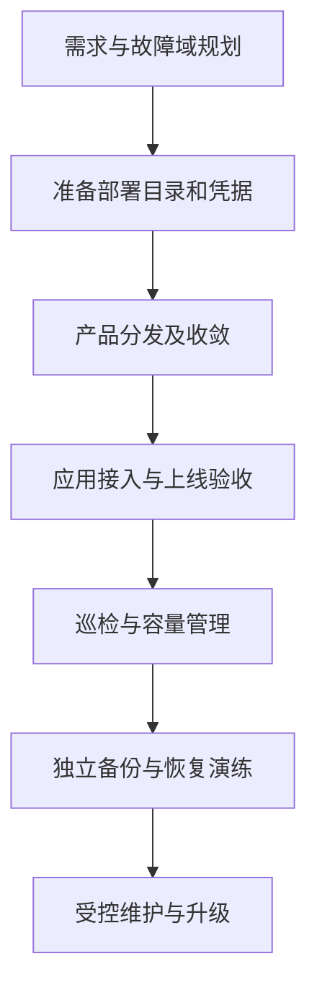
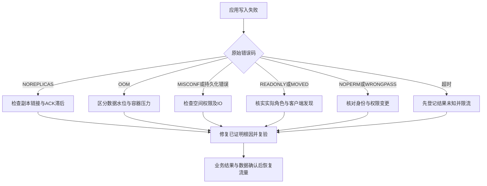
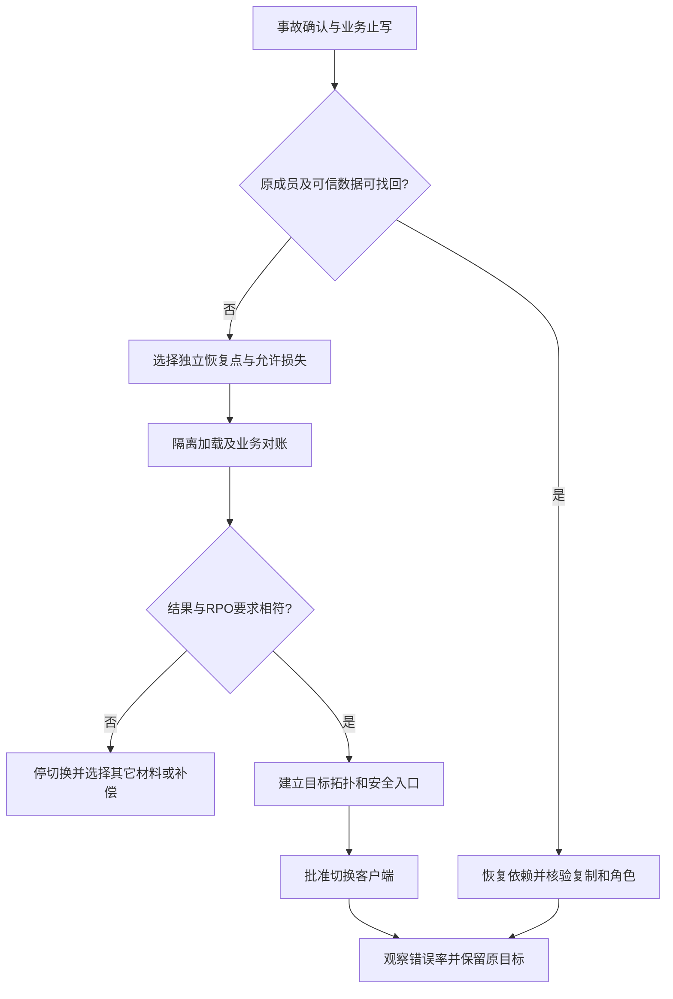

# Redis 用户与运维手册

本手册合并用户手册与运维手册，面向实施人员、业务开发者和当班运维。适用 Redis Open Source 8.10.2、OpsTree Operator 0.27.0、Exporter v1.93.0 与 Kubernetes 1.33.6；读者需要基本的 Linux、Kubernetes、TLS 和 Redis 命令知识。完成主线后应获得可认证连接、可解释的数据结果和可恢复的运维流程。原理见[技术白皮书](technical-whitepaper.md)，配置到资源的实现见[开发手册](development-manual.md)。

| 当前任务 | 从哪里进入 | 完成后应得到什么 |
| --- | --- | --- |
| 第一次部署 | [模式选择](#1-产品与操作边界) → [规划](#2-上线规划) → [安装](#3-安装主线路) → [业务接入](#4-业务接入与上线验收) | 产品收敛、SDK 真实读写与安全拒绝通过 |
| 查询日常操作 | [巡检](#5-日常巡检与监控)、[故障入口](#6-故障诊断与恢复)、[参数速查](#12-参数速查与特殊部署场景) | 能从现象找到最小检查与恢复出口 |
| 执行生产变更 | [维护与扩容](#7-维护与容量变更)、[轮换](#8-凭据与证书轮换)、[升级](#11-升级回退与下线) | 身份、数据、拓扑与业务均经过复验 |
| 备份或事故恢复 | [数据保护](#9-数据保护与恢复) | 独立材料、恢复证据与业务切换边界 |
| 制定容量/SLO | [容量算例](#23-从业务量推导部署预算)、[性能验收](#10-性能与稳定性验收) | 有负载依据的预算与停止条件 |

当班操作可直接进入具体任务：[写入失败](#64-写入失败先按错误码分叉)、[切换后仍连旧主](#65-sentinel-不切换或应用仍连旧主)、[丢槽或迁移停滞](#66-cluster-丢槽视图分裂或迁移停滞)、[进程崩溃](#68-进程崩溃与诊断升级)、[尾延迟升高](#69-尾延迟升高与-cpu-分析)、[节点维护](#71-节点维护与滚动重启)、[内存/PVC 扩容](#72-内存与-pvc-扩容)、[密码轮换](#82-密码与-acl-轮换)、[CA 轮换](#83-ca-与叶子证书轮换)、[快照导出](#92-导出可核验的独立快照)、[恢复](#93-恢复流程)和[下线](#112-下线)。独立进入任务时，先按该节恢复执行位置、kubeconfig 和凭据上下文。

推荐新部署先用 Sentinel，只有明确需要分片容量或吞吐时采用 Cluster。主线中的 `redis-prod-cluster` 是 **Kubeauto 部署目录名称**，不表示一定使用 Redis Cluster；示例实际是 Sentinel。所有示例名称可替换，但部署目录、资源名称、证书 SAN 和客户端配置必须一起更新。



图给出生产顺序；备份与巡检在上线后持续进行，不能等到升级当天才第一次验证恢复。

## 1. 产品与操作边界

固定运行集合为 Redis Open Source 8.10.2、OpsTree Redis Operator 0.27.0、Redis Exporter v1.93.0。Operator 运行镜像为 `0.27.0-kubeauto.2`；Sentinel 模式使用原 `8.10.2`，Cluster 模式使用处理 ASM 接管状态刷新的 `8.10.2-kubeauto.1`。Redis 默认关闭。配置在目标部署目录的 `config.yml` 中完成；`conf/config.yml` 是创建部署目录的模板，修改模板不会更新已有部署。

完成第 3 章的目录、集群和凭据准备后，用 `kubecli download -E redis` 分发固定制品，再用 `kubecli setup redis-prod-cluster 07 --tags redis` 收敛。两个命令不是未准备环境的快捷安装器。

`--tags redis` 将本次收敛限定为 Redis。Operator 管理 Redis StatefulSet、Service、复制和分片拓扑；日常部署不得直接修改这些受控对象，否则控制器可能覆盖变更。Kubeauto 不自动创建 Kubernetes 集群、存储系统或业务凭据。

| 模式 | 数据与客户端 | 默认规模 | 适用场景 |
| --- | --- | --- | --- |
| Sentinel | 一份数据；主写、副本读须接受延迟；支持多 DB | 1 主、2 副本、3 Sentinel | 单实例容量足够、需要故障发现和自动切换 |
| Cluster | 16384 槽；仅 DB 0；集群客户端处理 MOVED/ASK | 3 主分片、每主 2 副本，共 9 个 Redis | 需要分片容量或横向吞吐扩展 |

> **边界：** Sentinel 与 Cluster 不能通过修改 `redis_mode` 原地转换。同名另一模式资源存在时，产品拒绝执行；应部署独立目标、迁移数据、验证客户端后切换业务。
>
> **上游特性：** 本固定镜像使用 Operator 的 `GenerateConfigInInitContainer` 路径生成认证、TLS 和持久化配置。该特性在上游 0.27.0 仍为 Alpha，项目验收不会改变其上游成熟度。内存水位设为 0 也不会关闭配置生成；生产版本变更须重新验证该路径。

## 2. 上线规划

### 2.1 故障域、存储与网络

准备至少三个可调度且独立的故障域，默认按 `kubernetes.io/hostname` 分布。使用可扩容的块存储 StorageClass，明确 `ReadWriteOnce`、容量限制、扩容方式、回收策略和故障恢复 SLA。业务 PVC 在删除 CR 后保留；保留不代表备份，也不保证底层 StorageClass 删除 PV 后仍能恢复。

这里“块存储”指底层介质；Redis 挂载并读写的是卷上的文件系统，不是 `volumeMode: Block` 的裸设备。RWO（ReadWriteOnce）约束单节点挂载，仍可能允许同一节点上的多个 Pod 使用同一卷，不能当作单进程写入锁。禁止给两个 Redis 实例复用同一数据目录；故障节点重新接入前由平台确认旧挂载和旧进程已经隔离。上游推荐的 RWOP（ReadWriteOncePod）提供单 Pod 约束，但要求 CSI/sidecar 支持，当前产品模板固定 RWO；不得仅改已有 PVC 字段就称迁移完成。存储类型或访问模式变更按独立目标与恢复资格处理。

Sentinel 的 Redis 与 Sentinel 分别约束分布，不以六个 Pod 的总分布代替两组各自分散。Cluster 的 leader/follower StatefulSet 标签是控制器配置角色，故障转移后的真实主从角色应从 `ROLE`、`INFO replication` 或 `CLUSTER NODES` 读取。组级拓扑分散不能单独证明每个主分片与其副本已跨故障域，上线须验证实际复制关系。

Cluster 接入新副本前会验证当前节点标签与剩余副本布局，确保每个主至少有一个跨故障域副本。遇到 `scheduled replicas cannot satisfy the failure-domain and replica budgets` 时，保留已接入成员及 PVC，检查待接入 Pod 的节点、拓扑标签和调度约束，调整其布局后重新执行同一产品入口。不要删除已有业务副本、关闭写保护或将健康检查改为只验证 Ready。

网络须支持集群 DNS、Redis 客户端端口 `6379/TCP`、Sentinel `26379/TCP`、Cluster bus `16379/TCP`、Exporter `9121/TCP` 和 Kubernetes API。Cluster bus 仅允许 Redis 成员互通，不对应用开放。应用到 Redis、应用到 Sentinel、成员间复制、Operator 到成员和监控抓取应分别列入网络访问清单。

> **注意：** 产品不自动安装 CNI、修改现有 NetworkPolicy 或把 Redis 暴露为公网服务。启用默认拒绝策略前，应逐条验证上述必要流量；禁止以开放全部命名空间流量作为永久排障措施。

NetworkPolicy 是否生效取决于 CNI 的实现，不由对象创建成功证明。Pod 的入口与出口分别判断，一条连接须同时满足来源 Pod 的出口策略和目标 Pod 的入口策略；同方向多个策略的允许规则取并集，新加“默认拒绝”不会收紧已有的全开放规则。用同一条规则中的 namespaceSelector 与 podSelector 表达“指定命名空间里的指定应用”，拆成两个列表项会变成“任一命名空间或任一本地应用”，授权范围不同。策略按 Pod 标签定义，不能直接以 Redis Service 名称授权，也不代替 TLS 或 ACL。

由平台网络负责人维护允许清单，至少包括 DNS 的 UDP/TCP 53、必要的 Redis/Sentinel/bus 链路、控制器 API 与监控入口。上线前在相同 CNI 下验证允许和拒绝两类**新连接**，再逐步发布并观测业务、复制、发现和采集；策略 API 没有统一的“数据面已生效”状态，已有 TCP 连接是否被切断也取决于实现。验收失败时停止推广、保留脱敏后的策略和连接结果，按网络配置的原发布入口回退本次变更，再重新建立连接复验。hostNetwork、节点来源和 Service 地址转换须单列资格，不能将普通 Pod 的结果外推。依据见[固定 Kubernetes 网络策略说明](https://github.com/kubernetes/website/blob/b9ab6105d0e3b6824dc368d3dd3b101fb4774575/content/en/docs/concepts/services-networking/network-policies.md)。

### 2.2 容量模型

| 资源 | 规划依据 | 上线核验 |
| --- | --- | --- |
| Redis 内存 | 业务对象、碎片、复制/客户端缓冲、fork/COW | `used_memory`、RSS、`mem_fragmentation_ratio`、容器内存峰值 |
| PVC | RDB、AOF、rewrite 双份材料、复制重建临时空间 | `df`、AOF 文件大小、存储告警、扩容能力 |
| CPU | 命令复杂度、TLS、序列化、后台保存、事件循环 | 饱和度、限流时间、延迟分位、慢查询 |
| 网络 | 客户端吞吐、全量复制、分片迁移和备份并发 | 重传、带宽、复制积压覆盖时间 |
| 客户端 | 连接池、pipeline、超时、输出缓冲 | `connected_clients`、`blocked_clients`、拒绝连接和缓冲上限 |

默认每个 Redis request 为 `500m/1Gi`、limit 为 `2 CPU/2Gi`；这是声明起点，不能直接作为客户容量承诺。`redis_maxmemory_percent: 70` 为容器限制预留约 30% 非数据内存，但 fork 写时复制和突发缓冲仍可能超过余量。不得把 `maxmemory` 等同于进程 RSS 或容器硬限制。

### 2.3 从业务量推导部署预算

先采集代表性业务样本，记录 key 长度、value/字段大小、类型、TTL 与实际编码，测量 `MEMORY USAGE` 和整体 `used_memory` 增量，再推到峰值存活数量。不能仅把 value 字节相加。下面数字是**计算示例，不是硬件性能保证**：

- 峰值存活 200 万条，实测每条含 key、对象与 TTL 平均 600 bytes，数据工作集约 `2,000,000 × 600 / 2^30 = 1.12GiB`。
- 预计业务增长 50%，数据约 1.68GiB；另计 JSON/检索索引，未测索引不得按零计算。
- 示例复制/客户端缓冲峰值 0.30GiB，持久化期间额外 COW 峰值 0.80GiB，进程/分配器及余量 0.40GiB，总内存预算至少约 3.18GiB。应在高写入保存/重建窗口实测后选择更高容器 limit，不能沿用默认 2Gi。
- Sentinel 每个数据成员都保存全量，三成员需要三份预算；Cluster 先按最繁忙分片算，再乘每主及其两个副本。均匀槽数不保证均匀字节或热点。
- 若当前 RDB 1GiB、AOF 3GiB、rewrite 新文件可能 2GiB、重建及增长预算 2GiB，单卷至少先预算 8GiB 再加安全余量。20Gi 是默认申请值，不是所有业务的足够容量。

默认 Sentinel 三个 Redis 的 request 合计 1.5 CPU/3Gi，再加 Sentinel、三个 Exporter 和两个 Operator；Cluster 九个 Redis 的 request 合计 4.5 CPU/9Gi，再加九个 Exporter、Operator 与平台开销。request 是调度保证，limit 是运行边界，主机还需留系统、Kubernetes 和后台任务空间。不要在三台小内存节点上仅凭 Pod 数做生产承诺。

backlog 示例：复制峰值 5MiB/s，需要覆盖 120 秒断连，起始估算为 600MiB。最终应核对 `INFO replication` 中 backlog 大小、起始 offset 和历史长度；本项目没有对外 backlog 参数开关，需要调优时先按[开发扩展契约](development-manual.md#10-业务扩展与版本演进)交付持久配置与专项验收，不在线改完就称永久生效。

### 2.4 上线前置检查与停止条件

执行安装前由实施负责人逐项确认：

| 检查 | 方法 | 准入条件；不满足时停在哪里 |
| --- | --- | --- |
| 集群与权限 | 核对 kubeconfig 的当前 context；`kubectl get nodes`、`kubectl auth can-i create namespaces` | 目标正确、节点 Ready、具备批准权限；否则不创建 Secret |
| 调度与域 | 查看节点 topology 标签、污点、可分配资源和已有 request | 至少三个可调度独立域，覆盖所有成员预算；否则先调整容量 |
| 存储 | `kubectl get storageclass csi-block -o yaml`，核对 CSI 运行状态 | 有适用的 RWO、回收/扩容策略及挂载资格；否则不提交 CR |
| DNS/网络 | 平台已有 DNS/CNI 验收，从应用运行网络验证计划端点 | 成员、Sentinel、bus、API、指标流量均有访问清单；否则先修网络 |
| 凭据 | 文件权限、CA 链、SAN、有效期、key 匹配及 ACL 审核 | 每条控制/业务链都匹配；不合格材料不得部署 |
| 制品 | 发布包的 Chart SHA256、镜像 index/架构 digest 与目标平台 | 两端固定制品已核验且本地 Registry 可用；否则停分发前 |
| 应用 | 客户端版本、发现、TLS、超时/重试和幂等策略评审 | SDK 可处理选择的拓扑，不能用直连单 Pod 代替 |

本产品在 Redis task 中执行控制面/数据面有限等待，单次健康检查使用最多 600 秒窗口；等待超时后保存首次错误并按第 6 章判断。网络、存储或权限前置未满足时不要连续重跑安装制造更多次生事件。

## 3. 安装主线路

以下操作在已安装 Kubeauto 的 Linux 控制端执行，由有权管理目标集群与本地部署目录的运维账号负责。全部命令使用同一 kubeconfig；执行新 shell 时先重新导出该路径。

| 输入或产物 | 归属与位置 | 读取方与生命周期 |
| --- | --- | --- |
| `config.yml` | 控制端 `/usr/local/kubeauto/clusters/redis-prod-cluster/`；运维维护 | `kubecli setup` 读取；版本、规模和凭据引用的权威声明 |
| `hosts` | 同一部署目录；运维核对路径与 inventory | Ansible `07` 在 localhost 执行；已有集群仅安装 Redis 时不需要重建节点 |
| `kubectl.kubeconfig` | 同一部署目录，权限 `0600` | Helm、kubectl、产品健康检查使用；不得误用另一个集群上下文 |
| `/secure/redis/` | 控制端安全目录；凭据管理方提供，目录 `0700`、文件 `0600` | 首次生成 Secret 与后续轮换；不进入镜像、Git 或诊断包 |
| 三个业务 Secret | `redis` 命名空间；凭据管理方维护 | Operator、Redis、Sentinel、Exporter 按配置引用，应用另用受限 ACL 用户 |
| `yml/redis/` | 产品在部署目录生成，目录 `0700` | 固定 Chart values、启动 ConfigMap 与 CR；应修改权威配置后重新渲染 |
| 独立备份目录 | 控制端安全目录及异地副本；备份管理方维护 | 快照出口及恢复输入，按保留策略管理；不随实例下线删除 |

### 3.1 准备目标部署目录

执行前需要已可访问的 Kubernetes 集群、Kubeauto 控制端、有效 kubeconfig 和选定 StorageClass。本步骤创建独立部署配置，读取集群状态，随后只收敛 Redis；重复创建同名目录会拒绝，应复用已有目录。

本产品固定使用 `redis-operator` Helm release 和同名 ClusterRole/ClusterRoleBinding，Operator 的 watchNamespace 指向配置的 Redis 命名空间。**独立部署目录或不同 Operator 命名空间不能自动隔离这些集群级对象。** 安装前由平台管理员核对 `helm list -A`、现有 Operator Deployment 和这两项 RBAC 的 Helm 所有权；已有其它 Redis Operator/release 或消费者时停在创建资源之前，先完成共享控制器、监视范围和版本兼容的专项维护设计。不得抢占 Helm 注解、删除共享 RBAC 或卸载其它实例的 Operator 来完成本示例。

```bash
bash <<'REDIS_OPERATIONS_2'
set -Eeuo pipefail
cluster=redis-prod-cluster
base=/usr/local/kubeauto
source_kubeconfig="$HOME/.kube/config"

test -s "$source_kubeconfig"
echo 'Redis 部署准备：检查控制端输入并创建独立部署目录'
kubecli new "$cluster" </dev/null
install -m 0600 "$source_kubeconfig" "$base/clusters/$cluster/kubectl.kubeconfig"
export KUBECONFIG="$base/clusters/$cluster/kubectl.kubeconfig"
kubectl get nodes -o wide
kubectl get storageclass
echo REDIS_DEPLOYMENT_INPUTS_READY
REDIS_OPERATIONS_2
```

检查 `hosts` 中的 `base_dir`、`cluster_dir` 与实际目录一致。`07` 的 Redis 任务在控制端执行；仅部署 Redis 时可将 inventory 保持为明确的本地控制入口，不能复用含错误节点地址的旧库存。

### 3.2 设置配置与凭据引用

编辑 `/usr/local/kubeauto/clusters/redis-prod-cluster/config.yml`，保留 `kubecli new` 已解析的版本字段，设置以下业务参数：

```yaml
redis_install: "yes"
redis_mode: "sentinel"
# kubecli new 自动解析运行版本；Cluster 镜像单独由 redis_cluster_image_ver 选择。
redis_namespace: "redis"
redis_operator_namespace: "redis-operator"
redis_name: "redis-prod"
redis_storage_class: "csi-block"       # 改成已核验的 StorageClass
redis_pvc_size: "20Gi"
redis_password_secret: "redis-auth"
redis_password_secret_key: "password"
redis_tls_secret: "redis-tls"
redis_acl_secret: "redis-acl"
redis_maxmemory_percent: 70
redis_appendfsync: "everysec"
redis_min_replicas_to_write: 1
redis_min_replicas_max_lag: 10
redis_backup_enabled: false
```

密码、证书和 ACL 文件由客户凭据系统提供，不写入配置文件、Git 或命令行参数。TLS Secret 必须包含 `ca.crt`、`tls.crt`、`tls.key`；密码 Secret 使用配置的键名；ACL Secret 使用 `user.acl`。

本推荐路径统一管理与应用密码的字节契约：由凭据系统生成至少 32 字节随机数并编码为 64 位小写十六进制 ASCII，文件只含这 64 个字符，**不带换行、空白、引号或 NUL**。这不是 Redis 原生密码字符集限制，而是本路径避免固定 Operator 的去空白处理、启动配置拼接及客户端读取差异的准入规则。密码系统应以密码原始字节计算 ACL 哈希，不能先哈希带换行文件再删除换行。应用终端的 `app-password` 与管理端的 `password` 分别校验，不混用身份。

证书应具备 serverAuth/clientAuth 用途、正确 CA 链和有效期，SAN 覆盖实际 Service/FQDN、成员通告 DNS，以及 Exporter 使用的 `localhost`。Sentinel、复制和 Cluster 成员地址不同，不得只给客户端 Service 签发证书而遗漏成员间路径。

Sentinel 示例的成员名称为 `redis-prod-0.redis-prod-headless.redis.svc.cluster.local`，Sentinel 成员为 `redis-prod-sentinel-sentinel-0.redis-prod-sentinel-sentinel-headless.redis.svc.cluster.local`。Cluster 分别使用 `redis-prod-leader-0.redis-prod-leader-headless.redis.svc.cluster.local` 和 `redis-prod-follower-0.redis-prod-follower-headless.redis.svc.cluster.local`。按实际副本序号与 DNS 后缀签发，或对每组 headless 域使用对应的单级通配 SAN；不得用命名空间级通配符代替全部成员域名。

凭据管理员同时提供 `/secure/redis/required-dns.txt`，每行一个实际连接名称，无空行或通配符；通配符可用于证书 SAN，验证输入必须是实际主机名。以下是本手册默认 Sentinel 主线的完整名称清单；改名、改 DNS 后缀、增加连接别名或改用 Cluster 时，先按批准配置重新生成清单和证书，不沿用此文件：

```text
localhost
redis-prod-master.redis.svc
redis-prod-master.redis.svc.cluster.local
redis-prod-sentinel-sentinel.redis.svc
redis-prod-sentinel-sentinel.redis.svc.cluster.local
redis-prod-0.redis-prod-headless.redis.svc.cluster.local
redis-prod-1.redis-prod-headless.redis.svc.cluster.local
redis-prod-2.redis-prod-headless.redis.svc.cluster.local
redis-prod-sentinel-sentinel-0.redis-prod-sentinel-sentinel-headless.redis.svc.cluster.local
redis-prod-sentinel-sentinel-1.redis-prod-sentinel-sentinel-headless.redis.svc.cluster.local
redis-prod-sentinel-sentinel-2.redis-prod-sentinel-sentinel-headless.redis.svc.cluster.local
```

下面使用 OpenSSL 3.2.4 的 verify/x509/pkey 接口；其它工具版本先验证相同选项。`ca.crt` 包含批准的完整签发 CA 链，`tls.key` 是供 Redis 非交互读取、不带口令加密的 PEM 私钥；静态加密和访问保护由凭据系统及平台负责。检查中的 `-passin pass:` 只指定空口令以避免工具交互等待，不传递任何秘密，也不负责解密或转换凭据。叶子证书至少剩余 86400 秒是本示例的初始准入值，应覆盖实际安装、观察和回退窗口，长变更需提高该值。`-purpose` 检查用途兼容性，`-verify_hostname` 检查名称匹配，公钥摘要比较检查 key/cert 配对；这些检查不替代管理员对显式 SAN/EKU、安全签发及整条链剩余有效期的审核，也不代替运行中的 SDK/mTLS 拒绝验收。

外部 ACL 同时启用密码时必须包含与密码 Secret 一致的 `default` 用户，Operator、探针、复制和 Sentinel 使用该用户。业务另建命名用户，只允许所需命令和 key 前缀。`default` 是管理身份，不应交给应用。

**推荐生产路径保留 ACL。** 凭据管理员生成 `user.acl` 时，管理用户使用与 `password` 文件相同密码的 SHA256 哈希，命名用户 `app-demo` 使用与应用终端 `app-password` 文件相同密码的哈希。Redis ACL 的 `#` 后为密码 UTF-8 字节的 64 位十六进制 SHA256，不是文件整体（含换行）的摘要；原始密码和摘要都作为敏感材料管理。下面是**文件格式模板，不能原样部署**；两处 `HASH_...` 必须由凭据系统替换成真实哈希，文件每行是一条完整用户规则：

```text
user default on #HASH_ADMIN_PASSWORD ~* &* +@all
user app-demo on #HASH_APP_PASSWORD ~demo:* -@all +ping +get +set +ttl +exists +del +expire +hset +hget +sadd +scard +zadd +zrange +lpush +rpop +multi +exec +discard +watch +unwatch +incr +eval +evalsha +xadd +xgroup|create +xreadgroup +xpending +xack +xlen
```

第二行仅用于第 4 章受限教学前缀，不是所有应用的统一授权。只做缓存的应用删去脚本、事务、集合和 Streams 权限；使用实际 SDK 时补充经审查的握手/发现权限，不能用 `+@all` 解决 NOPERM。该示例未授权业务 Pub/Sub 频道，使用通知时另设明确 `&业务频道模式` 与所需订阅/发布命令；key 模式与频道模式分别控制。Cluster 的拓扑发现和 Sentinel 自身默认身份要分别配置，不能凭这条应用 ACL 假设两种发现都可用。每次变更须验证允许 key/命令以及其它前缀、管理命令、频道的拒绝。

凭据准备步骤读取已有安全文件，创建带所有权标签的 Redis 命名空间和三个 Secret；不输出文件内容。文件路径是示例输入，执行前须替换为本地受控凭据路径。

```bash
bash <<'REDIS_OPERATIONS_3'
set -Eeuo pipefail
export KUBECONFIG=/usr/local/kubeauto/clusters/redis-prod-cluster/kubectl.kubeconfig
ns=redis
secret_dir=/secure/redis
for file in password ca.crt tls.crt tls.key user.acl required-dns.txt; do test -s "$secret_dir/$file"; done
python3 - "$secret_dir/password" <<'PY'
import re, sys
from pathlib import Path
if re.fullmatch(rb'[0-9a-f]{64}', Path(sys.argv[1]).read_bytes()) is None:
    raise SystemExit('密码材料不符合64位十六进制、无换行的准入规则')
print('REDIS_PASSWORD_MATERIAL_VALID')
PY
cert_validity_seconds=86400
openssl x509 -in "$secret_dir/tls.crt" -noout -checkend "$cert_validity_seconds"
cert_public_key=$(openssl x509 -in "$secret_dir/tls.crt" -pubkey -noout |
    openssl pkey -pubin -outform DER | sha256sum)
key_public_key=$(openssl pkey -in "$secret_dir/tls.key" -passin pass: -pubout -outform DER | sha256sum)
test "$cert_public_key" = "$key_public_key"
openssl verify -CAfile "$secret_dir/ca.crt" -no-CApath -no-CAstore \
    -purpose sslclient "$secret_dir/tls.crt"
while IFS= read -r dns_name || test -n "$dns_name"; do
    test -n "$dns_name"
    openssl verify -CAfile "$secret_dir/ca.crt" -no-CApath -no-CAstore \
        -purpose sslserver -verify_hostname "$dns_name" "$secret_dir/tls.crt"
done < "$secret_dir/required-dns.txt"
echo 'Redis 凭据准备：验证文件后创建专属命名空间与 Secret'
# 此命名空间须专用于该 Redis 部署；已有命名空间先核验所有权。
kubectl create namespace "$ns"
kubectl label namespace "$ns" kubeauto.io/managed-by=kubeauto kubeauto.io/component=redis
kubectl -n "$ns" create secret generic redis-auth --from-file=password="$secret_dir/password"
kubectl -n "$ns" create secret generic redis-tls \
  --from-file=ca.crt="$secret_dir/ca.crt" \
  --from-file=tls.crt="$secret_dir/tls.crt" \
  --from-file=tls.key="$secret_dir/tls.key"
kubectl -n "$ns" create secret generic redis-acl --from-file=user.acl="$secret_dir/user.acl"
echo REDIS_CREDENTIALS_CREATED
REDIS_OPERATIONS_3
```

> **重复执行：** 此凭据创建片段是首次准备步骤；同名资源存在时会拒绝，不能添加 `--overwrite` 抢占其它部署的命名空间。轮换应走第 8 章的变更流程。
>
> **未启用 ACL：** 将 `redis_acl_secret` 置空并省略 ACL Secret；仍应启用认证与 TLS。密码仅保护客户端命令，不能代替 Cluster bus TLS 认证。

此分支说明已有部署的配置边界；它不满足上述命名用户推荐主线，也不能继续使用 `app-demo` 示例。新生产部署优先采用受限命名身份，不把管理密码下发给业务以绕过 ACL 准备。

### 3.3 分发制品并收敛

本步骤读取固定版本清单，将制品同步到部署 Registry，再安装 Operator 和 Redis CR。中国交付优先 TalkEdu，保留固定 Docker Hub 回退。开始前核验 Chart SHA256 和镜像 digest；Tag 名相同不代表身份相同。

```bash
bash <<'REDIS_OPERATIONS_4'
set -Eeuo pipefail
export KUBECONFIG=/usr/local/kubeauto/clusters/redis-prod-cluster/kubectl.kubeconfig
cluster=redis-prod-cluster
kubecli download -E redis </dev/null
kubecli setup "$cluster" 07 --tags redis </dev/null
kubectl -n redis-operator get deployment,pod
kubectl -n redis get redisreplication,redissentinel,pod,pvc,service,pdb
echo REDIS_DEPLOYMENT_INSPECTED
REDIS_OPERATIONS_4
```

成功收敛必须出现 `REDIS_CONTROL_PLANE_READY` 和 `REDIS_DATA_PLANE_READY`。数据面检查包含预期成员数量、Pod Ready、故障域、PVC Bound、实际主从连接、Sentinel 仲裁与写 Service 端点；Cluster 还检查成员数量和全部 16384 槽。业务验收仍须独立完成，不能用上述标志代替应用读写。

> **异常处理：** 首先保存 CR、Pod/PVC 描述、事件和 Operator 日志。不要先删除 PVC、强行移除 finalizer 或把 Service 指向某个暂时可写的副本。分类和恢复顺序见第 6 章。

### 3.4 核验连接入口

| 用途 | 默认入口 | 使用规则 |
| --- | --- | --- |
| Sentinel 查询 | `redis-prod-sentinel-sentinel.redis.svc:26379` | master group 为 `mymaster`；客户端设置 Sentinel 自身认证 |
| Sentinel 主写 | `redis-prod-master.redis.svc:6379` | 当前主 Service；Sentinel SDK 应通过发现结果刷新连接 |
| Cluster seed | `redis-prod-leader.redis.svc:6379` | 只作为种子；应用须可连接发现的全部成员 |
| 复制指标 | `redis-prod.redis.svc:9121` | Service 发现后逐个 Endpoint 抓取，不能用一次负载均衡请求代表全部实例 |
| Cluster 指标 | `redis-prod-leader.redis.svc:9121`、`redis-prod-follower.redis.svc:9121` | 两组都需逐个 Endpoint 抓取，不能只监控主分片 |
| Sentinel 指标 | `redis-prod-sentinel-sentinel.redis.svc:9121` | 验证 Exporter 是否支持所需 Sentinel 指标 |

名称来源于固定 Operator，不是人为约定。部署名称改变时同步改变前缀；上线前用 `kubectl -n redis get service` 核验。普通 `redis-prod` Service 可能包括副本，不能作为安全的固定写入口。

### 3.5 首次安装 Cluster 的差异

Cluster 沿用前述目录、固定制品和 Secret 准备。提交 CR **之前**将 `redis_mode` 改成 `"cluster"`，保留 TLS，设置 `redis_cluster_shards: 3` 与 `redis_cluster_replicas: 2`。这里 replicas 是每主两个，最终九个数据成员；不要把 Sentinel 的 `redis_replication_replicas` 当作 Cluster 总数。Cluster 镜像保留创建目录解析的 `redis_cluster_image_ver`。

第 3.2 节的证书名称清单相应改为 localhost、实际 seed/Service 名称、三个 leader 与六个 follower 的成员 FQDN，并覆盖其实际通告及 SDK 返回名称；删除不使用的 Sentinel 名称。按这份清单重新执行同一材料检查后再创建 Secret。共享凭据不表示两种拓扑的 SAN 自动兼容。

仍执行第 3.3 节两个产品命令；状态检查改用 `kubectl -n redis get rediscluster,pod,pvc,service,pdb`。应有三个 leader、六个 follower 的声明成员；实际主副本以 `CLUSTER NODES` 为准。数据卷各为配置容量，每成员另有 1Gi node-conf 卷。上线验收包括每个成员认识全部九成员、三主各两个副本、真实跨域关系、全部 16384 槽、无迁移残留及应用 SDK 读写。

已存在 Sentinel 的同名资源时立即停止，不删其资源再改模式。创建独立目录/名称/命名空间迁移，原实例与恢复点保留到业务回退窗口结束。

## 4. 业务接入与上线验收

### 4.1 客户端约束

应用使用维护中的 Redis SDK，配置 CA 信任、服务端主机名验证、客户端证书、认证、连接池、超时和有限重试。Cluster 客户端需要缓存槽位并在 MOVED 后更新拓扑，ASK 只针对当前请求临时跳转。

本手册的 Sentinel 主线让受限 `app-demo` 用户连接 `redis-prod-master.redis.svc:6379`。Operator 根据实际角色维护 Pod 标签，master Service 选择当前主，应用无需读取管理密码。主提升、标签协调及 Endpoint 更新不是同一个事件；应用遇到断线/READONLY 时回收失效连接、重新连接同一 Service，并按业务幂等规则核实结果未知的写入。既有 TCP 连接不会因 Endpoint 改变自动迁到新主，控制器不可用时 Service 路径也可能延后更新，这些时间必须计入应用恢复预算。

**Sentinel-aware SDK 是另一条接入路径。** 它向三个 Sentinel 端点发现 `mymaster`，分别配置 Sentinel 身份与 Redis 业务身份，发现新主后更新连接；该路径可减少对 master Service 更新的依赖。当前产品模板为 Sentinel 自身认证和 Redis 管理用户引用同一个 `redis_password_secret`，没有独立的 Sentinel 发现身份配置入口。把该密码交给应用就同时暴露了 Redis 管理凭据，不能作为最小权限主线。需要原生 Sentinel 发现时，先完成独立身份、控制器兼容和凭据轮换的专项维护交付；不要未经验证手改 Sentinel ACL，也不要拿应用 Redis 用户直接认证 Sentinel。第 4.8 的发现验收仅适用于采用并已完成资格的发现路径。

`redis-cli --tls --cacert` 可以验证信任链，但不能据此宣称应用已校验服务端主机名；上线验收还需使用应用 SDK 的主机名验证选项和错误 SAN 证书进行拒绝测试。不要使用 `--insecure`、关闭证书检查或无界重试作为生产设置。

| 行为 | Sentinel | Cluster |
| --- | --- | --- |
| 多数据库 | 可按业务选择 DB | 仅 DB 0，SELECT 非零应失败 |
| 多 key 命令 | 同实例执行，注意大命令阻塞 | 必须同槽；使用一致 hash tag |
| 事务/脚本 | 不等于关系数据库回滚 | 涉及的 key 必须同槽 |
| 副本读取 | 显式接受复制延迟 | SDK 明确开启副本读取并接受滞后 |
| 自动重试 | 超时可能意味着结果未知 | 切换和重定向同样可能造成结果未知 |

> **业务风险：** 非幂等写入不能在超时后盲目重复。计数、扣减和队列消费须采用业务去重、幂等键或明确的补偿规则；不能把连接恢复等同于事务成功。

#### Python 应用的最小接入实例

下面给出 Sentinel **master Service 路径**的完整 SDK 实例，补足从连接参数到业务结果的接入步骤。执行位置是应用同一运行网络的受控终端，输入沿用第 4.2 节的四个客户端文件和 `app-demo` 身份；证书 SAN 必须包含 `redis-prod-master.redis.svc`。示例固定 Python 3.11（patch 至少 3.11.3）与 `redis-py==6.4.0`，仅使用其基本 String API，不表示这个客户端封装了 Redis 8.10 全部新命令，也不是 Cluster/Sentinel 发现客户端的统一资格结论。其它语言或版本按同样的认证、主机名、重试和连接契约验证。

在工具终端的专属工作目录执行下面准备步骤；要求已有 Python 3.11 venv/pip 支持，目录不得与产品运行环境混用。此版本在 Python ≥3.11.3 且不启用 extras 时没有额外必需依赖；不隐式引入 hiredis/OCSP 包。哈希对应官方发布的 6.4.0 纯 Python wheel。离线环境由客户已批准的包仓提供相同制品，以 `--no-index --find-links` 指向该包目录并保留哈希检查，不在生产 Pod 启动时临时下载。

```bash
set -Eeuo pipefail
umask 077
python3.11 -c 'import sys; assert (3, 11, 3) <= sys.version_info[:3] < (3, 12, 0)'
test ! -e .venv-redis-sdk
test ! -e requirements-redis.txt
python3.11 -m venv .venv-redis-sdk
cat > requirements-redis.txt <<'REDIS_SDK_REQUIREMENTS'
redis==6.4.0 --hash=sha256:f0544fa9604264e9464cdf4814e7d4830f74b165d52f2a330a760a88dd248b7f
REDIS_SDK_REQUIREMENTS
.venv-redis-sdk/bin/python -m pip install --only-binary=:all: --require-hashes -r requirements-redis.txt
.venv-redis-sdk/bin/python -c 'import redis; assert redis.__version__ == "6.4.0"; print("REDIS_SDK_PACKAGE_VERIFIED")'
```

准备失败时停止，检查解释器、包源和哈希，保留首错误；不去掉 `--require-hashes` 重试。已存在虚拟环境时核对其版本与依赖，不能覆盖未知目录。将下面代码保存为本工作目录中的 `redis_sdk_probe.py`，随后执行 `.venv-redis-sdk/bin/python redis_sdk_probe.py`。需要可写且属主私有的本地临时目录；它保存本次精确 key 的清理记录，不含密码。验收完成后按应用发布规则保留或回收此专属环境，勿删除产品虚拟环境。

```python
import json
import os
import tempfile
import uuid
import re
from pathlib import Path

import redis
from redis.backoff import NoBackoff
from redis.retry import Retry

if redis.__version__ != "6.4.0":
    raise RuntimeError("本示例要求 redis-py 6.4.0")
client_dir = Path("/secure/redis-client")
password = (client_dir / "app-password").read_bytes().decode("ascii")
if re.fullmatch(r"[0-9a-f]{64}", password) is None:
    raise RuntimeError("应用密码不符合材料准入规则")
key = f"demo:{{{uuid.uuid4().hex}}}:sdk-probe"
value = b"catalog-sdk-v1"
fd, manifest_name = tempfile.mkstemp(prefix="redis-sdk-", suffix=".json")
manifest = Path(manifest_name)
with os.fdopen(fd, "w") as record:
    json.dump({"host": "redis-prod-master.redis.svc", "db": 0, "key": key}, record)
print(f"本次 SDK 清理记录：{manifest}", flush=True)

client = redis.Redis(
    host="redis-prod-master.redis.svc", port=6379, db=0,
    username="app-demo", password=password,
    ssl=True, ssl_ca_certs=str(client_dir / "ca.crt"),
    ssl_certfile=str(client_dir / "tls.crt"),
    ssl_keyfile=str(client_dir / "tls.key"),
    ssl_cert_reqs="required", ssl_check_hostname=True,
    socket_connect_timeout=3, socket_timeout=3,
    max_connections=8, health_check_interval=30,
    retry=Retry(NoBackoff(), 0), decode_responses=False,
    protocol=2, lib_name=None, lib_version=None,
)
try:
    if client.ping() is not True:
        raise RuntimeError("PING 未通过")
    if client.set(key, value, ex=300, nx=True) is not True:
        raise RuntimeError("独占示例 key 未创建；停止，保留清理记录")
    if client.get(key) != value:
        raise RuntimeError("业务回读不一致")
    remaining = client.ttl(key)
    if not 0 < remaining <= 300:
        raise RuntimeError("TTL 不符合预期")
    if client.delete(key) != 1 or client.exists(key) != 0:
        raise RuntimeError("本次 key 清理未通过")
except Exception as error:
    print(f"SDK 接入失败：{type(error).__name__}；保留清理记录并停止")
    raise SystemExit(1) from None
finally:
    client.close()
manifest.unlink()
print("REDIS_SDK_PROBE_PASS")
```

成功输出应先出现清理记录路径，最后为 `REDIS_SDK_PROBE_PASS`，进程退出码为 0；这证明该应用网络中的 TLS 主机名校验、命名用户、读写、TTL 和精确清理均通过。失败时不继续后面的 Streams/变更任务；先依据异常类型分辨认证、证书、网络或 Redis 命令错误。恢复连接后读取记录，只核对并回收这个 key，再确认 EXISTS=0 后删除记录。SET 超时即使没有成功回复也可能已创建 key，因此失败记录不能提前删除；TTL 是后备边界。

连接与读写的 3 秒、池上限 8 和 30 秒健康检查是**此低负载验收实例的预算**。健康检查在连接使用时发生，不是每 30 秒独立运行的监控任务；普通连接池达到上限会拒绝申请连接，不无限等待。程序显式把命令重试设为 0，防止把未知写入自动重放；应用在更外层按业务幂等性设计有限重试与总截止时间。此版本的 Redis 构造器默认带重试，不能仅关闭 `retry_on_timeout` 就推断所有网络错误都不会重放。SDK 的库元数据握手在此关闭，避免为教学额外授予 CLIENT 权限；应用确需命名连接或协商 RESP3 时，再审核 CLIENT/HELLO 权限。

redis-py 6.4.0 的 SSLConnection 先建立系统默认信任上下文，再加载 `ssl_ca_certs`；所给 CA 文件并非自动排除全部系统根。客户须审查运行环境的系统根与配置 CA，私有 CA 验收目标应使用未被系统根额外信任的签发链。如果错误 CA 仍连接成功，应检查额外信任来源并整改，不能宣称已经实现仅信任该文件的 CA pinning。

上线还必须在受控验收目标完成正确材料成功、错误 CA/错误 SAN/错误密码/越权拒绝，以及主切换后连接刷新，见第 4.8 节。这个一次性脚本不执行故障注入，也不提供持续服务的重连循环。固定接口依据见[开发手册客户端来源](development-manual.md#8-固定源码对应关系)。

### 4.2 准备业务客户端会话

SDK 是应用主入口，CLI 用于理解命令和排障。以下教学示例在**应用同一运行网络**的受控工具终端执行，使用固定 Redis 8.10.2 CLI；该终端须能解析/访问发现返回的全部成员。第 3 章的 Kubeauto 控制端未必具备集群 Service 网络，不能假设两处相同。

凭据管理员为该工具终端提供 `/secure/redis-client/`，包括 `ca.crt`、`tls.crt`、`tls.key`、`app-password`，文件属主私有。业务用户示例为 `app-demo`，ACL 只允许 `demo:*` 前缀与本节所用命令；连接/发现所需命令按 SDK 实际需求批准。管理用户不得交给业务，Streams、事务与脚本权限也不必授权给只做缓存的应用。

在一个专用 Bash 会话建立下面的连接函数；后续所有 Bash 示例在**同一会话**执行，另开终端须重新建立。TLS/认证失败时立即停，不通过 `--insecure` 排障。CLI 成功仅证明此连接可用，主机名拒绝测试必须使用实际应用 SDK。

```bash
set -Eeuo pipefail
client_dir=/secure/redis-client
for file in ca.crt tls.crt tls.key app-password; do
    test -s "$client_dir/$file"
done
python3 - "$client_dir/app-password" <<'PY'
import re, sys
from pathlib import Path
if re.fullmatch(rb'[0-9a-f]{64}', Path(sys.argv[1]).read_bytes()) is None:
    raise SystemExit('应用密码不符合材料准入规则')
PY
export REDISCLI_AUTH
export REDISCLI_HISTFILE=/dev/null
REDISCLI_AUTH=$(cat "$client_dir/app-password")
test -n "$REDISCLI_AUTH"
redis_host=redis-prod-master.redis.svc
redis_port=6379
redis_user=app-demo
r() {
    timeout 15s redis-cli -e --raw --tls \
      --cacert "$client_dir/ca.crt" --cert "$client_dir/tls.crt" --key "$client_dir/tls.key" \
      --user "$redis_user" -h "$redis_host" -p "$redis_port" "$@"
}
r PING
```

预期 PONG；错误凭据应得到明确 WRONGPASS，未授权操作应 NOPERM。函数使用 `-e` 使命令错误以非零退出，15 秒是诊断预算，并非业务推荐超时。CLI 历史写入已关闭；终端录屏、shell 历史和业务参数日志仍由终端安全策略控制。不要打开 shell `set -x`，结束后 `unset REDISCLI_AUTH REDISCLI_HISTFILE` 并退出专用会话。业务 SDK 从客户凭据系统读取材料，禁用把密码写进 URI/日志的调试输出。

`-e` 只把顶层 Redis 错误回复转换为失败退出；EXEC 数组中的单项错误、条件命令未成立及查询部分返回仍须检查实际结果。`--raw` 的空输出也可能是 null 或空字符串，不能用“CLI 退出码为 0”判断事务全成功或对象存在。业务代码保留 SDK 的返回类型和逐项错误，诊断中需要区分这些情况时使用带类型的输出；本节明确断言值、TTL 和清理状态的步骤才构成相应验收。

**Cluster 分支：** 将 host 改为 `redis-prod-leader.redis.svc`，在函数的 `redis-cli` 参数加入 `-c`；key 使用一致 hash tag。这里 `-c` 用于 CLI 自动重定向，不会把一套不支持 Cluster 的 SDK 变成集群客户端。第 4.4 的事务必须由 SDK 固定到相关槽主的同一连接，不能从随机 seed 粘贴 MULTI 期望自动跨节点执行。

### 4.3 缓存与记录：值、TTL、字段和有序集合

每次教学使用唯一前缀，避免覆盖应用或上次演示数据。先建立本次输入，下列命令只涉及该前缀；同一 `{run_id}` 标签使相关 key 在 Cluster 同槽。生产命名按环境、业务、实体设计，不把整个租户的所有热点强制放入一个槽。

```bash
run_id=$(python3 -c 'import uuid; print(uuid.uuid4().hex)')
prefix="demo:{$run_id}"
cache_key="$prefix:cache"
record_key="$prefix:record"
rank_key="$prefix:rank"
set_key="$prefix:members"
list_key="$prefix:queue"
stream_key="$prefix:events"
demo_manifest=$(mktemp "${TMPDIR:-/tmp}/redis-demo.XXXXXXXX.keys")
chmod 0600 "$demo_manifest"
printf '%s\n' "$cache_key" "$record_key" "$rank_key" "$set_key" "$list_key" "$stream_key" > "$demo_manifest"
printf '本次示例所有权记录：%s\n' "$demo_manifest"
```

保存打印的记录路径，文件只列本次六个 key，不含凭据。示例意外退出或 EXPIRE 尚未成功时仍能按准确身份回收；不要只依赖终端变量或 TTL。工具终端还需要 Python 3 生成 UUID、GNU timeout、mktemp 和固定 CLI；文件在终端本地，不属于 Redis 数据卷或备份。

缓存 String 的推荐命令在一次 SET 中同时设置有效期：

```bash
test "$(r SET "$cache_key" 'catalog-v1' EX 300 NX)" = OK
test "$(r GET "$cache_key")" = catalog-v1
ttl=$(r TTL "$cache_key")
test "$ttl" -gt 0
test "$ttl" -le 300
test "$(r SET "$cache_key" 'catalog-v2' XX KEEPTTL)" = OK
test "$(r GET "$cache_key")" = catalog-v2
ttl=$(r TTL "$cache_key")
test "$ttl" -gt 0
test "$ttl" -le 300
```

预期新值 `catalog-v2`，剩余 TTL 为 1～300 秒。NX 只在 key 不存在时建立，已有 key 返回空结果而非 OK；测试断言不满足应停下核对前缀，不能删任意已有数据。XX 只更新仍存在的 key：若检查后 key 已到期，SET 返回空结果并停止，不重新创建无期限缓存。KEEPTTL 保留**剩余**寿命，不重置到 300 秒。TTL=-1 常意味着覆盖时遗漏了 TTL，TTL=-2 意味着不存在或已到期。失效回源要有并发合并/限流和 TTL 抖动，避免大量同一时刻过期形成缓存雪崩；Redis 中的 SET NX 锁还需要唯一所有者、续期与安全释放，不把这段缓存示例当成分布式锁实现。

记录和排序采用结构化命令，而不是每次把整个对象序列化再覆盖：

```bash
r HSET "$record_key" sku A-100 stock 20
r EXPIRE "$record_key" 300
test "$(r HGET "$record_key" stock)" = 20
r SADD "$set_key" alice bob alice
r EXPIRE "$set_key" 300
test "$(r SCARD "$set_key")" = 2
r ZADD "$rank_key" 95 alice 90 bob
r EXPIRE "$rank_key" 300
r ZRANGE "$rank_key" 0 1 REV WITHSCORES
r LPUSH "$list_key" job-1 job-2
r EXPIRE "$list_key" 300
test "$(r RPOP "$list_key")" = job-1
```

HSET 首次增加两字段返回 2，SADD 的重复 alice 不增加基数；排名输出 alice/95、bob/90。LPUSH/RPOP 是 FIFO，但“出队后崩溃”尚无处理确认，不作为可靠任务队列主线。示例 HSET 后 EXPIRE 两条命令用于观察行为，不具备原子生命周期；生产要求两者同成败时用经过评审的同槽有界脚本，并先检查类型。跨类型复用同一个 key 会 WRONGTYPE；用新 key 或迁移设计修复，不为消除错误强制删除生产 key。

大集合只读所需字段或范围，避免无界 HGETALL/LRANGE 0 -1。计数 INCR 是单节点原子操作，但响应丢失后重试可能重复加一；资金、库存和唯一业务提交必须有幂等 ID 与权威结果记录。

### 4.4 Pipeline、事务和条件更新

**Pipeline 用于互不依赖的批量操作。** SDK 将有限数量请求一起发出、收齐回复后再发下一批，减少 RTT。常用起点为小批次，然后按响应大小、p99 和缓冲测量调整；不能照抄官网示例批量大小为生产上限。逐条检查返回结果，批次里一个错误不会撤销其它命令，断线时按每项业务 ID 核实结果。Cluster pipeline 按主拆批，不能承诺全批原子或全局顺序。

**事务示例是协议片段，适用于 Sentinel 当前主的同一专用连接。** 使用 SDK 固定到当前主的专用连接并按行发送；本节的 CLI 函数每次调用建立新连接，不可用多个 `r` 调用拆开事务。Cluster 使用 SDK 先定位该组 key 的槽主再独占连接。下面固定 key `demo:{txn-example}:counter` 仅用于独立教学实例；生产应用替换为本次独占标签，不能覆盖其它会话。

```redis
MULTI
SET demo:{txn-example}:counter 10 EX 300
INCR demo:{txn-example}:counter
GET demo:{txn-example}:counter
EXEC
```

前三条写/读排队返回 QUEUED，EXEC 的三结果应分别是 OK、11、11。**EXEC 是逐条结果集合，不是回滚承诺。** 如果先把值写成文本再 INCR，INCR 执行期报错，其它成功的 SET/GET 仍有结果；应用要逐项处理。演示结束在同连接 `DEL demo:{txn-example}:counter`，释放专用连接返回应用流程。WATCH 乐观更新的完整逻辑为 WATCH → GET → 客户端计算 → MULTI/写入/EXEC；EXEC null 表示并发或过期改变了监视对象，应重新读取再有限重试。连接离开池前清除 WATCH/事务状态。

业务想“只在仍为预期值时更新”可使用固定版本支持的条件命令或有界脚本，选择前核实版本与错误语义。对“扣库存并登记请求 ID”要检查 key 类型、参数范围和是否已处理，再在一段同槽原子代码中更新。原子执行不自动撤销代码错误前已写的数据，代码评审与失败负例不可省略。

### 4.5 Lua 与 Functions 的上线方法

EVAL/EVALSHA 用于应用携带的短脚本，Functions 用于持久化、版本化的服务端库。脚本只接受显式 KEYS/ARGV，不从业务数据动态构造未声明 key；Cluster 全部 key 同槽。先验证输入、类型和边界，再写；限制循环次数和结果大小。执行超时不代表脚本被撤销，写入后不能安全地依靠 SCRIPT KILL 回滚。

下面是**解释性代码**：把一个 String 从预期值改为新值并设置 300 秒 TTL，仅在值仍匹配时执行。KEYS[1] 是调用方的专属 key，ARGV[1]/ARGV[2] 是预期/新值；用自己的 SDK 通过 EVAL(script, 1, key, expected, replacement) 调用，Cluster SDK 路由至该 key 的主。

```lua
local current = redis.call('GET', KEYS[1])
if current ~= ARGV[1] then
  return 0
end
redis.call('SET', KEYS[1], ARGV[2], 'EX', 300)
return 1
```

返回 1 表示本次修改，0 表示前提不成立，不应重试覆盖；GET 遇到错误类型会在写前失败。响应丢失后查询业务状态确认，不能把“得到 0”总解释为之前请求没执行。EVALSHA 缓存可能在切换/重启后消失，SDK 需正确处理 NOSCRIPT 与重载。把脚本源码作为已审核发布资产，不能在每次调用中拼接 value 到代码字符串。

Functions 用版本化库名和源码摘要发布，验证所有主成员定义一致，再验证 FCALL 结果；不要在首次负载请求中临时覆盖已有库。定义会进入复制和持久化，恢复演练同时验证库和数据；Cluster 扩容由受保护控制器复制与比较定义，冲突会停止接入。新库、只读 flags、模块调用或跨版本代码变化须先在隔离目标验收，再进入变更窗口。

### 4.6 消息通知与可靠事件处理

选择 Pub/Sub 传递可丢失的在线通知，选择 Streams 保留可追踪事件。Pub/Sub 断线没有补发，PUBLISH 的订阅数不是处理确认；频道不按 DB 隔离，使用环境/业务前缀和独立 channel ACL。不得给业务开放 `__sentinel__:*` 或 `&*` 以图方便。

以下 Streams 示例在第 4.2～4.3 的同一会话、Sentinel 当前主执行，ACL 允许 XADD/XGROUP/XREADGROUP/XPENDING/XACK/XLEN/EXPIRE/DEL。演示 key 使用本次前缀；每条操作都应看到命令结果，无完整处理结果时保持 pending 供后续认领。

```bash
stream_key="$prefix:events"
group=demo-workers
consumer="worker-$run_id"
r XGROUP CREATE "$stream_key" "$group" 0 MKSTREAM
r EXPIRE "$stream_key" 300
event_id=$(r XADD "$stream_key" '*' event_id "$run_id" kind created)
r XREADGROUP GROUP "$group" "$consumer" COUNT 1 BLOCK 1000 STREAMS "$stream_key" '>'
r XPENDING "$stream_key" "$group"
```

预期建组 OK、XADD 返回 `毫秒-序号` ID、XREADGROUP 返回该 ID 和字段、XPENDING 总数为 1。此处只演示消息读取；先在业务结果库按 event_id 做幂等提交，再确认：

```bash
test "$(r XACK "$stream_key" "$group" "$event_id")" = 1
r XPENDING "$stream_key" "$group"
test "$(r XLEN "$stream_key")" = 1
```

ACK 后 pending 为 0，但 XLEN 仍为 1，说明 ACK 不是删除。教学没有真实业务库提交，客户应用不能在收到消息时立刻无条件 ACK。组初始 0 会包含历史；`$` 会跳过已有记录。XREADGROUP 新消息用 `>`；恢复自己的 pending 或认领别人的 pending 是不同路径。

消费者故障时先检查 XPENDING/XINFO GROUPS/CONSUMERS，确认 idle 超过正常处理上限，再按 XAUTOCLAIM 的返回 cursor 有界循环认领。读取后可能重复处理，先查询幂等结果再决定继续和 ACK。8.10 新命令/裁剪选项须对齐应用客户端和全部组保留策略；本示例不替代多消费者、积压重放、裁剪和故障切换资格。不要删除仍需处理的日志来降低“积压告警”。

采用 IDMP 去重时，生产者身份与事件 ID 保存在应用可靠日志中，按恢复窗口设置去重时长、按未确认发送量设置每生产者容量；配置变更会清空去重映射，先处理未决发送再调整。使用 XNACK 交回消息时，FATAL 只标记失败计数，死信存储和业务人工处理由应用完成。裁剪选 KEEPREF/DELREF/ACKED 前确认全部组的恢复义务；具体因果和默认窗口见[白皮书消息专题](technical-whitepaper.md#91-裁剪拒收与多消费组)。

示例结束只收回此次 key；不扫描删除 `demo:*`：

```bash
r DEL "$cache_key" "$record_key" "$rank_key" "$set_key" "$list_key" "$stream_key"
for key in "$cache_key" "$record_key" "$rank_key" "$set_key" "$list_key" "$stream_key"; do
    test "$(r EXISTS "$key")" = 0
done
rm -- "$demo_manifest"
```

若流程在组创建、权限或类型错误处失败，保留所有权记录、非敏感命令和错误码；重新建立第 4.2 会话，按记录核对六个 key 的相同 UUID 标签与前缀，只对这些准确名称执行 DEL，再逐个 EXISTS=0。仍不能连接或清理时保留记录并交当班运维，不把故障状态写成完成，不删除记录掩盖残留；绝不执行 FLUSHDB/FLUSHALL。300 秒 TTL 仅是已经成功设置过期的对象的后备限制，不能替代明确清理记录。

### 4.7 JSON、检索、时序与概率结构的使用边界

固定 Redis 8 镜像包含 Array、JSON、Search、TimeSeries、Bloom 家族与内置 Vector Set。业务首次使用前，以管理诊断身份检查 `MODULE LIST` 和相关 `COMMAND INFO`，核验加载版本/路径和权限；业务账户不需要普遍 MODULE/CONFIG 管理权。命令可用不表示业务设计或容量已验收。

| 能力 | 最先确定的业务输入 | 上线前必须验证 |
| --- | --- | --- |
| Array | 稀疏下标、实际元素数、范围响应、环形覆盖 | ARCOUNT 与 ARLEN 区分、SDK 返回、复制/恢复及 preview 风险 |
| JSON | 文档大小、JSONPath、更新范围、空值/缺失区别 | JSON.SET/GET 的路径与返回结构、TTL、恢复后的字段值 |
| Search/向量索引 | 文档前缀、字段类型、分词/语言、向量维度/距离、查询 dialect | 索引创建范围、索引追赶/错误、权限、召回率、响应与索引内存峰值 |
| TimeSeries | 时间单位、重复时间戳策略、保留期、聚合粒度 | TS.ADD/RANGE、乱序输入、保留边界、压缩规则及恢复 |
| Bloom/Cuckoo | 预期元素数、误判率、扩展/删除语义 | 假阳性处理路径；不能用可能存在当精确会员权限 |
| CMS/Top-K/t-digest/HLL | 频率/热点/分位/基数的允许误差 | 对照真实样本、误差预算、不能用于精确结算 |
| Vector Set | 向量格式、维度、相似度与过滤 | 版本命令、召回率、数据/索引恢复及资源预算 |

模块专属 ACL 应显式核实当前命令/分类；升级不只更换 redis-server，还要验证官方模块与数据格式一致。额外第三方 `.so`、运行时 MODULE LOAD、跨地域/Active-Active 和商业产品管理功能没有纳入本交付。原生 API 选型与设计依据见[白皮书数据结构](technical-whitepaper.md#3-数据结构编码与生命周期)，维护资格见[开发手册](development-manual.md#10-业务扩展与版本演进)。

Search 首装已有数据时等待索引回填，再核对 FT.INFO 的进度、错误与已知文档查询；新建索引错误不通过删除原文档来“重试”。TimeSeries 的保留期按最高采样时间戳，不会自动删除停止采样的 key；规则创建前的历史也不会自动生成聚合结果。Array 的 ARLEN 是最高下标加一，内存预算按实际元素及切片而不是该长度；环形覆盖会丢弃窗口外的值。概率结构和近似向量搜索须对照真实样本评价误差/召回，不能用于精确结算或单独授权。以上能力在基础镜像中可用，业务专项的上线、迁移和恢复验收仍须独立完成。

### 4.8 业务验收与完成判据

在实际应用网络中，以专属验收前缀执行 SET/GET、TTL、删除、pipeline 和应用使用的事务/脚本。Sentinel 的 master Service 主线验证主切换、Endpoint 更新及连接刷新；已完成独立身份资格的 Sentinel-aware 路径额外验证三个发现入口。Cluster 验证 MOVED/ASK、同槽操作及跨槽拒绝。记录写入值的 SHA256、读取数量、TTL 容差、错误类型和完成时间，验收后只删除本次前缀。

安全拒绝包含错误密码、错误 CA、缺少客户端证书、错误主机名、越权命令和越权 key。网络连接失败不能算认证拒绝；测试必须先证明同一入口使用正确凭据能成功。

#### 在应用网络执行安全拒绝

本任务是 Sentinel master Service 推荐路径的只读验收，在第 4.1 节的 SDK 专属工作目录执行。凭据管理员先提供 `/secure/redis-client/negative/wrong-ca.crt`（有效、但不在当前服务证书信任链中的独立 CA）和 `wrong-host.txt`（每文件一行、指向同一 Service 的受控 DNS 别名，名称不在当前证书 SAN 中）。网络负责人在隔离验收环境发布该别名；不得改生产 DNS、证书或客户端的 hostname 校验开关制造负例。缺少这些材料时停在输入准备，不能把 DNS 不存在或 TCP 不通记作 TLS 拒绝。

将下面代码保存为 `redis_security_probe.py`，以 `timeout 120s .venv-redis-sdk/bin/python redis_security_probe.py` 执行。本配方要求目标支持 TLS 1.3，SDK 将最低版本固定为 TLS 1.3；不能将结果外推到仅支持 TLS 1.2 的入口。代码使用真实 SDK，每个负例前后都以正确材料建立新连接并 PING；只执行 PING、无 key 管理命令 INFO 和一个不存在且不属于 `demo:*` 的 key 的 GET，不创建或删除数据。错误密码在内存中生成，不修改原文件；客户端会话逐次关闭，故无需回收业务 key。整段失败时保存案例名、异常类型与退出码，不保存异常全文或密码。

```python
import re
import socket
import ssl
import uuid
from pathlib import Path

import redis
from redis.backoff import NoBackoff
from redis.retry import Retry

if redis.__version__ != "6.4.0":
    raise RuntimeError("要求 redis-py 6.4.0")
root = Path("/secure/redis-client")
host = "redis-prod-master.redis.svc"
password = (root / "app-password").read_bytes().decode("ascii")
if re.fullmatch(r"[0-9a-f]{64}", password) is None:
    raise RuntimeError("密码材料不符合准入规则")
wrong_ca = root / "negative/wrong-ca.crt"
wrong_host = (root / "negative/wrong-host.txt").read_text().strip()
if not wrong_ca.is_file() or not wrong_host or wrong_host == host:
    raise RuntimeError("负例材料未准备")

def addresses(name):
    return {entry[4][0] for entry in socket.getaddrinfo(
        name, 6379, type=socket.SOCK_STREAM)}

if addresses(wrong_host) != addresses(host):
    raise RuntimeError("错误名称必须解析到同一验收Service地址")

def connection(**overrides):
    options = dict(
        host=host, port=6379, db=0, username="app-demo", password=password,
        ssl=True, ssl_ca_certs=str(root / "ca.crt"),
        ssl_certfile=str(root / "tls.crt"), ssl_keyfile=str(root / "tls.key"),
        ssl_cert_reqs="required", ssl_check_hostname=True,
        socket_connect_timeout=3, socket_timeout=3, max_connections=1,
        ssl_min_version=ssl.TLSVersion.TLSv1_3,
        retry=Retry(NoBackoff(), 0), retry_on_timeout=False, retry_on_error=[],
        lib_name=None, lib_version=None,
    )
    options.update(overrides)
    return redis.Redis(**options)

def positive():
    with connection() as client:
        if client.ping() is not True:
            raise RuntimeError("正常对照失败")

def causes(error):
    seen = set()
    while error is not None and id(error) not in seen:
        seen.add(id(error))
        yield error
        error = error.__cause__ or error.__context__

def tls_rejected(error, hostname=False, missing_client=False):
    for cause in causes(error):
        if missing_client:
            if isinstance(cause, ssl.SSLError) and cause.reason in {
                "TLSV13_ALERT_CERTIFICATE_REQUIRED"
            }:
                return True
        elif isinstance(cause, ssl.SSLCertVerificationError):
            return (cause.verify_code == 62) if hostname else (cause.verify_code != 62)
    return False

bad_password = ("0" if password[0] != "0" else "1") + password[1:]
cases = [
    ("wrong_password", {"password": bad_password}, lambda c: c.ping(),
     lambda e: isinstance(e, redis.exceptions.AuthenticationError)),
    ("wrong_ca", {"ssl_ca_certs": str(wrong_ca)}, lambda c: c.ping(),
     lambda e: tls_rejected(e)),
    ("wrong_hostname", {"host": wrong_host}, lambda c: c.ping(),
     lambda e: tls_rejected(e, hostname=True)),
    ("missing_client_certificate", {"ssl_certfile": None, "ssl_keyfile": None},
     lambda c: c.ping(), lambda e: tls_rejected(e, missing_client=True)),
    ("forbidden_command", {}, lambda c: c.info(),
     lambda e: isinstance(e, redis.exceptions.NoPermissionError)),
    ("forbidden_key", {}, lambda c: c.get(f"outside:{uuid.uuid4().hex}:redis-security-probe"),
     lambda e: isinstance(e, redis.exceptions.NoPermissionError)),
]
for name, overrides, action, expected in cases:
    positive()
    with connection(**overrides) as client:
        try:
            action(client)
        except Exception as error:
            if not expected(error):
                print(f"{name}: 非预期失败 {type(error).__name__}", flush=True)
                raise SystemExit(1) from None
        else:
            print(f"{name}: 应拒绝却成功", flush=True)
            raise SystemExit(1)
    positive()
    print(f"{name}: EXPECTED_REJECTION", flush=True)
print("REDIS_APP_SECURITY_PROBE_PASS")
```

期望六个案例均输出 `EXPECTED_REJECTION`，最终 `REDIS_APP_SECURITY_PROBE_PASS` 且退出码 0。错名称判据为 OpenSSL 主机名校验错误码 62；错 CA 判据为证书链校验拒绝；认证及权限分别判断 SDK 的专门异常。普通连接断开、DNS/超时或错误文件不能满足这些判据。TLS 1.3 的客户端证书拒绝可能在握手后的首次读写出现，代码沿异常链核对 TLS alert；平台若只返回 EOF 或其它 alert，则该项**保持未验证**，由平台负责人对齐同一时间的服务端 TLS 日志与健康对照后专项验证，不能自动放宽为任意 ConnectionError。负例结束仍须保留正确连接与第 4.1 节读写/TTL结果；本任务不修改 ACL、CA 或网络，不存在关闭安全开关的“回退”。

> **专项路径：** Cluster 或独立 Sentinel-aware 接入必须使用已批准的对应 SDK、发现权限和全部成员名称重新设计同样的允许/拒绝矩阵；不得沿用这个单 Service 脚本宣称拓扑发现已经验收。上线记录区分已执行、尚缺输入和专项验证项。

#### Sentinel 主切换与 master Service 刷新

本任务在**独立、已验收的 Sentinel 演练目标**执行一次计划切换，验证 Sentinel 新主、Operator 角色标签/Endpoint 更新和应用新连接；不是自动故障检测、仲裁丢失或生产零丢失资格。`SENTINEL FAILOVER` 是管理命令，会跳过其它 Sentinel 的同意直接发起切换，因此不得对无多数派、复制滞后或数据损坏的生产现场使用。正常故障检测与拒绝路径须另做受控故障演练，不能用本任务替代。

平台负责人先在第 3 章控制端执行原产品健康入口，取得控制/数据就绪标志，保存三数据成员、三 Sentinel、PVC 的 UID 与 master Service Endpoint。应用负责人暂停其它写入并确认无未决请求；凭据管理员仅为演练用户增加 `WAIT` 命令权限（ACL 规则增加 `+wait`），完成允许/拒绝验证。下面的初始化写入与 WAIT 使用同一客户端连接，最多等待 2 秒，低于该实例 3 秒读超时，等待两个副本收到探针写入；它仍不承诺磁盘确认或未来故障零丢失。其它业务数据的复制及备份准入独立验收。

在应用网络 SDK 工作目录，将第 4.1 节实例另存为 `redis_switch_probe.py`：**保留所有 import、版本/密码检查、key/value/私有 manifest 创建及 client 构造，替换从 `try:` 到文件末尾的任务段为下面完整代码**。这保持相同的真实 SDK/TLS/ACL，不能把它改成 Sentinel 管理客户端。执行 `timeout 360s .venv-redis-sdk/bin/python redis_switch_probe.py`；出现 `REDIS_SWITCH_PROBE_READY` 后才由运维负责人执行下一步。manifest 先于初始化写入保存，未知写入不会重放。

```python
import time

try:
    if client.set(key, value, ex=600, nx=True) is not True:
        raise RuntimeError("探针初始化未确认")
    if client.execute_command("WAIT", 2, 2000) != 2:
        raise RuntimeError("两个副本未在2秒内确认探针")
    if client.get(key) != value:
        raise RuntimeError("切换前读值不一致")
    print("REDIS_SWITCH_PROBE_READY", flush=True)
    started = time.monotonic()
    last_success = started
    max_gap = 0.0
    errors = 0
    checks = 0
    heartbeat = started
    while time.monotonic() - started < 300:
        # 强制新连接，验证Service刷新；读取重试不重放写入。
        client.connection_pool.disconnect()
        try:
            if client.get(key) != value:
                raise RuntimeError("切换期间探针缺失或值不一致")
        except redis.exceptions.AuthenticationError:
            raise
        except (redis.exceptions.ConnectionError, redis.exceptions.TimeoutError):
            errors += 1
        else:
            now = time.monotonic()
            max_gap = max(max_gap, now - last_success)
            last_success = now
            checks += 1
        now = time.monotonic()
        if now - heartbeat >= 10:
            print(f"切换观察 elapsed={now-started:.1f}s checks={checks} errors={errors}", flush=True)
            heartbeat = now
        time.sleep(0.5)
    client.connection_pool.disconnect()
    if client.get(key) != value or not 0 < client.ttl(key) <= 600:
        raise RuntimeError("切换后读值/TTL复验失败")
    max_gap = max(max_gap, time.monotonic() - last_success)
    if client.delete(key) != 1 or client.exists(key) != 0:
        raise RuntimeError("切换探针精确清理失败")
except Exception as error:
    print(f"切换探针停止：{type(error).__name__}；保留manifest", flush=True)
    raise SystemExit(1) from None
finally:
    client.close()
manifest.unlink()
print(f"切换观察 checks={checks} errors={errors} longest_read_gap={max_gap:.3f}s")
print("REDIS_SWITCH_PROBE_COMPLETE")
```

最长成功读取间隔包含 0.5 秒采样、重连/TLS/认证及服务不可读窗口，不能当作纯 Sentinel 选举时间；连续新连接也不是生产连接池的稳态吞吐。`COMPLETE` 只汇总观察、值/TTL 与精确清理，不证明发生过切换或恢复时限符合 SLO。运维负责人必须在观察期内完成下列实际切换，并对齐两侧时间与 Endpoint 证据；启动后 30 秒内未出现 READY 时停止，不向未建立探针的目标发切换。

运维管理命令在可访问三 Sentinel DNS 的受控运维终端执行，使用固定 8.10.2 CLI。凭据管理员为此终端提供 `/secure/redis/` 的 CA、客户端证书/私钥与管理 `password`，不得将这些材料放入应用终端。先核对演练目标及三 Sentinel 视图，禁止在日志中打印密码或完整配置。以下只触发**一次**切换；重复执行会再次切换，所以 accepted 后失败不能重发，要先只读检查现状。

```bash
bash <<'REDIS_PLANNED_SWITCH'
set -Eeuo pipefail
secret_dir=/secure/redis
change_dir=/secure/redis-changes/switch-01
test ! -e "$change_dir"
install -d -m 0700 "$change_dir"
for file in ca.crt tls.crt tls.key password; do test -s "$secret_dir/$file"; done
export REDISCLI_AUTH REDISCLI_HISTFILE=/dev/null
REDISCLI_AUTH=$(cat "$secret_dir/password")
s() {
    timeout 15s redis-cli -e --raw --tls \
      --cacert "$secret_dir/ca.crt" --cert "$secret_dir/tls.crt" --key "$secret_dir/tls.key" \
      --user default -h "$1" -p 26379 "${@:2}"
}
sentinels=(
  redis-prod-sentinel-sentinel-0.redis-prod-sentinel-sentinel-headless.redis.svc.cluster.local
  redis-prod-sentinel-sentinel-1.redis-prod-sentinel-sentinel-headless.redis.svc.cluster.local
  redis-prod-sentinel-sentinel-2.redis-prod-sentinel-sentinel-headless.redis.svc.cluster.local
)
before=$(s "${sentinels[0]}" SENTINEL GET-MASTER-ADDR-BY-NAME mymaster)
test -n "$before"
printf '%s\n' "$before" > "$change_dir/master-before"
chmod 0600 "$change_dir/master-before"
for host in "${sentinels[@]}"; do
    test "$(s "$host" SENTINEL GET-MASTER-ADDR-BY-NAME mymaster)" = "$before"
    quorum=$(s "$host" SENTINEL CKQUORUM mymaster)
    [[ "$quorum" == OK* ]]
done
read -r -p '确认仅为批准的隔离演练目标、应用READY且健康准入通过；输入 SWITCH: ' approved </dev/tty
test "$approved" = SWITCH
test "$(s "${sentinels[0]}" SENTINEL FAILOVER mymaster)" = OK
unset REDISCLI_AUTH REDISCLI_HISTFILE
echo REDIS_SWITCH_TRIGGER_ACCEPTED
REDIS_PLANNED_SWITCH
```

正常触发返回 OK，最后 `REDIS_SWITCH_TRIGGER_ACCEPTED`；这不是切换完成。原地址已写入本次私有 `/secure/redis-changes/switch-01/master-before`，下一段独立读取它，不依赖已退出 Bash 的变量。接着在相同管理终端执行下列有 180 秒总截止的只读视图等待，再检查三 Sentinel 的 `GET-MASTER-ADDR-BY-NAME mymaster`、`MASTER mymaster` 与 `REPLICAS mymaster`，每 5 秒核对一次、最多 3 分钟；新主地址须不同于之前保存的地址，三视图一致、无持续切换标记，原主恢复为副本且两副本链接正常。原地址必须存入本次私有变更记录，不能以“肉眼看起来变化”作证。控制端用 `kubectl -n redis get endpointslice -l kubernetes.io/service-name=redis-prod-master -o yaml` 核对唯一 Ready 端点的 Pod UID 与新主相同，再执行原 `kubecli setup redis-prod-cluster 07 --tags redis </dev/null`，取得健康出口；保存三视图、Endpoint 与 PVC UID 对照，不输出 Secret。

```bash
# 总截止包括DNS和在途请求；124表示超时，不能标记收敛。
timeout 180s bash <<'REDIS_SWITCH_VIEWS'
set -Eeuo pipefail
secret_dir=/secure/redis
change_dir=/secure/redis-changes/switch-01
test -s "$change_dir/master-before"
before=$(cat "$change_dir/master-before")
export REDISCLI_AUTH REDISCLI_HISTFILE=/dev/null
REDISCLI_AUTH=$(cat "$secret_dir/password")
s() {
    timeout 10s redis-cli -e --raw --tls \
      --cacert "$secret_dir/ca.crt" --cert "$secret_dir/tls.crt" --key "$secret_dir/tls.key" \
      --user default -h "$1" -p 26379 "${@:2}"
}
sentinels=(
  redis-prod-sentinel-sentinel-0.redis-prod-sentinel-sentinel-headless.redis.svc.cluster.local
  redis-prod-sentinel-sentinel-1.redis-prod-sentinel-sentinel-headless.redis.svc.cluster.local
  redis-prod-sentinel-sentinel-2.redis-prod-sentinel-sentinel-headless.redis.svc.cluster.local
)
while true; do
    same=true
    candidate=''
    for host in "${sentinels[@]}"; do
        if current=$(s "$host" SENTINEL GET-MASTER-ADDR-BY-NAME mymaster); then
            test -n "$candidate" || candidate="$current"
            if [[ -z "$current" || "$current" == "$before" || "$current" != "$candidate" ]]; then
                same=false
            fi
        else
            same=false
        fi
    done
    if [[ "$same" == true ]]; then break; fi
    echo '等待三Sentinel确认同一个不同于原主的新地址'
    sleep 5
done
printf '%s\n' "$candidate" > "$change_dir/master-after"
chmod 0600 "$change_dir/master-after"
for host in "${sentinels[@]}"; do
    s "$host" SENTINEL MASTER mymaster
    s "$host" SENTINEL REPLICAS mymaster
done
unset REDISCLI_AUTH REDISCLI_HISTFILE
echo REDIS_SWITCH_VIEWS_CHANGED
REDIS_SWITCH_VIEWS
```

任何视图不一致、复制未恢复、业务值差异或 3 分钟超时都停止后续演练；不要再次 FAILOVER、删除 PVC 或手改 Service 标签。保留触发返回、各成员状态、事件及 Operator 日志，按第 6 章恢复依赖并等待收敛。回退不是强制切回旧主：先保持唯一当前主和数据权威，完成复制/业务对账，是否再次计划切换由新窗口批准。应用探针必须最终完成读值/TTL与限定清理，平台端必须完成新主/Endpoint/健康证据，二者齐全后才对照批准的恢复时限登记结果；未触发、未变主或只有客户端 COMPLETE 均不能算切换验收。演练结束由凭据管理员按第 8 章恢复原演练 ACL，撤销本次额外的 `+wait`；以应用身份验证 WAIT 被 NOPERM 拒绝，同时正常读写仍成立，收回管理终端材料及临时会话。不要在组内切换尚未收敛时同时轮换凭据。

二次运行相同产品入口，比较 CR、PVC、Secret、Service 和 Pod UID、数据摘要、Operator release revision 与事件。Helm release revision 可以因 `upgrade` 执行增加；关键是配置内容稳定、PVC/Secret 不被替换、没有非预期数据变化或 Pod 滚动。

## 5. 日常巡检与监控

### 5.1 巡检顺序

先检查业务成功率和延迟，再检查 Redis 内部状态，最后解释 Kubernetes 和 Operator 状态。不要从 Pod Running 反推业务健康。

| 层次 | 检查内容 | 判定重点 |
| --- | --- | --- |
| 业务 | 成功率、P95/P99、超时、重试、读取摘要 | 业务错误不能被 SDK 重试隐藏 |
| Redis | INFO replication/persistence/memory/stats；ROLE | 唯一主、链接 up、复制偏移、持久化最近结果 |
| Sentinel | CKQUORUM、master、replicas、sentinels | 三个视图一致，仲裁可授权 |
| Cluster | CLUSTER INFO/NODES | state=ok；槽位完整；真实主副本关系与故障域 |
| 存储 | PVC 使用率、fsync 延迟、扩容状态 | 留出 rewrite/fork/重建余量 |
| 平台 | Pod Ready/restarts、PDB、事件、Operator 日志 | 分辨探针、调度、挂载与控制器故障 |

平台巡检是只读操作：

```bash
bash <<'REDIS_OPERATIONS_5'
set -Eeuo pipefail
export KUBECONFIG=/usr/local/kubeauto/clusters/redis-prod-cluster/kubectl.kubeconfig
kubectl -n redis get pod,pvc,service,pdb -o wide
kubectl -n redis get events --sort-by=.lastTimestamp
kubectl -n redis-operator logs deployment/redis-operator --since=15m --all-containers=true
echo REDIS_PLATFORM_INSPECTION_COMPLETE
REDIS_OPERATIONS_5
```

诊断日志按现场保密等级存储；不得导出完整 Secret、密码环境变量或 ACL 原文。慢日志可能包含业务参数，分享前脱敏。

### 5.2 监控与告警

Exporter 与 Operator 指标需要分别抓取。现有 Prometheus 由客户监控平台维护，Redis 部署不自动启用或调整其它监控分支。使用 ServiceMonitor 时确认该集群已安装对应 CRD，标签匹配监控平台选择器，Service 端口与目标端口一致。

固定 Operator 还会为数据 Exporter 创建 metrics Service；普通数据 Service 也可能暴露同一 Exporter。选择 metrics Service 时同时匹配实际 `app.kubernetes.io/component: metrics` 等身份标签，或明确只使用一组已核验的普通 Service Endpoint，避免一个 Pod 被两组 Service 重复抓取。上线先列出 Service、端口、selector 与 Endpoint 对照，再核对 Prometheus targets，不能只看业务 Service 的端口列表猜采集对象。

| 告警 | 观察窗口与关联信号 | 首要动作 |
| --- | --- | --- |
| 业务超时/错误 | 结合客户端重试、网络和慢命令 | 优先止损、限流，保留业务结果未知请求 |
| 内存接近水位 | used_memory/maxmemory 与 RSS/容器限制分别计算 | 排查大 key、缓冲和 fork；勿只提高硬限制 |
| 复制中断/延迟 | master_link_status、偏移差、积压覆盖时间 | 检查网络/CPU/磁盘；保护写入 |
| 持久化失败 | rdb_last_bgsave_status、aof_last_write_status、rewrite | 检查空间/权限/IO；验证是否已拒写 |
| PVC 高水位 | 75% 初始预警结合增长速度 | 预留 rewrite 空间，走受控扩容 |
| 仲裁不足/槽位异常 | CKQUORUM、cluster_state、slots_fail/pfail | 先恢复成员通信，禁止强制制造新拓扑 |
| 控制器故障 | 副本数、协调错误、API/RBAC/leader-election | 验证数据面，恢复控制面，避免删数据 |

阈值是初始运维建议，须按客户 SLO 校准。告警验收必须包含规则被加载、条件触发、恢复解除和通知路由检查；仅看到 `/metrics` 不等于告警系统可用。

#### 指标来源、单位与聚合

下面名称基于固定 Exporter v1.93.0 的默认 `redis` namespace。监控平台可增加 job/instance/namespace/pod 标签；先在实际采样中核对，不假设 ServiceMonitor 自动生成全部标签。发现每个 Pod Endpoint 并单独抓取，Sentinel 应有三个数据目标，Cluster 应有九个；Sentinel 进程和 Operator 另列目标清单。Service 负载均衡地址的一次抓取会在不同成员间跳转，破坏 counter 和角色身份。

| 指标 | 类型、单位与来源 | 阅读方法 |
| --- | --- | --- |
| `up` | Prometheus gauge，0/1，HTTP 抓取结果 | 1 只证明采集 HTTP 成功；目标消失时序列会缺失 |
| `redis_up` | Exporter gauge，0/1，Redis 抓取是否成功 | 与 up 一起区分采集链和 Redis 连接故障 |
| `redis_exporter_last_scrape_error` | gauge，0/1，带 err 标签 | 非零检查认证/TLS/命令权限；err 文本分享前脱敏 |
| `redis_memory_used_bytes` / `redis_memory_max_bytes` | gauge，bytes，INFO memory | 每成员分别计算比例；max=0 无上限，不能除零或认为健康 |
| `redis_memory_used_rss_bytes` | gauge，bytes，进程 RSS | 配合容器 working set/limit 和 COW；不是 maxmemory 的同一分母 |
| `redis_master_link_up` | 副本 gauge，0/1，master_host/master_port 标签 | 逐副本观察；主没有这个序列属正常，缺副本序列要检查目标身份 |
| `redis_master_repl_offset` / `redis_slave_repl_offset` | gauge，复制流字节位置 | 只在同复制历史与真实主从关系下比较；不能对所有成员简单相减 |
| `redis_rdb_last_bgsave_status` / `redis_aof_last_write_status` / `redis_aof_last_bgrewrite_status` | gauge，ok=1、err=0 | 状态 1 不是“备份可恢复”；同时看任务时间、磁盘和独立恢复记录 |
| `redis_commands_processed_total` / `redis_rejected_connections_total` | counter，命令数/连接数 | 用 rate/increase，按成员计算后再汇总；重启归零由 rate 处理 |
| `redis_keyspace_hits_total` / `redis_keyspace_misses_total` | counter，查找次数 | 5 分钟增量命中率；无查找不能解释为 100%，也不是应用端完整命中率 |
| `redis_evicted_keys_total` | counter，key 数 | 当前 noeviction 应无新增淘汰；增加时检查有效配置及历史进程身份 |
| `redis_commands_duration_seconds_total` | counter，seconds，cmd 标签 | 与对应调用 counter 算平均执行时间；不能据此得出业务 p99 |

建议先用 15～30 秒抓取/评估间隔和 5 分钟 rate 窗口，再按负载与监控成本调整。counter 不先跨实例求和再做 rate，以免切换/重启掩盖重置。实例分位数不能平均成全局分位数；业务 p99 从应用直方图或实际请求记录获得。Exporter 的命令直方图和 SLOWLOG 只解释服务端执行部分，不能代替连接排队、网络、发现与重试时间。

#### 告警规则模板与处置

Operator 自身的 `/metrics` 使用命名端口 metrics、默认 `8080/TCP`，与数据 Exporter `9121` 分开；当前是内部 HTTP，应由监控网络访问策略保护。`redisreplication_has_master`、`redisreplication_replicas_size_current/desired`、`rediscluster_healthy` 是按 namespace/instance 标记的 gauge，分别解释主识别、控制器观测规模与协调时健康判断。它们不代替逐成员 ROLE/槽位与应用读写。两个 Operator Pod 受 leader election 控制，按实际领导者与协调时间判断，不把两份 gauge 相加当成两倍数据成员。

一个固定版本差异必须单列：`redisreplication_connected_slaves_total` 的文档元数据写 Counter，但源码实际创建 `NewGaugeVec` 并用 Set 写当前连接副本数。它是 gauge，不能做 rate；优先与 Redis 自身复制信息交叉核对。指标后缀和自动生成说明都不能替代实际类型/语义。对应依据见[固定 Operator 监控实现](development-manual.md#8-固定源码对应关系)；此处仅说明其监控解释，不改变控制器。

以下是交给**客户监控管理员**的规则模板，示例 job 名 `redis-data` 表示只抓数据成员。先用平台现有配置核实并替换 job 名、标签和任务路由；模板不是 Kubeauto 的自动安装配置。在监控规则仓完成 `promtool check rules`、预览表达式结果，再按该平台的发布/回退入口加载。不要直接修改 Redis CR 来安装监控。

```yaml
groups:
  - name: redis-data-health
    rules:
      - alert: RedisMetricsEndpointDown
        expr: up{job="redis-data"} == 0
        for: 1m
        labels:
          severity: critical
        annotations:
          summary: "Redis 指标端点连续无法抓取"
      - alert: RedisConnectionDown
        expr: redis_up{job="redis-data"} == 0
        for: 1m
        labels:
          severity: critical
        annotations:
          summary: "Exporter 连续无法完成 Redis 抓取"
      - alert: RedisDataMemoryHigh
        expr: (redis_memory_used_bytes{job="redis-data"} / redis_memory_max_bytes{job="redis-data"} > 0.85) and (redis_memory_max_bytes{job="redis-data"} > 0)
        for: 5m
        labels:
          severity: warning
        annotations:
          summary: "Redis 数据内存超过初始预警水位"
      - alert: RedisReplicaLinkDown
        expr: redis_master_link_up{job="redis-data"} == 0
        for: 1m
        labels:
          severity: critical
        annotations:
          summary: "副本复制链路持续中断"
      - alert: RedisAofWriteFailed
        expr: redis_aof_last_write_status{job="redis-data"} == 0
        for: 30s
        labels:
          severity: critical
        annotations:
          summary: "Redis 最近 AOF 写入失败"
```

85%/5 分钟是初始预警，不是安全容量承诺；按当前增长速率、扩容耗时及 fork 峰值提前预警。故障转移期间允许短暂复制波动，但业务错误的报警不能因此被压制。AOF 规则的 `for: 30s` 表示表达式在连续规则评估中保持成立的初始持续窗口，不表示两次独立采样；实际发现和触发还受抓取间隔、规则评估间隔及样本新鲜度影响，也不保证 30 秒内收到通知。实际业务拒写应立即处置。处置入口分别为[平台诊断](#67-pod-pending反复重启和控制器异常)、[只读身份/持久化检查](#63-建立只读诊断上下文)与[容量与复制诊断](#102-从延迟现象定位瓶颈)。

目标被删除时 `up == 0` 不会产生告警。另用平台的预期 Pod/Endpoint 清单比较当前目标数，并在零目标时检查 `absent(up{job="redis-data"})`；部分目标缺失须按期望身份匹配，不能只靠 absent 或把缺样本当 0。Prometheus 和告警通知链自身也需要外部存活监控。

#### 扩展指标与采集成本

基础 INFO 指标不能回答所有业务问题。Exporter v1.93.0 的模块指标和 Search 索引指标分别由 `include-modules-metrics`、`include-search-indexes-metrics` 控制，上游默认均关闭；当前产品模板没有设置这些开关。没有索引指标时，先核对采集配置与权限，不能将缺样本解释为索引不存在或没有错误。需要这类指标时，按[开发扩展契约](development-manual.md#10-业务扩展与版本演进)交付受控配置，明确采集的索引名、FT.INFO 权限、时间序列预算和回退；不要直接修改 Operator 生成的 sidecar。JSON/Search 的业务正确性仍由已知文档与查询探针判断。

Streams 的积压和消费者状态同样需要专项采集。优先列出准确的 Stream key；模式匹配会遍历 key，消费者标签会随着消费进程数量增长。按业务组核对 pending、最后投递位置、消费速率和处理成功率，不能以 XLEN 代替尚未处理消息数。只有已批准的消费者诊断需求才启用消费者级标签，并设置标签数量及采集耗时预算。

内存按 key 分组并不是一次廉价的 INFO 查询：Exporter 会用 SCAN 和 Lua 批量执行 MEMORY USAGE，再按正则分类。COUNT 是批量提示，增大它可能提高采集速度，也可能延长主线程占用；分组数上限限制输出序列，并不能消除全库扫描成本。先在相同数据规模的隔离目标测采集耗时及业务 p99，再选批量、周期和分组规则；生产出现采集超时或业务延迟上升时，撤回新增采集并复测。不要把每个 UUID/key 变成一组，也不要将 README 的示例耗时当作当前硬件保证。

指标 HTTP 接口只向批准的监控网络开放。上游默认还提供接受目标地址的 `/scrape` 接口；它不是业务 Redis 入口，不能暴露给任意调用者。TLS 连接 Redis、指标 HTTP 的访问保护和 Prometheus 到 Exporter 的网络准入是三条不同的安全边界，应分别验证。完整开关与成本依据见[固定 Exporter 说明](https://github.com/oliver006/redis_exporter/blob/v1.93.0/README.md)。

验收至少核对：目标数/身份、指标名称/单位、规则加载成功、已批准的告警样本或测试条件触发、实际通知到达、恢复后解除。未加载/缺指标/标签不匹配时停在监控发布环节，保留查询和规则错误，回退到监控仓上一版本；修复后再验证。不要关闭 Redis 写保护制造告警。禁止为看业务 key 的值而随意开启 exporter check-keys：它可能扩大扫描负载、暴露业务值并引入高基数标签。固定指标映射依据见[开发手册官方参考](development-manual.md#8-固定源码对应关系)。

## 6. 故障诊断与恢复

### 6.1 通用处置顺序

1. 固定首个业务错误、时间、对象、命令及原始退出码，保留正常对照。
2. 核验制品 digest、控制器和节点版本；区分 Registry、运行时、Kubernetes、存储、控制器与 Redis 本体。
3. 恢复网络、时间和存储，再确认控制器健康、真实角色/槽位和复制追赶。
4. 验证客户端重新发现拓扑、数据摘要和 TTL，确认错误率恢复。
5. 回收故障注入、临时进程和验收 key；记录未完成的数据修复，不提前宣布恢复。

### 6.2 典型场景

| 场景 | 证据与安全行为 | 恢复方法 |
| --- | --- | --- |
| 副本故障 | 主是否满足最小副本写入保护；副本延迟 | 恢复副本挂载/网络，等待全量或增量同步 |
| Sentinel 主故障 | 唯一新主、Sentinel 三视图、客户端重连 | 等控制器与 Sentinel 收敛；恢复旧主为副本 |
| Sentinel 多数派丢失 | CKQUORUM 拒绝；不能假称自动切换安全 | 恢复 Sentinel 通信与多数派，再恢复切换能力 |
| 网络分区 | 各侧成员视图与实际写入结果；旧主窗口写入 | 恢复网络后按新主拓扑处理业务损失，不手工双主合并 |
| Cluster 主故障 | 可授权副本提升、槽位与客户端刷新 | 恢复成员，校验每主副本数和跨域关系 |
| Cluster 丢槽 | 完整覆盖策略下应拒绝不安全服务 | 优先找回持久化成员；不可用空节点顶替丢失数据 |
| AOF/RDB 失败 | 保存实际错误、文件材料与业务拒写 | 扩容/修复存储后重新持久化并恢复验收 |
| Operator 故障 | 数据面可能仍服务；新变更无法协调 | 修复制品、RBAC/API、配置和 leader election |

> **风险：** 多数派与数据副本是两种不同条件。Sentinel 多数派恢复不代表数据未丢失；Cluster 槽位重新分配也不代表原 key 已恢复。禁止用强制 failover、删除 nodes.conf 或清空 PVC 掩盖数据损失。

### 6.3 建立只读诊断上下文

当班运维在第 3 章控制端执行平台检查；Redis 协议检查在第 4.2 节的应用网络工具终端执行。诊断账户由凭据管理员提供，只开放本节需要的 INFO/ROLE/CONFIG GET、SLOWLOG GET、LATENCY、CLUSTER 只读子命令和指定业务探针权限；不要把 `default` 管理密码加入业务会话。重新建立第 4.2 的 `r` 函数并将 `redis_user` 与私有密码文件换成批准的诊断身份。Sentinel 诊断另设 26379 会话，使用其自身凭据，不把应用命名用户假设为 Sentinel 用户。

在当前主执行以下只读检查；Cluster 需逐个真实主/副本建立对应连接，不通过 seed 的 INFO 推测全体。

```bash
r ROLE
r INFO server
r INFO replication
r INFO persistence
r INFO memory
r INFO stats
r CONFIG GET maxmemory maxmemory-policy min-replicas-to-write min-replicas-max-lag
```

预期主角色为 master；副本为 slave（协议保留旧称），link=up、未持续同步；`aof_enabled:1`、`aof_last_write_status:ok`；数据水位/写保护与配置一致。offset 仅在同复制 ID 下比较；副本同步中不是“已追平”。INFO 各节可能随版本增加字段，诊断解析不要依赖输出行序。不要读取/输出 requirepass、masterauth、ACL 全文或完整进程环境。

Cluster 专用只读命令：

```bash
r CLUSTER INFO
r CLUSTER NODES
r CLUSTER SHARDS
```

每成员应为 cluster_state:ok、16384 槽覆盖、无 fail/pfail/handshake 残留，视图认识全部预期成员。CLUSTER NODES 的副本记录要指向真实主 ID；“九成员、六副本”还需逐主检查两个副本及其故障域。别把 flags 中 master 和 StatefulSet leader 标签混用。

诊断包只保存时间、对象名/UID、版本、非敏感状态、首个错误和必要事件，权限 0600，约定保留周期；SLOWLOG 或日志包含业务值时先脱敏再分享。重新收敛/重启之前保留原状态，防止证据被新错误覆盖。

### 6.4 写入失败：先按错误码分叉



| 错误 | 最小证据与根因分叉 | 处置和停止条件 |
| --- | --- | --- |
| NOREPLICAS | INFO replication 的 connected_slaves、link、lag；CONFIG GET 写保护 | 先修复网络/证书/CPU/挂载，等待至少声明数量合格副本。不能降低 min-replicas 换取可写；下一批维护停止 |
| OOM | used_memory/maxmemory 与容器 RSS、restart/OOMKilled 分开 | 前者是服务端拒写，后者是硬限制杀进程。限流、按业务授权释放无用 key或按第 7.2 扩容；不随意提高水位挤掉 COW余量 |
| MISCONF/写盘失败 | INFO persistence、PVC/文件系统容量、Pod 事件、存储错误 | 保留原 RDB/AOF，修复空间/权限/IO；不能关闭 stop-writes 保护。恢复持久化与独立恢复资格后才解除写入限制 |
| READONLY | ROLE 与应用当前端点、发现缓存 | 刷新主发现/槽图，核验唯一写主；不设置 replica-read-only no 把副本变写主 |
| WRONGTYPE | TYPE 与应用 key 命名、版本/序列化记录 | 修复错误 key设计或迁移；不要删除生产对象掩盖冲突 |
| WRONGPASS/NOPERM | 正确入口正常对照、身份名、Secret/ACL 变更版本 | 按第 8 章恢复匹配材料；不得扩大权限或关闭验证 |
| 超时 | 客户端连接池/重试、网络、服务端执行、持久化和调度指标 | 结果未知请求按幂等 ID查询/补偿；连接恢复不能证明原写入未执行 |

副本追赶可以有波动偏移差，退出条件为 link up、全量同步结束、滞后处于批准预算、探针值/TTL在每成员符合预期。只有 PING 恢复不能解除 NOREPLICAS 事故。空间问题恢复后确认 `aof_last_write_status=ok`；若原材料损坏或数据不确定，停在隔离恢复路径，不在生产原件执行修复工具。

### 6.5 Sentinel 不切换或应用仍连旧主

使用批准的 Sentinel 诊断身份，在每个实际 Sentinel Pod 的独立端点上检查下列协议命令（**命令片段**，使用第 6.3 的专属 26379 会话）：

```redis
SENTINEL CKQUORUM mymaster
SENTINEL MASTER mymaster
SENTINEL REPLICAS mymaster
SENTINEL SENTINELS mymaster
SENTINEL GET-MASTER-ADDR-BY-NAME mymaster
INFO sentinel
```

1. CKQUORUM NOQUORUM：故障判定/授权不足；核实 Sentinel 相互 26379 通信及所认识的总数，恢复原成员与通信。不要强制 FAILOVER 跳过多数派。
2. 有授权但 `no-good-slave`：检查候选 link、断连时长、priority、认证和复制数据；先恢复合格副本，Sentinel 多数派不能创造数据。
3. 存在 `sentinel_tilt=1`：核查时间跳变、宿主暂停、CPU饥饿；恢复稳定时间/调度后观察退出。持续 30 秒正常是上游退出条件，不是人工改配置催促切换的依据。
4. 三个发现结果已同意新主，应用仍报 READONLY/连旧主：检查 SDK Sentinel 支持、两层认证、返回 FQDN可达/SAN和存量连接刷新。修复客户端，不手改 Service 指向旧主。

产品健康等待 600 秒内不收敛时结束本次变更并保留三视图、控制器/成员日志。恢复后用实际 SDK 发现新主，验证原批准数据、新写入、结果未知请求及两副本追赶；记录窗口内无法证明保留的写入，按业务账目对账。旧主回归是复制重挂，不执行双主手工“合并”。

### 6.6 Cluster 丢槽、视图分裂或迁移停滞

先逐成员收集 CLUSTER INFO/NODES/SHARDS、INFO replication，并把 Redis node ID映射到 Pod UID、PVC 与节点域。slot fail 与主多数不可达是不同原因；有多数派但缺少故障分片的可提升副本，也无法恢复完整数据。保持源卷/节点身份，不执行 `--cluster fix`、RESET或删除 nodes.conf。

- **bus断链：** 6379 能 PING 但 CLUSTER NODES link 异常，检查成员间 16379、TLS客户端证书、DNS、时间和 CNI策略；恢复通路后等视图收敛。
- **副本数错误：** 先读每个副本的主 ID与 INFO 目标；linked up仅证明某一复制链。通过产品声明修复，不能随意 REPLICATE改变保留成员归属。
- **扩容接入拒绝：** 日志显示新节点非空、Functions冲突或域预算不满足，停拓扑变更。保留已有成员，核实待接入 Pod布局/数据归属，只有空独立新节点且预算满足才继续。
- **槽迁移未完：** 固定当前配置和迁移日志，观察源/目标身份、槽状态与业务 TRYAGAIN/超时。不要同时缩容或发起第二次迁移；存储/网络恢复后从同一产品请求重入。
- **源数据已丢：** 空主重新分配槽只能恢复“有主”状态，不能恢复 key。进入第 9 章独立恢复和业务对账，由业务负责人批准可接受损失。

恢复终态为全体成员同意完整槽图、预期复制预算及异域关系、无迁移残留、新主有数据并真实服务、SDK拓扑刷新及业务摘要正确。缩容额外核验退役记录只包含批准成员，保留闲置 PVC直到回退窗口关闭。

### 6.7 Pod Pending、反复重启和控制器异常

平台检查从 `kubectl -n redis describe pod` 与 PVC/events 开始，不删除对象试运气。Pending 是调度或挂载层：分别识别 Insufficient资源、硬反亲和/域数、污点、未绑定卷与 attach/mount错误。修复已证明的容量、标签或存储依赖后重新执行原产品入口，不能放宽真实复制安全条件。

CrashLoopBackOff 先保存对应容器前一次日志（`kubectl logs ... --previous`），区分 init配置错误、Unsupported参数、AOF/RDB加载错误、TLS材料、OOMKilled和探针重启。日志按保密等级保留。版本参数错误恢复批准的配置/镜像；坏数据保留原卷并隔离恢复；OOM按数据和RSS分析。Repeated restart会增加全量同步成本，不能以加大重启次数治根因。

Operator不可用但应用正常时冻结拓扑/证书等变更，检查镜像拉取、Deployment副本、API/RBAC和leader-election。恢复控制面后核对原CR/PVC/Secret/Pod身份，观察是否意外滚动，再完成产品健康及应用检查。Registry失败仅证明供应链不可达，API拒绝仅证明权限/控制面异常，不将其记录为Redis数据引擎故障。

### 6.8 进程崩溃与诊断升级

本节用于已经观察到 Redis 进程异常退出的情况，由当班运维在第 3 章控制端收集平台证据，并由 Redis 维护负责人决定是否进入进程调试。先记录 namespace、Pod 名称/UID、容器名、节点、镜像 digest、退出时间和 restartCount，读取对应容器 `lastState.terminated`、Pod events 与前一次日志。容器名取自实际 Pod spec；不要把 Sentinel、Exporter 或 init 容器退出当作数据进程崩溃。多次重启会覆盖前次日志，先保存首失败，再做恢复。

| 最小证据 | 如何分叉 | 下一步及停止条件 |
| --- | --- | --- |
| terminated reason 为 OOMKilled，且有相应内存事件 | 内存边界、节点或 cgroup 压力；退出码 137 本身只表示 SIGKILL，不单独证明 OOM | 对齐 RSS/COW/缓冲、容器限制和节点事件，按容量任务处理；不在剩余副本余量不足时再重启成员 |
| kubelet 事件显示探针失败或主动终止 | 先查健康预算、阻塞命令、加载/同步时间和终止流程 | 保留探针失败前后的日志，定位原因；不能单纯放宽探针阈值掩盖服务无法响应 |
| 启动日志明确配置、TLS、模块或加载错误 | 初始化/材料/数据格式层，尚未建立可服务进程 | 恢复批准且匹配的配置/材料，或按第 9 章在隔离目标恢复；保留源卷，禁止删库试启动 |
| 信号 11、Redis crash report 或模块栈 | 可能是引擎、模块或输入触发的缺陷，需进一步复现 | 固定二进制、模块、数据输入与平台版本，在独立目标定位；有 crash report 仍不能直接认定本项目代码根因 |

向维护负责人移交时间线、镜像和模块身份、操作前提、经过脱敏的栈与最小复现输入；同时登记主切换、客户端错误窗口和业务摘要。服务恢复仍需第 4.8 节的数据、安全及业务复验，进程重新 Running 不能关闭事故。若当前主与足够健康副本仍可服务，冻结不相关变更并保留健康成员，不能为取得调试信息在生产重放致崩输入。

core dump 含进程内的数据和凭据，按敏感恢复材料控制访问、加密存储、审批传输与保留期，不能直接附到公开问题或普通诊断包。GDB attach 会先暂停目标进程；有界调试、权限、磁盘容量及停机影响必须先评审，不能将其当作无损只读命令。本产品不提供生产注入 DEBUG SEGFAULT、现场重新编译无优化二进制或自动收集 core 的入口。需要符号调试时，由维护负责人在独立目标使用与原镜像/模块匹配的二进制和符号，保留原始制品身份；依据见[开发手册诊断来源](development-manual.md#8-固定源码对应关系)。

### 6.9 尾延迟升高与 CPU 分析

本节由当班运维与应用负责人共同判断瓶颈，执行位置沿用第 6.3 节；涉及内核采样时再交给平台和 Redis 维护负责人。先对齐同一时间窗的应用 p99、错误率、请求量、命令分布、连接池等待与各真实主节点指标，区分客户端等待、网络往返和服务端执行。不要拿平均命令耗时解释全部尾延迟，也不要在业务恶化时立即增加并发来“测上限”。

| 观测组合 | 优先核实的机制 | 有依据的处置与复验 |
| --- | --- | --- |
| 连接池等待高，服务端执行时间没有同步升高 | 连接耗尽、长时间占用、重连风暴或客户端排队 | 查池的活跃/等待数量和连接生命周期；限流并修复泄漏，按原请求量复测，不无界增加连接 |
| 一个主节点 CPU/限流时间高，命令或热点集中 | 大对象、复杂命令、长 Lua、热点 key 或 CPU 配额不足 | 检查命令统计及脱敏 SLOWLOG，核实对象规模和实际槽负载；一次调整一项，测业务 p99、正确性及资源峰值 |
| p99 高但 CPU 未饱和，保存/复制或磁盘延迟同步升高 | fsync、fork、缺页、存储或网络等待 | 查持久化状态、COW、内存压力与存储/网络时间线；修复已证明的依赖，不改成关闭 AOF 或写保护 |
| CPU 总量尚有余量，但单线程或特定模块线程饱和 | 普通命令执行路径与后台/模块线程职责不同 | 按线程和命令归因；增加核数不保证串行命令变快，模块并行度还需查询预算与相同负载资格 |

若证据已经指向 CPU 执行热点，维护负责人可按[官方 CPU profiling 方法](development-manual.md#8-固定源码对应关系)设计一次有界采样。先登记精确进程/容器身份、原镜像和模块 build ID、内核工具权限、采样时长/频率、磁盘预算及业务停止阈值；持续观察业务 SLO，超预算立即停止采样并保留已取得材料。火焰图表示采样期间的栈占比，不能直接当作单次请求延迟或函数调用次数；热点函数还需结合调用频率判断。

有 CPU 开销的采样与第 6.8 节的 GDB attach 是不同操作。分析栈必须匹配原二进制和模块符号；若原制品不能展开完整栈，在隔离目标准备带调试信息和 frame pointer、仍保留 `-O2` 的匹配构建，再复现同一负载。不能在生产替换无优化构建后，用变化后的耗时证明原制品性能。perf/eBPF、硬件计数器与符号工具不属于当前产品自动安装范围，缺少权限或制品身份时停止专家采样，先完成已有指标和日志诊断。

处置结束后回到原负载窗口，比较 p50/p95/p99、错误率、数据结果、CPU/限流、内存及持久化/复制状态；未达到接受条件就撤回本次可逆调整。停止采样进程，按保密要求归档或删除 trace、符号包和中间图，不把诊断文件混入备份或客户业务卷。若服务仍不稳定，按第 10 章先保护业务并降低负载，再继续根因分析。

#### 区分热点 key 与热点槽

Redis 8.10.2 的 `HOTKEYS` 提供单节点、有界的热点采样，适合已经定位到特定主节点后的进一步归因。它使用概率统计，不能证明未出现的 key 没有热点，也不会自动合并 Cluster 各主的结果。该诊断由维护负责人在应用网络工具终端、直连已核验身份的目标节点执行，使用单独批准 HOTKEYS 权限的诊断账户；不要给普通 `app-demo` 扩权，也不要通过可能在切换后指向另一主的 Service 管理采样生命周期。

先用 `HOTKEYS GET` 检查目标是否已有会话/保留结果，登记节点 ID、镜像 digest、采样所有人及业务停止阈值；已有他人的采样或未归档结果时停止协调，不能 RESET 抢占。一个小范围配方为 `HOTKEYS START METRICS 2 CPU NET COUNT 20 DURATION 30 SAMPLE 10`：在该节点采样 30 秒、CPU 与 NET 各保留最多 20 个候选，对携带可识别 key 的命令以约 1/10 概率采样；多 key 命令的 CPU/网络成本按 key 数均分进入候选，不是对每个 key 单独精确计时。这些数值是诊断起点，采样开销仍须在相同负载下评估。Cluster 可用 `SLOTS count slot ...` 限定已确认属于该节点的槽，非 Cluster 不接受 SLOTS。参数中的 METRICS 2 表示两种指标，COUNT 20 才是候选数量。

采样期间持续检查业务延迟和错误率，超过批准阈值就对同一节点执行 `HOTKEYS STOP`；正常情况下在时长到期后查询 GET，核对 `tracking-active=0`。控制端单次请求仍受第 4.2 节 15 秒预算约束，不等待一个请求占满整个采样窗口；到 45 秒仍不能确认停止时，保留节点身份与首错交维护负责人处理，不能启动第二轮。STOP 保留已采集结果，先将 GET 的脱敏输出以私有文件归档，再对自己已经停止的会话执行 `HOTKEYS RESET` 释放统计内存；最后 GET 应为 null。null 表示尚无或已清除采样数据，不能当作“没有热点”。节点不可达或身份改变时停止操作，不在另一节点清理猜测中的会话。

解释结果时区分单位：`by-cpu-time-us` 是微秒值，`by-net-bytes` 是字节值，不是已经算好的百分比；`collection-duration-ms` 与 `total-cpu-time-*-ms` 才是毫秒。选定槽的 `*-selected-slots-us` 也按微秒读取，滚动官网中将其描述为毫秒的文字不能覆盖固定实现。结合采样比例、同一窗口的命令量与节点 CPU/网络指标归因，不把这些数值当作每次请求耗时或整个集群精确排名。依据见[HOTKEYS START](https://redis.io/docs/latest/commands/hotkeys-start/)、[GET](https://redis.io/docs/latest/commands/hotkeys-get/)与[固定实现](https://github.com/redis/redis/blob/498ecd0d6d007db11ddb3aea9428552598a78622/src/hotkeys.c)。

Cluster 的 `CLUSTER SLOT-STATS` 观察槽级分布，与热点 key 是两个层次。`key-count` 默认可提供，CPU/NET 字段依赖相应统计开关；`memory-bytes` 还要求槽统计 MEM 位和内存跟踪同时开启。缺少字段不等于数值为零；不同开关与窗口的结果不能直接比较。额外统计会增加成本，先读取当前配置和实际输出，不临时开全量采集来掩盖容量问题。本产品没有通用统计配置透传，需要长期启用时按开发手册扩展契约交付并评估开销。依据见[固定槽统计实现](https://github.com/redis/redis/blob/498ecd0d6d007db11ddb3aea9428552598a78622/src/cluster_slot_stats.c)。

## 7. 维护与容量变更

### 7.1 节点维护与滚动重启

维护前确认全部成员健康、数据摘要和备份可恢复，检查真实主副本跨故障域关系以及 PDB。按一次一个故障域操作，观察业务错误与复制追赶；本批未恢复不得开始下一批。

RedisReplication 与 Sentinel 各有 `minAvailable: 2`。Cluster leader 至少保留 `主分片数-1`，follower 最多不可用 1。PDB 限制通过 Eviction API 发起的自愿驱逐；直接删除 Pod、删除工作负载和 StatefulSet 滚动更新不会被它阻止。主机断电、磁盘故障等非自愿中断也不受它保护，但不可用 Pod 会占用预算。节点 drain 必须结合真实复制图判断，组级数量不能证明每个分片仍有健康副本。依据见[Kubernetes 1.33 中断说明](https://github.com/kubernetes/website/blob/b9ab6105d0e3b6824dc368d3dd3b101fb4774575/content/en/docs/concepts/workloads/pods/disruptions.md)。

维护前核对 PDB 的 selector、`observedGeneration`、`currentHealthy`、`desiredHealthy` 和 `disruptionsAllowed`，确认它选中了预期 Pod 且状态对应当前声明。这里的 healthy 只表示 Pod Ready，不表示复制已经追平。多个 PDB 重叠选中同一 Pod 会阻断驱逐；默认 `IfHealthyBudget` 也可能让有不健康 Pod 的节点无法排空。出现阻断时先恢复业务成员或补足替代容量，不临时改成 `AlwaysAllow`、放宽 selector 或移除预算来强行继续。相关策略由平台负责人按业务恢复风险单独评审。

滚动重启之前先通过产品入口收敛所需配置。受控 `rollout restart` 是维护动作，应等待完整业务健康检查；不要以单个 StatefulSet rollout 完成代替 Sentinel/Cluster 拓扑验收。

以下流程在第 3 章的控制端执行，适用于已完成备份恢复验证和应用数据摘要记录的 TLS 部署。变更目录 `/secure/redis-changes/maintenance-01/` 由本次维护操作独占；其中的 CR、PVC 快照和健康命令由运维账号创建，供后续重启或节点维护步骤复用。开始另一批维护时使用新的变更目录。健康命令从本批 CR 快照读取已批准的模式和副本数，不自行推测拓扑。

```bash
bash <<'REDIS_MAINTENANCE_PREPARE'
set -Eeuo pipefail
cluster=redis-prod-cluster
base=/usr/local/kubeauto
export KUBECONFIG="$base/clusters/$cluster/kubectl.kubeconfig"
change_dir=/secure/redis-changes/maintenance-01
test ! -e "$change_dir"
install -d -m 0700 "$change_dir"
echo '[维护] 收敛产品配置并记录 CR、PVC 和中断预算'
kubecli setup "$cluster" 07 --tags redis </dev/null
replication=$(kubectl -n redis get redisreplication redis-prod --ignore-not-found -o name)
if test -n "$replication"; then
    kubectl -n redis get redisreplication redis-prod -o json > "$change_dir/instance.json"
else
    kubectl -n redis get rediscluster redis-prod -o json > "$change_dir/instance.json"
fi
kubectl -n redis get pvc -o json > "$change_dir/pvc-before.json"
kubectl -n redis get pdb -o wide
cat > "$change_dir/health.sh" <<'REDIS_MAINTENANCE_HEALTH'
#!/usr/bin/env bash
set -Eeuo pipefail
change_dir=$(cd "$(dirname "$0")" && pwd)
read -r mode replicas shards followers < <(python3 - "$change_dir/instance.json" <<'PY'
import json,sys
cr=json.load(open(sys.argv[1]))
assert cr['metadata']['name']=='redis-prod' and cr['metadata']['namespace']=='redis'
if cr['kind']=='RedisReplication':
    print('sentinel',int(cr['spec']['clusterSize']),3,2)
else:
    assert cr['kind']=='RedisCluster'
    shards=int(cr['spec']['clusterSize'])
    followers=int(cr['spec']['redisFollower']['replicas'])
    assert shards>=3 and followers>=shards and followers%shards==0
    print('cluster',3,shards,followers//shards)
PY
)
python3 /usr/local/kubeauto/roles/cluster-addon/files/redis-health.py \
    --kubeconfig /usr/local/kubeauto/clusters/redis-prod-cluster/kubectl.kubeconfig \
    --namespace redis --name redis-prod --mode "$mode" --replication-replicas "$replicas" \
    --shards "$shards" --replicas-per-shard "$followers" --tls --wait 600
REDIS_MAINTENANCE_HEALTH
chmod 0700 "$change_dir/health.sh"
bash "$change_dir/health.sh"
echo REDIS_MAINTENANCE_PREPARE_PASS
REDIS_MAINTENANCE_PREPARE
```

选择滚动重启时，下面按 StatefulSet 逐组执行。每组完成控制器滚动和完整 Redis 健康验收后才开始下一组；全部结束后对比 PVC UID，随后通过应用再次核验已记录的数据摘要和业务错误率。

StatefulSet 的 RollingUpdate 按序号从大到小替换，等待新 Pod Ready 后继续；它不是 Redis 复制追赶屏障，也不会按当前主从角色自动排序。高写入、慢全量同步或业务要求更严 RPO 时，应先在同规模隔离目标证明滚动期间副本和写保护预算始终成立；尚无该资格时安排已批准的停写窗口。不要仅因三个 Pod 最终 Ready 就宣布连续可用。滚动前核对实际 `updateStrategy` 与 partition；发现 OnDelete、未批准的非零 partition 或并发更新策略时，停止采用本示例，由维护者恢复受控声明并重新验收。

```bash
bash <<'REDIS_MAINTENANCE_ROLLING'
set -Eeuo pipefail
export KUBECONFIG=/usr/local/kubeauto/clusters/redis-prod-cluster/kubectl.kubeconfig
change_dir=/secure/redis-changes/maintenance-01
test -x "$change_dir/health.sh"
bash "$change_dir/health.sh"
read -r -a groups < <(python3 - "$change_dir/instance.json" <<'PY'
import json,sys
cr=json.load(open(sys.argv[1]))
print('redis-prod redis-prod-sentinel-sentinel' if cr['kind']=='RedisReplication'
      else 'redis-prod-follower redis-prod-leader')
PY
)
for group in "${groups[@]}"; do
    echo "[维护] 滚动重启 $group"
    kubectl -n redis rollout restart "statefulset/$group"
    kubectl -n redis rollout status "statefulset/$group" --timeout=15m
    bash "$change_dir/health.sh"
done
kubectl -n redis get pvc -o json > "$change_dir/pvc-after.json"
python3 - "$change_dir" <<'PY'
import json,sys
from pathlib import Path
p=Path(sys.argv[1])
def identities(name):
    return sorted((v['metadata']['name'],v['metadata']['uid']) for v in json.loads((p/name).read_text())['items'])
assert identities('pvc-before.json')==identities('pvc-after.json')
print('REDIS_MAINTENANCE_PVC_RETAINED_PASS')
PY
echo REDIS_MAINTENANCE_ROLLING_PASS
REDIS_MAINTENANCE_ROLLING
```

节点维护需要额外的可调度容量。排空一个节点后，仍须具备至少三个可用故障域、满足反亲和的副本位置、CSI 挂载能力和足够的资源；只有三个可承载数据的节点时，应先增加经验证的替代节点。核对待维护节点上的全部工作负载及其 PDB，完成应用侧变更批准后，再执行标准驱逐。

```bash
bash <<'REDIS_MAINTENANCE_DRAIN'
set -Eeuo pipefail
export KUBECONFIG=/usr/local/kubeauto/clusters/redis-prod-cluster/kubectl.kubeconfig
change_dir=/secure/redis-changes/maintenance-01
test -x "$change_dir/health.sh"
read -r -p '已审核的待维护节点名: ' maintenance_node </dev/tty
test -n "$maintenance_node"
test "$(kubectl get node "$maintenance_node" -o jsonpath='{.spec.unschedulable}')" != true
bash "$change_dir/health.sh"
kubectl get pods -A --field-selector "spec.nodeName=$maintenance_node" -o wide
kubectl -n redis get pdb -o wide
test ! -e "$change_dir/maintenance-node"
kubectl get node "$maintenance_node" -o json > "$change_dir/node-before.json"
chmod 0600 "$change_dir/node-before.json"
printf '%s\n' "$maintenance_node" > "$change_dir/maintenance-node"
chmod 0600 "$change_dir/maintenance-node"
echo "[维护] 通过 Eviction API 排空 $maintenance_node"
kubectl drain "$maintenance_node" --ignore-daemonsets --timeout=15m
bash "$change_dir/health.sh"
echo "REDIS_MAINTENANCE_DRAIN_PASS node=$maintenance_node state=cordoned"
REDIS_MAINTENANCE_DRAIN
```

> **异常处理：** drain 被 PDB、剩余故障域或 CSI 挂载阻断时，保留节点、Pod、PVC、事件和控制器日志，停止本批。待维护节点的准确名称已保存到本批 `maintenance-node` 文件；恢复终端读取该文件并核对现场身份，再解除封锁。不得通过强制删除 Pod、禁用驱逐或降低 PDB 绕过阻断。涉及 emptyDir 的工作负载必须由其所属应用确认数据可丢弃后单独处理。
>
> **恢复调度：** 节点系统维护完成后，在控制端重新建立 kubeconfig，读取本批节点并执行以下步骤；Ready 超时或健康复验失败时停止下一批。随后按本节前述方法比较 PVC 身份，并验证应用数据摘要。原节点恢复可调度即可进入下一批，不要求将已正常运行的成员强行迁回原节点。

```bash
set -Eeuo pipefail
export KUBECONFIG=/usr/local/kubeauto/clusters/redis-prod-cluster/kubectl.kubeconfig
change_dir=/secure/redis-changes/maintenance-01
test -s "$change_dir/maintenance-node"
read -r maintenance_node < "$change_dir/maintenance-node"
test -n "$maintenance_node"
kubectl get node "$maintenance_node" -o json > "$change_dir/node-returned.json"
chmod 0600 "$change_dir/node-returned.json"
python3 - "$change_dir/node-before.json" "$change_dir/node-returned.json" <<'PY'
import json, sys
before, returned = (json.load(open(path)) for path in sys.argv[1:])
if (before['metadata']['name'], before['metadata']['uid']) != (
        returned['metadata']['name'], returned['metadata']['uid']):
    raise SystemExit('维护停止：节点身份已改变，先由平台负责人重新验收替代节点')
PY
kubectl wait --for=condition=Ready "node/$maintenance_node" --timeout=5m
kubectl uncordon "$maintenance_node"
test "$(kubectl get node "$maintenance_node" -o jsonpath='{.spec.unschedulable}')" != true
bash "$change_dir/health.sh"
```

### 7.2 内存与 PVC 扩容

默认 `noeviction`：内存达到 maxmemory 时，新增占用内存的写命令可能返回 OOM；读取和部分释放内存操作仍可用。它保护现有 key，不保证所有写都成功。缓存型业务需要淘汰策略时应单独评估并显式设计配置与验收，不以临时 CONFIG SET 作为永久声明。

#### 内存扩容：同时调整调度预算与进程上限

先区分 Redis 的 OOM 拒写和容器 OOMKilled：前者比较 `used_memory/maxmemory`，后者核对容器硬限制、RSS、fork 写时复制（COW）与退出状态。提高 maxmemory 百分比不会增加物理内存，反而会压缩复制、索引及 fork 的余量。推荐先增加实际容器容量，保持经过验证的水位比例，再用相同负载验证峰值。

以下为 Sentinel 默认数据容器从 request=1Gi/limit=2Gi 扩为 request=2Gi/limit=4Gi 的示例；数值仅用于说明变更，准入仍以[业务容量预算](#23-从业务量推导部署预算)为准。控制端、部署目录和私有 kubeconfig 沿用第 3 章。运维负责人先确认三故障域均有新增 request、替换 Pod 及 Exporter 的调度余量，并在批准窗口保存原配置、CR/Pod/PVC UID、业务校验记录与可信恢复点。存在复制故障、正在 fork/恢复或缺少节点余量时，停在配置提交前。

1. 在 `/usr/local/kubeauto/clusters/redis-prod-cluster/config.yml` 仅修改下列两项，保留原 `redis_maxmemory_percent`；原值为 0 时不会自动计算水位，须先单独设计该情况的内存保护，不能套用 70% 的预期。

   ```yaml
   redis_memory_request: "2Gi"
   redis_memory_limit: "4Gi"
   # 本例原比例为70；现场保留其原值，不在本批改比例
   ```

2. 执行 `kubecli setup redis-prod-cluster 07 --tags redis </dev/null`。这属于资源与启动配置变更，可能滚动数据成员；遵守[滚动边界](#71-节点维护与滚动重启)，不要同时进行节点维护或版本升级。入口失败即保存首错误和事件，停止下一批。
3. 在控制端用 `kubectl -n redis get pod -l app=redis-prod -o json` 核对三个数据容器实际 requests/limits；确认不是只修改了 CR 而 Pod 仍使用旧模板。通过产品健康出口后，在[诊断会话](#63-建立只读诊断上下文)分别连接三个成员，检查 `CONFIG GET maxmemory` 与 `INFO memory`。固定 Operator 以 limit 字节数乘以比例后转为整数，4Gi×70% 得到 **3006477107 字节**；配置、进程值与真实内存峰值分别验收。
4. 按第 4.8 节复验业务值、TTL、复制与允许/拒绝路径，确认 PVC UID 不变，再用第 10 章的相同负载复测 RSS/COW、错误率及 p99。保留包含持久化或恢复峰值的观察窗口后登记完成，不能以一次 OOM 消失作为稳定容量证明。
5. 调度或启动失败时，由原产品配置恢复上一组 requests/limits 并重新收敛；**恢复较小 limit 前先证明当前数据、RSS、复制及 COW 峰值仍能装入原预算**。扩容后数据已增长时不得盲目缩回 2Gi，先停写/限流、扩充节点或按批准的数据生命周期释放空间，再复验。任何失败均保留 PVC 与原恢复材料，不通过删除卷重新安装来回退。

#### PVC 扩容：请求、卷与文件系统分别验收

PVC 扩容前核验 StorageClass 的 `allowVolumeExpansion`、CSI 支持和文件系统处理方式。固定 Operator 0.27.0 会根据 CR 中新的数据卷大小更新既有数据 PVC，并在 StatefulSet 上记录 `storageCapacity`；其原始不可变 volumeClaimTemplates 可以保留旧值。以 PVC 的请求、实际 capacity 和容器文件系统为验收依据，不能因原模板仍是旧值就删除 StatefulSet 或 PVC。

以下为 Sentinel 三数据卷从 20Gi 扩至 40Gi 的操作。执行位置和配置归属沿用第 3 章；变更目录由本次运维操作独占。先完成业务停写或风险允许的在线窗口、独立备份恢复验证与应用侧摘要记录，随后记录平台身份与容量。

```bash
bash <<'REDIS_PVC_BEFORE'
set -Eeuo pipefail
export KUBECONFIG=/usr/local/kubeauto/clusters/redis-prod-cluster/kubectl.kubeconfig
change_dir=/secure/redis-changes/pvc-expand-01
test ! -e "$change_dir"
install -d -m 0700 "$change_dir"
kubectl get storageclass csi-block -o json > "$change_dir/storageclass.json"
kubectl -n redis get pvc -l app=redis-prod -o json > "$change_dir/pvc-before.json"
python3 - "$change_dir" <<'PY'
import json,sys
from pathlib import Path
p=Path(sys.argv[1])
assert json.loads((p/'storageclass.json').read_text())['allowVolumeExpansion'] is True
claims=json.loads((p/'pvc-before.json').read_text())['items']
assert len(claims)==3
for claim in claims:
    assert claim['metadata']['namespace']=='redis' and claim['status']['phase']=='Bound'
    assert claim['spec']['storageClassName']=='csi-block'
    assert claim['spec']['resources']['requests']['storage']=='20Gi'
    assert claim['status']['capacity']['storage']=='20Gi'
print('REDIS_PVC_EXPANSION_INPUTS_VERIFIED members=3 from=20Gi to=40Gi')
PY
chmod 0600 "$change_dir"/*.json
REDIS_PVC_BEFORE
```

在原 `config.yml` 中仅将顶层 `redis_pvc_size` 改为 `"40Gi"`，保留认证、TLS、资源、模式和其它已有配置。Kubeauto 渲染 CR，由 Operator 发起扩容，由 CSI 和节点完成块设备及文件系统处理。

```bash
bash <<'REDIS_PVC_EXPAND'
set -Eeuo pipefail
export KUBECONFIG=/usr/local/kubeauto/clusters/redis-prod-cluster/kubectl.kubeconfig
change_dir=/secure/redis-changes/pvc-expand-01
test -s "$change_dir/pvc-before.json"
echo 'Redis 扩容：收敛产品声明并等待三个数据 PVC'
kubecli setup redis-prod-cluster 07 --tags redis </dev/null
kubectl -n redis wait '--for=jsonpath={.status.capacity.storage}=40Gi' pvc -l app=redis-prod --timeout=10m
kubectl -n redis get pvc -l app=redis-prod -o json > "$change_dir/pvc-after.json"
python3 - "$change_dir" <<'PY'
import json,sys
from pathlib import Path
p=Path(sys.argv[1])
before=json.loads((p/'pvc-before.json').read_text())['items']
after=json.loads((p/'pvc-after.json').read_text())['items']
assert {(c['metadata']['name'],c['metadata']['uid']) for c in before} == {
    (c['metadata']['name'],c['metadata']['uid']) for c in after}
for c in after:
    assert c['spec']['resources']['requests']['storage']=='40Gi'
    assert c['status']['capacity']['storage']=='40Gi' and not c['status'].get('conditions')
print('REDIS_PVC_CAPACITY_VERIFIED members=3 pvc-uids=retained capacity=40Gi')
PY
for ordinal in 0 1 2; do
  pod="redis-prod-$ordinal"
  echo "检查 $pod 的 /data 文件系统"
  kubectl -n redis exec "$pod" -c redis-prod -- sh -ec \
    'total=$(df -Pk /data | awk "NR==2 {print \$2}"); test "$total" -ge 37748736; df -Ph /data'
done
echo REDIS_PVC_FILESYSTEM_VERIFIED
REDIS_PVC_EXPAND
```

文件系统门禁按 40Gi 的 90% 检查可用格式化容量，不以空闲容量代替总容量。完成后通过应用验证既有 key 摘要、绝对过期时间、新写入与复制确认，再次运行同一产品入口并比较 PVC UID、实际容量和业务结果，确认可重复收敛。

> **异常处理：** PVC 请求已增大而 capacity/文件系统未增大时，保存 PVC conditions、事件、CSI controller/node 日志和实际 `df`。CSI 需要重启挂载才能扩展时，按第 7.1 节逐成员维护并重新验收；不要一次重启全部成员。
>
> **不可逆边界：** 已接受的扩容请求与卷容量保持新值。回退其它配置时不得将 `redis_pvc_size` 改回旧值，也不得尝试缩小 PVC/PV；需要减容时创建独立较小目标并迁移验证。
>
> **Cluster 分支：** 使用实际 leader/follower 标签逐数据卷检查；node-conf 卷仍固定 1Gi，不由 `redis_pvc_size` 扩容。扩容结束后额外核验每个分片与副本、全部 16384 槽和无迁移状态。

### 7.3 Cluster 扩缩与槽位迁移

本流程使用 `0.27.0-kubeauto.2` Operator 镜像及受保护 Cluster 生命周期。Chart/CRD 版本仍为 `0.27.0`；维护镜像参数 `redis_operator_image_ver` 时，不能把 Chart 版本直接当作镜像版本。变更期间保留最小副本写保护，先验证复制，再迁移槽位。业务使用的 Functions 必须在新增分片上保留定义和执行结果。

> **安全拒绝：** 新节点已有数据或 Functions 冲突时停止接入；待缩分片包含计划保留的副本、复制未收敛或仍有源槽位时停止退役。保留变更记录、业务数据和卷，重新核对真实复制图与退役预算。不得降低写保护、清空库或手工遗忘保留成员来绕过拒绝条件。

先计算迁移后的主数、每主副本数、存储和网络峰值，记录槽位、key 摘要和 TTL。变更 `redis_cluster_shards` 会改变 leader 数，follower 数按主数与每主副本数计算。必须先在相同版本的独立目标验证控制器扩缩流程；扩容新增节点就绪并不代表槽位已完成迁移。

迁移过程中持续观察 ASK/MOVED、业务错误、slot ownership 和复制状态。完成条件包括无 importing/migrating 槽、完整 16384 槽、预期主副本数、真实复制关系、业务摘要与 TTL。缩容必须先确认待删除节点无槽且无独有数据；禁止直接缩 StatefulSet 或删除 PVC。

产品以每主声明副本数设置 `cluster-migration-barrier`，避免新增分片时自动迁移抽走原分片的正常副本预算。变更前核验每个实际成员的该参数，而非只检查 ConfigMap；对既有实例，启动配置更新不等于运行参数已经生效。若真实副本数不符、部分成员只认识较少节点，或仍有迁移标志，停止后续批次，保留各成员 `CLUSTER NODES`、`CLUSTER INFO`、复制状态及控制器日志。

以三主、每主两个副本扩展为四主为例，保持 `redis_cluster_replicas: 2`，将目标部署目录的 `config.yml` 中 `redis_cluster_shards` 改为 `4`。预留三个新成员的资源：一个主、两个副本，以及各成员的数据卷和 node-conf 卷；保留迁移期间原成员的容量。停止其它拓扑变更，启动应用侧持续读写与 TTL 核验后，执行以下产品入口：

```bash
bash <<'REDIS_OPERATIONS_7'
set -Eeuo pipefail
export KUBECONFIG=/usr/local/kubeauto/clusters/redis-prod-cluster/kubectl.kubeconfig
cluster=redis-prod-cluster
kubecli setup "$cluster" 07 --tags redis </dev/null
kubectl -n redis get rediscluster redis-prod -o wide
kubectl -n redis get pod,pvc,pdb -o wide
kubectl -n redis-operator logs deployment/redis-operator --all-pods=true --all-containers=true --since=15m
echo REDIS_CLUSTER_CHANGE_INSPECTED
REDIS_OPERATIONS_7
```

产品入口必须先完成控制面与数据面健康检查；四主、八副本应有十二个成员，每个成员的视图均须包含这些成员。随后用应用 Cluster SDK 对变更前的验收数据逐项读取，核对值、类型和绝对到期时间；确认新主确实持有槽位且参与读写，再登记扩容完成。上例最后的检查标志只表示命令已执行，业务摘要和拓扑验收仍是完成条件。

缩回三主时，在同一部署配置将 `redis_cluster_shards` 改为 `3`，保持其它参数，执行同一入口；等待 Operator 迁移槽位并移除多余成员后，核验九成员、三主各两个副本、全部槽位及原业务数据。原有 PVC UID 应保留，扩容新增但缩容后闲置的保留卷须单独登记。确认成员移除、数据迁移及回退窗口结束前，不删除这些卷；PVC 保留策略也不能替代迁移验收。

> **异常处理：** 槽位全部覆盖仍可能伴随副本不足，不能降低健康门槛后继续缩容。先通过原产品配置请求回退并核验完整成员；回退未收敛时保留数据卷和首失败，按实际复制图恢复成员关系。不要通过手工删除成员记录、强制复制重挂或清空卷，把拓扑异常包装成成功。

## 8. 凭据与证书轮换

### 8.1 变更准备与执行边界

轮换前记录 Secret 名称/版本标识、证书指纹与到期日、Pod/PVC UID、当前角色和业务摘要。避免在同一批次同时改变密码、CA 和 Redis 版本，否则首次失败难以定位。

沿用第 3 章的部署目录和 kubeconfig。凭据管理系统应提供本次批准的 Secret 清单与原材料的安全备份；清单须保留既有名称、命名空间、UID 所对应的资源身份及最新 `resourceVersion`。使用经核验的阶段文件更新已有 Secret，例如 `kubectl -n redis replace -f /secure/redis-change/overlap-ca.yaml`，此命令仅适用于已准备该阶段清单的情况。遇到版本冲突先重新读取资源并核对并发变更，不使用 `--force` 删除重建。清单和备份应为属主私有，不能通过终端输出 Secret 全文。

同时核对 Secret 是否设置 `immutable: true`，以及每个消费者采用环境变量、普通卷、subPath 还是初始化生成文件。不可变 Secret 不能用本节的原对象替换流程更新，应停在材料提交前另行设计新身份引用与回退。普通 Secret 卷更新最终一致，subPath 不自动更新；环境和已生成文件也不能靠 Secret API 更新证明生效。按逐组重建后的实际认证、证书链和旧身份拒绝判断轮换结果，不等待固定几秒就继续撤销旧材料。Kubernetes TLS Secret 类型检查不等于证书链、SAN、有效期或私钥匹配检查，这些条件仍按第 3.2 节核验。

轮换前还须核对这三个 Secret 是否被其它 Redis 声明、工作负载或外部应用共同引用；不得仅因名称为 `redis-auth` 就假定它独占。共享消费者尚未登记和协调时，停在 Secret 更新之前。更换引用名称或给共享实例拆分 Secret 属于独立变更，不在轮换中临时扩大影响范围。

本节的滚动执行方法适用于第 3 章的 Sentinel 示例：依次执行 `kubectl -n redis rollout restart statefulset/redis-prod`、`kubectl -n redis rollout status statefulset/redis-prod --timeout=10m`，再对 `statefulset/redis-prod-sentinel-sentinel` 执行相同两步。随后运行 `kubecli setup redis-prod-cluster 07 --tags redis`，取得控制面与数据面就绪标志，并完成第 4.8 节的实际业务验收。每组等待成功后才操作下一组；Pod Ready 或 Secret 更新成功均不能代替复制和业务验证。

每一组开始前保存其 StatefulSet generation、Pod UID 和实际角色；单组模板已生效、全部预期成员 Ready 且无持续重建，是进入阶段核验的最低条件。**CA 重叠或已验证的兼容凭据阶段**，每组后都须核验完整复制、Sentinel 视图与业务，失败不得继续。**无兼容窗口的停写密码轮换**，数据组已更新而 Sentinel 仍持旧身份时，完整发现/认证健康可能尚未恢复：先以新材料证明数据组认证、持久化和组内复制成立，并确认应用仍停写，再在同一批准窗口更新 Sentinel 组；两组完成后才运行产品完整健康与业务复验。不能在第一组后调用完整健康入口、等待旧身份恢复，再把这当作第二组的前置条件。

10 分钟是单组等待上限，超时即停止下一组并保留事件、首失败和控制器日志，不循环重启。停写密码轮换的整个过渡期从滚动开始计入维护时间；若新身份在已更新数据组仍无法认证、复制不成立或初始化失败，应恢复匹配的原密码与 ACL，并刷新已经受影响的组后再核验。CA 重叠阶段若失去同样连接，则属于未满足兼容前提，不能继续撤销旧材料。

> **拓扑边界：** 上述两个 StatefulSet 名称只适用于 Sentinel。Cluster 的证书变更须另行安排逐主副本组的维护批次，维持每主两个健康副本及完整槽位；不能把两角色全量重启当作本节已验证的轮换流程。

### 8.2 密码与 ACL 轮换

密码改变会同时影响 Operator、探针、复制、Sentinel 和应用。Secret 值更新并不保证现有容器环境或已生成配置自动刷新。先设计双凭据窗口：ACL 支持新旧凭据并存时，先发新凭据、更新客户端，再滚动成员，最终撤销旧凭据；默认用户与 Operator Secret 的匹配在每一步都必须成立。

> **固定版本限制：** 初始化配置会核验 ACL 默认用户与密码 Secret 一致。不能先更新 Secret、随后才更新 ACL，让新建 Pod 进入初始化失败。Sentinel 自身密码与其 Redis auth-pass 也要协调。无已验证双凭据窗口时安排停写维护窗口，不承诺零中断密码轮换。

停写窗口的主线路为：暂停应用写入并等待已提交请求完成；凭据系统准备相互匹配的新 `redis-auth` 和 `redis-acl` 清单；更新这两个 Secret 后按第 8.1 节滚动两组成员；更新应用凭据并验证合法读写、旧 Redis/Sentinel 密码拒绝、ACL 命令和 key 边界、原值与 TTL、PVC UID 保留，最后恢复写入。两项 Secret 更新之间不是事务，应保持维护窗口并监控意外重建；任一更新失败立即停止，协调恢复匹配的原密码与原 ACL，再滚动和验收，不能带着不匹配的材料继续。

### 8.3 CA 与叶子证书轮换

CA 轮换先下发新旧 CA 信任包，再更新叶子证书，逐成员验证服务、复制和指标，最后撤旧 CA。叶子证书必须保持 SAN、用途和客户端证书需求。应用主机名验证、错误 CA/旧凭据拒绝以及持续业务错误率都是轮换验收的一部分。

| 阶段 | `redis-tls` 的材料 | 本阶段执行与退出条件 |
| --- | --- | --- |
| 重叠信任 | `ca.crt` 包含旧、新 CA；保留旧叶子证书和私钥 | 先让应用信任两代 CA，再更新 Secret；按第 8.1 节滚动并核验业务和复制 |
| 新叶子 | 保留两代 CA，替换为新叶子证书及匹配私钥 | 再次滚动；实际 Sentinel 发现名称通过主机名校验，所有成员、Exporter 和应用连接正常 |
| 撤销旧 CA | 仅保留新 CA、新叶子证书和私钥 | 再次滚动并验收；旧 CA、旧客户端证书和错误 SAN 均拒绝，新材料完成真实读写后才关闭变更 |

每阶段由凭据系统刷新清单的资源版本后执行更新，不能反复重放首次导出的 YAML。失败时先保存首失败、事件和控制器日志；在已核验的重叠信任窗口内恢复上一阶段材料，必要时恢复原 CA、原叶子证书和原私钥，重新滚动并核验复制、业务和 PVC 身份。应用撤销旧 CA 必须晚于服务端新叶子验收，不能只回退服务端而留下客户端不兼容的信任链。

在第一次修改 Secret 前，用客户实际使用的 OpenSSL/JDK/客户端库验证重叠信任包分别信任旧、新叶子证书。两代 CA 应有可区分的主体标识，叶子证书应有 Authority Key Identifier；缺少签发者标识时，同名 CA 可能导致 `certificate signature failure`。发现此错误先检查证书链，保留原 Secret 版本，恢复原信任材料并完成拓扑、复制和业务验收，不通过关闭证书验证恢复服务。

Sentinel 会返回当前主的稳定 Pod 完整域名。签发证书时核对 Pod 的 `spec.hostname`、`spec.subdomain`、命名空间和集群 DNS 后缀；例如 `redis-prod-0.redis-prod-headless.redis.svc.cluster.local`。`*.redis.svc.cluster.local` 只能匹配一级名称，不能覆盖上述多级成员名称。CA 轮换完成后，既要通过实际发现名称连接，也要确认旧 CA 和错误 SAN 被拒绝。

## 9. 数据保护与恢复

### 9.1 保护层次与备份契约

RDB/AOF 是实例恢复材料；PVC 保留是删除保护；只有独立故障域内的可验证材料和成功恢复演练才构成备份。当前配置的 `redis_backup_enabled` 为保留开关，开启会明确拒绝，不能把它当作已实现的自动备份计划。

外部备份系统应使用受控凭据和 TLS，从已确定角色的成员生成 RDB，并将快照与元数据复制到独立存储。元数据至少包括版本、拓扑、各分片槽范围、起止时间、停写边界、文件大小、SHA256、业务数量/摘要、TTL 验收时间和恢复工具版本。

Cluster 逐分片导出不是全局一致快照。需要业务一致性时，应停止写入、等待已提交业务完成和复制追赶，再固定槽位拓扑导出；跨分片事务或外部业务系统需额外协调。备份期间不得同时迁移槽位。

### 9.2 导出可核验的独立快照

一次性导出复用已分发的固定 Redis 镜像，创建短期客户端 Pod，在其临时卷中通过 `redis-cli --rdb` 导出并执行 `redis-check-rdb`，将文件流式传输到控制端，核对 SHA256 后原子发布。它不写入源 PVC，也不删除源 CR/PVC；临时 Pod 在成功或失败后限定回收。

在目标 `config.yml` 设置新的专用输出目录，启用一次性请求：

```yaml
redis_snapshot_requested: true
redis_snapshot_directory: "/secure/redis-backups/snapshot-20261012-01"
```

执行只选择快照任务的产品入口，随后检查文件、元数据与摘要；下次导出必须使用新的目录，同名目录或文件不会被覆盖。

```bash
bash <<'REDIS_OPERATIONS_6'
set -Eeuo pipefail
export KUBECONFIG=/usr/local/kubeauto/clusters/redis-prod-cluster/kubectl.kubeconfig
kubecli setup redis-prod-cluster 07 --tags redis-snapshot </dev/null
backup_dir=/secure/redis-backups/snapshot-20261012-01
python3 - "$backup_dir" <<'PY'
import hashlib,json,sys
from pathlib import Path
directory=Path(sys.argv[1])
manifest=json.loads((directory/'manifest.json').read_text())
assert manifest['files']
for entry in manifest['files']:
    path=directory/entry['file']
    digest=hashlib.sha256()
    with path.open('rb') as stream:
        for block in iter(lambda:stream.read(1024*1024),b''):
            digest.update(block)
    assert path.stat().st_size==entry['size'] and digest.hexdigest()==entry['sha256']
print('REDIS_SNAPSHOT_FILES_VERIFIED')
PY
REDIS_OPERATIONS_6
```

产品终端标志为 `REDIS_SNAPSHOT_EXPORTED`，表示文件已完成结构检查、传输校验和临时 Pod 清理。`manifest.json` 明确记录 `restore_verified: false`；不得将导出标志改称完整备份成功。还应将整个目录复制到独立故障域，核验副本摘要并完成下一节的恢复演练，再登记备份可用。

文件验收通过后，立即在原部署 `config.yml` 将 `redis_snapshot_requested` 恢复为 `false`；原输出目录登记为只读恢复材料，保留已有文件。请求是配置中的一次性动作声明，产品不会自动写回复位；保留 true 会让后续收敛再次尝试导出，并因同名目录保护而停止。下一次导出另设新的目录，再显式置 true，不删除旧备份以绕过保护。

> **异常处理：** 失败目录不能作为成功备份；只有所有文件与完整 manifest 同时存在并通过校验才可进入恢复资格检查。保留首次失败和已导出材料用于诊断，按请求目录处理，不覆盖其它备份。Cluster 各文件对应当时真实主节点与槽位，不自动保证同一时刻一致。

### 9.3 恢复流程

本版提供一次性导出和独立 RDB 恢复验证，不提供向运行中 Operator PVC 自动注入数据的配置项。`kubecli restore` 的 Kubernetes 控制面恢复不能替代 Redis 数据恢复。先证明材料可以独立加载和回读，再实施生产恢复变更。

下面给出小规模 Sentinel 备份的离线验证主路径，适用于已具备 Docker 的备份控制端。它用备份登记的固定镜像、新的容器临时卷与 Unix socket 加载数据，容器没有网络，不挂载源 PVC，也不修改原备份。临时数据在容器结束时回收。示例的 2 GiB 内存上限包含临时卷和 Redis RSS；较大的数据集须按实测解压后大小提高上限。

**本代码块没有指定模块加载参数，只适用于不含模块对象的备份。** 原实例若使用 JSON/Search/TimeSeries/Bloom 等模块，先登记其 MODULE LIST、加载路径和版本，并由恢复负责人在独立目标准备相同的已核验加载配置，再执行该目标的专项恢复与业务校验。相同镜像内存在共享库，不等于下面直接启动的 redis-server 已加载这些库；不要先照抄本段，再通过删除模块数据或跳过加载错误让恢复“通过”。此类材料未完成专项加载验证前，备份登记保持未验证状态。

| 执行契约 | 内容 |
| --- | --- |
| 输入 | 第 9.2 节的 Sentinel 备份目录；备份时登记且尚未过期的字符串校验键、原值 SHA256、恢复时预期 key 数量 |
| 影响 | 创建并自动删除唯一离线容器；原 RDB 从标准输入只读复制到临时卷 |
| 产物 | 文件 CRC、key 数量、原值摘要、新写入回读与进程重启保留结果 |
| 幂等 | 每次创建新容器与临时数据，不覆盖原备份或运行中的实例 |
| 验收 | 下列所有断言通过且容器已退出并删除，最后输出唯一完成标志 |

先在当前终端设置并用 `export RESTORE_PROBE_KEY RESTORE_PROBE_SHA256 RESTORE_EXPECTED_KEYS` 导出这三个变量，供下列新 Bash 进程与离线容器继承；只执行普通变量赋值不会传入子进程。三个值分别来自备份前登记的字符串校验键、原值 SHA256 和恢复时预期 key 数量。预期摘要不能从恢复目标反向生成；key 数量应考虑期间已经到期的数据。这个字符串样例不能替代应用对其他类型、权限及 TTL 的完整验收。

```bash
bash <<'REDIS_OFFLINE_RDB_VERIFY'
set -Eeuo pipefail
backup_dir=/secure/redis-backups/snapshot-20261012-01
: "${RESTORE_PROBE_KEY:?设置备份时登记的字符串校验键}"
: "${RESTORE_PROBE_SHA256:?设置原值的 SHA256}"
: "${RESTORE_EXPECTED_KEYS:?设置恢复时预期 key 数量}"
restore_run=${RESTORE_RUN_ID:-$(python3 -c 'import uuid; print(uuid.uuid4().hex)')}
[[ "$restore_run" =~ ^[0-9a-f]{32}$ ]]
container=redis-offline-$restore_run
cleanup() {
  local id
  id=$(docker container ls -aq --filter "name=^/${container}$")
  if [[ -n "$id" ]]; then
    [[ "$(docker inspect --format '{{index .Config.Labels "kubeauto.io/recovery-run"}}' "$id")" == "$restore_run" ]]
    docker rm -f "$id" >/dev/null
  fi
}
trap cleanup EXIT
echo '[1/3] 核验原始备份身份、大小与 SHA256'
image=$(python3 - "$backup_dir" <<'PY'
import hashlib,json,re,sys
from pathlib import Path
root=Path(sys.argv[1]);m=json.loads((root/'manifest.json').read_text())
assert m['mode']=='sentinel' and len(m['files'])==1
r=m['files'][0];assert r['file']=='replication.rdb'
p=root/r['file'];assert p.is_file() and not p.is_symlink()
data=p.read_bytes()
assert len(data)==r['size'] and len(data)>16 and data[:5]==b'REDIS'
assert hashlib.sha256(data).hexdigest()==r['sha256']
assert re.fullmatch(r'registry\.talkschool\.cn:5000/brinnatt/redis:8\.[0-9]+\.[0-9]+',m['image'])
print(m['image'])
PY
)
echo '[2/3] 离线加载，核验业务并重启独立进程'
docker run --rm -i --name "$container" --label "kubeauto.io/recovery-run=$restore_run" \
  --network none --user 999:999 --cap-drop ALL \
  --security-opt no-new-privileges --memory 2g --cpus 1 \
  --tmpfs /work:rw,nosuid,nodev,size=1g,mode=1777 \
  -e RESTORE_PROBE_KEY -e RESTORE_PROBE_SHA256 -e RESTORE_EXPECTED_KEYS \
  "$image" bash -euo pipefail -c '
    cat > /work/dump.rdb
    redis-check-rdb /work/dump.rdb
    start() {
      redis-server --daemonize yes --port 0 --unixsocket /work/redis.sock \
        --unixsocketperm 700 --dir /work --dbfilename dump.rdb --appendonly no \
        --save "" --logfile /work/redis.log
      for attempt in $(seq 1 60); do
        if [ "$(redis-cli -s /work/redis.sock -e --raw PING 2>/dev/null || true)" = PONG ]; then return; fi
        echo "RDB 加载等待：attempt=$attempt/60"
        sleep 1
      done
      cat /work/redis.log >&2
      return 1
    }
    cli() { redis-cli -s /work/redis.sock -e --raw "$@"; }
    verify() {
      [ "$(cli TYPE "$RESTORE_PROBE_KEY")" = string ]
      # --raw GET adds one newline; remove only that byte before hashing.
      digest=$(cli GET "$RESTORE_PROBE_KEY" | head -c -1 | sha256sum)
      [ "${digest%% *}" = "$RESTORE_PROBE_SHA256" ]
    }
    start
    [ "$(cli DBSIZE)" = "$RESTORE_EXPECTED_KEYS" ]
    verify
    run=$(cli INFO server | tr -d "\r" | sed -n "s/^run_id://p")
    [ -n "$run" ]
    [ "$(cli SET "recovery:$run" "$run" EX 600)" = OK ]
    cli SHUTDOWN SAVE
    start
    after=$(cli INFO server | tr -d "\r" | sed -n "s/^run_id://p")
    [ -n "$after" ] && [ "$after" != "$run" ]
    verify
    [ "$(cli GET "recovery:$run")" = "$run" ]
    cli SHUTDOWN NOSAVE
  ' < "$backup_dir/replication.rdb"
cleanup
[[ -z "$(docker container ls -aq --filter "name=^/${container}$")" ]]
trap - EXIT
echo '[3/3] 独立目标已退出，临时卷已回收，原材料保留'
echo REDIS_OFFLINE_RDB_VERIFY_PASS
REDIS_OFFLINE_RDB_VERIFY
```

> **异常处理：** 加载失败或 OOM 时保留首失败及镜像身份，先区分格式、模块、数据完整性与恢复资源不足。示例临时卷不是事故取证存储；需要保存目标日志或文件时，改用预先登记的独立恢复卷，并明确人工回收范围。

生产恢复继续按下列顺序执行，独立验证容器不能直接作为生产实例：

1. 校验备份元数据、签名/摘要、非零文件、可读取性和版本兼容，不覆盖源材料。
2. 创建独立命名空间、独立 CR 和独立 PVC，目标客户端入口与生产隔离。
3. 按备份模式恢复数据；Cluster 还需恢复正确的槽位归属与复制拓扑，不能把一个分片 RDB 当作全量备份。
4. 核验 key 数量、数据摘要、类型、TTL 容差、权限和业务读写；恢复期间的时间流逝应从 TTL 预期中扣除。
5. 在业务批准的维护窗口切换客户端，再验收错误率和拓扑；保留原目标以满足回退窗口。

> **恢复风险：** RDB/AOF 格式不保证可向任意旧版本降级。失败时保存目标日志与 PVC，不自动覆盖生产；只有备份经独立目标成功恢复后，才能用于升级或灾难恢复的回退承诺。

### 9.4 在线 BACKUP 与 AOF 备份专题

Redis 8.10.2 上游提供 BACKUP START/STATUS/LIST/SEAL/ABORT/CLEANUP，以及启动时 `preload-file` 指定恢复材料。**当前产品没有集成这些生产入口**，本节用于方案判断，不提供未经验证的现场命令替换第 9.2～9.3 的已交付路径。自动定时、S3和保留字段仍不可用。

BACKUP先创建BASE并持续收集INCR，SEAL固定最终时点；LIST给出的BASE、INCR和manifest必须完整复制到独立故障域并核验。逐分片SEAL仍不形成跨分片原子时点。备份状态必须完成并且独立恢复业务验证成功，不能把START返回或BASE存在叫备份完成。`backup-sealed-ttl` 默认0不自动清理，服务端材料占用卷须纳入预算；CLEANUP只在材料已有独立验证与保留登记后进行。

原生AOF目录备份也不能在rewrite任意时刻复制几个文件。方案要阻止自动/手动rewrite、等待现有rewrite结束、复制一致的全manifest集合，再恢复原rewrite设置；项目声明与挂载配置会参与重建，因此不能直接照搬裸机CONFIG REWRITE。采用BACKUP或AOF体系前须补齐产品配置、认证/权限、目录边界、等待/取消、独立恢复和故障清理资格，由维护者提供可执行手册后再实施。

### 9.5 灾难恢复的决策与回切

事故负责人先确定是单成员可找回、全站丢失、误删还是文件损坏。单成员故障优先恢复原身份/卷与复制；误删已传播不能靠切换副本补救；数据损坏先保存原材料，不在原件上运行 `redis-check-aof --fix`，该工具可能截掉坏点之后大量数据。



恢复点由业务/数据负责人批准，须说明快照时间之后的业务如何重放或补偿。RTO从事故确认到实际业务恢复计时，包括获取材料、准备目标、加载、拓扑、凭据和客户端切换。回切不是改回DNS：新目标已发生写入后，旧目标不再是当前权威；需再次协调停写、数据迁移和验证，禁止两目标同时写。原材料、目标卷和证据保留至业务对账与回退窗口结束。

本版不提供通用的生产PVC注入或Cluster全站自动重建命令。该边界必须在上线前落实为客户专项恢复Runbook与演练；只有离线验证通过，不能承诺全站RTO已经满足。未演练这一步的业务不得把独立RDB校验当完整灾备能力。

## 10. 性能与稳定性验收

性能测试使用独立前缀或独立实例，固定 key/value 大小、数据类型、TTL、连接数、pipeline、读写比例、TLS、持久化和持续时间。先建立无故障基线，再测主切换、复制重建、持久化 rewrite 与槽位迁移期间的负载。

| 输出 | 判定方式 |
| --- | --- |
| 吞吐 | 明确每秒业务操作、请求与命令计数口径 |
| P50/P95/P99 | 报告完整采样窗口，不只报告平均值 |
| 错误率 | 分开记录拒写、超时、重定向、网络和权限错误；正常基线业务错误必须为零 |
| 资源 | CPU/限流、RSS/容器内存、磁盘/fsync、网络、fork 时长 |
| 正确性 | 写入数量、读取摘要、TTL 和失败后的结果未知请求 |
| 稳定性 | 长时间趋势、重连、重启、主切换、积压清空和恢复时间 |

不要把短时间峰值当作稳定容量。调优一次只改变一个因果参数，保留原始样本和负载配置。热点 key、大 value、阻塞脚本、深 pipeline 和批量过期应分别测试，避免总吞吐掩盖尾延迟或单分片瓶颈。

### 10.1 按业务预算设计压测

由业务和运维共同批准独立目标与负载，使用和生产相同版本、TLS、ACL、持久化、复制和SDK。测试执行位置是应用实际运行网络，不在Kubeauto开发机启动Redis服务。预先登记专属前缀/数据量、最长测试时长、峰值并发、数据回收和停测责任人；专属前缀也不能隔离共享实例的CPU/内存影响，生产共享目标须另批流量预算。

建议流程为小负载正确性→预热→稳态→逐级并发→背景持久化/复制重建→批准故障→恢复→清理。每档使用相同采样窗口，至少保留客户端p50/p95/p99、有效业务吞吐、原始错误、重试与各成员资源峰值。遇到数据差异、安全拒绝异常、容器接近硬限制、存储余量不足或超过SLO时立即停止加压；先恢复/核验数据再清理自有样本。

不能只跑 `redis-benchmark` 默认SET/GET后宣称客户性能达标。它可作网络/命令基线，但应用压测应保留真实对象、命令组合与幂等逻辑；benchmark版本和参数、结果口径与生产差异都要记录。测试工具的password选项或URI可能暴露凭据，使用该工具支持的受控凭据入口，诊断材料不得包含秘密。

#### 最小可复现 SDK 基线

以下配方在独立 Sentinel 验收目标上执行，使用第 4.1 节的 Python/SDK 环境、`app-demo`、TLS 与文件输入；地址仍为该隔离环境的 `redis-prod-master.redis.svc`。操作者先核对 kubeconfig、应用 DNS 与目标归属，完成安全验收，并由监控负责人保存同期各成员的 CPU/限流、RSS、存储延迟与剩余空间。目标缺少这些观测时只能获得客户端基线，不能签收容量。**本例不批准对共享生产目标加压**，也不自动触发故障或调整参数。

负载固定为一个连接、无 pipeline、循环使用 128 个唯一前缀 key、每 value 256 字节、每次 SET EX 600 后立即 GET 对账，命令读写比 1:1。预热 10 秒；测量最多 60 秒或 10000 对业务操作，以先到者为准；外层总截止 100 秒。这是低并发正确性与延迟起点，不能代表多连接容量、Cluster 分片均衡或真实业务组合。一次“业务操作”计为一对 SET/GET；单命令延迟和这一对的总延迟分别报告。p50/p95/p99 使用保存样本的最近秩法，吞吐分母包括测量期客户端开销，不把网络命令数当业务操作数。

保存为本 SDK 工作目录中的 `redis_baseline.py`，执行 `timeout 100s .venv-redis-sdk/bin/python redis_baseline.py`。配置和 SLO 保持批准的原值，不要为取得通过结果关闭 AOF、复制写保护或 TLS。代码在本地创建私有 run 目录，先记录准确 key 清单再写入；每次执行产生新 UUID，不覆盖历史报告。

```python
import json
import math
import re
import time
import uuid
from pathlib import Path

import redis
from redis.backoff import NoBackoff
from redis.retry import Retry

if redis.__version__ != "6.4.0":
    raise RuntimeError("要求 redis-py 6.4.0")
root = Path("/secure/redis-client")
password = (root / "app-password").read_bytes().decode("ascii")
if re.fullmatch(r"[0-9a-f]{64}", password) is None:
    raise RuntimeError("密码材料不符合准入规则")
run_id = uuid.uuid4().hex
report_dir = Path(f"redis-baseline-{run_id}")
report_dir.mkdir(mode=0o700)
keys = [f"demo:{{{run_id}}}:baseline:{i}" for i in range(128)]
manifest = report_dir / "keys.json"
manifest.write_text(json.dumps({"host": "redis-prod-master.redis.svc", "keys": keys}))
manifest.chmod(0o600)
print(f"基线记录目录：{report_dir}", flush=True)
client = redis.Redis(
    host="redis-prod-master.redis.svc", port=6379, username="app-demo", password=password,
    ssl=True, ssl_ca_certs=str(root / "ca.crt"),
    ssl_certfile=str(root / "tls.crt"), ssl_keyfile=str(root / "tls.key"),
    ssl_cert_reqs="required", ssl_check_hostname=True,
    socket_connect_timeout=3, socket_timeout=3, max_connections=1,
    retry=Retry(NoBackoff(), 0), retry_on_timeout=False, retry_on_error=[],
    lib_name=None, lib_version=None,
)
value = b"x" * 256
samples = []

def pair(index):
    key = keys[index % len(keys)]
    start = time.perf_counter_ns()
    if client.set(key, value, ex=600) is not True:
        raise RuntimeError("SET未确认")
    written = time.perf_counter_ns()
    if client.get(key) != value:
        raise RuntimeError("业务值不一致")
    end = time.perf_counter_ns()
    return [(written - start) / 1e6, (end - written) / 1e6, (end - start) / 1e6]

def percentiles(values):
    ordered = sorted(values)
    return {f"p{p}_ms": ordered[math.ceil(len(ordered) * p / 100) - 1]
            for p in (50, 95, 99)}

try:
    warmup_end = time.monotonic() + 10
    index = 0
    while time.monotonic() < warmup_end:
        pair(index)
        index += 1
    started = time.monotonic()
    while len(samples) < 10000 and time.monotonic() - started < 60:
        samples.append(pair(index))
        index += 1
    elapsed = time.monotonic() - started
    if len(samples) < 200:
        raise RuntimeError("样本不足200对，保留记录并停止")
    for key in keys:
        if client.get(key) != value or not 0 < client.ttl(key) <= 600:
            raise RuntimeError("最终数据/TTL复验失败")
    results = {
        "run_id": run_id, "redis_py": redis.__version__,
        "connections": 1, "pipeline": 1, "key_count": 128, "value_bytes": 256,
        "warmup_seconds": 10, "elapsed_seconds": elapsed,
        "business_pairs": len(samples), "business_pairs_per_second": len(samples) / elapsed,
        "commands_per_second": 2 * len(samples) / elapsed, "errors": 0,
        "set": percentiles([s[0] for s in samples]),
        "get": percentiles([s[1] for s in samples]),
        "pair": percentiles([s[2] for s in samples]),
    }
    for filename, data in (("samples-ms.json", samples), ("summary.json", results)):
        path = report_dir / filename
        path.write_text(json.dumps(data, indent=2))
        path.chmod(0o600)
    client.delete(*keys)
    if client.exists(*keys) != 0:
        raise RuntimeError("本次精确key清理失败")
except Exception as error:
    for filename, data in (
        ("incomplete-samples-ms.json", samples),
        ("failure.json", {"status": "incomplete", "error_type": type(error).__name__,
                          "completed_pairs": len(samples)}),
    ):
        path = report_dir / filename
        path.write_text(json.dumps(data))
        path.chmod(0o600)
    print(f"基线停止：{type(error).__name__}；保留目录及key清单", flush=True)
    raise SystemExit(1) from None
finally:
    client.close()
manifest.unlink()
print("REDIS_SDK_BASELINE_COMPLETE")
```

成功时保留 `summary.json` 与毫秒样本文件，准确 key 清单在清理通过后删除，最后输出 `REDIS_SDK_BASELINE_COMPLETE`；该标志表示采样及数据清理完成，**不表示业务 SLO 已通过**。将客户端结果与同期平台曲线、版本/digest、AOF/复制配置及批准的 p99/吞吐/容量预算一起比较；任何预算不满足就保持未验收，单项调优后使用相同配方复测。

首个超时、数据差异或命令拒绝会停止采样，退出码非零；未知 SET 不重放，清单保留。外层超时或人工中断同样保留已记录的 key；恢复正确连接后只按 `keys.json` 列出的 128 个名称删除并确认 EXISTS=0，再移除清单。已成功发出的 SET 带 600 秒 TTL 是后备边界，不替代清理验证。不得用 FLUSHDB 或扫描删除整个 `demo:*`。命令失败时保存 `incomplete-samples-ms.json` 与 `failure.json`，不完整样本不算成功窗口；硬中断或外层超时无法保证异常分支执行，至少保留预先写好的 key 清单，不能宣称原始采样完整。对并发、真实对象、故障期及恢复期的业务验收，按本节的逐档流程另行执行，不能把这个单连接起点外推为生产性能保证。


异常恢复后，在第 4.2 节重新建立专用 Bash 客户端会话并核对仍为本次隔离目标，再执行以下精确清理；输入是刚才打印目录中的 `keys.json`，目录及文件由本次操作者独占。此步骤读取私有记录，只接受本配方的同一 UUID、128 个固定序号 key，不搜索其它前缀。原记录缺失或格式不符时停止，先找回本次记录，不凭猜测批量删除。

```bash
read -r -p '本次失败基线的 keys.json 路径: ' baseline_manifest </dev/tty
test -s "$baseline_manifest"
key_list=$(python3 - "$baseline_manifest" <<'PY'
import json, re, sys
from pathlib import Path
path = Path(sys.argv[1])
assert path.is_file() and not path.is_symlink()
record = json.loads(path.read_text())
assert record['host'] == 'redis-prod-master.redis.svc'
keys = record['keys']
assert isinstance(keys, list) and len(keys) == 128
first = re.fullmatch(r'demo:\{([0-9a-f]{32})\}:baseline:0', keys[0])
assert first is not None
assert keys == [f'demo:{{{first[1]}}}:baseline:{i}' for i in range(128)]
print('\n'.join(keys))
PY
)
mapfile -t owned_keys <<< "$key_list"
r DEL "${owned_keys[@]}"
test "$(r EXISTS "${owned_keys[@]}")" = 0
rm -- "$baseline_manifest"
echo REDIS_BASELINE_SCOPED_CLEAN_PASS
```

清理命令非零时保留记录并停止；未确认全部 key 不存在前不删除清单。样本和失败报告保留至分析结束，这条路径只删除 key 清单，不递归删除本地目录。

### 10.2 从延迟现象定位瓶颈

在第6.3诊断会话执行以下只读命令；LATENCY没有事件时可能尚未配置监视阈值，不代表没有延迟。SLOWLOG输出可能含业务参数，只在受控终端查看。

```bash
r INFO commandstats
r INFO latencystats
r SLOWLOG LEN
r SLOWLOG GET 10
r LATENCY LATEST
```

| 现象 | 证据分叉 | 单项调整与复验 |
| --- | --- | --- |
| 客户端p99高，服务端命令执行低 | 连接池排队、RTT、TLS握手/重连、客户端CPU | 控制连接预算、复用连接或有界pipeline；同负载确认尾延迟和错误率 |
| 单分片CPU高 | 热点key/tag、命令调用分布、大集合/脚本 | 调整业务key分布或有界操作；单key不能靠增加其它主分摊 |
| 保存/rewrite时内存或延迟升高 | fork耗时、COW、磁盘与写入速率 | 增加真实资源余量或降低业务并发，重测相同后台任务，不关闭持久化 |
| RSS高于used_memory | 分配器碎片、客户端/复制缓冲、后台释放 | 定位来源后按容量章处理；碎片比在小数据量下偏高也可能是进程固定开销 |
| 高吞吐但错误/重试升高 | OOM/NOREPLICAS/超时、连接风暴 | 降负载，确认业务正确性；不把失败请求计作有效吞吐 |

SLOWLOG 的 duration 单位为微秒，只覆盖命令执行，不包含完整客户端 I/O 或连接池等待。固定 8.10 的条目增加第 7 项“原始命令参数总数”，即使记录中的参数数组已截断，也能判断原命令规模；采集器不能假设条目永远只有旧版本的六项。参数可能包含业务值，先脱敏并以私有文件保存首个故障窗口，再考虑 RESET；RESET 会移除现有记录，不能作为无损巡检或消除慢请求的修复。依据见[SLOWLOG GET](https://redis.io/docs/latest/commands/slowlog-get/)。

Linux overcommit、THP、磁盘和内核参数由平台层按适用Kubernetes规范管理。本Redis任务不负责修改所有节点sysctl，不能将裸机优化清单当作可直接粘贴的产品步骤。I/O线程、主动碎片整理、输出缓冲等调优需要先核实固定版本机制及产品可配置层，按第12.1完成持久配置资格后实施。

### 10.3 稳定性与恢复期容量

稳态窗口应覆盖业务周期、增长和过期分布；测试长度由客户负载周期决定，不把固定短时间写成生产寿命证明。稳定性观察包括内存/文件/连接增长、AOFrewrite、全量同步、消费者pending、证书期限与采集缺失。故障前后记录持续业务请求ID与结果、检测/新主/SDK恢复时点、错误窗口和积压清空时间。

验收表明确SLO阈值、测量范围和批准的错误预算。正常稳态无业务错误是基础要求，故障窗口应区分可预期拒绝与数据错误；未解释的数据差异、无界重试或残留故障均阻断验收。清理仅删除专属样本和测试进程，不删除共享CR/PVC；清理后复验原业务与复制状态。

## 11. 升级、回退与下线

### 11.1 升级

升级包须同时锁定 Operator、Chart/CRD、Redis、Exporter、镜像 digest 与备份格式。先验证目标版本兼容性和独立恢复，再备份当前 CR、拓扑、PVC UID、数据摘要与配置。更新 CRD 的行为不同于更新 Helm 模板：Helm 的 `crds/` 在已有 release 上不自动升级，须按锁定版本官方流程执行受控 CRD 更新与验收。

在修改配置或执行产品收敛前，逐数据成员核验 `CONFIG GET appendfilename`、多段 AOF manifest 与备份登记。此交付包自首次部署起固定使用 `appendonly.aof`；Operator 0.26 的默认值为 `Appendonly.aof`，0.27 的默认值为小写。文件名区分大小写，PVC 保留不能证明原 AOF 被读取。已经使用大写默认值的外部旧部署必须先按第 9.3 节在独立目标恢复并迁移客户端，不得直接套用此包或重命名多段 AOF 文件。

> **版本边界：** 原地迁移与回退只适用于已经核验完整制品、相同持久化文件身份和数据格式的版本集合；保留前向 CRD。模块数据、跨 Redis 主版本降级及任意旧 Operator 均须单独验证。旧 Chart 和旧镜像必须作为受控回退材料预先分发，默认 `kubecli download -E redis` 下载当前生产集合，不会自动提供任意历史版本。

回退材料还必须经过安全评审。8.10.2 是上游标注 SECURITY 的版本，修复了事务排队后权限撤销检查，以及特定 TimeSeries RDB、检索向量字段和 Vector Set 输入引起的崩溃问题，并增加 Cluster bus 显式保护开关。回退到 8.10.1 会失去这些修复与新增保护，不能因业务回读成功就把旧版本当作等价生产状态。确需应急回退时，先限定维护时间、客户端与网络访问，确认不可信数据/输入的处理边界，登记责任人和恢复到安全版本的期限；无法控制该风险时采用已验证安全版本的独立恢复路径。固定发布依据见[开发手册来源](development-manual.md#8-固定源码对应关系)。

旧部署还须检查 StatefulSet 的 volumeClaimTemplates 名称与实际 PVC 名称。新旧控制器生成的模板名不同，即使旧 PVC 仍在，也可能给新 Pod 创建空卷；将其误判为“Redis 自动恢复后没有数据”会掩盖真实绑定问题。上游有全局 `OPERATOR_STS_PVC_TEMPLATE_NAME` 兼容设置，但它影响该 Operator 管理的全部实例，本产品没有对应参数入口。若旧布局不匹配，停在原地升级之前，按独立目标恢复/迁移路径处理；不要为了一个实例在线改共享控制器环境或删除旧卷。

在第 3 章的 Kubeauto 控制端，以同一账号和部署目录执行。下列变更目录由操作人创建，保存变更前配置、CR、PVC 和 Operator 状态；它不属于业务存储，也不能代替第 9 章的独立备份。目录已存在时拒绝覆盖，先核对并归档上一轮变更。

```bash
bash <<'REDIS_UPGRADE_PREPARE'
set -Eeuo pipefail
base=/usr/local/kubeauto
cluster=redis-prod-cluster
change="$base/clusters/$cluster/redis-upgrade-change"
export KUBECONFIG="$base/clusters/$cluster/kubectl.kubeconfig"
echo 'Redis 升级准备：确认当前产品收敛并保存变更前状态'
kubecli setup "$cluster" 07 --tags redis </dev/null
mkdir -m 0700 "$change"
install -m 0600 "$base/clusters/$cluster/config.yml" "$change/config.before.yml"
kubectl -n redis get redis,redisreplication,redissentinel,rediscluster \
  -l kubeauto.io/component=redis -o json > "$change/instances.before.json"
kubectl -n redis get pvc -o json > "$change/pvc.before.json"
kubectl -n redis-operator get deployment redis-operator -o json > "$change/operator.before.json"
chmod 0600 "$change"/*.json
echo "REDIS_UPGRADE_PREPARE_PASS change=$change"
REDIS_UPGRADE_PREPARE
```

先更新控制器：在已有 `config.yml` 中替换以下顶层键，保留业务名称、模式、Secret 引用、存储和 Redis 运行版本。这里的版本对应本交付包；未来版本必须使用已完成兼容性和制品验证的配套包，不能只替换镜像标签。

```yaml
redis_operator_ver: "0.27.0"
redis_operator_image_ver: "0.27.0-kubeauto.2"
redis_crd_upgrade_requested: true
```

`redis_crd_upgrade_requested` 是一次显式产品请求，由 Redis Ansible 任务调用 `redis-crd.py` 消费。它读取交付包内已校验 Chart 的四项 CRD，检查现有 API 身份、存储版本和所有命名空间的消费者，在服务端预检全部通过后，将原 schema 保存到部署目录 `yml/redis/crd-backups/crd-<UUID>/before.json`，再更新 schema 并等待 `Established`。已有 CR 必须全部位于当前 Redis 命名空间且带本产品所有权标签；涉及其它租户时拒绝执行。schema 备份由本次升级维护人保存并归档，后续回退评审继续使用。

```bash
bash <<'REDIS_UPGRADE_OPERATOR'
set -Eeuo pipefail
base=/usr/local/kubeauto
cluster=redis-prod-cluster
change="$base/clusters/$cluster/redis-upgrade-change"
export KUBECONFIG="$base/clusters/$cluster/kubectl.kubeconfig"
test -s "$change/config.before.yml"
echo 'Redis 控制器升级：先预检与备份 CRD，再收敛 Operator 和现有实例'
kubecli setup "$cluster" 07 --tags redis </dev/null
kubectl -n redis-operator rollout status deployment/redis-operator --timeout=10m
kubectl -n redis get pvc -o json > "$change/pvc.after-operator.json"
python3 - "$change/pvc.before.json" "$change/pvc.after-operator.json" <<'REDIS_UPGRADE_PVC_CHECK'
import json, sys
def identities(path):
    return {(r['metadata']['name'], r['metadata']['uid'], r['spec'].get('volumeName'))
            for r in json.load(open(path))['items']}
if identities(sys.argv[1]) != identities(sys.argv[2]):
    raise SystemExit('Redis 升级阻断：PVC 或底层 PV 绑定身份发生变化')
print('REDIS_UPGRADE_PVC_IDENTITY_PASS')
REDIS_UPGRADE_PVC_CHECK
echo REDIS_UPGRADE_OPERATOR_PASS
REDIS_UPGRADE_OPERATOR
```

日志必须同时出现 `REDIS_CRD_UPGRADE_PASS`、`REDIS_CONTROL_PLANE_READY` 和 `REDIS_DATA_PLANE_READY`。重复执行相同 schema 请求会预检并核验，不重复创建无变更备份。完成后把 `redis_crd_upgrade_requested` 恢复为 `false`，保留升级后的控制器版本；该开关不用于自动降级或强制抢占 schema 字段。

控制器验收通过后，再在同一配置中更新已批准的 Redis 运行镜像版本：Sentinel 使用 `redis_ver`，Cluster 使用 `redis_cluster_image_ver`。保留其它参数，通过 `kubecli download -E redis` 和 `kubecli setup redis-prod-cluster 07 --tags redis` 执行滚动变更。每批检查版本、真实角色、复制/槽位、认证/TLS、持久化和第 4.8 节的业务摘要，并按上述方法比较 PVC 身份；全部业务验收完成后才解除维护窗口。存在未解释的警告、错误率或重建行为时停止下一批。

> **异常处理：** checksum、共享消费者、存储 API 版本或 schema 字段所有权冲突失败时，产品在相应前置条件处停止。保存首次错误和渲染输入，核实 CRD 当前状态及日志中的备份路径；禁止添加 `--force-conflicts`、删除 CRD 或绕过消费者检查来继续升级。共享 schema 由平台维护人统一评审；恢复已验证的配置后，重新从当前状态核验，而不是假定失败意味着所有资源均未变化。

> **回退：** 回退前核验 CRD 与数据格式的兼容性。不能以 `helm rollback` 代替 CRD 或 Redis 数据回退；不兼容时采用独立备份恢复与客户端迁移。Redis 自动生成文件及槽位状态不得被旧镜像静默覆盖。

8.10.1 不支持 8.10.2 的 `cluster-bus-port-protected-mode` 参数，本交付包按请求的 Cluster 镜像版本渲染对应启动配置。旧版本回退应限定固定拓扑、TLS 和维护访问边界，不承诺旧版本具备新增总线保护。看到 `Unresolved Configuration(s)` 时，先比对请求版本的官方参数表与生成配置，不能删除全部保护参数后继续上线。

> **StatefulSet 回退阻塞：** 若错误版本已产生未就绪 Pod，恢复正确模板后，OrderedReady 仍可能等待该 Pod。先核验产品 CR 和两组 StatefulSet 的镜像、配置已经恢复，再依据 Pod 的 controller owner、UID 和实际失败状态，限定删除使用错误模板的未就绪 Pod，让 StatefulSet 按已恢复模板重建；保留 PVC，等待产品健康与原业务数据验收。不要删除健康成员、批量重启两组或修改更新分区来掩盖阻塞。生产操作由本次维护负责人按实际身份执行；实验室恢复入口不用于客户资源。

### 11.2 下线

先停止业务写入并确认没有生产客户端，完成独立备份和恢复校验，然后删除 Redis CR，等待 finalizer 在 Operator 存活时完成。确认受控资源清理和 PVC 保留状态后，才卸载 Operator。共享 CRD 仍有其它消费者时必须保留。

下线由平台运维与业务负责人共同执行，位置仍是第 3 章的 Kubeauto 控制端和同一 kubeconfig。目标是停止服务并保留批准的恢复材料；销毁卷、清除凭据与删除备份是后续独立任务。按以下顺序退出服务：

1. 业务负责人撤销流量、停写并排空生产连接，登记最后确认的业务状态、独立恢复点与回退截止时间。平台运维核对本次 CR 的 kind/name/namespace/UID、所有权标签和关联 Pod/PVC/PV，保留非敏感状态。任一对象归属不明或恢复点未通过校验，停在删除之前。
2. 在该部署 `config.yml` 将 `redis_install` 改为 `"no"`，停止会再次应用该部署的计划任务或发布流水。此开关只跳过 Redis 安装任务，**不删除已有资源**；不能用关闭开关作为下线验收，也不能在删除后仍让其它自动化重建 CR。保留配置及原启用状态作为变更材料。
3. 保持 Operator 健康，核对数据 CR 的 `spec.storage.keepAfterDelete: true` 及 StatefulSet 的 PVC 保留策略、真实绑定关系。Sentinel 示例需要移除的声明是 `RedisSentinel/redis-prod-sentinel` 和 `RedisReplication/redis-prod`；Cluster 为 `RedisCluster/redis-prod`。实际名称改变时以本次登记对象为准，不能用 `--all` 或删除命名空间代替精确对象退役。
4. 使用 Kubernetes 原生删除入口逐项删除批准的 CR，单项等待上限 10 分钟；删除 Sentinel 声明后再删除复制声明。每项确认 CR 已不存在、其关联 StatefulSet/Pod/Service/PDB 已按所有权回收，再进入下一项。API 接受删除但对象仍为 Terminating 时，不算完成；保存 deletionTimestamp、finalizers、事件及控制器日志，恢复控制器/API 权限或依赖后继续等待，不手动抹除 finalizer。
5. 逐项比对保留 PVC/PV 的名称、UID、绑定关系和容量；确认无业务进程仍挂载这些卷，备份副本及 Secret 仍符合批准的保留窗口。保留的旧 PVC 不构成“同名重建一定恢复”的承诺，回退须先核验卷模板、数据格式、模块与拓扑身份，按第 9.3 节证明恢复并完成业务复验。
6. 若 Operator 还管理其它命名空间或实例，保持其运行。只有全部消费者及所有待完成 finalizer 已清零，才按平台的 Helm release 退役流程卸载本 Operator；共享 CRD 由平台统一管理。最后确认服务入口不可用、没有生产连接、保留对象与恢复材料齐全，归档结果后关闭下线任务。

> **失败与回退：** CR 删除是分阶段操作，没有整批撤销按钮。删除前可撤回本次下线并恢复原流量；提交删除后先查清实际完成范围，不在 Terminating 对象上重放旧清单。保留原卷、Secret、拓扑记录与独立恢复点，按批准的恢复计划重建独立目标或核验可重用对象，再恢复声明、应用连接和业务。删除 PVC/PV 或命名空间会越过本节的数据保留边界，必须另行批准并核对存储回收策略。

实验用 `tests/helpers/redis-cleanup.sh` 会删除其拥有的命名空间和卷，只用于固定实验现场，不是客户生产数据删除入口。客户下线必须单独审核 PVC/PV、凭据、备份保留和回退窗口，不能直接调用实验清理脚本。

## 12. 参数速查与特殊部署场景

### 12.1 配置权威与生效层次

所有 `redis_*` 字段位于目标部署目录 `config.yml` 顶层。下表默认值来自当前产品模板，区别于 Redis 上游默认。更改声明后重新执行 `kubecli setup redis-prod-cluster 07 --tags redis`；“在线”表示控制器可调整该值，不意味着其它同时变化字段不触发滚动。先记录原值、备份/业务摘要与变更范围，再核验实际状态。

| 参数组 | 产品默认及允许边界 | 生效与验证 |
| --- | --- | --- |
| `redis_install` / `redis_mode` | `"no"` / `"sentinel"`；模式仅 sentinel/cluster | 显式开关；禁止同名原地转换模式 |
| `redis_name` / 两个 namespace | `redis-prod` / `redis` / `redis-operator` | 资源身份，变更视为新目标，不当普通重命名 |
| `redis_storage_class` / `redis_pvc_size` | 空值必填 / `20Gi` | 创建/扩容 CR 数据卷；CSI 与文件系统结果才是终态，不能缩容 |
| `redis_replication_replicas` | 3，是 Sentinel 数据总成员数，至少 3 | 核验一个真实主及其余副本；不是副本单独数量 |
| `redis_sentinel_replicas` | 固定 3 | 三视图、quorum和多数派；不以用户手改缩为 2 |
| `redis_cluster_shards` / `redis_cluster_replicas` | 3 / 2；语法允许主至少 3、每主副本至少 1 | 本推荐及已验收拓扑为每主 2 副本；改为 1 或其它数量须另验故障预算。受保护接入/迁移/退役，真实成员数为 shards×(1+replicas) |
| `redis_operator_replicas` | 2 | leader-election，Deployment可用与协调正确 |
| `redis_topology_key` | `kubernetes.io/hostname` | 节点必须有真实域标签及可调度容量；检查每复制组，不只检查标签总数 |
| `redis_cpu_request` / `redis_cpu_limit` | `500m` / `2` | CR资源→Pod，核验调度及 throttling；等值数量规范化不算漂移 |
| `redis_memory_request` / `redis_memory_limit` | `1Gi` / `2Gi` | 涉及滚动/资源变化；核对实际limit、RSS与COW峰值 |
| `redis_maxmemory_percent` | 70；允许 0 或 50～80 | 0关闭水位自动计算，仍生成认证/TLS/持久化配置。逐成员 CONFIG GET maxmemory核验 |
| `redis_min_replicas_to_write` / `redis_min_replicas_max_lag` | 1 / 10秒 | 写保护动态与启动一致；不能当逐写复制确认 |
| `redis_appendfsync` | everysec；只接受 always/everysec | 启动与动态一致，确认AOF状态及相同负载尾延迟 |
| `redis_password_secret` / key | 名称空、必须准备 / password | Secret名称引用；更改值需要协调匹配材料和刷新生命周期 |
| `redis_tls_secret` / `redis_acl_secret` | 空；生产推荐TLS/ACL，Cluster强制TLS | TLS三文件、ACL user.acl；滚动及允许/拒绝/复制路径共同验收 |
| `redis_exporter_enabled` / requests | true / 100m、128Mi | 逐成员采集；不安装客户Prometheus或自动完成告警路由 |
| `redis_crd_upgrade_requested` | false | 一次受控请求，先检查所有消费者与备份schema，完成后复位 |
| `redis_snapshot_requested` / directory | false / 空 | 一次RDB导出请求；新绝对目录，完成后复位请求，保留材料 |
| `redis_backup_enabled` 与 schedule/S3/retention字段 | false；其它为保留字段 | 不能开启自动备份，true明确拒绝；这些保留值当前不驱动任务 |

`redis_operator_ver` 选择 Chart/CRD，`redis_operator_image_ver` 选择 operator/agent；Sentinel用 `redis_ver`，Cluster用 `redis_cluster_image_ver`，Exporter用 `redis_exporter_ver`。创建目录已经解析版本，不要把 `__redis__` 等模板占位符写回已有配置。精确集合和升级关系见[开发版本契约](development-manual.md#2-版本和制品契约)。

当前产品固定 `noeviction`、AOF文件名、Cluster完整覆盖/bus保护/副本迁移门槛，没有提供任意 Redis 参数透传。backlog、淘汰、latency-monitor、io-threads、输出缓冲或模块特殊配置需求，先走维护设计与资格；不手改生成 ConfigMap、不改受控 StatefulSet，也不在文档中添加产品不存在的开关。

### 12.2 离线、私有仓与访问已有集群

交付包固定 Chart 与 checksum、本地 CRD和镜像目录。中国路径先使用 TalkEdu，Docker Hub保留固定回退；部署使用分发后的客户 Registry。离线实施先在可联网的交付环境准备全部固定架构制品、发布证据与校验清单，再按客户既有离线分发流程进入目标 Registry；不要在现场把 `latest` 或动态公网代理持久化为默认值。目标只需Redis时保持其它 install开关关闭，使用 `--tags redis`，不能为排障顺便重装CNI、存储或其它中间件。

已有集群/共享 CRD 的场景，实施前检查四项 Redis CRD和全部消费者。产品 CRD升级拒绝外部共享消费者或不安全schema变更；由平台所有者统一兼容性评审，不能强行接管。已有外部Redis的数据/命名、AOF大小写或默认行为未必满足此包原地资格，先部署独立目标并验证迁移。

### 12.3 集群外客户端与多地域

本文的 `.svc`/Pod FQDN是集群内默认访问模型。集群外客户端需独立网络和通告地址设计：Sentinel返回的主地址、Cluster全部主副本端点均要可达并匹配SAN；只暴露一个seed负载均衡地址不足以完成Cluster路由。产品没有自动公网暴露/外部地址映射开关。不得把单Pod port-forward当作生产HA入口。

跨地域不等于Active-Active。业务写权威、RPO/RTO、长RTT下选主/复制与客户端策略需独立设计和验收。区域标签拓扑还须满足调度准入和复制预算；只添加 `topology_key` 不自动获得站点容灾。本文不提供强制TAKEOVER常态运行方案。

### 12.4 生产操作的共同复验

每次变更退出前核对同一组证据：产品控制/数据健康标志、真实角色/槽位/副本/域、AOF与存储、业务账户读写/TTL、权限拒绝、原始业务摘要及资源身份。记录实际耗时和结果未知请求，回收本次临时key/客户端/诊断文件并归档变更材料。存在无法解释的数据差异时保留现场，不能凭“Pod已Ready”关闭事故。
