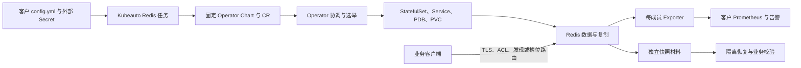

# Redis 技术白皮书

## 1. 架构与职责

Kubeauto 只负责声明式输入、固定制品、命名空间、Operator release、Redis CR、版本和资源所有权。OpsTree Redis Operator 负责 CRD 协调、StatefulSet、Service、PVC、复制初始化、Sentinel 和 Cluster 收敛。Redis Server 负责数据结构、持久化、复制、故障转移协议和客户端协议；Exporter 负责观测，不参与选主。

控制面资源使用 `kubeauto.io/component=redis` 和 mode 标签，Operator 使用独立 namespace。Operator 与 Kubeauto 不同时修改 StatefulSet 的角色、槽位或复制关系，避免两个控制器产生竞争。

### 1.1 声明与运行状态

产品将启动配置和动态配置分开：ConfigMap 为每次启动生成持久化、安全与写保护设置；CR 的 dynamicConfig 负责控制器在线调整。只执行 CONFIG SET 会在重建后丢失，只有启动与运行状态一致才算收敛。Secret 更新还涉及容器环境、挂载与生成配置三个不同生命周期，不能把 Secret 已更新当作轮换完成。

资源 Ready、Redis 可达与业务结果分层判断。健康检查要求完整成员、存储和角色关系；业务检查要求真正写入、回读、TTL 与摘要。故障后的新主可能健康，却没有旧主网络分区期间的部分写入；该现象符合异步复制模型，不能由健康标志掩盖。

## 2. 版本、许可证与资格

锁定集合为 Redis 8.10.2、OpsTree Redis Operator 0.27.0、Redis Exporter v1.93.0、Kubernetes 1.33.6。Redis 8 源码采用 AGPLv3/RSALv2/SSPLv1 三授权模型，本项目交付配置选择 AGPLv3，发布包必须保留许可证和源码获取说明。Operator 使用 Apache-2.0，Exporter 依照其官方发行物许可证清单执行。

运行镜像区分上游版本与项目修订版本：Sentinel 使用原固定 `8.10.2` 镜像；Cluster 使用 `8.10.2-kubeauto.1`。修订只处理 ASM 槽接管后的集群状态刷新，Redis 协议、数据格式和版本号仍为 8.10.2。构建来源、补丁和基础镜像身份单独记录，不能把项目 tag 作为新的上游发行版。

版本集合变化时，须重新验证 CRD、镜像、初始化逻辑、客户端兼容和升级/回退；旧组合的资格结论不能直接沿用。镜像 tag 不是身份，现场必须记录 TalkEdu 和 Docker Hub manifest digest。

### 2.1 配置生成特性成熟度

固定 Operator 的配置生成 feature gate 在官方源码标记为 Alpha，并非上游 GA。采用官方 Redis 镜像时需要开启该路径，关闭 gate 会失去镜像所需的启动配置生成。项目可对固定版本组合建立验收证据，但不能承诺上游保持 Alpha API 的长期兼容性。

## 3. Sentinel 模式

复制层由一个主实例和两个副本组成；三个 Sentinel 负责发现、投票和故障转移授权。quorum=2 只代表故障判定阈值，授权仍需要 Sentinel 多数派。主从复制是异步的，旧主在网络分区期间可能接受一段时间写入；恢复后以新主拓扑为准，冲突写入可能丢失。

Sentinel 客户端的正确流程是查询 master group、连接当前主、监听切换事件并刷新连接。Service 只能提供发现入口，不能承诺固定 Pod 地址。副本读必须由业务明确接受滞后，否则从主读取。

成员地址使用 StatefulSet Pod 的稳定完整域名。产品在 RedisSentinel 设置 `resolveHostnames: 'yes'` 与 `announceHostnames: 'yes'`，先声明 Sentinel 配置，再提交 RedisReplication；锁定 Operator 的初始化逻辑据此生成复制成员的 DNS 公告地址。所有数据 Pod 重建后，IP 可以全部变化，Sentinel 仍应通过稳定名称重新发现当前实例。客户端必须支持 Sentinel 返回域名，证书 SAN 必须覆盖实际成员完整域名；只覆盖命名空间下一级 Service 的通配符不能匹配 Pod 与 headless Service 组成的多级名称。依据为 [Redis Sentinel 的主机名支持](https://redis.io/docs/latest/operate/oss_and_stack/management/sentinel/#ip-addresses-and-dns-names) 与 [固定 Operator 的复制初始化源码](https://github.com/OT-CONTAINER-KIT/redis-operator/blob/v0.27.0/internal/agent/bootstrap/redis/config.go)。

Sentinel 具有两条认证链：RedisSentinel.kubernetesConfig.redisSecret 保护 Sentinel 本身，redisSentinelConfig.redisReplicationPassword 保护其访问 Redis 主从的链路。任一遗漏都会使服务发现或故障切换失效；两条链都需要正确凭据成功和错误凭据拒绝证据。

## 4. Cluster 模式

Cluster 将 16384 个 hash slot 分配给主分片，每个主分片配置两个副本。客户端收到 `MOVED` 时刷新槽位，收到 `ASK` 时仅对当前请求临时跳转。多 key 操作、事务和脚本必须使用同一 hash tag；Cluster 的 DB 0 限制应进入客户端契约。

Cluster 的安全运行条件包括槽位完整覆盖、主节点多数可达、每个主有健康副本和 Cluster bus 身份认证。`tls-cluster` 与 `cluster-bus-port-protected-mode yes` 同时使用；只给客户端端口设置密码不能保护 bus。

副本数量与故障域分散是独立条件。运行镜像 `0.27.0-kubeauto.2` 在接入新副本前，读取已声明 Pod 的实际节点及 `redis_topology_key` 对应标签，对全部剩余副本名额完成匹配规划；每个主至少有一个位于其它故障域的副本。已经接入成员的复制归属保持不变。若剩余 Pod 的布局不能同时满足副本预算与跨故障域条件，控制器拒绝接入，运维须调整待接入 Pod 的调度布局后重试。Pod 序号、随机 Redis node ID 和组级均匀分布都不能代替真实复制组验证。

Redis 还有独立于选主的自动副本迁移机制：当某主缺少副本时，可以从拥有更多健康副本的主迁入成员。默认 `cluster-migration-barrier=1` 允许捐出一个副本后只保留一个；这与每主两个副本的声明预算不同。产品将该门槛设为 `redis_cluster_replicas`，同时写入启动配置和动态声明。恰好满足预算的主不能捐出副本，超过预算的主仍可帮助孤立分片；新分片的正常副本由 Operator 创建和接入。此门槛不改变故障提升授权，也不替代 `min-replicas-to-write` 的业务写保护。依据为 [Redis 8.10.2 参数说明](https://github.com/redis/redis/blob/8.10.2/redis.conf) 与 [自动迁移判定](https://github.com/redis/redis/blob/8.10.2/src/cluster_legacy.c)。

受保护的扩容按“空主接入、补齐副本、验证复制、保留 Functions、迁移槽位”推进；收缩按“保存退役身份、保留副本迁移、确认源槽位为空、限定退役”推进。复制安全条件适用于每个阶段，不能用临时降低写保护换取扩缩成功。新增成员已有业务数据或函数库冲突时，系统拒绝覆盖；缩容计划包含保留成员时，系统拒绝删除。

Redis 8.4 及以后，固定 CLI 可自动采用 ASM 迁移。8.10.2 的 `ASM_EVENT_TAKEOVER` 更新槽归属与配置 epoch 后，只安排广播，没有安排重算集群状态；新接收主的 `cluster_size` 缓存可能仍少一个主。项目修订为该事件追加状态刷新标志，使 `clusterUpdateState()` 同时更新主节点数和多数派计算。接管完成、数据已到达与各成员健康视图一致是三个独立验收条件，不能相互替代。依据为 [固定 Redis 的 ASM 事件处理](https://github.com/redis/redis/blob/8.10.2/src/cluster_legacy.c)。

扩缩验收须分别检查 Pod 数、已知成员集合、真实主副本关系和槽位。一个仍存活的副本可以继续与主同步，却已从其它成员的 Cluster bus 视图中被遗忘；因此 `master_link_status=up` 或 `redis-cli --cluster check` 的槽位成功标志，均不能独立证明完整拓扑。每个成员必须一致认识全部声明成员，且每主副本数满足预算。

## 5. 一致性、持久化与容量

### 5.1 写入确认层次

Redis 的写入确认、复制 ACK、AOF fsync 和客户端响应是不同层次。`min-replicas-to-write=1`、最大复制延迟和 `appendfsync everysec` 可限制风险，但不构成线性一致或固定 RPO。容量模型必须加入对象编码、碎片、复制缓冲、客户端缓冲、AOF rewrite 和 fork/COW。

| 观测结果 | 已证明的事实 | 尚需考虑的边界 |
| --- | --- | --- |
| SET 返回 OK | 当前主已执行该命令 | 网络分区后的拓扑选择与未同步写入 |
| WAIT 返回预期数量 | 当前连接此前写入获得指定数量副本 ACK | ACK 不等于磁盘 fsync，也不改变异步复制一致性模型 |
| WAITAOF 返回本地及副本数量 | 当前连接此前写入获得对应 AOF fsync 确认 | 需启用 AOF；仍须管理超时、结果未知、故障转移和业务幂等 |
| 独立 RDB 校验与恢复成功 | 指定快照可读取并恢复已核验数据 | 快照之后的写入、过期时间、Cluster 跨分片一致性与异地材料保留 |

`WAIT`、`WAITAOF` 的确认范围与客户端连接有关，不能先换连接，再把确认结果当作此前连接写入的证明。需要业务提交语义时，应在写入连接中完成确认，并定义超时后的查询、去重或补偿流程。官方语义见 [WAIT](https://redis.io/docs/latest/commands/wait/) 与 [WAITAOF](https://redis.io/docs/latest/commands/waitaof/)。

### 5.2 容量与性能余量

Redis 数据水位与容器内存限制分别控制不同对象。规划应满足 `容器内存限制 ≥ 数据水位 + 峰值复制/客户端缓冲 + fork 写时复制峰值 + 进程及分配器余量`，并以实际 RSS、容器峰值和持久化期间的数据变化验证。写入速率高时，RDB/AOF rewrite 期间的 CoW 成本可能显著增大；提高 maxmemory 比例会缩小这部分空间。

PVC 容量至少覆盖保留 RDB、当前 AOF、新 rewrite AOF、复制重建临时材料和增长余量。同一磁盘上的文件峰值可重叠，不能只把当前文件大小乘以副本数作为单卷需求。复制 backlog 的起始估算为 `峰值复制字节速率 × 期望覆盖的中断时长`；应测量 Redis 实际复制流，而非仅用业务 value 大小估算。backlog 不足会转为全量同步，增加网络、磁盘、fork 与恢复时间。

默认 noeviction 将内存超限暴露为明确拒写；它保护已有数据，但业务必须处理 OOM。限流、删除无用数据、优化大对象与受控资源扩容应形成恢复闭环。容量变更后再次验证实际 maxmemory、AOF/RDB 状态、复制延迟与业务延迟，不能只核对 CR 字段。

### 5.3 数据保护

RDB 适合快照与恢复，AOF 记录写入日志；两者都依赖本地文件系统和 PVC。备份系统要把制品复制到独立故障域并用摘要验证。Cluster 逐分片备份不自动形成同一时刻的全局快照。

### 5.4 存储与生命周期变更

默认 AOF 开启、appendfsync everysec，并保留 RDB 周期快照。正常启动文件与在线配置保持一致；发生 AOF 写入或快照错误时，运维首先保存状态并调查空间、权限和 IO。副本不提供独立灾难恢复边界，因为误删、过期和业务错误会传播到副本。

PDB 只限制自愿中断，实际容错仍取决于复制组和故障域。Cluster leader/follower 的均匀分布不会自动证明每个真实主分片的副本分散；上线、切换与扩缩之后均须重新核验真实关系。升级资格同时受 CRD、控制器、Redis 协议、RDB/AOF 格式与客户端版本约束，回退不能只依据镜像 Tag。

## 6. 安全模型

TLS 证书使用专用 CA、明确 SAN 和轮换窗口。ACL 按业务、备份、监控和控制器拆分，默认拒绝危险命令和跨前缀访问。Secret 只通过 Volume/Env 引用，任何诊断输出都必须过滤密码、私钥、token、ACL 原文和完整 Secret。

重叠 CA 信任窗口需要明确的签发者身份。不同 CA 使用可区分的主体标识，叶子证书携带 Authority Key Identifier，CA 携带 Subject Key Identifier。仅把相同主体名称、不同公钥的两张 CA 拼接起来，不能证明每个客户端库都能选择正确签发者；必须用实际客户端库验证新旧证书链、双向 TLS 及旧 CA 撤销后的拒绝。扩展语义参见 [OpenSSL X.509 v3 配置](https://docs.openssl.org/1.1.1/man5/x509v3_config/)。

本部署使用 Kubernetes RBAC、客户网络访问策略和 Redis ACL；这三种边界互不替代。固定 Chart 默认不启用 webhook，不能声称已具备 webhook 策略保护。错误 CA、错误凭据、越权命令、未授权 key 模式和未认证 Cluster bus 都必须有拒绝证据。

### 6.1 控制器连接的身份校验边界

固定控制器的内部 Redis CLI 参数包含 `--insecure`，该路径不校验服务端证书。其 Go Redis 客户端采用自定义 `VerifyPeerCertificate` 校验 CA 信任链，但不校验主机名；两条路径的保证不同，均不能宣称已完成严格服务端身份验证。源码依据分别为 [CLI 参数](https://github.com/OT-CONTAINER-KIT/redis-operator/blob/v0.27.0/internal/k8sutils/redis.go) 与 [Go TLS 配置](https://github.com/OT-CONTAINER-KIT/redis-operator/blob/v0.27.0/internal/k8sutils/secrets.go)。Redis 成员、业务客户端和 Exporter 的安全验证须分别评估；网络隔离不能被描述为密码学身份校验。此上游边界应纳入版本资格评估及安全验收，不由应用连接测试代替控制器证据。

## 7. 故障模型

| 故障 | 允许行为 | 必须拒绝或验证 |
| --- | --- | --- |
| 单个副本失联 | 主继续服务，副本重连追赶 | 超过滞后阈值时写保护语义 |
| 主实例故障 | Sentinel/Cluster 选出新主 | 多数派不足时不得伪造安全成功 |
| 网络分区 | 一侧保留明确拓扑 | 记录旧主窗口写入和恢复后的数据结果 |
| PVC/磁盘压力 | 告警、限流或拒写 | 不得静默丢失数据或覆盖 PVC |
| Operator 重启 | CR 收敛继续 | 不得重建 PVC、Secret 或无意义滚动 |

每项故障都必须有正常、拒绝、恢复三类断言。Kubernetes 状态、控制器状态和 Redis 业务状态分层记录。

## 8. 性能与稳定性模型

性能取决于命令复杂度、对象编码、网络往返、pipeline、事件循环、TLS、AOF fsync 和 fork。基线至少包含小 value、高 value、热点 key、TTL 批量过期、pipeline、事务和 Cluster 跨槽错误请求。稳定性测试包含长时间压测、Pod 重启、主从切换、节点排空、PVC 扩容和控制器重启。

阈值由客户工作负载建立；仓库只固定测试参数、采样格式、错误率为零的硬门槛和恢复证据，不把实验吞吐写成通用产品承诺。

## 9. 退出与替换

客户端协议和 RDB/AOF 版本是退出成本的核心。Sentinel 到 Cluster 不是透明切换，需要重做 key 分布、客户端、备份和多 key 语义设计。Valkey 是许可证取向的替代路径，但其 Operator v0.7.1 官方仍标注 early development，不与本方案共享控制器或交付结论。

## 10. 官方依据

- [Redis 8.10.2 发布说明与源码](https://github.com/redis/redis/tree/8.10.2)
- [Redis Cluster specification](https://redis.io/docs/latest/operate/oss_and_stack/reference/cluster-spec/)
- [Redis Sentinel documentation](https://redis.io/docs/latest/operate/oss_and_stack/management/sentinel/)
- [Redis persistence](https://redis.io/docs/latest/operate/oss_and_stack/management/persistence/)
- [OpsTree Redis Operator v0.27.0](https://github.com/OT-CONTAINER-KIT/redis-operator/tree/v0.27.0)
- [OpsTree Redis Operator feature gates](https://github.com/OT-CONTAINER-KIT/redis-operator/blob/v0.27.0/docs/content/en/docs/Advance%20Configuration/Feature%20Gates/_index.md)
- [Redis Exporter v1.93.0 flags](https://github.com/oliver006/redis_exporter/tree/v1.93.0)
