# Redis 技术白皮书

本白皮书面向架构师、业务开发者和运维工程师，解释 Kubeauto 所交付 Redis 的请求路径、数据语义、故障行为与设计取舍。读者应了解 TCP、容器资源和 Kubernetes Service/PVC。首次部署请从[用户与运维手册](operations-manual.md#3-安装主线路)进入；维护产品实现请读[开发手册](development-manual.md)。本篇的机制说明不能替代变更前的健康检查或恢复演练。

适用版本为 Redis Open Source **8.10.2**、OpsTree Redis Operator **0.27.0**、Exporter **v1.93.0** 和 Kubernetes **1.33.6**。Operator 项目镜像为 `0.27.0-kubeauto.2`；Sentinel 使用 `8.10.2`，Cluster 使用 `8.10.2-kubeauto.1`。官网 `latest` 会变化，本文以固定版本源码校正行为；新版本能力不能自动纳入交付承诺。

阅读入口：

- 选择部署模式：[能力与取舍](#1-能力与选型) → [Sentinel](#5-sentinel-如何决定切换) 或 [Cluster](#6-cluster-如何分片路由和接管)。
- 理解一次业务操作：[请求执行](#2-从配置到一次请求) → [数据模型](#3-数据结构编码与生命周期) → [事务与脚本](#8-pipeline事务脚本与-functions)。
- 判断可靠性：[复制确认](#4-复制历史与写入确认) → [持久化](#7-持久化与独立恢复) → [故障模型](#11-故障模型与恢复承诺)。
- 设计生产负载：[消息语义](#9-发布订阅与-streams) → [安全](#10-身份权限与网络边界) → [容量性能](#12-容量性能与稳定性推导)。

## 1. 能力与选型

Redis 是以内存数据结构为工作集、可用日志和快照持久化的数据库。它减少读写往返和应用层计算，但每个主节点仍有有限的命令执行预算。选型首先回答三个问题：数据是否可从其它系统重建，业务能否接受故障窗口的写入损失，单主是否能承载容量和最繁忙命令。不能先选九个 Pod，再据此推导业务可靠性。

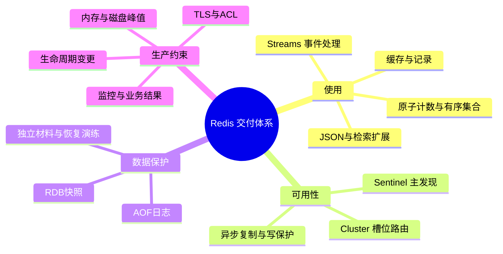

图中的分类是学习入口，各项之间并不存在“启用后自动保证成功”的依赖。尤其复制、持久化和独立备份分别解决副本故障、进程重启和故障域丢失，必须共同设计。

| 选择因素 | Sentinel，推荐起点 | Cluster，明确需要分片时选择 |
| --- | --- | --- |
| 数据组织 | 一个主保存全量数据，两个副本各保存同一份 | 三个主分片分摊数据，每主两个副本 |
| 客户端 | master Service 主线需断线/READONLY 处理；独立身份资格后的 Sentinel 发现需两层认证及域名返回 | 支持槽位发现、MOVED/ASK 和全部成员可达 |
| 多 key/事务 | 同实例可执行，仍不提供事务回滚 | 所有相关 key 必须同槽，迁移期可能 TRYAGAIN |
| 多数据库 | 可用逻辑 DB；DB 不能隔离 CPU、内存或 Pub/Sub | 只允许 DB 0 |
| 扩展边界 | 单主数据量和命令预算；副本读可能陈旧 | 主数可扩展；热点 key/同一 hash tag 仍在单分片 |
| 故障授权 | Sentinel 故障判定与多数派授权 | 持槽主多数派授权，副本接管本主槽位 |
| 独立恢复 | 单份快照的恢复较直接 | 各主快照需保留槽位映射与业务一致边界 |

Sentinel 到 Cluster 是数据模型与客户端迁移，不是原地改 `redis_mode`。两者都采用异步复制，不能承担要求线性一致、跨分片原子提交或无条件零丢失的账本职责。需要这类语义时，保留权威业务数据库，以 Redis 承载可恢复的派生状态，或另行选择满足该一致性模型的系统。

本交付是 Redis Open Source。Redis Software/Cloud 的 Active-Active、管理界面、托管备份、自动分层等不属于本产品。上游支持 standalone 等形态，但本产品仅提供 Sentinel 和 Cluster 两条入口。Redis 8 的 AGPLv3/RSALv2/SSPLv1 三授权中，本交付选择 AGPLv3，发行物保留许可证和源码获取说明；Operator 为 Apache-2.0。许可依据见[固定 LICENSE](https://github.com/redis/redis/blob/8.10.2/LICENSE.txt)。

## 2. 从配置到一次请求

Kubeauto 把 `config.yml` 与外部 Secret 引用转换为固定 Chart values、启动 ConfigMap 和 Redis CR。Operator 把 CR 协调成 StatefulSet、Service、PDB 和 PVC，并管理复制初始化与成员变化。Redis 自己执行数据命令、复制、持久化和选主协议。Exporter 只提供观测，不参与选主；Operator 停止也不意味着已经运行的 Redis 必然停止服务。

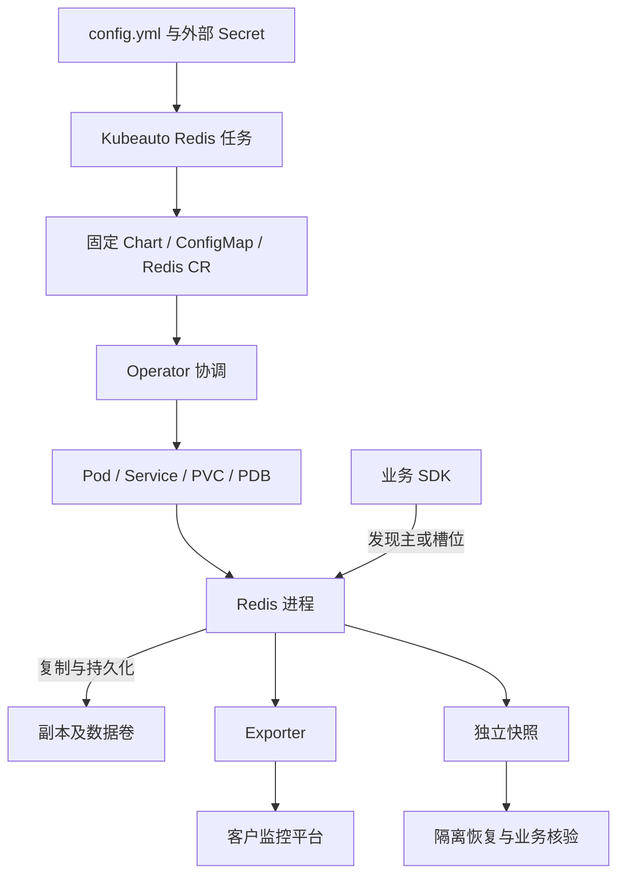

控制路径决定资源声明；业务请求不经过 Kubeauto 或 Operator 代理。修正 StatefulSet 而不修正权威配置，下一次协调可能覆盖手工修改。ConfigMap 负责启动输入，CR `dynamicConfig` 负责支持的在线调整；`CONFIG SET` 的临时成功不能证明重建后仍有效。Secret 更新、容器环境刷新和生成配置刷新也是三个不同事件。

一次命令沿“连接建立 → TLS 与身份验证 → ACL 检查 → 解析命令 → 执行 → 复制/AOF传播 → 返回”推进。RESP2/RESP3 是响应编码协议，RESP3 对 map、set 和推送消息的表示不同；升级客户端要检查其解析与连接状态，不能只验证 PING。连接池复用连接可减少握手，但事务、WATCH、订阅、阻塞读取和复制确认均包含连接状态，应使用专用连接或正确的池管理。

Redis 主要在事件循环中串行执行普通命令，网络 I/O、后台 fsync、释放和模块任务可有其它线程。Redis 8 的 TLS I/O 线程支持不等于普通命令全部并行。一个长脚本、巨大集合操作或同步阻塞任务会延迟同一节点上的其它请求。定位尾延迟要把命令执行、网络、客户端排队和后台任务分开，不能笼统称“Redis 单线程导致”。参见[固定网络源码](https://github.com/redis/redis/blob/8.10.2/src/networking.c)与[延迟诊断](https://redis.io/docs/latest/operate/oss_and_stack/management/optimization/latency/)。

### 2.1 客户端缓存的失效通道

客户端缓存把部分读结果留在应用内存，减少网络往返；它与 Redis 服务端淘汰缓存是两层状态。CLIENT TRACKING 默认按连接记录读过的 key，key 修改时发失效通知；BCAST 按前缀广播，避免逐 key 跟踪但会增加无关通知。RESP3 可在同连接接收 push，RESP2 通常用 REDIRECT 指向专用失效连接。SDK 必须支持通知与命令响应并存，普通同步解析器不能直接启用。

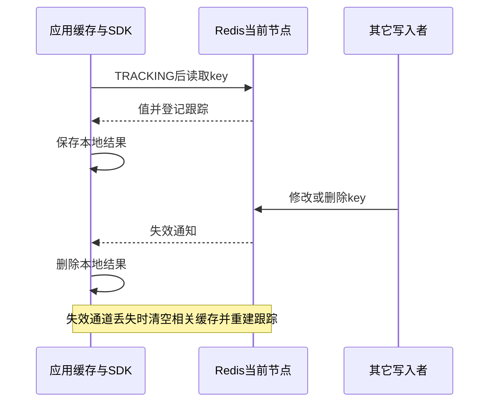

本地缓存不能只靠“连接通常不断”维持正确性。失效通道断开、故障转移或槽迁移时，清空受影响缓存并重建跟踪；限制本地容量和最长 TTL。使用两连接时，失效可能先于读回复到达，SDK 必须避免把随后返回的旧值重新存入缓存。NOLOOP 省略本连接写入的通知，也把自行更新/删除本地值的责任交给应用。该机制不是线性一致读保证，不适合仅凭本地旧值执行库存扣减。依据见[官方客户端缓存](https://redis.io/docs/latest/develop/reference/client-side-caching/)；实际业务要验证其 SDK 对 Sentinel/Cluster 重连、失效竞态和故障窗口的处理。

REDIRECT 使用的 `CLIENT ID` 标识当前服务端进程中的某条连接，按连接分配递增 ID；它不是应用身份，也不是跨节点/进程重启的全局唯一编号。失效连接重连后重新获取 ID 并重建重定向，不能保存旧整数后继续使用；即使另一进程返回相同数值，也不证明仍为原连接。连接身份变化与清空受影响本地缓存必须一起处理。依据见[CLIENT ID](https://redis.io/docs/latest/commands/client-id/)及固定版本的连接分配实现。

默认跟踪的服务端开销随 key 与读过它的客户端数量增长；失效表达到上限时可以发出失效并回收记录，所以收到通知不一定代表业务修改。OPTIN 只跟踪明确选择的读取，适用于只缓存少量热点的应用；BCAST 则以通知流量和前缀处理成本换取不维护逐 key 失效表。不要把“服务端不存逐 key 表”解释为没有任何内存或 CPU 开销。失效命名空间不按 DB 号隔离，flush 的 null 通知表示清空缓存；NOLOOP 写后还须重新读取建立跟踪，不能假设旧跟踪一直保留。选型时同时预算服务端记录、本地缓存、失效连接和重连期间的回源峰值。

### 2.2 协议、返回类型与连接状态

RESP 用长度前缀传输二进制参数；长度按 **bytes** 计算，不按中文字符数计算。客户端请求通常是命令和参数组成的 bulk-string 数组，回复则由命令与协议版本决定。应用交给成熟 SDK 编码，不把 shell 引号、JSON 字符串转义或换行拼接当作协议编码。Cluster bus 使用另一套成员协议，RESP 客户端不能连到 16379 执行业务命令。

| 返回或状态 | 正确解释 | 常见误判 |
| --- | --- | --- |
| GET 的 null | key 不存在，或访问时已过期 | 当成已保存的空字符串 |
| GET 的空字符串 | key 存在且值长度为 0 | 当成缓存未命中 |
| EXPIRE 的整数 0 | 未对目标设置过期，需要按命令条件解释 | 把所有非异常回复都算成功 |
| EXEC 的 null | WATCH 条件改变，事务未按该次计划提交 | 与 EXEC 数组中的单项执行错误混淆 |
| RESP3 map/set | 有结构和类型的结果，按 SDK 返回契约读取 | 沿用 RESP2 的扁平数组下标解析 |
| RESP3 push | 与普通命令回复分开的异步通知 | 当成前一条 GET 的回复，导致流错位 |

新连接从 RESP2 开始，HELLO 可协商 RESP3 并执行相应认证；协商失败不表示已经切换协议。AUTH、SELECT、WATCH/MULTI、订阅、TRACKING 与待复制确认的位置都属于连接状态。重连后重新建立所需状态；`redis-cli` 的交互重连会恢复 DB 选择，但不会恢复未完成事务。连接池中断、回收或切换时，不得把旧事务的下一条命令送到另一连接。

二进制业务值保持 bytes；只对已约定的 UTF-8 文本开启自动解码。诊断中的 `--raw` 用换行展示值，不能无条件将其用于二进制导出、null 判定或逐行 key 清理。应用还应限制最大回复、缓冲与等待预算；协议允许的大值不是业务可接受的大值。依据见[官方 RESP 规范](https://redis.io/docs/latest/develop/reference/protocol-spec/)与[固定 CLI](https://github.com/redis/redis/blob/8.10.2/src/redis-cli.c)。

## 3. 数据结构、编码与生命周期

### 3.1 用业务访问方式选择结构

| 数据结构 | 常见用途与操作 | 选择代价 |
| --- | --- | --- |
| String | 缓存字节串、SET/GET、INCR 计数 | 整对象更新；数值与普通文本混用会触发类型错误 |
| Hash | HSET/HGET 存记录字段；按字段修改 | 大量 HGETALL 产生大响应；字段过期与整 key 过期要区分 |
| List | 顺序队列、LPUSH/RPOP、阻塞读取 | 简单出队后消费者崩溃可能丢处理，需要可靠队列协议 |
| Array | 稀疏数字下标、ARSET/ARGET、环形窗口 | 上游仍标记 preview；逻辑长度不等于元素数，不能替代消费组 |
| Set | 去重、成员关系、集合运算 | 大集合交并差按元素量耗时；存结果可能额外占内存 |
| Sorted Set | 排行、按 score 的时间队列 | score 是浮点数，别用超出精确整数范围的值充当精确账本 |
| Streams | 有 ID 的追加事件、消费组、待确认记录 | 必须管理 ACK、认领、裁剪和消费者幂等 |
| Bitmap/Bitfield | 稠密编号签到、状态位、打包计数 | 很大的稀疏编号会扩大 String；BITFIELD 有溢出策略 |
| HyperLogLog | 大规模近似去重计数 | 估计值有误差，不能返回成员列表或作为精确结算 |
| Geo | 位置索引、邻近查询 | 属于地理索引模型，不能代替任意空间数据库 |
| JSON 与 Search | 文档局部更新、字段/全文/向量检索 | 索引是额外工作集，查询语法和模块版本需要专项设计 |
| TimeSeries | 时间戳样本、聚合和保留 | 需明确重复时间戳策略、采样单位及保留周期 |
| Bloom/Cuckoo/CMS/Top-K/t-digest | 成员过滤、频率、热点和分位估计 | 概率或近似结果，错误预算需进入业务契约 |
| Vector Set | 向量近邻查询 | 近似搜索召回率、向量维度与索引资源须独立评估 |

String 是二进制安全的字节串；整数计数命令把其内容解释为数值，而不创建另一种独立类型。SET 可覆盖已有其它类型的 key，业务必须固定命名与类型；大对象整串更新会扩大复制、AOF 和网络负载。8.4 起支持 SET 的值比较条件及 DELEX 条件删除，单 key 比较更新可优先使用原生命令；DIGEST 用于条件比较，不替代备份完整性所需的 SHA256/CRC。计数成功后的响应丢失仍可能导致重复增加，原子命令与幂等提交是不同要求。

List 保留顺序但按位置随机访问可能遍历；阻塞弹出要用独立连接。需要崩溃恢复时，用 LMOVE/BLMOVE 将消息移到处理列表，再按业务结果确认与回收，或采用 Streams 消费组；移走不等于处理成功。8.10 的 LMOVEM/BLMOVEM 可批量移动，也要控制批次与处理列表残留。Set 保证唯一成员、不保证迭代顺序，交集/并集/差集仍需遍历数据；只要基数时用 SINTERCARD、SUNIONCARD/SDIFFCARD 避免把全部结果传给客户端，但不消除集合运算成本。Cluster 涉及多个集合仍须同槽。

BLMOVEM 的 COUNT 允许有元素时就返回，不能将 COUNT 10 理解为一定等到十条；EXACTLY 才要求可移动数量达到目标。OBO 模拟逐项移动，BULK 批量搬移，目的列表的次序取决于两端和模式，先用已知顺序样本确认。事务/脚本内部无法按普通调用持续阻塞，数量不足时检查 null；同 key 的异端移动还可能旋转列表，不是无条件 no-op。这些差异会影响消费批次和业务顺序，不能只按吞吐选择。依据见[BLMOVEM](https://redis.io/docs/latest/commands/blmovem/)与[固定 List 实现](https://github.com/redis/redis/blob/498ecd0d6d007db11ddb3aea9428552598a78622/src/t_list.c)。

Sorted Set 为唯一成员关联浮点 score，并用成员名称打破同分排序；适合排名和按时间范围查找。score 的整数精度受双精度范围限制，不能存任意大整数保持精确。选择分页时，排名分页受并发插入影响，按 score/成员边界分页也要处理同分和更新；需要一致导出仍走快照。用范围与 LIMIT 控制响应，不能每次取完整排行榜。

Bitmap/Bitfield 都在 String 字节上操作：稠密编号能节省空间，巨大稀疏编号却会把中间空间一起扩展。按时间/编号窗口拆 key，并明确 bit 编号、位宽、符号和 OVERFLOW 策略，避免计数回绕；位运算与批量统计仍按处理字节量耗时。Geo 使用地理坐标索引支持半径/矩形近邻，输入次序是经度再纬度，查询单位和边界要固定；它与 Search 的 GEO/GEOSHAPE 不同，也不提供完整地理信息系统的几何操作。结构上限不是生产推荐对象大小，所有范围查询都应进入响应和延迟预算。

BITFIELD 有符号最大 i64、无符号最大 u63；位从高位向低位编号，普通 offset 是 bit 偏移，`#offset` 则乘以声明位宽，例如 u8 的 `#2` 从 bit 16 开始。GET 返回当前值，SET 返回旧值，INCRBY 返回增加后的值，逐子操作的回复不能统一解释为新值。OVERFLOW FAIL 在溢出子操作返回 null 且不修改该字段，后续子操作仍可能执行，不能当作整批回滚；WRAP/SAT 分别回绕/饱和。只读批量取值采用 BITFIELD_RO 的 GET 语义，不因此获得副本强一致性。参考[BITFIELD](https://redis.io/docs/latest/commands/bitfield/)。

固定镜像含四个官方模块共享库及内置 `vectorset`，8.10.2 命令表也包含 Array；这说明固定制品的能力集合，不能据此承诺任意模块组合、查询性能或自动维护索引。各结构的选用入口见[官方数据类型](https://redis.io/docs/latest/develop/data-types/)；项目镜像加载和扩展边界见[开发手册](development-manual.md#10-业务扩展与版本演进)。滚动官网的新能力仍须逐项对照固定版本，preview 能力要单独评估升级和恢复风险。

### 3.2 逻辑数据量为何小于实际内存

key 名称、字典项、对象头、过期字典、分配器对齐和索引都占内存。小 Hash/Set/Sorted Set 可使用紧凑编码；字段或元素超过编码阈值后可能转换，内存增长不是简单线性。`OBJECT ENCODING` 帮助解释结构，`MEMORY USAGE` 估算指定对象，`INFO memory` 描述进程分配状态，容器监控描述 cgroup 实际压力；它们观察的层次不同。

`MEMORY USAGE key` 对嵌套容器默认采样 5 个元素；`SAMPLES 0` 会遍历全部元素，大容器的估算本身可能增加主线程占用。先用默认采样筛选代表对象，再在隔离目标做全量对照，不在生产循环全量估算所有大 key。8.10 的紧凑 Hash 还可能共享字段 template，单 key 估算会均摊这部分成本；逐 key 相加与进程真实内存并非严格相等。`OBJECT ENCODING` 的编码名称也应以固定实现为准，不能用旧官网枚举拒绝新编码。依据见[MEMORY USAGE](https://redis.io/docs/latest/commands/memory-usage/)与[固定对象实现](https://github.com/redis/redis/blob/498ecd0d6d007db11ddb3aea9428552598a78622/src/object.c)。

例如 100 万个 100-byte value 的原始数据约 95.4 MiB，不能据此购买 100 MiB 内存。必须把实际 key 长度、TTL、对象类型及编码分布放入样本，再用每记录实测内存乘业务数量；JSON/检索索引、复制缓冲和恢复期间峰值另计。紧凑编码减少空间可能增加查找或转换成本，不应为追求一个比例随意提高上游阈值。[官方内存优化](https://redis.io/docs/latest/operate/oss_and_stack/management/optimization/memory-optimization/)解释这些转换。

Redis 8.10 的紧凑 Hash 进一步让大量记录共享字段名称。例如一百万条用户记录都包含 name/email/age，重复字段名可以用共享模板替代，每条 key 主要保存值和模板引用；业务的 HGET/HSET 语义不变。适用条件是大量 key 共享稳定字段集合，频繁新增/删除字段会重新匹配模板，独有字段集合可能反而增加开销。大型紧凑 Hash 在复制和槽迁移时以整体 blob 传输，因此不能只凭稳态节省内存决定启用。

上游 `hash-min-template-entries` 等自动转换参数默认为 0，项目未额外启用。写路径转换在下次写入才发生，改回阈值不会把已转换对象恢复成普通 Hash；带字段过期的 Hash 不自动转换。`HIMPORT PREPARE` 在**当前连接**声明字段集合，`HIMPORT SET` 按 PREPARE 输入的字段顺序提交值，且替换已有 key 而非合并；不要按服务端模板的内部排序重排值。连接池、重连和 Cluster 各主连接都要重新声明，不能用多个短连接拼接两步。RDB 加载转换参数仅用于没有模板的旧 RDB，不应作为每次重启的自动调优手段。启用前比较样本内存、字段变化频率、迁移延迟和恢复兼容性；依据见[官方 Hash 专题](https://redis.io/docs/latest/develop/data-types/hashes/)与[8.10.2 配置](https://github.com/redis/redis/blob/8.10.2/redis.conf)。

### 3.3 TTL、淘汰与删除不是同一件事

TTL 描述对象有效期。Redis 存储绝对过期时点，因此停机期间时间仍经过，恢复时已经过期的 key 不应重新获得完整寿命。覆盖 String 的 SET 默认移除旧 TTL；需要保留时显式 KEEPTTL，需要新的生命周期时将 EX/PX 放在 SET 同一条命令。先 SET 后 EXPIRE 留有中间失败窗口。TTL 返回 `-1` 表示存在但无过期，`-2` 表示不存在，不能把两者都当作“马上过期”。

Hash 还支持字段独立过期：HEXPIRE/HPEXPIRE 设置相对秒/毫秒，HEXPIREAT/HPEXPIREAT 设置绝对时点，HTTL/HPTTL 读取字段寿命，HPERSIST 移除字段过期。它们不延长整 key 的寿命；整 key 先到期时，字段随记录一起消失。HSET 覆盖字段会清除该字段原过期，HSETEX/HGETEX 提供显式生命周期选项，应用必须选择保留、刷新还是移除，不能把整 key 的 KEEPTTL 套在字段上。字段 TTL 适合会话子项或窗口计数，但一张巨大 Hash 仍是一个 key、一个槽和一个命令执行热点。

过期由访问时检查与周期性主动扫描共同处理，故物理释放不保证刚到毫秒边界就完成。主节点驱动过期和淘汰并传播删除；副本可隐藏逻辑过期数据，正常情况下依赖主传播保持一致。时间漂移会影响过期与故障判断，节点时间管理属于生产依赖。

淘汰是达到 `maxmemory` 后的内存政策。本产品固定 `noeviction`：拒绝需要更多内存的写入，保留已有数据，读与释放内存的操作仍可用。LRU/LFU、volatile/allkeys 等是上游替代政策，当前没有客户级淘汰策略开关；不能把一次 CONFIG SET 描述为持久配置。副本默认忽略自身 maxmemory、由主控制淘汰，副本 RSS 仍可能超容器限制。删除大对象可用 UNLINK 将主要释放工作异步化，但后台释放仍消耗 CPU 和内存时间。参见[复制的 maxmemory 说明](https://redis.io/docs/latest/operate/oss_and_stack/management/replication/#maxmemory-on-replicas)。

LRU 按最近访问、LFU 按近似访问频率选择对象；8.6 引入的 LRM 按最近修改选择，读取不会刷新其修改顺序。volatile 类只考虑有 TTL 的对象，没有合格对象时可能像 noeviction 一样拒写。因此“改淘汰策略”必须先回答哪类业务状态允许被丢弃，不能作为记录型负载的紧急扩容替代。缓存命中率与淘汰量一起观察，恢复原策略也不能找回已淘汰数据。参见[官方淘汰策略](https://redis.io/docs/latest/develop/reference/eviction/)。

### 3.4 遍历与批量操作

SCAN 的 cursor 是服务端迭代位置，必须循环到返回 0；COUNT 只是工作量提示，单批可以为空或超出预想数量。并发变化时可能重复或看不到瞬时对象，所以导出、清理和审计不能将 SCAN 当成一致快照。Cluster 应遍历各真实主节点，seed 的一次 SCAN 不是整个集群。KEYS 遍历整个 keyspace 且阻塞，不用于常规生产巡检。批量删除需按批准前缀、小批次和延迟预算执行；数据备份使用正式快照路径。[Keyspace](https://redis.io/docs/latest/develop/using-commands/keyspace/)给出游标与生命周期语义。

批量导入要同时处理发送和回复。`redis-cli --pipe` 连续发送 RESP 请求并读取服务端回复，输入结束后发送带随机标记的 ECHO，以匹配最后回复确认已读到请求流末端；只把文件送进 TCP、使用 netcat 后等待几秒，不能证明所有命令执行成功。生成 RESP 时 bulk 长度是**编码后的字节数**，不是中文字符数，参数按 CRLF 和长度分隔，不能把普通逐行命令文件当成 RESP 数据流。

导入完成至少核对退出码、`errors: 0`、回复数与预先登记的命令数，并回读业务数量、样本摘要和 TTL；最后 ECHO 的到达只证明这一连接的回复流结束，不证明持久化、复制或业务约束成立。中间命令可能部分成功，连接丢失也可能留下结果未知的写入，重入要按幂等 key/请求 ID 和对账清单处理。单连接 pipe 不是 Cluster 全槽路由客户端，不替代同槽拆分、拓扑发现或正式备份恢复；上线前另行设计目标、认证/TLS、ACL 中 ECHO 权限、文件完整性、过载停止和限定回收。机制依据见[官方批量导入](https://redis.io/docs/latest/develop/clients/patterns/bulk-loading/)。

### 3.5 Array：数字下标、稀疏范围与环形覆盖

Array 把非负整数下标映射到 String 值。与 List 的序列位置不同，在下标 10 和 1000000 写值不需要为中间每个位置分配值；内部按切片选择稀疏或稠密表示。此时 ARCOUNT 为 2，ARLEN 为 1000001，后者表示最高下标加一，不能用于估算实际记录数。ARSET 写连续下标、ARMSET 写指定下标，ARGET 读取未设置位置返回 nil；删除最后元素会删除 key。

ARGETRANGE 返回范围内每个位置，包含空位，固定版本限制单次最多一百万位置，但生产预算通常应远小于这个保护上限。ARSCAN 返回存在的下标和值，使用范围和 LIMIT 控制响应；不要把它与 keyspace 的 SCAN cursor 协议混用。ARINSERT 使用对象的插入游标，ARNEXT 查看、ARSEEK 改变游标；ARRING 按指定窗口循环写入并覆盖旧元素，窗口调整可能产生额外处理成本。环形覆盖不是消费确认，不能代替 Streams 的保留与 PEL。

适用稀疏采样、按编号查找和允许覆盖旧值的有界窗口；需要两端出入队选 List，需要字段名称选 Hash，需要事件重放和确认选 Streams。Array 仍被[官方文档](https://redis.io/docs/latest/develop/data-types/arrays/)标记 preview；使用前单独验证 SDK 返回解析、RDB/AOF、复制、扩缩和升级后的兼容性，不能把基础 Sentinel/Cluster 验收外推为所有 Array 业务已验证。固定命令依据为[8.10.2 命令定义](https://github.com/redis/redis/tree/8.10.2/src/commands)。

Array 的范围检索和统计也需要明确工作量。ARGREP 可按精确、子串、glob 或正则条件匹配；多条件默认 OR，LIMIT 限制返回数量而不保证最坏扫描或正则计算成本，先用范围、输入长度与总请求预算限定。AROP 对可解释为数字的字符串计算，SUM/MIN/MAX 返回数值字符串，位运算使用整数转换；空范围或没有合格数值可能返回 null，不适合未经约束的精确金额运算。ARINFO FULL 会展开切片明细，ARLASTITEMS 的顺序相对插入游标，不能将它们分别当成免费元数据和按数值下标排序的分页。先用稀疏/稠密、非数字、空范围与环形覆盖样本核验返回类型，再评价内存和延迟。

### 3.6 JSON 与检索：文档、索引和查询是不同状态

JSON 提供树形对象的路径读写，适合只更新文档局部；JSONPath `$` 可以匹配多个位置，返回通常保留匹配集合，不能沿用普通 GET 的标量解析。缺失路径、JSON null、空数组和不存在的 key 是不同业务状态。Hash 适合扁平字段，JSON 适合嵌套树；大量完整文档读取仍会产生大响应，选择路径和对象大小比类型名称更影响成本。JSON 的整 key TTL 与 String/Hash 一样，要单独设计更新后剩余寿命；局部更新不是自动过期策略。依据见[JSON](https://redis.io/docs/latest/develop/data-types/json/)。

JSONPath 的名称相同不代表不同实现完全兼容。固定 RedisJSON 8.10.0 的语法包含自身扩展，不能未经用例验证就承诺符合 [RFC 9535](https://www.rfc-editor.org/rfc/rfc9535.html) 的全部语义。例如该实现的数组切片只接受正步长，过滤中的正则表达式交给固定 Rust `regex` 1.12.3 解析，不能直接搬用要求不同正则语法或完整 I-Regexp 转换的查询。迁移查询时保存一组包含缺失、null、嵌套数组、多匹配和边界下标的脱敏文档，逐条核对匹配位置、结果类型与更新数量；业务判据是这些实际结果一致，不能只看解析成功或命令退出码。

JSON 在内存中保存反序列化后的树，文件字节数不能直接作为内存预算。数组等容器按容量扩展，删除元素后仍可能保留已分配容量；“文档变小”不等于 RSS 立即下降。`JSON.DEBUG MEMORY` 描述 JSON 值的估算，字符串复用时仍可能按各次出现计数，不代表该文档独占的进程内存；同时观察 `MEMORY USAGE`、`INFO memory`、索引内存和 cgroup 压力。用真实嵌套层级、字符串复用、数组增长/删除及索引更新负载测样本，另计恢复和重建峰值。[官方 JSON 内存说明](https://redis.io/docs/latest/develop/data-types/json/ram/)中的对象字节示例随实现变化；早期 preview、特定 EC2 机型的性能对照也不能作为固定 8.10.0 的容量或吞吐承诺。

Search 在 Hash/JSON 上构建索引。FT.CREATE 声明文档前缀、字段路径、类型和属性名；已有文档初始回填在后台运行，新文档/修改按该索引路径更新。写入返回成功、回填完成和查询满足业务召回是不同判据，使用 FT.INFO 检查索引进度、文档数和索引错误，再以已知样本查询验证。

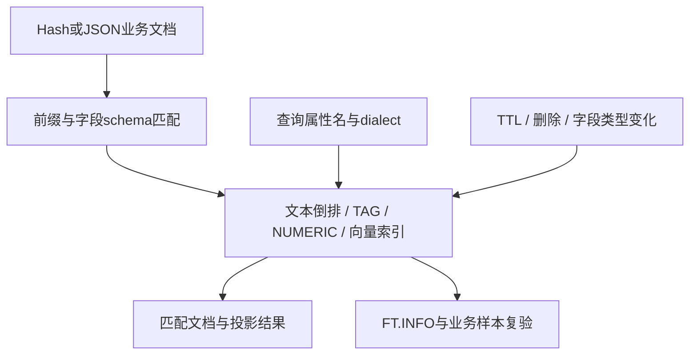

TEXT 为分词全文匹配，TAG 为离散标签，NUMERIC 为数值范围；类型选错会改变匹配行为或造成索引失败。JSON 数组可作为多个 TAG，JSON 的逗号字符串默认不是 Hash 的逗号分隔规则。schema 使用 JSONPath，查询使用属性名，RETURN/LOAD 才承担对应路径投影。多值字段的排序、短语顺序和高亮有约束；不能把数组索引当普通单值字段。客户 schema 必须覆盖缺失、null、错误类型、TTL 和修改后的反例。参见[官方索引与限制](https://redis.io/docs/latest/develop/ai/search-and-query/indexing/)。

具体到多值 JSON，NUMERIC 数组的范围匹配通常表示“至少一个值符合”，不能当作全部值都在范围内；要表达全部满足，需要按查询语义排除范围外的值并处理缺失/null。多值排序只采用首值，不能假设自动按最大值或平均值排序；HIGHLIGHT/SUMMARIZE 不支持这类路径，顺序未定义的多值 TEXT 路径使用 SLOP/INORDER 会报错。多向量用 `$.embeddings[*]` 匹配各向量，文档距离按其中最小距离计算；`$.embedding` 指向一个数值数组与指向数组的数组不同，后者不能原样当单向量索引。索引 JSON 对象须拆成具体字段，不能把整个对象映射成普通可检索字段。SDK 返回 JSON 字符串与多个匹配值时需按实际返回协议解析，不能直接套用 Hash 的单值转换。

JSON 的返回还取决于路径语法和 FORMAT。固定 RedisJSON v8.10.0 的 JSON.GET 在省略路径时仍使用 legacy 路径 `.`，默认 FORMAT 为 STRING；显式 `$` 路径与 legacy 单值路径的结果形状不同。客户端改成 HELLO 3 不足以推导返回变成原生 RESP3 对象，也不能据滚动官网的迁移说明断言本版本默认路径已经变成 `$`。应用应显式固定路径、FORMAT、客户端协议与解码方式，用单值、多匹配、缺失、null、空数组分别验收；不要把收到的 JSON 字符串再当成已解码字典，或把匹配数组直接当成单个字段值。版本依据见[固定命令处理](https://github.com/RedisJSON/RedisJSON/blob/v8.10.0/redis_json/src/commands.rs)、[路径默认值](https://github.com/RedisJSON/RedisJSON/blob/v8.10.0/redis_json/src/redisjson.rs)与[固定 RESP3 测试](https://github.com/RedisJSON/RedisJSON/blob/v8.10.0/tests/pytest/test_resp3.py)。

向量索引还需固定 embedding 模型、维度、数值格式、距离算法和查询 dialect。FLAT 做穷举，HNSW 用图近似检索，后者用额外内存和参数换取速度/召回；过滤选择率也会改变成本。调优按同一真实样本比较召回率、p99、索引建立与更新延迟、内存和恢复时间，不能只报告一次最快查询。分词器、schema、模型或维度变更采用独立新索引/新文档集，完成双读比较再切流；索引别名切换不迁移原文档，也不能自动回滚已经改变的数据格式。

项目未交付独立的分布式 Search 协调器或全局索引维护入口；Redis Cluster 的槽位完整不证明一次 FT.SEARCH 搜到了全部主的文档。跨分片查询、索引生命周期、扩缩迁移和模块版本恢复需专项设计与资格验证，不借用 Redis Software/Cloud 的分布式能力说明。索引错误、缺文档或召回下降时，先检查 schema/前缀、回填、字段类型和查询；保留原文档，不能立即删除带 DD 的索引掩盖问题。

FT.HYBRID 是另一种业务查询：先分别取得文本与向量候选，再融合排名，随后进行投影、计算、分组、排序和分页；它不是“先按标签过滤，再做 KNN”的同义词。RRF 按各候选排名计算并相加 `1/(constant+rank)`，LINEAR 在固定实现中直接对分数作加权求和；后者要求业务评估两路分数尺度与权重，不能假定服务端已自动归一化。候选 WINDOW 影响参与融合的集合，最后 LIMIT 只裁剪输出，扩大 LIMIT 不能找回已被候选窗口排除的文档。上线用标注集对照相关性、召回率、p99、LOAD 等后处理成本和超时/部分结果，不把一次正常回复当作融合正确。此能力仍属于固定模块的业务专项，没有增加全局协调或生产性能承诺；参数须按[固定融合解析](https://github.com/RediSearch/RediSearch/blob/v8.10.1/src/hybrid/parse_hybrid.c)与[融合计分](https://github.com/RediSearch/RediSearch/blob/v8.10.1/src/hybrid/hybrid_scoring.c)核对，不复制滚动示例中的可疑参数数量。

#### 查询语义、超时与索引维护

查询字符串是一门查询语言，不是普通搜索框原文。TAG 的 `@status:{ready}` 表示离散标签，NUMERIC 的 `@price:[500 1000]` 默认包含两端，TEXT 的词项经过语言分词、词干与停用词处理。组合条件用括号明确范围，例如 `(@status:{ready}) (@price:[500 1000])`；显式固定 DIALECT，避免客户端升级或全局默认变化改变 AND/OR 优先级。业务输入交给 SDK 的参数和经过审核的转义逻辑，不直接拼入运算符、字段名或通配表达式。精确编号通常用 TAG，不能用 TEXT 的词匹配承担唯一身份判断。

FT.SEARCH 默认只返回前十条，匹配总数与本页返回数不同。LIMIT 限制输出，不保证索引遍历、排序或聚合只做十条工作；深分页、无界通配和大投影仍会增加执行成本。排序字段、同分次序和并发更新下的分页一致性都要进入应用契约。FT.AGGREGATE 的 LOAD、APPLY、GROUPBY、REDUCE、SORTBY 是按阶段处理的流水，后续阶段只看得到当前阶段保留的字段。将 LIMIT 放在分组前后会改变统计集合，不能为了速度无意改变业务含义；cursor 也不是一份无限期稳定的备份快照。

查询成本取决于候选集合和后处理，而不是结果页大小。纯否定查询可能遍历大部分文档；前缀、模糊和通配展开会扩大词项及迭代器预算。聚合流水中的 FILTER 过滤已经流入的行，不会自动将任意表达式改造成索引条件；能在初始查询筛选的条件应先筛选，再按业务语义计算。LOAD 要读取原文档，`LOAD *` 与大 JSON 投影增加读取和响应成本；SORTABLE 用额外排序值和内存换取性能，不能把它当成任何排序都必须具备的语法条件。统计时区分 COUNT、精确 COUNT_DISTINCT 和近似 COUNT_DISTINCTISH，不能用近似结果替代结算/审计的精确集合。cursor 持有服务端资源，批量、空闲期限与 `FT.CURSOR DEL` 回收一起设计；超时、断线或退出客户端不构成一致快照或无限期资源保留契约。参考[聚合](https://redis.io/docs/latest/develop/ai/search-and-query/advanced-concepts/aggregations/)与[固定 FT.AGGREGATE 定义](https://github.com/redis/docs/blob/312402286f1ad473bda748983e2069d84df939a1/content/commands/ft.aggregate.md)。

中文等语言需要在索引和查询端采用一致的语言约定；分词、词干与停用词会改变哪些词进入索引以及如何匹配，NOSTEM 不表示完全不分词。停用词配置在建索引时确定，变更采用新索引回填、已知样本与反例双读，再切换别名，不能只改查询语言期望历史索引重新解释。自动补全使用独立建议词典及 `FT.SUGADD` 等接口，不从已有文档索引自动生成或保持业务同步；应用负责词典来源、更新/删除、权限、内存和返回内容安全。语言和词典边界见[查询语言](https://redis.io/docs/latest/develop/ai/search-and-query/query/)与[自动补全](https://redis.io/docs/latest/develop/ai/search-and-query/advanced-concepts/autocomplete/)。

固定 Search 内嵌 Friso 1.6.2 及词典，只有显式配置 FRISOINI 才读取相应外部词典配置。本产品没有通用分词器/词典配置入口，自定义词典须作为独立发布资产按扩展契约交付；采用新索引回填，对已知中文正例、歧义和不应匹配的反例复验后切流，保留原词典与旧索引作回退。不能直接修改运行容器中的词典文件，把临时状态当成可重复部署能力。依据见[固定中文分词集成](https://github.com/RediSearch/RediSearch/tree/v8.10.1/deps/friso)。

建议词典与同义词也有独立的写入语义。固定实现中 `FT.SUGADD` 返回更新后整个建议词典的条目数，不能把返回 1 当作唯一成功值，也不能据此判断本次是否新增。同义词使用 `FT.SYNUPDATE` 管理组；历史接口 `FT.SYNADD` 在该版本直接返回不再支持的错误。默认会安排历史文档扫描，`SKIPINITIALSCAN` 跳过这次扫描，既有文档要等后续更新/重建后才使用新增规则；返回 OK 不能替代历史样本和新写入样本的查询复验。变更前保存原词典/组定义及回退资产，等待索引追赶并完成正负样本验收后切流；不能把它当作无副作用查询。依据见[固定建议词典实现](https://github.com/RediSearch/RediSearch/blob/v8.10.1/src/suggest.c)与[同义词命令实现](https://github.com/RediSearch/RediSearch/blob/v8.10.1/src/module.c)。

聚合流水中的日期转换先统一单位和时区。`timefmt` 接受 Unix **秒**，固定实现通过 `gmtime_r` 按 UTC 转换，默认格式为 `%FT%TZ`；不能直接传入 TimeSeries 的毫秒时间戳。示例 `timefmt(0)` 对应 `1970-01-01T00:00:00Z`，应用需另行处理业务时区与夏令时。格式采用 `strftime` 语义，`%G/%V` 是 ISO 周所属年/周，跨年时可能与日历年 `%Y` 不同。固定实现使用 1024 字节格式缓冲，数值/时间转换失败或格式输出无法容纳时返回 null；应用须显式识别缺失结果，不能把它当作零时刻。依据见[固定日期函数](https://github.com/RediSearch/RediSearch/blob/v8.10.1/src/aggregate/functions/date.c)与[POSIX strftime](https://pubs.opengroup.org/onlinepubs/9699919799/functions/strftime.html)。

DIALECT 4 的排序优化与 WITHOUTCOUNT 路径可能省略精确总匹配数计算，不能将其返回总数用于精确分页、结算或审计。需要精确计数时显式采用相应 WITHCOUNT 语义，并预算遍历成本，在相同过滤和排序条件下对照已知数据集。固定 Search v8.10.1 仍支持 DIALECT 1～4，默认是 1；官网对部分 dialect 的弃用维护政策不等于这个制品已经移除它们。向量查询采用所需的 DIALECT 2 及以上语义并显式固定，客户升级前比较解析与已知结果，不能让 SDK 的默认值决定业务语义。EXPLAIN/EXPLAINCLI 用于查看解析计划，PROFILE 会实际执行查询并增加分析开销，生产使用应有查询预算。依据见[固定查询请求处理](https://github.com/RediSearch/RediSearch/blob/v8.10.1/src/aggregate/aggregate_request.c)。

索引删除和过期必须单独核对数据后果。FT.DROPINDEX 不带 DD 时保留文档，带 DD 时会删除关联文档；TEMPORARY 索引的空闲到期处理在固定实现中会调用带 DD 的删除路径。因此 TEMPORARY 不能被当作“到期仅收回索引内存”的安全开关。使用前确认该索引关联的 key、其它业务依赖与恢复材料，不能把已有共享文档挂到短寿命索引上试验。该风险不同于一次查询 cursor 的空闲超时。依据见[固定索引到期处理](https://github.com/RediSearch/RediSearch/blob/v8.10.1/src/spec.c)。

旧接口的默认值恰好相反：`FT.DROP` 默认删除原文档，只有 `KEEPDOCS` 才保留；`FT.DEL` 会直接删除对应文档 key，不能理解为仅移除索引项。新任务采用原生 Hash/JSON 写入与明确的 `FT.DROPINDEX` 生命周期，迁移旧脚本时逐条核对默认数据后果，禁止机械地互换命令名称。删除前登记实际索引及关联 key 的所有权、恢复材料与保留义务，独立恢复未验证时停止。固定依据见[索引及文档删除实现](https://github.com/RediSearch/RediSearch/blob/v8.10.1/src/module.c)。

向量与聚合的兼容性必须按版本判断。滚动官网的 aggregation 教程仍有“不能组合向量与聚合查询”的说明，但固定 Search v8.10.1 的官方 `test_ft_aggregate_basic` 已包含 FT.AGGREGATE 下的 KNN、VECTOR_RANGE 和带 NUMERIC 过滤的 KNN，并核对距离结果。因此不能将旧教程的限制写成此版本一概不支持，也不能从这些测试推导任意聚合流水、磁盘索引或跨分片查询均受支持。应用采用这类组合时，固定 DIALECT、向量编码、字段流转和排序，在独立目标核对已知样本、完整性及资源预算；本项目没有全局 Search 协调入口，以上是上游版本依据，业务专项仍须验收。依据见[固定向量聚合测试](https://github.com/RediSearch/RediSearch/blob/v8.10.1/tests/pytests/test_vecsim.py)与[查询构建及执行路径](https://github.com/RediSearch/RediSearch/blob/v8.10.1/src/aggregate/aggregate_exec.c)。

固定 Search v8.10.1 源码的普通内存模式默认查询预算是 **500ms**，超时政策是 **RETURN**，可返回已经得到的部分结果；FAIL 则将超时作为错误返回。官网部分教程把部分返回称作 PARTIAL，但该固定版本对应的部分返回配置值是 RETURN，错误返回用 FAIL。业务依赖完整计数、合规筛选或确定 top-k 时，必须识别超时和不完整结果，不能把“没有异常、返回数组”当作全量成功。服务端查询预算、客户端 socket 超时、应用总请求预算分别管理；单纯提高超时会延长资源占用。本产品尚未提供 Search 参数透传，永久改变政策需经过[扩展契约](development-manual.md#10-业务扩展与版本演进)。依据见[固定配置默认值](https://github.com/RediSearch/RediSearch/blob/v8.10.1/src/config.h)与[配置校验](https://github.com/RediSearch/RediSearch/blob/v8.10.1/src/config.c)。

查询预算还受到线程模式和资源政策影响。下面列的是**固定源码的定义/注册行为**，不是对客户现场 CONFIG GET 输出的预告；构建选项与客户显式配置仍须核验。滚动官网的配置表将 `search-workers` 默认写为 0、`search-on-oom` 默认写为 IGNORE，但 v8.10.1 的注册代码分别计算 worker 数并注册 RETURN，应以锁定源码及运行值校正：

| 参数 | 固定源码行为与单位 | 对业务的影响 |
| --- | --- | --- |
| `search-default-dialect` | 默认 1；查询可显式指定 DIALECT | 客户端可能覆盖默认，例如 redis-py 6.4 的 Search API 默认附加 DIALECT 2；记录有效查询，不能只看服务端参数 |
| `search-workers` | 启动注册为 CPU 数与编译上限的较小值；默认编译上限 16，无法获得 CPU 数时使用上限 | 不从旧文档或结构初始化的 0 推断当前线程模式；CPU 数识别也不能替代 cgroup CPU 预算 |
| `search-_max-foreground-timeout-limit` | 默认 60000ms；只在 workers=0 且该上限>0 时生效 | 此条件下 TIMEOUT 0 也会被截断，不能把“无限超时”当作实际承诺；RESP3 的相应 warning 要交给 SDK 处理 |
| `search-max-prefix-expansions` | 默认 200 个词项扩展 | 达到上限时不会继续展开全部词项，限制资源也可能影响匹配完整性；不得用于唯一身份判断 |
| `search-index-cursor-limit` | 默认 128；cursor 占用查询资源 | 及时关闭已完成/放弃的游标，限制并发和 idle；提高上限须重新测内存 |
| `search-on-oom` | 固定注册默认 RETURN；另可选 FAIL/IGNORE | 资源压力下也可能只有部分结果；不把 Redis 写 OOM 与检索部分返回混为一谈 |

RETURN_STRICT 同样可返回部分结果，但更严格执行截止时间；它不会把部分返回变成完整结果，也不会给本产品增加全局 Search 协调能力。超时预算主要约束查询执行，解析和最终文档加载等成本不能仅靠 `search-timeout` 推导端到端延迟。普通业务响应应包含“完整/部分/失败”的明确契约；若当前 SDK 无法可靠辨识部分结果，依赖完整集合的任务应先交付并验证 FAIL 策略，不能直接上线依赖默认返回行为。

文档更新和删除可能留下索引待回收空间，不能把原文档数减少等同于 RSS 同比例下降。监控索引内存、垃圾回收、更新速度与查询延迟，给回填、GC 和持久化叠加窗口留余量。新增字段可评估 FT.ALTER，删除或改变字段类型优先建立新版本索引；在索引追赶、已知正负样本与负载验收后切换别名，保留旧索引至回退窗口结束。别名只是路由名称，不能作为租户权限隔离。FT.DROPINDEX 的 DD 会删除关联文档，应与只删除索引区分，不能用来清理失败回填。依据见[索引管理](https://redis.io/docs/latest/develop/ai/search-and-query/best-practices/index-mgmt-best-practices/)、[查询](https://redis.io/docs/latest/develop/ai/search-and-query/query/)与[垃圾回收](https://redis.io/docs/latest/develop/ai/search-and-query/administration/gc/)。

#### 向量索引的准确性与成本

向量索引选择先固定模型及数据集，再比较同一召回目标下的成本。下面是算法机制的比较，不以官网样本规模划定固定生产门槛：

| 算法 | 搜索与资源机制 | 选择依据 |
| --- | --- | --- |
| FLAT | 比较候选向量；查询成本随候选量增长 | 可接受穷举开销，需要精确对照或数据规模较小 |
| HNSW | 多层近邻图；图边额外占内存，建图与搜索使用不同预算 | 较大数据集接受近似检索，用召回率、更新及恢复实测确定参数 |
| SVS-VAMANA | 图搜索结合压缩；性能依赖具体构建、CPU 与量化实现 | 对内存/速度有明确目标，并已核验当前镜像算法和架构支持 |

HNSW 的 M 增加图连接，EF_CONSTRUCTION 增加建图候选，EF_RUNTIME 增加查询候选；前两项会改变建立时间/索引资源，后一项提高召回也可能提高查询延迟。过滤后只剩少量文档时，直接计算这些向量可能优于先近邻搜索再过滤；低选择率、大 k 和过滤关联会改变最优方案。先保留自动策略，再用 FT.PROFILE 和标注集验证是否需要查询级调整，不统一强制一种 hybrid policy。

Hash 中向量是按声明数值类型编码的 binary blob，JSON 中为数值数组；查询向量仍按接口要求传 binary blob。维度、字节长度、数值类型与距离必须匹配，不能把一段 JSON 文本当 FLOAT32 原始内存。距离通常越小越近；L2、内积与余弦不可用同一个数值阈值解释。KNN 的 k 与响应 LIMIT 是两个约束，要取 k 条还应设置相应 LIMIT，并按距离字段排序；少于 k 条要区分候选不足、过滤、超时和分片缺失。

SVS 的 Intel 专有 LVQ/LeanVec 优化不能移植为开源镜像承诺；官网说明在开源或非 Intel 路径会采用基础量化实现，实际构建与可用命令仍需核验。不要仅因配置写了同一压缩名就假设各架构召回和速度相同。模型、量化和维度变化采用新的索引版本与独立评估；项目未提供全局 Search 协调入口，官网跨分片参数不能使本部署自动获得全局查询。依据见[向量搜索](https://redis.io/docs/latest/develop/ai/search-and-query/vectors/)与[固定向量实现](https://github.com/RediSearch/RediSearch/blob/v8.10.1/src/vector_index.c)。

### 3.7 TimeSeries：保留窗口与聚合窗口

TimeSeries 每个 key 保存毫秒时间戳与数值样本，可带 labels 供多序列筛选。RETENTION 按该序列最高已报告时间戳判断旧样本，不是墙上时间到了就删除整个 key；停止写入的序列不会凭保留期自动消失，需要整 key TTL 或单独生命周期。重复时间戳可拒绝、保留首次/末次或按指定方式合并，必须按“重发同一采样”与“同时间的多个有效采样”分别选择，SUM 不能作为幂等重试政策。

查询 AGGREGATION 按毫秒 bucket 与 ALIGN 计算结果，改变 bucket 对齐会改变统计口径。TS.CREATERULE 将新输入逐步聚合到独立目标序列，目标须先创建；它不自动回填建规则前的历史，最新未完成 bucket 与已完成 bucket 也要区分。原始序列和聚合序列各有保留预算，删除原始数据后不一定还能重算更细粒度统计。压缩存储不等于聚合；乱序回填可能反复解压/修改 chunk，需单独验证峰值。

8.6 后支持 NaN 表示无效或缺失采样；多数聚合忽略 NaN，countNaN/countAll 才分别统计缺失与总量，不能把缺失测量写成零。业务图表同时展示有效样本数和缺失率。时间单位、重复政策、labels、聚合规则、保留期及乱序边界须进入恢复核验；外部 Prometheus/Grafana 适配器是独立依赖，本部署不会自动提供。依据见[TimeSeries](https://redis.io/docs/latest/develop/data-types/timeseries/)及[乱序写入](https://redis.io/docs/latest/develop/data-types/timeseries/out-of-order_performance_considerations/)。

Redis 8 使用 `ts-*` 配置名。全局默认、序列级配置和单次命令覆盖是不同层次：重复时间戳政策按单次 TS.ADD 的 ON_DUPLICATE、该 key 的 DUPLICATE_POLICY、全局默认依次选择；chunk 大小和 retention 的序列声明优先于全局默认。改变全局默认不会重写全部既有序列或已有 chunk。运维先用 TS.INFO 核对实际序列和规则，再决定是否需要 TS.ALTER；不能仅查询 CONFIG GET 就断言历史样本已改变。

多序列任务还要限定查询、权限与写入结果。TS.NRANGE/NREVRANGE 按显式 key 的时间戳作 outer join，Cluster 相关 key 须同槽；输出 NaN 可能代表实际 NaN，也可能代表该序列在此时没有样本，业务若需区分应保留独立有效性信息。TS.READ 的时间下界是包含关系，前向轮询使用最后时间戳加 1；历史乱序回填或同一时间戳修改会被这种游标错过，因此它不是 Streams 的持久消费组或变更日志。TS.MADD 逐项执行，可能部分成功，应用要逐项检查返回，不能将批量请求当作全有或全无；重试仍遵守各序列的重复政策。

labels 是检索元数据，也有安全边界。TS.ALTER 的 LABELS 会整体替换标签集合，漏写的原标签不会自动保留。固定模块的 TS.QUERYINDEX 可能返回无读取权限序列的匹配 key 名；TS.QUERYLABELS 跳过无读取权限的序列，而 MGET/MRANGE 匹配到无读取权限的序列时可拒绝整个请求。不要仅靠 key 读取 ACL 就认定标签索引不泄露名称，也不要把权限拒绝误判为“查询没有数据”。客户按实际身份验证名称可见性、标签替换、跨槽和部分写入负例。依据见[固定 TimeSeries 命令实现](https://github.com/RedisTimeSeries/RedisTimeSeries/blob/v8.10.1/src/module.c)与相关命令参考。

| 配置 | 上游默认/单位及机制 | 生产判断 |
| --- | --- | --- |
| `ts-retention-policy` | 0，毫秒；0 表示不按样本年龄限制 | 按原始历史和重算需求定预算，不代替整 key TTL |
| `ts-chunk-size-bytes` | 4096 bytes；合法范围 48～1048576，8 的倍数 | 小序列与乱序工作集实测；不是每个 chunk 总内存硬上限 |
| `ts-duplicate-policy` | BLOCK；冲突时间戳报错 | FIRST/LAST 与 SUM 的重发行为不同，按业务采样身份选择 |
| `ts-compaction-policy` | 未声明时无自动规则 | 针对 TS.ADD 等自动新建序列；TS.CREATE 不套此自动规则 |
| `ts-ignore-max-time-diff` / `ts-ignore-max-val-diff` | 0ms / 0.0；满足全部条件时忽略近似重复样本 | 仅适用于相应 LAST、顺序写入等条件；会丢弃信息，不作为通用降采样 |
| `ts-num-threads` | 开源默认 3，范围 1～16；线程池开始执行后不能调整 | 影响适用跨 key 查询；生产按受控启动变更处理，增加线程不保证吞吐提高 |

Cluster 中源序列与聚合目标必须同槽，使用一致 hash tag；自动 compaction 命名也需保留该标签，否则不能假设聚合正确。Redis 8 不再使用旧 `OSS_GLOBAL_PASSWORD`，不能照搬 Redis 7 模块加载教程。本项目未提供 TimeSeries 全局配置透传；需要持久全局参数时按开发扩展契约交付，优先在业务 schema 明确每条序列的生命周期与重复政策。完整条件见[官方 TimeSeries 配置](https://redis.io/docs/latest/develop/data-types/timeseries/configuration/)。

### 3.8 概率结构：误差必须进入业务决策

Bloom 用位和多个哈希判断成员：在正确维护的过滤器中，否定可用于跳过昂贵查询，肯定只是“可能存在”，仍需权威数据库确认。该条件不覆盖复制丢写、过滤器过期或更新漏项；不能据此拒绝真实新用户或授权交易。先按预期容量和误判率 BF.RESERVE，持续看 BF.INFO 的扩展层数/容量与延迟；自动扩展不是免费容量，层数会增加查询成本。Bloom 无单项删除，应按周期重建或改用符合删除需求的结构。

Cuckoo 保存指纹、支持删除，但可能假阳性。删除必须由权威记录证明该项确实已加入，不能仅凭 CF.EXISTS 删除碰撞的指纹；重复插入还可能占多份空间。bucket 大小、扩展和迁移尝试预算影响误判和尾延迟，不能把 Bloom 的 error_rate 参数原样套用。

CF.ADDNX/CF.INSERTNX 的“尚不存在”也依据指纹判断，假阳性可能跳过真实新元素，不能承担唯一约束。BF/CF 的批量命令逐项返回插入结果，应用须检查每项，不能把一条命令正常返回当作整批成功。BF/CF SCANDUMP 按 cursor 导出若干块，LOADCHUNK 按对应迭代位置恢复；这个过程不是隔离快照，须避免导出/加载期间并发修改，并保留完整块序列与摘要，否则过滤器文件存在也不能证明恢复正确。

`CF.COMPACT` 会整理过滤器内部布局并传播到副本/AOF；固定模块虽把它注册为 `readonly fast`，handler 实际以读写方式打开 key。不能仅按命令 flags 或 ACL 分类把它加入无损巡检。返回 OK 也不保证内存下降，只有尾部过滤器中的元素全部迁移走后才可能释放该层。需要整理时按变更操作评估数据保护、执行成本和复制影响，在独立目标验证后再安排窗口；普通观测使用 CF.INFO 等已核实接口。依据见[固定 Cuckoo 命令实现与注册](https://github.com/RedisBloom/RedisBloom/blob/v8.10.1/src/rebloom.c)。

HyperLogLog 估计去重基数而不保存成员列表，Redis 的标准误差约 0.81%，稠密表示约 12 KiB，不含 key/对象等额外开销；这不是每次误差的硬上限。CMS 估计频率，哈希碰撞可能高估，低于误差预算的稀有项不能当精确计数；Top-K 寻找重频项，输出的候选与计数仍是近似。t-digest 估计分位数，QUANTILE 0.99 是约 99% 样本不超过的值，不是前 99% 的平均值；后者属于截尾均值。跨节点统计需合并兼容 sketch 或原始分布，不能平均各节点 p99。

CMS、Top-K 与 t-digest 应先显式初始化容量/误差或压缩参数，再写入样本，不能假定它们像普通 String 一样自动创建。CMS 合并要求源和目标维度兼容且目标已建立；t-digest 的 MERGE 不带 OVERRIDE 时还会累计目标原有样本，重复执行不是幂等恢复。Top-K 的 COUNT 已弃用，LIST WITHCOUNT 也只是候选频率估计，不能改名后当成精确计数。持久化恢复与按业务窗口合并是不同任务：合并前登记输入身份、时间窗口、是否包含目标旧样本以及允许误差，对照真实样本复验，失败时保留原结构，不重复合并“补救”。固定行为依据见[Bloom 家族源码](https://github.com/RedisBloom/RedisBloom/tree/v8.10.1/src)及相关命令参考。

按业务时间窗口建立结构、给整 key 明确保留期，并在真实偏斜分布下对照精确结果。会员权限、支付、唯一约束及精确结算继续由权威记录裁决。误差来源与 API 分别见[概率结构目录](https://redis.io/docs/latest/develop/data-types/probabilistic/)及[HyperLogLog](https://redis.io/docs/latest/develop/data-types/probabilistic/hyperloglogs/)。

### 3.9 Vector Set：单 key 近邻与应用分片

Vector Set 把命名元素与向量、可选 JSON 属性关联，用 HNSW 近邻搜索。它与 Search 的 VECTOR 字段是两种 API，不能混用索引 schema 和命令。默认 Q8 量化减少向量数值存储，BIN 更省但损失精度，NOQUANT 保留 FP32；总内存还包括图边、元素名称、属性和分配器，因此“四倍节省”不能外推到整个进程。

VADD 输入维度必须与该集合设计一致，FP32 blob 为 little-endian；跨架构用显式编码或 VALUES，不直接发送平台原生字节。VEMB 不一定等于原始向量，需保留权威 embedding 才能重建。VSIM 的 EF 与过滤候选预算影响召回和耗时，缺属性/类型不符可能直接排除元素。使用真实标注集与必要的穷举对照测召回，不把一个查询的返回条数视为正确性证明。

| 运维或业务命令 | 固定版本的判断要点 |
| --- | --- |
| VCARD / VDIM | 前者是元素数，缺 key 返回 0；后者是集合实际向量维度，缺 key 报错，REDUCE 后维度不同于原始输入维度 |
| VADD | 返回 0 可以表示已有元素更新，不能当作失败；回包本身也不证明复制、持久化及并发竞争后的最终值，更新后核对元素及已知查询 |
| VGETATTR / VSETATTR | 属性返回为 bulk 字符串，缺 key/元素/属性返回 null；固定 VSETATTR 原样保存内容，空字符串移除属性，不替应用验证 JSON，写入前校验结构与类型，并复验过滤查询 |
| VSIM / VLINKS WITHSCORES | 分数为 `1-distance/2`，越大越近；VSIM 的 EPSILON 约束 `distance/2`，不能直接套 Search 的距离阈值，须用已知相同/相反向量校准 |
| VINFO / VREM | VINFO 描述集合元数据，不证明恢复成功；VREM 删除最后元素时删除 key，但不承诺进程 RSS 立即下降 |
| VRANGE / VRANDMEMBER | VRANGE 按元素名的字节序遍历，不提供并发快照；随机正 count 去重，负 count 可重复，大正样本不能假定严格均匀抽样 |

VSIM TRUTH 用穷举提供近似检索的对照，成本随集合规模增加，只在批准的样本与时间预算内使用。NOTHREAD、Lua 或 MULTI 语境会采用同步执行路径；默认后台线程也受可用执行槽限制，不能承诺任何情况下都不阻塞。VADD 的 CAS 选项涉及后台候选处理，不是业务条件更新或幂等提交协议。应用仍要用独立请求身份处理结果未知，并在采用新选项或更新模式前核验主副本与恢复结果。参数与路径依据见[固定 Vector Set 实现](https://github.com/redis/redis/blob/498ecd0d6d007db11ddb3aea9428552598a78622/modules/vector-sets/vset.c)。

REDUCE 在创建集合时确定输入/输出维度；固定实现还检查量化类型与 M 是否匹配，已有集合不能通过下一次 VADD 随意改成另一种表示。迁移模型、量化或投影时建立新集合、重新写入权威向量并比较召回，再切换应用。滚动排障页仍称 REDUCE 的投影矩阵不复制、主副本会产生不同投影，但固定 8.10.2 的 `createProjectionMatrix` 已使用确定性的 Hadamard 模式，同维度可生成相同权重，RDB 还显式保存并加载矩阵。因此不能把旧说明当作当前版本的必然差异；也不能据此保证近邻图、跨架构浮点值或任意模型结果完全一致。仍须比较主副本与隔离恢复后的维度、元素、属性和已知查询结果。依据见[固定投影与 RDB 实现](https://github.com/redis/redis/blob/498ecd0d6d007db11ddb3aea9428552598a78622/modules/vector-sets/vset.c)及[滚动排障页](https://redis.io/docs/latest/develop/data-types/vector-sets/troubleshooting/)。

一个集合仍是一个 key/槽；扩充 Cluster 不会拆分该集合内部图。需要横向分片时由应用分多个 key，并行查各集合并按相同评分语义合并 top-k；部分分片超时返回的只是部分结果，应显式标识，不能称全量搜索成功。量化、REDUCE 投影、图参数或模型改变须验证副本/恢复后的搜索与向量语义；上游示例吞吐/加载秒数不构成本产品保证。依据见[Vector Set](https://redis.io/docs/latest/develop/data-types/vector-sets/)、[内存](https://redis.io/docs/latest/develop/data-types/vector-sets/memory/)及[分片边界](https://redis.io/docs/latest/develop/data-types/vector-sets/scalability/)。

## 4. 复制历史与写入确认

### 4.1 全量同步和部分同步

主把数据变化编成连续复制流；副本报告已处理的 offset。offset 是复制流字节位置，只有 **replication ID 相同**才可比较成同一历史。提升产生新 ID，并保留旧 ID 的有效历史边界，以便其它副本仍有机会部分同步。只比较两台机器 offset 数值大小可能得出错误的新旧结论。

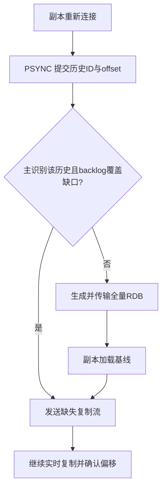

backlog 是有限缓冲，能否部分同步取决于历史和缺口是否仍保留。全量同步需要快照、传输、旧数据释放、新数据加载及增量追赶；即使主继续处理命令，fork、网络和副本加载仍会影响延迟。diskless sync 减少主中间落盘，不消除内存/COW 与网络成本。恢复速度必须在生产数据量下测量。不能为减少全量同步关闭持久化；无持久化主重启成空库后可能将空数据传播到全部副本。依据见[官方复制机制](https://redis.io/docs/latest/operate/oss_and_stack/management/replication/)。

### 4.2 确认层次与结果未知

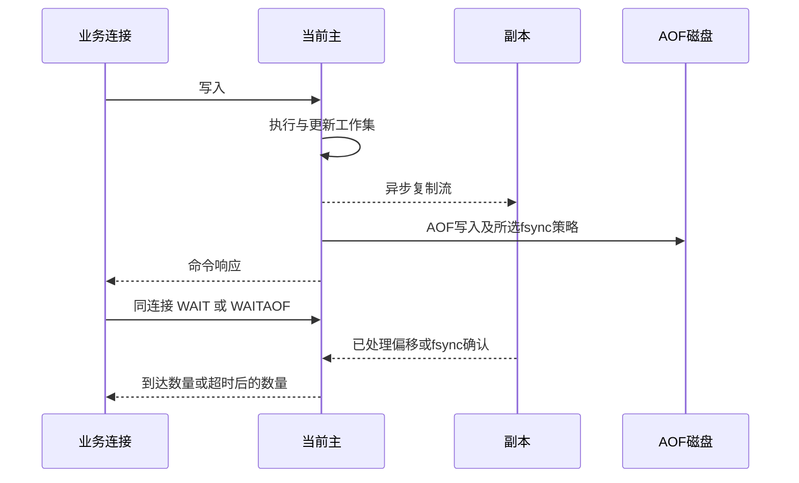

图刻意不把普通响应标成所有副本已落盘；磁盘完成时点由策略决定。`min-replicas-to-write=1`、`min-replicas-max-lag=10` 根据近期副本 ACK 判断是否允许写入，不是对每条写入等待一个副本，更不是固定 10 秒 RPO。

| 观察 | 可以得出的结论 | 不可推导的承诺 |
| --- | --- | --- |
| SET 返回 OK | 当前主执行了该写入 | 切换后必定仍存在 |
| WAIT 达到目标副本数 | 当前连接此前写入获得相应复制 ACK | 所有 ACK 已落盘，或系统线性一致 |
| WAITAOF 达到本地/副本目标 | 当前连接此前写入获相应 AOF fsync 确认 | 任何故障组合都不丢数据 |
| 客户端超时 | 未在预算内收到结果 | 命令一定没执行，可盲目重试 |

WAIT/WAITAOF 必须与待确认写入使用同一连接；Cluster 多主 pipeline 需在各写入主的连接上分别确认。超时返回未达目标的数量不撤销原写入。事务或脚本中的确认命令有不能按普通调用阻塞等待的限制，应在 EXEC/脚本返回后由同连接确认。业务使用幂等请求 ID、查询最终状态或补偿路径处理结果未知，不能依靠 SDK 无界重试。精确语义见[WAIT](https://redis.io/docs/latest/commands/wait/)及[WAITAOF](https://redis.io/docs/latest/commands/waitaof/)。

WAITAOF 的两个返回整数分别表示本地主与副本的 AOF fsync 确认数，必须逐项达到业务要求；返回成功回复不等于两个目标均已达到。`numlocal` 只能为 0 或 1，为 1 时本地必须开启 AOF，命令不能在副本上执行。等待预算用毫秒，0 会无限等待，不能用于有总截止时间的业务主线。确认依据是复制流位置及其 fsync 位置：脚本通过 `redis.set_repl`，或模块通过传播标志，使某次写入只进入 AOF 而不进入复制流时，上游明确警告与 WAITAOF 的组合可能出现错误行为。采用这类扩展传播前，须独立核验持久化和复制契约；不能沿用普通命令的确认结论。

## 5. Sentinel 如何决定切换

三个 Sentinel 监控 `mymaster` 的一个主和两个副本。主负责执行，副本保存复制数据，Sentinel 负责监测、通知、服务发现和故障转移授权，三个 Sentinel 不保存业务数据。产品设置 quorum=2、down-after=5000ms、failover-timeout=60000ms；这些是判定与重试参数，不能当作业务切换必在 5 秒或 60 秒结束的保证。

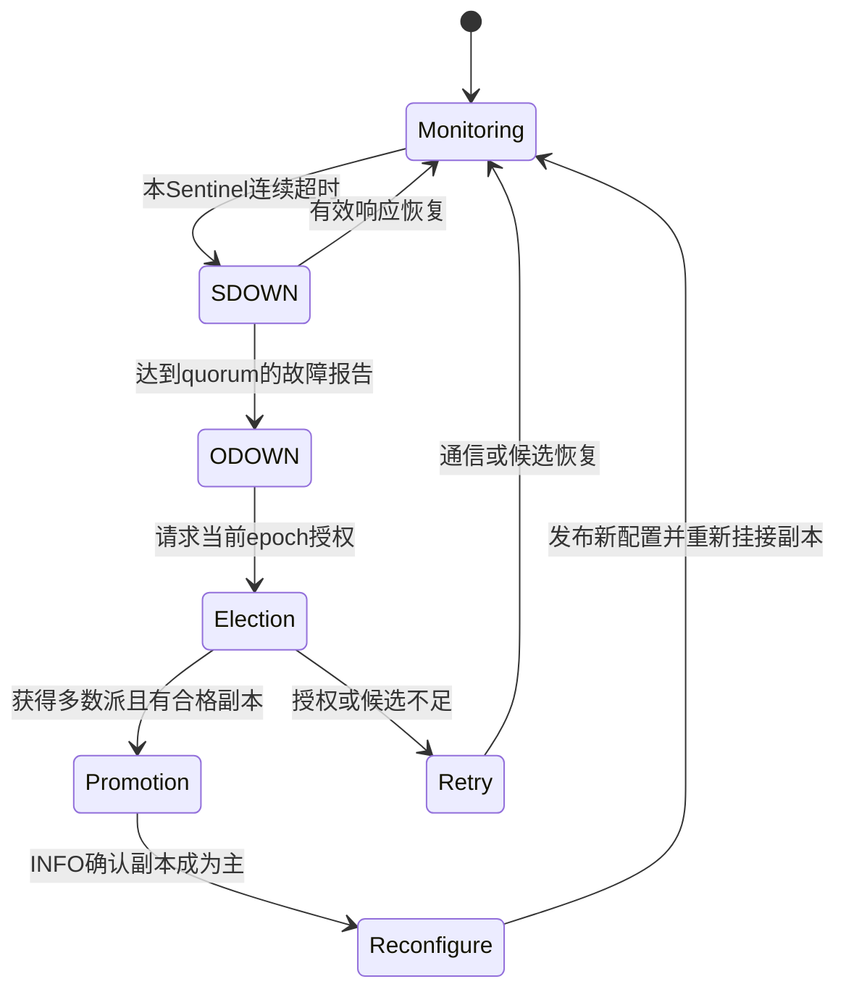

SDOWN 是本 Sentinel 的主观判断；ODOWN 是满足 quorum 的故障判定；选举多数派是允许某个 Sentinel执行切换的另一个条件。三 Sentinel、quorum=2 时都涉及两个，但概念不能合并，扩大 Sentinel 规模时区别会显现。候选先排除过久断连、故障和 priority=0 的副本，再按优先级、复制偏移及确定性 run ID 顺序选择。不同优先级可能使较低 offset 的副本先被选中，不能笼统说“总选择最新数据”。

新配置有递增 epoch，Sentinel 传播较新配置，旧主回归后被挂为新主副本。网络分区时，旧主窗口写入可能在回归同步中被丢弃，系统没有双主业务合并算法。写保护限制窗口，但两个副本同时不可用时也会拒写，这是数据风险与可用性的明确取舍。

Sentinel-aware 客户端向 Sentinel 获取当前主，验证连接角色，再管理重连与地址刷新。master Service 依赖 Operator 的实际角色标签及 Kubernetes Endpoint 更新，已有连接不会自动迁移；控制器恢复时间进入这条路径的 RTO。当前模板的 Sentinel 与 Redis 管理认证共享密码引用，应用主线使用 master Service 与受限 Redis 身份；需要独立 Sentinel 发现身份时先完成专项配置资格，不能把管理密码下发给业务。具体边界见[客户端约束](operations-manual.md#41-客户端约束)。产品设置 `resolveHostnames/announceHostnames=yes`，通告稳定 Pod FQDN；SDK、DNS、网络和证书 SAN 必须共同支持该名称。多级 Pod 域名不被简单的 `*.redis.svc.cluster.local` 覆盖。

Sentinel 经 `__sentinel__:hello` 发布/订阅发现信息，该前缀保留给内部控制身份；业务用户不要获得 `&*` 或该前缀发布权。TILT 是时间跳变或调度停顿后暂停主动故障操作的保护状态，应检查主机时间与 CPU 调度，而不是把它看成已完成选主。动态 Sentinel 设置不会自动把同样参数复制到全部 Sentinel，项目应维护统一声明。完整算法与 API 见[官方 Sentinel 文档](https://redis.io/docs/latest/operate/oss_and_stack/management/sentinel/)。

## 6. Cluster 如何分片、路由和接管

### 6.1 key 到槽，槽到主

Redis 用 CRC16(key) mod 16384 得到槽号。hash tag 按字节寻找第一个 `{`，再寻找其右侧第一个 `}`；只有两者之间非空时才对内部字节计算，否则对完整 key 计算，不继续寻找后面的括号。因此 `order:{42}:items` 与 `order:{42}:state` 同槽；`foo{}{bar}` 对完整 key 计算，`foo{{bar}}zap` 对 `{bar` 计算。标签应该是业务原子操作的最小范围，不能把所有用户统一为 `{all}`，否则九个实例仍只有一个分片承载热点。

客户端从 seed 取得槽位地图，然后直连目标主。节点不为客户端代理命令；Service 负载均衡也不做 Redis 槽位路由。Cluster 发现的所有成员必须对应用可达，端口转发一个 seed 或只开放一个外网地址不会使其它通告地址自动可达。

`COMMAND` 元数据中的 request/response tips 是给 SDK 的路由与聚合建议，不会让服务端自动执行全局操作。`all_nodes`、`all_shards` 或 `multi_shard` 要由客户端选择目标、发出请求并按各命令的响应政策汇总；只拿到一个节点的回复不能代表全 Cluster 成功。SDK 将支持拆分的跨槽操作分批发送，也不会因此获得全局原子性；部分节点失败时要保留各目标结果，按业务幂等记录核实，不能无条件重放整批。资格评审应同时核对固定命令 tips 和实际 SDK 实现。依据见[官方命令 tips](https://redis.io/docs/latest/develop/reference/command-tips/)。

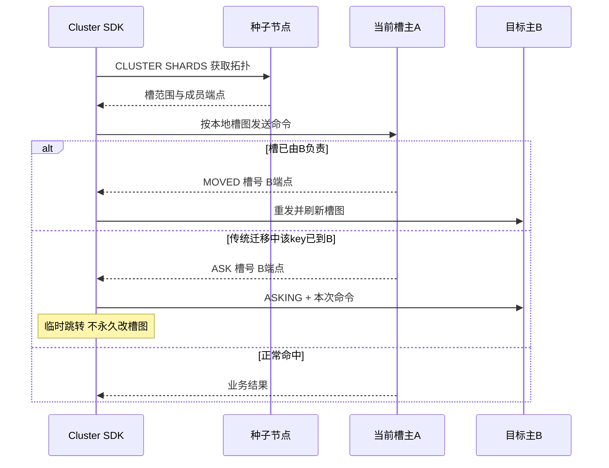

MOVED 表示槽主映射需要更新；ASK 是迁移中的本次例外。ASKING 必须与重发命令使用同一目标连接。跨槽多 key 请求返回 CROSSSLOT；同槽 key 在迁移时分布于源/目标，仍可能返回 TRYAGAIN。有限重试和业务幂等要覆盖这些条件，不能把同槽设计解释为所有时刻的成功保证。[Cluster specification](https://redis.io/docs/latest/operate/oss_and_stack/reference/cluster-spec/)描述传统迁移与重定向；固定 8.10 CLI 还可采用 ASM 原子槽迁移，维护入口由项目控制器管理。

### 6.2 故障授权与真实副本关系

Cluster bus 连接所有成员，传播成员、槽位与故障视图。PFAIL 是本地可疑失联，FAIL 由近期持槽主多数派故障报告形成。副本接管仍需赢得持槽主多数派投票，发布新的 configEpoch；更高 epoch 的槽归属最终胜出。该版本号让槽视图收敛，不是业务数据的共识提交序号。

本产品要求 `cluster-require-full-coverage yes`：丢失槽位时不能以局部服务掩盖缺失数据。三个主中，单主故障还要有本主的可提升副本、其它主多数可达及副本通信。总有六个副本并不能补救某个分片全部副本同时丢失。leader/follower 是声明角色，提升后真实角色会变；Pod 序号、标签或均匀调度不能代替 `CLUSTER NODES` 的复制图。

产品接入前读取实际域标签，为每个主规划至少一个异域副本；不能满足全部预算时拒绝继续。自动副本迁移与故障提升不同：前者补孤立主，后者接管槽。项目把 `cluster-migration-barrier` 设置为每主声明副本数，恰好满足预算的主不能为扩容捐出副本；新分片由 Operator 显式补齐。故障域与预算必须在切换、维护和扩缩后复验。

### 6.3 扩缩容是状态变更

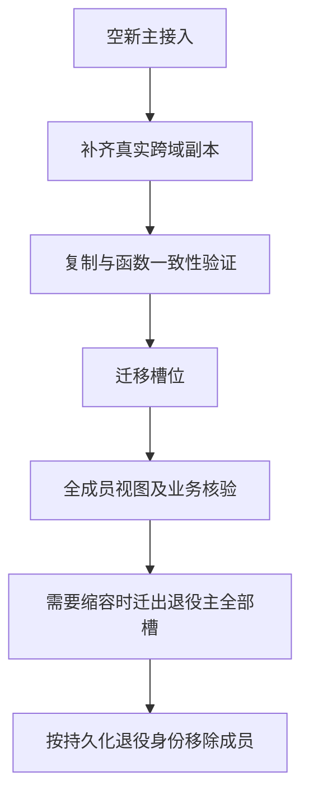

受保护生命周期不降低写保护，不覆盖新成员已有业务数据或冲突 Functions。退役前必须确认源槽位为空，记录属于退役预算的准确 node ID，并验证保留副本没有被遗忘。槽位完整、复制 up、所有成员视图一致与业务摘要正确是四个独立条件。节点 RESET/删除 nodes.conf/强制 FORGET 会改变身份和拓扑，不是常规修复方式。

Cluster 的项目镜像为 ASM takeover 追加集群状态刷新，维护背景和最小补丁在[开发手册](development-manual.md#2-版本和制品契约)说明。客户依据受保护产品入口扩缩，不自行运行 `redis-cli --cluster fix` 或降低预算绕过拒绝。完整步骤见[运维扩缩](operations-manual.md#73-cluster-扩缩与槽位迁移)。

## 7. 持久化与独立恢复

### 7.1 RDB 与多段 AOF

RDB 是某时点数据的紧凑快照，BGSAVE 通过 fork 子进程生成临时文件，完成后原子替换；父进程继续处理写入。fork 初期共享页面，随后写入触发 copy-on-write（写时复制，COW），所以“后台保存”不等于零延迟、零额外内存。

AOF 持续记录写入效果。Redis 7 以后使用 BASE、一个或多个 INCR 及 manifest 的多段集合。rewrite 子进程生成新的 BASE，父进程写新的 INCR，最后原子切换 manifest；文件身份不能只按一个 `appendonly.aof` 推测。直接在 rewrite 期间复制活动目录可能得到不完整集合。

项目同时启用 AOF 与上游 RDB 快照配置，并固定 `appendfilename "appendonly.aof"` 防止不同 agent 版本改变大小写。普通启动同时存在 RDB/AOF 时优先加载 AOF。把一份 RDB 放进旧 AOF 目录后重启可能仍加载旧数据；恢复必须在隔离空目标明确选择加载材料。[官方 persistence](https://redis.io/docs/latest/operate/oss_and_stack/management/persistence/)和[固定 server.c](https://github.com/redis/redis/blob/8.10.2/src/server.c)是加载边界依据。

| fsync 策略 | 机制与代价 | 项目选择 |
| --- | --- | --- |
| everysec | 后台周期 fsync，吞吐较好；异常磁盘或故障时仍有未确认数据窗口 | 默认，业务定义可接受损失和恢复方式 |
| always | 每批写入 fsync，延迟依赖持久化设备，可有 group commit | 可显式选择，先验证尾延迟和存储保证 |
| no | 交给操作系统刷盘，损失窗口由系统决定 | 当前配置校验不接受 |

“everysec 通常约一秒窗口”是策略解释，不是任何磁盘异常下都满足的 RPO SLA。AOF 写入失败与 rewrite 失败也不同：前者影响持续记录，后者可能仍能用旧集合记录写入但增长加快；巡检和告警必须区分。

### 7.2 Redis 8.10 在线 BACKUP 的能力边界

8.10 新增 BACKUP 命令族，将备份创建和最终封存分离。START 建立 BASE 并记录后续 INCR，SEAL 固定最终边界；最终恢复状态是封存时点，不只是初始快照时点。LIST 给出实际文件集，复制早期 BASE 可减轻封存阶段传输压力。STATUS/ABORT/CLEANUP 分别观察、终止和释放服务端材料。

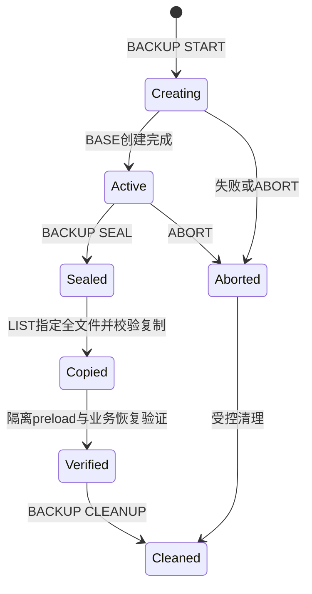

这是**上游专题**：当前 Kubeauto 的 `redis-snapshot` 实现是 RDB 导出，未调用 BACKUP，也未集成 `preload-file` 生产恢复或自动定时备份。不能把新命令描述为现有产品恢复入口。`backupdirname` 与 `backup-sealed-ttl` 管理服务端材料；`preload-file` 可指定 RDB 或 AOF manifest，损坏/缺失应启动失败。对多分片错峰 START 后逐个 SEAL，仍不能自动获得跨主业务原子时点。使用新备份体系需要独立实施方案、权限、存储与操作验证，详见[运维数据保护](operations-manual.md#94-在线-backup-与-aof-备份专题)。

### 7.3 可恢复性的判据

副本传播误删，PVC 保留仍受同一存储故障影响，RDB 校验只证明结构可读。可用备份必须有独立故障域副本、文件身份、版本/模块集合、角色/槽范围、业务摘要和恢复演练。Cluster 逐主快照需固定拓扑；业务要求全局一致时应停写并协调外部系统，单靠逐主导出没有跨分片事务。

RPO 衡量允许丢失的业务范围或时间，RTO 衡量从故障确认到业务恢复的时间，包含准备目标、传输、加载、拓扑建立和客户端切换。离线 RDB 验证不等于向生产 Cluster 自动重建拓扑；事故时不要首次发明 PVC 注入流程。运行时恢复资格和下线保留见[运维第 9 章](operations-manual.md#9-数据保护与恢复)。

## 8. Pipeline、事务、脚本与 Functions

pipeline 把多个请求连续发送再读回复，减少往返及系统调用，不保证批次原子性。若每条命令等待 1ms RTT，单连接理想上限约 1000 次/秒；一次发送 100 条可摊薄等待，但执行和回复仍耗时。无限批次会扩大输出缓冲与客户端内存，延迟可能更差。Cluster SDK 可以按主拆批，这不构成跨主顺序或原子保证。[官方 pipelining](https://redis.io/docs/latest/develop/using-commands/pipelining/)解释其适用边界。

MULTI/EXEC 让排队命令作为一组串行执行；排队语法错误可以导致 EXECABORT，执行期 WRONGTYPE 等错误**不撤销同组其它成功命令**。WATCH 是乐观并发检查，被监视 key 修改、过期或淘汰可使 EXEC 返回 null，应用应有限重试并重新计算，不能重放旧计算结果。需要“先读取、计算、条件修改”时可用有界 Lua 或 Functions，但也不能从原子执行推导关系数据库式回滚。参见[官方 transactions](https://redis.io/docs/latest/develop/using-commands/transactions/)。

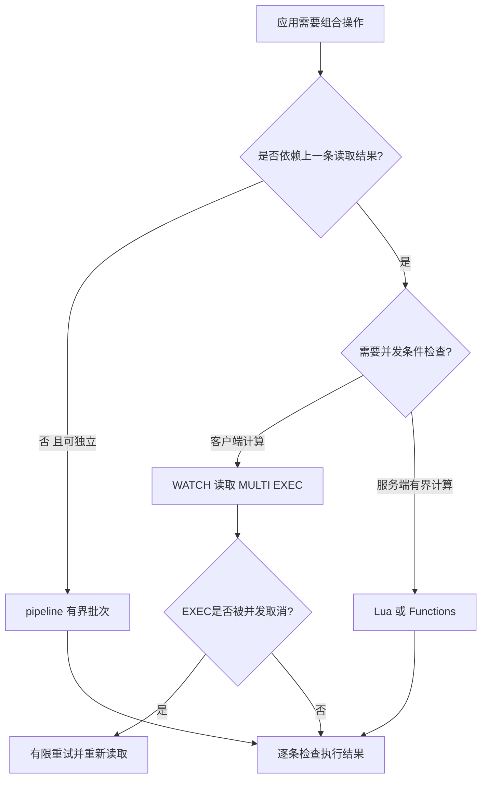

Lua 执行期间会占用所在节点的命令执行路径，必须限制循环、数据规模和返回大小；先检查输入/类型再写入，避免写了一半后报错。脚本涉及的 key 显式放在 KEYS 参数，Cluster 同槽；不要从数据中构造未声明的跨槽 key。EVALSHA 依赖脚本缓存，重启/切换或缓存回收可 NOSCRIPT，应用需要正确回退 EVAL/加载，而不是把加载成功当成永久注册。已经执行写入的脚本不能安全 SCRIPT KILL，需要业务/节点恢复计划。解释见[Eval](https://redis.io/docs/latest/develop/programmability/eval-intro/)。

固定引擎使用 Lua 5.1.5，不能按宿主应用语言解释条件与数据。Lua 中只有 `false` 和 `nil` 为假，数值 `0` 与空字符串都为真；字符串长度及截取按字节处理，不能据此统计 UTF-8 字符数。`pairs` 的遍历顺序不构成业务排序契约，带空洞的 table 也不能依赖长度运算得到元素个数。先明确稠密数组、映射或有序记录的结构，再选择遍历和编码方式，避免同一脚本在数据形状变化后静默改变结果。语言依据见 [Lua 5.1 手册](https://www.lua.org/manual/5.1/manual.html)，实际开放能力以 Redis 的沙箱为准：固定实现只开放 `os.clock`，不提供通用文件 I/O、`package` 或 `require`；独立 Lua 程序中的加载模块和读文件示例不能直接复制进 Redis。

数值还要区分 Lua 的 double、BitOp 的有符号 32 位运算以及外部序列化类型。超过 double 精确整数范围的订单号、计数或金额应采用字符串等明确表示，不在 Lua 中先转 number 再期望 MessagePack 恢复原始整数。`bit` 运算可能返回负数，应由双方约定有符号或无符号解释；`cmsgpack` 固定实现的嵌套深度上限为 16，达到该层的 table 会被编码为 nil，并不保证报错；深层文档须在写入前检查。序列化后能解包并不证明类型和精度符合业务契约，应同时核对整数边界、空值、数组与映射，且在开始写入之前完成可能报错的输入校验。

`busy-reply-threshold` 是进入忙脚本处理状态的阈值，默认 5000ms；它不是执行到时自动回滚或终止的硬截止。超过阈值后，普通命令会收到 BUSY；尚未写入的脚本或函数可由管理者以 SCRIPT KILL 或 FUNCTION KILL 停止，已经写入时不能借此撤销。上游保留 SHUTDOWN NOSAVE 作为强制中止出口，但会停止实例并放弃未保存状态，只能在事故负责人批准、已有数据恢复方案的情况下处理，不能作为应用超时后的自动动作。声明 `no-writes` 或使用 EVAL_RO/EVALSHA_RO/FCALL_RO 可限定只读执行；脚本语境中的 PUBLISH、SPUBLISH、PFCOUNT 也被当作写命令，不因它们看似只发消息或读计数就放行。只读资格可以避免写入后的不可安全中止状态，不能消除大范围计算的阻塞成本。依据见[官方可编程机制](https://redis.io/docs/latest/develop/programmability/)。

Lua 值与 Redis 协议值存在转换边界。裸 Lua number 返回时转成整数，`return 1.5` 不会保留小数；精确十进制业务值可使用约定格式的字符串，或明确采用协议支持的 double 返回结构并核验 SDK 类型。普通 table 按从 1 开始的连续数字下标生成数组，遇到 nil 就结束，关联字段不会自动成为 map：`{1, nil, 3}` 只返回第一项，`{name="A"}` 也不是一条 JSON 记录。内部 `redis.call` 的回复转换由 `redis.setresp` 选择，外部客户端的 HELLO/协议设置决定最后回复的编码；固定实现默认内部 RESP2，客户端协商 RESP3 不会自动替脚本调用 `redis.setresp(3)`。设计布尔值、null、map 或 set 返回时，应同时固定内部转换和外部 SDK 契约，并分别验收缺失与空值，避免脚本逻辑正确却在返回时丢掉字段或精度。依据见[固定 Lua 回复转换](https://github.com/redis/redis/blob/498ecd0d6d007db11ddb3aea9428552598a78622/src/script_lua.c)与[固定协议转换测试](https://github.com/redis/redis/blob/498ecd0d6d007db11ddb3aea9428552598a78622/tests/unit/scripting.tcl)。

Functions 将库定义纳入数据库状态与复制/持久化，但功能库本身不按 slot 分布；Cluster 每个主须有相同适用定义。项目受保护扩容验证并复制 Functions，冲突拒绝。版本化库名、显式声明 key、维护代码摘要与有限执行预算，升级时先验证函数结果和恢复材料。只读命令 EVAL_RO/FCALL_RO 需满足相应 flags 与权限，不自动使陈旧副本读变成一致读。依据见[Functions](https://redis.io/docs/latest/develop/programmability/functions-intro/)。

`FUNCTION DUMP` 导出的是库集合，不是业务 key 的数据备份。`FUNCTION RESTORE` 默认 APPEND，追加库时遇到冲突会拒绝；FLUSH 会先删除现有库，不能用于保留其它业务库的常规升级；REPLACE 替换同名库，但不能消除不同库之间的函数名冲突。导入前保存当前源码/库集合及摘要，核对所有库名和函数名，在独立目标验证冲突、调用结果和恢复，再按各主一致性要求发布。发生冲突时保留原库和失败材料，不能改用 FLUSH 强行通过。依据见[FUNCTION RESTORE](https://redis.io/docs/latest/commands/function-restore/)。

Lua 调试器 LDB 用于**隔离开发副本**，不用于生产请求旁路。默认 fork 调试在子进程执行，调试产生的数据变化会丢弃；同步模式在原进程执行，修改会保留，而且交互调试会阻塞其它客户端。`abort` 的含义随模式不同，不能把它当成生产数据回滚。先复制脱敏的最小样本和脚本，在独立实例确认执行模式，再逐步观察局部变量、调用与返回；退出后重建开发样本并复测正常执行。不要对生产主执行 DEBUG/LDB 来调查一个超时，也不要把含凭据或客户数据的调试输出纳入普通诊断包。依据见[官方 Lua 调试](https://redis.io/docs/latest/develop/programmability/lua-debugging/)。

## 9. 发布订阅与 Streams

Pub/Sub 把消息发给当前在线订阅者，至多一次交付；断线期间消息没有等待重放的持久记录。PUBLISH 返回订阅者数量，不表示其业务处理完成。频道与 DB 编号无关，应按环境/业务命名并独立配置 channel ACL。Cluster 全局 Pub/Sub 向集群传播；sharded Pub/Sub 用 SPUBLISH/SSUBSCRIBE 限制在槽对应分片，客户端应支持其路由。不要将频道 ACL 与 key ACL 混为一谈。[官方 Pub/Sub](https://redis.io/docs/latest/develop/pubsub/)给出交付与协议区别。

Keyspace notifications 在此基础上发布键空间事件，默认关闭，启用会增加 CPU/通知流量。`notify-keyspace-events` 中 K 选择以 key 为频道、事件名为消息的通知，E 选择以事件为频道、key 为消息的通知，还需选择相应事件类别；仅设置 K/E 不等于订阅全部事件。`expired` 在过期 key 被实际删除时才产生，不保证在 TTL 刚归零时准时发出；断线不补发，Cluster 还需分别订阅各节点的事件。因此不能把它作为可靠过期调度、审计或灾备日志。持久通知需求由应用显式写入可恢复事件流并按业务结果确认。本产品未提供该参数透传，确需启用时先按开发扩展契约评估资源、频道权限、断线与重连行为。依据见[官方键空间通知](https://redis.io/docs/latest/develop/pubsub/keyspace-notifications/)。

固定版本的 Hash 字段级通知另用 S/T/I/V 选择四类 subkey 频道，与 K/E 独立，仍需 h 等对应事件类别；例如 STh 才同时选择两类频道和 Hash 事件，不能照搬滚动教程中只写 ST 的片段。携带字段名的 payload 使用字节长度前缀，字段名可含分隔字符，不能简单按逗号拆分，也不能用 Unicode 字符数代替字节数。它仍通过 Pub/Sub 交付，不补发断线消息；不能从 Hash 支持推导所有模块和数据类型都产生相同粒度的事件。依据见[字段级通知](https://redis.io/docs/latest/develop/pubsub/subkeyspace-notifications/)与[固定通知实现](https://github.com/redis/redis/blob/498ecd0d6d007db11ddb3aea9428552598a78622/src/notify.c)。

Streams 将事件存入有序 ID 的日志，可独立读取或用消费组分配工作。XREADGROUP 读取新消息后进入该组的 pending entries list（PEL，待确认表）；业务成功后 XACK。ACK 不删除日志，裁剪日志也不等于清理所有组的待处理责任。消费者在处理后 ACK 前崩溃，恢复方认领会重复执行，因此消费端必须按事件/业务 ID 幂等。

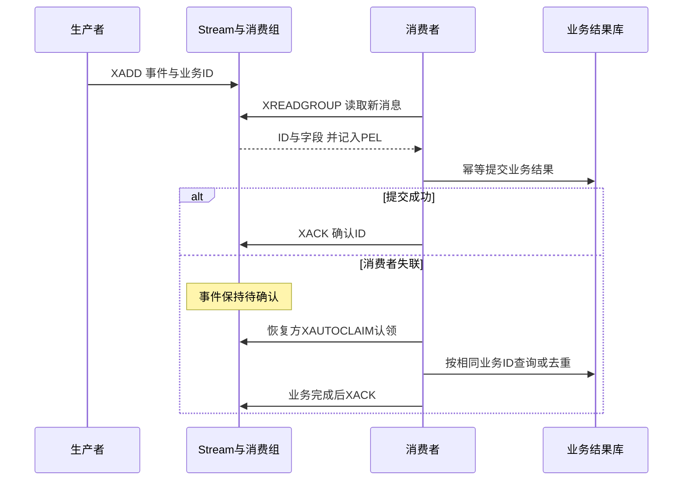

初始组 ID 为 `0` 时可处理历史，为 `$` 时只取建组之后新增消息，选择要符合上线任务。XREAD 的 `$` 也只适合首次订阅当前位置，后续应使用收到的最后 ID，重复 `$` 会跳过消息。阻塞读取应使用独立连接和有界等待；组 lag、pending 数、最老 idle 和投递次数比单独 XLEN 更接近积压原因。认领的最小 idle 应大于正常处理时长，过小会争抢仍在工作的消费者。裁剪前明确全部组保留要求，不能为省内存删除未完成业务。详见[官方 Streams](https://redis.io/docs/latest/develop/data-types/streams/)。

### 9.1 裁剪、拒收与多消费组

一个 Stream 是一个 key，即使有很多消费者也仍由一个槽主执行；多消费者分担处理，不自动把日志分布到多主。按业务实体需要顺序时，应用还需控制并发和提交顺序。XLEN 为 0 时 Stream 可以继续保留消费组状态，不能据此推断对象已删除。

MAXLEN 按长度、MINID 按 ID 边界裁剪；`~` 是近似裁剪，并非精确上限。8.2 后 KEEPREF 保留已裁剪条目的 PEL 引用，消费者可能得到“ID 在但内容已无”的记录；DELREF 同时移除所有组的引用，会放弃尚未完成的责任；ACKED 仅移除全部组已确认的条目，慢组可能让保留量持续增加。XACKDEL 合并确认和删除，但仍要选择引用政策，不等于跨外部业务数据库的原子提交。保留策略应同时考虑所有组的最长恢复窗口、磁盘/内存预算和无法处理的事件出口。

8.8 的 XNACK 让消息重新进入组的待认领区：SILENT 减少投递次数，适用于有序退出；FAIL 保持次数，适用于本消费者失败；FATAL 标记最大次数。FATAL **不会自动创建死信队列**，应用需识别、保存失败原因并按批准流程转移。XREADGROUP 的 CLAIM 或认领命令可重新接收这些记录；“交回组”与“业务成功确认”必须区分。

### 9.2 生产者去重的有效窗口

8.6 的 XADD IDMP 使用持久生产者 ID（pid）和事件幂等 ID（iid）识别重发；IDMPAUTO 根据字段和值生成 iid，相同内容的两个真实业务事件也可能被视作重发，因此应优先按业务事件身份设计。重启必须保留 pid，重试必须保留 iid，不能在每次发送时重新生成 UUID。

去重记录受 XCFGSET 的时间和数量两种窗口约束：IDMP-DURATION 为 1～86400 秒，默认 100；IDMP-MAXSIZE 为每生产者 1～10000 个，默认 100。先达到数量上限会提前移除旧记录，即使时间未到也可能再次插入。数量按“确认结果写回业务日志的最大延迟 × 该生产者峰值发送速率 + 余量”估算，时间按最长恢复/重试窗口确定，并用 XINFO STREAM 核对追踪数和重复数。**改变这两个参数会清空现有去重映射**，不能在存在未决重试时随意调优。

IDMP 状态进入 RDB/AOF，仍受异步复制与备份时点限制；它解决有效窗口内的生产重发，不保证外部业务恰好执行一次。消息、组进度或去重状态在切换时均可能丢失，消费侧的业务唯一约束与结果查询仍不可省。依据见[官方幂等生产](https://redis.io/docs/latest/develop/data-types/streams/idempotency/)及[固定 XCFGSET 定义](https://github.com/redis/redis/blob/8.10.2/src/commands/xcfgset.json)。

## 10. 身份、权限与网络边界

TLS 加密传输并在配置正确时验证证书身份，ACL 决定身份可做什么，NetworkPolicy 限定哪些网络主体可到达，RBAC 限定谁可改 Kubernetes 声明。四层不能互相替代。Cluster bus 的密码认证与客户端 AUTH 不同，项目要求 TLS 并启用固定版本 bus 保护；只给 6379 设置密码不能保护 16379。

产品 `tls-auth-clients yes` 使用双向 TLS，客户端需 CA、证书和私钥；复制、Sentinel 访问和 Cluster bus 也要匹配 TLS。应用 SDK 还应严格校验发现端点的主机名。固定 Operator CLI 含 `--insecure`，不校验服务端证书；Go 客户端自定义回调验证 CA 链但不校验主机名。两条内部连接边界均不能写成严格服务端身份验证。源码依据为[CLI](https://github.com/OT-CONTAINER-KIT/redis-operator/blob/v0.27.0/internal/k8sutils/redis.go)与[Go TLS](https://github.com/OT-CONTAINER-KIT/redis-operator/blob/v0.27.0/internal/k8sutils/secrets.go)。

ACL 按命令、key 模式、读写方向和频道授权。`~tenant:*` 不会限制 FLUSHALL 这类没有具体 key 参数的全库命令；`+@all` 还可能允许未来加载的模块命令。推荐业务身份从 `-@all` 开始显式允许需要的命令，核实当前版本命令分类，避免把旧文档分类结论照搬到 Redis 8 的模块命令。ACL 规则从左到右增量处理，多次 SETUSER 不自动重置。用户 off 也不自动断开已有认证连接，撤权验收要覆盖存量连接。

外部 ACL 以 Secret 的 `user.acl` 为权威；CONFIG REWRITE 不会保存 ACL 文件，挂载只读 Secret 也不适合原生 ACL SAVE。项目默认管理用户还承担探针、复制和控制器职责，不直接交给业务；业务命名用户只允许专属 key 和频道。上线同时验证允许路径和拒绝路径，网络超时不能算成功认证拒绝。参见[ACL](https://redis.io/docs/latest/operate/oss_and_stack/management/security/acl/)及[TLS](https://redis.io/docs/latest/operate/oss_and_stack/management/security/encryption/)。

Secret 的 base64 是编码，不是加密；是否在 etcd 中加密由平台的静态加密配置决定，Redis 分支不负责替平台开启该能力。平台负责人须核验加密、备份保护与最小 RBAC，并约束 Redis 命名空间中的工作负载创建权限：即使没有直接读取 Secret 的权限，能创建 Pod/Deployment 的身份也可能通过挂载取得其中材料。节点特权容器还可能访问该节点使用的 Secrets。因此应用不应拥有 Redis 命名空间管理权，凭据管理、平台操作与业务 Redis ACL 分别授权；限制文件读取不等于限制 Kubernetes 或节点访问。依据见[固定 Kubernetes Secret 说明](https://github.com/kubernetes/website/blob/b9ab6105d0e3b6824dc368d3dd3b101fb4774575/content/en/docs/concepts/configuration/secret.md)。

ACL 同时约束命令、key 和 Pub/Sub 频道，三者不可互相替代。`~tenant:*` 只限制命令声明的 key 参数；FLUSHDB/FLUSHALL/SWAPDB 等没有这种 key 参数，即使用户带此前缀，`+@all` 仍会允许全库操作。因此先 `-@all` 再显式授予业务命令，比“允许全部再依靠前缀隔离”更容易证明权限边界。子命令可用 `+xgroup|create` 单独授权；旧的首参数授权形式已弃用，不作为新应用设计。

需要按前缀区分读写时，可用 `%R~reference:*` 与 `%RW~tenant:*`，但“读权限”并不消除所有元数据侧通道；EXISTS、类型或长度等仍应按其命令/key 规格审核。Selectors 是分别求值的完整规则组：例如 `+get ~key1 (+set ~key2)` 能允许 GET key1 与 SET key2，却不合并两组权限来允许 GET key2。跨源/目标的 COPY 等命令必须由同一规则组完整授权，否则会被拒绝。业务资格覆盖这些负例，不能只检查 ACL 文本里有没有预期前缀。

ACL LOAD 只有在整份文件有效时才替换当前用户配置；文件更新、进程内权限加载和所有成员一致是不同步骤。Secret 更新后的可见时间及 Pod 重建亦影响结果，应走[凭据轮换](operations-manual.md#8-凭据与证书轮换)并复验旧凭据拒绝。SHA256 密码哈希不是慢速的人类口令散列，使用凭据系统生成的高熵共享秘密，原值与哈希都按敏感材料处理。Sentinel 的 `__sentinel__:hello` 频道承载拓扑发现；伪造发布可影响发现及凭据安全，业务身份不得授权该保留频道或宽泛 `&*`。

CA 轮换采用重叠信任、换叶子、撤旧 CA 三阶段。两代 CA 的主体应可区分，SKI/AKI 帮助客户端选择签发链；同名不同 key 的 CA 简单拼接可能仍验证失败。各实际 SDK 必须验证新旧链、mTLS、错误 SAN 及撤旧后的拒绝。备份、慢日志、MONITOR 和诊断材料可能含业务内容；不得输出 Secret、私钥或完整 ACL。固定 Chart 默认未启用 webhook，不能承诺额外准入保护。

## 11. 故障模型与恢复承诺

| 故障层 | 可能行为 | 判断和恢复要点 |
| --- | --- | --- |
| 客户端/网络 | 超时、地址不可达、拓扑陈旧、连接耗尽 | 正常对照、真实发现端点与结果未知请求 |
| 单副本 | 主可能仍写；余量降低，后续重建产生峰值 | 最小副本写保护、跨域关系和复制追赶 |
| 单主 | 可授权候选提升，现有连接失效 | 多数派、合格副本、数据窗口、应用重连 |
| 网络分区 | 不同局部视图，旧主窗口写入可能丢失 | 保留各侧证据，恢复通信后按新拓扑核验数据 |
| 磁盘/PVC | 持久化拒写、加载失败或不能挂载 | 保存原材料，修复存储，隔离验证恢复点 |
| 内存/CPU | OOM 拒写或 OOMKill、长尾与探针误判 | 数据水位与 RSS 分开、检查 COW/缓冲/限流 |
| 控制器/API | 已有数据服务可能正常，变更不能协调 | 先判断业务，再恢复制品/RBAC/API/选举 |
| 全站丢失/误删 | 副本不足以恢复或已同步错误 | 独立备份、可用目标、业务一致边界与回切 |

PDB 约束 Eviction API 的自愿驱逐，直接删除和 StatefulSet 滚动更新会绕过它；它无法阻止断电或保证跨域复制图。Ready 表示探针局部判断，无法保证应用权限、路由、原值正确或复制已经追平。滚动策略的 Ready 等待与 Redis 数据保护预算必须分别判断。恢复终点应同时满足控制面可协调、数据面角色/槽位/持久化正常、业务结果和数据符合批准的损失范围。具体处置见[运维故障入口](operations-manual.md#6-故障诊断与恢复)与[维护边界](operations-manual.md#71-节点维护与滚动重启)。

跨地域链路提高 RTT，延长复制、故障判定与恢复时间；异步副本不是双站双写。Active-Active 不在本交付范围，不能以强制 TAKEOVER 建立常态容灾。异地方案需单独设计写入权威、切换防护、恢复点和回切，先验证网络/时钟/证书/客户端及双方故障组合。

## 12. 容量、性能与稳定性推导

容量预算应满足：`容器限制 ≥ 数据工作集 + 分配器/进程余量 + 复制及客户端缓冲峰值 + fork期间COW峰值`。maxmemory 只控制特定内存范围，并不等于 cgroup 总量。默认 2Gi limit、70% 水位只是初始声明，不能保证高写入下后台保存安全。副本忽略 maxmemory，可能比主更先碰到硬限制，必须逐成员采样。

PVC 预算包含现有 RDB、多段 AOF、rewrite 新 BASE/INCR、复制临时材料及增长/故障处置余量。一次后台任务可能叠加客户端写入和复制重建，容量模型须按实际并发峰值，而不是只按当前文件大小。backlog 可初估为 `峰值复制字节/秒 × 要覆盖的断连秒数`，实际历史与保留范围决定是否部分同步；offset 字节不是 value 字节总量。

命令吞吐由最繁忙分片决定；平均 CPU 低不能排除热点。大对象、大响应、慢集合运算、Lua、索引查询、TLS、磁盘 fsync 和 CPU throttling 会贡献不同延迟。先用客户端分位数识别尾延迟，再用 SLOWLOG、INFO commandstats/latencystats、LATENCY、容器/磁盘/网络信号拆分，最后一次只调整一个假设并同负载复测。SLOWLOG 测执行时间，不包含完整网络和客户端排队；MONITOR 有额外开销并暴露命令参数，不能常驻生产。

基准应覆盖真实 key/value 分布、类型、读写比、连接、pipeline、TLS、AOF、复制与故障期。单连接忙等 SET/GET 可能主要测 RTT；只报告吞吐平均值会掩盖 p99 和错误。发布结论必须保留预热、稳态窗口、工具版本、各成员峰值、成功率、恢复时间及停止条件。官方 `redis-benchmark` 数据不能变成跨硬件承诺。[基准方法](https://redis.io/docs/latest/operate/oss_and_stack/management/optimization/benchmarks/)与[延迟监视](https://redis.io/docs/latest/operate/oss_and_stack/management/optimization/latency-monitor/)解释测量差异。

稳定性是稳态和变更期间均能满足业务预算：包括持续增长、过期峰值、重建、AOF rewrite、扩缩、升级、证书轮换和连接风暴。性能优化不能以停持久化、降低副本保护、关闭 TLS 或跳过错误换取漂亮数字。操作与容量算例见[运维性能章](operations-manual.md#10-性能与稳定性验收)。

## 13. 生命周期与替换成本

升级同时影响 CRD/API、控制器/agent、配置默认值、数据格式、模块和客户端。CRD 向前升级后控制器回退不等于 schema 回退；新 RDB/命令不能假设被旧 Redis 读取。项目修订与上游版本分开标记，既有升级资格仅对经过验证的组合、AOF 名称和固定拓扑成立。原地回退条件不成立时，采用保留原实例、隔离恢复/迁移和客户端切换路径。

下线要先确认业务不再依赖、独立恢复点和保留周期，再限定删除 CR/release；PVC 保留与最终销毁分别审批并核验资源身份。名称重用不能代替数据迁移。Valkey 或其它兼容产品也要重新验证协议、命令、模块、数据格式和控制器资格，不能共享本 Redis 组合的交付结论。

官方维护依据集中在相关正文中；固定版本入口为[Redis 8.10.2](https://github.com/redis/redis/tree/8.10.2)、[Operator v0.27.0](https://github.com/OT-CONTAINER-KIT/redis-operator/tree/v0.27.0)、[Exporter v1.93.0](https://github.com/oliver006/redis_exporter/tree/v1.93.0)及[Kubernetes 1.33](https://v1-33.docs.kubernetes.io/docs/)。原理、产品支持、实测资格和客户 SLO 是不同层次，版本变化须重新核实受影响的主题。
