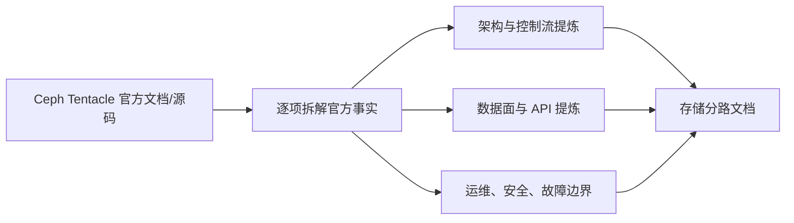

# Kubeauto 存储分路

存储技术栈位于 `docs/storage/`，是与中间件完全独立的产品分路，使用独立产品入口、专项矩阵和清理边界。Longhorn 沿用中间件的三份正式手册，合并用户与运维内容；Ceph 保留已批准的九模块结构。

## Longhorn

| 正式内容 | 文档入口 |
| --- | --- |
| 用户与运维 | [operations-manual.md](./longhorn/operations-manual.md) |
| 技术白皮书 | [technical-whitepaper.md](./longhorn/technical-whitepaper.md) |
| 开发与维护 | [development-manual.md](./longhorn/development-manual.md) |

Longhorn 1.12.1 面向动态持久卷及中间件存储，范围包括 V1 文件系统盘与 V2 裸块盘。当前处于开发与验证阶段，[54 项专项矩阵](../../tests/longhorn-test-matrix.yaml)逐项记录结果；既有 V1 业务证据不覆盖 V2，V2 现场验收尚未完成，不能据此声明交付。已有中间件的 1.10.1 存储夹具不替代本分路验收。

## Ceph 九模块

Ceph Tentacle 严格对应官方九个入口：

| # | Ceph 模块 | 本项目文档 |
|---:|---|---|
| 1 | Architecture | [01-architecture.md](./ceph/01-architecture.md) |
| 2 | Cephadm | [02-cephadm.md](./ceph/02-cephadm.md) |
| 3 | RADOS Storage Cluster | [03-rados.md](./ceph/03-rados.md) |
| 4 | CephFS | [04-cephfs.md](./ceph/04-cephfs.md) |
| 5 | RBD | [05-rbd.md](./ceph/05-rbd.md) |
| 6 | RADOS Gateway | [06-radosgw.md](./ceph/06-radosgw.md) |
| 7 | MGR | [07-mgr.md](./ceph/07-mgr.md) |
| 8 | MGR Dashboard | [08-mgr-dashboard.md](./ceph/08-mgr-dashboard.md) |
| 9 | Monitoring | [09-monitoring.md](./ceph/09-monitoring.md) |

## 官方基线

- 文档入口：[Ceph Tentacle](https://docs.ceph.com/en/tentacle/)
- 官方源代码分支：[ceph/ceph `tentacle`](https://github.com/ceph/ceph/tree/tentacle)
- 本次核验的官方提交：`76fba24cef67d9219f97eeaa68cd1a848da3f2b2`
- 九份正文按机制和客户任务重新组织官方内容。重复叙述可以合并，但官方概念、状态、配置语义、默认行为、命令、限制、警告和异常恢复分支必须在正文中得到实际解释，不能用目录或“已覆盖”声明代替。

Ceph 的对象、块、文件接口共用 RADOS 数据平面；cephadm 负责集群生命周期，MGR/ Dashboard/ Monitoring 提供控制、管理和观测能力。Kubeauto 的 Cephadm 与外置 Ceph-CSI 实现已进入验证，当前 28 项专项矩阵仍为 pending；这些文档及未完成的现场验证均不表示已经交付。
