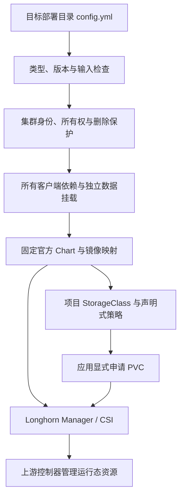

# Longhorn 开发与维护手册

本文面向维护 kubeauto 存储分路的开发、测试和发布人员。版本集合为 Kubernetes 1.33.6、Helm 3.19.0、Longhorn 1.12.1、V1 与 V2 replicated 数据引擎，升级资格源为 1.12.0，通用 CSI snapshot-controller 为 8.6.0。业务部署与维护从[用户与运维手册](operations-manual.md)进入；副本、容量、恢复与一致性机制见[技术白皮书](technical-whitepaper.md)。本分路的当前验收状态以[54 项专项矩阵](../../../tests/longhorn-test-matrix.yaml)及其绑定证据为准，未验收能力不能由上游支持推导为项目交付。V2 AIO 已取得三节点安装、三副本持久写入与跨节点重挂资格证据；原生 PCI 接管未作为产品接口开放，完整交付仍需矩阵的现场门禁。

## 维护任务索引

| 维护任务 | 阅读入口 |
| --- | --- |
| 理解配置与控制器的职责 | [配置与资源控制边界](#配置与资源控制边界) |
| 扩展 V2 主机、磁盘与引擎 | [V2 集成契约](#v2-集成契约) |
| 修改版本、镜像或 Chart | [版本集合与制品维护](#版本集合与制品维护) |
| 增加运维请求 | [操作请求与幂等](#操作请求与幂等) |
| 处理升级、删除与资源冲突 | [所有权与数据保护](#所有权与数据保护) |
| 修改断言或验收范围 | [验证与交付](#验证与交付) |
| 定位集成行为的上游依据 | [官方接口与版本差异](#官方接口与版本差异) |

## 配置与资源控制边界

Longhorn 是独立存储技术栈。配置使用 `longhorn_` 前缀，默认关闭，通过 `kubecli setup <部署目录> 09` 收敛；镜像通过 `kubecli download -E longhorn` 准备。存储必须先于消费它的中间件收敛，不能让中间件安装步骤顺便接管存储。已有 Kafka、Redis、MongoDB 回归中的 1.10.1 存储夹具具有独立所有者，其成功记录和资源不能作为本分路的基线。

项目管理安装声明、资源所有权和生产前置；Manager 管理 Volume、Engine、Replica、InstanceManager、ShareManager 的运行态。应用团队管理自己的 PVC、数据库一致性和业务恢复点。维护代码不得直接修改副本文件、模拟状态成功、解除未知 finalizer，或同时充当另一个副本控制器。

`longhorn_storage_nodes` 是 inventory 地址的显式允许列表，而 Kubernetes Node 名来自集群 API 的 InternalIP 映射。地址必须唯一映射到本集群节点，不能把主机名、IP 和 Longhorn Node 名混用。所有可能消费卷的客户端都需要依赖；只有允许列表中的节点可以获得项目默认数据盘。移出允许列表不代表副本已经迁走，既有盘退役另走迁出和空盘检查。

控制任务从 `kube_node` 组派生 `longhorn_client_nodes`，要求存储允许列表是客户端集合的子集；`kube_master:kube_node` 仍用于完整节点身份和依赖检查。节点引导只在客户端设置 `kubeauto.io/longhorn-client=true`，其余 inventory 节点设为 `false`，Manager 的官方 `nodeSelector` 消费该标签。标签和默认盘字段一样，在预检、并发补丁及卸载时受所有权与 Node UID 保护。混合角色通过同时属于 `kube_node` 表达，不根据节点名称猜测。

这项范围约束来自固定 1.12.1 的实际集成行为：`InstanceManagerController.handlePod` 遇到 Kubernetes unschedulable 节点不会创建 instance-manager Pod；`BackupController.isResponsibleFor` 对 V1 只检查数据引擎兼容、Manager 与 EngineImage 可用性，`getBackupTarget` 随后却要求 owner 本机有运行中的 instance-manager。专用控制面从核心安装起已 cordon，在这些节点运行 Manager 会留下可以竞选备份 owner、却无法完成请求的控制器。不能通过解除控制面 cordon 或改写 Backup.status.ownerID 隐藏该前置。健康检查逐个核验客户端上的固定版本 V1 instance-manager 为 running、PodReady 且未删除，Manager/CSI Ready 数量不能替代此运行时条件。官方配置接口见 [Node Selector](https://longhorn.io/docs/1.12.1/advanced-resources/deploy/node-selector/)，源码按本手册固定 Manager commit 核对上述函数。

原生节点的期望磁盘声明与观测状态异步收敛。固定 Manager 的 `NodeStatus.DiskStatus` 明确允许 `null`，`alignDiskSpecAndStatus` 随后初始化 map 与盘条目；新节点刚加入时，缺少状态不表示磁盘已 Ready。`healthy()` 将缺失或 null 的 map/条目按尚未观测处理，在原有超时内继续等待 UUID、Ready、Schedulable 与引擎类型/驱动全部满足；不能以空状态成功，也不能因 `.get()` 异常提前终止。裸盘已有身份回执时，空状态仍阻断身份确认，不能覆盖原回执。相应合同分别覆盖两种引擎的初始 null/空状态、正常就绪，以及已接受块盘身份缺失后的拒绝。官方定义见固定 commit 的 [NodeStatus](https://github.com/longhorn/longhorn-manager/blob/8320238242e8c804325d9588ec1db10feb9f36b8/k8s/pkg/apis/longhorn/v1beta2/node.go) 和 [NodeController](https://github.com/longhorn/longhorn-manager/blob/8320238242e8c804325d9588ec1db10feb9f36b8/controller/node_controller.go)。

V1 节点永久退役须在数据迁出后分别关闭节点与磁盘调度，并在删除最后一块盘声明前将该 Kubernetes Node 的 `node.longhorn.io/create-default-disk` 标签设为 `false`。固定 `KubernetesNodeController.syncDefaultDisks` 只检查 `spec.disks` 是否为空；标签仍为 `config` 时，控制器会再次从原注解生成默认盘。项目预检随后会正确拒绝不在数据 allowlist 中却仍有盘的节点，不能放宽该检查。这个标签变更是运维手册明确的原生操作，与 `config.yml` 移除数据地址、空盘删除及产品节点删除构成连续流程；测试按 UID/resourceVersion、原标签及精确默认盘注解限定同一操作，不修改其它节点或绕过删除护栏。

新增 worker 的核心网络必须先于 Longhorn 客户端收敛。已有集群中的 CSI 与 EngineImage DaemonSet 会在 kubelet 注册后自动扩展；如果先提供临时 bridge，Pod 可能取得该网络的 sandbox，后续安装 Calico 不会自动改建这个已有 sandbox。因此新增 worker 不生成临时 CNI 配置，containerd 的 `conf_template` 为空，按固定 containerd 2.1.4 的 `UpdateRuntimeConfig` 等待实际网络插件落盘；节点 Ready 检查位于 CNI 安装之后。初装和扩展控制面的既有流程不由这项修复改变。发生部分加入时，保留原产品失败和 inventory 状态，先根据 Node UID、机器与启动身份、CRI sandbox 和 Pod/DaemonSet UID 证明错误网络归属，再限定恢复；不能把任意删除 CSI Pod 当作正常扩容步骤。该修复的现场结果仍以 LONGHORN-45 的当前证据为准。

节点生命周期夹具在原生退役后还须恢复临时宿主的原始状态。核心 `clean_node` 采用按角色清理的边界，保留可能由其它角色共享的 `/etc/kubernetes/ssl`；新借入、原先为空的 worker 因而可能仍有本次复制的 CA 公钥、kubelet 证书和私钥。夹具先证明 Kubernetes Node 与 inventory 条目均已退役、原机器和 boot ID 未变、相关服务已停止，再将整份剩余目录与原控制端的三份文件 SHA256 比对；全部吻合才释放这些自有文件及空目录。遇到其它角色文件、额外内容、替换或符号链接即停步，保留账本。主机清洁校验随后验证完整边界，不能把这种临时资产恢复当作产品自动清除共享证书的承诺。 部分加入重试可能由产品重新签发 kubelet 证书与私钥，因此恢复校验应保留原 CA 身份，并将当前节点证书与成功加入后控制端的实际签发源比对，验证原 CA 信任链及 `system:node:原节点名` 主体；不能要求重试前后的叶证书字节不变，也不能仅凭文件名相同认定归属。

数据路径必须是已经独立挂载的 ext4/xfs 文件系统根，检查挂载目标、设备身份、UUID、可用容量、读写状态及重启持久性。只有目录存在或 `df` 能输出并不能证明挂载正确：掉盘后的普通目录可能回落到根文件系统。产品不执行分区、格式化、自动选择磁盘或接管未知旧副本。

主机 receipt 同时绑定路径、文件系统 UUID、当前 `kube-system` namespace UID 和 Kubernetes Node UID。控制端预检从当前 API 的 InternalIP 唯一映射生成 host context，存储节点先执行不依赖 iSCSI/NFS 的磁盘资格检查，再安装依赖；后续完整主机检查返回的 receipt 在控制端再次与当前 API 身份比对。仅路径和 UUID 相同不能授权跨集群沿用旧副本；缺少集群/节点字段的旧 receipt 也拒绝自动接管。节点重建导致 UID 改变时，管理员须先完成原生节点/副本退役与数据处置，不能直接改 receipt 绕过校验。原生卸载后的 mount guard 释放同样校验当前集群、节点和文件系统身份，保留数据挂载及内容。 文件系统 UUID 与 Longhorn 原生 `diskUUID` 是两种独立身份：前者绑定宿主挂载与设备，后者由 Manager 生成并保存在文件系统盘的 `longhorn-disk.cfg`，再反映到 Node 的观测状态。恢复部分加入或核对磁盘归属时须分别验证，不能要求两者相等；固定实现见 [generateFilesystemTypeDiskConfig](https://github.com/longhorn/longhorn-manager/blob/8320238242e8c804325d9588ec1db10feb9f36b8/controller/monitor/disk_utils.go)。

`longhorn_data_path` 管理 V1 允许列表节点的首个数据盘及其主机挂载保护。后续由管理员按原生多磁盘流程加入的 V1 filesystem disk 归管理员维护；预检要求原主盘唯一存在、数据节点仍在 V1 允许列表内。V2 block disk 则必须在独立 `longhorn_block_disks` 声明中，不接受类型/路径/驱动不符的已有盘。产品不会覆写额外 V1 盘的路径、预留、标签或调度状态。额外盘的独立文件系统、UUID、持久挂载和 kubelet 开机依赖必须由管理员另行落实和验证；首盘 receipt 不能作为额外盘的主机资格证据。首次默认盘注解也不是持续同步整个 `Node.spec.disks` 的声明。

## V2 集成契约

V1 是兼容既有配置的默认值，V2 必须显式选择，不能把两者都启用作为“不遗漏”的替代。`longhorn_data_engines` 接受非空、无重复的 `v1/v2` 列表；共存要求 `longhorn_allow_engine_coexistence=true`。`longhorn_storage_nodes` 仅声明 V1 文件系统节点；`longhorn_v2_nodes` 声明 V2 存储与计算客户端，`longhorn_block_disks` 的地址必须是后者子集。每种启用引擎都必须有满足默认副本数的独立数据节点；每个 StorageClass 的 `data_engine` 又按该引擎的数据节点数检查副本。旧类省略该字段按 V1 解释，不能按集群默认偷偷变成 V2。

固定 Chart 消费 `v1DataEngine/v2DataEngine`，V2 的 `dataEngineCPUMask`、`dataEngineNumberOfCPUCores`、`guaranteedInstanceManagerCPU`、`dataEngineMemorySize`、`dataEngineHugepageEnabled` 与 `dataEngineInterruptModeEnabled` 使用引擎到字符串值的 map，经官方 `longhorn.multiTypeSetting` 序列化。不能传成单个整数/布尔后假定兼容当前多引擎 Settings。`longhorn_v2_cpu_cores` 默认 0，使用 CPU mask；正整数只允许在 1.12.1 启用 V2 时使用，并优先于 mask。真实 Chart 渲染测试同时核对两种路径最终 ConfigMap，而不只比较 Python 字典。

主机侧 `block-check.py` 只使用标准库，通过三个阶段分离职责：安装依赖前只读资格检查；加载模块后复核并返回 receipt；原生卸载后按原身份释放 receipt。首次盘资格使用 `wipefs --no-act` 观察已知签名，拒绝分区、挂载、swap、holders、虚拟/嵌套设备和不匹配的 WWN/serial，不执行擦盘。重复执行以原 receipt 的 cluster/node UID、稳定路径和硬件字段识别原盘，允许内核设备号因重启变化，但拒绝容量/硬件身份替换。检查已知签名不能证明未识别裸数据不存在，首次使用的资产授权仍是必要输入。

Ansible 为每个 V2 节点传入无凭据的 base64 JSON 声明；它是编码而非加密，不得在其中增加 Secret。host context 绑定当前 `kube-system` 与 Node UID；`longhorn_block_receipts` 返回控制端后再核对 cluster/node、盘集合、路径、驱动、硬件身份及资源参数。缺失或不同上下文不能继续 Helm。产品不自动分配 hugepages、编辑引导器或调整 kubelet CPU policy，既有 5.14 V1 池不能冒称通过 6.7 的资格检查。

mask 模式须逐位包含在主机 `/sys/devices/system/cpu/online` 的实际 CPU ID 集合中。总核数不能代替编号集合：CPU 热拔除后可能有空洞，合法编号也可能从较大的值开始。主机检查按 [Linux 6.7 CPU sysfs 格式](https://docs.kernel.org/6.7/admin-guide/cputopology.html)解析单编号与区间，拒绝离线编号和缺失/无效清单。控制端的 Allocatable CPU 只用于数量和预留预算，不把它当作最大 CPU ID；两层检查不能互相替代。

独占分核模式按核数检查在线容量，不再用已忽略的 mask 判断 CPU 归属。所有 Longhorn 客户端在主机变更前读取实际 kubelet 根下的 `cpu_manager_state`，要求 `policyName=static`；已有安装还核对每个原生 Node 的 `status.cpuPolicy`，与固定 Manager 的全节点准入一致。读取失败、未知策略或非 static 均拒绝，不写入 checkpoint，不改变 kubelet 策略。设置更新仍受全部 V2 卷分离保护；主机 receipt 增加核数，防止复用旧参数的资格结果。

固定 Manager 的 `GetInstanceManagerCPURequirement` 先按百分比或 Node override 得到 millicores，再在独占模式将请求提高到配置核数与向上取整原请求中的较大者。因此 2 核 reactor 不一定只预留 2 核，控制端同时检查有效请求不超过 Allocatable。原生 IM Pod 必须声明整数 CPU、相等的 CPU requests/limits、128 MiB 普通内存 requests/limits，实际 QoS 为 Guaranteed，`--spdk-core-number` 及 IM 的 `cpuCoreNumber` 与声明一致；该模式的 `--spdk-cpumask` 参数为空。以上依据固定 Manager 的 `datastore/longhorn.go`、`controller/controller_manager.go` 与 `controller/instance_manager_controller.go`。[三节点运行资源验证](../../../tests/evidence/longhorn-v2-platform-complete-20261023.json)已通过产品入口切换独占档：实际 cpuset 均为 `1-2`，恢复原配置后为 `0-7`；独占档与恢复档各保留 59 条 fsync 确认、3,866,624 字节并完成读回。该结果证明配置、实际运行态与数据闭环，不证明独占后的吞吐或尾延迟收益。

新装 V2-only 将默认文件系统盘标签设为 false，在不启用 V2 的节点上设置 `node.longhorn.io/disable-v2-data-engine=true`。默认盘注解只能初始化空节点；因此为已有 V1 集群加入 V2 AIO 盘时，由 `reconcile_block_disks` 对官方 Longhorn Node 做带 UID/resourceVersion 的最小补丁，补入不存在的获准盘。同名异参、同路径异名拒绝；标签与预留不被重写。产品依赖上游控制器初始化裸盘数据结构，不模拟 diskStatus。

单盘可选的 `allow_scheduling` 与 `eviction_requested` 必须成对提供，映射到原生 `allowScheduling/evictionRequested`；省略时保留原生维护状态。显式声明后，产品只补丁这两个字段，并在冲突重读后重新检查 Node UID、盘身份与驱逐状态。驱逐必须禁调度；已有驱逐请求时不得同时取消和重新启用调度，先以 `false/false` 取消并收敛，再用 `true/false` 开放。该路径不删除盘、Replica、lvstore 或任何数据。

禁调度的盘仍须 Ready，但不以 Schedulable=False 误判维护失败。显式请求驱逐时，健康收敛还要求该 diskUUID 的 `storageScheduled=0`、`scheduledReplica` 和 `scheduledBackingImage` 均为空，实际 Replica CR 中也没有同 diskID；仅进入删除中的 Replica 仍阻断完成。等待取安装和运维超时的较大值，默认 7200 秒。身份记录保留原 UUID，不把驱逐完成当作退役释放；移除或替换声明仍拒绝。依据为官方驱逐主题、固定 Node/DiskStatus schema 以及原生控制器的先重建后迁出语义；[完整裸盘生命周期验证](../../../tests/evidence/longhorn-v2-disk-lifecycle-complete-20261024.json)已通过真实副本迁出、原生盘退役与原盘重新导入，原生 diskUUID 和原确认数据保持。

V2 StorageClass 固定 `frontend=blockdev`、`dataLayout.type=replicated`，可显式选择 `clone_mode=full-copy/linked-clone`；后者只在 V2 有效。固定 CSI 的 `getVolumeOptions` 在收到 clone dataSource 后消费 `cloneMode`，普通空卷创建不会成为一个伪克隆。克隆的源快照保护、同盘放置和源副本数限制由原生控制器与 webhook 执行，集成测试须验证拒绝及数据隔离，不能只检查类参数存在。

健康检查同时验证原生 block 类型/驱动、diskUUID、Ready/Schedulable，以及每个 V2 客户端上的正确版本 V2 Instance Manager running/PodReady。V2-only 不要求 V1 engine image 成为可用性判据。节点选择不能只检查存储端：NVMe/TCP 卷消费者必须在启用 V2 的客户端运行。

主机硬件身份与原生存储池身份分别保存。控制端在声明盘首次 Ready/Schedulable 后，将 `diskUUID`、路径、驱动、硬件声明、Kubernetes Node UID 和 Longhorn Node UID 写入私有安装目录的 `block-disks.json`，并绑定安装的 cluster/namespace UID；使用原子替换和 `0600` 权限。后续预检、写入前及收敛等待中复核已接受的身份；同路径重新初始化、节点替换、删减已接受盘或缺失原生状态均停止，不覆写原记录。新增盘通过资格和健康检查后才补录，原盘调度、迁出和标签字段仍由原生维护流程保留。固定 Manager 的 [disk monitor](https://github.com/longhorn/longhorn-manager/blob/8320238242e8c804325d9588ec1db10feb9f36b8/controller/monitor/disk_monitor.go)从磁盘配置取得原生 UUID；这个标识用于发现身份变化，不能证明卷数据完整或授权擦盘恢复。原生卸载删除护栏通过后，控制端归档为 `block-disks-uninstalled-<原 namespace UID>.json`，保留原内容与权限；归属不符或归档冲突即停止。

全局引擎关闭在仍存在该引擎卷时拒绝；V2 节点上还有原生实例时拒绝禁用；CPU、内存、hugepages、interrupt 配置改变在 V2 卷未分离时拒绝。补丁升级对 V1 保留原生升级模型，对 V2 强制 detached，旧 backing image 依赖必须先迁移。新 1.12.1 linked clone 与 legacy clone 的约束不同，维护各场景时不能复用 V1 快照保留或进程路径断言。

显式 AIO 退役在 `block-retire.py` 中先核对批准的盘 UUID、集群与节点身份、禁调度及完成疏散的原生状态，再从原 Instance Manager 内查询 SPDK 的 bdev、lvstore 和 NVMe controller。原生 Node 的 diskStatus 消失不足以证明设备释放，必须同时证明目标 bdev、存储池及其别名消失，原 SPDK 进程和其它设备保持；随后才释放对应宿主回执。参数为空的 JSON-RPC 查询省略 `params`，与固定 Instance Manager 所消费的[官方 go-spdk-helper](https://github.com/longhorn/longhorn-instance-manager/blob/cfd63a673e3047ca176185619565d5a81d33ec1c/vendor/github.com/longhorn/go-spdk-helper/pkg/jsonrpc/client.go)归一化行为一致。现场只读对照中，`bdev_lvol_get_lvstores` 收到 `params: {}` 返回 `Invalid argument`，省略该字段则返回原盘组；这种查询失败必须阻断退役，不能解释为设备已经消失或绕过原生释放检查。对应合同直接检查线上请求结构和原生错误拒绝，不以预制成功标志代替协议验证。

**接口范围与验收归属：** AIO 裸盘准入、原生 diskUUID 持久绑定、安装收敛已有三节点安装资格及 fsync/重挂证据；可选独占 CPU 分核、匿名内存与 iobuf 已取得[运行资源验证](../../../tests/evidence/longhorn-v2-platform-complete-20261023.json)，主机 CPU 隔离取得[精确原策略恢复证据](../../../tests/evidence/longhorn-v2-cpu-isolation-complete-20261023.json)；这些范围不能替代逐盘生命周期验收。AIO 逐盘退役/替换已由 `block-retire.py` 和步骤 09 实现，原生释放与精确回执释放的连续流程见[运维手册](operations-manual.md#v2-aio-逐盘退役与替换)，[完整现场验证](../../../tests/evidence/longhorn-v2-disk-lifecycle-complete-20261024.json)已完成，实际数据与恢复边界见运维手册对应任务。PCI `nvme/virtio-blk` 接管未开放，也未取得原生硬件资格；V2 44–54 项的整体运维结论仍须逐项以当前矩阵判断。当前输入拒绝 `auto`、BDF 与原生驱动，不能绕过预检用直接 kubectl/SSH 构造“产品通过”。AIO 路径按矩阵完整验收；未开放的 PCI 接口不由 AIO 或 V1 结果证明。

矩阵先从官方 GA 能力、前置、操作、失败路径和已知限制确定项目集成断言；稳定的上游算法无需为写作重复测量。现场验证聚焦 config+kubecli 的实际引擎/设备选择、资源保障、业务持久性、恢复和清理。新 `test_longhorn_v2.py` 已纳入固定静态入口；未实现的现场模式继续明确拒绝。上游性能报告的历史条件与可复用结论见[白皮书](technical-whitepaper.md#如何使用官方规模与性能报告)，不能将 1.6.0/1.6.1 V1 测量当 1.12.1 V2 阈值。

### V2 副本可写状态与 RAID 成员关系

NVMe namespace 连接对象仍存在，并不证明它仍属于 Engine RAID1 的有效成员。固定 SPDK 的移除流程可将故障成员标为 `is_configured=false`，并把其名称释放为 `null`；旧 Engine 只检查 namespace 的名称、地址、大小和传输属性，可能继续保留该后端的旧 `RW` 模式，导致 Manager 未及时沿原生故障流程重建。

派生制品 `v1.12.1-kubeauto.3` 在 `validateReplicaStatusMapNoLock` 使用同一次 bdev 查询的 RAID 对象构造已配置成员集合。只对旧模式为 `RW` 且实际后端名称不在集合中的副本设置 `ERR`，继续由原 `updateRequired`、更新通知及 Manager 的 `failedAt` 处理恢复。处于 `WO` 的重建目标、既有 `ERR` 后端和有效 `RW` 成员保持原规则；restore、expand、linked clone 进行中及非 Running 的前置守卫也保持原样。不能将影响范围限定为物理磁盘故障：凡正常运行中出现“namespace 仍存在、旧 RW 后端已不属于 RAID 有效成员”的路径都应评估；不应对整个上游组件无差别重测。

该制品的 TalkEdu／Docker Hub 多架构索引均为 `sha256:589b42d35a055cb2c4cc000c118f2fb181908c0f2cb83704144a6e0db4530a38`；AMD64 与 ARM64 均执行了四项 TLS 顶层测试、两个 RAID 顶层测试及其子例。发布及精确源码依据见[发布证据](../../../tests/evidence/longhorn-v2-raid-status-publication-20261022.json)和[源码合同](../../../tests/evidence/longhorn-v2-raid-status-source-contract-20261022.json)。V2 源和独立灾备目标已分别经产品入口采用 `.3`；`.2` 的发布和测量记录保留为该版本的历史结果，不能改写其标签。下面的 TLS 维护说明同时适用于 `.3` 保留的四处补丁；克隆业务与故障组合的验收仍须依据各自完整结果判断。

### Linked clone 图的产品入口与验收边界

固定 Instance Manager commit `cfd63a673e3047ca176185619565d5a81d33ec1c` 内含 SPDK engine `d19dbb3abcea`。服务启动将 `clientTLSConfig` 注入实例的 `NewServiceClientFactory`，但以下四条 linked clone 路径仍调用全局 `GetServiceClient`，创建没有 TLS 配置的客户端。服务端要求认证 TLS 时，这些调用会发生 EOF 或连接重置；副本与源同节点也不能绕过 TLS。依据为固定源码的 [Engine](https://github.com/longhorn/longhorn-instance-manager/blob/cfd63a673e3047ca176185619565d5a81d33ec1c/vendor/github.com/longhorn/longhorn-spdk-engine/pkg/spdk/engine.go) 和 [Replica](https://github.com/longhorn/longhorn-instance-manager/blob/cfd63a673e3047ca176185619565d5a81d33ec1c/vendor/github.com/longhorn/longhorn-spdk-engine/pkg/spdk/replica.go)。

| 调用位置 | 受影响的动作 | 修复后的客户端来源 |
| --- | --- | --- |
| `Engine.snapshotCloneLinkedN` | 从源 engine 建立 linked clone | `e.newServiceClient` |
| `Engine.checkLinkedCloneSrcReplicaMode` | 校验源副本模式 | `e.newServiceClient` |
| `Replica.repairCloneEntrypoint` | 修复 linked clone 入口 | `r.newServiceClient` |
| `Replica.RebuildingDstFinish` | 重建完成时连接 linked 源 engine | `r.newServiceClient` |

本项目以四处调用替换复用已注入的实例工厂，保留服务端 TLS 与证书校验；当前 `.3` 保留这些修复，RAID 成员状态同步及制品 digest 见[前节](#v2-副本可写状态与-raid-成员关系)。维护时核对镜像目录与 `longhorn_image_tags` 的精确 pin，国内优先 TalkEdu，保留已验证的 Docker Hub 回退；不覆盖原始官方标签。

三节点 AIO 源集群及独立单节点灾备目标已通过产品入口采用 `.3`，并独立验证新 Instance Manager 身份、原集群与磁盘身份、确认写入和重挂读回、业务清理及健康状态；对应[源采用证据](../../../tests/evidence/longhorn-v2-im-revision-3-adopt-qualification-20261022.json)和[目标采用证据](../../../tests/evidence/longhorn-v2-dr-target-im-revision-3-adopt-qualification-20261022.json)。[单盘故障验证](../../../tests/evidence/longhorn-v2-failure-single-disk-revision3-20261023.json)同时核对真实 RAID 成员、Engine 模式、重建和业务账本；[重建带宽验证](../../../tests/evidence/longhorn-v2-failure-rebuild-qos-revision3-20261023.json)验证活动重建中的应用值。制品采用与这两个故障范围不能替代 linked/nested 创建、依赖重建和升级后 legacy 边界的完整证据。变更 TLS 客户端后必须同时覆盖创建和重建路径，不能只凭创建成功推定全部调用已修复，也不能以关闭 TLS 或替换运行容器中的二进制交付。

对升级遗留 linked clone 的拒绝验证，应区分容量申请前置与 legacy 保护本身。固定 Manager 的 `volumeValidator.Update()` 先检查关联 PVC 已申请目标容量，随后才检查 legacy 卷禁止扩容；仅对 Volume 做扩容 dry-run、却保持 PVC 原容量，会命中前一层，不能证明后一层保护。资格夹具须先核对自有 PVC/PV/Volume 的 UID 和 CSI 绑定，以 UID、resourceVersion 限定申请目标容量，再要求原生 legacy 扩容拒绝，并确认实际 Volume 大小未变；该临时 PVC 最后按原生依赖顺序退役。其它副本数、迁移和计划限制也须逐项命中准确拒绝原因，不能把任意非零作为通过。此说明用于维护隔离验收夹具，生产业务仍按[升级与恢复出口](operations-manual.md#升级与恢复出口)迁移或替换遗留依赖。

`clone_mode=linked-clone` 只决定目标类的 `parameters.cloneMode`，不会替调用方设置 PVC 数据源。应用仍须在 PVC 中显式提供同 namespace 的 `dataSource.kind=PersistentVolumeClaim` 和父 PVC 名；不传该字段创建的是普通空卷。嵌套场景的两条边分别是源→第一级、第一级→嵌套，不能把同一个源名复用到第二层，也不能从未完成的第一级继续。实际容量、volumeMode、数据引擎和副本数仍由 CSI 与原生 admission 校验，项目不伪造原生 cloneStatus。

维护克隆集成时，分别断言 PVC/PV/Volume 绑定、completed、三份 RW 副本、业务初始内容和双向写隔离。原生拓扑还须将每个子副本的 `spec.linkedCloneSrcReplicaName` 与同 `nodeID/diskID` 的父副本关联，并核对源入口快照及克隆标签。验证跨节点客户端重挂时不应要求节点名以外的隐式实验室上下文；实际客户端须经产品 V2 准入。来源和限制解释见[白皮书](technical-whitepaper.md#v2-linked-clone-的视图隔离与源依赖)。

通用单类业务账本和“先删快照”的回收顺序不适用于这张混合 StorageClass 依赖图。资格脚本使用独立账本记录 namespace、类、PVC/PV/Volume 和副本关系；只按已返回的 UID 取得删除权限，不猜测 CSI 生成名。回收先停消费者，再按嵌套→第一级→源处理；独立类回收前核对无消费者。父卷回收前不能先删入口快照，不能去除保护 finalizer。未知原生残留、对象替换或 API 结果未知时保留账本并停止，恢复入口应先到达原账本，不能以空卷前置条件挡住自己的残留恢复。

删除保护和副本数保护使用独立的 server dry-run 原生请求核对：源 Volume、入口 Snapshot、源 Replica 删除，以及源三减二、子三增四。要求原生原因匹配并重读 UID/spec 不变；即使保护失效，dry-run 也不会真的删除业务图。允许路径则必须真实创建、写入、重挂与读回。该窄资格不能替代依赖驱逐/重建、扩容、备份恢复和 legacy 升级验收；完整交付状态按 LONGHORN-49 判断。

### Linked 源副本保护与安全驱逐

健康副本集合与可删除副本集合承担不同职责。固定 Manager 的 `cleanupExtraHealthyReplicas` 先调用 `filterOutLinkedCloneSrcReplicas`，将仍被子副本引用的父副本排除在删除候选之外，避免控制器反复请求删除而 admission 持续拒绝。但这些父副本仍可能是正在服务的健康数据副本；不能因为它们暂不可删除，就在判断冗余时把它们当作不存在。

维护此路径时，`cleanupEvictionRequestedReplicas` 的健康判断必须遍历该卷全部副本，并继续使用原生 `IsAvailableHealthyReplica` 排除删除中、失败或尚无健康时间的对象；实际删除则仍仅遍历经过引用保护过滤的候选集合。没有其它非驱逐健康副本时，最后一份健康驱逐副本必须保留。以“两副本卷迁出一个节点”为例，新节点副本重建健康后，已有的两份健康副本即使被下一层 nested clone 引用，仍足以支持旧驱逐副本退役；删除被子卷引用的父副本依然应被拒绝。这两条约束必须同时成立，不能用强制删除父副本、移除 finalizer 或降低健康检查补偿控制器的不收敛。

Manager 这一行修复沿用上游 API 版本 `v1.12.1`，通过不可变镜像标签、带补丁标识的 GitCommit 与 OCI patch SHA 区分制品；不能把组件 API 版本改成预发布版本来替代制品溯源，否则原生版本比较可能改变升级判定。双仓发布、实际采用和完整克隆场景是三个独立出口：前者核验两架构与摘要，中间经 `config.yml + kubecli setup` 的 `09` 步收敛并核对原 DaemonSet、新 Pod 与实际 imageID，后者验证真实迁出、依赖重建和恢复。旧 Instance Manager 采用及升级日志保留原字节，不改写为新 Manager 的现场结果。

Manager 派生制品 `v1.12.1-kubeauto.1` 的[双仓发布核验](../../../tests/evidence/longhorn-manager-eviction-publication-20261024.json)记录多架构索引为 `sha256:bda2f0cc5ff46226eeb3e1cd9b35604fc4a970c839eebf15581c2f6eac1938fc`，AMD64 与 ARM64 各通过 10 个健康集合、删除保护及最后健康副本安全子例。该记录固定上游 commit、补丁 SHA、构建 fingerprint 和实际发布退出状态。产品入口采用后原 Manager DaemonSet UID 保持，三个新 Pod 的实际 AMD64 imageID 为 `sha256:e1d6aee262c8fee0bc1b49cc4de550519a05040bd34d9783a2dfeda9d2d4181c`；[完整克隆验收](../../../tests/evidence/longhorn-v2-clone-complete-20261024.json)随后验证了真实源/子/嵌套副本迁出及重建、外部备份恢复为无父引用普通卷，以及旧图退役后的跨节点读回。维护验收须同时具备真实业务标志、持久退出状态、依赖身份与限定清理；发布或某个子步骤的成功只证明其声明范围。

### 重建 QoS 的固定接口

可选 `longhorn_v2_rebuild_bandwidth_limit` 默认 `null`，表示不管理原生全局值；显式非负整数只允许启用 V2，0 表示不限，单位为官方 MB/s。固定 1.12.0 与 1.12.1 都消费 Chart `defaultSettings.replicaRebuildingBandwidthLimit={v2: "数值"}`。上游 ConfigMap controller 经 `UpdateCustomizedSettings` 更新 Setting CR；省略键不会主动重置已有值。产品健康检查在配置显式值时等待 `replica-rebuilding-bandwidth-limit` 的 V2 值一致，不自行创建或覆盖 Setting，也不伪造正在重建的 engine 状态。恢复旧数值后才能以 `null` 退出管理。

固定 `EngineMonitor.getEffectiveRebuildQoS` 先读全局值，再用 Volume `spec.replicaRebuildingBandwidthLimit>0` 覆盖；卷 0 为继承。`checkAndApplyRebuildQoS` 在重建中调用原生 RPC，成功后更新 `appliedRebuildingMBps`，RPC 失败会在后续轮询重试。这是动态重建配置，不能放入启动资源参数的 detached-only 比较集合。相同变更中的 CPU、内存、iobuf 仍受原停卷保护。官网重建专题仍使用旧键，维护时以锁定的 Manager API、Chart 与 Settings 参考校正，不能照搬 `rebuildingMbytesPerSecond` / `appliedRebuildingMbps` 或发明 CSI 参数。

确定性契约覆盖未管理时无额外 API 读取、参数范围和引擎边界、两版真实 Chart 的省略/0/正值序列化、Setting 异步收敛以及附着卷下仅 QoS 可改变。实际重建的[当前产品验证](../../../tests/evidence/longhorn-v2-failure-rebuild-qos-revision3-20261023.json)已核对全局/卷覆盖/已应用值依次为 `1/2/2`、`1/0/1`、`3/0/3`，并验证确认写入和跨节点读回。这证明所测重建中的继承与动态更新；完整 LONGHORN-50 仍由九范围组合及最终干净回归验收，不能以这一子场景或上游 GA 签收。

### iobuf 参数和版本边界

`longhorn_v2_iobuf_large_pool_size` / `longhorn_v2_iobuf_small_pool_size` 默认 1024/8192，最小值与固定 Manager 的 SettingDefinition 相同。调大只允许启用 V2 的 1.12.1；两池按 `large×132 + small×8` KiB 计算，达到或超过 `longhorn_v2_memory_mib×1024` KiB 时在输入校验阶段拒绝。此条件只是必要预算，不能证明剩余内存足够承载特定卷数。配置经官方 Chart 的引擎字符串 map 写入两个 iobuf Setting；有附着 V2 卷时，变更在主机准备前被拒绝。

收敛检查沿原生 IM UID、Pod owner、节点和镜像核验启动参数。计数大于默认值时须有唯一且匹配的 `--spdk-iobuf-large-pool-size` / `--spdk-iobuf-small-pool-size`；等于默认值时原生控制器省略相应参数。固定包装脚本以 JSON 配置调用启动专用 `iobuf_set_options`，产品不自行编辑临时 JSON 或在线调整 SPDK。[运行资源验证](../../../tests/evidence/longhorn-v2-platform-complete-20261023.json)在 anonymous-iobuf、exclusive、original 三档分别核对实际 SPDK 运行参数，每档确认 59 条、3,866,624 字节并完成读回。它证明声明到运行态和原数据恢复，池大小的业务性能收益仍须以客户负载测量。

1.12.0 不消费 1.12.1 新增的核数和 iobuf Setting。兼容升级源时，Chart values 及附着卷的设置一致性检查均按版本排除这些接口，不能把旧版本没有的 Setting 视为资源配置改变。精确回归在原生旧接口集合上验证同配置重入，而非给夹具补造新版本 Setting。

## 版本集合与制品维护

生产版本的 Chart 和镜像必须作为一个集合维护。Engine、UI、Share Manager、Backing Image Manager 固定 v1.12.1；Manager 固定派生版本 `v1.12.1-kubeauto.2`，保留 linked 源副本参与健康冗余判断的修复，并在实例 API 边界将 V2 创建中的 `pending` 归一为 `starting`，避免卷或快照恢复副本尚在创建时被永久标记为故障；V1 和实际错误状态保持原有语义；Instance Manager 固定派生版本 `v1.12.1-kubeauto.3`，包含上述四处 TLS 客户端修复及 RAID 成员状态同步修复。两种组件的派生标签分别维护，不能把 Instance Manager 的修复范围套用于 Manager。辅助组件采用该版本 Chart 的精确 pin，不能统一替换为“最新 CSI”。升级源 1.12.0 的 support-bundle、provisioner、resizer、snapshotter 与目标不同，须独立保留。

| 制品 | 固定版本或 SHA256 |
| --- | --- |
| `longhorn-1.12.1.tgz` | `c8cf4b35a9d872cd5f7e44fd26d8e6ac7c2abaee42f4e2f2a0b0ebbc6e3a6116` |
| `longhorn-1.12.0.tgz` | `869bb20701b154473606f1e8967b27f34f2448a2dfe6eb8970f1cae6957384f5` |
| Support Bundle Kit | 目标 v0.0.92；源 v0.0.86 |
| CSI attacher / registrar / livenessprobe | v4.12.0 / v2.17.0 / v2.19.0 |
| CSI provisioner | 目标 v5.3.0；源 v5.3.0-20260514 |
| CSI resizer | 目标 v2.2.1；源 v2.1.0-20260514 |
| CSI snapshotter | 目标 v8.6.0；源 v8.5.0-20260514 |
| 通用 snapshot-controller 与 CRD | external-snapshotter v8.6.0 |

Chart 来源为 `longhorn/charts` 官方 release，镜像来源由官方 Chart 和 `kubeauto-ext-images-dockerfile/platform/storage/` 的 Dockerfile 共同固定。文件下载先写临时路径、校验 SHA256，再原子替换；仓库保存的是核验后的固定包，不在安装时执行浮动 `helm repo update`。

修改版本前，发布人员先读上游 release notes、Kubernetes/OS 前置、升级与降级限制、对应 Chart values 和 CRD。对照消费者常量、配置 token、Chart 中的全部镜像字段和外部镜像 catalog，覆盖升级、恢复、备份、诊断及测试工具。新 pin 先经所属镜像仓固定入口校验并双推，读回 TalkEdu/Docker Hub 的 index 与 AMD64/ARM64 manifest，核对输入 fingerprint、run SHA、artifact SHA256 和 durable 退出状态，再开放现场门禁。

国内正常路径优先 `hub.talkedu.cn/kubeauto`，保留已核验 Docker Hub 回退。临时公共加速源只能通过隔离测试的非持久化参数注入，不能写入 Longhorn 默认配置、生产代码或客户手册。版本映射也不能借机改动其它组件的成熟加速配置。

## 所有权与数据保护

命名空间、Helm release、集群级 RBAC/CSI、CRD、StorageClass 和操作请求分别检查，不能只凭 namespace 存在就认为内部资源都可管理。既有外来同名对象应明确拒绝；错误、超时或 API 不可达与 NotFound 必须分开处理。读取失败不能成为允许安装、接管或删除的证据。

首次安装没有绑定当前集群与 namespace UID 的私有 `installation.json` 时，已有 Longhorn release、`.longhorn.io` CRD 或 `driver.longhorn.io` CSIDriver 都阻断接管。该 CSI 对象由原生 deployer 动态创建，不属于 Chart 渲染资源，也没有项目或 Helm 标签；固定 Manager 的 [`NewCSIDriverObject`](https://github.com/longhorn/longhorn-manager/blob/8320238242e8c804325d9588ec1db10feb9f36b8/csi/deployment.go)只声明名称与 spec，[`deploy`](https://github.com/longhorn/longhorn-manager/blob/8320238242e8c804325d9588ec1db10feb9f36b8/csi/deployment_util.go)在版本/commit 不同等条件下会删除重建。因此必须在任何主机准备和部署之前拒绝无 receipt 的遗留 driver，不能等 Helm 同名资源检查来保护它。合法 receipt 下的正常重入仍允许原生 CSI 对象，不额外要求它携带 Helm/项目标签；这项首装检查不等于承诺自动接管其它安装。

项目直接创建的声明使用 `app.kubernetes.io/managed-by=kubeauto`、`kubeauto.io/component=longhorn`。Chart 资源由 post-renderer 增加 `kubeauto.io/component=longhorn`；其 `app.kubernetes.io/managed-by=Helm` 和 release-name/release-namespace 注解仍由 Helm 管理。Helm 3.19.0 的 `setMetadataVisitor` 会写入这些元数据，不能把它们改成项目标签再作为归属条件。清理再核验创建时 UID、对象引用及消费者，标签本身不构成删除未知对象的授权。StorageClass 的不可变字段变更应新建类名，不能删除重建以绕过 API 保护；原卷也不随新类自动改变。

通用 snapshot-controller 是平台共享组件。`managed` 只适用于没有外来控制器和 CRD 的安装；`external` 要证明已有唯一健康控制器与兼容 v1 CRD；`disabled` 不提供 CSI VolumeSnapshot。Longhorn 的 CSI snapshotter sidecar 只负责驱动接口，不能代替通用 controller。卸载 Longhorn 时，不应连带删除其它驱动依赖的 snapshot CRD 或共享控制器。

版本升级必须有明确 change ID、健康卷和已验证外部恢复点。Helm `--atomic` 可能在失败后卸载或执行不合适的回退，不用于存储安装；成功升级后不支持直接降级。只有首失败明确属于前置 checker、且原控制器与状态未迁移时，才按官方前置失败流程恢复原 release。其余情况保留当前状态并修复，或在独立兼容环境恢复升级前备份。

集群销毁和节点删除须先检查 Longhorn 数据，不因 `longhorn_install=no` 绕过。节点要先停止新调度、迁出副本和 backing image，确认不存在本机卷附着、活动进程和剩余数据，再退出；全集群要完成业务迁移、备份恢复验收与逐卷处置后卸载。非空卷、保留 PV、运行中恢复或身份未知都应阻断破坏性路径。

备份目标收敛采用显式非空输入：`longhorn_backup_target` 非空才更新 `default` BackupTarget 的 URL、凭据引用和轮询周期，并等待 `status.available`；空值不主动清除已有目标。不要在重构时把空配置解释为安全断开，也不要用删除 Backup/BackupVolume CR 替代目标维护。固定 Manager 的远端删除取决于目标非空且可用等条件；原生卸载控制器会先清空 URL 再回收元数据，以保留外部备份。相关修改须分别验证目标配置、原生对象身份与外部对象内容，不能只断言 CR 消失；生产任务与限制见[配置独立备份目标](operations-manual.md#配置独立备份目标)及[下线与保留](operations-manual.md#下线与保留)。

## 操作请求与幂等

声明式安装和一次性运维请求采用不同重入语义。相同安装输入且控制面健康时应保留 Helm revision、工作负载和凭据身份，避免无意义滚动。一次性请求保留固定名称和不可变输入摘要；重入读取原请求并等待其终态，同名异参必须拒绝，不能删掉旧对象再执行。

节点引导元数据采用 Kubernetes 乐观并发控制。只读预检和写入之间，正常 kubelet 心跳也会推进 Node 的 `resourceVersion`；因此不能把预检中的旧版本直接带入稍后的补丁。产品在每次补丁前重读原 Node，核对 UID、归属和当前版本，只对 API 明确返回的 `Conflict` 最多尝试三次，每次重新核对身份；权限拒绝、节点替换和外来标签立即停止。卸载同样在当前版本上限定删除本项目引导字段，保留其它标签和注解；即使安装尚未创建 Helm release，也须凭绑定集群及 namespace 的 installation receipt 回收已写入的引导字段。没有 receipt 时不能凭标签接管节点。参见 [Kubernetes 更新并发控制](https://kubernetes.io/docs/reference/using-api/api-concepts/#updates-to-existing-resources)。

| 操作 | 上游对象与关键字段 | 完成的必要条件 |
| --- | --- | --- |
| 原生快照 | `Snapshot.spec.volume/createSnapshot` | `readyToUse=true`，无 error；独立恢复校验另做 |
| 外部备份 | `Backup.spec.snapshotName/backupMode` | `state=Completed`、URL 非空、无 error；目标对象与恢复业务另验 |
| 系统备份 | `SystemBackup.spec.volumeBackupPolicy` | `state=Ready`，检查 volume backup 策略及外部材料 |
| 系统恢复 | `SystemRestore.spec.systemBackup` | 全部卷分离前置通过；`state=Completed` 后仍需卷和业务复验 |

等待必须有总超时和定期心跳；每轮读取原对象身份和原生状态。请求进入失败终态立即停止，不把“API 已创建”或进度为 100 单独当成成功。不将 error 原文、完整对象或 Secret 值直接写日志，诊断保留状态、原因类别、资源名和 UID，敏感详情另受权限保护。

原生 CR 的 `status.conditions` 可以尚未出现或显式为 null；两者都表示当前没有可供检查的 condition，不表示请求已经成功。轮询用 `(status.get('conditions') or [])` 归一后仍按原对象 UID、原生失败状态及上表完成条件判断。不得因空条件跳过 `Ready/Completed`，也不能把显式 null 当作 Python 可迭代列表。对应确定性契约覆盖四种请求的等待、完成、错误和 UID 替换。

独立 DR 通过两套已由 config+kubecli 安装的集群、相同外部备份 URL 和各自的 CA／Secret 引用衔接。创建原生 `Volume` 时先等待目标发现准确的 Backup CR，再显式设置 `dataEngine: v2` 和大写 `Standby: true`；固定 mutator 默认引擎为 V1，并从该 Backup 读取备份块大小。同步完成必须沿 Volume 归属核对 Engine 的 `requestedBackupRestore`、`lastRestoredBackup` 和 `restoreStatus`；V2 的业务前端另在 EngineFrontend，不能把 Engine 的内部 export endpoint 当成业务暴露。两个备份点已在同一 V2 standby 上实际恢复，条件和数据见[白皮书](technical-whitepaper.md#恢复系统恢复与-dr-的区别)；这些状态契约不代替隔离激活后的业务验证。

计划激活与回切沿用这些原生接口，不把运行中的 DR 编排加入安装控制器。资格编排在缺少当前源站隔离证明时，必须先拒绝且不调用激活 API；原生 API 本身不能判定其它集群是否停止写入。证明绑定集群及 Volume UID、完整声明摘要、停止的 Engine/EngineFrontend UID，并检查无 PV、原 claim、业务 Pod 或 attachment ticket。只有同一目标已恢复批准的最新点，才以 UID／resourceVersion／spec 保护提交 `Standby: false` 与 `frontend: blockdev`。转换完成还须 `restoreInitiated=true`、`isStandby=false`、`restoreRequired=false` 和 detached，防止把恢复尚未初始化时的默认 detached 当成完成。

回切固定入口先核对已通过的激活证据、未变的业务代码摘要、双集群身份和独立清理读回，再创建传输。接管及回切分别使用自己的静态 PV/PVC 账本，claim UID 预绑定原生 volumeHandle、Retain 策略；主站回切使用新三副本卷，禁止旧源或接管卷 UID。目标新全量备份经 config+kubecli 创建并逐对象校验；反向隔离目标之后才在主站新卷挂载读回。实际验证已覆盖 18,087,936-byte 目标新增载荷返回主站、主站新写入确认和旧源持续隔离，详见[白皮书实践及边界](technical-whitepaper.md#恢复系统恢复与-dr-的区别)。写入确认检查字节数及 fsync，读回另走真实文件读取；两者不能在证据解释中混用。缺失创建响应、替换 UID 或剩余消费者仍保留账本及外部材料，不能通过猜测清理继续后续场景。

DR 的清理同样具有数据依赖：先退役目标恢复消费者，再恢复原备份目标，使原生 cache 自然退出，核对外部备份配置及引用块仍可读且摘要不变，最后才按授权回收后端。空配置中的备份 URL 不是产品主动断开现有目标的指令，测试中的 UID／resourceVersion／spec 保护恢复仅用于回收自有夹具；客户保留策略不能照搬测试后端删除。未知创建结果、替换 UID 或未退出的消费者都须保留账本和恢复材料。

系统资源包有两条不同的序列化路径。固定 Manager 的 [`systemBackupMeta/GenerateSystemBackup`](https://github.com/longhorn/longhorn-manager/blob/8320238242e8c804325d9588ec1db10feb9f36b8/controller/system_backup_controller.go)将 metadata 交给 `util.EncodeToYAMLFile`，由 `gopkg.in/yaml.v2 v2.4.0` 编码；结构体只有 JSON tags，因此 YAML 字段使用 Go 字段名全小写，例如 `longhornversion`、`longhorngitcommit`、`kubernetesversion`、`longhornnamespaceuuid`、`systembackupcreatedat`、`managerimage`。不要使用 JSON API 的 camelCase 别名或复制 JSON tag 中的拼写。Volume/PV/PVC 等资源另走 Kubernetes `printers.YAMLPrinter`，仍使用原生资源字段；不能把整个 ZIP 的所有字段改成小写来兼容 metadata。

外部 cfg 的资源包校验和来自固定 backupstore commit `e5f4ddc47e4d372169fb4efcfbae5848e7bc1739` 的 [`util.GetFileChecksum`](https://github.com/longhorn/backupstore/blob/e5f4ddc47e4d372169fb4efcfbae5848e7bc1739/util/util.go)，算法为完整文件 SHA256。维护验证应同时检查完整 ZIP 摘要、每成员 CRC、cfg 名称/版本、来源 namespace UUID、原 Volume/PV/PVC/类 UID 和包内 lastBackup；不要误用另一个块校验函数的截短 SHA512。失败时原 cfg/ZIP 和异常链仅保存在权限受限的诊断目录，公开日志只保留位置与原因类别；未取得的文件不能以空文件伪装成已保存材料。实际 57,486-byte ZIP／20 成员／182 资源的核验结果与边界见[白皮书](technical-whitepaper.md#恢复系统恢复与-dr-的区别)。

系统恢复的输入范围也必须与包格式一致。固定 [`restorePersistentVolumeClaims`](https://github.com/longhorn/longhorn-manager/blob/8320238242e8c804325d9588ec1db10feb9f36b8/controller/system_rollout_controller.go)直接在原 namespace 创建 PVC，不恢复 Namespace、应用工作负载或 Secret。产品/运维前置必须保留这些独立材料；新资源会获得新 UID，不能把同名当作原身份。附着卷拒绝、资源包校验及同集群缺失卷重建已有各自的产品入口专项结果；独立 DR 的两点同步、软件隔离后激活及回切另有业务验证，均已纳入完整数据保护模块，不能由系统恢复结果推导另一条路径通过。恢复后核对新的 Volume/PV/PVC UID、PV claimRef 的新 PVC UID、原容量和来源，并继续等待绑定，不能从 rollout Completed 直接推导 Bound 或业务已恢复。

恢复来源注解使用固定 backupstore 的 [`systembackup.GetSystemBackupURL`](https://github.com/longhorn/backupstore/blob/e5f4ddc47e4d372169fb4efcfbae5848e7bc1739/systembackup/system_backup.go) 输出：该函数把 `getSystemBackupURI` 交给 `filepath.Join`，去掉 URI 片段末尾的斜线，再由 Manager 写入 `longhorn.io/last-system-restored`；卷另用 `longhorn.io/last-system-restored-backup` 记录实际卷备份 URL。维护来源断言时应按最终函数输出精确比较，不直接复用目录前缀字符串，也不放宽成仅比较资源名。重建缺失卷后，应通过与外部备份对应的数据摘要排除备份后的写入，并按 Pod→Job→SystemRestore UID 核对 rollout 归属；资源包可读、Job 成功和实际业务恢复分别判断。完整材料和同集群验证结果见[白皮书](technical-whitepaper.md#恢复系统恢复与-dr-的区别)。

备份目标的连通性与一次备份的完成状态分别验证。固定 Manager 的 [`BackupTargetController`](https://github.com/longhorn/longhorn-manager/blob/8320238242e8c804325d9588ec1db10feb9f36b8/controller/backup_target_controller.go)先通过 `ListSystemBackup` 探测目标：失败时设置 `available=false` 和 `Unavailable=True`，成功时先更新可用性，再执行完整同步。产品在目标就绪前不会创建后续快照、备份请求；拒绝测试因此同时检查原生错误类别、请求不存在及对象库未产生备份数据。错误密钥、无关有效 CA 和不可达 endpoint 必须逐项隔离，不能把任意超时当作三种故障均已覆盖。

已运行的周期任务还可能在创建 Backup 时被拒绝。固定 [`Backup validator.Create`](https://github.com/longhorn/longhorn-manager/blob/8320238242e8c804325d9588ec1db10feb9f36b8/webhook/resources/backup/validator.go)检查目标 `available`，不可用即返回创建前错误；这条路径没有 Backup CR。轮换探针分别验证已创建对象的原生 `Error/InvalidAccessKeyId`，或新 Job/Pod/快照归属、目标与 Secret UID/摘要、同一行精确 volume/snapshot 的 webhook 拒绝。读取日志前后重新检查 Pod UID、目标和 Secret，出现新 Backup 则停止以免混淆阶段；只记录日志摘要，不输出凭据或原始错误正文。修复后仍须新建成功恢复点并独立恢复，不以 Job 成功替代数据保护结果。

目标 URL 为空会触发上游清理相关备份 CR，故不能以清空 URL 代替失败恢复。独立测试夹具先以 UID、resourceVersion 和原字段值约束 Secret 变更，把恢复意图保存在私有 journal；正常每项完成后恢复原凭据，仅在没有备份消费者时断开空目标。异常或中断先恢复凭据，让原生备份清理仍可访问对象库，随后按原 UID 回收本轮资源。最后须用正确配置重新备份、独立读取对象并恢复新卷，才能证明拒绝之后恢复了业务能力。该机制是受控测试边界；实际验收结果仍以所属矩阵项的现场证据为准。

凭据恢复也会触发 BackupTarget 状态更新，推进其 resourceVersion。夹具先检查消费者，再读取补丁前置；若固定 Kubernetes 版本明确拒绝 JSON Patch 前置，且重读证明原 UID、允许配置和凭据均未改变、只有版本推进，才允许最多三次重试，并保留控制器最新的 `syncRequestedAt`。版本未变、权限错误、配置被他人修改或新消费者出现均立即停止；不能把通用错误码当成无限重试的依据。

静态 CSI 快照的就绪和容量需要分别处理。固定 external-snapshotter 8.6.0 的 [`GetSnapshotStatus`](https://github.com/kubernetes-csi/external-snapshotter/blob/78e32cd84e0abec2621924a30e38c755f93e180a/pkg/snapshotter/snapshotter.go) 在驱动不支持 `ListSnapshots` 时返回 ready=true、size=0；sidecar 只在 size 大于零时填写 RestoreSize，通用 controller 仅复制已有容量。固定 Longhorn 1.12.1 的 [`ControllerServer.ListSnapshots`](https://github.com/longhorn/longhorn-manager/blob/8320238242e8c804325d9588ec1db10feb9f36b8/csi/controller_server.go) 返回 Unimplemented，因此预创建 `snap://` 或 `bak://` content 可以长期没有 `VolumeSnapshot.status.restoreSize`。不得直接索引或循环等待这个可选字段，也不得自行填充 status 使断言通过。

门禁保留动态快照的容量返回要求；静态导入核验源卷或已读取备份对象的容量，字段存在时拒绝冲突值。恢复必须绑定原 VolumeSnapshot/Content UID 和精确 handle，在三个健康 RW 副本就绪后，逐层检查新 PVC 请求及状态容量、PV 容量、原生卷容量和全部 UID/volumeHandle 绑定，再执行恢复点边界和源卷隔离断言。确定性合同同时覆盖合法缺字段、冲突容量、错误备份身份、对象替换和实际容量缺失；可选字段修复不能削减真实恢复验收。

小拓扑不得通过直接 Helm 或放宽反亲和绕过产品配置。`longhorn_default_replica_count` 与每类 `replicas` 的项目校验范围为 1–5，两个引擎的 UI 默认值均取前者；StorageClass 仍独立生成 `numberOfReplicas`。当真实 `longhorn_client_nodes` 少于三个时，Chart 的 `csi.attacherReplicaCount`、`provisionerReplicaCount`、`resizerReplicaCount`、`snapshotterReplicaCount` 取节点数，保留 `podAntiAffinityPreset: hard`。三个及更多客户端节点保留原 CSI 上游默认。固定 Chart 的 `templates/deployment-driver.yaml` 将这四个值转为 `CSI_*_REPLICA_COUNT`；Manager 的 `types/setting.go` 将 UI 默认定义为引擎独立的 1–20 范围，项目上限仍为 5。维护时须同时验证真实产品配置校验、StorageClass、官方 Chart 环境变量渲染和已有三节点值不变；单节点现场只能证明同节点卸载重挂及单盘归属，不复用跨节点或三副本成功标志。

新增请求先说明客户任务、输入来源、作用对象、不可变字段、所有权、前置、终态、结果未知、中断重入和清理。使用固定版本 CRD/OpenAPI 验证字段与类型；再用正常、拒绝、恢复三条路径验证真实业务数据。涉及外部备份时，完成状态不是最终验收，必须证明备份可读且能恢复指定数据边界。

周期计划是持续声明，采用 `longhorn_recurring_jobs` 管理。产品声明接受 `snapshot`、`backup`、`backup-force-create` 三类任务；其它上游任务通过原生维护入口独立批准和管理，其中 `snapshot-delete` 会跨计划清理超额快照，不能作为普通保留配置混入。名称最多 40 字符；`name/task/cron/retain/concurrency/groups` 为必填字段。备份类任务还可提供 `parameters: {full-backup-interval: "7"}`，参数值必须是字符串，项目接受 0～2147483647；0 保持增量请求模式；正数 N 在该计划的任务启动计数为 N 的整数倍时请求全量，其余调用请求增量，不能把它解释为小时、天数或每卷成功增量的次数。计数在选卷前递增，没有选中卷或执行失败的调用同样可能影响后续全量时机；最终类型还须检查实际备份元数据。原生任务及参数语义见 [1.12.1 周期计划](https://longhorn.io/docs/1.12.1/snapshots-and-backups/scheduling-backups-and-snapshots/)，具体校验对应 Manager 的 `datastore.ValidateRecurringJobParameters`。

分离卷调度仍通过 Longhorn 原生 `allow-recurring-job-while-volume-detached` 设置控制，当前不是 config 字段。维护与验收须记录原设置 UID/value，以 UID/resourceVersion/value 的 JSON Patch 前置控制临时变更，先停止精确计划、等待子任务退出，再恢复原值，最后回收业务和对象库；设置身份不明或恢复未完成时保留外部恢复材料。不能在自动附着期间要求 `spec.nodeID` 为空。间隔参数的证据链为成功 Pod → 原 Job → 原计划、日志 `Starting volume job` 的 `executionCount/snapshotName` → 原 Backup 的 UID、`snapshotName/backupMode`，再连接对象配置及全部引用块。三节点 V2 的[分离卷专项](../../../tests/evidence/longhorn-v2-detached-backup-qualification-20261020.json)验证计数 2/3 对应 full/incremental、临时附着与再次分离、独立恢复和原设置回收；首次增量产生的后端全量不能替代这条参数证据链。

周期计划用原子 create 建立身份，更新使用携带原 UID/resourceVersion 的原生 PUT；相同声明不重写对象。更新保留原生默认字段、备份标签、元数据及 finalizer，显式移除配置中已撤销的可选参数。不能将 create 与后续 server-side apply 混用来修改计划：Kubernetes 的字段管理身份包含 Update/Apply 操作类型，同名管理者也可能发生归属冲突。固定 Kubernetes 1.33.6 对应 apimachinery v0.33.6 的 `buildManagerInfoManager` 明确将操作类型编码进身份；产品不使用 `--force-conflicts` 绕过归属。机制见 [Kubernetes Server-Side Apply](https://kubernetes.io/docs/reference/using-api/server-side-apply/#conflicts)及[固定字段管理源码](https://github.com/kubernetes/apimachinery/blob/v0.33.6/pkg/util/managedfields/internal/buildmanagerinfo.go)。

产品在私有安装目录的 `recurring-jobs.json` 中保存每个计划创建响应的 UID，并绑定 installation receipt 的集群和 namespace UID。计划更新和删除同时核对该记录与两个项目管理标签；只有标签而没有原 UID 的对象不能自动接管或回收。创建响应丢失而无法确认 UID 时停止，不猜测归属。

从配置移除计划后，产品仅删除记录内的过期 RecurringJob，并等待原对象及其 UID 拥有的 CronJob 消失；删除前使用当前对象 UID/resourceVersion，等待中遇到同名替换即停止。删除策略显式采用 `Foreground`，与固定 Manager 的 [`datastore.DeleteRecurringJob`](https://github.com/longhorn/longhorn-manager/blob/8320238242e8c804325d9588ec1db10feb9f36b8/datastore/longhorn.go) 一致。原生 RecurringJob 没有专用 finalizer，控制器在观察到 deletionTimestamp 时清理卷/PVC 选择标签；默认后台删除可能使它来不及观察该状态，不能据 CR 消失推断标签已经清理。Kubernetes 还会级联回收 CronJob 及其子作业，进行中的 Job/Pod 可能被终止，不能承诺已有备份继续运行到完成。停止前先经产品将 Cron 调到批准的未来窗口并等待原任务终态，停止后再核对标签、子任务和实际备份；历史备份按独立保留策略处理。外来计划保留；与新声明同名的外来计划在预检拒绝。

## 验证与交付

维护人员在开发工作区使用 `bash tests/run_unit_tests.sh` 验证受影响静态和单元契约。Longhorn 专项矩阵独立于核心、Ceph 和中间件矩阵，不能继承其 PASS。静态检查应覆盖默认关闭、错误输入、固定版本、Chart SHA256、渲染后所有镜像、官方 schema、所有权拒绝、StorageClass 不可变项、等待终态、节点删除与集群销毁保护。

新增或改变 runner、模板、fixture、断言时，先分类产品、测试门禁、环境和供应链，记录所属场景、config+kubecli 入口、预期 marker 及最小反证命令。完成 shell/Python/YAML、Ansible、Helm、资源名/namespace/selector/port/ownership/marker/退出契约后，只允许运行抵达新断言的最窄分支；通过再完成所属模块，最后执行一次干净的完整专项回归。

现场 runner 独占租约，声明并验证主机、磁盘和清理边界。先保存首失败、durable 状态、渲染输入、事件、资源身份与控制器诊断，再改一个因果层。健康基线经身份、数据和无故障残留验证后可复用；集群存在本身不是可以复用的证据。失败尝试的代码和残留须回收，不作为下一轮新基线。

安装使用真实产品入口，读写使用真实客户端。业务探针至少维护确认写入账本、fsync、重挂载后的校验值；故障路径统计失败、重试与结果未知。备份恢复验证快照前后边界，性能记录负载条件、p50/p95/p99 与错误，稳定性至少持续 30 分钟。loop 文件系统结果必须标明虚拟化与底层共享盘条件，不外推为独立 SSD 的性能承诺。

V1 隔离导出探针还须区分应用只读与副本服务只读。固定 Engine 1.12.1 的 [launch-simple-longhorn](https://github.com/longhorn/longhorn-engine/blob/1fa902f0061b84b92af445c38392bfeb99faffb2/package/launch-simple-longhorn)两处进程创建使用 `--port-args "--listen,localhost:"`；本项目仅在救援 Pod 的私有临时脚本中将其适配为 `--listen=localhost:`，不修改固定镜像和原脚本。文件系统以只读方式挂载，仍不意味着底层 Replica 服务以 readOnly 模式打开：固定源码 [revision_counter.go](https://github.com/longhorn/longhorn-engine/blob/1fa902f0061b84b92af445c38392bfeb99faffb2/pkg/replica/revision_counter.go)会为可写服务初始化 `revision.counter`。因此必须保护原副本，只导出隔离拷贝；不能要求拷贝目录始终逐字节不变，也不能据此放行任意新增文件。

限定清理只在拷贝身份、原文件清单和应用读回均已绑定时，接受新生成且权限精确为 0600、长度 4096 byte、内容为字符 `0` 后接 4095 个 NUL 的初始 counter；未知文件、替换身份或非初始内容均停止。回收先完成全部文件的核验，再逐项记录删除意图与完成状态，仅删除已证明归属的测试拷贝，绝不删除原副本。该契约及原业务恢复已通过 [V1 完整性模块](../../../tests/evidence/longhorn-integrity-20261022.json)；维护此探针时先验证其确定性合同，再按所属最窄分支复验。它不构成面向客户数据的通用救援接口，生产救援仍需存储与应用负责人批准。

V2 数据保护和克隆／故障的验收层级须分别维护，不能把一个子入口通过写成完整模块通过。以下结果来自 Longhorn 1.12.1／Kubernetes 1.33.6、三节点 AIO 裸盘源，业务卷 2 GiB／三副本；数据保护的独立目标为单节点／单副本。证据均包含冻结输入、原始日志摘要、durable `rc=0`、零失败及限定清理，未改变的依赖可继续复用。

| 当前证据与范围 | 必须保留的业务判据 | 本次真实结果及不能外推的结论 |
| --- | --- | --- |
| [数据保护完整模块 LONGHORN-48](../../../tests/evidence/longhorn-v2-data-protection-complete-20261021.json) | 十一项组合依次覆盖缺块恢复、快照／checksum、备份拒绝、计划选择、计划快照、计划备份、凭据轮换、分离卷备份、SystemBackup、缺失卷 SystemRestore、独立 DR 激活及回切；完整／增量独立 CSI 恢复在相应子场景内验证 | 一个 8,305 byte 引用块被暂移后出现身份匹配的原生失败，修复原对象后恢复成功；DR 两点分别为 9,437,184／12,845,056 byte，目标新 18,087,936 byte 经新备份回主站新卷。209 个输入首尾匹配，双侧安装、盘与空业务基线复核保持。该项完整通过；不证明突然断电、目标 HA、任意损坏或全卷重新哈希 |
| [全拷贝源退役，LONGHORN-49 子场景](../../../tests/evidence/longhorn-v2-full-copy-lifecycle-qualification-20261021.json) | 先完成 full-copy，确认三份独立健康副本；真实退役原源 PV／Volume 后，保持克隆 PVC/PV/Volume 和副本 UID，并在另一节点读回旧数据及确认新写入 | 源消失后原克隆摘要 `2afe6dd017baf7f7f48044db055701f1e296ab86dac54b0cf87e1f9e69644198` 在另一节点读回，新写入并 fsync 后为 `b27046d2b90685aa6b520b498cfce42ac4fd573e806d12e6529b534966fdb40a`；230 个输入匹配。原数据重挂在新写入之前，不能误记为新数据再次重挂；不覆盖 linked/nested、扩容、备份或完整 49 |
| [远端副本 IM 正常删除，LONGHORN-50 子场景](../../../tests/evidence/longhorn-v2-replica-im-loss-qualification-20261021.json) | 注入前排除共享消费者，只对非附着节点承载一份副本的 Pod 做 UID/RV 保护的正常 DELETE；核对原 InstanceManager 父对象、配置、新 Ready Pod、三副本及原客户端确认账本 | 230 个输入匹配；组件恢复观察 84.87 秒、客户端 rc=0／零重试，原账本 319 条与新账本 20 条合计 22,216,704 byte，逐条读回并跨节点复验，原 9 MiB 数据保持。正常删除允许终止处理，不能称为强杀／断电，或据此接受完整故障模块 |
| [V2 interrupt，LONGHORN-51 子场景](../../../tests/evidence/longhorn-v2-interrupt-manager-partial-20261021.json) | 先证明附着时产品拒绝启动设置变更；完全分离后 polling → interrupt → polling，分别核对 Setting、IM 父对象、Pod UID、真实启动参数、原内容和新确认账本 | 273 个输入匹配；三个 IM 父 UID 保持，每次切换三个 Pod UID 替换；恢复原 polling，原 9 MiB 及中断模式新确认 19 条共 1,245,184 byte 跨节点复验。仅此模式子场景，不覆盖其它资源选项或性能等价 |
| [V2 Manager Pod，LONGHORN-50 子场景](../../../tests/evidence/longhorn-v2-interrupt-manager-partial-20261021.json) | 仅对原附着节点的 Manager Pod 做 UID/RV 保护的正常 DELETE；核对原数据面实例身份、原客户端和两份确认账本，恢复后跨节点读回 | 原客户端 rc=0／零重试，组件恢复观察 44.243 秒；原账本 205 条／13,434,880 byte，新账本 19 条／1,245,184 byte，原 9 MiB 保持。不能代替突发断电或完整 50；子场景有独立 durable `rc=0` 与清理判据 |

[三盘不可用的 `.3` 当前场景](../../../tests/evidence/longhorn-v2-failure-all-replicas-revision3-20261023.json)还明确区分了三类证据：同一原客户端的 uncached I/O 失败、原生卷／Engine 拒绝状态、消费者隔离后独立备份恢复。固定 Manager 允许故障卷在分离且仍有可用副本时从 `faulted` 转为 `unknown`，原 Replica `failedAt` 可为空；门禁不得把反复维持 `faulted` 或伪造三个失败时间当作安全要求。保留原 UID、禁止 salvage，并在恢复硬件前证明原消费者已消失和原生分离。该场景读回 9 MiB 原数据、原 20 条和新 20 条 fsync 确认记录，并在另一 worker 复验；922 项冻结输入首尾一致，业务、传输和备份库完成限定回收。它只签收所属故障 scope，不代替完整 LONGHORN-50 或最终干净回归。

维护上述路径时，SystemRestore Completed 后仍需等待新 PVC/PV 绑定并读回备份时数据；独立 DR 先验证源软件隔离，回切前再反向隔离目标，旧源不得重新写入。远端副本 IM 的替换不要求任意 Engine 都能自动恢复，原客户端继续的条件也不能移植到附着端故障。需要修改相应行为时，只返回受影响模块或子场景到 pending，保留首失败与原始数据边界，再按本节阶梯验证；这些模块进度仍不代替最终干净完整交付。

原生 API 辅助探针还须遵守固定 Chart 的网络边界。[Manager ingress 模板](https://github.com/longhorn/longhorn/blob/f349c091c50700cb6cb8a4df8aaa29ea214bdd48/chart/templates/network-policies/manager-network-policy.yaml)允许本命名空间内符合选择器的 Manager、UI、CSI 等组件访问；Webhook 的 API Server 来源配置不自动放行 Manager TCP 9500。不能假设 API Server 的 Service proxy 能到达该接口，也不能为了测试关闭默认策略。TRIM 探针先核对安装 namespace、DaemonSet、所属节点和 Ready Pod 的身份，再从该 Manager Pod 使用镜像自带的 curl 访问其实际 Pod IP 上的原生接口；Manager 并不保证监听 loopback。请求保留有界超时和返回卷身份校验，超时后先诊断，不盲目重发有副作用的动作。该辅助路径验证原生 TRIM/purge 行为；快照声明及安装仍通过 config+kubecli 生成产品证据。

控制组件故障不能统一解释为“删一个 Pod 再等 Ready”。V1 engine 是 Instance Manager 内按卷管理的进程，原生故障探针以名称和 UUID 同时限定停止对象；Instance Manager Pod 则可能承载多个卷的 engine、replica 及其代理服务。固定 Engine 1.12.1 的 [CLI API 版本为 12](https://github.com/longhorn/longhorn-engine/blob/1fa902f0061b84b92af445c38392bfeb99faffb2/pkg/meta/version.go)，Manager 的 [`getBinaryAndArgsForEngineProcessCreation`](https://github.com/longhorn/longhorn-manager/blob/8320238242e8c804325d9588ec1db10feb9f36b8/engineapi/instance_manager.go)会在 controller 参数前加入 `--engine-instance-name <Engine.name>`；探针应连同 `controller <Volume.name>` 核对完整身份前缀，而非假设 controller 总是 argv 的第一项。共享组件探针必须先清点 Volume CR、实例 CR 和原生进程清单，存在未知消费者就拒绝注入；Pod 删除使用 UID/resourceVersion 前置，恢复核对原父对象和新的进程或 Pod 身份。机制依据为 [1.12.1 架构与故障域](https://longhorn.io/docs/1.12.1/concepts/#12-the-instance-manager)及固定 Manager 的 [InstanceManagerController](https://github.com/longhorn/longhorn-manager/blob/8320238242e8c804325d9588ec1db10feb9f36b8/controller/instance_manager_controller.go)。

[官方卷恢复](https://longhorn.io/docs/1.12.1/high-availability/recover-volume/)区分受管工作负载自动重建、裸 Pod 人工重建和文件系统自动 remount。门禁采用哪一种，证据就必须明确哪一种；人工重建不能证明 Deployment/StatefulSet 自动恢复，也不能把旧客户端因 Pod 删除而非零退出当成零中断。故障前逐次 fsync 的外部确认账本须在新挂载上逐条读取；停止前未收到确认的尾部不计入已确认集。恢复后另外写入独立文件并 fsync、读回，再次跨节点重挂核对两份账本和原应用数据，才能把“组件 Ready”连接到“业务能恢复”。整个过程保留错误、重试、客户端退出码及各计时起点，不修改全局恢复设置或强制分离卷来掩盖失败。

加密拒绝探针必须重新经历密钥消费路径。固定 Manager 的 [`NodeStageVolume`](https://github.com/longhorn/longhorn-manager/blob/8320238242e8c804325d9588ec1db10feb9f36b8/csi/node_server.go)在已有 `crypto_LUKS` 设备上不会再次格式化；[`OpenVolume`](https://github.com/longhorn/longhorn-manager/blob/8320238242e8c804325d9588ec1db10feb9f36b8/csi/crypto/crypto.go)发现 mapper 已打开时可直接返回成功。因此，原 Pod 仍挂载时覆盖 Secret 后继续读写，不能证明新 key 有效，也不能证明错误 key 被拒绝。门禁须先按 UID 删除自己的消费者，等待原生卷 detached、三个 worker 上该卷 mapper 都关闭，再注入错误或缺失 passphrase；只接受原 Pod UID、正确卷模式及明确密钥错误三者同时匹配的原生事件。Kubernetes 1.33.6 的 [`GenerateMountVolumeFunc` 与 `GenerateMapVolumeFunc`](https://github.com/kubernetes/kubernetes/blob/v1.33.6/pkg/volume/util/operationexecutor/operation_generator.go)分别发出文件系统的 `FailedMount` 和 raw Block 的 `FailedMapVolume`；不能用同一种事件名称判断两种模式。调度、镜像或网络超时均不算密钥拒绝。

设备身份应按块设备号核验。固定 Engine 的 [`createDev` 与 `DuplicateDevice`](https://github.com/longhorn/longhorn-engine/blob/1fa902f0061b84b92af445c38392bfeb99faffb2/vendor/github.com/longhorn/go-iscsi-helper/longhorndev/dev.go)按 iSCSI 设备的 major/minor 创建 `/dev/longhorn/卷名` 节点；它不保证是指向 `/dev/sdX` 的符号链接。因此 `cryptsetup status` 的底层路径可能与 Longhorn 路径不同，解析后的文件名及 inode 相等都不是正确判据。只读探针要求两者均为块设备、`stat().st_rdev` 相同，再核对 LUKS 类型、UUID 和原始／映射容量；不同设备号或普通文件必须拒绝。

V2 的设备层还要区分前端 mapper 与加密 mapper。固定 Manager 的 [`VolumeMapper`](https://github.com/longhorn/longhorn-manager/blob/8320238242e8c804325d9588ec1db10feb9f36b8/csi/crypto/crypto.go)为 V2 使用 `/dev/mapper/卷名-encrypted`；未加后缀的 mapper 已由 NVMe/TCP 前端占用。前端可用不能证明 LUKS 已打开，检查关闭状态或映射容量时也不能沿用 V1 路径。只读探针仍从 `/dev/longhorn/卷名` 核验原始加密设备，通过块设备号确认 `cryptsetup status` 指向相同前端，再读取带后缀的解密映射容量；两种容量应分别保留而不混淆。V1 探针保留默认路径，V2 调用须显式选择引擎，并以合同验证该接线。

密钥故障的原材料先以 0600、原属主私有 escrow 绑定 run、namespace 与 Secret UID；变更通过 JSON Patch 同时测试 UID、resourceVersion 和原 data。正常、失败和中断恢复只接受原 data 或本轮注入 data，遇到外来修改即停止。原密钥恢复后须用新的客户端核对原 LUKS UUID、映射容量及已确认业务内容，不能直接格式化、改 keyslot 或强制打开映射来使门禁成功。备份还须区别逻辑容量和实际保存的 LUKS 头：固定 Manager 的 [`getCorrectedEncryptedVolumeSize`](https://github.com/longhorn/longhorn-manager/blob/8320238242e8c804325d9588ec1db10feb9f36b8/controller/utils.go)对带 `volume-encrypted=enabled` 标记的备份容量扣除 16 MiB。对象库检查使用包含头部的原始容量验证块偏移，CSI 恢复则核对逻辑容量、新卷身份、Secret 引用与恢复后的原 LUKS UUID；仅有加密标签不足以证明真实恢复。该契约描述验收方法，现场覆盖状态仍以 LONGHORN-31 为准。

每项通过要求当前业务 marker、durable `rc=0`、零失败 marker、对应限定清理与可追溯证据。最终完整专项还需要全部当前矩阵项、干净起点、完整终端标志与 `LAB_CLEAN_VERIFY_PASS`。客户文档再按真实输入输出、测量条件、失败恢复校正，分别完成来源、内容、静态、两类读者路径和操作证据检查；不能用产品 PASS 代替文字质量。

## 官方接口与版本差异

依据锁定于 Longhorn Chart commit `f349c091c50700cb6cb8a4df8aaa29ea214bdd48`、Manager commit `8320238242e8c804325d9588ec1db10feb9f36b8`、Instance Manager commit `cfd63a673e3047ca176185619565d5a81d33ec1c`、官方文档 commit `6f1c5dd3768ba12b047d582108858d693cc37fe9`，及 external-snapshotter commit `78e32cd84e0abec2621924a30e38c755f93e180a`。后续更新须重新核验消费的接口，不能沿用滚动官网默认值。

| 易误用接口 | 固定版本的实际契约与维护影响 |
| --- | --- |
| Chart CRD | 在 `chart/templates/crds.yaml`；不能假设 Helm 的 `crds/` 特殊目录行为 |
| 默认副本数 | 1.12.1 为按引擎区分的 JSON，例如 `{"v1":"3","v2":"3"}`；不是旧版单整数 |
| revision counter 缺省值 | `csi/util.go:defaultStorageClassDisableRevisionCounterParameter=true`；省略 `disableRevisionCounter` 时禁用计数。官方 revision counter 页的 StorageClass 缺省 `false` 旧句不能用于本版本；本项目不显式覆盖，已有卷以其 `spec.revisionCounterDisabled` 为准 |
| 默认磁盘允许列表 | `createDefaultDiskLabeledNodes` 与节点初次创建标签/注解配合；不是持续同步已有盘 spec 的控制器 |
| CSI 克隆初始容量 | 固定 `csi/controller_server.go:CreateVolume` 在 V1/V2 数据源分支均比较请求字节与源卷字节，任何不等量请求返回 OutOfRange；不能只为 V1 验证此拒绝。克隆完成还须区分 `copy-completed-awaiting-healthy` 与 `completed`，并独立检查副本健康和读写隔离；linked-clone 有同盘及源依赖约束，不能复用 full-copy 的独立性结论 |
| DR standby | `Volume.spec.Standby` 的 JSON 字段确为大写 S；不能按惯例改成 `standby` |
| V1 主机 iSCSI | [1.12.1 安装前置](https://longhorn.io/docs/1.12.1/deploy/install/#install-open-iscsi)排除 open-iscsi 2.1.12。上游 [问题 540](https://github.com/open-iscsi/open-iscsi/issues/540)及 2.1.12 的 `libopeniscsiusr/idbm.c` 表明会话参数改名后旧记录被拒绝；主机检查读取 `iscsiadm --version`，拒绝该上游版本及发行版后缀，不改写主机 iSCSI 记录 |
| S3 目标路径 | Manager 实际消费 backupstore commit `e5f4ddc47e4d372169fb4efcfbae5848e7bc1739`；`s3/s3.go` 拒绝空 `url.Path`。bucket 根须写 `/`，前缀推荐尾随 `/`；源码接受非空且无尾斜杠的前缀，产品不擅自重写客户的目标路径 |
| 计划全量间隔与保留 | 固定 [`app/recurring_job.go`](https://github.com/longhorn/longhorn-manager/blob/8320238242e8c804325d9588ec1db10feb9f36b8/app/recurring_job.go)在卷选择前递增 `status.executionCount`，[`doRecurringBackup`](https://github.com/longhorn/longhorn-manager/blob/8320238242e8c804325d9588ec1db10feb9f36b8/app/recurringjob/volume.go)按该计数对 `full-backup-interval` 取模，不是每卷的成功增量计数。该函数在备份成功后的清理错误分支会记录警告并清除返回错误，故计划验收须独立核对实际保留集、对象库读取与恢复，不能由 Job Complete 推导保留策略成立；声明更新成功及按需备份成功均不替代定时作业的保留与恢复验证 |
| 计划卷级错误传播 | 同一固定 `volume.go` 的 `StartVolumeJobs` 使用非命名返回值，在 `defer` 中等待卷级 goroutine 并将其错误赋给局部 `err`；`return err` 的返回值此前已经求值。因此卷级任务即使记录错误，外层也可能返回成功，不能假设 Kubernetes 会因此触发 `backoffLimit` 重试。此结论来自固定源码审查；具体故障仍须以原生 Backup 状态、所属 Job/Pod 日志和实际恢复点验证，不把源码推导当作现场复现。回归必须分别断言调度执行、卷级结果、保留及业务恢复，不能仅统计成功 Job |
| robustness 指标 | `longhorn_volume_robustness` 使用 `state` 标签与 0/1 值；不能套用旧数值枚举 |
| 监控示例与容量口径 | 固定官网告警示例仍有旧 `robustness == 2/3`，安装示例还有不存在的 `longhorn_volume_usage_bytes`，不得照搬。`metrics_collector/volume_collector.go` 只为本 Manager 拥有的卷导出 `status.actualSize`；`controller/volume_controller.go` 从 engine 快照大小累计，`node` 标签不代表逐副本磁盘用量。PVC 文件系统、卷快照链和物理磁盘分别观测 |
| 加密派生默认值 | `csi/crypto/crypto.go` 中 `CryptoDefaultPBKDFForceIterations` 与 `CryptoDefaultPBKDFMemory` 为空，采用 cryptsetup 自动选择；官网加密页的 `200000` 默认值与此不一致，不能无条件写入 Secret |
| gRPC TLS | 固定名 Secret 在组件启动前存在。[Instance Manager `loadTLSConfigsFromDir`](https://github.com/longhorn/longhorn-instance-manager/blob/cfd63a673e3047ca176185619565d5a81d33ec1c/app/cmd/start.go)在启动时加载材料，[`serverConfig`](https://github.com/longhorn/longhorn-instance-manager/blob/cfd63a673e3047ca176185619565d5a81d33ec1c/pkg/util/grpcutil.go)的回调捕获原证书与 CA 池，不重新读取文件；服务端要求 TLS 1.3，验证客户端链和 `longhorn-backend` 名称（兼容 CN）。[Manager `newIMClient`](https://github.com/longhorn/longhorn-manager/blob/8320238242e8c804325d9588ec1db10feb9f36b8/engineapi/tls.go)在 TLS 构造、连接检查或额外探测失败时尝试明文兼容，但明文也必须通过连接检查。Secret 更新不证明服务端证书已重载，客户端 fallback 也不证明可绕过一个实际强制 mTLS 的服务端。轮换须验证真实服务端证书及允许/拒绝路径，不能据 Secret 存在宣称数据面全链路加密 |
| 副本进程故障夹具 | [Instance Manager 进程 CLI](https://github.com/longhorn/longhorn-instance-manager/blob/cfd63a673e3047ca176185619565d5a81d33ec1c/app/cmd/process.go)支持 `process delete --name ... --uuid ...`；服务端同时核对名称与原生进程 UUID，不匹配时返回 NotFound。夹具先核对卷、副本、InstanceManager 和 Pod 归属，再以挂载的 TLS 材料连接；只停止这一进程，不重启整个 InstanceManager。Manager 的 [`getBinaryAndArgsForReplicaProcessCreation`](https://github.com/longhorn/longhorn-manager/blob/8320238242e8c804325d9588ec1db10feb9f36b8/engineapi/instance_manager.go)通过 `GetReplicaMountedDataPath` 将宿主数据目录映射到容器的 `/host` 下，原生进程参数须核对转换后的精确路径，不能直接比较宿主路径或放宽为任意后缀。这是受控验收故障，不是生产数据恢复步骤；进程删除响应不能替代失败状态、重建、确认账本及重挂验证 |
| snapshot-controller 清单 | v8.6.0 源仓 deployment 的镜像默认仍写 v8.5.0；产品须显式固定已发布的 v8.6.0 并核对同版本 CRD |

维护时优先阅读 [1.12.1 官方文档](https://longhorn.io/docs/1.12.1/)、[固定 Chart](https://github.com/longhorn/longhorn/tree/v1.12.1/chart)、[Manager API 类型](https://github.com/longhorn/longhorn-manager/tree/v1.12.1/k8s/pkg/apis/longhorn/v1beta2)及 [external-snapshotter v8.6.0](https://github.com/kubernetes-csi/external-snapshotter/tree/v8.6.0)。源码用于核实具体字段、版本差异和集成歧义；官方已清晰说明的机制在白皮书和运维任务中直接解释，不另建重复的客户来源索引。
