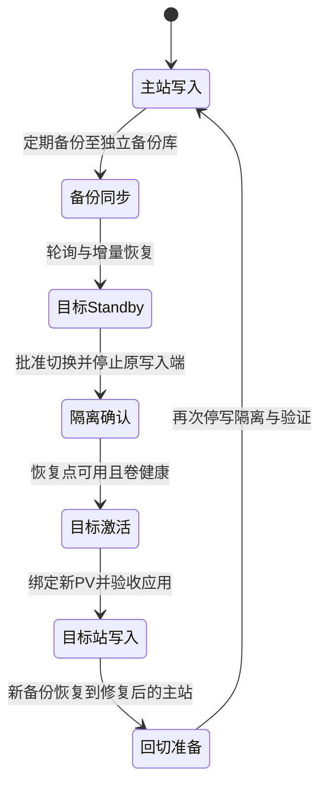
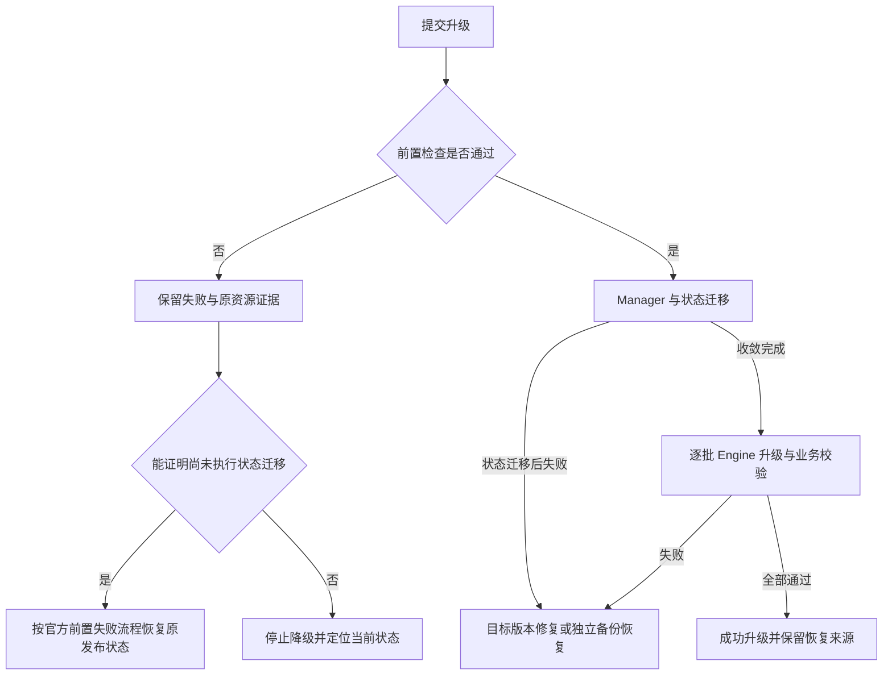

# Longhorn 用户与运维手册

适用版本为 Longhorn **1.12.1、V1 与 V2 replicated 数据引擎、Kubernetes 1.33.6**，演练升级源为 1.12.0。本文供平台管理员、存储管理员及使用 PVC 的业务开发者共同使用；要求理解 Kubernetes、Linux 挂载、备份和基本 PKI。架构与取舍见[技术白皮书](technical-whitepaper.md)，配置到资源的映射与维护契约见[开发手册](development-manual.md)。项目已有 V1 业务证据，以及 V2 AIO 的三节点安装、访问模式、在线扩容、Retain/Delete、加密密钥恢复、TRIM、快照及外部全量／增量备份恢复验证结果；本手册的 V2 数据盘路径为 AIO 裸盘；原生 PCI 接管未作为产品接口开放。

## 任务索引

首次使用按[规划](#规划与操作上下文) → [节点与凭据](#准备节点与稳定凭据) → [产品安装](#配置与产品安装) → [业务接入](#业务接入与验收) → [备份与恢复](#备份与恢复)连续执行。熟练人员从相应任务进入，先重建本节公共上下文，再检查该任务的特定前提。

| 任务 | 入口 |
| --- | --- |
| 选择副本、故障域与容量 | [规划与操作上下文](#规划与操作上下文) |
| 选择 V1 文件系统盘或 V2 裸盘 | [数据引擎与磁盘选择](#数据引擎与磁盘选择) |
| 调整 V2 副本重建带宽 | [V2 重建带宽维护](#v2-重建带宽维护) |
| 新 PVC、RWO/RWOP/RWX/Block、中间件接入 | [业务接入与验收](#业务接入与验收) |
| 巡检、告警、故障分层 | [巡检与诊断](#巡检与诊断) |
| 卷扩容与 StorageClass 变更 | [容量与卷扩容](#容量与卷扩容) |
| 按需快照 checksum | [V2 按需快照 checksum 与逐卷策略恢复](#v2-按需快照-checksum-与逐卷策略恢复) |
| 快照、克隆、保留与 TRIM | [快照克隆与空间回收](#快照克隆与空间回收) |
| V2 linked/nested 源依赖与退出 | [V2 linked clone 与嵌套工作副本](#v2-linked-clone-与嵌套工作副本) |
| 外部备份、计划、凭据轮换与新卷恢复 | [备份与恢复](#备份与恢复) |
| 全集群恢复、灾备和回切 | [系统恢复与站点灾备](#系统恢复与站点灾备) |
| 重启、排空、增退节点、换盘 | [节点与磁盘生命周期](#节点与磁盘生命周期) |
| 副本、网络、磁盘满与数据损坏 | [故障恢复](#故障恢复) |
| 卷密钥、证书、网络隔离 | [安全维护](#安全维护) |
| 升级与不可降级边界 | [升级与恢复出口](#升级与恢复出口) |
| 负载测量、正式下线 | [性能与稳定性验证](#性能与稳定性验证)、[下线与保留](#下线与保留) |
| 常用参数 | [参数速查](#参数速查) |

本分路的验证范围与交付结论以[专项矩阵](../../../tests/longhorn-test-matrix.yaml)及其绑定证据为准。上游支持、项目声明式接口和现场验证分别判断；上线须取得本版本和自身拓扑的完整证据。已有中间件回归使用的 Longhorn 1.10.1 夹具不构成 1.12.1 验收。

## 规划与操作上下文

推荐至少三个独立存储节点、每卷三副本、专用 SSD 和有余量的低延迟网络。Longhorn V1 的官方最低建议为每节点四核、4 GiB；客户平台仍按项目至少 16 CPU/32 GiB 的基线规划，并计入应用、CSI、engine、replica、备份和重建峰值。三节点三副本不能在永久退出一台后继续维持三节点反亲和，应先加入接收节点。

对经过容量批准的独立单节点灾备目标，可以显式将 `longhorn_default_replica_count` 和目标 StorageClass 的 `replicas` 同时设为 `1`；前者控制 Longhorn UI 新建卷的默认值，后者控制该类新建的 PVC，二者不会修改已有卷。V1/V2 均接受这一显式配置，默认生产路径仍为三副本。CSI 控制器继续使用节点硬反亲和；一个或两个客户端节点时，产品将 attacher、provisioner、resizer、snapshotter 各自的副本数限制为客户端节点数，避免控制器因不足三个节点而永久 Pending。单副本没有第二份在线数据，也没有存储节点故障后的服务连续性；外部备份和经过演练的恢复仍必需。单节点验证不能签收目标站点节点高可用，扩展到生产三节点时须重新核对故障域、容量并为已有卷单独增加副本。

V1 数据盘由客户完成分区、ext4/xfs 格式化、稳定挂载和开机依赖；V2 使用专用裸块盘，不能先格式化。产品**不会格式化、擦盘、自动挂盘或把根目录当作数据盘**。容量先按逻辑卷乘副本数核算，再为快照增长、重建和故障域迁移留余量；磁盘空闲告警应早于调度拒绝。详细计算见[白皮书容量章节](technical-whitepaper.md#容量与性能)。

数据库每成员使用独立 PVC，不以共享 RWX 数据目录替代数据库复制。已有 PVC 的 StorageClass 不可原地迁移；变更存储须新建目标卷，通过数据库原生备份恢复或明确停写的数据迁移切换。变更默认 StorageClass 只影响省略类名的新 PVC，应先完成所有消费者审计。

本入口不接管已有 Longhorn 安装。首次安装若发现现存 release、Longhorn CRD 或 `driver.longhorn.io` CSIDriver，而部署目录缺少原安装的身份记录，前检会停止；仅有这个 CSI 对象也不能视作干净环境。应先核实原安装、卷消费者与清理记录，恢复原管理路径或完成原生退出；不要单独删除 driver、伪造身份记录或补标签来强行安装。

以下命令由有集群管理权限的管理员，在**安装 kubeauto 的管理节点**、`/usr/local/kubeauto` 工作目录、专用 Bash 会话中执行。部署目录名来自变更单，必须是已经完成核心安装的目标集群；新平台先完成[平台手册](../../operations-manual.md)中的核心流程。每个新会话重新执行此上下文，不能依赖作者的 shell、默认 kubeconfig 或实验室地址。

```bash
set -euo pipefail
cd /usr/local/kubeauto
read -r -p '目标部署目录名称: ' DEPLOYMENT
[[ "$DEPLOYMENT" =~ ^[a-zA-Z0-9][a-zA-Z0-9_-]*$ ]] || exit 1
test -s "clusters/$DEPLOYMENT/config.yml"
test -s "clusters/$DEPLOYMENT/hosts"
export KUBECONFIG="$PWD/clusters/$DEPLOYMENT/kubectl.kubeconfig"
test -s "$KUBECONFIG"
export LH_NAMESPACE=longhorn-system
export LH_CREDENTIAL_DIR=/var/lib/kubeauto/longhorn/credentials
command -v python3
python3 --version
kubectl config current-context
kubectl get --raw /readyz
kubectl get nodes -o wide
kubectl get storageclass
```

管理主机须提供 Python 3，后续只读 JSON 检查仅使用其标准库，不依赖开发工作区的虚拟环境。context、节点 IP、集群身份必须与变更单一致，`/readyz` 输出 `ok`，节点 Ready，时间同步且无内存、磁盘、PID 压力。确认 CNI 执行 NetworkPolicy、管理 Registry 可读、所有客户端节点可访问 iSCSI/NFS 所需网络。已有 Longhorn 或 snapshot-controller 时先核对所有者和版本，禁止以相同 release 名接管。

> **停止与恢复：** 任一前提失败即停止本会话，不继续安装或故障注入。恢复平台、容量、网络或原有服务后重新检查。所有后续变更先保存对象 UID、配置差异与应用基线；非零退出、等待超时或数据校验失败均不表示操作已撤销。

## 数据引擎与磁盘选择

生产优先按官方建议选择一种引擎。保留默认 `longhorn_data_engines: [v1]` 时，继续下面的文件系统准备主线；选择 V2 时，使用本节的裸盘准备与配置，跳过 V1 文件系统数据盘步骤，仍完成公共凭据、下载、产品安装和业务验收。已有 V1 卷不能通过改 StorageClass 或全局开关变成 V2：必须新建 V2 类/卷，以应用原生迁移或明确停写复制完成切换，验证后才处置源卷。

### V2 AIO 的节点与裸盘准入

由主机管理员在变更单列明的每台 **V2 存储节点及卷客户端**上执行只读检查；运行位置是目标主机的 root 或有相同只读权限的会话，工具来自当前 OS 的 util-linux、kmod。设备路径来自资产清单，WWN/序列号须与资产记录独立对照，不能把脚本读出的任意设备直接当成批准盘。

```bash
set -euo pipefail
uname -r
lscpu
free -m
awk '/^(MemTotal|MemAvailable|Balloon|HugePages_Total|HugePages_Free|HugePages_Rsvd):/' /proc/meminfo
for module in vfio_pci uio_pci_generic nvme_tcp; do
  modprobe --dry-run "$module"
done
cat /sys/kernel/mm/hugepages/hugepages-2048kB/nr_hugepages
```

上述内核、CPU、模块和页池检查适用于所有 V2 客户端。下面的设备检查只在变更单列为数据盘接收者的存储节点执行；不提供数据盘的纯客户端跳过此设备段，继续本节的内存与 kubelet 容量检查，不为接入卷而额外指定或初始化裸盘。

```bash
set -euo pipefail
read -r -p '变更单批准的 /dev/disk/by-id/ 完整路径: ' LH_RAW_DISK
[[ "$LH_RAW_DISK" =~ ^/dev/disk/by-id/[A-Za-z0-9_.:+-]+$ ]] || exit 1
test -b "$LH_RAW_DISK"
lsblk --bytes --output NAME,TYPE,SIZE,RO,FSTYPE,MOUNTPOINTS,WWN,SERIAL "$LH_RAW_DISK"
wipefs --no-act "$LH_RAW_DISK"
swapon --show
```

本项目按官方生产稳定性建议，将 V2 内核准入设为至少 6.7；官方 NVMe/TCP 功能最低要求为 5.19，不能把最低可运行版本等同于此生产准入。AMD64 每核须支持 SSE4.2；三个模块可加载；设备为无分区、无文件系统签名、无挂载/swap/holders 的可写整盘，且不是 Longhorn 输出卷、device-mapper/loop 等嵌套设备。命令每次应在 30 秒内完成；任何失败、身份不符或未知数据均停止，保留只读输出并交主机/存储管理员处理，**不在安装流程中执行 `wipefs -a`**。检测不到已知签名不等于证明整盘没有业务数据，首次接入仍需要资产所有者明确授权。

hugepages 默认需要每节点 1024 个 2 MiB 页。主机管理员在维护窗口按发行版启动参数持久预留 `hugepagesz=2M hugepages=1024`，使用该发行版的引导配置更新入口，必要时重启；不要混用 Debian 的 `update-grub` 与 RedHat 的 `grub2-mkconfig` 路径。重启或已在运行时配置页池后，按维护预算重启 kubelet，让其重新公布容量。产品不自动编辑引导器、分配页池或重启主机。若选择 anonymous memory，则配置 `longhorn_v2_hugepages: false`，仍必须为每节点 SPDK 留出至少配置的 2048 MiB 预分配量及 Manager、系统、业务余量。

运行时可用内存足额，也可能因物理页碎片而无法组成足额的连续 2 MiB 大页。因此写入页池目标后必须读回实际 `HugePages_Total`、`HugePages_Free` 与 `HugePages_Rsvd`，不能将写入命令返回成功视为预留完成。一次 Ubuntu 24.04／Linux 6.8 的临时接收节点检查中，分配前 `MemAvailable` 为 6,934,140 KiB，申请 1024 页后仅获得 748 个空闲大页、保留页为 0；检查按页数不足停止，业务数据和原三节点随后完成限定回收与复核。此现象说明可用容量与连续物理页是两个条件，不证明硬件容量不足或 Longhorn 数据损坏。生产主线优先在启动时预留；已有生产节点运行时申请不足时保持 V2 未启用，保留内存与页池状态，由主机管理员按维护窗口处理碎片或安排重启，然后读回完整页池、刷新 kubelet 容量并复查全部前置。Linux [hugetlb 文档](https://github.com/torvalds/linux/blob/v6.8/Documentation/admin-guide/mm/hugetlbpage.rst)说明启动预留有利于获得连续页；[内存规整接口](https://github.com/torvalds/linux/blob/v6.8/Documentation/admin-guide/sysctl/vm.rst#compact_memory)只能尽可能规整空闲页，不能保证页池申请成功。

虚拟机的配置内存不等于当前可用内存。VMware balloon 驱动根据宿主目标在来宾中占用页，将物理内存归还宿主；因此 CPU、`MemTotal` 和节点 Ready 均正常时，仍可能无法预留页池。检查上面输出中的 `MemAvailable` 及内核提供时的 `Balloon`，结合虚拟化平台的预留和宿主物理内存判断；不能从 `Balloon` 缺字段推导没有资源回收。

一次三节点、每台配置 8 GiB 的 V2 准入检查中，两台分别被回收约 3.44/3.83 GiB，可用量仅约 2.22/2.66 GiB，低于该夹具分配前要求的 3 GiB（2 GiB 页池加 1 GiB 普通内存余量），因此在任何页池或裸盘写入前停止。此结果只解释该次环境拒绝，不是 V2 性能、生产容量或安装成功证据，详见[资源检查证据](../../../tests/evidence/longhorn-v2-resources-balloon-first-failure-20261020.json)。机制依据为 [Linux v7.0 的 VMware balloon 驱动](https://github.com/torvalds/linux/blob/v7.0/drivers/misc/vmw_balloon.c)；页池预算依据为 [Longhorn 1.12.1 安装要求](https://longhorn.io/docs/1.12.1/deploy/install/#enable-hugepages)。实际余量不足时，由虚拟化管理员调整内存保障并确认宿主容量，再重新执行只读检查；不要以卸载 balloon 驱动或降低页池预算代替资源保障。

回到管理节点、恢复[公共操作上下文](#规划与操作上下文)，检查 `kubectl get nodes -o yaml` 中每台 V2 节点的 `status.allocatable.cpu`、`memory` 和 `hugepages-2Mi`。25% CPU 预留必须覆盖 mask `0x3` 的两核；页池模式下 kubelet 的 hugepages 容量不得少于 SPDK 配置。项目还要求至少 1 GiB 普通内存余量，这只是安装准入下限，不替代生产 sizing。前置不满足时在部署前停止，恢复主机原配置需由原变更单控制；不能降低准入来让 Pod 调度成功。

### 声明 V2 存储与消费者

以下是**需替换的配置模板**，在目标部署目录原有 `config.yml` 中更新这些字段，保留其它核心配置。把三处 `node-*-inventory-address` 替换为该目录 `hosts` 中 `kube_node` 的实际地址；每台路径、WWN/序列号分别来自该台资产清单，不能照抄相邻节点。`storage_reserved` 的单位为字节，示例预留 1 GiB 是演示配置，需按磁盘容量及恢复预算调整。

```yaml
longhorn_install: 'yes'
longhorn_data_engines: [v2]
longhorn_allow_engine_coexistence: false
longhorn_storage_nodes: []
longhorn_v2_nodes:
  - node-a-inventory-address
  - node-b-inventory-address
  - node-c-inventory-address
longhorn_block_disks:
  node-a-inventory-address:
    - {name: data-block, path: /dev/disk/by-id/wwn-NODE_A, disk_driver: aio, identity: WWN_OR_SERIAL_A, storage_reserved: 1073741824}
  node-b-inventory-address:
    - {name: data-block, path: /dev/disk/by-id/wwn-NODE_B, disk_driver: aio, identity: WWN_OR_SERIAL_B, storage_reserved: 1073741824}
  node-c-inventory-address:
    - {name: data-block, path: /dev/disk/by-id/wwn-NODE_C, disk_driver: aio, identity: WWN_OR_SERIAL_C, storage_reserved: 1073741824}
longhorn_v2_cpu_mask: '0x3'
longhorn_v2_cpu_cores: 0
longhorn_v2_cpu_reservation_percentage: 25
longhorn_v2_memory_mib: 2048
longhorn_v2_hugepages: true
longhorn_v2_interrupt_mode: false
longhorn_storage_classes:
  - name: longhorn-v2
    data_engine: v2
    replicas: 3
    fs_type: ext4
    reclaim_policy: Retain
    default: false
    encrypted: false
    encryption_secret: ''
    recurring_jobs: []
```

V2-only 配置不创建默认文件系统盘。数据盘节点来自 `longhorn_block_disks`，无本地数据盘但需要挂卷的计算节点也必须加入 `longhorn_v2_nodes` 并通过同样的内核/资源资格。产品在其余节点设置 `node.longhorn.io/disable-v2-data-engine=true`，业务需显式指定 `storageClassName: longhorn-v2` 并使用 Node affinity/selector 约束到已启用 V2 的客户端，例如以该标签值 `"false"` 为 nodeSelector；中间件自己的调度约束也要一致。不要修改其它中间件既有类和旧 PVC 来隐式迁移。

anonymous 模式下，固定上游 IM 的普通内存 request 不能完整反映 SPDK 预分配量；上线前必须为同节点应用另设可核对的内存预算和压力停止条件。当前产品的容量检查不替代这项隔离，推荐主线保留 hugepages 模式，详见[资源模型](technical-whitepaper.md#spdk-的性能收益依赖资源保障)。

确需两引擎共存时，设置 `longhorn_data_engines: [v1, v2]`、`longhorn_allow_engine_coexistence: true`，保留独立 V1 `longhorn_storage_nodes`、挂载与类，为 V2 另行批准裸盘及资源；同一设备不能同时承担两种数据盘。每个 StorageClass 显式写 `data_engine`，旧配置省略时按 V1 解释。

下载、PKI、`kubecli setup "$DEPLOYMENT" 09` 与默认 1800 秒安装等待沿用[产品安装](#配置与产品安装)。V2 还应检查原生 Node 的 `diskStatus`：每个声明盘为 `diskType: block`、`diskDriver: aio`、有稳定 `diskUUID`，Ready 与 Schedulable 为 True；每台 V2 客户端有固定版本 V2 Instance Manager 的 running/PodReady。之后按[业务接入](#业务接入与验收)的新卷、确认写入、重新挂载和摘要校验判断结果，不能把基础设施 Ready 当成验收。

首次健康收敛后，控制端私有安装目录的 `block-disks.json` 保存原生盘 UUID、节点 UID 与硬件声明的绑定。运维人员应将该文件连同安装记录纳入受控备份；它有 `0600` 权限，不应手工修改或删除以消除拒绝。后续执行发现原生 UUID、硬件或节点身份变化会停止，要求先查清原盘状态、卷副本和恢复来源。UUID 一致只证明身份检查匹配，业务验收仍须读回确认数据。新增盘须先完成资产和裸盘资格，再加入声明；逐盘退役和替换使用[专用产品入口](#v2-aio-逐盘退役与替换)，不得直接删记录。

项目实测条件与结果：三台 Ubuntu 虚拟机各 8 vCPU、8 GiB，内核 7.0.0-38-generic，每台一块 100 GiB SCSI 裸盘，经稳定 WWN 路径选择 `diskType: block`、`diskDriver: aio`；每台预留 1024 个 2 MiB hugepages，SPDK 使用 `0x1` CPU mask、25% CPU 预留及 2048 MiB 内存。Longhorn 1.12.1 经 config+kubecli 完成 V2-only 安装，三个 V2 Instance Manager 与三个原生盘 UUID 均健康。消费端采用 RWO＋Filesystem PVC，写入 9,437,184 字节并 fsync，删除原写入 Pod 后在另一节点重挂，SHA256 为 `b91f4dd1142d3b7fc242490c7f7e65add767b9091f3a128b9efb59211201fc40`，与确认写入一致，三个副本分别位于三台已绑定裸盘。业务 namespace、PV 和原生卷随后回收，健康存储保留供后续场景。该结果证明此 AIO 配置的安装、持久写入与跨节点重挂，不证明性能上限、应用 Block/RWX、双引擎、裸盘替换、升级或灾备已验收。完整输入、退出状态与原始日志见[该项证据](../../../tests/evidence/longhorn-v2-aio-install-qualification-20261020.json)。

同一 V2 AIO 环境随后完成独立访问模式验证：RWO 文件系统、RWOP 文件系统和 RWO 应用 Block 均拒绝竞争挂载，分别在另一节点重挂并读回相同的 9 MiB 原摘要；RWOP 的竞争者位于同一节点，RWO 的竞争者位于另一节点。RWX 使用两个节点上的 NFSv4.1 客户端，验证 0600 文件权限拒绝、advisory lock 互斥和释放后，按原 UID 删除 share-manager Pod。两个原挂载客户端各完成 301 次 fsync/读回确认，I/O 错误均为 0，最大单轮耗时为 26.261／26.048 秒；替代 Pod Ready 用时 16.084 秒。原确认文件在两个客户端及换节点重挂后均保持上述摘要，业务对象及传输夹具已限定回收。零错误不等于零等待，Pod Ready 时间也不是业务 RTO；该场景未验证持锁跨故障 reclaim、节点断电或网络分区。输入、计时和清理见[访问模式证据](../../../tests/evidence/longhorn-v2-volume-modes-qualification-20261020.json)。

相同资源配置的[独立综合验证](../../../tests/evidence/longhorn-v2-volumes-20261020.json)中，RWX 两客户端各确认 330 次，I/O 错误为 0，最大单轮耗时分别为 11.351／11.337 秒，替代 Pod Ready 用时 10.877 秒。该次验证同时覆盖下文三类在线扩容、Retain/Delete、文件系统与 Block 的四条密钥拒绝/原密钥恢复路径，以及有效快照保留后的实际 TRIM 回收；11 次跨节点读回的原 9 MiB 数据摘要保持一致。两次 RWX 等待值不同，说明实验室单次观察不能作为时延上限或业务 SLA；它们也不涵盖节点断电、网络分区、升级或灾备。

> **资格边界：** AIO 安装结果只证明安装范围，完整运维与最终干净回归按 54 项矩阵分别验收。原生 NVMe/VirtIO 的 BDF、IOMMU、队列与驱动恢复尚未接入产品；当前拒绝 `disk_driver: auto/nvme/virtio-blk`，不由管理员临时直改资源绕过项目准入后冒称产品通过。

### V2 独占 CPU 分核

本任务用于 1.12.1 的已有健康 V2 安装；由存储管理员在前述管理节点和目标集群上下文执行，主机管理员负责按平台变更流程预先配置所有 Longhorn 客户端的 kubelet static CPU 策略。该主机变更涉及工作负载迁移与 kubelet 生命周期，应使用所属平台运行手册；不要手改 `cpu_manager_state`，它是运行时检查结果。未准备 static 策略时保留默认 `longhorn_v2_cpu_cores: 0`，使用 mask 主线。

变更前保存当前 config 和每个消费者的副本数、调度约束、原 PVC/Volume UID及业务校验值，核验独立备份恢复点。按消费者手册停写、缩停使用 V2 的工作负载，最多等待 600 秒，检查全部 V2 卷均已分离且没有目标节点。任一卷未分离、仍有恢复/驱逐任务或业务备份不合格即停止；不能删除挂载记录或强制删除 IM 达成前置。以下为只读断言，成功后才修改配置：

```bash
kubectl -n "$LH_NAMESPACE" get volumes.longhorn.io -o json | python3 -c '
import json,sys
volumes=[v for v in json.load(sys.stdin)["items"] if v.get("spec",{}).get("dataEngine")=="v2"]
assert all(v.get("status",{}).get("state")=="detached" and not v["spec"].get("nodeID") for v in volumes), "V2 consumers are not fully detached"
print("V2 volumes detached:",len(volumes))'
kubectl -n "$LH_NAMESPACE" get nodes.longhorn.io -o json | python3 -c '
import json,sys
nodes=json.load(sys.stdin)["items"]
assert nodes and all(n.get("status",{}).get("cpuPolicy")=="static" for n in nodes), "All Longhorn nodes must report static CPU policy"
print("Static CPU policy nodes:",len(nodes))'
```

在目标 `config.yml` 将 `longhorn_v2_cpu_cores` 改为批准核数，例如 `2`，保留原非零 mask 供以后退出独占模式时使用。此时 mask 不决定实际 CPU 编号；原百分比预留和 Node CPU override 仍可能使有效请求大于 reactor 核数，按[资源模型](technical-whitepaper.md#spdk-的性能收益依赖资源保障)核算每台节点的剩余预算。执行 `kubecli setup "$DEPLOYMENT" 09`，默认最多等待 1800 秒。产品先只读检查实际 kubelet checkpoint，再提交原生设置；不替代主机策略变更。

收敛后检查每台 V2 IM 的 `status.dataEngineStatus.v2.cpuCoreNumber` 等于配置值，其同名 Pod 的 QoS 为 Guaranteed、CPU requests=limits 且为整数，普通内存 requests=limits=128 MiB，hugepages 仍满足原页池预算；Pod 必须有正确 IM owner UID、节点和镜像。可先用下列摘要定位对象，再按[业务接入与验收](#业务接入与验收)恢复原消费者副本数，验证原 PVC/Volume 身份、原确认数据与新写入。CPU Manager 的实际编号不一定等于旧 mask，不能用旧 mask 比较代替实际分配和 SPDK/业务检查。

```bash
kubectl -n "$LH_NAMESPACE" get instancemanagers.longhorn.io \
  -o custom-columns='NAME:.metadata.name,ENGINE:.spec.dataEngine,NODE:.spec.nodeID,STATE:.status.currentState,CORES:.status.dataEngineStatus.v2.cpuCoreNumber'
kubectl -n "$LH_NAMESPACE" get pods \
  -o custom-columns='NAME:.metadata.name,NODE:.spec.nodeName,QOS:.status.qosClass,CPU_REQUEST:.spec.containers[*].resources.requests.cpu,CPU_LIMIT:.spec.containers[*].resources.limits.cpu,MEM_REQUEST:.spec.containers[*].resources.requests.memory,MEM_LIMIT:.spec.containers[*].resources.limits.memory'
```

到期、策略未知、资源不足或业务校验失败时保留停写状态及诊断，不继续重启。退出独占分核也须在全部 V2 卷分离后，将核数恢复为 `0`，核对保留的 mask 每一位在各主机在线 CPU 集合中且预留覆盖 reactor 数，再重入 09；新 IM 正常、原数据和新写入通过后恢复业务。主机 CPU 策略是否回退由主机变更单决定，不能在尚有独占消费者时直接改回 none。[三节点运行资源验证](../../../tests/evidence/longhorn-v2-platform-complete-20261023.json)已通过该产品接口进入独占档并恢复原配置：实际 cpuset 从各节点的 `1-2` 回到 `0-7`，两档各确认 59 条、3,866,624 字节并读回一致。该结果验证配置与数据恢复，不是客户签收或性能收益承诺。

### V2 重建带宽维护

本任务适用于健康的 1.12.1 V2 安装，由存储管理员与业务负责人在[公共管理上下文](#规划与操作上下文)执行。升级源 1.12.0 也有相同接口。限速用于降低副本重建对正常 I/O 的竞争，数值是官方定义的 **MB/s 写带宽**；降低带宽会延长降级窗口，应结合业务尾延迟、剩余副本健康和恢复时间预算选择。它不是全节点总带宽配额，也不限制正常业务 I/O；多个重建任务仍需单独考虑聚合负载。

先完成[巡检](#巡检与诊断)，确认没有未知故障、容量压力或超过预算的降级，记录当前卷及 engine UID、重建进度、业务延迟和错误基线。将现有设置保存到变更单：

```bash
kubectl -n "$LH_NAMESPACE" get settings.longhorn.io replica-rebuilding-bandwidth-limit -o yaml
kubectl -n "$LH_NAMESPACE" get volumes.longhorn.io \
  -o custom-columns=NAME:.metadata.name,ENGINE:.spec.dataEngine,LIMIT:.spec.replicaRebuildingBandwidthLimit
kubectl -n "$LH_NAMESPACE" get engines.longhorn.io -o json
```

在目标 `clusters/$DEPLOYMENT/config.yml` 设置以下参数，然后执行 `kubecli setup "$DEPLOYMENT" 09`。`100` 是配置示例，须按批准预算替换，并非官方推荐值或项目测量。`null` 表示不管理全局值，已有原生设置保持；首次安装未设置时，上游默认 `{"v2":"0"}`。显式 `0` 表示全局不限制。该参数不改变 CPU、内存或 iobuf，也不要求卷分离或重启 IM；不要在同一变更里夹带这些需要停卷的资源调整。

```yaml
longhorn_v2_rebuild_bandwidth_limit: 100
```

产品默认最多等待 1800 秒，要求原生 Setting 的 `value` 解析为 `{"v2":"100"}`；不同或缺失时不能作为收敛成功。卷的 `spec.replicaRebuildingBandwidthLimit` 大于 0 时覆盖全局值，为 0 时继承全局值。因此“全局 100、卷 200”的有效值是 200 MB/s；“全局 100、卷 0”的有效值是 100 MB/s，不能把卷 0 解释为单卷不限速。

需要单卷覆盖时，使用原生 Volume 接口，不能在 StorageClass 中发明同名 CSI 参数。在同一管理会话中按变更单输入业务命名空间和 PVC，再从 PV 找到实际卷：

```bash
read -r -p '业务命名空间: ' QOS_APP_NAMESPACE
read -r -p '目标 PVC: ' QOS_PVC
test -n "$QOS_APP_NAMESPACE"
test -n "$QOS_PVC"
QOS_PV=$(kubectl -n "$QOS_APP_NAMESPACE" get pvc "$QOS_PVC" -o jsonpath='{.spec.volumeName}')
test -n "$QOS_PV"
test "$(kubectl get pv "$QOS_PV" -o jsonpath='{.spec.csi.driver}')" = driver.longhorn.io
QOS_VOLUME=$(kubectl get pv "$QOS_PV" -o jsonpath='{.spec.csi.volumeHandle}')
test -n "$QOS_VOLUME"
test "$(kubectl -n "$LH_NAMESPACE" get volumes.longhorn.io "$QOS_VOLUME" -o jsonpath='{.spec.dataEngine}')" = v2
kubectl -n "$LH_NAMESPACE" get volumes.longhorn.io "$QOS_VOLUME" -o yaml
kubectl -n "$LH_NAMESPACE" edit volumes.longhorn.io "$QOS_VOLUME"
```

在编辑器内独立核对目标 Volume 的 UID、使用者和原限速值，将其保存到变更单，只修改 `spec.replicaRebuildingBandwidthLimit` 为批准的非负整数；身份不符时取消保存。编辑使用原生 resourceVersion 保护，提交冲突时重新核对对象，不能覆盖新版本。全局参数由产品配置管理，单卷覆盖由存储管理员维护，产品不会清除单卷值。

变更后重新执行上述只读查询。正在重建的 engine 在控制器成功下发后，通过 `status.rebuildStatus` 中对应副本的 `appliedRebuildingMBps` 报告实际应用值；必须关联原卷、原 engine 和本次重建，核对进度继续前进及正常业务的确认写入。没有活动重建时可能没有该记录，不能据缺字段认定失败，也不能人为损坏生产副本来获得记录。Setting 收敛只证明控制配置，不能代替实际重建、吞吐和业务验收。本项目的[三节点现场结果](../../../tests/evidence/longhorn-v2-failure-rebuild-qos-revision3-20261023.json)使用 Longhorn 1.12.1、派生 IM `.3`、AIO 裸盘和三副本卷，在同一次真实重建中依次观察到下列状态；全局值均通过 `config.yml` 与步骤 09 下发。

| 全局限速 MB/s | 卷覆盖 MB/s | 活动重建的 appliedRebuildingMBps | 采样时重建进度 |
| --- | --- | --- | --- |
| 1 | 2 | 2 | 27% |
| 1 | 0 | 1 | 31% |
| 3 | 0 | 3 | 37% |

这组结果证明正值覆盖、零值继承以及重建中的动态更新，字段表示引擎已应用的限速配置，不是独立测得的吞吐上限。此次 1 GiB 重建数据在跨节点重挂后 SHA256 仍为 `dd961dfec5a2ab2f404ffca183410b07ee9dbadc1557a1634fc2c2c92cb71860`；原 1,634 条 fsync 确认记录共 107,085,824 byte，以及恢复后新增的 20 条记录共 1,310,720 byte 均逐条校验通过，未记录客户端 I/O 错误重试。测试完成后恢复原配置并回收业务夹具；这些实验室结果不外推客户硬件的恢复时限或业务延迟。

> **停止与恢复：** 设置超时、重建停滞、业务错误或延迟超预算时停止其它变更，保留原生状态、事件和 controller/engine 日志。按变更单恢复原全局数值并经 09 收敛；若要退出产品管理，先显式恢复原数值并验证，再改成 `null`，不能把 `null` 当作数值回退。单卷覆盖单独恢复原值，再复验实际重建状态、全部副本健康、原确认数据和新写入。取消限速可能增加负载，仍须满足原资源预算。

固定 1.12.1 的[重建专题](https://longhorn.io/docs/1.12.1/advanced-resources/rebuilding/replica-rebuild-qos/)仍含旧字段名。此处以固定 Manager/Chart 和[Settings 参考](https://longhorn.io/docs/1.12.1/references/settings/#replica-rebuilding-bandwidth-limit)为准：Setting 为 `replica-rebuilding-bandwidth-limit`，卷字段为 `replicaRebuildingBandwidthLimit`，实际状态字段为 `appliedRebuildingMBps`，大小写须保持。

### V2 iobuf 缓冲池维护

本任务适用于 1.12.1 的健康 V2 安装，由存储管理员与应用性能负责人在前述管理节点、目标集群上下文执行。iobuf 是同一 SPDK target 内多个卷共享的 I/O 缓冲池，不能按单卷乘上池大小。只有在实际负载及 SPDK 日志出现相应 `small_pool` / `large_pool` 的 `retry` 或 `NEED_BUFFER` 等耗尽线索时，才按负载大小、队列深度与测量结果决定是否调大；吞吐下降本身不能证明需要增加缓冲池。

保留原配置、每个消费者的副本数/调度约束、原 PVC/Volume UID、已确认数据及独立恢复点。先按消费者手册停写和缩停，最多等待 600 秒，使用[独占 CPU 分核](#v2-独占-cpu-分核)中的第一条只读断言确认全部 V2 卷 detached 且没有目标节点；本任务不要求更改 CPU 策略。仍有附着卷、重建、恢复、驱逐或未知共享消费者时停止。两种池均只能在 SPDK 启动时配置，不能通过修改 Setting 就认定正在运行的 target 已改变。

默认 large 池 1024 个、每个 132 KiB，共 132 MiB；small 池 8192 个、每个 8 KiB，共 64 MiB，两池合计 196 MiB，均来自 `longhorn_v2_memory_mib` 的固定预算。以下配置算例把两池提高到合计 392 MiB，保留原 2048 MiB 预算；剩余内存仍要容纳副本、传输和其它 SPDK 结构，不能从这个算例推导可承载卷数或性能保证：

```yaml
longhorn_v2_iobuf_large_pool_size: 2048
longhorn_v2_iobuf_small_pool_size: 16384
```

将批准值写入目标 `config.yml`，保留原引擎、CPU、盘和其它配置，然后执行 `kubecli setup "$DEPLOYMENT" 09`，按 `longhorn_ready_timeout` 等待，默认 1800 秒。若两池本身已达到或超过 SPDK 总内存，产品会在主机变更前拒绝；需要增大总内存时，先由主机管理员按[裸盘准入](#v2-aio-的节点与裸盘准入)准备足额页池和 kubelet 容量，再在所有卷分离的同一维护窗口变更。该检查只排除必然超预算，不能替代实际工作集测量。

收敛后先只读核对原生 Setting 与 V2 IM 同名 Pod 的实际 args：

```bash
kubectl -n "$LH_NAMESPACE" get settings.longhorn.io \
  data-engine-iobuf-large-pool-size data-engine-iobuf-small-pool-size \
  -o custom-columns='NAME:.metadata.name,VALUE:.value'
kubectl -n "$LH_NAMESPACE" get instancemanagers.longhorn.io \
  -o custom-columns='NAME:.metadata.name,ENGINE:.spec.dataEngine,NODE:.spec.nodeID,STATE:.status.currentState'
read -r -p '上述输出中的 V2 Instance Manager 名称: ' LH_V2_IM
[[ "$LH_V2_IM" =~ ^[a-z0-9][a-z0-9.-]*$ ]] || exit 1
kubectl -n "$LH_NAMESPACE" get pod "$LH_V2_IM" -o yaml
```

对每台 V2 IM 分别检查，确认 Pod 的 owner UID、节点和固定镜像正确，两个启动参数分别为 `--spdk-iobuf-large-pool-size 2048`、`--spdk-iobuf-small-pool-size 16384`；采用默认 1024/8192 时，上游省略对应参数。产品也检查这些参数，缺失或错误不会作为健康收敛。随后按原副本数恢复消费者，核对原卷身份、原确认数据及新写入，并在原负载和队列深度下比较耗尽日志、错误/重试、延迟与资源占用。参数正确只能证明传递完成，性能收益必须由这一业务结果判断。

超时、OOM/重启、分配错误或业务校验失败时保持停写并保留原对象和日志，不强删 IM。需要回退时，在全部 V2 卷再次分离后恢复原池和内存配置，经 09 收敛，检查新 Pod 参数、原数据和新写入后才恢复业务。不要在仍有实例时手工替换 SPDK JSON 配置或在线调用启动专用 RPC。[运行资源验证](../../../tests/evidence/longhorn-v2-platform-complete-20261023.json)已核对 anonymous-iobuf 档实际 SPDK 参数与运行态，确认 59 条、3,866,624 字节并在恢复原配置后读回；它不构成增大池后的吞吐或时延承诺。官方参数和内存口径见[固定版本 Settings](https://longhorn.io/docs/1.12.1/references/settings/#data-engine-iobuf-large-pool-size)。

### V2 裸盘禁调度、驱逐与取消

存储管理员在前述管理节点、目标集群上下文执行，版本为 1.12.1，目标为已受管 AIO 裸盘。变更单必须给出 inventory 地址、Longhorn Node 名、声明盘名、稳定路径、硬件身份和原 diskUUID，并记录原调度状态、受影响卷及其确认数据。接收盘/节点须满足剩余空间、反亲和和故障域要求；三节点三副本不能假定新增一个同节点盘就一定满足迁移调度。先验证独立恢复点和业务健康，安排持续的确认写入/读回观察。原生驱逐可处理 attached 与 detached 卷，后者可能由 Longhorn 临时附着；不要同时执行资源变更、节点关闭或升级。

在目标 `config.yml` 的该条 `longhorn_block_disks` 对象中加入以下两个字段，保留该盘的原五项身份与容量声明及其它盘：

```yaml
allow_scheduling: false
eviction_requested: true
```

两字段必须成对提供。省略时由管理员原生维护状态继续生效；显式提供后由此配置收敛，避免再用另一入口反复修改同两字段。执行 `kubecli setup "$DEPLOYMENT" 09`。产品以原 Node UID/resourceVersion 更新禁调度和驱逐请求，由原生控制器在新副本重建成功后迁出旧副本。收敛等待取 `longhorn_ready_timeout` 与 `longhorn_operation_timeout` 的较大值，默认 7200 秒；数据规模、接收容量、网络与负载决定实际耗时，不保证在此时间内完成。

运维人员从变更单取得原生 Node 名与 diskUUID，通过只读巡检核对该盘 `allowScheduling=false`、`evictionRequested=true`、Ready=True，`storageScheduled=0`、`scheduledReplica` 和 `scheduledBackingImage` 为空；同时检查实际 Replica CR 的 `spec.diskID`，目标 UUID 必须没有引用，包括仍在删除中的 CR。产品只有这些条件满足后才结束该驱逐收敛；盘的 Schedulable=False 在禁调度场景不构成单独失败。再核验受影响卷在新故障域的副本健康、原确认数据与新写入，才能判定业务迁移完成。原盘和身份记录仍保留，不能据副本归零直接擦盘或删除声明。

```bash
read -r -p '变更单中的原生 Longhorn Node 名: ' LH_BLOCK_NODE
read -r -p '变更前记录的目标 diskUUID: ' LH_BLOCK_UUID
[[ "$LH_BLOCK_NODE" =~ ^[a-z0-9][a-z0-9.-]*$ && "$LH_BLOCK_UUID" =~ ^[A-Za-z0-9-]+$ ]] || exit 1
kubectl -n "$LH_NAMESPACE" get nodes.longhorn.io "$LH_BLOCK_NODE" -o json | python3 -c '
import json,sys
node=json.load(sys.stdin)
matches=[(name,state) for name,state in node.get("status",{}).get("diskStatus",{}).items() if state.get("diskUUID")==sys.argv[1]]
assert len(matches)==1, "Original disk identity is absent or ambiguous"
name,state=matches[0]; disk=node["spec"]["disks"][name]
assert disk.get("allowScheduling") is False and disk.get("evictionRequested") is True, "Eviction flags are not converged"
assert any(c.get("type")=="Ready" and c.get("status")=="True" for c in state.get("conditions",[])), "Disk is not Ready"
assert not any(state.get(k) for k in ("storageScheduled","scheduledReplica","scheduledBackingImage")), "Disk accounting is not empty"
print("Native disk evacuation accounting empty:",name,state["diskUUID"])' "$LH_BLOCK_UUID"
kubectl -n "$LH_NAMESPACE" get replicas.longhorn.io -o json | python3 -c '
import json,sys
remaining=[r["metadata"]["name"] for r in json.load(sys.stdin)["items"] if r.get("spec",{}).get("diskID")==sys.argv[1]]
assert not remaining, "Replica objects still reference the original disk"
print("No Replica CR references the original disk")' "$LH_BLOCK_UUID"
```

超时、调度失败、重建错误、业务校验失败或身份变化时停止后续退役，保留当前状态和诊断；空间不足时原生驱逐会暂停，先按批准计划补足接收资源。需要取消时，把同盘两字段改为 `allow_scheduling: false`、`eviction_requested: false`，重入 09 并确认原生驱逐标志已为 false。剩余副本保持原位，已迁移的副本不会自动移回。此后如需恢复调度，再改为 `true/false` 并重入 09；不能直接从驱逐中的 `false/true` 跳到 `true/false`。恢复后再次校验卷副本和业务数据。

### V2 AIO 逐盘退役与替换

本任务由存储管理员与主机管理员在 Longhorn 1.12.1 的原管理节点执行，沿用本章目标集群的公共上下文。产品退役入口为 `longhorn_action: retire-block-disks`，只接受已声明的 AIO 盘；它不擦盘，也不接管 PCI 驱动。先完成前节的禁调度、驱逐与业务复验，保留原配置、盘稳定路径/硬件身份、Node UID、diskUUID 和独立恢复点。其它接收节点必须满足原卷副本数与故障域，目标盘不得有 Replica、BackingImage 或 SPDK lvol 依赖；即使 CR 已归零，运行时尚有依赖也会拒绝。

在变更单中登记全新的退役 ID、inventory 地址、原声明盘名和原生 diskUUID。ID 为 1–64 个字符，首字符必须是字母或数字，其余可用字母、数字、下划线、点或连字符。下面是配置模板：只替换四个明确标注的值，保留全部原 `longhorn_block_disks`，目标盘继续 `allow_scheduling: false`、`eviction_requested: true`；不要先删盘声明。

```yaml
longhorn_action: retire-block-disks
longhorn_block_retirement_id: 替换为本次唯一退役ID
longhorn_retire_block_disks:
  - node: 替换为原inventory地址
    name: 替换为原声明盘名
    disk_uuid: 替换为变更前已核对的原diskUUID
```

先用原管理节点上 `clusters/$DEPLOYMENT/yml/longhorn/block-disks.json` 的记录与当前 Node `diskStatus`、稳定硬件清单逐项比对；文件权限为 0600，不复制到公开工单。以公共上下文执行：

```bash
read -r -p '配置中本次唯一退役ID: ' LH_RETIRE_ID
[[ "$LH_RETIRE_ID" =~ ^[A-Za-z0-9][A-Za-z0-9_.-]{0,63}$ ]] || exit 1
kubecli setup "$DEPLOYMENT" 09
LH_RETIREMENT_FILE="clusters/$DEPLOYMENT/yml/longhorn/block-retirement-$LH_RETIRE_ID.json"
[[ -f "$LH_RETIREMENT_FILE" && ! -L "$LH_RETIREMENT_FILE" ]] || exit 1
python3 - "$LH_RETIREMENT_FILE" <<'PY'
import json,sys
record=json.load(open(sys.argv[1]))
if record.get('phase')!='complete':
    raise SystemExit('退役未完成；保留原账本并停止拆盘')
print('phase=complete')
PY
```

原生运行时释放按 `longhorn_ready_timeout` 等待，默认上限 1800 秒；前一节副本迁出使用独立的操作等待窗口。成功须同时具有产品输出 `LONGHORN_BLOCK_RETIRE_NATIVE_PASS`、`LONGHORN_BLOCK_RETIRE_PASS` 和原 ID 的 `phase=complete`。产品先绑定原 Kubernetes/Longhorn Node、盘、IM 与 SPDK 进程身份，核对空引用，再请求原生盘删除；随后独立查询实际 bdev、lvstore、controller，目标必须消失，且同进程的非目标盘与控制器保持原身份。最后才精确释放主机和控制端回执。Node 状态项消失或 RPC 返回成功只证明中间步骤，不能跳过产品终态。主机管理员还须核对原稳定设备身份未变、没有挂载或外来消费者；盘内容未被清空，不得直接交给不应读取原数据的租户。

退役成功后，先在原配置删除**该目标盘**的 `longhorn_block_disks` 声明，再将 `longhorn_action` 恢复为 `present`、`longhorn_block_retirement_id` 清空、`longhorn_retire_block_disks` 改为 `[]`。通过 09 收敛，核对其它盘、卷副本、原确认数据及新业务写入保持正常；不要保留旧盘声明直接恢复 `present`，否则表示显式重新准入原设备。归档完成账本与变更结果，不手工删除历史记录。

更换硬件时，只有旧盘退役终态和业务复验均通过，主机管理员才能按硬件维护流程拆盘。新盘按[裸盘与节点准入](#v2-aio-的节点与裸盘准入)重新提供资产清单、稳定 by-id 路径和独立硬件身份，证明无分区/挂载/swap/holders/外来签名；不得沿用旧盘 identity 或 diskUUID。将新盘作为明确的新声明加入原配置，再经 09 准入，记录新的原生 UUID 并等待副本分布和业务复验。系统不会自动擦除带签名的替换盘。

若目的是重新接入同一原盘，须重新核对该设备稳定身份和已退役记录，再按原盘准入；成功导入应保持原 lvstore UUID，不能把导入解释为创建空盘或已经恢复业务。原盘数据留存、复用或销毁由已批准的数据保留策略决定。

> **停止与恢复：** 超时、身份变化、残留 lvol、外来消费者或同进程 peer 变化时，保留原退役 ID、配置和账本，停止删声明、拔盘和替换。按日志定位首个未满足条件，先恢复可用副本/接收容量并校验数据。只有根因排除且原身份仍一致时，使用同 ID、同参数经 09 重入；不同 ID 或手改回执不构成恢复。退役已释放设备后不能靠回填旧 receipt 回滚，需要显式准入原盘或按独立备份恢复；原盘不可用时保留健康副本，不要求它重新出现来伪造回退。

[AIO 裸盘完整生命周期验证](../../../tests/evidence/longhorn-v2-disk-lifecycle-complete-20261024.json)在 Longhorn 1.12.1、派生 Instance Manager `.3`、三节点三副本和临时第四接收节点上完成了上述产品路径。8 MiB 原数据先在原布局读回，随后把一台源节点的副本迁至第四节点，原生退役源盘，再以原硬件身份重新准入；原盘的 diskUUID 保持。副本恢复到原三节点后，再退役第四节点的数据盘并退出临时节点。六次读回均保持原 PVC/PV/Volume 身份及 SHA256 `59b4e0396ad24d063a6a70e56684c160e24b573ee1b8aab1323cdf3155e1200b`，忙盘退役和有业务时删除节点被正确拒绝；临时业务、页池和宿主变更完成限定回收，原三节点健康。

这个结果证明 AIO 驱逐、原生释放和原盘重新导入的连续流程，未模拟物理拔盘，也未证明任意更换硬件后能够导入旧数据。新硬件仍须按新身份准入并依靠健康副本或独立备份恢复。原生 NVMe/VirtIO 的 BDF、IOMMU 和驱动绑定恢复未作为本产品入口开放。

### V2 运维分支与停止条件

通用巡检、备份、业务校验与保留原则仍适用，但执行下列任务前必须使用 V2 分支，不能机械照抄 V1 的文件系统/进程断言：

| 任务 | V2 前置、操作与判断 | 失败停止和恢复 |
| --- | --- | --- |
| CPU、内存、hugepages、interrupt 变更 | 存储管理员在管理节点停写并缩停已记录副本数的消费者；等待全部 V2 Volume 的 `status.state=detached`、`spec.nodeID` 为空，再改 config 并重入 09；等待新 IM running/PodReady 后恢复原消费者 | 默认分离观察上限 600 秒、收敛 1800 秒；到期保留状态，不继续改设置或删 IM。先恢复原 config，再在无实例条件下重入并验原数据；资源仍不足则保持停机 |
| 1.12.0 → 1.12.1 | 先独立恢复验证备份及源版本 SystemBackup；全部 V2 卷分离；旧 backing image/legacy clone 依赖须按升级说明处理。管理组件升级后以新 IM、原卷数据和新备份恢复判断 | 不支持此版本对的 live engine upgrade；失败保留升级证据和分离状态，恢复按备份新建目标，不原地降级数据格式 |
| 删除快照/空间回收 | V2 可立即合并 head 父快照；等待目标快照/CR 删除，再观察盘的分配变化及原卷数据 | 不能要求 V1 的 removed 状态；链或空间异常时停止继续删除，保留源快照和外部备份，不能直接清理 blobstore |
| linked/nested clone | 新 1.12.1 克隆支持快照、备份、扩容和重建；检查源入口快照保护、同盘副本放置和源/克隆副本数量约束 | 源缩副本或入口快照删除被拒绝时保留依赖图；先按原生依赖顺序退役克隆，再处置源，不删 finalizer |
| 加盘、换盘、退役 | 新增盘经资产清单与只读身份检查后加入声明；原盘先按[禁调度和驱逐](#v2-裸盘禁调度驱逐与取消)迁出，再按[AIO 逐盘退役](#v2-aio-逐盘退役与替换)验证原生释放并精确释放回执；不能直接删盘声明或替换身份 | 迁出超时、无接收故障域、运行时残留或身份变化即停止；迁出取消先清驱逐标志再恢复调度，已释放设备则按原身份重新准入或独立恢复。不要删 receipt 或擦盘消除拒绝；现场验收以 LONGHORN-45 为准 |
| 故障与重建 QoS | 先记录 V2 native 实例和共享 IM 消费者；核对确认写入边界、重建状态及 engine 的实际带宽值 | 不以 V1 revision counter 选最后副本；不支持 offline fast rebuild；全副本故障时保留介质，优先从独立验证备份恢复 |
| 加密与下线 | 1.12.1 新加密 V2 卷预留 16 MiB LUKS 头，旧卷升级不补；下线须无 Volume、PV、快照依赖和活动任务 | 密钥丢失不能生成新 key 修复；原生卸载后只释放身份匹配的 receipt，保留盘中数据、包和共享模块。PCI 驱动恢复属于尚未交付的原生路径 |

中断模式使用同一维护主线：先将原 `longhorn_v2_interrupt_mode` 保存到变更单，完成上表的全部 V2 卷分离检查后，在 `clusters/$DEPLOYMENT/config.yml` 将其改为 `true`，执行 `kubecli setup "$DEPLOYMENT" 09`。检查原生 `data-engine-interrupt-mode-enabled` 的 V2 值以及各 V2 Instance Manager 新 Pod 的启动参数包含 `--spdk-interrupt-mode`；只看到 Setting 更新不足以确认 SPDK 已采用新模式。恢复原 `false` 值也先停消费者并等待全部卷分离，再经同一产品入口收敛，确认新 Pod 不再携带该参数，最后恢复原消费者并读回原确认数据、确认新写入。整个操作沿用 600 秒分离、1800 秒收敛的观察上限，任一步超时即保留当前状态，不跳过检查直接删 Pod。

[三节点 AIO 中断模式实践](../../../tests/evidence/longhorn-v2-interrupt-manager-partial-20261021.json)使用每节点 2 GiB hugepages、2048 MiB SPDK 内存和 `0x1` CPU mask：附着卷存在时产品拒绝启动设置变更，分离后完成 polling → interrupt → polling。Setting 和三个 InstanceManager 的 UID 保持，两次切换均出现三个新 Pod UID；最终恢复原 polling 参数。原 9,437,184 byte 内容保持 SHA256 `b91f4dd1142d3b7fc242490c7f7e65add767b9091f3a128b9efb59211201fc40`，中断模式新增并确认的 19 条 64 KiB 记录也完成跨节点读回。这证明所测配置的停卷切换保护与数据复验；没有比较两模式的性能，也没有验证 anonymous memory、独占 CPU、iobuf 或 PCI 接管。

## 准备节点与稳定凭据

### 客户端依赖与数据目录

所有可能运行消费 Pod 的 Linux 节点都需要 open-iscsi/iscsid、NFSv4.1 客户端、cryptsetup、device-mapper 工具及必要内核模块，不能只准备存储节点。产品入口会按受支持 OS 包管理器安装依赖并检查服务；遇到已有 multipath/SAN、SELinux 拒绝或不支持的内核配置时停止，先由主机管理员按该主机的存储策略修复，不自动禁用已有 SAN 服务或安全控制。

Longhorn 1.12.1 官方明确排除 **open-iscsi 2.1.12**：该版本重命名会话配置参数，读取已有 iSCSI 节点记录时可能报 `Unknown parameter name node.session.conn_reopen_log_freq`，造成卷附着失败，即使 iscsid 为 active 也不能通过。主机管理员须在安装前运行 `iscsiadm --version` 并从发行版受控软件源选择上游版本不高于 2.1.11 或不低于 2.1.13 的兼容包；不要只按 RPM/deb 包名判断版本。产品检查遇到 2.1.12 会停止，不自动降级软件或改写 `/var/lib/iscsi`。已有业务主机按变更窗口先完成消费者停写、卷分离和备份，再处理客户端版本；保留原配置，失败时恢复批准的软件与配置组合，复验附着、原 PVC 身份及业务摘要后才能恢复流量。

存储管理员在**每个选定存储主机**通过组织受控主机运维入口检查数据挂载。下面是只读检查，`DATA_PATH` 从存储设计单取得，须指向真实挂载根；不把示例设备名用作格式化目标。

```bash
set -euo pipefail
read -r -p '本机批准的数据挂载根: ' DATA_PATH
test -d "$DATA_PATH"
test ! -L "$DATA_PATH"
findmnt --mountpoint "$DATA_PATH" --output TARGET,SOURCE,FSTYPE,OPTIONS,PROPAGATION
findmnt --target / --output TARGET,SOURCE,FSTYPE
df -hT "$DATA_PATH"
lsblk -o NAME,PATH,SIZE,FSTYPE,UUID,MOUNTPOINTS
```

目标必须为独立 ext4/xfs 文件系统、读写挂载、空间满足规划；记录稳定设备身份、UUID 和挂载持久性。不同路径指向同一文件系统不算独立磁盘。节点重启后必须先挂载数据盘再启动依赖工作负载；未挂载时不能继续安装或写入。产品不会删除或接管未知旧副本目录。

### gRPC 管理 mTLS

推荐生产在初装前准备 `longhorn-grpc-tls`，其作用范围是 Manager/Instance Manager 的 gRPC 管理连接；副本数据网络是否加密需独立评估。PKI 管理员提供 PEM `ca.crt`、`tls.crt`、`tls.key`，存于管理节点 `/var/lib/kubeauto/longhorn/credentials`，目录 0700、文件 0600。CA 私钥留在组织 PKI。

证书 CN 为 `longhorn-backend`，支持服务端及客户端用途。SAN 按官方 1.12.1 要求覆盖 `longhorn-backend`、`longhorn-frontend`、`longhorn-engine-manager`、`longhorn-replica-manager`、`longhorn-csi` 的短名及各自 `.longhorn-system`、`.longhorn-system.svc` 名称，并包含 `127.0.0.1`；本分路固定 namespace，不能只改配置而不重签证书。有效期须覆盖运行和维护窗口。产品前置使用 Python 标准库 `ssl` 的内存双向 TLS 1.3 握手检查信任链、服务端及客户端用途、证书与私钥匹配、上述 DNS/IP 和至少 24 小时剩余有效期；缺少可执行 `openssl` 的隔离 Ansible 控制环境也执行相同检查。证书错误会在节点依赖安装与磁盘操作前停止，管理员修复 Secret 后通过原产品入口复验。

下方创建操作仅适用于全新且不存在的命名空间；同名对象报错就停止核对，不能自动重新贴所有权标签接管。

```bash
export LH_CREDENTIAL_DIR=/var/lib/kubeauto/longhorn/credentials
test -d "$LH_CREDENTIAL_DIR"
chmod 700 "$LH_CREDENTIAL_DIR"
for name in ca.crt tls.crt tls.key; do
  test -s "$LH_CREDENTIAL_DIR/$name"
  chmod 600 "$LH_CREDENTIAL_DIR/$name"
done
openssl verify -CAfile "$LH_CREDENTIAL_DIR/ca.crt" "$LH_CREDENTIAL_DIR/tls.crt"
openssl x509 -in "$LH_CREDENTIAL_DIR/tls.crt" -noout -dates -ext subjectAltName
diff <(openssl x509 -in "$LH_CREDENTIAL_DIR/tls.crt" -pubkey -noout) \
     <(openssl pkey -in "$LH_CREDENTIAL_DIR/tls.key" -pubout)
kubectl create namespace "$LH_NAMESPACE"
kubectl label namespace "$LH_NAMESPACE" app.kubernetes.io/managed-by=kubeauto kubeauto.io/component=longhorn
kubectl -n "$LH_NAMESPACE" create secret generic longhorn-grpc-tls --type=kubernetes.io/tls \
  --from-file="ca.crt=$LH_CREDENTIAL_DIR/ca.crt" \
  --from-file="tls.crt=$LH_CREDENTIAL_DIR/tls.crt" \
  --from-file="tls.key=$LH_CREDENTIAL_DIR/tls.key"
```

只检查 Secret 元数据与 key 名，不打印其 data。证书存在不代表实际连接已强制 mTLS，初装验收还要验证合法访问和明文/错误证书拒绝。运行后补建 Secret 不会自动重启旧 Instance Manager，轮换见[安全维护](#安全维护)。

## 配置与产品安装

管理员在 `clusters/$DEPLOYMENT/config.yml` 合并下列配置，保留核心及其它功能。以下模板用于 V1：`longhorn_storage_nodes` 必须填写 hosts 的 `kube_node` 组中至少三台实际存储主机地址，所有选定主机使用同一已核验数据挂载路径。**已选择 V2 的读者保留前节的引擎、节点、裸盘和 StorageClass 声明，只从本节补齐版本、namespace、PKI、快照系统及其它公共字段，不用下面的 V1 模板覆盖它们。**

`kube_node` 组同时定义可以消费 Longhorn 卷的工作负载节点；计算节点可以不配置数据盘，但仍需要本机 Manager、Instance Manager 和 CSI 客户端。仅属于 `kube_master` 的专用控制节点保持核心的 cordon 状态，不部署 Manager，也不承担卷挂载或备份控制器责任。确需混合角色的主机须按核心拓扑同时加入 `kube_node`，满足容量和调度条件；不要为完成存储安装临时解除专用控制面的 cordon。产品通过受管客户端标签与官方 Manager nodeSelector 落实这一边界，只有允许列表节点获得默认数据盘。维护时不得手工移动这些标签；变更 inventory 前先完成相关卷和副本的迁出。

```yaml
longhorn_install: "yes"
longhorn_version: "1.12.1"
longhorn_namespace: longhorn-system
longhorn_storage_nodes: []
longhorn_data_path: /data/longhorn
longhorn_min_disk_gib: 100
longhorn_default_replica_count: 3
longhorn_grpc_tls_required: true
longhorn_snapshot_controller: managed
longhorn_storage_classes:
  - name: longhorn
    replicas: 3
    fs_type: ext4
    reclaim_policy: Retain
    default: false
    encrypted: false
    encryption_secret: ""
    recurring_jobs: []
longhorn_backup_target: ""
longhorn_backup_secret: ""
longhorn_recurring_jobs: []
longhorn_monitoring_enabled: false
longhorn_requests: []
```

`longhorn_snapshot_controller: managed` 仅适用于尚无共享快照系统的集群；产品安装固定 v8.6.0 CRD/controller，并阻止接管外来对象。已有系统使用 `external`，由平台团队证明控制器和 CRD 同版本兼容、健康且唯一；不能再部署第二套通用控制器。省略 CSI 快照系统时可用 `disabled`，但不具备 VolumeSnapshot/从 CSI 快照恢复能力。原生 Snapshot 不受此开关替代。

Retain 是推荐的数据保留基线：删除 PVC 后 PV/卷不会自动释放，管理员仍承担保留和后续处置责任。需要自动回收的临时工作负载另建 `reclaim_policy: Delete` 的类，明确删除后果。修改现有 StorageClass 不可变参数会被拒绝，应新增类名，原类和已创建卷不自动变更。

2026-10-20 的[V2 回收资格](../../../tests/evidence/longhorn-v2-reclaim-qualification-20261020.json)在 Longhorn 1.12.1、Kubernetes 1.33.6、三节点 AIO 裸盘环境中，分别验证了三副本 Retain 与 Delete 卷。删除 Retain 原 PVC 后，原 PV、Volume 和旧 claimRef 保持；新 PVC 显式绑定原 PV，在另一节点读回原 9,437,184 字节，SHA256 为 `b91f4dd1142d3b7fc242490c7f7e65add767b9091f3a128b9efb59211201fc40`。Delete 分支只删除消费者和 PVC，由控制器自动回收原 PV 与后端卷。经 config+kubecli 请求改变不可变回收策略、替换外来默认类时均被拒绝，原类身份和声明保持。限定清理后原三块盘 UUID、集群和安装身份保持，无本轮业务对象。该结果证明此 V2 配置的保留重绑、自动回收和类保护，不代表管理员误删可撤销，也不替代独立备份恢复。

确认全部依赖镜像已按双仓固定制品发布后，在前面的管理节点会话运行：

```bash
kubecli download -E longhorn
kubecli setup "$DEPLOYMENT" 09
```

产品按输入校验、所有权及版本检查、主机依赖、官方 Chart 校验和、收敛、CSI/磁盘健康的顺序执行。默认健康等待上限为 1800 秒，操作请求另有超时；等待期间应持续有阶段或心跳信息。setup 必须退出 0，Ansible `failed=0 unreachable=0`；随后核验以下只读状态。

```bash
kubectl -n "$LH_NAMESPACE" get daemonset,deployment,pod
kubectl -n "$LH_NAMESPACE" get nodes.longhorn.io -o wide
kubectl -n "$LH_NAMESPACE" get engineimages.longhorn.io
kubectl get csidriver driver.longhorn.io
kubectl get csinode
read -r -p '本次声明的 StorageClass 名（V1 示例 longhorn，V2 示例 longhorn-v2）: ' LH_STORAGE_CLASS
test -n "$LH_STORAGE_CLASS"
kubectl get storageclass "$LH_STORAGE_CLASS" -o yaml
```

Manager/CSI 在预期客户端节点可用，只有 allowlist 主机具有声明的数据盘，盘 Ready/Schedulable、路径和身份匹配；StorageClass provisioner 为 `driver.longhorn.io`、Retain、可扩容、三副本且未抢占默认类。`parameters.dataEngine` 必须等于所选 `v1` 或 `v2`：V1 另要求 engine image Ready；V2 按前节核对 block 盘和 V2 Instance Manager，V2-only 不以 V1 engine image Ready 为前置。若配置了 CSI snapshot，通用 controller Ready、三个 snapshot CRD Established。这些只证明安装阶段，必须继续真实 PVC 读写和恢复验证。

完成下一节的真实业务确认写入后，再按其中的步骤执行相同配置重入，比较 Helm revision、Pod/PVC/Secret UID 和原数据；不要在尚未创建业务卷时把空对象列表当作数据幂等证据。关闭 `longhorn_install` 只停止管理，不卸载已有存储，也不构成安全的下线路径。

> **失败处理：** 下载未完成或 Chart checksum 不符时，不进入部署；主机依赖、所有权、版本、Secret 或故障域不符时修复该层后重入同一入口。Helm/控制器已经修改集群时保留首失败和 release 状态，不自动 `--atomic` 卸载、不直接降级、不剥除 finalizer。安装超时先查[巡检](#巡检与诊断)，不能以延长超时掩盖磁盘未挂载、网络隔离或调度失败。

## 业务接入与验收

### 独立 PVC 与确认写入

业务管理员在组织批准的应用 namespace 创建 PVC，明确 StorageClass。以下完整声明使用 V1 示例类 `longhorn`；V2 读者将它改为前节已创建的 `longhorn-v2`，后续扩容、快照恢复、克隆的目标声明同样使用实际类。`app-storage-check` 应替换为真实且有权限的业务 namespace；容量按规划选择。创建前检查该 namespace 中没有同名 PVC，避免把旧数据误作探针结果。

```yaml
apiVersion: v1
kind: PersistentVolumeClaim
metadata:
  name: application-data
  namespace: app-storage-check
spec:
  accessModes: [ReadWriteOnce]
  storageClassName: longhorn
  volumeMode: Filesystem
  resources:
    requests:
      storage: 10Gi
```

保存到批准的应用声明目录，通过该应用既有发布入口创建 PVC 和挂载 `/data` 的 Pod。下面的完整验证 Pod 与前述 PVC 同 namespace，使用已经纳入项目固定制品目录的 Python 客户端；生产应用替换为自己的固定镜像与控制器。部署前核对该镜像的当前双仓发布证据和运行架构，不临时发现公网镜像。

```yaml
apiVersion: v1
kind: Pod
metadata:
  name: application-storage-check
  namespace: app-storage-check
  labels:
    app: application-storage-check
spec:
  restartPolicy: Never
  securityContext:
    runAsNonRoot: true
    runAsUser: 1000
    runAsGroup: 1000
    fsGroup: 1000
    fsGroupChangePolicy: OnRootMismatch
  containers:
    - name: client
      image: hub.talkedu.cn/kubeauto/redis-documentation-client:3.11.17-redis6.4.0-cli8.10.2
      command: [python3, -c, "import time; time.sleep(3600)"]
      securityContext:
        allowPrivilegeEscalation: false
        capabilities:
          drop: [ALL]
      resources:
        requests: {cpu: 100m, memory: 64Mi}
        limits: {cpu: "1", memory: 128Mi}
      volumeMounts:
        - {name: data, mountPath: /data}
  volumes:
    - name: data
      persistentVolumeClaim:
        claimName: application-data
```

V2 读者还须在提交前给上面的 Pod `spec` 增加以下调度约束，确保挂卷客户端已经完成 V2 主机资格；生产 Deployment/StatefulSet 使用同样的 `spec.template.spec.nodeSelector`，并保留应用原有约束：

```yaml
nodeSelector:
  node.longhorn.io/disable-v2-data-engine: "false"
```

通过同一应用发布入口提交，等待 PVC Bound、Pod Ready 最多 600 秒；若超过，停止并检查 PVC 事件、卷附着、CSI 和 Node CR 的调度条件。示例 Pod 最长运行一小时，到时只读验证会失败，重新创建 Pod 后继续读原 PVC，不能为重启探针而删除卷。

在该业务 Pod 的真实客户端中执行写入、fsync/数据库 durable commit、读取与校验，记录唯一业务 ID 和内容 SHA256；重新创建同一控制器的 Pod 后再读取原数据。以下诊断命令需要先从应用声明赋值真实 namespace、Pod 和 PVC 名；不能把 `echo` 或 Pod Running 当成持久性验证。

```bash
read -r -p '应用 namespace: ' APP_NAMESPACE
read -r -p '已挂载测试卷的 Pod 名: ' APP_POD
read -r -p '本次 PVC 名: ' APP_PVC
kubectl -n "$APP_NAMESPACE" wait --for=condition=Ready "pod/$APP_POD" --timeout=600s
kubectl -n "$APP_NAMESPACE" get pvc "$APP_PVC" -o wide
PV_NAME="$(kubectl -n "$APP_NAMESPACE" get pvc "$APP_PVC" -o jsonpath='{.spec.volumeName}')"
test -n "$PV_NAME"
VOLUME_NAME="$(kubectl get pv "$PV_NAME" -o jsonpath='{.spec.csi.volumeHandle}')"
test -n "$VOLUME_NAME"
kubectl -n "$LH_NAMESPACE" get volumes.longhorn.io "$VOLUME_NAME" -o yaml
kubectl -n "$LH_NAMESPACE" get replicas.longhorn.io -l "longhornvolume=$VOLUME_NAME" -o wide
```

核对 PV 的 claimRef UID 与 PVC UID、CSI driver、volumeHandle；卷 Attached/Healthy，期望三个副本落在三个独立节点。业务校验必须包含新写入和重新挂载后的读取；失败则保留源 PVC/卷，先定位，不能删除重建来获得空卷成功。

对于上述专用测试 Pod，先在相同会话执行创建、同步与独立读取。脚本只写 `/data/longhorn-acceptance.bin`，文件已存在时拒绝覆盖。退出 0 且内容比较通过，才记录打印的字节数和 SHA256；失败保留 PVC 和文件用于诊断。

```bash
kubectl -n "$APP_NAMESPACE" exec -i "$APP_POD" -- python3 - <<'PY'
import hashlib
import os
from pathlib import Path
payload = b'longhorn-acceptance-fsync-v1\n' * 65536
target = Path('/data/longhorn-acceptance.bin')
with target.open('xb') as stream:
    stream.write(payload)
    stream.flush()
    os.fsync(stream.fileno())
directory = os.open('/data', os.O_RDONLY | os.O_DIRECTORY)
try:
    os.fsync(directory)
finally:
    os.close(directory)
assert target.read_bytes() == payload, 'read-back differs from acknowledged data'
print('bytes=', len(payload), 'sha256=', hashlib.sha256(payload).hexdigest())
PY
```

未修改上述固定 payload 时，计算预期输出为 `bytes= 1900544 sha256= dad7742818f3a5f3586b8b429c656fe8cc2d6b910acaf82960ab4548e7f79bb8`。这是样例内容的确定性校验值，不是磁盘容量或性能测量；实际命令必须退出 0 并得到该结果。

保存 Pod/PVC/PV UID、上述输出和应用发布文件。只删除并重新提交原测试 Pod 声明，**保留 PVC/PV**；等待新 Pod Ready 最多 600 秒，确认 Pod UID 已变、PVC/PV UID 未变，再执行以下只读复验。同节点重建证明重新挂载后的内容，跨节点故障转移仍须在维护验收中独立验证。

```bash
kubectl -n "$APP_NAMESPACE" wait --for=condition=Ready "pod/$APP_POD" --timeout=600s
kubectl -n "$APP_NAMESPACE" exec -i "$APP_POD" -- python3 - <<'PY'
import hashlib
from pathlib import Path
expected = b'longhorn-acceptance-fsync-v1\n' * 65536
actual = Path('/data/longhorn-acceptance.bin').read_bytes()
assert actual == expected, 'remounted data differs'
print('bytes=', len(actual), 'sha256=', hashlib.sha256(actual).hexdigest())
PY
```

两次摘要与字节数必须一致。保留当前运行的测试 Pod，以此时的应用 Pod/PVC/PV、Longhorn 工作负载和 Secret UID、资源 generation、Helm release revision 及配置作为重入前基线；仅保存 Secret 元数据，不导出其内容。管理员回到相同部署目录上下文，保持 `config.yml` 不变，再执行 `kubecli setup "$DEPLOYMENT" 09`。要求退出 0 且没有无输入变化的资源替换或滚动；比较上述身份与配置，再重复刚才的只读复验命令，字节数和摘要仍须相同。这里主动重新创建探针 Pod 的前一阶段与产品重入是两个独立检查，不应把主动创建的新 UID 当作重入造成的替换。

> **重入失败：** 保存本次 setup 日志及首次身份/数据差异，保留原业务卷；先判断控制器正常运行态更新与意外 spec/身份变化，不通过删除资源或重写数据取得表面一致。修复原因后重入同一配置，并重复原数据只读校验。

验收后按应用发布入口删除测试 Pod；测试 PVC 和 Retain 卷按[下线与保留](#下线与保留)的批准清单处置，不能只删 namespace 后认定存储已回收。

### 访问模式和文件权限

| 使用方式 | 应用声明 | 验收和限制 |
| --- | --- | --- |
| 单节点读写 | `ReadWriteOnce` + Filesystem | 同节点多 Pod 可能同时使用，不提供单进程互斥 |
| 单 Pod 写入 | `ReadWriteOncePod` + Filesystem | 另一个 Pod 的并发占用应被拒绝；拒绝不是卷故障 |
| 原始块设备 | RWO + `volumeMode: Block`、`volumeDevices` | 用应用块格式验证容量与数据；不复用 Filesystem 数据卷执行格式化 |
| 跨节点共享文件 | `ReadWriteMany` + Filesystem | 两节点实际互读、文件锁、权限、share-manager 恢复和错误处理都要验证 |

文件系统的 UID/GID、`fsGroup`、应用 umask 和已有文件权限共同决定可写性。设置 fsGroup 可能递归修改大量文件，影响启动时间；不能用全目录 `chmod 777` 或长期 root 替代权限设计。RWX 通过 NFS 导出，客户端和服务端对身份及锁的行为应由真实业务验证。

### 中间件消费与存储迁移

新装中间件在自身 `config.yml` 中使用相应字段指定 `longhorn` 或经批准的加密类。例如 MongoDB 的 `mongodb_storage_class`、Redis 的 `redis_storage_class`、Prometheus 的 `prom_storage_class` 等必须按各自手册填写；不同组件可能有多个数据、日志、备份类字段，应逐一核对，不统一猜测字段名。

当前项目的持久化消费者使用以下字段。表中 `longhorn` 是本手册创建的三副本、Retain、非默认类；填写字段后仍须满足该组件的安装、认证、资源、故障域和数据保护前置，不能只开启存储就开启全部组件。

| 消费者 | 自身部署目录 `config.yml` 中的字段 | 新装配置值 |
| --- | --- | --- |
| Prometheus / Alertmanager / Grafana | `prom_storage_class` | `longhorn` |
| MinIO | `minio_storage_class` | `longhorn` |
| Nacos | `nacos_storage_class` | `longhorn` |
| RocketMQ | `rocketmq_storage_class` | `longhorn` |
| Percona PXC | `mysql_storage_class` | `longhorn` |
| Kafka | `kafka_storage_class` | `longhorn` |
| Redis | `redis_storage_class` | `longhorn` |
| MongoDB | `mongodb_storage_class` | `longhorn` |
| EFK | `logging_efk_storage_class` | `longhorn` |
| Loki | `logging_loki_storage_class` | `longhorn` |

先检查待安装组件的现有 PVC，再修改该组件的权威配置；对已经绑定的 PVC，表中的值属于迁移目标，不能直接改写原绑定。保留非默认类能够让每个新消费者显式选择，并避免其它 namespace 中省略 StorageClass 的待绑定 PVC 意外落到新存储。若业务确需默认类，先清点全局默认类、所有未绑定 PVC 及创建者，再单独安排默认类变更。

数据库自身三副本与每卷 Longhorn 三副本叠加时，三份数据库成员数据分别再保存三份块副本；仅以逻辑数据计，基础物理副本量约为九份，尚未包括索引、日志、快照、备份和重建峰值。这不会形成九个独立故障域：相同三台存储主机、网络或电源仍是共同依赖。容量预算应先按每个数据库成员的实际卷占用累加，再乘存储副本数并加入维护余量；不要为节省空间临时降为单副本。MinIO、Kafka 等自身也有数据冗余，应按各自机制评估容量和恢复期间的 I/O 放大。

先通过 09 收敛存储并验证业务，再按该中间件的 `config.yml + kubecli` 入口部署。主流程 07/90 在依赖中间件前执行存储准备，但这不免除独立数据保护。核验实际 PVC/PV 使用目标类，而不仅看配置文字。现有中间件迁移采用其原生备份恢复、复制切换或停写复制，在新卷业务校验通过前保留旧卷；不直接改 PVC 的 class，不把备份目标放回待保护的同一 Longhorn 故障域。

2026-10-22 的[中间件集成验收](../../../tests/evidence/longhorn-middleware-hex-blob-business-20261022.json)使用 Longhorn 1.12.1／V1、三个存储 worker，通过本项目入口部署 PXC 三成员、HAProxy 三副本及六个监控 PVC。PXC 三个数据卷各有三份存储副本；监控卷使用限定测试的单副本类，不能据此降低生产监控的存储冗余要求。验收分别核对实际卷绑定、数据库逻辑备份独立恢复、写隔离及重建一个数据库 Pod 后的三成员本地查询，具体数据和可外推边界见[数据库一致性实践](technical-whitepaper.md#数据库一致性为何要单独设计)。该结果不覆盖表中其它消费者的迁移、V2 中间件或生产物理备份方案。

## 巡检与诊断

平台管理员每天及每次维护前，在公共上下文中检查：

```bash
kubectl -n "$LH_NAMESPACE" get volumes.longhorn.io
kubectl -n "$LH_NAMESPACE" get nodes.longhorn.io
kubectl -n "$LH_NAMESPACE" get backups.longhorn.io,backuptargets.longhorn.io
kubectl -n "$LH_NAMESPACE" get pods -o wide
kubectl -n "$LH_NAMESPACE" get events --sort-by=.lastTimestamp
```

Attached 卷应 Healthy、期望副本数量和故障域符合设计；磁盘物理/调度容量有迁移余量，最近独立备份在 RPO 窗口内且有可用恢复证据。Detached/Unknown 结合实际使用判断，不能一律当坏卷。任何 Degraded、Faulted、错误备份、磁盘压力或重复重启都暂停非必要维护。

UI 只通过管理主机本地转发开放，命令在单独前台会话执行，按 Ctrl-C 结束；不绑定 `0.0.0.0`。

```bash
kubectl -n "$LH_NAMESPACE" port-forward --address=127.0.0.1 service/longhorn-frontend 8080:80
```

管理人员在该主机的安全浏览器/隧道访问 `http://127.0.0.1:8080`。UI 可查看卷链、副本、事件、磁盘和恢复任务；对外发布需独立 TLS/认证和准入设计。

| 首个异常 | 优先证据 | 停止与恢复方向 |
| --- | --- | --- |
| ImagePullBackOff | 固定镜像、Registry manifest、Pod events | 供应链/认证/网络先修复，不改变存储语义 |
| PVC Pending | PVC event、class、CSI 日志、Node/disk conditions | 区分控制器、容量、故障域、Secret 和参数 |
| 挂载失败 | CSI node 日志、主机 iscsid/NFS、VolumeAttachment | 检查旧附着与 fencing，禁止盲目 force-detach |
| 卷 Degraded | Replica、Engine、disk status、重建错误 | 保护现存健康副本，恢复空间/网络后等待重建 |
| RWX 卡顿 | share-manager、NFS 锁恢复、客户端 mount options | 记录超时/错误，恢复导出并验业务，不承诺透明切换 |
| 备份失败 | Backup 状态、目标可用性、Secret 身份和 CA | 修复凭据/目标；创建新请求并独立恢复验证 |
| 数据校验异常 | 应用账本、快照/副本校验、宿主错误 | 停写、保留副本，按数据恢复流程处理 |

诊断只收集必要对象、事件和限定时间日志，避免 `get secrets -o yaml`、完整环境变量或含签名 URL 的输出。先保存故障时间、卷/PVC/节点 UID、应用确认账本和第一条错误，再决定是否生成范围更大的支持包；重启组件前保留前一容器日志，避免首失败被覆盖。

### 生成与回收支持包

支持包包含集群清单、日志、内部拓扑和用户元数据。固定版本使用独立 `longhorn-support-bundle` ServiceAccount 与带 **cluster-admin** 权限的 ClusterRoleBinding 收集资料；这是一项临时高权限诊断操作，执行前须由平台管理员批准采集范围、接收人、脱敏方式及保留期限。生成支持包不会替代应用备份，也不会自动包括每个宿主的完整内核日志。

1. 管理员沿用本节仅 loopback 的 UI 入口，记录当前 SupportBundle 列表及其 UID，确认没有进行中的采集。上游不支持多个支持包并发生成；再次发起可能覆盖上一包，不能用反复点击处理等待。
2. 在管理主机创建本次专用 0700 目录，浏览器下载位置指向该目录；不要使用共享下载目录。通过 UI 的 **Generate Support Bundle** 发起一次请求，记录新 SupportBundle 身份和开始时间。
3. 观察 SupportBundle 状态、采集 Deployment/Pod 及事件，以批准的诊断窗口为上限；可先采用 600 秒观察窗口。超时或采集出错即停止新请求，保留首失败，检查镜像、调度、RBAC 和采集器日志。该窗口是运维停步条件，不表示产品保证在十分钟内完成。
4. 完成后下载 ZIP，记录字节数与 SHA256，在隔离目录检查压缩包可读取。按批准范围检查并处理 Secret、证书、凭据引用、签名 URL、业务标识和内部地址；未完成审查前不向外部系统上传。支持包脱敏不能靠文件名或生成成功推断。
5. 若需内核 I/O、文件系统或网络错误，由节点管理员在明确的故障起止时间内另取 `journalctl -k` 日志，单独审查后与支持包关联；不收集所有节点的全部历史日志。
6. Manager 在 ZIP 下载流成功发送后会自动请求删除该 SupportBundle；等待本次原 UID 的对象及对应采集 Deployment/Pod 退出，不能把浏览器开始下载等同于集群清理已完成。600 秒内仍未退出时保留事件与采集器身份，停止创建新包并排查控制器清理；下载中断可能留下原任务，不以创建第二包覆盖它。共享 ServiceAccount/RBAC 的生命周期以当前 Chart 管理关系为准，不手工删除仍被其它采集引用的对象。诊断结束后关闭本次转发，按保留期限删除本次下载包与解压目录，并复验 Longhorn 和业务数据健康。

本项目在 Longhorn 1.12.1/V1、六节点 Kubernetes 1.33.6 和 `v1.12.1-kubeauto.2` Instance Manager 的限定支持包验证中，实际下载 ZIP 为 **222,762,890 字节（约 212.44 MiB）**，包含 300 个成员，声明展开量 319,279,043 字节（约 304.49 MiB）。接收长度与原生 Ready 元数据一致，下载约 59.325 秒，全部成员 CRC 校验通过；验证期间未解压、未外发，并完成原任务与临时文件回收。该结果说明小型集群的诊断包也可能超过 200 MiB，运维前须检查采集节点和接收端余量，不能假设日志包总是很小。实验室采用的 512 MiB 压缩、4 GiB 展开及两端 1 GiB 余量仅是该验证的资源预算，不是官方产品上限或生产推荐容量；实际预算应按节点数、日志规模和批准的保留范围制定。CRC 与长度只证明传输和归档完整，不证明内容已经脱敏。来源为[支持包专项证据](../../../tests/evidence/longhorn-support-bundle-posix-focus-20261022.json)，其通过范围限于支持包及原数据复验，不代表完整监控或整个 Longhorn 已验收。

> **失败与恢复：** 身份变化、出现并发采集或对象归属不明时停止回收，保留原 UID 清单供平台管理员核查。不要删除整个命名空间、批量清理 RBAC 或重启数据面来处理采集失败；支持包任务本身失败不代表原业务数据损坏。

## 容量与卷扩容

先检查业务增长、Longhorn actual size、快照链、宿主空闲、已调度容量与重建预算；PVC 逻辑容量不是物理已用。三副本卷从 10 GiB 增至 20 GiB，新增调度需求在三个故障域各有 10 GiB，不能只看某台有 30 GiB 空间。扩容不可缩回，回退是迁移至新卷。

应用管理员更新应用/PVC 的权威声明，保持相同对象名，将 `spec.resources.requests.storage` 改为更大值，经应用原有发布入口提交；由中间件管理的卷则使用该中间件产品扩容入口，避免和控制器争用。StorageClass 必须 `allowVolumeExpansion: true`；加密类必须带 node-expand Secret 引用。

在公共上下文中从变更单输入实际 PVC，提交后限时观察：

```bash
read -r -p '扩容 PVC 所在 namespace: ' APP_NAMESPACE
read -r -p '扩容 PVC 名: ' APP_PVC
kubectl -n "$APP_NAMESPACE" get pvc "$APP_PVC" -o yaml
kubectl -n "$APP_NAMESPACE" get events --field-selector "involvedObject.name=$APP_PVC" --sort-by=.lastTimestamp
```

最多按批准的扩容窗口等待 1800 秒；必须同时确认 PVC/PV capacity 到达目标、Longhorn 卷与副本状态恢复、Pod 内文件系统或块设备达到目标且原始数据 hash/数据库查询仍正确。RWX 检查 share-manager 版本和导出容量；旧 share-manager 可能不具备新版本扩容接口，应按维护流程重建服务并验证恢复。

> **失败分支：** FileSystemResizePending 不等于底层扩容失败，先分清 controller 与 node 阶段。不要把 PVC 请求改小来“回滚”；不要在身份未核对的 `/dev` 上手工 resize。保留对象 UID、原/目标容量和错误事件，修复单层条件后重入。已经增大的卷保留新尺寸，应用声明必须同步。

### 独立文件系统 PVC 的连续扩容示例

以下路径仅用于前述 `application-data` 独立测试 PVC，从原 10 GiB 扩至 20 GiB；应用负责人使用相同管理主机、kubeconfig 和应用声明目录执行。该卷必须仍由 `application-storage-check` 挂载，确认文件只读校验通过、三个副本 Healthy，且三个故障域各有新增调度及物理余量。Operator 管理的数据库卷应从其原生扩容入口进入，不向它套用本例。

先保存原 PVC/PV/Volume 和 Pod 的 UID、容量及确认文件摘要到变更记录。将原应用声明中的 PVC 文件更新为以下完整内容，保存为该声明目录的 `application-data.yml`；实际 namespace 不同时，文件和命令的 namespace 一并替换。不要将恢复、克隆或其它 PVC 写入此文件。

```yaml
apiVersion: v1
kind: PersistentVolumeClaim
metadata:
  name: application-data
  namespace: app-storage-check
spec:
  accessModes: [ReadWriteOnce]
  storageClassName: longhorn
  volumeMode: Filesystem
  resources:
    requests:
      storage: 20Gi
```

通过该应用的声明发布入口提交；对于直接使用 kubectl 管理上述独立示例的应用，入口如下。server dry-run 失败时停在第一条，不提交第二条。提交后最长等待 1800 秒，超时按前述失败分支保存当前状态，不缩回请求。

```bash
kubectl apply --dry-run=server -f application-data.yml
kubectl apply -f application-data.yml
kubectl -n app-storage-check wait --for=jsonpath='{.status.capacity.storage}'=20Gi pvc/application-data --timeout=1800s
kubectl -n app-storage-check get pvc application-data -o yaml
kubectl -n app-storage-check exec application-storage-check -- df -B1 /data
```

再按[业务接入的绑定检查](#独立-pvc-与确认写入)核对同一个 PVC、PV、volumeHandle 和 Pod UID 均未替换，PV 与 Longhorn 卷容量为 20 GiB、三个副本健康。`df` 的文件系统总容量应超过旧 10 GiB 边界，但因元数据开销而小于 20 GiB；available 列还受已有文件和文件系统预留影响，不要求它等于逻辑容量。重复该节原确认文件的只读校验，仍应得到原字节数与 SHA256；随后用应用真实写入或专用验证文件完成新区间写入、fsync 和读回，才验收应用已可使用新增空间。保留扩容后的应用声明，撤回业务变更也不删除或收缩此卷。

同样的容量与数据判据已在 Longhorn 1.12.1 的三节点 V2 AIO 环境验证，节点资源和裸盘条件见[V2 准入](#v2-aio-的节点与裸盘准入)。普通 Filesystem、应用 Block、加密 Filesystem 三类三副本卷均经 PVC/CSI 从 2 GiB 在线扩至 4 GiB，原 Pod、PVC、PV 和 Volume UID 保持。Block 设备报告 4,294,967,296 字节，两类文件系统均报告 4,152,066,048 字节；各自从偏移 2,148,532,224 字节写入 1 MiB 随机数据，fsync 后读回一致。新建加密卷的原 LUKS UUID 保持，解密映射为完整 4 GiB，原始设备为 4,311,744,512 字节，额外 16 MiB 用于 LUKS 头部。三类卷的 1 GiB 缩容请求均被拒绝，原请求仍为 4 GiB；原 9 MiB 确认文件在换节点重挂后保持 SHA256 `b91f4dd1142d3b7fc242490c7f7e65add767b9091f3a128b9efb59211201fc40`，原三盘和副本身份保持。该结果适用于本次新建的 V2 block-device frontend 卷，不包括旧版加密卷容量修正、RWX 扩容或持续负载时延保证；完整输入与清理见[扩容资格证据](../../../tests/evidence/longhorn-v2-expansion-qualification-20261020.json)。

## 快照克隆与空间回收

### 创建与恢复快照

应用负责人先决定一致性点：数据库使用原生备份或明确协调停写/flush；多 PVC 不能假设单卷快照形成全局一致点。保存源 PVC/PV/卷 UID、业务摘要和恢复验证方法。

CSI 路径要求平台快照系统健康，VolumeSnapshotClass 使用 driver `driver.longhorn.io`、`parameters.type: snap`；产品不抢占其它驱动默认类。业务管理员将下面模板中的 namespace、源 PVC 及新快照名替换成批准输入，通过应用声明发布。类名按实际产品配置核对。

```yaml
apiVersion: snapshot.storage.k8s.io/v1
kind: VolumeSnapshot
metadata:
  name: application-before-change
  namespace: app-storage-check
spec:
  volumeSnapshotClassName: longhorn-snapshot
  source:
    persistentVolumeClaimName: application-data
```

等待最多 1800 秒，`status.readyToUse: true`、无 error，记录绑定的 VolumeSnapshotContent 和 Longhorn snapshot handle；然后在相同 namespace 创建**新名** PVC，`dataSource` 指向该 VolumeSnapshot、请求容量与快照要求一致，挂到隔离应用验证快照前数据存在、快照后数据不混入。不能覆盖源 PVC 来试恢复。原生 Snapshot 可通过产品 `longhorn_requests` 的不可变请求创建；其状态是 Longhorn Snapshot 的 `readyToUse`，不会自动创建 VolumeSnapshotContent。

动态创建的 CSI 快照由 `CreateSnapshot` 返回容量，检查 `status.restoreSize` 与源卷一致。将已有原生快照或备份静态导入 CSI 时，1.12.1 驱动没有实现 `ListSnapshots`，通用快照组件可能直接标记 ready，而不填写 `restoreSize`；缺少该字段表示容量未知，继续等待不会使其自动出现。此时先从快照创建时保存的原生源卷容量记录或已核验的备份元数据取得精确字节容量，再填写恢复 PVC；字段存在时仍须核对，不能忽略冲突值。恢复后必须同时核对 PVC 请求与状态容量、PV 容量、Longhorn Volume 的 `spec.size`，以及新卷绑定和业务摘要。静态快照 ready 不能单独证明后端恢复点存在、可读或能够恢复。

沿用[独立 PVC 示例](#独立-pvc-与确认写入)时，源卷为未扩容的 10 GiB Filesystem 卷，快照名为 `application-before-change`。业务管理员在相同应用声明目录添加以下新 PVC；如果实际源卷容量、namespace 或快照名不同，先从变更记录和上述容量检查取得输入，再修改这三个字段。新名称必须未被占用；不要修改源 PVC 的 dataSource。

```yaml
apiVersion: v1
kind: PersistentVolumeClaim
metadata:
  name: application-snapshot-restore
  namespace: app-storage-check
spec:
  accessModes: [ReadWriteOnce]
  storageClassName: longhorn
  volumeMode: Filesystem
  resources:
    requests:
      storage: 10Gi
  dataSource:
    kind: VolumeSnapshot
    apiGroup: snapshot.storage.k8s.io
    name: application-before-change
```

通过应用既有发布入口提交该声明，最多等待 900 秒进入 Bound。随后复制前述完整验证 Pod 声明，将 Pod 名改为 `application-snapshot-restore-check`，将 `claimName` 改为 `application-snapshot-restore`，保留原镜像、安全上下文及 `/data` 挂载；提交并等待 Ready 最多 900 秒。这两处更名使原写入 Pod 与恢复客户端使用不同卷，不发生源卷重新格式化或覆盖。

在已建立的管理节点 Bash/kubeconfig 上下文中，下面命令只读检查独立恢复对象；资源名称来自上述应用声明，PV 和 volumeHandle 从当前绑定派生。输出中 PVC、PV 和原生卷容量须均为 `10Gi` 或等价的 `10737418240` 字节；PV 的 CSI driver 必须为 `driver.longhorn.io`，新 PV/volumeHandle 必须不同于源卷。副本检查使用巡检章节的原生 Volume/Replica/Engine 判据，不能以 Ready 代替三副本均为 RW。

```bash
APP_NAMESPACE=app-storage-check
RESTORE_PVC=application-snapshot-restore
RESTORE_POD=application-snapshot-restore-check
kubectl -n "$APP_NAMESPACE" get pvc "$RESTORE_PVC" -o yaml
RESTORE_PV=$(kubectl -n "$APP_NAMESPACE" get pvc "$RESTORE_PVC" -o jsonpath='{.spec.volumeName}')
test -n "$RESTORE_PV"
kubectl get pv "$RESTORE_PV" -o yaml
RESTORE_VOLUME=$(kubectl get pv "$RESTORE_PV" -o jsonpath='{.spec.csi.volumeHandle}')
test -n "$RESTORE_VOLUME"
kubectl -n longhorn-system get volumes.longhorn.io "$RESTORE_VOLUME" -o yaml
kubectl -n "$APP_NAMESPACE" exec "$RESTORE_POD" -- python3 -c \
  'import hashlib; p="/data/longhorn-acceptance.bin"; d=open(p,"rb").read(); print("bytes=",len(d),"sha256=",hashlib.sha256(d).hexdigest())'
```

摘要与创建快照前保存的确认记录相同才通过第一层数据检查。若源卷在快照后继续写入，恢复卷必须仍保留快照前的内容；再在恢复卷创建独立验证文件并 fsync，确认源卷没有该文件且原数据不变。数据库改用自己的业务 ID、事务一致性和原生恢复检查，不能把示例文件摘要当作数据库一致性证明。

> **停止与恢复：** PVC 未绑定、容量或身份不同、快照状态出错、恢复点摘要不符时，不启用恢复应用流量，保留原卷、快照和新目标的事件/状态。先区分 handle、容量、调度、凭据和副本恢复问题；修复后复验同一目标身份，只有明确放弃该目标才按 Retain 卷流程回收其 Pod、PVC、PV 和原生卷。源服务未切换时继续原服务；本流程不原地回滚源卷。

2026-10-20 的[V2 快照恢复资格](../../../tests/evidence/longhorn-v2-snapshot-qualification-20261020.json)在前述三节点 AIO、Longhorn 1.12.1／Kubernetes 1.33.6 环境，使用 2 GiB 三副本源卷，分别从动态 CSI 快照、静态导入的原生快照创建独立的 `full-copy` 恢复卷。源卷快照前的 9,437,184 字节 SHA256 为 `b91f4dd1142d3b7fc242490c7f7e65add767b9091f3a128b9efb59211201fc40`；快照后源卷继续写入，13,369,344 字节的摘要变为 `d8a1b9640eeeefcd5af5a3db05660d2f9a8f59d4f94cfbb84ada605614d93224`。两个恢复卷均读回旧摘要，各自写入后源卷仍保持新摘要；独立 PVC/PV/Volume、2 GiB 容量及原三块裸盘上的三副本均已核对。原生请求重入保留原身份，同名异参被拒绝，源卷换节点后新摘要保持。此结果证明两条接口的单卷时间边界与写隔离，不证明数据库事务、多卷一致性、后台完整性扫描、全部本地副本丢失后的恢复或外部备份；本轮对象及传输已限定回收。

### V2 按需快照 checksum 与逐卷策略恢复

按需 checksum 用于为已有用户快照补齐校验和，例如为后续重建准备数据比较依据；它不创建应用一致性点，也不保证每次请求重新读取已校验的数据。下面使用官方原生 Volume CR 入口，适用于 Longhorn 1.12.1 的三副本 replicated V2 卷；本项目 `longhorn_requests` 创建快照，checksum 请求是另一个原生异步操作。数据库仍先完成自身一致性检查和外部备份，不能用本任务替代应用校验。

存储管理员在前述管理主机、同一 kubeconfig 上操作，具备读取 Volume/Snapshot/Engine/Replica/Setting 及修改指定 Volume 的权限。由变更单输入 PVC，沿 CSI 绑定取卷名，记录 PVC/PV/Volume UID，避免把应用 PVC 名当作 Longhorn 卷名：

```bash
read -r -p '待检查 PVC 的 namespace: ' APP_NAMESPACE
read -r -p '待检查 PVC 名: ' APP_PVC
HASH_PV=$(kubectl -n "$APP_NAMESPACE" get pvc "$APP_PVC" -o jsonpath='{.spec.volumeName}')
: "${HASH_PV:?PVC 尚未绑定，停止}"
HASH_VOLUME=$(kubectl get pv "$HASH_PV" -o jsonpath='{.spec.csi.volumeHandle}')
: "${HASH_VOLUME:?缺少 CSI volumeHandle，停止}"
kubectl -n "$APP_NAMESPACE" get pvc "$APP_PVC" -o yaml
kubectl get pv "$HASH_PV" -o yaml
kubectl -n longhorn-system get volumes.longhorn.io "$HASH_VOLUME" -o yaml
kubectl -n longhorn-system get engines.longhorn.io -l "longhornvolume=$HASH_VOLUME" -o yaml
kubectl -n longhorn-system get replicas.longhorn.io -l "longhornvolume=$HASH_VOLUME" -o yaml
kubectl -n longhorn-system get settings.longhorn.io snapshot-data-integrity snapshot-data-integrity-immediate-check-after-snapshot-creation snapshot-data-integrity-cronjob -o yaml
```

确认 PV 驱动是 `driver.longhorn.io`、原生 Volume `spec.dataEngine=v2`，源卷 `status.state=attached`、`status.robustness=healthy`，三副本 running 且 Engine 的三个 replicaModeMap 均为 RW。原生 Engine 必须没有 rebuild、purge、restore、expansion，Volume 没有 migration；本窗口停止会改变该卷快照集的计划和其它管理员操作，保留应用确认数据摘要。保存三个全局 Setting 的 UID/value 及卷原 `spec.snapshotDataIntegrity`；`ignored` 表示继承全局策略，恢复时不能擅自换成 disabled。若已经明确配置 disabled，本任务先停止；由策略负责人另行确定允许的检查策略和变更窗口后再进入，不静默覆盖原禁用意图。

读取并记录该卷当前用户快照的名称、UID、checksum 和计算时间；每份必须 readyToUse 且无 error、无删除中对象，至少有一份已验证可恢复的用户快照；若本卷没有用户快照，先按上一节形成恢复点，不把空集合当作成功。以下命令从全量列表中只显示指定卷，需管理主机具备 Python 3：

```bash
export HASH_VOLUME
kubectl -n longhorn-system get snapshots.longhorn.io -o json | python3 -c '
import json,os,sys
for row in json.load(sys.stdin)["items"]:
    if row["spec"].get("volume") == os.environ["HASH_VOLUME"] and row.get("status",{}).get("userCreated"):
        print(row["metadata"]["name"],row["metadata"]["uid"],row["metadata"].get("deletionTimestamp"),json.dumps(row["status"],sort_keys=True))
'
```

源卷当前 `spec.snapshotHashingRequestedAt` 与 `status.lastOnDemandSnapshotHashingCompleteAt` 都为空或相等才可继续；不相等表示旧请求尚未完成，应诊断旧请求而非覆盖。确认管理主机与 API Server 时间同步，生成晚于旧请求和现存快照创建时间的 UTC 时间，再只编辑本卷：

```bash
HASH_REQUESTED_AT=$(python3 -c 'from datetime import datetime,timezone; print(datetime.now(timezone.utc).isoformat(timespec="microseconds").replace("+00:00","Z"))')
printf '本次 snapshotHashingRequestedAt: %s\n' "$HASH_REQUESTED_AT"
kubectl -n longhorn-system edit volumes.longhorn.io "$HASH_VOLUME"
```

在编辑器中再次核对记录中的原 Volume UID，身份不同则不保存；仅将 `spec.snapshotDataIntegrity` 设为 `fast-check`，将 `spec.snapshotHashingRequestedAt` 设为刚输出的实际时间，保持全部身份、其它 spec 和 status 不变。`kubectl edit` 用当前 resourceVersion 提交；冲突时停止本次提交，重读 UID、维护状态及旧请求，不盲目覆盖。看到 patched/edited 仅表示 API 接受，之后限时等待控制器确认：

```bash
kubectl -n longhorn-system wait "volumes.longhorn.io/$HASH_VOLUME" --for=jsonpath='{.status.lastOnDemandSnapshotHashingCompleteAt}'="$HASH_REQUESTED_AT" --timeout=900s
kubectl -n longhorn-system get volumes.longhorn.io "$HASH_VOLUME" -o yaml
```

正常结果为两个时间字段精确相等，策略仍为 fast-check，原卷 UID 和三个 RW 副本保持。重复前面的快照列表命令，与请求前清单逐个比较：本轮所有原用户快照 UID 不变、无 error、checksum 与 checksumCalculatedAt 非空。已有 checksum 的计算时间可能不推进，这是允许的复用；新请求已完成不等于每份历史快照被重新扫描。再从应用读回原确认数据，并按业务需要检查应用一致性。

操作完成后再次用相同 `kubectl edit` 命令，**仅**把 `spec.snapshotDataIntegrity` 恢复为变更记录中的原值，读取确认；保留本次已完成的请求时间，不回写旧时间、不清空完成状态。复查三个全局 Setting 的原 UID/value、原三副本与应用确认数据。若长期需要 enabled 周期重算，应另走性能预算与低峰计划变更，不能把本次 fast-check 任务当作该策略验收。

> **失败停止与恢复：** 900 秒超时、请求/快照 UID 改变、checksum 缺失、原生错误或副本退化时停止新请求，保存原请求时间、原生事件、Engine/Replica 状态及相关 Manager/Instance Manager 日志；不修改 status、不删快照或副本来制造完成。先处理维护冲突、资源、节点或数据错误，再观察原请求。仍在运行的请求不通过清空时间强行取消。策略恢复也须核对原卷身份和当前请求；无法证明归属或策略变更的原因时保留记录并升级处置，不覆盖他人的新策略。检测到数据不一致则进入[数据损坏恢复](#最后副本全部错误与数据损坏)，保留源数据和外部恢复点。

依据为固定版本[按需 checksum](https://longhorn.io/docs/1.12.1/advanced-resources/data-integrity/on-demand-snapshot-data-integrity/)及[完整性策略](https://longhorn.io/docs/1.12.1/advanced-resources/data-integrity/snapshot-data-integrity-check/)。本任务未注入位腐坏，也未证明周期全量重算、数据库逻辑校验或损坏副本自动恢复。

2026-10-20 的[按需 checksum 资格](../../../tests/evidence/longhorn-v2-integrity-qualification-20261020.json)在前述 Longhorn 1.12.1／Kubernetes 1.33.6、三节点 V2 AIO、2 GiB 三副本源卷上，先完成动态 CSI 与原生快照的两次独立恢复及写隔离，再提交请求 `2026-10-20T11:24:38.720790Z`。两份用户快照在提交前均没有 checksum，之后分别记录原生值 `16905174199790420000`、`11665500574741340000` 及计算时间；控制器的完成字段与该请求时间精确相等。这里的引擎 checksum 是原生值，不能当作应用文件 SHA256。原逐卷策略恢复为 `ignored`，三个全局设置保持；源卷换节点后 13,369,344 字节仍匹配快照后数据摘要 `d8a1b9640eeeefcd5af5a3db05660d2f9a8f59d4f94cfbb84ada605614d93224`。本次业务和传输限定清理，三块原盘及安装身份保持。两份快照均为首次生成 checksum，未现场验证复用已有 checksum 的路径，也未注入位腐坏或测量生产扫描性能。


### 从现有 PVC 克隆隔离工作副本

克隆适合升级演练、只读分析副本准备和应用验证；它在同一集群复制源卷，不能替代集群外备份。应用管理员沿用[独立 PVC 示例](#独立-pvc-与确认写入)的管理节点、kubeconfig 和应用声明目录，先确认源 PVC `application-data` 为 Bound、未扩容的 10 GiB Filesystem 卷，且原卷 Healthy。数据库须先形成批准的一致性点；克隆不能自动把持续写入的多卷数据库变成一致备份。

V2 全拷贝沿用同一流程，但先从源 PV 的 volumeHandle 核对原生 `spec.dataEngine=v2`，确认源、目标使用已由产品部署的 V2 类（前述模板为 `longhorn-v2`），且该类 `parameters.cloneMode=full-copy`。将下方模板的 `storageClassName` 改为实际 V2 类名，源 PVC 名和容量来自原绑定，两个客户端均限于已通过 V2 准入的节点。该任务验证 full-copy；linked-clone 的同盘与源依赖生命周期必须另行处理，不能用这里的独立性判据回收其源卷。

保存源 PVC/PV/volumeHandle、原生 Volume UID 和确认数据摘要，新名 `application-data-clone` 必须不存在。将以下声明加入应用发布：源和目标必须同 namespace、相同 volumeMode；固定 1.12.1 的 V1 与 V2 CSI 克隆均**要求目标容量等于源卷容量**，不能直接通过更大的克隆请求兼做扩容。实际源不是本示例容量时，先核对其请求与实际容量，再修改模板。

```yaml
apiVersion: v1
kind: PersistentVolumeClaim
metadata:
  name: application-data-clone
  namespace: app-storage-check
spec:
  accessModes: [ReadWriteOnce]
  storageClassName: longhorn
  volumeMode: Filesystem
  resources:
    requests:
      storage: 10Gi
  dataSource:
    kind: PersistentVolumeClaim
    name: application-data
```

通过应用既有发布入口提交，等待 Bound 最长 900 秒。复制前述完整验证 Pod 声明，Pod 名改为 `application-clone-check`、`claimName` 改为 `application-data-clone`，其余镜像、安全上下文和挂载保持一致，提交后等待 Ready 最长 900 秒。沿用上一节恢复对象检查，将 `RESTORE_PVC` 和 `RESTORE_POD` 改为这两个名称；核对新 PVC/PV/Volume 的独立身份及等量容量，再读取原确认文件摘要。高效克隆的后台复制完成后，尚未附着的新卷可能只有一份副本且为 `copy-completed-awaiting-healthy`；附着会触发其余副本重建。须继续等待克隆状态完成、三份独立副本健康且 Engine 全 RW，最长 1800 秒，不能把这个中间状态当作完整冗余。

在克隆卷创建独立验证文件并 fsync，检查源卷不存在该文件、源确认摘要不变；再在源卷创建另一独立文件，确认克隆卷不会随之改变。记录两个方向的隔离结果后，才将工作副本交给演练应用；需要更大容量时，对完成克隆的新 PVC 另走[卷扩容](#容量与卷扩容)。

全拷贝完成后的源退役是独立的变更：先确认目标 `cloneStatus.state=completed`、卷 Healthy、三份副本均为 RW、没有 linked 源引用，并保存目标 PVC/PV/Volume 及副本 UID。源业务仍在服务或没有批准的数据保留方案时，不执行源删除。退役按[保留与删除](#保留删除和-trim)核对源消费者、PVC/PV 和卷身份；源消失后，先在原目标读回确认数据，再换节点重挂核验，随后确认新的 fsync 写入及读回。目标身份或摘要变化、副本不足时停止后续回收，保留目标和独立备份；已经删除的源卷不能靠重新创建同名 PVC 撤回。此条件只适用于 `full-copy`，不能用于解除 linked clone 的源依赖。

> **停止、撤回与回收：** 容量错误请求出现 `ProvisioningFailed` 是固定版本的 CSI 克隆约束，不应删除源卷重试。保存目标 PVC UID 与其原事件，核对源不变后只撤回错误目标声明，改用未占用的新目标名和正确输入。其它超时、克隆错误、摘要不符或副本不足时保留源和新目标，不切换流量。放弃工作副本时，先停止其消费者，再按该类 Retain 策略核对并回收本次目标 PVC、PV 和原生卷；不改源绑定，不移除未知 finalizer。源服务未切换时继续原服务。

2026-10-20 的[V2 full-copy 资格](../../../tests/evidence/longhorn-v2-full-copy-clone-qualification-20261020.json)使用前述 Longhorn 1.12.1／Kubernetes 1.33.6、三节点 AIO 环境和 2 GiB 三副本源卷。错误容量请求被原生 CSI 拒绝后，等量克隆达到 `cloneStatus.state=completed`；源和克隆各有三份不同 UID 的 RW 副本，目标没有 linked 源副本引用。克隆写入后 SHA256 为 `ebae6d103a5903ae6c40a8c23e8e09ab38c48f8eaea3b5cdc203852f97f9159b`，源 9,437,184 字节仍保持 `b91f4dd1142d3b7fc242490c7f7e65add767b9091f3a128b9efb59211201fc40`。随后源卷单独创建并 fsync 的 1,048,576 字节文件在克隆中不可见；源卷换节点重挂后，主数据和该独立文件分别通过长度、SHA256 检查。业务和传输限定回收，原盘与安装身份保持。本次未删除源卷验证剩余克隆服务，也未验证 linked/nested 克隆、扩容、故障重建或外部备份恢复；同一三节点上的两个卷也不构成独立站点。

2026-10-21 的[源退役专项](../../../tests/evidence/longhorn-v2-full-copy-lifecycle-qualification-20261021.json)另用同版本三节点 AIO、2 GiB／三副本源卷完成等容量 full-copy，再经原生流程实际删除源 PV 和 Volume。克隆 PVC、PV、Volume 及分布在三个节点上的原副本 UID 全部保持。源退役前克隆确认摘要为 `2afe6dd017baf7f7f48044db055701f1e296ab86dac54b0cf87e1f9e69644198`；源退役后先在原客户端及另一节点重挂读回该摘要，再在新节点写入并 fsync，得到新摘要 `b27046d2b90685aa6b520b498cfce42ac4fd573e806d12e6529b534966fdb40a`。该结果补充了源消失后的可读写独立性；它与前一项双向隔离使用不同卷和载荷，不可拼为一次运行，也不证明 linked/nested、扩容、重建、外部备份或完整克隆模块已验收。

### V2 linked clone 与嵌套工作副本

> **制品与源卷前置：** 本任务使用项目固定的 Longhorn 1.12.1、Instance Manager `v1.12.1-kubeauto.3` 与 Manager `v1.12.1-kubeauto.1`，保持默认 gRPC TLS。前者修复 TLS 客户端调用与 RAID 成员状态同步，后者修正依赖迁出时的健康副本集合；分别完成双仓双架构发布和产品采用，机制见[开发手册](development-manual.md#linked-clone-图的产品入口与验收边界)。原始官方镜像不包含这些补丁，不可只比较 API 版本字符串判断制品相同。下面操作仍须先满足业务、容量和依赖图条件。

当工作副本需要快速建立、允许与源卷共享底层故障域时，可选择 1.12.1 新架构的 `linked-clone`。源与子卷有不同的 PVC/PV/Volume 和写入视图，但子副本仍依赖同节点、同盘的源副本及其入口快照。源卷的新写入不会传播到已经创建的子卷，子卷的新写入也不回写源。需要彻底解除源生命周期依赖时，选择上一节的 `full-copy`，或将子卷备份恢复到新的独立卷；不得通过删除标签、源引用或 finalizer 把 linked 卷改造成独立卷。

本任务由平台管理员和应用管理员共同执行，沿用[规划与操作上下文](#规划与操作上下文)的管理节点、工作目录、专用 kubeconfig、`DEPLOYMENT` 和 `LH_NAMESPACE`。适用于本版本新建的 V2 replicated 卷，不能套用到升级保留的 legacy linked clone。示例源为已完成前节业务校验的 `app-storage-check/application-data`：10 GiB、Filesystem、RWO、三个健康副本，源与所有客户端均通过 V2 准入。实际名称、namespace、容量及声明目录从应用发布清单取得，并统一替换下文示例。先保存源 PVC/PV/Volume UID、确认数据摘要、原产品配置和应用发布版本；暂停需要一致性保护的应用写入，完成应用自身的 checkpoint 或备份。多卷事务不由 CSI 克隆协调。

**先新增目标类，再创建第一级克隆。** 在 `clusters/$DEPLOYMENT/config.yml` 的现有 `longhorn_storage_classes` 列表中追加以下完整条目，保留所有原类；这个新类名不得已存在，源卷的类和绑定保持原样。

```yaml
- name: longhorn-v2-linked
  data_engine: v2
  clone_mode: linked-clone
  replicas: 3
  fs_type: ext4
  reclaim_policy: Retain
  default: false
  encrypted: false
  encryption_secret: ""
  recurring_jobs: []
```

```bash
kubecli setup "$DEPLOYMENT" 09
kubectl get storageclass longhorn-v2-linked -o yaml
```

setup 必须退出 0；类应显示 `driver.longhorn.io`、`dataEngine: v2`、`cloneMode: linked-clone`、三副本和 Retain。仅选用这个类但未提供 `dataSource`，会创建普通空卷，不能产生克隆。通过应用原有发布入口提交以下完整 PVC，等待 Bound 最长 900 秒。

```yaml
apiVersion: v1
kind: PersistentVolumeClaim
metadata:
  name: application-data-linked
  namespace: app-storage-check
spec:
  storageClassName: longhorn-v2-linked
  accessModes: [ReadWriteOnce]
  volumeMode: Filesystem
  resources:
    requests:
      storage: 10Gi
  dataSource:
    kind: PersistentVolumeClaim
    name: application-data
```

复制[独立 PVC 示例](#独立-pvc-与确认写入)的完整验证 Pod，将其名称改为 `application-linked-check`、claimName 改为 `application-data-linked`，加入该节 V2 nodeSelector，通过同一应用发布入口提交。等待 Ready 最长 900 秒；从目标 PV 的 `spec.csi.volumeHandle` 定位原生 Volume，等待 `status.cloneStatus.state=completed`、`status.robustness=healthy` 和三份 RW 副本，最长 1800 秒。初次读取 `/data/longhorn-acceptance.bin` 应与变更记录中的源摘要一致；不要重新执行原样例的创建命令覆盖或重新生成这份文件。

**第一级完成后才创建嵌套克隆。** 另存一份上述 PVC 声明，名称改为 `application-data-nested`，`dataSource.name` 改为 `application-data-linked`，其余容量、namespace、volumeMode 和类保持。另存验证 Pod，名称改为 `application-nested-check`、claimName 改为 `application-data-nested`，保留 V2 调度约束。通过同一发布入口依次提交 PVC 和 Pod，按相同超时等待绑定、客户端就绪和三副本克隆完成。中间卷尚未 completed 时不得提交下一层；超时或原生克隆错误须停止，不能改其 status 使流程继续。

**把业务视图和底层依赖分别验收。** 对每一条父→子关系，都先在子卷读取父卷克隆前的确认数据；在子卷新建一个名称唯一的文件并 fsync，确认父卷不存在它；再在父卷新建另一个文件并 fsync，确认子卷不存在它。使用前节同样的 Python 文件创建、目录 fsync 和只读 SHA256 方法，文件名及预期摘要写入变更记录；不要使用正在由应用更新的文件作为确定性比较对象。继续执行需要时，按应用正常停止和重新发布流程将三个验证 Pod 分别迁到另一台获准节点，保留全部 PVC/PV，重新核对三个视图。Pod Ready 不能替代这些读回结果。


对于本节三个专用验证 Pod，可在相同管理会话运行以下完整检查。namespace 和三个 Pod 名来自前面应用声明，预期摘要来自克隆前保存的源输出。脚本每次创建三个带随机 ID 的 1 MiB 文件，不覆盖原文件；输出记录文件名、长度和摘要，供重挂后复验与最终限定回收。每条远端命令超时为 60 秒，任一异常立即停止。

```bash
read -r -p '应用 namespace: ' APP_NAMESPACE
read -r -p '源验证 Pod 名: ' LH_SOURCE_POD
read -r -p '第一级验证 Pod 名: ' LH_LINKED_POD
read -r -p '嵌套验证 Pod 名: ' LH_NESTED_POD
read -r -p '克隆前记录的 acceptance 文件 SHA256: ' LH_SOURCE_SHA256
[[ "$LH_SOURCE_SHA256" =~ ^[a-f0-9]{64}$ ]] || exit 1
python3 - "$APP_NAMESPACE" "$LH_SOURCE_POD" "$LH_LINKED_POD" "$LH_NESTED_POD" "$LH_SOURCE_SHA256" <<'PY'
import hashlib
import json
import subprocess
import sys
import uuid
namespace, *args = sys.argv[1:]
roles = dict(zip(('source', 'linked', 'nested'), args[:3]))
expected = args[3]
def remote(pod, program):
    result = subprocess.run(['kubectl', '--request-timeout=10s', '-n', namespace,
        'exec', pod, '--', 'python3', '-c', program],
        check=True, capture_output=True, text=True, timeout=60)
    return result.stdout.strip()
baseline = "import hashlib;print(hashlib.sha256(open('/data/longhorn-acceptance.bin','rb').read()).hexdigest())"
for pod in roles.values():
    assert remote(pod, baseline) == expected, 'initial clone contents differ'
run = uuid.uuid4().hex
files = {}
for role, pod in roles.items():
    name = '/data/linked-check-' + run + '-' + role + '.bin'
    print(json.dumps({'phase':'create-intent','role':role,'pod':pod,'name':name}), flush=True)
    program = ("import hashlib,json,os,secrets;data=secrets.token_bytes(1048576);"
        "name=" + repr(name) + ";f=open(name,'xb');f.write(data);f.flush();os.fsync(f.fileno());f.close();"
        "d=os.open('/data',os.O_RDONLY|os.O_DIRECTORY);os.fsync(d);os.close(d);"
        "assert open(name,'rb').read()==data;"
        "print(json.dumps({'name':name,'bytes':len(data),'sha256':hashlib.sha256(data).hexdigest()}))")
    files[role] = json.loads(remote(pod, program))
    print(json.dumps({'phase':'confirmed','role':role,**files[role]}), flush=True)
    for other, other_pod in roles.items():
        if other != role:
            remote(other_pod, "import os;assert not os.path.exists(" + repr(name) + ")")
for role, pod in roles.items():
    assert remote(pod, baseline) == expected, 'baseline changed during isolation check'
print(json.dumps({'namespace':namespace,'pods':roles,'baseline_sha256':expected,
                  'canaries':files}, ensure_ascii=False, sort_keys=True))
PY
```

输出中的三份 canary 各自只在本卷可见，三个 baseline 均等于变更前记录，才完成这次允许路径检查。保存创建意图、逐文件确认及最后的汇总 JSON 到变更记录；随后正常迁移验证 Pod 并只读检查各卷自己的 canary 长度/SHA256、其它 canary 仍不存在，以及原 acceptance 摘要。工作副本退役后，源卷中只留下本次 `source` canary；按记录中的准确文件名清除它并同步目录，原 acceptance 文件保留。

存储管理员从三份 PVC 的 PV/volumeHandle 获取源、linked、nested 的原生名称，读取并保存下列对象；每条命令应在 30 秒内完成，查询失败先恢复 API，不继续删除或缩副本。

```bash
kubectl --request-timeout=30s -n "$LH_NAMESPACE" get volumes.longhorn.io -o yaml
kubectl --request-timeout=30s -n "$LH_NAMESPACE" get replicas.longhorn.io -o yaml
kubectl --request-timeout=30s -n "$LH_NAMESPACE" get snapshots.longhorn.io -o yaml
```

按 PVC/PV/Volume UID 关联本次对象，不把其它应用卷纳入操作。第一级 `cloneStatus.sourceVolume` 应为原源卷，嵌套卷应为第一级；两者均为 `spec.cloneMode=linked-clone`、完成状态。各自的 `cloneStatus.snapshot` 应定位到父卷 Ready 的入口快照，并与自身 `longhorn.io/linked-clone-source-snapshot` 标签相同。每个子 Replica 的 `spec.linkedCloneSrcReplicaName` 必须指向相应父 Replica，二者的 `nodeID`、`diskID` 相同；三条副本对分布在三台节点。不同 UID 证明对象身份不同，同盘关系则说明它们仍共享底层故障域。

**依赖迁出与独立恢复。** 需要迁出某节点或盘时，先保存三个视图的数据摘要和原副本 UID，核算接收域是否能放下各层副本及重建临时空间，再按[V2 裸盘禁调度与驱逐](#v2-裸盘禁调度驱逐与取消)通过配置和步骤 09 提交。默认最长等待 7200 秒，目标盘上各层原副本必须真实退役、其它节点出现新健康副本，并重新满足上述同盘父子关系；仅看驱逐开关不代表完成。每个视图读回原确认数据后，才按该任务恢复原调度。不能接收、数据异常或超时即停止扩大迁出，保留原配置、图和副本身份，先恢复健康冗余。需要退出整个源依赖时，按[按需备份](#按需备份和不可变请求)分别备份要保留的子视图，再按[恢复至新卷](#从备份恢复至新卷)建立普通卷；核对新卷无 linked 标签、源引用或父副本引用，验证数据、三副本和新写入后，才批准旧图退役及应用切换。旧图删除不可回滚，须保留已验证的外部恢复点。

**保留与退出沿依赖图执行。** 三副本子卷不能增到超过源的副本数；源的副本数也不能降到无法支撑现有子卷。存在子卷时，源 Volume、被引用的源 Replica、入口快照受到原生删除保护。源 PVC 使用 Retain，不表示可以立即删除其后端源卷；即使业务不再挂载源，仍要保留依赖。日常快照保留任务不得把入口快照当作普通过期点强行清理。变更副本数、驱逐或换盘前先清点整个依赖图和接收端容量；linked 副本重建要求其对应源副本先健康，不能将独立卷的迁出步骤直接套用。

回收本例时，先停止并移除 nested 消费者，按[Retain 数据处置](#下线与保留)核对该 PVC、PV、原生卷的原 UID 后逐一回收，等原生卷及其副本消失最长 600 秒；读回仍存活的 linked 和源卷。然后以同样方式回收 linked，再读回源卷，源卷仍由原应用继续使用。这里只回收两个批准的工作副本，原源卷不在清理范围。入口快照是否可清理必须重新检查剩余引用，再走正常原生快照删除路径，不移除保护 finalizer。独立类不再有任何 PVC/PV 消费者后，先从产品配置移除本次新增条目，再核对实际 StorageClass 的原 UID、参数和无消费者状态，按管理员原生资源管理流程删除；产品不靠移除列表条目自动删除既有类。

> **失败与恢复：** 初始摘要不符、写隔离失败、错误父引用、同盘关系不符、克隆未完成或副本不足，均禁止把工作副本交给业务。保存原 PVC/PV/Volume/Replica/Snapshot 身份、事件和应用读回结果；源服务继续使用原绑定。若放弃本次操作，仍按 nested→linked 的顺序停止消费者并限定回收；删除被保护对象遭拒绝时，应调查并处理子依赖，不能重试强制删除。原配置只恢复本次新增字段，原类及其它消费者保留。恢复后复查源摘要、健康和原 UID；没有证明残留归属时保留对象及变更记录，不凭 `pvc-` 名称猜测删除权限。

本节机制来自[官方 1.12.1 CSI 克隆说明](https://longhorn.io/docs/1.12.1/snapshots-and-backups/csi-volume-clone/)与固定 Manager 的依赖保护。[完整克隆验收](../../../tests/evidence/longhorn-v2-clone-complete-20261024.json)分别验证了三副本新图的创建、双向写隔离、两级 2→4 GiB 扩容、十项保护拒绝与叶到根回收；另以两副本图加空闲第三域验证真实依赖迁出、两个外部全量备份独立恢复和原图退役后的跨节点读回。未完成克隆作为嵌套源被拒绝，同一克隆完成后原生 dry-run 通过；真实 1.12.0 升级遗留克隆仍按独立限制拒绝。两类图的资源条件与实测值见[白皮书实践](technical-whitepaper.md#v2-linked-clone-的视图隔离与源依赖)，这些结果不承诺任意规模迁出时间或生产 SLA。

### 保留、删除和 TRIM

先证明拟保留的备份或快照可以恢复，再按批准清单删除过期对象；删除没有撤销操作。RecurringJob 的不同任务有不同 retain 语义，`snapshot-delete` 可能清理其它任务产生的快照，不能与保留计划随意叠加。有效快照仍引用旧块时，应用 `rm` 和一次 fstrim 都不会释放所有宿主空间。

V1 中紧邻 Volume Head 的父快照被删除后，原 Snapshot CR 可以继续存在，并呈现 `status.markRemoved=true`、`readyToUse=false`；这与仍可用于恢复的有效快照不同。V1 不能立即把这个父节点完整合并进活动 Head，purge 可能只修剪重叠区间而保留链节点。不能仅因 CR 尚在就认定删除失败，更不能强制去掉 finalizer。先按原卷和快照身份核对原生快照链的 removed 状态、purge 错误与副本健康，再比较实际分配块和业务摘要；恢复点删除与空间回收是两项结果。

存储管理员仅在卷无扩容/重建、业务允许、快照保留清单明确时，通过 UI 对**选定卷**执行 `Trim Filesystem`，最长等待 600 秒并检查任务返回。RWO 的 trim 目标是实际卷挂载；RWX 应在 share-manager 的导出文件系统执行，而非客户端任意路径。不要启用“trim 时自动删除快照”来绕过恢复点保留。

操作前后记录应用 df、Longhorn actual size、对应后端分配量和快照链，复验业务 hash。V1 记录副本目录在宿主文件系统中的实际分配块；V2 裸盘没有这种目录，应读取原生 Node 的对应 `diskStatus`，以 `storageMaximum - storageAvailable` 观察该 SPDK 盘已分配容量。原生磁盘监控周期为 30 秒，应等待连续采样稳定；同盘还有其它卷、快照、备份或重建活动时，不能把整盘变化全部归因于本卷。该数值也不表示虚拟化宿主或 SSD 实际回收了相同字节。重建期间 trim 可能无实际回收，后续可能需要按正常停机流程卸载/重挂；加密卷默认不传递 discard，允许 discard 会泄露空间使用模式，须经安全评估。未达到回收预期不应继续删除更多数据；先定位链引用、运行状态和设备映射。

在上述三节点 Longhorn 1.12.1／V2 AIO 环境，2 GiB 未加密 RWO 文件系统卷的[TRIM 资格](../../../tests/evidence/longhorn-v2-trim-qualification-20261020.json)使用 64 MiB 随机文件并 fsync、读回。三份原副本各自独占一块已绑定裸盘；有效快照保留时，删除文件和 TRIM 后各盘分配仍为 189,792,256 字节。仅删除本轮原 UID 快照，经正常跨节点重挂再 TRIM，各盘降至 118,489,088 字节，分别回收 71,303,168 字节。原 9,437,184 字节确认数据的 SHA256 保持 `b91f4dd1142d3b7fc242490c7f7e65add767b9091f3a128b9efb59211201fc40`；原副本、节点和盘 UUID 均保持，业务与传输已限定清理。此结果只证明原生 SPDK 分配变化，不证明虚拟化宿主或 SSD 已回收同量物理空间，也不覆盖加密、RWX 或重建期间的 TRIM。

## 备份与恢复

V2 AIO 的[完整数据保护验收](../../../tests/evidence/longhorn-v2-data-protection-complete-20261021.json)已在 Longhorn 1.12.1／Kubernetes 1.33.6 下覆盖十一项组合场景：缺块拒绝和修复、快照及 checksum、备份目标拒绝和恢复、计划选择／快照／备份／凭据轮换、分离卷计划备份、系统备份、缺失卷系统恢复，以及独立站点 standby 激活和回切。源为三节点、三副本，目标站点为独立单节点、单副本；双方使用已准入裸盘、AIO、2 GiB hugepages 和集群外 TLS 对象库。业务、请求及测试凭据已限定回收，原安装与盘身份保持。以下任务分别给出操作与结果判据；该数据保护模块通过不代表整个 Longhorn 分路 GA，也不包括突发整站断电、目标节点高可用或数据库多卷事务一致性。

### 配置独立备份目标

存储管理员与业务负责人共同确定恢复点、恢复时间、保留数量及演练频率。推荐集群外、独立故障域、HTTPS 的 S3 兼容备份存储；它必须在源 Kubernetes/Longhorn 丢失后仍可访问。对象库账户仅授予该 bucket/prefix 所需的 List/Get/Put/Delete 权限。Longhorn 自行管理块引用和备份生命周期，**不要在对象库直接按年龄过期或通配删除块对象**，否则可能破坏仍保留的增量恢复链。

`longhorn_backup_target` 非空时，步骤 09 更新原生 `default` BackupTarget 的 URL、`longhorn_backup_secret` 凭据引用并等待可用；把配置改为空不主动清除已有目标，也不会停止仍引用它的计划。暂停备份应按[计划、保留与凭据轮换](#计划保留与凭据轮换)停止调度并等待现有任务结束；更换目标则使用经批准的新 URL/Secret 经步骤 09 收敛，先保存旧目标、恢复点、密钥与访问路径。不要通过删除 Backup/BackupVolume CR 达到“断开”目的：目标仍在线时，原生控制器可能同步删除对应远端备份数据。目标恢复后，必须重新发现并实际恢复所需恢复点，才能撤销旧访问材料。

对象存储管理员预建 bucket/prefix，提供凭据和 endpoint，保存于前述受控凭据目录的 `backup.env`，权限 0600。文件格式如下为说明性结构，值必须来自密钥托管系统，不把真实值写入项目 config 或终端历史：

```text
AWS_ACCESS_KEY_ID=由密钥托管系统提供
AWS_SECRET_ACCESS_KEY=由密钥托管系统提供
AWS_ENDPOINTS=https://经批准的对象存储域名
```

私有 CA 的 PEM 信任链另存 `backup-ca.crt`。1.12.1 的备份目标 webhook 会拒绝凭据字段首尾的空格或换行，包括 `AWS_CERT`；PEM 常见的末尾换行也会被拒绝。下例生成仅去除首尾空白、保留 PEM 内部换行的专用副本，再创建全新 Secret，遇同名对象停止并核对：

```bash
test -s "$LH_CREDENTIAL_DIR/backup.env"
test -s "$LH_CREDENTIAL_DIR/backup-ca.crt"
chmod 600 "$LH_CREDENTIAL_DIR/backup.env" "$LH_CREDENTIAL_DIR/backup-ca.crt"
python3 - "$LH_CREDENTIAL_DIR/backup-ca.crt" "$LH_CREDENTIAL_DIR/backup-ca.longhorn.crt" <<'PY'
import os
from pathlib import Path
import sys
source, target = map(Path, sys.argv[1:])
with target.open('xb') as stream:
    os.chmod(target, 0o600)
    stream.write(source.read_bytes().strip())
PY
openssl x509 -in "$LH_CREDENTIAL_DIR/backup-ca.longhorn.crt" -noout -checkend 86400
kubectl -n "$LH_NAMESPACE" create secret generic longhorn-backup \
  --from-env-file="$LH_CREDENTIAL_DIR/backup.env" \
  --from-file="AWS_CERT=$LH_CREDENTIAL_DIR/backup-ca.longhorn.crt"
```

公有可信 CA 可省略 AWS_CERT。`AWS_ENDPOINTS` 必须 HTTPS、证书域名正确，不配置跳过验证。需要 virtual-hosted-style 的服务按供应商要求在该 Secret 增加 `VIRTUAL_HOSTED_STYLE=true` 并验证 bucket DNS/证书；不要为解决 403 改用全局管理员账户。

在部署 config 中设置非敏感目标 URL：`longhorn_backup_target` 为 `s3://实际bucket@实际region/批准prefix/`，尾部保留 `/`；`longhorn_backup_secret: longhorn-backup`。这个 URL 表达备份库位置，HTTPS endpoint 和认证放 Secret。产品对默认目标固定设置五分钟轮询；当前没有对应的 config 调整字段，在线修改会在下次 09 收敛时恢复。轮询用于发现备份库变化，实际 RPO 还取决于源备份周期、完成时间与目标恢复进度，不能直接承诺为五分钟。经 `kubecli setup "$DEPLOYMENT" 09` 收敛，默认备份目标必须 available、无错误，才创建首次备份。

NFSv4 后端是可选原生路径，URL 为实际 `nfs://主机:/导出目录`，客户负责导出、权限、HA 和数据保护。它不具备 S3 的对象身份与权限模型，NFS 短暂空目录响应还可能影响备份元数据同步。SMB/CIFS、Azure 等上游支持不等于本分路已验证；使用前按上游接口另行完成制品、凭据和独立恢复资格验证。

### 备份目标不可用时停止与恢复

本任务由存储管理员与对象存储管理员共同执行，沿用本章的产品容器、`DEPLOYMENT`、`KUBECONFIG` 和 `LH_NAMESPACE=longhorn-system` 上下文。若步骤 09 停在 `Longhorn timeout: backup-target-ready`，先停止提交后续备份及恢复请求，记录变更单、目标 UID、受影响请求名和首次失败时间。该超时表示本次目标就绪前置未通过，不能据此判定历史备份已经损坏，也不能把重复执行次数当作备份次数。

先只读确认目标身份与可用状态，输出不包含 Secret 内容：

```bash
kubectl -n "$LH_NAMESPACE" get backuptargets.longhorn.io default \
  -o jsonpath='{.metadata.uid}{"\t"}{.status.available}{"\n"}'
```

`false` 时，由具备权限的管理员在受控终端检查该目标的 `Unavailable` condition 和同期 Manager/Instance Manager 日志；错误正文按组织规范脱敏后才进入工单。按证据选择下列分支，不同时修改凭据、网络和证书：

| 原生错误类别 | 先核对什么 | 恢复动作与停止条件 |
| --- | --- | --- |
| 签名不匹配、无效账户或 AccessDenied | 目标引用的 Secret 是否正确、账户是否有效、时钟及 bucket/prefix 权限是否满足；403 不能单独证明是密码错误 | 对象库管理员核验账户与策略；需要轮换时按[计划与凭据轮换](#计划保留与凭据轮换)流程创建新 Secret、改 config 引用并经步骤 09 收敛，不原地覆盖未知 Secret |
| x509、未知 CA 或证书域名错误 | Secret 中的信任链、服务证书有效期、HTTPS endpoint 域名及中间证书 | 恢复经过批准的信任链或服务证书；不关闭 TLS 校验。多个客户端节点必须都能访问同一正确服务 |
| connection refused、dial/连接超时 | endpoint 的地址/端口、服务监听、DNS、路由和允许规则；从实际 Longhorn 数据节点检查，不能只测管理终端 | 恢复该端点及网络路径；连接成功后继续检查 TLS 与账户，不能把 TCP 可达当作备份成功 |

保留原 Secret 和原配置引用直到新链路验收。修复后再执行 `kubecli setup "$DEPLOYMENT" 09`，按 `longhorn_ready_timeout` 等待目标就绪（默认 1800 秒）；超时仍为失败，保留首次错误并停止，不通过删除 target、Backup CR 或对象库文件解除错误。恢复旧引用时同样从 config 收敛，不能只在线改 target 后留下声明漂移。

目标恢复为 `true` 只表示控制器能够访问备份库；1.12.1 用列举系统备份检查可达性，尚不能证明新卷数据已写入、所有块可读或应用可恢复。核对原请求实际状态：尚未创建的请求按原不可变声明继续，已经失败或结果未知的请求先保存状态、按批准的新 ID 创建恢复验证。随后按[按需备份](#按需备份和不可变请求)完成真正的备份、引用块读取和[新卷恢复](#从备份恢复至新卷)，通过业务数据检查后才撤销旧账户或回收旧信任材料。

2026-10-20 的 [V2 拒绝与恢复实践](../../../tests/evidence/longhorn-v2-backup-refusal-qualification-20261020.json)使用 Longhorn 1.12.1、Kubernetes 1.33.6、三台 8 vCPU／8 GiB 主机、各一块 100 GiB AIO 裸盘，以及 2 GiB 三副本文件系统卷。三个节点先验证独立 TLS 对象库与精确对象读回，再仅改变测试 Secret 的一个字段，依次验证错误密钥、不相关的有效 PEM CA 和已确认关闭的端点。每次经 `config.yml + kubecli` 提交请求，目标就绪等待限定为 60 秒；三次均得到相应原生错误，本次快照与备份请求未创建、后端备份对象为零，原凭据每次均恢复。该 60 秒是受控失败观察窗口，不是生产默认等待值。

恢复正确配置后，同一次执行完成全量备份，实际读取其配置及全部引用块共 15 个对象。独立 2 GiB 恢复卷读回备份前数据摘要 `b91f4dd1142d3b7fc242490c7f7e65add767b9091f3a128b9efb59211201fc40`；恢复卷独立写入后，源卷仍保持后续数据摘要 `d9676c3563dd7d87f2b54d14b6da08d1f2a8608658e6f18a65932ee773f73169`，换节点重挂的 12,320,768 字节再次匹配。最终已恢复原默认目标、回收业务和备份夹具，并复查原三盘身份。这将拒绝原因、配置恢复和真实数据恢复连接起来；它未覆盖传输中途断网、历史对象损坏、计划、凭据轮换或站点灾备，也不能用对象数估算生产容量。

### 按需备份和不可变请求

先让应用达到批准的一致性点。管理员在 config 的 `longhorn_requests` 中添加新请求名，以变更单唯一 ID 命名，快照引用前面核验的真实 Longhorn volumeHandle。以下是需要替换名称的请求模板，实际类型/字段见[开发接口](development-manual.md)：

```yaml
longhorn_requests:
  - name: application-snapshot-change001
    kind: snapshot
    volume: 替换为实际volumeHandle
  - name: application-backup-change001
    kind: backup
    snapshot: application-snapshot-change001
    mode: full
```

通过 `kubecli setup "$DEPLOYMENT" 09` 顺序执行；相同名称相同参数复用并验证，不同参数拒绝，不能复用旧 ID 掩盖新变更。Snapshot readyToUse 后 Backup 才运行。备份最长按 `longhorn_operation_timeout` 等待，默认 7200 秒；必须 Completed、progress 100、非空 URL、无 error。错误或超时停止，保留原快照/请求和首次错误；修复目标后用新批准 ID 重试，不把 Unknown 改为成功。

完成备份 CR 还不足以签收。由备份管理员使用组织固定版本的 S3 客户端，以受控凭据文件认证，独立列举本次备份元数据及其引用的非零数据块，读取并记录 SHA256；然后在新卷恢复并核对业务数据。增量备份还要证明与前一恢复点的边界，周期性全量备份应在资源预算内安排。不要只对整个前缀一个清单做 hash 就声称验证了所有引用块。

请求成功后从配置移除该项，保留请求身份和恢复证据；移除声明不会删除备份。未完成请求先查实际状态，避免重复备份和不受控保留。

### V2 两个外部恢复点的实际验证

2026-10-20 的 [V2 外部备份恢复资格](../../../tests/evidence/longhorn-v2-backup-qualification-20261020.json)使用 Longhorn 1.12.1、Kubernetes 1.33.6、三节点 AIO 裸盘及 2 GiB 三副本文件系统源卷，经 `config.yml + kubecli` 创建全量和增量恢复点。独立 TLS S3 兼容对象库存放在集群外，三个节点均验证 CA 和主机名；实验室 TLS 透传入口随集群消失，不能当作站点灾难后仍然可达的生产地址。

| V2 恢复点 | 实际读回的配置及引用块对象数 | 新增上传（byte） | 重新上传（byte） |
| --- | ---: | ---: | ---: |
| 全量 | 15 | 129,016 | 165,300 |
| 增量 | 21 | 75,584 | 0 |

每个列入集合的对象均实际读取、核验非零长度并记录 SHA256。两个独立 2 GiB CSI 恢复卷分别读回全量摘要 `b91f4dd1142d3b7fc242490c7f7e65add767b9091f3a128b9efb59211201fc40` 和增量摘要 `d9676c3563dd7d87f2b54d14b6da08d1f2a8608658e6f18a65932ee773f73169`；分别写入恢复卷后，源卷仍保持后续写入的摘要 `46646303880e3e77c6a431310f4fbabd4c3cba8ae35268044841334931950dd4`。源卷换节点重挂后，17,039,360 字节再次匹配后一摘要，原三节点上的副本健康；业务、备份、临时目标凭据、对象库和传输均已限定回收。

上述对象数是每个恢复点引用的完整集合，不是本轮新增上传块数；上传计数来自备份元数据，固定版本在压缩后计算传输流长度，不能与 2 GiB 卷容量或业务文件字节数直接比较。数据可压缩且卷稀疏，这组结果不表示生产备份速度、节省比例、RPO/RTO 或数据库事务一致性，也未模拟源站点整体丢失、对象库损坏、加密备份、计划或系统恢复。

### 备份元数据存在但引用块缺失

备份目标可访问、Backup 曾经 Completed，均不能证明之后仍可读取全部引用块。V2 恢复会读取、解压并校验引用块；对象库生命周期规则或库外删除破坏块引用后，可能返回 `NoSuchKey`。固定版本的单次缺块读取有合计 516 秒的重试退避，另加网络与执行耗时，不能把数分钟未完成解释成安全拒绝，也不能将这一数字当作生产恢复时限。按当前 `longhorn_operation_timeout` 等待原生终态，超时仍须停止业务切换并保留现场。

由存储管理员在前述目标集群上下文按[巡检与诊断](#巡检与诊断)保存失败 Volume、Engine、Replica 的名称与 UID、请求的备份及首次错误，并由备份管理员核对错误中的完整对象 key。Engine 停止后监控状态可能被清空，需同时检查同一 Volume UID 的 `FailedRestore` 警告及其副本身份；空 `restoreStatus` 不能视为恢复成功。保留原源卷和有效恢复点，不修改 status、不强制挂载失败卷，也不删除保护 finalizer。

缺失对象只能由备份管理员从具有原 key、长度及校验和的可信副本或对象版本恢复；没有可验证副本时停止此恢复点，评估其它完整恢复点的业务数据边界。修复后重新读取该恢复点全部引用对象，通过[从备份恢复至新卷](#从备份恢复至新卷)创建独立目标，核对数据、写隔离和应用一致性后才批准切换。失败目标先确认无业务消费者、PVC/PV 引用，再按原生管理流程退役；删除被拒绝时保留身份和日志，不强行清理。新恢复仍失败或数据不符时停止切换，继续保留原源及备份材料。

2026-10-21 的[缺块恢复资格](../../../tests/evidence/longhorn-v2-broken-restore-qualification-20261021.json)在前述 Longhorn 1.12.1、三节点 AIO、2 GiB 三副本源卷和独立 TLS 对象库中，仅暂移一个已校验的引用块。原生 `FailedRestore` 事件匹配失败 Volume、Engine、Replica、请求备份和完整缺块 key，且目标未完成恢复。按原 SHA256 修复后，新建的两个 CSI 恢复卷分别读回前节全量点和增量点摘要，各自写入未影响源；源跨节点重挂的 17,039,360 字节仍匹配确认摘要。故障对象、业务及对象库已限定回收，双侧原基线独立复核一致。该实践验证一个缺失引用块的拒绝与修复，不覆盖任意内容损坏、多对象丢失、数据库事务一致性或恢复时间承诺。

### 计划、保留与凭据轮换

`longhorn_recurring_jobs` 定义受管计划，StorageClass 的 `recurring_jobs` 选择其中的作业或组，只影响新卷；已有卷通过批准的 PVC recurring-job 标签或 UI 明确选择。默认组会自动应用到无显式计划的卷，影响面大，生产先采用显式选择。

```yaml
longhorn_recurring_jobs:
  - name: production-backup
    task: backup
    cron: "0 */6 * * *"
    retain: 14
    concurrency: 1
    groups: [production]
    parameters:
      full-backup-interval: "7"
```

这是 UTC/集群实际 CronJob 时区需先核验的配置示例，六小时和保留 14 份不是推荐 RPO。普通 backup/snapshot 在没有新数据时可能不创建新对象，force-create 类任务语义不同。默认仅 attached 卷执行；允许 detached 作业时 Longhorn 会临时附着，可能阻塞业务挂载，需预留窗口。执行后检查 CronJob/Job、Backup/Snapshot、真实对象库及保留集；观察至少两次成功执行和一次越过保留上限的清理，再核对最老保留点仍可恢复。

固定 1.12.1 的 `full-backup-interval` 按该 RecurringJob 的 `status.executionCount` 取模决定本次是否全量；计数在选择卷及执行前递增，因此失败、重试或没有适用卷的调用也可能影响下一次全量时机，不能将示例值 7 解释为每个卷恰好完成七次成功增量后才全量。检查实际 Backup 的模式与对象库材料。备份成功后的保留清理异常还可能只留下警告、作业仍成功退出；Job Complete 不证明保留数量符合声明，应等原生删除收敛后核对完整保留集及仍需恢复的最老点。版本机制见[开发接口差异](development-manual.md#官方接口与版本差异)。

保留策略的删除是异步过程：旧 Backup 可以处于 `Deleting`，而对应本地快照已经消失；这段状态本身不等于备份创建失败，也不能作为新的可恢复点。按原 UID 跟踪其删除收敛，检查删除错误及外部保留集，不能直接擦除对象库块来催促完成。选择恢复来源时只使用仍保留、已完成且外部材料可读的备份；仅凭历史创建时间或残留的 CR 名称不能证明它仍可恢复。

计划运行窗口也要与安装/按需请求超时分开。1.12.1 原生 CronJob 使用禁止重叠执行策略和失败时重启容器，Job 的重试上限为 3；同一 Pod 的容器多次重启可能属于同一个 Job，不能只数 Pod。这些重试仅在进程实际失败时触发；固定版本的卷级错误传播可能只留下错误日志而外层返回成功。因此 Job Complete 不能证明备份成功，也不能据备份错误假定已经自动重试，须同时核对原生 Backup 状态、对应作业日志与恢复点。固定源码中，备份进程启动等待为最多 90 轮、每轮 5 秒；快照 ready 等待为最多 390 轮、每轮 5 秒，分别可接近 450 秒和 1950 秒，另加 API 时间。备份进入运行态后的完成循环还没有统一墙钟截止。因此请从批准的备份窗口取得外部观察截止，持续核对 Job UID、容器重启、Backup 状态和实际产物；超出窗口时停止后续变更并诊断，不能把安装的 1800 秒或常量名称当作周期作业的必然退出时间。移除计划可能通过级联回收终止已有 Job/Pod，因此应先识别其所属快照/备份、判断是否仍在写入，再按下面的停止流程处理；不要为缩短验收修改原生重试策略。上述计时行为依据[开发手册固定版本接口](development-manual.md#官方接口与版本差异)。

停止计划由存储管理员在原部署目录完成。先将 config 中该计划的 Cron 改到批准的未来维护窗口，通过步骤 09 收敛，核对 CronJob 的实际 schedule/时区，确认已无新 Job 产生；在批准的备份截止时间内等待原有作业终态，并逐项核对其快照/备份结果。仍在运行、结果未知或有失败时停止删除，保留原 Job/Pod 身份及日志，先处理在途任务。完成后再从 config 移除该计划并执行步骤 09，最长按 `longhorn_ready_timeout` 等待原计划和 CronJob 消失，另行核对所属 Job/Pod 均已退出、卷/PVC 选择标签已清理。历史备份仍须核对独立保留集，原生备份删除通过 Longhorn 管理接口按确定身份执行，不直接删除对象库块。停止超时或标签残留时保留现状并诊断，不直接删除未知标签；需要恢复调度时保留同一声明参数并经步骤 09 重建，重新检查选择关系、下一次真实产物及可恢复性。

轮换备份账户先创建具有相同最小权限的新 Secret 名，保留旧账户；更改 config 引用并收敛，真实新备份、独立读取和恢复成功后才撤销旧账户。CA 轮换先提供新旧 CA bundle，再改服务端证书，最后移除旧 CA，每阶段都验证实际备份链。轮换失败恢复旧引用与信任链并重入产品，不修改卷数据；已有失败请求保留原状态，另建 ID 验证恢复。

撤销当前账户后的失败可能发生在两个阶段。Backup 已创建时，检查该新对象的 `Error` 和原生错误；若 BackupTarget 已被判为不可用，1.12.1 的 webhook 会在创建前拒绝请求，此时可能只有新快照和定时任务日志，没有新 Backup。定时 Job/Pod 即使显示成功，也不能据此认定备份成功。管理员应按同一 RecurringJob → CronJob → Job → Pod 的 UID 归属，关联本次 volume/snapshot 日志、原目标的 `Unavailable` condition 与所选 Secret 身份；无效账户应有明确的 `InvalidAccessKeyId`，不能用普通超时或任意 403 替代。恢复有效引用后等待目标重新可用，确认后续新备份完成并执行独立恢复；被拒绝创建的请求没有 Backup 名，不能编造该对象或声称校验了其后端元数据。

### 允许分离卷自动附着的计划备份

此设置影响全局计划调度，不限于一份业务卷。存储管理员先重建[公共上下文](#规划与操作上下文)，核对全部选中卷的业务停写窗口、备份目标、容量与当前计划，并在变更单记录 `allow-recurring-job-while-volume-detached` 的原 UID 和值。使用 Longhorn 1.12.1 管理界面的 **Settings → Backup → Allow Recurring Job While Volume Is Detached** 修改；它属于原生运维设置，当前没有对应的 kubeauto config 字段。设置前后在管理节点读回，原 UID 必须保持：

```bash
kubectl -n "$LH_NAMESPACE" get settings.longhorn.io   allow-recurring-job-while-volume-detached -o json
```

批准后将该值设为 true，并通过前节 `config.yml + kubecli` 入口收敛显式选卷的计划。到期时 Longhorn 会临时附着分离卷执行任务，业务挂载须等待任务释放该卷；因此不能把“无业务 Pod”解释为“卷始终 detached”。在变更单批准的观察截止内，关联 RecurringJob、CronJob、Job 和 Pod 的原 UID，核对任务所选卷、实际 Snapshot/Backup 及外部对象；任务结束后应回到 detached。需要验收周期全量时，结合成功 Pod 日志的 `Starting volume job` 中 `executionCount`、`snapshotName`，核对相应 `Backup.spec.backupMode`，再读真实配置与引用块。首次增量请求也可能产生实际全量，不能只凭后端 `IsIncremental=false` 认定间隔参数生效。

退出维护窗口时，先按前节停止流程将本轮计划移到未来窗口并排空，核对在途备份结果，再从产品配置移除本轮计划并收敛，确认子任务和选卷标签退出；随后在同一设置页面恢复变更单记录的原值，重新读回原 UID/值。保留业务和仍需恢复的备份，验证原业务卷重新挂载及原数据。观察超时、对象替换或恢复点不可读时停止后续清理，保留原作业日志、外部材料和设置记录；先处理任务或恢复信任/凭据，不删除对象库来结束异常。此设置没有统一的任务完成墙钟上限，沿用前节的外部观察截止。

[独立分离卷验证](../../../tests/evidence/longhorn-v2-detached-backup-qualification-20261020.json)在 Longhorn 1.12.1／Kubernetes 1.33.6、三节点 AIO、每节点 8 vCPU／8 GiB 和 100 GiB 裸盘、2 GiB 三副本源卷上，使用每分钟 `backup-force-create` 与 `full-backup-interval: "2"`。无业务 Pod 时实际观察到临时 attached，计划排空后再次 detached：

| 原生执行计数 | 请求模式 | 后端 IsIncremental | 新上传 byte | 重新上传 byte | 逐项读回的配置及引用对象 |
| ---: | --- | --- | ---: | ---: | ---: |
| 2 | full | false | 0 | 219685 | 15 |
| 3 | incremental | true | 0 | 0 | 15 |

两次备份之间没有业务写入，增量不上传新块仍能产生有效恢复点；全量则重传已存在块。上述字节是本次压缩传输计数，不是 2 GiB 逻辑容量，也未注入远端块损坏。两份恢复点的全部配置和引用块均实际读取并计算 SHA256；从计数 3 对应的备份创建独立 CSI 恢复卷，读回备份时摘要 `b91f4dd1142d3b7fc242490c7f7e65add767b9091f3a128b9efb59211201fc40`，排除后来源写入，并验证恢复卷写入不改变源卷。源卷换节点后，13,369,344 字节再次匹配后写摘要 `ff9a5abd99df45cc1d811004c0e9773e6878ede811687abfdb4bf6fadb7ff23e`。原设置、目标和计划基线恢复，业务与外部夹具限定回收。此结果不证明每份备份都已独立恢复、远端损坏修复、多卷事务一致性或独立站点灾备；实验室集群内透传路径也不能作为灾难后独立可达地址。

### V2 计划选择、保留与恢复的实际结果

2026-10-20 的[定时快照](../../../tests/evidence/longhorn-v2-recurring-snapshot-qualification-20261020.json)和[定时备份](../../../tests/evidence/longhorn-v2-recurring-backup-qualification-20261020.json)分别在 Longhorn 1.12.1／Kubernetes 1.33.6、三节点 V2 AIO 环境执行；每节点 8 vCPU／8 GiB、专用 100 GiB 裸盘，源卷为 2 GiB 三副本文件系统卷。计划由 `config.yml + kubecli` 创建，StorageClass 显式组选卷；另一份未选中卷作为数据与选择范围的对照。备份使用集群外独立 TLS S3 兼容对象库，三节点均完成 CA/主机名及精确对象读回检查。

| 独立场景 | 周期配置 | 完成 Job 数 | 观察到的恢复点数 | 最终保留数 | 分离后的跳过周期 |
| --- | --- | ---: | ---: | ---: | ---: |
| 快照 | 每分钟 `snapshot`、retain=2；向独立文件确认写入触发 head 变化 | 5 | 3 | 2 | 2 |
| 备份 | 每分钟 `backup-force-create`、retain=2；显式强制创建恢复点 | 7 | 4 | 2 | 2 |

Job 数包含不产生新恢复点的执行，不能与快照或备份数等同。两次场景均在卷 detached 后观察至少两个完成周期，原生恢复点集合保持不变、卷没有被自动附着；这证明当前 `allow-recurring-job-while-volume-detached=false` 的跳过行为，不证明开启该设置后的临时附着路径。未选中卷始终保持原 SHA256 `d2b4170d58f6327924ea66eebf5a50457e37e75769428a7ef60dd89e55542206`。

备份保留集收敛后，两个恢复点各有 15 个配置及引用块对象实际读回，全部为非零长度并记录 SHA256；两份元数据均标为 incremental，各自新增上传 14,722 byte、重新上传 0 byte。对象数是该恢复点完整引用集合，上传字节是压缩后的传输计数，既不等于新块数量，也不等于 2 GiB 逻辑容量。此处强制创建的是恢复点，不是强制全量传输；本次没有验证周期全量间隔。

从其中一份仍保留的备份创建独立 CSI 恢复卷，读回备份前摘要 `b91f4dd1142d3b7fc242490c7f7e65add767b9091f3a128b9efb59211201fc40`；源卷随后写入后摘要为 `07c674486424698b12c382ec3ae5c99a1bdbe618f9679f13cfb40be7be3cf122`，恢复卷写入没有改变源数据。源卷换节点后，13,631,488 字节再次匹配后一摘要。快照场景中的原 9,437,184 字节也在跨节点重挂后匹配其原摘要。计划、子任务、业务和备份均限定回收，原目标配置、外来计划及 detached 设置保持。

上述结果分别证明选择范围、越界保留清理、分离卷跳过、外部引用对象可读及一个保留备份的恢复边界；没有逐份恢复所有周期快照或所有保留备份，也未覆盖数据库事务、多卷一致性、开启 detached 调度、站点灾难或 RPO/RTO。备份实验室的集群内 TLS 透传入口随集群消失，不能作为生产灾难后独立可达的目标地址。


相同版本与拓扑的[V2 定时备份账户轮换](../../../tests/evidence/longhorn-v2-recurring-rotation-qualification-20261020.json)另用三组临时账户，依次验证首账户、替换账户和恢复账户各自产生不同 UID 的完成备份。替换账户启用后，先用旧账户读取同一备份配置作为成功对照，再撤销旧账户并确认 `InvalidAccessKeyId`；替换账户仍能读回原摘要。随后撤销当前选中的替换账户，本次产生一份原生 Backup Error，错误同为 `InvalidAccessKeyId`；该失败点没有对应的后端备份配置，不能计入可恢复点。测试在取消源选择后等待原生失败作业退出，本段约 454 秒，说明一分钟 Cron 不意味着失败作业一分钟内结束，也不能据 Job 状态替代卷级结果。

换成第三组有效账户后，新备份的配置及全部引用块共 15 个对象均实际读回；元数据记录新增上传 14,708 byte、重新上传 0 byte。独立恢复卷读回原备份摘要 `b91f4dd1142d3b7fc242490c7f7e65add767b9091f3a128b9efb59211201fc40`，源卷后续摘要为 `f5bfdcba0f8922622eab0cd25792347bbee10c881023f13d187748bc723750be`；恢复卷写入没有改变源数据，源卷换节点重挂的 16,252,928 字节再次匹配后一摘要。账户、Secret 引用、计划、业务及外部测试对象均限定回收，原目标、外来计划与 detached 设置保持。此结果限定于本次 S3 兼容测试账户模型和单卷负载，不包括 CA 轮换、其它服务的权限语义、加密卷、系统恢复或站点灾备。

### 从备份恢复至新卷

恢复操作者必须同时持有备份读取权限、源卷加密密钥（加密卷）、恢复应用凭据，以及新的隔离 namespace/卷命名。通过 UI 的 Backup 页面选择已核验备份，记录 URL、源卷尺寸、engine 版本、加密和 backing image 依赖，选择 **Restore** 到新卷名，副本数和容量按恢复设计填写。不得覆盖仍在服务的源卷。

最长等待批准的恢复窗口，默认先以 7200 秒为上限；等待恢复完成、卷无 error、期望副本可用。通过 UI 的 **Create PV/PVC** 或受控静态 PV/PVC 声明绑定新卷，显式指定 driver、volumeHandle、容量、mode 和 Secret 引用；静态 PV 推荐 Retain，claimRef/PVC 名/namespace 与恢复应用一致。加密卷同时核对 node-stage/node-publish/node-expand 凭据，不能重新生成源密钥。

恢复应用首先在隔离环境启动，验证快照前业务 ID、数量、hash、数据库自身恢复与一致性检查，确认备份后的写入不被错误声称已恢复。满足目标 RPO/RTO 后再执行应用停写、连接切换与业务验证，保留源卷与备份直到批准清理。恢复失败停止切换，保留新目标和日志供诊断；源应用未切换时继续原服务，已经切换时根据业务写入位置决定反向迁移，不能简单切回陈旧源卷。

采用 CSI 静态导入备份的应用声明时，snapshot handle 为 `bak://源volumeHandle/备份名`；必须分别核对备份所属源卷与具体备份身份，不能把备份名当作原生快照名。它同样适用[静态快照容量未知的判据](#创建与恢复快照)：从对象库 `volume.cfg` 与该备份配置核验源卷、容量及引用块，不能以缺少 `restoreSize` 判定恢复失败，也不能因 ready 而跳过真正的新卷恢复。恢复期间保留对象库访问、CA 和凭据；两个恢复点需要各自独立的新卷与业务边界验证。

预置 CSI 快照刚创建时，snapshot-controller 的 informer 缓存可能尚未发现已经提交的 Content，暂时记录 `VolumeSnapshotContent is missing`。固定 v8.6.0 控制器会重试；这条消息本身不能代替最终恢复判据。只有在原 Snapshot UID、原 Content UID、Content 中的 name/namespace/UID 绑定及 `bak://` 句柄均保持正确时，才在上述批准窗口内继续等待；必须等到同一 Snapshot 的 `readyToUse=true`、错误消失并绑定原 Content，才允许目标 PVC 进入恢复。其它错误、对象替换、绑定变化或超时都应停止并保留诊断，不能按相同消息无限重试，也不能重建同名对象绕过身份检查。

StatefulSet 恢复还要先解决成员与 PVC 的对应关系。由应用负责人从原工作负载声明取得 StatefulSet 名、每个 `volumeClaimTemplates` 名、ordinal 和 namespace，按成员记录“原 PVC/PV/volumeHandle → 备份恢复点 → 新 Longhorn 卷 → 新 PV/PVC”。例如 claim template 为 `data`、StatefulSet 为 `webapp` 时，成员 0 和 1 期待 `data-webapp-0`、`data-webapp-1`；一个成员有数据和日志两个模板时，两组都要记录，不能只恢复第一块卷。各卷的时间点还必须满足数据库自身的一致性方案，不能把多个独立卷的备份时间相近当作原子快照。

在隔离目标 namespace 中，先通过应用支持的恢复入口保持消费者停止；受 Operator 管理的数据库必须使用该数据库的暂停/恢复流程，不能仅把底层 StatefulSet 缩至零后与 Operator 争用。逐个恢复新卷并按前述步骤创建 Retain PV，PVC 名与目标工作负载期望名一致，通过 `spec.volumeName` 指定准确 PV；先核对每个 PVC/PV claimRef UID、volumeHandle、容量、访问模式和加密 Secret，再允许工作负载启动。若先启动 StatefulSet，动态 provisioner 可能创建同名 PVC 和空卷，Pod Ready 也不能证明使用了恢复数据。已出现这种绑定时立即停在应用恢复入口，保留对象与数据并核对所有者，不自动删除同名 PVC 或重绑未知 PV。

每个成员在批准恢复窗口内完成数据库恢复、成员身份及确认数据检查，所有需要的 PVC 均正确绑定后，才开放应用连接。原卷和备份保留至业务验收；部分成员失败时保持目标隔离，按数据库原生恢复流程处理。若目标已接受新写入，撤回还需迁移这些新增数据，不能直接重新启用陈旧源集群。

## 系统恢复与站点灾备

### 系统备份与全新集群恢复

SystemBackup 保存 Longhorn 管理的资源包，并放入 **default** 备份目标。它包括卷、PV/PVC、StorageClass、相关控制组件与 RBAC 等资源，既不是 Kubernetes 全集群备份，也不包含业务 Namespace、应用 Pod 或主机磁盘清单。目标集群须自行准备 Longhorn Node、磁盘、标签、原 PVC 所属 Namespace、业务控制器与必需 Secret；数据库的一致性点、加密密钥和外部身份系统均须独立保管。资源包中的 Longhorn namespace UUID 是来源身份，不是待创建 Namespace 的清单。

资源包和卷备份是两条恢复依赖。固定 1.12.1 对缺失且非 standby 的卷，使用资源包内该 Volume `status.lastBackup` 所记录的备份 ID 生成恢复源；恢复时对象库中新增的其它备份不会自动替换该记录。记录为空时不能据资源包宣称卷数据已有恢复点，不能把资源包创建时间当作整个应用的原子恢复点。`volume_backup_policy: always` 为所有卷创建备份；`if-not-present` 在备份缺失或过时时补建；`disabled` 不创建卷备份。多卷数据库仍须按应用原生流程协调一致性，并记录每个卷实际使用的备份 ID、时间和业务水位。这些语义来自固定版本的[系统备份](https://longhorn.io/docs/1.12.1/advanced-resources/system-backup-restore/backup-longhorn-system/)与[系统恢复](https://longhorn.io/docs/1.12.1/advanced-resources/system-backup-restore/restore-longhorn-system/)；同集群缺失卷的系统恢复已有专项结果，独立 DR 的两点同步、软件隔离后激活及回切也已有业务读回证据；二者分别证明各自路径，不能合并推导为独立集群 SystemRestore、突发整站故障或应用全集群恢复。

**源集群备份。** 平台与备份管理员在源管理节点建立[公共上下文](#规划与操作上下文)，核对 default 目标 Available、所有受保护卷健康且副本完整、外部库容量与 TLS 正常，并完成应用批准的一致性操作。先处理原配置中未完成的请求，保存当前配置和卷/备份清单；不要覆盖其它人的待执行请求。另从源 PV 的 `spec.claimRef.namespace/name` 记录每个受保护 PVC 的原位置，与 `spec.csi.volumeHandle`、备份 ID 和应用恢复清单对应。以下命令只读源集群，在本地创建权限受限的变更目录；将该目录按组织受控传输流程交给恢复管理员，独立保留到恢复验收结束：

```bash
umask 077
LH_SYSTEM_CHANGE_DIR=$(mktemp -d /var/tmp/longhorn-system-change.XXXXXX) || exit 1
kubectl get pv -o json > "$LH_SYSTEM_CHANGE_DIR/source-pvs.json" || exit 1
python3 - "$LH_SYSTEM_CHANGE_DIR" <<'PY'
import json, sys
from pathlib import Path
directory = Path(sys.argv[1])
claims = []
for pv in json.loads((directory / 'source-pvs.json').read_text())['items']:
    spec = pv['spec']; csi = spec.get('csi', {}); claim = spec.get('claimRef', {})
    if csi.get('driver') == 'driver.longhorn.io' and claim.get('namespace') and claim.get('name'):
        claims.append({'pv': pv['metadata']['name'], 'volume': csi['volumeHandle'],
                       'namespace': claim['namespace'], 'pvc': claim['name']})
if not claims:
    raise SystemExit('没有已绑定的 Longhorn PVC；停止并核对保护范围')
(directory / 'protected-claims.json').write_text(json.dumps(claims, indent=2) + '\n')
(directory / 'required-namespaces.txt').write_text('\n'.join(sorted({c['namespace'] for c in claims})) + '\n')
PY
```

核对生成清单与本次系统包内 PV/PVC 一致；没有 claimRef 的保留卷单独登记，不能因未进入该 PVC 清单而漏掉数据保护。Namespace 的标签、配额、网络策略及应用 Secret 由应用负责人提供原批准清单，不能从空 Namespace 推断应用环境已恢复。随后在 `clusters/$DEPLOYMENT/config.yml` 的 `longhorn_requests` 中加入以下模板，将 `system-backup-change001` 替换为变更单内全新的 DNS 名称：

```yaml
longhorn_requests:
  - name: system-backup-change001
    kind: system-backup
    volume_backup_policy: always
```

```bash
read -r -p '配置中本次系统备份请求名: ' LH_SYSTEM_BACKUP
[[ "$LH_SYSTEM_BACKUP" =~ ^[a-z0-9]([-a-z0-9]*[a-z0-9])?$ ]] || exit 1
kubectl -n "$LH_NAMESPACE" get backuptargets.longhorn.io default
kubectl -n "$LH_NAMESPACE" get volumes.longhorn.io
kubecli setup "$DEPLOYMENT" 09
kubectl -n "$LH_NAMESPACE" get systembackups.longhorn.io "$LH_SYSTEM_BACKUP" -o yaml
kubectl -n "$LH_NAMESPACE" get backups.longhorn.io
```

产品按 `longhorn_operation_timeout` 等待，默认 7200 秒。成功标志为该名称的 `LONGHORN_REQUEST_PASS kind=system-backup`，原生对象同时为 `Ready`、常规备份版本 `v1.12.1`，且没有 True 的 Error condition。**1.12.0 升级前备份属于源版本例外：须在仍运行 1.12.0 时创建并确认版本为 `v1.12.0`，不能用升级后的包替代升级前恢复点。** 备份管理员独立读取本次资源包和每个卷备份所引用的非零数据块，记录对象身份、字节数及 SHA256；恢复演练必须实际使用这些材料。仅有 SystemBackup Ready 不能证明外部副本、解密密钥或应用恢复可用。源请求成功后从配置移除它并保存原 UID；移除声明不删除资源包，不能为清理配置而删除远端恢复材料。

**独立目标恢复。** 恢复管理员在另一台管理会话中重新建立目标部署的公共上下文，核对目标集群 UID 与变更单，禁止沿用源集群的 kubeconfig。先通过本手册安装主线部署同 major/minor 的固定 Longhorn 1.12.1，准备足够节点、磁盘与原 StorageClass 所需标签；V2 还须通过其客户端、裸盘和资源准入。配置原 default 外部目标并恢复必要 Secret，暂停目标应用控制器，确保没有消费者，且**所有现存 Longhorn 卷 detached**。不得对已有业务集群试做“合并恢复”。

在创建 SystemRestore **之前**，按源清单预先恢复全部业务 Namespace。恢复管理员从受控传输记录取得变更目录，应用负责人提供已经审查、只包含原业务 Namespace 声明的文件；不要在这一步提交工作负载或 PVC。下面的 apply 仅用于恢复该独立前提，SystemRestore 仍通过后续 `config.yml + kubecli` 请求执行。已有同名 Namespace 须先核对所有权、标签及策略，不能接管其它租户环境。

```bash
read -r -p '已核验来源的变更目录绝对路径: ' LH_SYSTEM_CHANGE_DIR
read -r -p '已批准且仅包含业务 Namespace 的清单绝对路径: ' LH_RESTORE_NAMESPACES
[[ "$LH_SYSTEM_CHANGE_DIR" == /* && -s "$LH_SYSTEM_CHANGE_DIR/required-namespaces.txt" ]] || exit 1
[[ "$LH_RESTORE_NAMESPACES" == /* && -f "$LH_RESTORE_NAMESPACES" ]] || exit 1
kubectl apply -f "$LH_RESTORE_NAMESPACES" || exit 1
while IFS= read -r LH_APP_NAMESPACE; do
  [[ "$LH_APP_NAMESPACE" =~ ^[a-z0-9]([-a-z0-9]*[a-z0-9])?$ ]] || exit 1
  [[ $(kubectl get namespace "$LH_APP_NAMESPACE" -o jsonpath='{.status.phase}') == Active ]] || exit 1
done < "$LH_SYSTEM_CHANGE_DIR/required-namespaces.txt"
```

任一 Namespace 缺失、Terminating、归属不明或清单与包内 PVC 不一致时停止，不创建恢复请求，也不启动应用。固定 1.12.1 直接在 PVC 的原 namespace 创建对象，不负责创建 Namespace；依据见[开发手册](development-manual.md#操作请求与幂等)。本项检查无自动删除回退：保留新建 Namespace 和恢复记录，确认其中无需保留的资源并经应用负责人批准后，才限定回收。

```bash
kubectl config current-context
kubectl -n "$LH_NAMESPACE" get volumes.longhorn.io
kubectl -n "$LH_NAMESPACE" get systembackups.longhorn.io
read -r -p '目标已同步发现且核对为 Ready 的源 SystemBackup 名: ' LH_SYSTEM_SOURCE
[[ "$LH_SYSTEM_SOURCE" =~ ^[a-z0-9]([-a-z0-9]*[a-z0-9])?$ ]] || exit 1
kubectl -n "$LH_NAMESPACE" get systembackups.longhorn.io "$LH_SYSTEM_SOURCE" -o yaml
```

核对该源对象的名称、版本、创建时间及远端材料与源变更记录一致；未同步、版本不符、备份链或密钥缺失即停在这里。在目标 config 加入以下请求，`source` 必须替换为刚核对的 `LH_SYSTEM_SOURCE`，请求名换为目标变更单的新 ID：

```yaml
longhorn_requests:
  - name: system-restore-change001
    kind: system-restore
    source: 替换为已核验的SystemBackup名称
```

```bash
read -r -p '目标配置中本次系统恢复请求名: ' LH_SYSTEM_RESTORE
[[ "$LH_SYSTEM_RESTORE" =~ ^[a-z0-9]([-a-z0-9]*[a-z0-9])?$ ]] || exit 1
kubecli setup "$DEPLOYMENT" 09
kubectl -n "$LH_NAMESPACE" get systemrestores.longhorn.io "$LH_SYSTEM_RESTORE" -o yaml
kubectl -n "$LH_NAMESPACE" get jobs,pods
kubectl get pv
kubectl get pvc -A
kubectl -n "$LH_NAMESPACE" get volumes.longhorn.io
```

默认仍以 7200 秒为上限，产品须报告对应 `LONGHORN_REQUEST_PASS kind=system-restore`，原生状态为 `Completed`。系统恢复**不覆盖已有 Volume 及其关联 PV/PVC**，因此同名旧卷不能被当作已还原。对照源清单核对实际新卷的名称、namespace、新 UID 和恢复来源；核对 PV 的 volumeHandle 指向该卷、claimRef.uid 指向新 PVC UID，并保持原容量、访问模式与回收策略。Completed 后仍须等待 PVC 为 Bound，按 600 秒作为本次绑定复查的停步上限；超时、身份或来源不符即保留现场，不启动消费者。随后核对恢复点、密钥引用及各节点副本；默认设置 ConfigMap、备份恢复和副本重建并发限制等不由资源包恢复，须按目标 config 再核对。分别复验应用账本、权限和本次约定水位，逐个启用应用控制器，最后才开放业务流量；源站保持原隔离状态。

**同集群缺失卷的验证边界。** 三节点 V2 AIO 的实际恢复先删除原 Volume/PV/PVC，再用外部完整备份与系统包重建，原业务 Namespace 保留；新 UID、原绑定语义、备份来源和三副本均核对通过。新卷及换节点重挂均读回 14,680,064 byte 的备份时数据，摘要与备份后源写入不同。这个结果支持本节的缺失卷身份、绑定和数据检查，不代表目标站点、应用 Secret 或数据库事务已自动恢复；测量条件与摘要见[白皮书](technical-whitepaper.md#恢复系统恢复与-dr-的区别)。

**失败停止与恢复。** 非零退出、Error condition、超时或数据不符时停止启用应用，保留源备份、目标 config、请求 UID/状态和 rollout Job 首个失败对象。按 `job-name=longhorn-system-rollout-本次恢复请求名` 定位目标 rollout Pod 的日志，并在受控目录保留，日志审查后方可分享。删除进行中的 SystemRestore 会删除关联 Job 并中止后续 rollout；不能用反复删除重建掩盖首失败。只有根因处理、目标部分状态与外部材料重新核对后，才按原生重启恢复流程处理旧请求并以新 ID 重入。恢复完成后移除目标配置中的请求并保存证据；资源与远端材料按批准保留策略处理，不连带删除源。涉及跨 major/minor 恢复或升级失败恢复时另立版本资格，不能外推本节路径。

### DR standby、隔离、激活和回切

DR 需要第二个独立集群及相同外部备份库。源站定期备份；目标站由管理员在 UI 选定源 backup volume 创建 **Disaster Recovery Volume**，保持 standby，不绑定生产消费者。持续检查它最后实际恢复的 backup ID/时间，不能只看源站最后成功备份时间。

由源站应用负责人、备份管理员及目标站恢复管理员共同维护一份切换清单：源/目标集群 UID、源 volumeHandle、加密密钥版本、实际备份 ID/时间、目标 DR 卷 UID、应用一致性水位、fencing 执行人与回切策略。目标管理员在目标管理主机建立公共上下文及仅 loopback 的 UI 通道；源、目标浏览器和终端须明确标注集群，不能因同名卷误操作源站。

1. 源站按[计划、保留与凭据轮换](#计划保留与凭据轮换)建立已选中该卷的增量备份计划，先取得至少一个 Completed、外部可读且已演练恢复的备份。目标站配置**相同** default 目标、CA 和读取凭据，等待发现这份源备份；它需要连接外部库，不能依赖已经故障的源集群提供传输。
2. 在目标 UI 的 Backup 页面核对源卷、备份 ID、尺寸、引擎及加密条件，选 **Create Disaster Recovery Volume**。采用清单中的目标名、副本数与故障域；V2 消费者和副本须满足其单独准入。创建后记录新 Volume UID，保持应用控制器停止，不为 standby 创建 PV/PVC，也不尝试备份或快照操作。初次恢复先以 7200 秒为运维停步上限；超时、Error 或副本不足即诊断，保留源材料和目标卷。
3. 正常待命时，检查新源备份已经同步并**实际恢复**到目标。官方页面以 UI 的 Last Backup 描述进度，但固定 Manager 的 `Volume.status.lastBackup/lastBackupAt` 来自备份库的最新记录，不独立证明目标恢复已完成。应沿目标 Volume → Engine 归属核对 `Engine.spec.requestedBackupRestore` 与 `Engine.status.lastRestoredBackup`，同时检查 `restoreStatus` 无错误、无进行中的恢复，再将实际 ID 与外部备份时间和应用水位对应。字段依据见固定 [VolumeController](https://github.com/longhorn/longhorn-manager/blob/8320238242e8c804325d9588ec1db10feb9f36b8/controller/volume_controller.go)的恢复完成及最新备份同步逻辑。仅有目标 UI 的最新备份时间不能消除异步恢复滞后。

以下只读检查在目标公共上下文中执行，卷名来自刚记录的目标 DR 身份；同时保存原 Volume/Engine UID，不能仅凭名称判断归属：

```bash
read -r -p '已核验的目标 DR 卷名: ' LH_DR_VOLUME
[[ "$LH_DR_VOLUME" =~ ^[a-z0-9]([-a-z0-9]*[a-z0-9])?$ ]] || exit 1
kubectl -n "$LH_NAMESPACE" get volumes.longhorn.io "$LH_DR_VOLUME" -o yaml
kubectl -n "$LH_NAMESPACE" get engines.longhorn.io -o json |
  python3 -c 'import json,sys
for obj in json.load(sys.stdin)["items"]:
    spec=obj.get("spec",{}); status=obj.get("status",{})
    if spec.get("volumeName")==sys.argv[1]:
        print(json.dumps({"name":obj["metadata"]["name"],"uid":obj["metadata"]["uid"],
            "requested":spec.get("requestedBackupRestore"),"restored":status.get("lastRestoredBackup"),
            "replica_restore":[{"is_restoring":item.get("isRestoring"),
                "last_restored":item.get("lastRestored"),"progress":item.get("progress"),
                "error_present":bool(item.get("error"))}
                for item in (status.get("restoreStatus") or {}).values()]},ensure_ascii=False))' "$LH_DR_VOLUME"
```

`requested` 与 `restored` 应为本次已批准且非空的同一备份 ID；恢复错误或新的同步请求出现时继续等待并重新核对。检查多 Engine 或迁移中的状态时先停止切换并确定当前有效 Engine，不能任取列表第一项。实际 RPO 包含源备份间隔、上传、目标轮询和增量恢复延迟，不能只用 Cron 周期估算；这些状态检查也不替代激活后的应用数据验证。



**V2 standby 同步的实际边界。** Longhorn 1.12.1／Kubernetes 1.33.6、三节点三副本 V2 AIO 源和独立单节点单副本目标使用同一集群外 TLS 对象库。目标在没有源传输通道时验证正确 CA 可访问、错误 CA 被证书校验拒绝。源卷先 fsync 9,437,184 byte，完成全量备份并逐对象读回；目标同一 standby 实际恢复后，源改写为 12,845,056 byte，再完成增量备份和第二次实际恢复。两次目标 Volume、Engine、Replica 及原裸盘 UUID 均保持，且没有 PV 或业务前端。该两点同步资格本身没有挂载目标应用；后续独立的计划切换和回切实践见下文，数据条件及判断边界见[白皮书](technical-whitepaper.md#恢复系统恢复与-dr-的区别)。

切换由灾备负责人确认源站已经停止写入，或由基础设施侧完成不可绕过的 fencing；不可达不等于已隔离。确定可接受的最后恢复点，记录可能缺失的业务时间范围。目标 standby 无进行中的恢复且健康后，通过 UI **Activate Disaster Recovery Volume** 激活，等待成为普通 detached 卷，再按恢复应用的静态 PV/PVC 绑定和逐层校验流程开放服务。1.12.1 原生字段实际为 `spec.Standby`，不要把小写字段当作可用控制接口。

计划切换先停止源应用写入，生成并核验最后备份，等待目标实际恢复该 ID 后再激活；突发灾难无法生成最后备份时，由业务负责人按最后已恢复水位批准损失窗口。激活最长仍按批准窗口等待，可先采用 7200 秒停步上限；核对原目标 UID、`spec.Standby: false`、`status.isStandby: false`、`restoreRequired: false`，最终 detached、无恢复错误且副本健康。官方允许在显式开启 degraded availability 时激活降级卷，但本生产主线不为赶时间修改该全局保护；副本不足时先恢复容量/节点。卡在 Attached 不能强制改 status 或剥离 finalizer，应检查恢复、最新备份与副本准入。

激活成功后，按[从备份恢复至新卷](#从备份恢复至新卷)的 Create PV/PVC 与 StatefulSet 成员映射绑定这个已激活卷，保留 Retain 策略；不要再创建一个同名空卷。只启动隔离的恢复应用，验证确认数据、水位、数据库自身一致性及权限，再切业务连接并记录实际停止/恢复时间。未达到业务判据时继续隔离目标，不释放源站 fencing；已在目标接受写入后，源站数据即可能陈旧，回退必须处理新增写入。

激活后源站不得同时恢复写入；DR 卷不再自动保持原 standby。回切先把目标站新增数据通过应用原生复制/备份或 Longhorn 外部备份恢复到修复后的主站新卷，验证完整业务摘要，再安排停写与反向隔离、最终同步、应用切换和重新建立 standby。数据未知或恢复点不满足 RPO 时停止激活/回切，交业务负责人决策，不把缺失区间隐藏为成功。

**计划切换与回切实践。** 同一版本和拓扑上的计划切换及回切已完成实际业务验证，演练后两侧安装和裸盘身份保持。计划切换先退役原业务 Pod、PVC 和 Retain PV，确认原卷 detached、无附着票据，禁用 frontend，并核对 Engine 与 EngineFrontend 已停止；记录原 UID 和声明摘要，在目标接管前及新写入后重新读取。目标通过静态 PV/PVC 绑定原已激活卷，读回最新增量点的 12,845,056 byte。随后目标 fsync 确认 18,087,936 byte 的新载荷；回切从这个接管卷创建新的全量备份，逐一读回 26 个配置及引用块，再恢复到主站新三副本卷。反向隔离目标后，主站读回的 SHA256 与目标备份时载荷一致，并完成回切后的新写入确认；旧源卷始终保持隔离，三个卷 UID 各不相同。

这证明了受控工作负载的“停止原写入 → 接管 → 目标新数据进入主站新卷”路径。软件隔离检查依赖双方控制面可访问及无人绕过该变更流程，没有关闭宿主机电源，也没有注入突发整站失联；生产灾难中的基础设施 fencing、数据库一致性与业务批准仍须执行。单节点目标不提供节点高可用。本次没有测量生产 RPO/RTO；其它故障与运维场景仍按各自的成立条件判断。

## 节点与磁盘生命周期

本章的独立挂载、ext4/xfs、`longhorn_storage_nodes` 和文件系统 UUID 操作适用于 **V1**。V2 不执行这些格式化或挂载步骤：新增 V2 客户端使用[裸盘与节点准入](#v2-aio-的节点与裸盘准入)，新增数据盘使用 `longhorn_block_disks`；禁调度、驱逐与取消使用[V2 维护路径](#v2-裸盘禁调度驱逐与取消)。V2 逐盘退役、替换和 receipt 释放使用[专用 AIO 退役入口](#v2-aio-逐盘退役与替换)，节点移除还必须清空其全部受管盘和其它卷消费者；不能照搬下面 V1 的删盘、移除 allowlist 流程绕过原生 UUID 和硬件身份绑定。两种引擎共用的维护前提、应用 PDB、故障域预算和业务数据复验仍须满足。

### 计划重启和滚动维护

平台与应用管理员共同批准维护窗口。先确认所有相关卷 Healthy、有独立有效备份、其它节点足够容量，当前没有重建/恢复/升级。只维护一台节点；最后副本保护和应用 PDB 必须保留。下列 drain 会驱逐应用并删除其 emptyDir 数据，执行前须取得对应应用的批准；命令不使用 `--disable-eviction`。先用前面的公共上下文读取真实 Node 名，并将原 cordon 状态记入变更单，再执行：

```bash
read -r -p '批准维护的 Kubernetes Node 名: ' MAINTENANCE_NODE
kubectl get node "$MAINTENANCE_NODE" -o wide
kubectl get node "$MAINTENANCE_NODE" -o jsonpath='{.metadata.uid}{" unschedulable="}{.spec.unschedulable}{"\n"}'
kubectl cordon "$MAINTENANCE_NODE"
kubectl drain "$MAINTENANCE_NODE" --ignore-daemonsets --delete-emptydir-data --timeout=1800s
```

等待所有受影响应用迁走、卷在目标附着、原节点 instance-manager 按策略停止，真实业务恢复后才经组织主机入口重启/维护。重启后检查数据盘先正确挂载；若节点原先允许调度，执行 `kubectl uncordon "$MAINTENANCE_NODE"`，原先已 cordon 的节点继续保持禁止调度。等待节点 Ready、全部卷恢复期望副本并复验业务，最长 1800 秒或变更单限定时间。

> **阻塞分支：** PDB 拒绝、最后副本保护或手工附着卷会使 drain 停止，这是保护信号。先查事件、副本和卷使用者；不绕过 eviction、不继续关机。取消维护时恢复原 cordon 状态并等待健康；已经完成的副本迁移不强制迁回旧目录。恢复失败暂停后续节点维护。

[三节点 V2 AIO 计划维护验证](../../../tests/evidence/longhorn-v2-maintenance-complete-20261024.json)区分了保护拒绝和允许迁移：隔离用例在仅剩一份健康副本时收到原生 disruption budget 拒绝，恢复三个节点的健康副本后才继续 drain。受影响应用由原节点迁至另一节点并获得新 Pod UID，12 条 fsync 确认记录、786,432 byte 完成校验；临时 cordon、策略和业务均限定恢复。这个结果证明所测负载的原生保护与应用迁移，不表示生产维护时应先降低副本，也不保证所有应用的中断时间；数据库自身 PDB、事务确认与恢复预算仍须单独满足。

### 增加与退役节点

本节的磁盘路径适用于 **V1 文件系统盘**。V2 AIO 节点也经核心节点入口增删，但块盘接入、迁出与原生释放必须按 [V2 AIO 逐盘退役与替换](#v2-aio-逐盘退役与替换)执行；不能将下文的准备 ext4/xfs 挂载或在 UI 移除 filesystem disk 套用于 V2 裸盘。

新增节点使用 kubeauto 的 `add-node`/`add-master` 正式入口，沿用平台主机、安全和清理契约；Longhorn 客户端依赖应随节点纳入。若增加数据节点，先准备独立挂载，再将其 inventory 地址加入 `longhorn_storage_nodes`，产品 09 收敛后确认新 Node/disk Ready。增加节点不意味着所有旧卷自动均衡；按卷或全局 auto-balance 的实际策略、资源预算和业务延迟决定是否迁移。

> 新增过程若非零退出，先保留原 `config.yml`、inventory、产品日志、Kubernetes/Longhorn Node UID、磁盘 UUID 和业务摘要，停止后续扩容与删除。核心节点可能已经注册，而 inventory 仍未在整条流程成功后提交；不能因为 inventory 中缺少一行就认定该节点不存在，也不能重新格式化其数据盘。先核对原机器、磁盘、证书与集群身份，确认已有卷及副本健康，并定位首个失败阶段，再按原配置的产品节点入口恢复该阶段。未知身份、外来卷引用或数据不符须保留现场；不通过手工补写 inventory、强删原生对象或移除 finalizer 绕过保护。

永久退役需要比重启更强的出口：新增接收容量后，在 Longhorn UI 的 Nodes 编辑目标节点，**先 Disable Scheduling，再 Eviction Requested=true**。迁移期间观察每卷重建和业务；最长按批准迁移窗口等待，默认以 7200 秒为初始上限。检查各磁盘 `scheduledReplica`、`scheduledBackingImage` 均为空，目标节点无残留 Replica/BackingImageManager 数据依赖。

确认每块盘的副本和 backing image 均已迁出后，在 UI 的 **Edit Disks** 中先将目标盘的 **Scheduling** 设为 **Disable** 并保存，再确认该盘原生 `storageScheduled=0`；节点禁调度不能替代逐盘禁调度。

在移除最后一块盘声明之前，还须停止该节点的默认盘创建。项目启用了按标签创建默认盘，原 `node.longhorn.io/create-default-disk=config` 与默认盘注解在 `spec.disks` 再次为空时仍会被官方控制器消费；它们并非只在第一次安装时生效。由存储管理员回到[公共操作上下文](#规划与操作上下文)，根据变更单及 `kubectl get nodes -o wide` 的 InternalIP 核对即将退役的 Kubernetes Node 名，执行以下原生元数据操作：

```bash
set -euo pipefail
kubectl --request-timeout=30s get nodes -o wide
read -r -p '已核对变更单的退役 Kubernetes Node 名: ' LH_RETIRING_NODE
[[ "$LH_RETIRING_NODE" =~ ^[a-z0-9][a-z0-9.-]*$ ]] || exit 1
LH_NODE_RECORD="$(mktemp -t longhorn-retiring-node.XXXXXX)"
chmod 0600 "$LH_NODE_RECORD"
kubectl --request-timeout=30s get node "$LH_RETIRING_NODE" -o json > "$LH_NODE_RECORD"
LH_NODE_RV="$(python3 -c 'import json,sys; print(json.load(open(sys.argv[1]))["metadata"]["resourceVersion"])' "$LH_NODE_RECORD")"
kubectl --request-timeout=30s label node "$LH_RETIRING_NODE"   node.longhorn.io/create-default-disk=false --overwrite --resource-version="$LH_NODE_RV"
test "$(kubectl --request-timeout=30s get node "$LH_RETIRING_NODE" -o jsonpath='{.metadata.labels.node\.longhorn\.io/create-default-disk}')" = false
```

版本冲突、命令非零或标签读回不是 `false` 时停止移除盘声明，重新核对原 Node UID 与最新元数据，不能省略版本检查盲目覆盖。此标签不删除既有盘或数据；保留节点记录供复核。接着从部署 `config.yml` 的 `longhorn_storage_nodes` 移除同一节点地址，保留原配置备份，暂不执行步骤 09。此时还须保留该节点的 Kubernetes inventory 和客户端身份，以便完成受保护的删除。

满足上述条件后，再在 UI 移除已空的数据盘配置；这里删除的是 Longhorn 磁盘声明，主机文件系统仍保留。产品删除护栏要求目标 Longhorn Node 的 `allowScheduling=false`、`spec.disks` 为空，并确认不存在本机 Replica/Engine、活动 Instance Manager 实例、backing image 进程和卷附着；只看到副本计数为零还不能执行删除。

然后按计划维护流程 drain，确认没有卷仍附着在目标节点，再使用 kubeauto 的节点删除入口。Kubernetes Node 删除后检查对应 Longhorn Node；若仍存在，确认它为 Down 且仍满足空盘、无实例条件，再按原生 UI **Delete** 删除该节点元数据，最长等待 600 秒。退役完成后从数据 allowlist 和 inventory 移除该身份，保留磁盘处理记录，确认 Kubernetes/Longhorn Node 消失和其它卷健康。不可只删除 allowlist 一行来迁移副本；从移除盘配置到完成退役期间不要重新执行带原 allowlist 的存储收敛。

> 如取消退役且原节点与原盘身份均保留，先恢复保存的 `longhorn_storage_nodes` 配置，通过 `kubecli setup "$DEPLOYMENT" 09` 收敛原默认盘标签，再按维护流程取消 eviction 并恢复调度，复验卷健康和业务摘要；已删除节点、替换介质或身份不符时不能使用这条回退，须按新节点准入处理。永久退役完成后，节点记录与原配置按变更单归档或安全回收。

迁出卡住时停止退役，检查反亲和、接收节点磁盘余量、卷健康和 backing image 依赖。取消 eviction 后才能重新允许调度；部分已迁出的副本不自动回原位。退役主机擦盘是独立授权事项，不能因 Node 已删除而自动擦除。

[V1 新数据节点生命周期验证](../../../tests/evidence/longhorn-node-lifecycle-complete-20261024.json)使用同一网段内三个控制面兼数据节点和一个新增 worker，各自主机使用稳定硬件身份绑定的 100 GiB 独立 ext4 文件系统。2 GiB 三副本卷先写入并 fsync 8 MiB 确认数据；通过产品 `add-node` 加入第四台后，原三份副本保持，第四份实际健康副本落到接收节点。带数据删除 worker，以及删除仍声明数据盘的 master，均由产品保护拒绝。随后禁用接收节点调度并迁出副本，证明节点空数据边界后才通过产品删除；原确认数据在保留节点上重新挂载读回，接收主机恢复，并完成独立测试集群的原生卸载与宿主清理。

这个结果说明数据 worker 的扩展、保护和退役路径，不证明控制面扩展、跨站点节点组网、容量性能上限或 V2 卷向 V1 的原地转换。介质先完成 V2 集群退役及空盘核验，再作为新 V1 文件系统准入；有业务数据的介质不能据此直接格式化或切换引擎。

### 加盘、换盘与副本均衡

以下加盘和换盘步骤适用于 **V1 文件系统盘**；V2 AIO 使用[独立块盘生命周期](#v2-aio-逐盘退役与替换)。两种引擎均须遵守后文的副本数与均衡预算，实际允许的卷操作还受各自原生准入保护。

新增盘先在目标主机核验独立 ext4/xfs、稳定挂载、UUID 和容量，不能使用同一文件系统的另一个目录。由存储管理员在 UI Nodes/Edit Disks 添加 filesystem disk，填写已批准路径、reserved 字节数和标签；保留其它 disk 字段。等待 600 秒内 Ready/Schedulable，再检查实际副本放置。添加后回写组织盘清单；项目首次默认盘注解不持续同步后续磁盘修改，不能据注解判断当前状态。

额外盘仅加入已有 `longhorn_storage_nodes` 节点，并保留唯一的 `longhorn_data_path` 主盘；产品后续收敛保留额外 V1 盘声明，不为它们生成主机 receipt 或开机挂载保护。管理员须另行将额外挂载写入 fstab、给 kubelet 增加对应 `RequiresMountsFor`，验证重启后实际 UUID 和挂载先于 kubelet 就绪。不能将首盘的产品检查通过当作全部额外盘都已具备保护；默认数据盘的更换涉及原 receipt，必须按原身份退役和重新准入，不能只改路径字段。

换盘先禁用旧盘调度并请求 eviction，等待旧盘 replica/backing image 为零且无错误副本依赖，才从 Longhorn 删除该盘配置并经主机入口卸载/更换。新盘用新身份重新加入，不能把旧 UUID 指向空盘。盘已损坏不可迁出时进入[故障恢复](#故障恢复)，先保护其它副本而非伪造“空盘”。

提高副本数先验证额外故障域和空间，通过 UI 的卷 **Update Replicas Count** 或受控 Volume 声明改变期望，等待完整重建并核验。减少副本会降低故障预算，需独立备份和批准，不能为释放空间盲目减至一份。StorageClass 副本数仅作用于新卷。auto-balance 可选 disabled/least-effort/best-effort，主要处理健康运行卷；未附着或非健康卷不能假设会自动均衡。每次调整观察尾延迟和重建资源，异常则撤回策略并等待稳定，不能手工删除随机 replica 加速。

期望副本数减少与实际副本回收是两件事。1.12.1 在 Replica Auto Balance 和 Data Locality 都禁用时，会保留多出的健康副本；它们以后故障时，只要剩余数量仍达到新期望，就不会补回。若变更目标包含主动回收多余健康副本，需在批准窗口对该卷采用合适的自动均衡策略，观察原生控制器完成回收，逐一核对节点、Replica 身份及 Engine 的 RW 模式；同时验证原确认数据。不要仅凭 `spec.numberOfReplicas` 已变化就宣告容量已释放。全局策略与卷级覆盖的关系见[技术白皮书](technical-whitepaper.md)。

## 故障恢复

### 先保留什么，再改什么

本节由存储管理员与应用负责人共同执行，仍使用公共管理上下文；任何故障注入只在明确隔离的验收资源上进行。生产事故先保存发生时间、应用已确认/结果未知请求、PVC/PV/Volume UID、Longhorn 当前 Engine/Replica/Node 状态、相关 Pod events 和限定时间日志。按 Registry/主机/网络/Kubernetes/控制器/产品数据面分层，先恢复首个失败前提，不把后续连锁错误当成多个产品缺陷。

对选定卷进行只读诊断：

```bash
read -r -p '事故卷的真实 volumeHandle: ' VOLUME_NAME
kubectl -n "$LH_NAMESPACE" get volumes.longhorn.io "$VOLUME_NAME" -o yaml
kubectl -n "$LH_NAMESPACE" get engines.longhorn.io,replicas.longhorn.io -l "longhornvolume=$VOLUME_NAME" -o yaml
kubectl -n "$LH_NAMESPACE" get nodes.longhorn.io -o yaml
kubectl -n "$LH_NAMESPACE" get events --sort-by=.lastTimestamp
```

对象可能包含内部主机、路径及备份 URL，诊断包应私有保存并脱敏；不要转储 Secret。禁止在原因未明时批量删除卷、副本、PVC、finalizer 或数据目录。

### 单副本/节点/控制器故障

一个副本错误而其它副本仍健康时，先恢复该节点网络、数据盘挂载、可用空间和服务；Longhorn 可能复用原副本或新建重建，观察 Engine 的副本 mode 从 WO 到 RW、卷回到 Healthy、期望副本数和故障域恢复。重建超过批准窗口（先以 1800 秒观察）就检查首个错误、吞吐和空间，不能只看进度百分比；大卷应按实际数据量批准更长窗口并持续有业务探针。

重建与业务竞争时，先记录每节点同时重建数、来源同步并发、CPU、磁盘延迟、网络和应用 p99，再选择一次只调整一个限制。来源并发 `replica-rebuild-concurrent-sync-limit` 默认 1、范围 1–5；卷级 `spec.rebuildConcurrentSyncLimit=0` 继承全局，大于零覆盖全局。提高来源数可能有利于稀疏快照，也会增加健康副本的读负载，须在同一负载下比较并保留原值作为撤回输入。不要给 V1 卷套用 V2/SPDK 的 MB/s 重建限流设置。启用 offline rebuilding 时，分离的 Degraded 卷可能为重建而临时附着但没有 frontend；维护前等待其完成或按原生条件取消并复核，不能据没有应用 Pod 就直接删进程。

Manager 故障主要影响协调，engine/instance-manager 故障可能直接中断数据通道。恢复后应用可能需要重新挂载或由控制器重建 Pod；记录 I/O 错误、超时及重试，核验所有已确认数据。只读挂载恢复不能靠任意 `mount -o remount,rw` 强行绕过底层错误。Longhorn 的自动 remount 和自动删除受管工作负载 Pod 是不同机制：前者约每 10 秒检查卷的全局挂载是否只读并尝试恢复；底层设备已写保护时，这种重挂可能无法恢复写入，仍需恢复设备及重建工作负载。后者由相应设置控制，只删除有 Deployment、StatefulSet 等控制器管理的工作负载 Pod，再由 Kubernetes 重建。没有控制器的裸 Pod 不会通过该机制重建；应用负责人须先核实卷附着及设备恢复，再按原应用声明删除、重新创建 Pod 并复验数据，不能无限等待自动恢复。

V2 的[远端副本 Instance Manager 恢复实践](../../../tests/evidence/longhorn-v2-replica-im-loss-qualification-20261021.json)在同版本三节点 AIO、2 GiB／三副本卷上，只对非附着节点中承载该卷一份副本的 SPDK Instance Manager Pod 执行带 UID/resourceVersion 前置的正常 DELETE；注入前已排除共享组件的其它卷消费者。原 InstanceManager 父对象及配置保持，替换 Pod Ready、原三个节点副本恢复健康后，原应用客户端正常退出，`rc=0`，本次记录零 I/O 重试。故障及恢复期间确认的 319 条 64 KiB fsync 记录共 20,905,984 byte，恢复后另一文件的 20 条记录共 1,310,720 byte，均逐条读回并在另一节点重挂复验；原 9,437,184 byte 业务数据摘要也保持。

本次组件／副本恢复观察为 84.87 秒，含故障前身份复核、正常删除和控制器收敛，不是最长 I/O 阻塞时间或生产 RTO。正常删除允许 Kubernetes 执行终止流程，不能代替进程硬杀、断电、节点失联或网络分区；原客户端继续也不能推导所有卷的 engine 故障都无需重建应用。生产发生该类事件时，先核对受影响卷、原父对象与新 Pod UID，等待全部副本及确认数据恢复后才进行下一台维护；超出本节批准窗口则保存首次错误并停止扩大变更。不要在生产中为复现这组测量而删除共享 Instance Manager。

同一 V2 AIO 条件下，[Manager Pod 正常删除实践](../../../tests/evidence/longhorn-v2-interrupt-manager-partial-20261021.json)只替换附着节点的 Manager Pod，InstanceManager、Engine 与 Replica 数据面身份保持。原客户端正常结束，`rc=0`、零重试；故障期间确认的 205 条 64 KiB 记录为 13,434,880 byte，恢复后独立文件新增 19 条、1,245,184 byte，两份账本和原 9 MiB 内容均经读回及跨节点复验。组件恢复观察为 44.243 秒，包含身份复核、正常删除与控制器收敛，不是最大 I/O 阻塞时间或生产 RTO；它只证明该次控制组件正常替换，不能代替附着端 SPDK 故障、强杀、节点断电或完整 V2 故障验收。

节点失联时，先判断临时不可达还是已被基础设施隔离；只有证明旧写入端不能继续 I/O，才按原生卷恢复流程处理强制分离/重新附着。等待旧节点心跳超时不等于 fencing。恢复节点重新加入前核对磁盘身份和残留进程，防止陈旧 engine 与新附着并存。任何时刻剩余健康副本不足，都停止第二台维护。

### 磁盘满与恢复预算

磁盘满可能让 replica 写失败、卷降级或 Faulted。先停止新增大写入和非必要快照/备份，保护剩余健康副本。读取真实宿主容量和 Longhorn 快照引用，确认是应用增长、历史快照、重建、孤儿数据还是同盘其它服务占用。

优先增加接收节点/磁盘或迁移可安全迁移的其它数据；只有在保留清单明确且仍有可恢复点时，通过 Longhorn 删除获批的过期快照并等待 purge。**不在宿主直接 rm replica/snapshot 文件**，不临时将预留降为零来伪造空间恢复。孤儿目录先对照 Orphan CR 的 nodeID、DiskUUID、DataName 与真实卷引用；删除 Orphan 会删除相应数据，必须有逐对象批准，不启用自动 orphan 删除覆盖未知历史。

空间恢复后等待 replica 重建、卷 Healthy，重挂应用并复验数据库一致性和确认账本。若所有副本都错误，进入下一节；不要继续驱动写入或强制重新格式化。恢复后把新增容量和保留策略写回权威配置，并验证告警解除与增长余量。

孤儿资源分为两类，排查时不要混用。`orphanType: replica` 描述没有对应 Replica CR 的磁盘目录，参数含 `DiskUUID`、`DiskPath`、`DataName`；删除相应 Orphan 会删除目录及其中数据。`engine-instance` 或 `replica-instance` 描述 Instance Manager 内已经失去 CR 跟踪的运行实例，参数含 `InstanceManager`、`InstanceName`，可能继续消耗 CPU 和内存。后者清理运行实例，不等于证明其磁盘数据可以删除。处于迁移、启动或停止中的实例、已驱逐节点，以及不符合 replica 目录结构的数据，可能不会形成 Orphan；没有 Orphan CR 不能证明现场无残留。

存储管理员在公共管理上下文执行 `kubectl -n "$LH_NAMESPACE" get orphans.longhorn.io -o yaml`，将具体对象的 UID、nodeID、类型和参数与事故前账本、当前卷/Replica/Engine、真实磁盘身份逐一比对。确认不再被活跃卷使用、不是唯一恢复来源，并完成独立备份与逐对象删除审批后，才在 UI 的孤儿资源页面选择该对象删除；不按类型或节点批量删除。手工删除立即生效，**不受** `orphan-resource-auto-deletion-grace-period` 延迟保护；自动删除另由 `orphan-resource-auto-deletion` 中的 `replica-data`、`instance` 选择及宽限期控制。本项目不自动启用该设置；错误副本仍由 `staleReplicaTimeout` 等原生机制处理，不能套用孤儿清理。删除后以批准的 180 秒观察对象及对应目录/实例消失，再复验所有受影响卷和业务摘要；超时保留现场，禁止移除 finalizer。数据目录删除没有原地撤回出口，误判时只能从事先保留的独立恢复来源重建隔离目标，因此所有权或可恢复性不明确时必须停在只读核对阶段。

### 最后副本、全部错误与数据损坏

全部副本错误时先停写，保留各副本目录、快照链、volume.meta 和运行状态。在没有证据识别可用副本前，不自动 salvage。确认只是瞬态网络/空间导致的错误且数据源可证明时，按 UI 的原生 salvage 流程选择候选，并在隔离应用验证；候选选择依据、丢失/未知区间和恢复结果必须记录。

V2 全部介质不可用时，应保存原 Volume、Engine／EngineFrontend、Replica UID、`failedAt`／`healthyAt`、实际 I/O 错误和稳定磁盘身份。Engine 整体停止可能使卷先进入 `faulted`，随后在原生分离过程中转为 `unknown`，三个副本的 `failedAt` 仍可能为空；不能据此断言控制器选择了未经证明的最后副本，也不能据此继续业务。应用负责人先通过原控制器停止全部消费者，存储管理员在公共管理上下文核对原卷 `state=detached`、`currentNodeID`／`currentEngineNodeID` 为空且原 Engine 已停止，再恢复介质或创建独立恢复目标。等待使用本次变更单批准的隔离超时；超时或身份不符即停止，不强制移除 attachment、finalizer 或清空 `failedAt`。使用事故前已独立恢复验证的备份，按[从备份恢复至新卷](#从备份恢复至新卷)操作；保留原源隔离，验证备份确认边界、恢复后新写入与跨节点读回后，才由业务负责人批准切换。前述副本目录、`volume.meta` 和单 engine 文件导出仅适用于 V1，不用于 V2 裸盘救援。

2026-10-23 的[V2 三盘同时不可用恢复实践](../../../tests/evidence/longhorn-v2-failure-all-replicas-revision3-20261023.json)使用 Longhorn 1.12.1／本项目 `.3`、Kubernetes 1.33.6、三节点 AIO 裸盘和 2 GiB 三副本卷。故障前先验证备份可恢复，再将三块原盘离线；同一原客户端三次直接读取返回 `EOPNOTSUPP`、`EIO`、`EIO`，且均未读回字节。首次不支持错误本身不作为存储故障证明，后续两次 I/O 错误与原卷 `faulted`、原 Engine 停止／错误状态共同构成拒绝证据；原副本 UID 保持、`failedAt` 为空，未请求或执行 salvage。隔离原消费者并确认原生分离后才恢复三盘，从同一备份建立独立新卷，在节点 147 恢复、节点 148 重挂。9,437,184 byte 原数据保持 SHA256 `b91f4dd1142d3b7fc242490c7f7e65add767b9091f3a128b9efb59211201fc40`；故障前和恢复后账本各 20 条确认、1,310,720 byte，分别保持对应摘要，两段账本均无重试。测试明确记录了故障期间的读错误，不能把账本无重试写成全程无 I/O 错误。该业务结果验证三盘临时不可用后的隔离备份恢复，不证明三盘永久丢失、任意介质损坏、整站断电或数据库事务一致性。后续原生卸载时发现原故障源卷留有打开计数为 0、下层 NVMe 已消失的 device-mapper 映射，因此不能仅凭 PVC／PV／Volume 删除就认定宿主释放完成；宿主清理结论须另行核对限定恢复证据。

> **V2 故障后的宿主释放检查：** 在客户端节点执行只读 `sudo dmsetup ls`，按事故记录中的原 PVC volumeHandle 查询 `sudo dmsetup info 设备名` 和 `sudo dmsetup table 设备名`，同时核对 `lsblk`、挂载状态与所有消费者。原生 Volume 消失、前端映射不存在、原宿主配置恢复，分别证明不同层次的完成条件。残留映射即使显示打开计数为 0，也不能据此格式化裸盘、复用底层设备或强制删除映射。先停止后续升级／主机释放，保留原卷 UID、客户端节点、DM 名称／UUID／major:minor／table、内核日志与介质稳定身份，交由存储负责人按原变更单完成限定回收；无法证明原对象归属、原业务已经退役、全部命名空间无挂载、无 holders 且下层设备已经消失时保持停止。当前自动化的严格宿主快照会拒绝这种差异，不把残留当作正常基线。该条件不影响已验证的新恢复卷数据，但阻断原宿主清理和最终交付。

怀疑单副本损坏时，先按应用控制器正常停止并确认卷 detached，无 replica/engine 进程写入。保留副本副本集的一致时间点，在各宿主比较对应快照和元数据 checksum，结合磁盘错误、快照完整性和应用校验识别坏副本；不同 hash 本身不证明哪份最新。证据确认后才通过 Longhorn UI 移除**确定的坏副本**，重新附着、重建并验证。所有副本同样包含逻辑损坏时，应从更早快照或外部备份创建隔离目标恢复。

整套 Kubernetes/Longhorn 不可用但仍有 replica 文件时，上游提供固定版本 engine 的 `launch-simple-longhorn` 单副本导出路径。救援必须在源系统已隔离、原目录无人使用、完整目录及依赖 backing image 已复制到独立目标之后进行；只操作副本拷贝，首次只读挂载，验证数据库和数据摘要。该路径需要特权设备访问，必须有独立主机/设备 allowlist 和清理计划，不能在生产活跃 replica 上启动第二个 engine。项目已验证下面的 V1 隔离拷贝场景，但没有通过 `config.yml` 交付可直接接管客户副本的自动救援请求。需要采用该救援路径时，先由存储和应用负责人在隔离拷贝上验证固定 engine 版本、卷格式、加密密钥及应用恢复，再批准实际救援方案，不能把测试辅助入口或上游示例直接用于生产原目录。

[V1 完整性与隔离恢复实践](../../../tests/evidence/longhorn-integrity-20261022.json)使用 Longhorn 1.12.1／Kubernetes 1.33.6、2 GiB 三副本卷。源卷分离、三个副本停止后，对应快照文件的完整 SHA512 相同；随后仅在隔离拷贝的偏移 0 修改一个字节，摘要随之改变，原副本未被修改。另取完好拷贝，经固定 engine 原生导出，以 `ro,nosuid,nodev,relatime,norecovery` 挂载 ext4，读回 9,437,184 byte，SHA256 为 `1e7b1b785af645da5a6aad141c6eb8f7f238080431a85e08b0663e3f6f8a743a`；之后原业务恢复三副本，隔离夹具完成限定回收。这条证据将“副本文件一致”“拷贝变化可检测”和“应用内容可读”分别验证；它不证明数据库事务一致性、全部副本损坏后的恢复、加密卷或 V2 救援。原生 Snapshot checksum 本次得到 `92805897f2d352a7`，但未证明强制重新扫描全盘，不能据此宣称自动发现或修复所有位腐坏。

## 安全维护

### 加密卷与密钥保护

加密是新卷属性，不会因更改 StorageClass 把已有明文卷原地加密。先由密钥管理员在托管系统生成稳定高熵 passphrase，保存为受控目录 `volume-key`，不含末尾换行，权限 0600；另外保存单行 `volume-key-provider`，内容为 `secret`。主密钥独立离线备份并演练取回，不能只放在待恢复 Kubernetes 内。

初装加密类前，在公共会话创建新 Secret：

```bash
test -s "$LH_CREDENTIAL_DIR/volume-key"
test -s "$LH_CREDENTIAL_DIR/volume-key-provider"
chmod 600 "$LH_CREDENTIAL_DIR/volume-key" "$LH_CREDENTIAL_DIR/volume-key-provider"
kubectl -n "$LH_NAMESPACE" create secret generic longhorn-volume-key \
  --from-file="CRYPTO_KEY_VALUE=$LH_CREDENTIAL_DIR/volume-key" \
  --from-file="CRYPTO_KEY_PROVIDER=$LH_CREDENTIAL_DIR/volume-key-provider"
```

在 config 的 `longhorn_storage_classes` 列表中追加以下完整条目，保留原类及其它配置；它引用前一步创建的 Secret，不作为默认类：

```yaml
- name: longhorn-encrypted
  data_engine: v1
  replicas: 3
  fs_type: ext4
  reclaim_policy: Retain
  default: false
  encrypted: true
  encryption_secret: longhorn-volume-key
  recurring_jobs: []
```

上述条目用于 V1。V2 使用新的类名（例如 `longhorn-v2-encrypted`）并将 `data_engine` 改为 `v2`，保留其余加密字段；省略引擎会按 V1 解释，不能以集群只启用 V2 为由省略。已有类不可原地切换引擎，V2 消费者仍须使用前述 V2 节点选择约束。

产品设置 provisioner/node-stage/node-publish/**node-expand** Secret 引用，并只校验必要 key，不打印内容。执行 `kubecli setup "$DEPLOYMENT" 09`，按安装章节等待控制面及磁盘健康；应用为新 PVC 显式指定实际加密类名（V1 示例为 `longhorn-encrypted`，V2 示例为 `longhorn-v2-encrypted`），真实写入、重新挂载、在线扩容和外部备份恢复均须验证。一个类引用同一 Secret 时，这些卷共享口令保护边界；按租户或安全域隔离应使用分别命名的 Secret 与类，不能把一个全局口令分发给所有业务。

推荐先使用固定版本的原生加密默认值，不额外填入派生参数。官网加密页的强制迭代次数默认值与固定 Manager 源码存在差异，准确默认及选择依据见[白皮书加密说明](technical-whitepaper.md#特权和密钥分别保护什么)。变更派生算法必须在独立卷上测量格式化、重挂载、资源峰值及失败恢复；不能拿 PBKDF2 的迭代次数套用 Argon2。V1 1.12 的原始设备额外包含 16 MiB LUKS2 头部，应用应检查解密后容量，不手工删除或覆盖这个头部。

换 key 不能直接覆盖 `CRYPTO_KEY_VALUE`；Secret 改了而 LUKS keyslot 没变，会使原卷无法打开。推荐创建新密钥、新加密类和新卷，通过应用原生迁移或停写复制切换，验证后按保留期处置旧卷/密钥。误换时先恢复原 Secret 材料和引用，再重挂并验数据；原密钥丢失则停止，不能用随机生成的新 key“修复”。启用 discard/更改 LUKS 参数、FIPS 算法策略属于独立资格验证，按 OS 与 cryptsetup 实际支持判断。

在前述三节点 Longhorn 1.12.1 V2 AIO 环境，独立加密 Filesystem 与 Block 卷已各验证错误、缺失口令两条拒绝路径。测试先删除原消费者，等卷 detached、三节点原 LUKS mapper 全部关闭后才改变测试 Secret；Filesystem 的原 Pod 产生密钥相关 `FailedMount`，Block 为 `FailedMapVolume`。恢复原 Secret 材料后，四次均重新挂载成功，原 LUKS UUID 保持，解密容量为 2 GiB、原始设备为 2 GiB＋16 MiB；两类卷各自换节点后，原 9 MiB 数据仍为 SHA256 `b91f4dd1142d3b7fc242490c7f7e65add767b9091f3a128b9efb59211201fc40`。这证明有原密钥材料时的拒绝与恢复路径，不代表能恢复真正丢失的密钥，也没有执行 keyslot 轮换、V2 加密备份恢复或 FIPS 资格。输入与限定清理见[加密资格证据](../../../tests/evidence/longhorn-v2-encryption-qualification-20261020.json)。

### 证书与管理权限轮换

1.12.1 Instance Manager 在启动时读取 gRPC 证书和 CA，后续 TLS 回调使用原内存材料；更新 Secret 或看到挂载文件变化，都不能证明服务端已经换证。PKI 轮换先保留原材料和可撤回路径，提供兼容新旧信任链，更新 Secret；在全部卷和副本健康、维护预算允许时，按官方组件维护流程依次重新加载 Manager 与 Instance Manager，逐个核对实际服务端的新证书序列号/有效期和合法连接，再移除旧 CA并验证旧 CA 客户端被拒绝。缺证书、错误证书及明文连接也必须被目标服务端拒绝，通用超时不能替代认证拒绝。不得同时重启所有 Instance Manager，也不能把 Manager 明文 fallback 当成轮换成功；同一 CA 下续签叶证书不构成移除旧 CA 的验收。

若旧 Instance Manager 因承载进程而未更新，先迁移/分离其卷并确认无活动实例，再处理该对象；RWO/RWX 的业务影响分别核对。发现证书错误立即停止后续批次，恢复原信任材料及受影响组件，确认业务与数据后重新设计轮换。证书更新和数据密钥轮换是两件事，不能混为一个 Secret 修改动作。

只授予平台管理员管理 Longhorn namespace、CRD、集群级 CSI/RBAC 的权限；业务团队只管理自身 namespace 的 PVC/VolumeSnapshot 与应用。普通租户不能创建特权 hostPath Pod 或修改 Longhorn Node/Volume。Secret base64 是编码，不是加密，应结合 API Server 静态加密、RBAC 和审计保护。

### 网络与监控准入

保留 1.12.1 官方内部 NetworkPolicy。跨 namespace 监控要按真实 namespace 与 Prometheus Pod selector 增加最小入站许可，限 Manager 9500；ServiceMonitor 被发现并不自动放行网络。若使用 webhook source CIDR 过滤，先确认每个 HA API Server 的真实源和 NAT 路径，不以整个 PodCIDR 放行所有业务 Pod。

产品监控设置 `longhorn_monitoring_enabled: true`，填写真实监控 namespace/Pod selector、ServiceMonitor release 标签后经 09 收敛；前提是 Prometheus Operator CRD 已存在，Prometheus 能发现该 namespace 和标签。检查 Targets UP、真实样本新鲜度与状态，再验证一个无授权测试客户端无法访问管理端口，不能只看 NetworkPolicy YAML。

由平台管理员和监控负责人在已安装的 Prometheus 平台上接入，沿用公共管理上下文；不在此流程中另装一套监控。先从实际 Prometheus CR、Pod 标签和平台配置取得三类输入：监控所在 namespace、可信采集 Pod 的精确 selector，以及 Prometheus 用于发现 ServiceMonitor 的 release 标签。**采集 Pod selector 与 ServiceMonitor 标签不是同一种选择器**，还须核对 Prometheus 的 `serviceMonitorNamespaceSelector` 能发现 Longhorn namespace：

```bash
kubectl get crd servicemonitors.monitoring.coreos.com prometheuses.monitoring.coreos.com
read -r -p '现有 Prometheus 所在 namespace: ' LH_MONITOR_NAMESPACE
[[ "$LH_MONITOR_NAMESPACE" =~ ^[a-z0-9]([-a-z0-9]*[a-z0-9])?$ ]] || exit 1
kubectl -n "$LH_MONITOR_NAMESPACE" get prometheuses.monitoring.coreos.com -o yaml
kubectl -n "$LH_MONITOR_NAMESPACE" get pods --show-labels
```

下面仅是配置片段；将 namespace、selector 的键和值及 release 标签替换为上述核对结果，合并到原 config，不覆盖引擎或盘声明：

```yaml
longhorn_monitoring_enabled: true
longhorn_monitoring_namespace: monitor
longhorn_monitoring_selector:
  app.kubernetes.io/name: prometheus
longhorn_monitoring_release: prometheus
```

```bash
kubecli setup "$DEPLOYMENT" 09
kubectl -n "$LH_NAMESPACE" get servicemonitors.monitoring.coreos.com longhorn-prometheus-servicemonitor -o yaml
kubectl -n "$LH_NAMESPACE" get networkpolicy kubeauto-longhorn-metrics -o yaml
kubectl -n "$LH_NAMESPACE" get service longhorn-backend
kubectl -n "$LH_NAMESPACE" get pods -l app=longhorn-manager -o wide
```

产品默认以 30 秒间隔抓取、单次 10 秒超时；收敛后由监控负责人沿现有受保护的 Prometheus UI 入口检查 Service Discovery 和 Targets。先以 300 秒为发现与诊断窗口，要求每个实际 Manager Pod 对应的目标 UP，`/metrics` 抓取成功，样本时间持续推进；核对 `up{namespace="longhorn-system",service="longhorn-backend"}` 及实际业务卷的 `longhorn_volume_robustness`、逐盘 capacity/usage。若平台 relabel 改写标签，按目标实际标签查询并记录映射。没有匹配序列时先检查发现、命名和抓取链，不能把空结果当作磁盘或卷的零值。任何缺失、陈旧或错误样本都停在告警启用之前。

接着把下表表达式纳入监控平台原有的规则管理入口，检查 PrometheusRule 被选中、规则语法与实际 label 一致，Alertmanager 的接收、抑制和通知配置来自该平台受控配置。官方[告警示例页](https://longhorn.io/docs/1.12.1/monitoring/alert-rules-example/)仍保留 robustness 数字 2/3 的旧表达式；固定 1.12.1 [指标目录](https://longhorn.io/docs/1.12.1/monitoring/metrics/)已经定义为 `state` 标签加 0/1，应采用下面的版本匹配表达式。不能因示例位于 GA 文档内就直接导入旧指标语义。

正式启用前，在批准的独立 canary 卷上按既定故障场景验证真实降级指标，经规则等待期进入 firing、通知按授权到达，再恢复副本并核对 resolved；另按监控平台的采集中断演练验证 target down 和缺失序列。记录实际采集、评估、通知与恢复时间以及原业务数据复验。不能以手工创建 Alert、截图或 ServiceMonitor 存在替代这些结果；[V1 告警闭环验证](../../../tests/evidence/longhorn-v1-observability-complete-20261023.json)已覆盖实际降级、容量阈值、备份新鲜度和采集缺失的触发及恢复：容量夹具为卷内 512 MiB fsync 文件，未填满宿主物理盘；备份告警通过真实全量备份恢复，而非注入对象库错误。验收分别核验原生状态、Prometheus API 和原 9 MiB 数据，不能据此外推所有通知通道或物理满盘行为。失败保留规则/对象身份及首个未满足条件，恢复本轮故障，撤回本次规则和监控配置，再经 09 收敛并复验原业务、网络拒绝及监控健康。

该许可要求监控 namespace 与 Pod 标签同时匹配，但 TCP 9500 同时承载指标与管理 API；网络放行不提供 URL 级只读授权。仅把可信 Prometheus 工作负载纳入 selector，限制该 namespace 的工作负载创建和标签修改权限，并检查其它 NetworkPolicy 是否额外放行来源。发现非预期可达时先保留客户端身份、目标 Pod IP 和全部适用策略，撤回本次监控配置并经 09 收敛，复验原业务和拒绝路径后再继续；不要用全 namespace 放行替代定位。

| 指标/判据 | 用途与选择依据 | 初步处置 |
| --- | --- | --- |
| `longhorn_volume_robustness{state="degraded"} == 1` 持续 5 分钟 | 冗余不足；持续时间过滤短暂协调，不能过滤长重建风险 | 暂停额外维护，检查 replica/磁盘/重建 |
| `longhorn_volume_robustness{state="faulted"} == 1` | 关键存储故障，应快速告警 | 停止不安全写入和维护，保留证据 |
| 磁盘 `(capacity-usage)/capacity` 与增长速度 | 默认调度最低 25% 前提前告警；示例 30% 需结合响应时间调整 | 识别快照/应用增长，增加容量，禁止直接删副本 |
| `longhorn_backup_state == 4` 或备份时间超出业务 RPO | 单次失败与恢复点新鲜度分别判断 | 检查目标/凭据/CA，恢复后真实备份与恢复验证 |
| `up == 0` / 缺失 Manager 样本 | 采集链失败，不等于磁盘使用为零 | 查 ServiceMonitor、标签、网络和采集器 |

以上持续时间与阈值是起始示例，正式值写入告警权威配置并受变更管理；不能据此承诺 RPO。1.12.1 的 robustness/state 是 state 标签加 0/1，Backup state 则是数值枚举，应分别解释。吞吐单位为 Bytes/s、engine 延迟指标为 ns；它们不提供应用端 p99，不能直接当作客户端延迟分位。受控触发告警后还要验证恢复解除和通知路径，不能用手工创建 Alert 对象冒充真实指标告警。

容量巡检同时检查 PVC 文件系统、卷快照链和物理磁盘。`kubelet_volume_stats_available_bytes`、`kubelet_volume_stats_inodes_free` 反映应用文件系统余量；`longhorn_volume_actual_size_bytes` 含后端快照链的空间，删除应用文件后不一定下降。后者只由卷的 owner Manager 导出，`node` 标签不能作为全部副本的逐盘统计。逐盘水位应使用 `longhorn_disk_capacity_bytes`、`longhorn_disk_usage_bytes`、预留及已调度状态，结合宿主实际分配量核对。原始 Block 不套用文件系统 inode 告警。

备份新鲜度以 `time() - longhorn_volume_last_backup_at` 对照业务批准的恢复点间隔；同时单列值为零与 Manager 抓取失败/序列缺失，避免把监控失联当成已有新备份。只读卷指标可能只有值 1 或没有记录，缺失本身不能证明可写。SMART 健康数据约每十分钟刷新，虚拟盘属性为零时应记录“不具备该硬件观测”，继续核对错误事件、I/O 和底层宿主，不能据零值排除磁盘问题。

## 升级与恢复出口

本产品固定目标 1.12.1，资格验证源 1.12.0。现有 1.10.1 测试夹具或客户其它安装不直接接管升级；须按上游逐 minor 迁移及归属方案另行处理。升级管理员先审查 release notes、固定 Chart/全部镜像、CRD、插件与 snapshot-controller 兼容性，并完成独立外部备份、新卷恢复和 SystemBackup 验证。

前置要求全部卷无 Faulted、参与在线升级的 V1 卷 Healthy、无失败 backing image/运行中恢复、足够临时副本/进程/网络资源、全部节点健康。V2 卷必须全部 detached 且原生 engine/replica 已停止；旧 V2 backing image 与 1.12.0 linked clone 依赖必须先迁移/替换，不能直接升级后再尝试修复。配置 `longhorn_version: "1.12.1"`、唯一 `longhorn_upgrade_id` 及已 Ready 的 `longhorn_upgrade_system_backup`，通过 `kubecli setup "$DEPLOYMENT" 09` 升级 Manager/Chart；不绕过官方 pre-upgrade checker，也不使用可能在失败时卸载存储的自动回滚策略。

具体由升级管理员在当前 **1.12.0 源集群**管理节点建立公共上下文。先按系统备份流程创建源版本恢复点并完成独立卷恢复验证，再在私有变更目录保留配置、Helm revision、原生卷/实例和确认账本：

```bash
umask 077
LH_CHANGE_DIR="$(mktemp -d /var/tmp/longhorn-upgrade.XXXXXX)"
cp -p "clusters/$DEPLOYMENT/config.yml" "$LH_CHANGE_DIR/config-before.yml"
./extra-bin/helm list -n "$LH_NAMESPACE" -o json > "$LH_CHANGE_DIR/helm-before.json"
./extra-bin/helm history longhorn -n "$LH_NAMESPACE" > "$LH_CHANGE_DIR/history-before.txt"
kubectl -n "$LH_NAMESPACE" get volumes.longhorn.io,engines.longhorn.io,replicas.longhorn.io -o yaml > "$LH_CHANGE_DIR/instances-before.yml"
read -r -p '已核验的 1.12.0 升级前 SystemBackup 名: ' LH_UPGRADE_BACKUP
[[ "$LH_UPGRADE_BACKUP" =~ ^[a-z0-9]([-a-z0-9]*[a-z0-9])?$ ]] || exit 1
kubectl -n "$LH_NAMESPACE" get systembackups.longhorn.io "$LH_UPGRADE_BACKUP" -o json |
  python3 -c 'import json,sys
obj=json.load(sys.stdin); status=obj.get("status",{})
assert status.get("state")=="Ready" and status.get("version") in ("1.12.0","v1.12.0")
assert not any(x.get("type")=="Error" and x.get("status")=="True" for x in status.get("conditions",[]))
print("SOURCE_SYSTEM_BACKUP_READY uid="+obj["metadata"]["uid"])'
```

核对 `helm-before.json` 的 `app_version` 为 1.12.0、原集群/安装 UID 未变，所有卷及依赖符合前置；V2 先通过应用原生暂停流程停止消费者，等待 detached 和原生实例 stopped，不能仅删除底层 Pod 与控制器争用。上述目录含内部元数据，保持私有并按变更保留期管理。任何前置失败都停在修改版本之前。

在原 config 只合并以下升级字段，保留引擎、盘、StorageClass、凭据引用及其它声明；替换变更 ID 和已核验的 SystemBackup 名，不使用示例名直接升级：

```yaml
longhorn_version: "1.12.1"
longhorn_upgrade_id: upgrade-change001
longhorn_upgrade_system_backup: 替换为源版本SystemBackup名称
```

```bash
kubecli download -E longhorn
kubecli setup "$DEPLOYMENT" 09
./extra-bin/helm list -n "$LH_NAMESPACE"
kubectl -n "$LH_NAMESPACE" get pods -o wide
kubectl -n "$LH_NAMESPACE" get engineimages.longhorn.io,instancemanagers.longhorn.io
kubectl -n "$LH_NAMESPACE" get volumes.longhorn.io,engines.longhorn.io,replicas.longhorn.io
```

下载和校验失败时不进入 setup；setup 默认 1800 秒收敛上限，非零或超时停止批量操作并保留首失败。Helm 的 app version 应变为 1.12.1，Manager/CSI、CRD 与节点控制组件按固定版本就绪；这只完成控制面阶段，下面仍须按引擎分支验证卷和业务。本节配置与顺序依据固定[升级指引](https://longhorn.io/docs/1.12.1/deploy/upgrade/)及[引擎升级边界](https://longhorn.io/docs/1.12.1/deploy/upgrade/upgrade-engine/)，本版本组合的实际产品升级与独立恢复结果见本节末尾；其它版本组合须另行核验。

Manager/CSI/CRD 收敛后检查真实版本和每节点 engine image Ready，再在 UI 对**健康 V1 卷**逐批执行 Upgrade Engine，等待该批 currentImage、replica、业务账本全部通过后进入下一批。iSCSI 原生 frontend 不支持 live upgrade，非健康卷先修复或采用批准的停机分离流程；普通 blockdev 的 live upgrade 也可能造成客户端等待。升级过程中监控应用 p99、错误及重建资源，不能同时叠加节点维护。

V2 不执行上述 V1 live engine upgrade：等待新版本 V2 Instance Manager running/PodReady 及真实资源预算符合，再恢复消费者，核对原生实例和全部副本、原数据与新确认写入；恢复失败保持源数据和独立备份，按[数据引擎与磁盘选择](#数据引擎与磁盘选择)的 V2 分支停止并诊断。V2-only 不以 V1 EngineImage Ready 作为数据引擎升级完成判据。

完成判据包括所有目标卷 engine 版本、Manager/CSI 正确、Pod/PVC/Secret 身份和应用数据保留、独立新备份和恢复验证、告警恢复。旧 engine/instance-manager 仍被卷引用时不可删除；待无引用且无运行进程，再依官方流程回收旧资源。



**成功升级后不支持直接降级。** `helm rollback` 不能逆转数据和 CR schema。只有首失败明确发生在 pre-upgrade checker、原 Manager 和状态未迁移时，才由管理员审查 Helm history 和原 revision，按官方前置失败恢复流程恢复原发布，再复验业务。升级已发生时优先在目标版本修复；需退回业务数据则在独立环境从升级前验证过的备份恢复，接受并记录升级后新增写入的处理方式。超时或状态未知时保留现场并停止，不能试探性多次切换版本。

### V2 停卷升级与四个独立恢复点的实践

本项目已通过[1.12.0 → 1.12.1 升级验收](../../../tests/evidence/longhorn-v2-upgrade-lifecycle-20261021.json)：源为三节点 AIO 裸盘集群，普通卷与加密卷均为 2 GiB、三个副本；独立目标为 1.12.1 单节点、恢复卷一个副本，目标 Instance Manager 与升级后的源均使用 `v1.12.1-kubeauto.3`。源卷停止消费者并分离后，通过 config 与本节产品入口完成 Manager/Chart 升级。原有 23 个 CRD 的 UID 保持，按固定 Chart 新增两个 CRD；原卷、PVC/PV、密钥、磁盘硬件身份和原生 disk UUID 均复核。缺失源版本 SystemBackup、附着时改变 V2 资源设置、升级后直接降级分别被正确拒绝；真实旧版 legacy 卷的副本数、扩容、迁移和新增计划四项限制也分别命中原生拒绝。

升级前和升级后分别为两种源卷建立外部恢复点，每个恢复点都在独立目标创建新的恢复卷，读回原确认数据、写入目标专属数据、分离重挂后再次核对，并检查目标写入没有改变源卷。以下为本次实测 SHA256 前 12 位，用于辨别四个数据状态；完整摘要及原始日志由验收记录绑定，不作为客户业务数据的期望值：

| 恢复点 | 恢复的源数据摘要 | 独立目标写入后摘要 | 重挂与隔离 |
| --- | --- | --- | --- |
| 普通卷，升级前 | `8a35e0d409c3` | `6d16f0bfd410` | 通过 |
| 加密卷，升级前 | `939d56ab3c72` | `21ef46caa573` | 通过 |
| 普通卷，升级后 | `1361f7ea2d2f` | `a03f74918ffd` | 通过 |
| 加密卷，升级后 | `6f16f0ef986a` | `5a9d46721fcb` | 通过 |

旧加密源卷升级前后的 LUKS UUID 相同，原始设备始终为 2,147,483,648 字节，解密映射始终为 2,130,706,432 字节，相差 16 MiB。这证明本次升级保留原设备身份与旧容量语义，没有把旧卷自动改造成 1.12.1 新建卷的头部预留布局。运维人员应以创建版本和实际映射容量判断扩容需求，不能从 Manager 版本推断可用空间。四份恢复结果证明此版本组合的存储数据保护与写入隔离；它们不证明数据库跨卷事务一致性、目标站点节点高可用、任意旧版本升级或生产 RPO/RTO。模块成功及限定回收也不替代最终完整交付验收。

## 性能与稳定性验证

性能验收由应用与平台团队在独立批准的卷上进行，先固定负载、时长和停测条件，不在生产数据目录填盘。至少记录硬件/虚拟化、底层磁盘、网络、CPU/内存、Longhorn/CSI 版本、副本数、卷/文件系统/加密/RWX、数据集、块大小、读写比、并发、同步策略、预热、持续时间和监控采样窗口。

从顺序吞吐、4 KiB 随机同步写、真实数据库业务分别测量，保存 p50/p95/p99、完成 IOPS、Bytes/s、错误、重试、结果未知和 CPU/内存/网络/磁盘峰值。数据集应明确是否超过缓存；报告 fsync 写入和异步缓存写入的差异。负载工具和容器固定版本，业务数据维护唯一 ID/校验账本，结束后验证全部确认数据。没有数据校验的高 IOPS 不能签收。

再用同一负载覆盖重建、备份、单节点/控制器故障和至少 30 分钟稳定性窗口。任一数据不一致、余量接近保护阈值、故障预算耗尽或服务恢复超出批准窗口即停止新增负载，先恢复故障再查因。变更一次只调整一个参数，在同一负载复测，接受或撤回并记录。loop/共享虚拟盘只能证明限定功能与相应条件下的表现，不能外推生产 SSD 性能或断电保护。

当前 V1 的 30 分钟故障负载已完成：单客户端以 64 KiB 追加、逐条 fsync 并间隔 0.25 秒写入，在同一 1800 秒窗口中依次经历 Manager Pod 更换、远端副本 worker 实际重启及另一副本原生进程删除，逐项恢复后再继续下一故障。最终确认 6873 条、450,428,928 字节，业务错误和重试均为 0；结束及换 worker 重挂后的全确认账本一致。详细条件、延迟口径和不涵盖的故障见[白皮书稳定性实践](technical-whitepaper.md#持续确认写入与三类故障的实际边界)。该结果用于检查确认数据和恢复闭环，不能外推应用节点故障、物理断电、V2、最大吞吐或生产 SLA。

压测结束先让客户端停止并确认无 I/O，回收本次带唯一 ID 的测试对象，验证 source/foreign 数据未改、临时故障/cordon/网络策略已恢复，保留汇总证据和脱敏日志。当前单客户端热缓存文件系统基线的负载、实测分位数与资源窗口见[白皮书性能实践](technical-whitepaper.md#当前文件系统基线如何解释)；该基线不替代故障负载或 30 分钟稳定性验收，也不能用其它中间件的 PASS 代替本配置结果。

## 下线与保留

下线由平台、应用和数据负责人共同批准。先枚举所有 Longhorn PV/PVC、Volume、快照、外部备份、计划、密钥与恢复依赖；Retain PV 即便无 PVC 也仍代表保留数据。完成应用迁移或停服，在替代存储上验业务并独立恢复备份，再决定逐卷和逐备份保留/删除清单。关闭 `longhorn_install` 不会卸载，也不阻止其它消费者访问。

保护检查发生在启用删除确认开关及提交 Helm 卸载之前。Bound PV 和删除 PVC 后的 Released/Retain PV 都必须阻断卸载与集群销毁；后者仍保留原卷引用和数据，不能因没有运行 Pod 就视为空存储。若决定继续使用这份数据，应按原 PV/卷身份重绑并验证业务，再恢复消费者；若决定销毁源卷，则先完成独立备份恢复验收与明确的数据删除审批。

停止计划和所有消费者，等待卷 detached，按批准清单通过原生接口删除不再需要的 PVC/PV/卷，保留外部备份和密钥。确认**无任何 Longhorn 卷、相关 PV 或运行中备份/恢复**后，在 config 设置显式卸载请求及唯一变更 ID，经 09 执行官方 Helm uninstall hook。非空数据检查失败必须停止，不能改为直接删除 namespace 或 CRD。

在前述管理节点上下文中，先将当前 `clusters/$DEPLOYMENT/config.yml` 备份到变更单指定的受控位置，再合并以下字段。`longhorn_uninstall_id` 示例仅表示格式，实际值来自本次已批准的唯一变更单；保留原存储节点允许列表和数据路径，不能通过清空它们绕过检查。

```yaml
longhorn_install: "yes"
longhorn_action: uninstall
longhorn_uninstall_id: storage-retirement-20261019
```

```bash
kubecli setup "$DEPLOYMENT" 09
kubectl get pv -o json
kubectl get crd -o name
./extra-bin/helm list --all -n "$LH_NAMESPACE"
```

产品默认最多等待 1800 秒；非零退出、Ansible `failed`/`unreachable` 非零或残留 Longhorn PV、`.longhorn.io` CRD、Helm release 均须停止并保留诊断。原生卸载及只读删除护栏通过后，步骤 09 先检查所有允许列表主机的路径、已挂载文件系统 UUID 和自有 guard 内容，再释放精确匹配的 `/etc/kubeauto/longhorn-disk.json` 与 `/etc/systemd/system/kubelet.service.d/kubeauto-longhorn.conf`，执行 systemd reload。外来文件、UUID 变化或挂载丢失会阻断释放；不修改这些文件来强行通过。

上述挂载与 kubelet guard 检查属于 V1 分支。V2 分支保留原 `longhorn_v2_nodes` 与 `longhorn_block_disks` 声明，检查 `/etc/kubeauto/longhorn-block-disks.json` 绑定的 cluster/node UID、设备路径、WWN/序列号及容量；所有 V1/V2 主机检查均通过后，才释放各自的凭据。控制端原生删除护栏通过后，将自己的 `block-disks.json` 归档为 `block-disks-uninstalled-<原 namespace UID>.json`；核对归档身份、内容与 `0600` 权限，冲突或归属不符须保留记录并停止。V2-only 不创建或释放 V1 挂载 guard。裸盘中的 Longhorn 数据结构仍保留，释放 receipt 不是清空介质，也不授予重新初始化数据的权限；重新纳管或数据恢复须另行制定有身份依据的操作方案。

步骤 09 不自动删除 `longhorn-system` namespace 或用户预建的凭据。固定 1.12.1 的官方卸载还可能留下 `longhorn-manager-webhook-lock` 与 `longhorn-webhook-cert-rotation` 两份协调 Lease：分别来自 Webhook 启动和证书轮换，未列入原生 `deleteLease` 的回收集合。它们不是 Volume 数据，也不能单独证明仍有活跃 Manager；应结合 Pod/进程、CRD、release 和实际租约状态判断。若组织另行批准删除 namespace，须先逐类核对全部资源、原 UID、保留凭据与其它消费者，确认它仍属于本次安装；不能把所有 Lease 或整个 namespace 当作无条件可删的残留。

该释放流程保留数据盘挂载、fstab、数据目录、客户端依赖包、模块及 iSCSI 服务；它不表示主机已恢复安装前状态，也不授权擦盘。V2 的 hugepages 页池和 CPU 策略由主机管理员预先配置，步骤 09 不会替管理员恢复这些预算。若要把主机交还其它用途，管理员须先确认 Longhorn 和其它 SPDK／大页消费者都已退出、无客户端挂载或遗留 DM 映射，再对照原变更记录恢复宿主和 kubelet 资源配置，按该主机维护流程检查实际页池、可用内存和节点 Allocatable。共享页池仍有消费者或原始记录不足时停止归还；实验室夹具恢复原页池的结果不代表产品自动执行主机回退。管理员在每台原 V1 存储节点核验前述文件系统 receipt 和 kubelet guard 均已移除、挂载与保留数据仍符合批准清单；V2 节点核验原 block receipt 已释放、控制端记录已按原 namespace UID 归档，并独立确认没有残留数据面消费者。原路径留有数据时重新安装仍会拒绝未知数据，应按恢复或迁移流程处理，不能创建伪造 receipt。生产采用该卸载流程前，须在对应版本、操作系统和盘身份条件下完成包括主机 guard 释放在内的卸载演练；配置检查通过不代表主机释放已完成。

卸载最长等待产品操作窗口，检查官方 uninstall Job 完成、Longhorn 工作负载与自有 CSI/集群资源回收；共享 snapshot-controller、其它驱动快照和外部备份不能一并删除。对已有共享快照消费者，保留共享 controller/CRD，按平台组件退役另行处理。最后核验无工作负载卷的客户端挂载、Longhorn iSCSI 会话、数据进程、私有节点标签和存储声明残留；主机数据盘挂载继续保留，擦除另行批准。

Longhorn 1.12.1 的原生卸载控制器在删除 BackupTarget 前清空其 URL，避免回收本地备份元数据时误删远端数据，见固定源码的 [`prepareBackupTargetForDeletion`](https://github.com/longhorn/longhorn-manager/blob/8320238242e8c804325d9588ec1db10feb9f36b8/controller/uninstall_controller.go)。这项机制的成立条件是正常执行官方卸载流程、备份库独立存在，且没有额外的对象过期或管理员删除操作；它不备份对象存储本身，也不保存集群 Secret。卸载前后由对象存储管理员通过原独立端点，比对批准保留的备份配置、`volume.cfg` 及其引用块的数量、长度与摘要；在兼容恢复环境重新发现并恢复业务，才能判定备份仍可用于接管。保留恢复所需的凭据、CA、卷加密密钥和独立访问路径；不要把源集群内的临时代理当作灾备入口。

[V2 源与独立目标退役验证](../../../tests/evidence/longhorn-v2-cleanup-complete-20261024.json)已分别完成实际 Bound／Retain 保护拒绝、注入失败和 SIGTERM 后的自有状态恢复、原生卸载及身份记录归档。源三台逐机释放证明同时核对原裸盘身份、外来 canary、页池与宿主状态，目标按独立身份退役；各场景都有持久退出 0 和限定清理。实验室将自己准备的页池恢复到原值，产品卸载仍按前述边界保留管理员负责的主机资源策略。该结果不证明任意擦盘、物理拔盘或未知现场均可安全清理。

> **失败与恢复：** 保存卸载 Job 和 hook 日志、Helm 状态与残留身份。未批准删除的数据一旦发现立即停止；不移除 `longhorn.io` finalizer。恢复原版本控制组件以完成原生清理，或在保留备份基础上按故障恢复处理。卸载及数据删除不可用重新开启安装开关自动撤回。

集群 `destroy` 和节点 `del-node`/`del-master` 的护栏必须在存储数据处置前拒绝危险清理；不能把底层 Kubernetes 清理当作 Longhorn 卸载。如果 API 已不可达，先恢复可读取数据身份的控制面或走独立灾难恢复方案，不通过“检查失败即视为空”的逻辑继续擦除。

## 参数速查

所有字段均使用完整 `longhorn_` 前缀，配置是安装和声明式资源的权威来源。UI/原生操作用于明确说明的运行态任务；需要持久化的全局策略应写回产品配置，避免下一次收敛覆盖。变更前先保存旧值及影响分析。

上游 Settings 中的 Danger Zone 还有独立的生效条件。污点容忍、PriorityClass、系统组件节点选择、存储网络及 Instance Manager CPU 等设置可能重建系统 Pod；提交新值不表示运行进程已经采用它。需要立即生效时，先在维护窗口停写并分离受影响卷，检查对应 Setting 的 `APPLIED` 和新 Pod 的真实调度、请求及网络，再逐卷恢复附着、确认数据和业务。存在附着卷时，上游可能延后应用并按小时同步；应在满足分离条件后重新配置并验证，不能反复重启组件催促收敛。本项目没有暴露任意 Settings 透传，额外原生变更须记录权威来源、旧值和恢复步骤；不能把回填旧值当作数据恢复，也不能将这一机制用于绕过升级或数据引擎限制。依据见固定版本[Settings 生效条件](https://longhorn.io/docs/1.12.1/references/settings/#danger-zone)。

| 字段 | 默认/用途 | 约束与变更影响 |
| --- | --- | --- |
| `longhorn_install` | `no` | 关闭不访问主机/集群，不卸载已有数据 |
| `longhorn_version` | `1.12.1` | 只允许固定版本集合；已升级不能降级 |
| `longhorn_data_engines` | `[v1]` | 非空 v1/v2 列表；原卷不原地换引擎，仍有卷时不可禁用 |
| `longhorn_allow_engine_coexistence` | `false` | 同时启用两引擎须显式 true，预算包含两套 IM |
| `longhorn_storage_nodes` | 空列表 | V1 数据节点的真实 inventory 地址；启用 V1 时至少满足副本故障域，删项不驱逐数据 |
| `longhorn_v2_nodes` / `longhorn_block_disks` | 空列表/映射 | V2 客户端与裸盘分别声明；当前只接受 by-id、显式 aio 和匹配 WWN/serial |
| 裸盘的 `allow_scheduling` / `eviction_requested` | 省略 | 可选且必须成对；省略保留原生状态，显式驱逐必须禁调度，恢复调度前先取消驱逐 |
| `longhorn_v2_cpu_mask` / `longhorn_v2_cpu_reservation_percentage` | `0x3` / `25` | mask 非零十六进制；百分比 1–40，按每节点 Allocatable 计算且覆盖 reactor 核数 |
| `longhorn_v2_cpu_cores` | `0` | 0 使用 mask；1.12.1 的 1–256 核优先于 mask，要求所有 Longhorn 节点 static，变更先分离全部 V2 卷；推荐至少 2 核 |
| `longhorn_v2_iobuf_large_pool_size` / `longhorn_v2_iobuf_small_pool_size` | `1024` / `8192` 个 | 调大仅限 1.12.1 V2；每个 large/small 分别占 132/8 KiB，合计必须小于 SPDK 总内存，仍须为其它结构留预算；变更先分离全部 V2 卷 |
| `longhorn_v2_memory_mib` / `longhorn_v2_hugepages` | `2048` MiB / `true` | 项目最小 2048 MiB，hugepages 模式需宿主及 kubelet 页池；关闭仍预分配内存 |
| `longhorn_v2_interrupt_mode` | `false` | true 降低部分轮询开销，仍有残余 CPU；变更先分离 V2 卷 |
| `longhorn_v2_rebuild_bandwidth_limit` | `null`，不管理 | 非负整数 MB/s；0 全局不限，卷正值覆盖、卷 0 继承；支持重建中动态下发，Setting 收敛不等于实际限速或业务验收 |
| `longhorn_data_path` | `/data/longhorn` | 已独立挂载的 ext4/xfs 根，产品不格式化；已有盘路径不自动迁移 |
| `longhorn_min_disk_gib` | `20` | 前置容量下限，生产按规划提高；不是业务可用容量保证 |
| `longhorn_default_replica_count` | `3` | V1/V2 UI 新卷默认副本数，支持 1–5；与 StorageClass `replicas` 分开，1 不具节点高可用，现有卷单独变更 |
| `longhorn_storage_classes` | `longhorn`、三副本、Retain、非默认 | 新卷参数；不可变参数变化使用新 class 名 |
| 类的 `data_engine` / `clone_mode` | `v1` / `full-copy` | `linked-clone` 仅支持 V2；V2 固定 replicated 与标准 blockdev 前端，类参数变化需新名字 |
| `longhorn_grpc_tls_required` | `true` | 预先准备固定 gRPC TLS Secret；不等于副本数据链路加密 |
| `longhorn_snapshot_controller` | `managed` | managed/external/disabled；共享所有权和兼容性检查 |
| `longhorn_backup_target` / `longhorn_backup_secret` | 空 | 默认 backup target URL/Secret 引用，不存凭据 |
| `longhorn_recurring_jobs` | 空 | 显式计划及保留策略，删除计划不删除已有备份 |
| `longhorn_monitoring_enabled` | `false` | 需 Prometheus CRD、发现标签和最小网络许可 |
| `longhorn_ready_timeout` | `1800` 秒 | 控制面/数据盘就绪等待，超时停止并诊断 |
| `longhorn_operation_timeout` | `7200` 秒 | 长操作上限，仍须业务与外部对象复验 |
| `longhorn_requests` | 空 | 不可变名称+参数；重入复用，异参拒绝 |
| `longhorn_upgrade_id` / `longhorn_upgrade_system_backup` | 空 | 版本升级的显式变更身份与已验证恢复点 |

官方机制与固定源码说明集中在[白皮书依据](technical-whitepaper.md#依据与验证范围)，项目字段、请求状态、制品和验证入口集中在[开发手册](development-manual.md)。未通过当前专项矩阵的场景保留待验证边界，不由手册文字或资源 Ready 推导为已交付。
