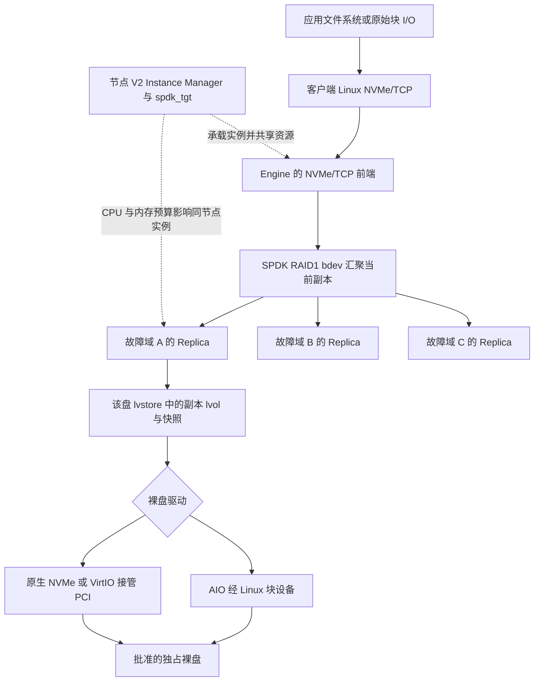
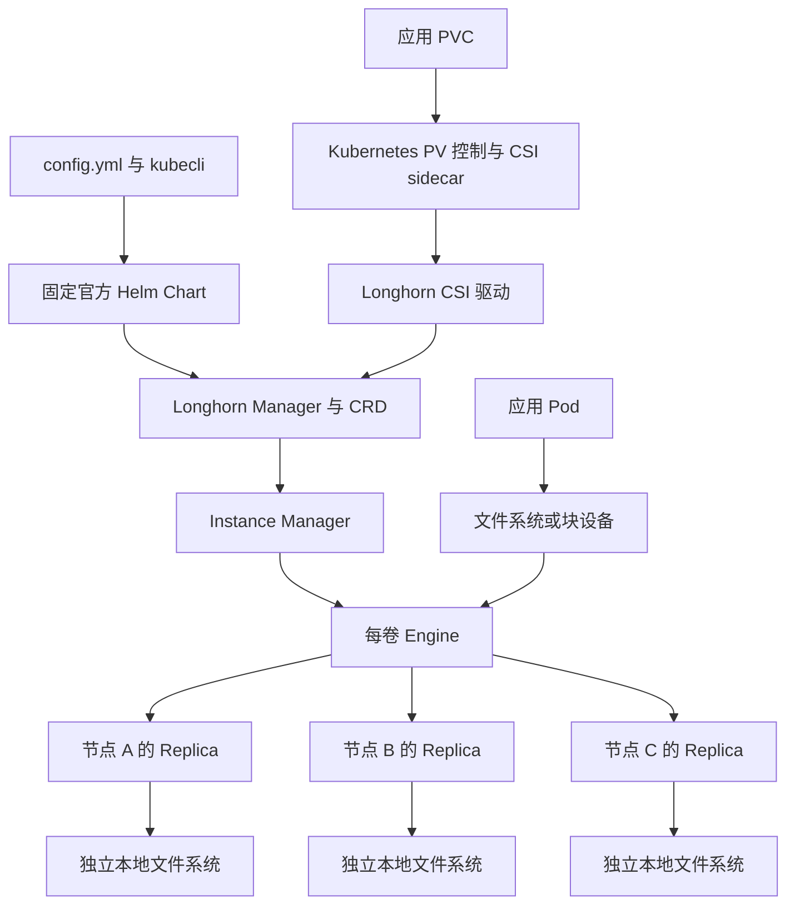
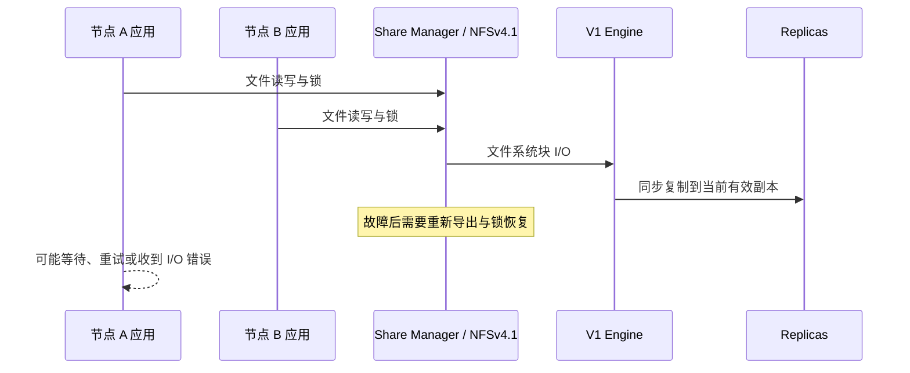
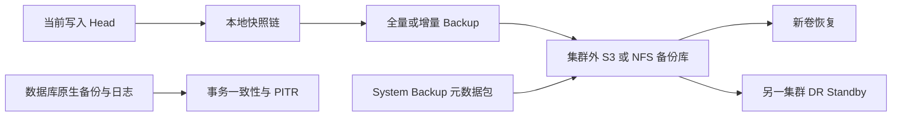
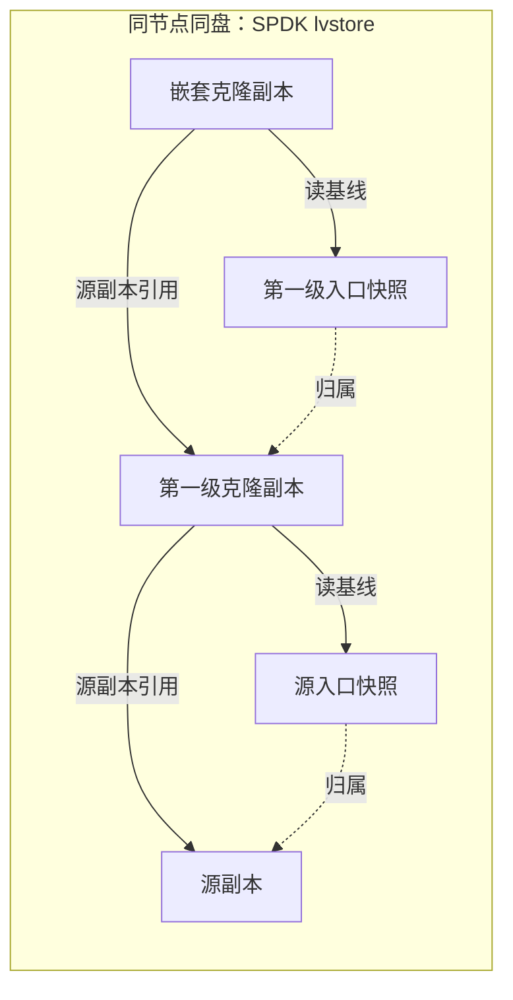

# Longhorn 技术白皮书

本文面向平台架构师、存储管理员和使用持久卷的中间件维护人员，解释 Longhorn **1.12.1、V1 与 V2 replicated 数据引擎、Kubernetes 1.33.6** 的数据与控制路径，以及可靠性、性能和恢复的成立条件。阅读者应理解 Pod、PVC、PV、StorageClass 和 Linux 文件系统；首次安装与日常操作从[用户与运维手册](operations-manual.md)进入，集成代码和制品维护见[开发手册](development-manual.md)。官方 V2 GA 能力与项目验收分开判断；本文性能基线及三类组件故障对照来自 V1。V2 另有三节点 AIO 卷生命周期、十一项完整数据保护及克隆／故障／中断模式的子场景结果；独立 DR 已验证受控隔离后的激活与回切。每项实践分别说明版本、拓扑、负载和恢复条件，不能跨引擎或跨场景外推；交付结论以专项矩阵为准。

## 目录与阅读路径

- [定位与选择](#定位与选择)：判断应使用哪一种存储，及数据库如何消费。
- [V1 与 V2 的数据面选择](#v1-与-v2-的数据面选择)：磁盘类型、SPDK 资源预算和维护差异。
- [从 PVC 到一次写入](#从-pvc-到一次写入)：区分 Kubernetes、Longhorn 控制面和数据面。
- [副本与故障恢复](#副本与故障恢复)：理解确认写入、重建、最后副本和隔离。
- [容量与性能](#容量与性能)：用物理容量、调度容量和快照增长决定余量。
- [快照、备份与灾备](#快照备份与灾备)：选择数据保护层次和恢复路径。
- [安全与运维边界](#安全与运维边界)：识别特权、加密、网络和升级的真实作用。
- [依据与验证范围](#依据与验证范围)：区分固定上游机制与项目现场结论。

## 定位与选择

Longhorn 是运行在 Kubernetes 内的分布式块存储系统，采用 Apache-2.0 许可证。它把多个节点已经准备好的本地磁盘组织成可动态申请的卷，通过 CSI 向工作负载提供存储。卷的数据副本分布在节点上，应用 Pod 可以在另一节点挂载，因此它解决了本地卷随节点绑定而难以迁移的问题。它不把任意已有目录自动变成分布式文件系统，也不提供 Ceph RGW 一类对象 API。

Longhorn 提供两条数据面：V1 将副本以稀疏文件存放于独立挂载的 ext4/xfs 文件系统；V2 通过 SPDK 管理裸块盘中的数据。V2 自 1.12.0 起已 GA，不能与仍为 experimental 的 UBLK 前端、sharded 纠删码布局混为一谈。本分路包含 V1 与 V2 replicated；V2 AIO 已完成三节点安装、持久写入与跨节点重挂资格，原生 PCI 接管未作为产品接口开放，完整 V2 运维验收仍有缺口。已有 Ceph、OpenEBS、本地卷及 NFS 能继续并存；选择 StorageClass 是新 PVC 的行为，不会迁移旧 PVC。

| 客户任务 | 合适的接口 | 取舍与边界 |
| --- | --- | --- |
| 数据库单实例或各成员独立磁盘 | 每个成员一个 RWO/RWOP 文件系统卷 | 数据库自己管理复制、仲裁和一致性；不得让多个数据库进程并发打开同一数据目录 |
| 应用自行管理文件系统或块格式 | RWO、`volumeMode: Block` | 应用负责格式和一致性；错误地对已有块设备执行 mkfs 会毁坏数据 |
| 跨节点共享普通文件 | RWX 文件系统卷 | 每个卷经独立 share-manager 导出 NFSv4.1，增加一跳和服务接管依赖 |
| 高性能、严格本地性且可接受节点绑定 | 评估本地 PV 或其它专用方案 | Longhorn 的网络复制与恢复会消费 CPU、网络和磁盘，不应假设接近裸盘延迟 |
| S3 业务接口或超大规模统一存储 | 评估 Ceph RGW/RADOS 等方案 | Longhorn 的 S3 backup target 是备份后端，不是面向应用的对象存储接口 |

数据库复制叠加 Longhorn 副本会增加容量和写放大。例如三成员数据库，每个成员 100 GiB、Longhorn 三副本，仅声明的副本容量就是 `3 × 100 × 3 = 900 GiB`，尚未包括快照、重建和备份。数据库三成员与存储三副本解决不同层的问题：前者理解事务及成员身份，后者保护块数据。不能因为某一层有三份数据就取消另一层的数据保护。

## V1 与 V2 的数据面选择

### 主机磁盘与应用卷是两个层次

`Node.spec.disks.*.diskType` 决定副本落到什么介质接口；StorageClass 的 `dataEngine` 决定新卷的数据引擎。V1 卷只能调度到 `filesystem` 盘，V2 卷只能调度到 `block` 盘。这与应用 PVC 的 `volumeMode` 不同：PVC `Filesystem` 表示 CSI 将卷设备格式化并挂给应用，PVC `Block` 表示把卷设备交给应用；两种应用接口都不能把 V1 的文件系统后端自动变成 V2 裸盘。

| 层次 | V1 | V2 replicated |
| --- | --- | --- |
| 主机数据盘 | 已格式化、独立持久挂载的 ext4/xfs | 无文件系统、无分区表的独占裸块设备 |
| 副本数据组织 | 稀疏文件、head 与快照差分链 | SPDK blobstore/lvol 的块分配与快照关系 |
| 默认应用前端 | iSCSI 接入 Linux 块层 | NVMe/TCP 接入 Linux 块层；UBLK 单独标为实验功能 |
| Instance Manager | 管理 V1 engine/replica 进程 | 由 `spdk_tgt` 承载 engine/replica 实例，共享节点资源预算 |
| 原地转换 | 已有卷不能通过修改类参数切换引擎 | 新卷加应用迁移，原卷保留至验数据和回退期结束 |

应用在两条路径最终都访问块数据；“用户态加速”不意味着没有网络、复制确认和 Linux 客户端成本。V2 使用 AIO 时仍通过 Linux 设备接口，原生 NVMe/VirtIO 则直接接管 PCI 设备。不能拿 AIO 路径的资格或测量替代原生驱动性能与恢复资格。

下图按 V2 replicated 的职责分层表示数据路径；三个副本应落在独立故障域，图中的单个副本分支代表其中一份。Engine 与 Replica 是 SPDK 中的逻辑实例，同节点的多个实例共享 `spdk_tgt`，不是每个卷各自独占一套进程和 CPU。



这里的 RAID1 bdev 是 Engine 对副本后端的逻辑镜像组织，不是要求客户把物理盘先组 RAID。每块原始盘提供 lvstore，副本在其中建立 lvol；快照、克隆和重建继续消费该存储池的空间。Engine 前端可连接并不证明三个副本均健康，盘 Ready 也不证明客户端 NVMe/TCP、文件系统和应用账本已通过。巡检须分别核对客户端、Engine/Replica、lvstore/裸盘及共享进程资源；一个节点的 `spdk_tgt` 故障可能影响该节点承载的多个卷。

巡检时还要区分“连接对象存在”和“成员仍参与镜像写入”。故障副本的 NVMe namespace 可以暂时保留，但 SPDK 已将它从 RAID 的有效成员集合移除；此时仅检查连接名称或网络可达会漏报。副本模式必须与 RAID 的实际成员关系交叉核对，再由 Manager 记录失败和重建，不能通过手工把模式改回 RW 恢复冗余。

2026-10-23 的[单盘故障原生采样](../../../tests/evidence/longhorn-v2-single-disk-native-revision3-20261023.json)使用本项目 `.3`、三节点 AIO 和三副本卷：故障节点的 namespace 仍存在，而 RAID 对应槽已出现 `name=null`、`is_configured=false`，另外两个有效成员继续提供服务；随后 Engine CR 中该副本从 RW 变为 ERR，磁盘状态恢复并完成重建后回到三个有效成员和三份 RW。业务确认写入及跨节点重挂由[同次固定入口结果](../../../tests/evidence/longhorn-v2-failure-single-disk-revision3-20261023.json)独立验证。原生 RPC 与 CR 读取不是原子快照，采样顺序只说明本次状态传播过程，不能推导固定故障发现时限或所有磁盘介质故障的恢复承诺。

上述细化同时核对固定 1.12.1 Instance Manager 所绑定的 [SPDK engine 源码](https://github.com/longhorn/longhorn-spdk-engine/tree/d19dbb3abcea/pkg/spdk)：`Engine.Create` 连接副本并创建 RAID1 bdev，`disk.go` 创建 lvstore，`replica.go` 创建 lvol 并导出副本。源码用于解释实现机制，不替代本项目 V2 现场证据。

### SPDK 的性能收益依赖资源保障

V2 将 I/O 处理移入 SPDK 用户态，使用 reactor 核处理队列。默认 polling 持续查询完成队列，降低唤醒开销，也持续消费分配的 CPU；宿主机 CPU 被抢占、云主机突发额度耗尽或保障请求过小，会同时拖慢数据 I/O 与管理 RPC，表现可能是副本断连或控制请求超时。1.12.1 的精确 CPU mask 默认是 **`0x3`，即两核**；不能沿用部分概览页“典型一核”的描述来配置当前默认。mask `0x4` 仅选择 CPU 2 一核，`0xF` 才是四核。

CPU request 必须至少覆盖 reactor 核数。项目提供按节点 Allocatable CPU 的百分比预留，默认 25%；例如 8 核 Allocatable 的 25% 为 2 核，16 核为 4 核，这是配置算例，非性能结果。V1/V2 共存时有两套 Instance Manager，预留相加，还要给 Manager、CSI、系统和应用留余量。官方生产建议优先启用一种引擎；共存必须有明确的消费者需求和容量预算。

CPU mask 约束 SPDK 选用哪些 CPU，不能独立授予 Kubernetes CPU 独占。1.12.1 新增的 CPU Manager 分核通过 `data-engine-number-of-cpu-cores` 请求 reactor 核数；正值覆盖 mask，并要求所有 Longhorn 节点使用 kubelet static 策略。原生控制器为 IM 生成 Guaranteed Pod，以整数 CPU requests=limits 获得独占分配，再由容器启动流程从实际分配确定 SPDK 的 CPU。有效请求取配置核数与原预留向上取整中的较大值：10 核 Allocatable、25% 预留、2 核 reactor 时，请求为 3 核，而非 2.5 核，这是源码计算示例，非性能测量。普通内存仍为 128 MiB；启用 hugepages 时另行声明 SPDK 页池，不能据 Guaranteed QoS 推导 anonymous SPDK 内存也获得了同额调度保障。项目提供 `longhorn_v2_cpu_cores` 配置及只读策略、资源和 Pod 核验。2026-10-23 的[运行资源实践](../../../tests/evidence/longhorn-v2-platform-complete-20261023.json)在三节点 `.2` 实例中分别验证匿名内存／iobuf、CPU 独占和恢复原配置；独占档三台实际 cpuset 均为 `1-2`，原配置为 `0-7`，各档均保存 59 条 fsync 确认记录、3,866,624 byte。无 static 策略或预算不满足时须原生拒绝；该证据验证资源约束与数据恢复，不承诺独占后的性能。依据为[1.12.1 CPU Manager 说明](https://longhorn.io/docs/1.12.1/important-notes/#cpu-core-allocation-with-the-kubernetes-cpu-manager)及固定 Manager 的资源计算和 Pod 构造源码。

默认 SPDK 预分配 **2048 MiB**，使用 2 MiB hugepages。宿主机必须事先持久配置页池，并让 kubelet 公布足够 `hugepages-2Mi`；内核页池存在而 kubelet 容量未更新也不能部署。关闭 hugepages 可以改用 anonymous memory，但 `data-engine-memory-size` 仍决定预分配量，不能据此减掉 2 GiB 内存预算。较大 I/O buffer pool 也消费这一预算，不能只增加池大小而保持原内存估算。

两种内存模式的调度保障也不同。固定 Manager 的 `createInstanceManagerPodSpec` 为 V2 设置普通内存 request 128 MiB，hugepages 模式另以 `hugepages-2Mi` 资源声明页池；anonymous 模式的 SPDK 预分配并不会自动成为同等大小的普通内存 request。因此“节点 Allocatable 足够”只是准入检查，不能保证 anonymous 模式的内存已被调度器完整隔离。选择该模式须另行限制同节点应用预算并监控实际内存/压力，在对应现场资格完成前不承诺与 hugepages 路径相同的资源保障。

Interrupt mode 可减少低负载节点的忙轮询，仍有管理队列与 NVMe/TCP 的残余轮询，不等于零 CPU，也不能保证与 polling 相同尾延迟。内存、CPU 和 interrupt 配置变更可能重建 Instance Manager；项目在 V2 卷未分离时拒绝这些变化，再通过维护窗口分离、重建、重挂和数据复验完成变更。官方依据为 [CPU 配置](https://longhorn.io/docs/1.12.1/advanced-resources/v2-data-engine/configurable-cpu-cores/)、[内存配置](https://longhorn.io/docs/1.12.1/advanced-resources/v2-data-engine/hugepage-configuration/)、[中断模式](https://longhorn.io/docs/1.12.1/advanced-resources/v2-data-engine/interrupt-mode/)，精确默认同时核对固定 Manager `SettingDefinitionDataEngineCPUMask`。

同版本三节点 AIO 的[中断模式实践](../../../tests/evidence/longhorn-v2-interrupt-manager-partial-20261021.json)给出了这条维护边界的具体例子：每节点 2 GiB hugepages、2048 MiB SPDK 内存、`0x1` mask，已有卷附着时变更被产品拒绝；分离后经产品入口依次从 polling 切为 interrupt，再恢复 polling。Setting 和三个 InstanceManager 父对象身份不变，但两次切换各产生三个新 Pod UID，说明保留控制对象并不等于保留原 SPDK 进程。原 9 MiB 数据及中断模式下新确认的 19 条 64 KiB 记录在重挂后保持；该结果证明所测配置的变更保护、进程替换和持久内容，没有测量 CPU 节约量、p99 或其它资源模式。生产选择仍应以同业务负载的对照测量决定，操作见[V2 运维分支](operations-manual.md#v2-运维分支与停止条件)。

iobuf 将可复用的缓冲区供给同一 SPDK target 内的 I/O，而不是为每个卷另建一份等大的池。1.12.1 的 large 池默认 1024 个、每个 132 KiB；small 池默认 8192 个、每个 8 KiB。小 I/O 高队列深度可耗尽 small 池，大于 8 KiB 的 I/O 也可能受 large 池影响；扩大池是在固定内存中重新分配用途，不能自动提高总内存或消除其它瓶颈。例如 large 池改为 4096 个会使用 528 MiB，未包括 small 池及其它结构，这是按官方大小计算的容量示例，非吞吐测量。池只能在启动时由 Instance Manager 生成 `iobuf_set_options` JSON 配置，目标启动后再调这个 RPC 不等价。项目暴露两项池计数、必要内存预算检查及全部 V2 卷分离保护，并核对 IM Pod 的启动参数；实际内存分配与负载收益仍由 V2 现场矩阵验收。操作与恢复见[iobuf 缓冲池维护](operations-manual.md#v2-iobuf-缓冲池维护)，依据为[固定版本参数定义](https://longhorn.io/docs/1.12.1/references/settings/#data-engine-iobuf-small-pool-size)与固定 Instance Manager 的启动包装脚本。

宿主 CPU 隔离则控制另一类竞争。原生 `data-engine-cpu-isolation-enabled` 默认 false，启用时将硬件 IRQ、unbound workqueue 和物理网卡接收队列的 RPS 移离 SPDK reactor CPU；每个 IM 的显式配置可覆盖全局值。脚本会跳过部分不可写的 IRQ 或接收队列，因此启动参数不证明每项亲和性均已生效，仍须读取实际 mask。它与 kubelet 分配独占 CPU 是不同机制：后者不能单独阻止这些宿主工作争用 reactor。固定启动脚本的取消隔离路径将相应 mask 放开到全部在线 CPU，**不会恢复主机原有的自定义亲和性**。因此已由其它平台管理的 IRQ/RPS 策略必须单独保存、协调与复原，不能把关闭开关视为精确回退。当前项目未暴露这一宿主变更的配置入口。[宿主 CPU 隔离专项](../../../tests/evidence/longhorn-v2-cpu-isolation-complete-20261023.json)已在三节点 AIO 环境读取实际启动参数和宿主 mask，并完成六个阶段：全局开启时显式 false 优先、空值继承全局开启、全局关闭后的原生清除、全局关闭时显式 true 优先、空值继承关闭及最终限定恢复。核验绑定各机 boot ID、IRQ/RPS/workqueue 对象和原 irqbalance 状态，恢复按保留的原策略逐项读回。这支持覆盖优先级与宿主恢复判据，不能外推硬件 IRQ 的全部可写性、其它平台并发修改或 CPU/尾延迟收益；也不等于产品已开放该配置。机制依据为[1.12.1 重要说明](https://longhorn.io/docs/1.12.1/important-notes/#host-cpu-isolation)、固定 Manager 的 `resolveCPUIsolationEnabled` 和 Instance Manager `package/start-spdk-tgt` 的设置/清除逻辑。

### 裸盘驱动决定设备所有权与恢复方法

| 接入方式 | 稳定定位与资格 | 运维影响 |
| --- | --- | --- |
| `aio` | `/dev/disk/by-id/` 加独立核对的 WWN/序列号；无分区、挂载、swap、holders 和外来签名 | Linux 块设备仍存在；产品不执行 wipefs、mkfs 或格式迁移 |
| 原生 `nvme` | PCI BDF；完整可隔离的 IOMMU group；硬件 I/O 队列数严格多于 reactor 核数 | SPDK 接管后原 `/dev/nvme*` 可能消失；以 BDF、硬件身份与原生 diskUUID 追踪，退役需恢复原驱动绑定 |
| 原生 `virtio-blk` | PCI BDF 及独占设备身份；不能将系统盘所在 PCI 功能交给 SPDK | 接管后原 `/dev/vd*` 可能消失，不能用“设备文件不见了”判断数据已丢失 |

请求值与检测结果属于不同接口。固定 1.12.1 Chart 的 Node CRD 允许 `spec.disks[*].diskDriver` 为 `""`、`auto`、`aio` 或 `nvme`；官网 VirtIO 示例使用 `auto` 加 BDF，由 SPDK 检测后在 `status.diskStatus[*].diskDriver` 报告 `virtio-blk`。不能把检测出的 `virtio-blk` 直接回填到 spec，也不能要求 auto 请求的状态仍为 auto。依据为[官方多磁盘示例](https://longhorn.io/docs/1.12.1/nodes-and-volumes/nodes/multidisk/#using-virtio-disks)与固定 Chart 渲染后的 CRD schema；这不改变当前产品只接入 AIO 的边界。

IOMMU group 与 PCI bridge 共组时，VFIO 无法按要求接管，官方给出的替代路径是 AIO。ARM64 原生 NVMe 在分配至少两 reactor 核时有已知 stuck I/O 限制，应按固定版本重要说明选择 AIO，不借“V2 GA”掩盖已知问题。产品当前只实现显式 AIO 接入，拒绝 `auto` 和 BDF，原生两类驱动未在本次 AIO 交付中获得硬件资格；产品继续明确拒绝这些配置。任何模式都不支持把 Longhorn 导出的卷再嵌套为它自己的后端盘；这种依赖回路可能导致级联 I/O 停滞。

删除磁盘声明与运行时释放也是两个阶段。固定 Manager 的 `alignDiskSpecAndStatus` 发现声明已删除时会调用 Disk Service；即使调用报错，它仍会移除对应 `diskStatus`。AIO 路径请求删除 SPDK bdev；原生 NVMe 路径还尝试 detach controller 和恢复驱动绑定，部分错误只记日志而最终返回成功。因此状态项消失甚至 RPC 返回成功，都不能独立证明设备已经交还宿主，也不表示介质已清空。完整退役须另查实际 SPDK 磁盘/bdev/controller、原 PCI 绑定和其它消费者，再允许释放身份记录或拆盘。这个结论来自锁定 Manager/Instance Manager 源码。产品的 AIO 专用退役入口据此核对空引用、实际 bdev/lvstore/controller 及同进程 peer 身份，再释放回执；[AIO 生命周期验证](../../../tests/evidence/longhorn-v2-disk-lifecycle-complete-20261024.json)已通过真实第四节点接收、副本迁出、原盘退役及重新导入：原 diskUUID 保持，8 MiB 原确认数据经六次读回保持同一摘要，最终恢复原三节点。该结果支持“先迁移数据、再释放运行态、最后释放回执”的顺序，不能外推物理拔盘或原生 PCI 驱动恢复。连续步骤和失败重入见[AIO 退役与替换](operations-manual.md#v2-aio-逐盘退役与替换)，不能通过手工删记录跳过原生释放。

### 生命周期断言必须按引擎区分

1.12.1 replicated V2 支持快照、完整/增量备份、恢复、DR、RWX、加密、扩容、TRIM 和计划任务。支持不代表与 V1 内部动作相同：删除 head 的直接父快照时，V1 可能标记 removed 等待后续 purge；V2 能 live merge，快照和对应 CR 可以立即移除。沿用 V1 的“必须保留 removed 快照”断言会错误地判定 V2 失败。

V2 不维护 V1 revision counter，也不支持 strict-local、offline fast rebuild；重建带宽 QoS 则是 V2 特有能力。全局 `replica-rebuilding-bandwidth-limit` 采用引擎 map，默认 `{"v2":"0"}` 表示不限；卷的 `spec.replicaRebuildingBandwidthLimit` 大于 0 时覆盖全局，0 则继承。单位是官方定义的 MB/s 写带宽。控制器在重建过程中动态下发，不必重建 IM；成功后 engine 的 `status.rebuildStatus` 对应项才报告 `appliedRebuildingMBps`。没有活动重建时，状态可能不存在，Setting 已更新也不能证明实际限速。限速缓解正常 I/O 的竞争，但延长副本恢复和降级窗口，且多个任务的总负载仍需规划。项目提供可选全局配置，单卷使用原生接口；操作和恢复见[V2 重建带宽维护](operations-manual.md#v2-重建带宽维护)。官网专题的旧字段与固定源码不同，此处按 1.12.1 Manager、Chart 及 Settings 参考校正。[本项目 `.3` 的同次重建实践](../../../tests/evidence/longhorn-v2-failure-rebuild-qos-revision3-20261023.json)分别在 27%、31%、37% 进度读取全局／卷覆盖／实际应用值为 `1/2/2`、`1/0/1`、`3/0/3`，验证正值覆盖、零值继承和重建中动态更新。1 GiB 确认数据和故障前 1,634 条、恢复后 20 条确认账本均经跨节点读回；这些状态值证明配置已应用，不等于测得恒定端到端吞吐，也不承诺客户业务延迟或恢复时限。

1.12.1 的新 linked clone 支持快照、备份、扩容、重建和嵌套克隆。其副本与源副本同节点同盘，共享源的入口快照；克隆副本数不能超过源，入口快照和源缩副本受依赖保护。因此删除、迁出与容量预算必须沿依赖图处理，不能按独立全拷贝卷操作。旧版 linked clone 的限制另按升级说明判断。V2 backing image 已移除，旧数据必须在升级前按官方路径迁移；不能继续交付一个不会工作的开关。

V2 在 1.12 补丁版本间不支持 engine live upgrade，升级前必须分离全部 V2 卷。1.12.1 新建加密 V2 卷额外预留 16 MiB LUKS 头，旧加密 V2 卷不会因升级自动补足；升级和容量断言必须记录创建版本。完整功能差异来自官方 [Data Engine Comparison](https://longhorn.io/docs/1.12.1/data-engine-comparison/)、[重要说明](https://longhorn.io/docs/1.12.1/important-notes/)及[CSI 克隆](https://longhorn.io/docs/1.12.1/snapshots-and-backups/csi-volume-clone/)。这些是设计与选型依据；项目 V2 已取得的业务与数据保护结果见下文，完整运维验收尚未完成。

项目 V2 AIO 验证采用三台各 8 vCPU、8 GiB 的 Ubuntu 虚拟机，内核 7.0.0-38-generic，每台一块 100 GiB SCSI 裸盘；使用稳定 WWN、AIO 驱动、单 reactor mask `0x1`、25% CPU 预留及 2 GiB hugepages。三个 V2 Instance Manager 与三个原生盘 UUID 健康，消费端通过 RWO＋Filesystem PVC 写入 9,437,184 字节并 fsync，再由另一节点重挂。确认数据 SHA256 为 `b91f4dd1142d3b7fc242490c7f7e65add767b9091f3a128b9efb59211201fc40`，重挂后保持一致，副本分别位于三台已绑定裸盘。

这里的应用文件系统与宿主裸盘同时成立：CSI 在对应用导出的逻辑卷上准备文件系统，SPDK 管理的底层盘仍是 `diskType: block`，不会因此成为 V1 filesystem-type 磁盘。确认写入、原生副本归属和跨节点重挂共同证明该配置的数据路径；这组结果没有测量 V2 性能上限、应用 Block/RWX、双引擎、盘替换、升级或灾备。安装与业务步骤见[用户与运维手册](operations-manual.md#v2-aio-的节点与裸盘准入)，测量输入和原始结果见[安装资格证据](../../../tests/evidence/longhorn-v2-aio-install-qualification-20261020.json)。

## 从 PVC 到一次写入

### 谁负责什么

下图描述 V1 的文件系统副本路径；V2 复用控制面与 CSI 的职责划分，数据面改为上一节说明的 SPDK 实例和裸盘存储。



Manager 监听 Longhorn 的 Volume、Engine、Replica、Node 等自定义资源，把声明收敛为进程、挂载和副本状态。Instance Manager 承载和管理 engine/replica 进程；它与应用 Pod 不是同一个生命周期。CSI provisioner、attacher、resizer 和 snapshotter 把 Kubernetes 请求转成 CSI 调用，Longhorn CSI 驱动再调用 Manager。UI 是管理入口，不是应用 I/O 的必经路径。

本项目以 inventory 的 `kube_node` 组定义卷客户端，存储节点是它的子集：无数据盘的计算客户端仍需要本机管理和附着能力。专用 Kubernetes 控制面可以承载 API 服务，却不因此成为卷客户端；其核心 cordon 状态保持不变。Manager 只在客户端节点运行，防止备份控制器把请求分配给没有本机 Instance Manager 的专用控制面。CSI DaemonSet 的存在与 Manager、Instance Manager 的实际职责应分别判断，不能从基础设施 Pod 总数推断可以在哪些节点运行有状态应用。

“每卷一个 engine”只隔离单个 engine 进程故障。一个 V1 Instance Manager Pod 可以同时承载多个卷的 engine 和 replica；该 Pod 被重启、驱逐或因资源压力退出时，其中全部进程都会丢失。因此，一次看似只重启一个基础设施 Pod 的动作可能影响多卷，不能把每卷控制器模型解释为所有故障都只影响一卷。CPU 保障、优先级和 Instance Manager 的 PDB 用来降低这种共同故障风险，业务自己的 PDB 不能替代它们。

升级时旧 V1 Instance Manager 可以继续承载已经运行的实例，新实例进入新版本 Pod；旧 Pod 只有在内部实例全部迁出后才能回收。这解释了为何 Manager 升级完成后仍可能看到旧 Instance Manager，也解释了升级容量必须容纳新旧进程的临时并存。不能以镜像版本较旧为唯一理由强制删除仍承载卷的 Pod。

Kubeauto 管理固定 Chart、项目配置、StorageClass、备份计划和操作请求；Longhorn 自己管理 engine、replica、share-manager 与相应 CR 的运行状态。项目不另写一个副本控制器，也不通过重复删除控制器生成的 Pod 来“收敛”声明。资源存在不代表归属正确，已有非本项目 Longhorn/CSI 管理系统必须先按独立迁移方案处理。

### 一次动态创建与挂载

1. 应用提交 PVC，指定 StorageClass。类参数决定新卷的副本数、文件系统、回收策略、数据引擎、加密和备份目标；这些参数不会反向改写已创建卷。
2. CSI provisioner 创建卷，Manager 为每卷选择可调度节点和磁盘。三副本且节点硬反亲和时，需要三个满足条件的节点；只有三节点且其中一台退役时，需要增加接收节点，不能靠“剩余总空间很大”突破反亲和。
3. Pod 被调度，CSI attacher 建立卷与节点的附着关系。V1 engine 在工作负载节点提供卷前端，iSCSI 与 Linux 块设备连接后，CSI node 插件负责 staging、必要的文件系统创建和 Pod 挂载。
4. 应用执行 I/O，数据进入 engine，再转发至当前参与 I/O 的副本。控制面协调路径与数据面 I/O 路径分开，因此短暂 Manager 重启和 engine 进程中断不能等同看待。
5. Pod 迁移时，原附着必须结束，目标节点才重新挂载。节点失联不证明原主机已经停止写入；强制分离之前必须完成基础设施隔离，防止两个写入方争用同一卷。

RWO 的含义是单节点读写，同节点上的多个 Pod 仍可能使用该卷；要求单 Pod 使用应选择 RWOP，并验证应用控制器和 CSI 行为。`Block` 只改变暴露形式，不改变副本机制。普通 RWX 则先由 share-manager 挂载卷，再向多个客户端提供 NFS 文件服务；它不是可任意并发写入的共享块设备。

一次已完成的 1.12.1/V1、Kubernetes 1.33.6 验证采用六节点集群，其中三个存储 worker 各有一块独立挂载的 100 GiB 虚拟盘，业务读写在 worker 间完成。客户端在 2 GiB RWO 文件系统卷写入并 fsync **9,437,184 字节（9 MiB）**，同时确认三个副本分别位于三个 worker；随后删除原写入 Pod，在另一 worker 通过原 PVC 重新挂载，读取内容的 SHA256 仍为 `1e7b1b785af645da5a6aad141c6eb8f7f238080431a85e08b0663e3f6f8a743a`。这串结果连接了“应用确认写入、卷身份保留、原附着结束、另一节点实际读回”四个环节，因而比仅观察 PVC Bound 或 Pod Ready 更能说明本次挂载路径工作正常。

在相同版本及三存储节点条件下，[独立访问模式验收](../../../tests/evidence/longhorn-rwo-20261019.json)进一步分别使用 RWO 文件系统、RWOP 文件系统和 RWO 裸块卷，每种都确认写入 9 MiB 并跨 worker 重挂，三个结果均得到上述 SHA256。RWO 的另一节点竞争挂载被拒绝；RWOP 还验证了同节点第二个 Pod 被拒绝。拒绝发生后，原写入方确认数据仍可读取，因此这些拒绝体现的是访问模式保护，不能按“第二个 Pod 未启动”直接诊断为存储不可用。裸块路径直接核对应用设备中的原始字节，没有把格式化文件系统作为块模式的替代验收。

在同一拓扑的[相同输入重入验收](../../../tests/evidence/longhorn-idempotence-20261019.json)中，先创建业务 PVC 并确认上述 9 MiB 数据，再通过产品步骤 09 重入。Helm revision 始终为 2；Longhorn 与业务 namespace 中的 50 个受检 Deployment、DaemonSet、StatefulSet、Pod、PVC、Secret 对象，其 UID、generation 和 spec 保持一致，Secret 内容只比较不可逆摘要。随后主动删除测试写入 Pod并跨 worker 重挂，原数据摘要仍一致。因此，这次有意变更客户端的重挂与产品重入导致的意外替换有明确分界；主机检查文件更新和控制端输入文件重写，也不应被混同为存储工作负载滚动。

这些结果提供安装后验收的判断方法：维护原 PVC/PV/volumeHandle 身份及确认数据账本，再检查重入和迁移后的实际读取。它们仅覆盖上述小规模虚拟盘环境中的受控重入、重挂和并发占用拒绝，未注入断电、丢盘或网络分区，也未在这些场景测量吞吐和尾延迟；不能据此确定生产硬件的持久性、故障 RTO 或性能上限。独立性能场景另见[文件系统基线](#当前文件系统基线如何解释)，业务负责人仍须用自己的事务确认和恢复点完成应用验收。

### Backing image 与普通卷备份的依赖差别

Backing image 是卷快照链底部的只读基础镜像，常用于从 RAW/QCOW2 镜像准备虚拟机磁盘。V1 的 data-source Pod 先准备首份文件，之后每块需要它的磁盘由 Backing Image Manager 分发和保管，盘内多个卷副本可以共享这一基础文件；副本的差分层并不包含完整基础镜像。因此，有效副本目录和普通卷备份都可能带有额外镜像依赖，退役磁盘时不能只清点 Replica。镜像的节点/磁盘选择也限制卷副本可放置的位置，不能只检查副本反亲和和空闲容量。

上游要求镜像尺寸按 512 字节对齐，校验值是**镜像文件整体的 SHA-512**，不是 QCOW2 内部展开数据的摘要。预先提供已核验 checksum 可以避免将错误的首份下载当作正确基准。至少一份 Ready 镜像尚存时可作为重新分发来源；全部丢失后，下载来源依赖原 URL，导出来源依赖原卷，本地上传来源还需重新提供文件，控制器并不会凭差分层重造丢失的基础数据。

上游的卷备份会连同 backing image 发起备份；恢复时优先复用集群已有镜像，缺失时从备份库恢复镜像。独立 `BackupBackingImage` 与普通卷的恢复点不是同一种对象，仍需检查其外部可读材料。镜像加密通过克隆产生新镜像，既有镜像不能原地换密钥；加密镜像与消费它的加密卷必须使用相同密钥，QCOW2 转 RAW 和加密过程还可能临时占用远大于下载文件的空间。镜像备份不替代密钥保管。

以上依据为固定版本的[Backing Image](https://longhorn.io/docs/1.12.1/advanced-resources/backing-image/backing-image/)、[镜像备份](https://longhorn.io/docs/1.12.1/advanced-resources/backing-image/backing-image-backup/)和[镜像加密](https://longhorn.io/docs/1.12.1/advanced-resources/backing-image/backing-image-encryption/)机制。本项目受管 StorageClass 没有暴露镜像创建参数，当前普通 PVC、快照和备份验收不包含上述镜像路径，也不构成 Harvester/虚拟机认证。接入已有镜像工作负载前应单独验证镜像分发、备份、密钥和恢复链；现有退役护栏保留这些依赖，不能把“未由项目创建”当作可删除依据。

### RWX 的额外故障路径



share-manager 故障后，即便卷本身健康，NFS 服务身份和锁状态仍需恢复。官方普通恢复窗口可涉及约 90 秒的 NFS 锁恢复等待；可选快速故障转移采用不同检测与恢复设置，不能从配置名称推导实际业务 RTO。Longhorn 的默认 NFS 软超时类选项可能把故障表现为 I/O 错误；改成 hard mount 又可能让调用长时间阻塞。选择必须结合应用是否能重试、能否识别部分写入和服务停止方式，而不能笼统承诺“透明切换”。数据库数据目录应先核验数据库对 NFS、锁、fsync 和故障语义的官方支持。

### 两个 RWX 客户端如何观察 share-manager 替换

2026-10-19 的 [LONGHORN-09 场景](../../../tests/evidence/longhorn-rwx-20261019.json)使用 1.12.1/V1、三存储 worker 的 2 GiB 三副本共享卷。两个不同 worker 同时挂载同一 PVC，均核对真实 NFSv4.1 挂载和原确认文件；以另一 UID 读取 0600 文件得到权限拒绝。客户端 A 持有 advisory lock 时，客户端 B 的非阻塞排他申请被拒绝；A 释放后 B 才成功取得锁。这些结果把共享访问、文件权限和协作锁区分开来，不能把“两个 Pod 都 Ready”作为三者的共同证据。

锁释放后，两个原挂载客户端各自开始约 180 秒读写循环，每轮写入自己的文件、执行文件与目录 fsync、读回比较，只有完成这些动作才增加确认计数。随后按原 Volume→ShareManager→Pod UID 链限定删除原 share-manager Pod，等待替代 Pod，再从原客户端挂载验证实际写入。以下是同次执行的观察：

| 观察项 | 结果 | 口径 |
| --- | ---: | --- |
| writer 确认次数、I/O 错误 | 331、0 | 故障前后同一客户端进程，完成写入、fsync 和读回才确认 |
| reader 确认次数、I/O 错误 | 331、0 | 与 writer 相同，但在另一 worker，写入不同文件 |
| writer／reader 最大单轮耗时 | 11.743／11.756 秒 | 包含文件及目录操作、fsync 和校验；不是单个存储 I/O 的延迟分位数 |
| 替代 share-manager Ready | 14.361 秒 | 从提交原 Pod 删除至轮询发现替代 Pod Ready，包含删除与查询等待 |
| 故障后的外层观察跨度 | 176.657 秒 | 从删除开始至客户端观察完成及数据复验；客户端循环在删除前已开始 |

本次未出现被捕获的 I/O 错误，也未触发相应错误重试；最大操作耗时仍超过 11 秒，因此零错误不等于零等待或零中断。替代 Pod Ready 与应用操作恢复使用不同计时起点和出口，不能相减得到精确业务中断时间。原 9,437,184 字节确认文件在两个原客户端及换 worker 重挂后，SHA256 均保持 `1e7b1b785af645da5a6aad141c6eb8f7f238080431a85e08b0663e3f6f8a743a`，本轮业务卷和 share-manager 随后限定回收。

该场景验证了文件权限、故障前的锁排他与释放，以及未保留显式 advisory lock 时 Pod 替换后的双客户端读写恢复；没有验证持锁客户端跨故障 reclaim、节点断电、DNS 丢失或网络分区，也没有调整为 hard mount 或启用快速故障转移。生产应用仍须按实际锁、超时、重试和部分写入语义验收，不把这一观察值当作 RWX 的固定 RTO。

同一组客户端断言也在上述三台 8 vCPU／8 GiB、100 GiB AIO 裸盘的 V2-only 环境独立执行。两个 NFSv4.1 客户端分别位于不同节点，仍先验证文件权限和锁互斥／释放，再替换 share-manager；180 秒循环中各完成 301 次确认、I/O 错误为 0，最大单轮耗时分别为 26.261 和 26.048 秒。替代 Pod Ready 用时 16.084 秒，故障后的外层观察跨度为 178.020 秒。原 9 MiB 数据在两个客户端和跨节点重挂后均保持 V2 AIO 原摘要 `b91f4dd1142d3b7fc242490c7f7e65add767b9091f3a128b9efb59211201fc40`，三个副本仍归属原已绑定裸盘，夹具回收及原安装健康复验均完成，见[独立 V2 访问模式证据](../../../tests/evidence/longhorn-v2-volume-modes-qualification-20261020.json)。

相同节点、裸盘及软件版本的一次[独立综合验证](../../../tests/evidence/longhorn-v2-volumes-20261020.json)中，两个 RWX 客户端各确认 330 次，错误均为 0；最大单轮耗时分别为 11.351／11.337 秒，替代 Pod Ready 用时 10.877 秒，外层故障后观察跨度为 176.966 秒。此次还独立完成访问模式、三类在线扩容、Retain/Delete、四条密钥拒绝与原密钥恢复，以及快照感知 TRIM；共 11 次跨节点读回的原 9 MiB 摘要一致。相同资源配置下的两次等待值仍有明显差异，单次最大值不能外推为生产时延上限。两组数据分别来自各自完整运行，不能合并为同一次测量；锁跨故障 reclaim、节点断电和网络分区仍需各自验证。

V1 与 V2 的这两组结果支持相同的 NFS 客户端恢复判据，但硬件、虚拟化和后端路径不同，不能用两组最大值比较引擎性能。它们都说明数据副本健康、NFS 服务恢复和客户端操作恢复是三个需要分别观察的条件；V2 GA 不会消除客户端在 NFS 故障期间的等待。这次 V2 访问资格还分别完成 RWO 文件系统、RWOP 文件系统和 RWO 应用 Block 的竞争拒绝及原摘要跨节点重挂；扩容、密钥丢失、空间回收和其它故障域仍按各自矩阵验收。

## 副本与故障恢复

### 副本不是多数派协议

官方 1.12.1 的 [Default Replica Count](https://longhorn.io/docs/1.12.1/references/settings/#default-replica-count) 允许单副本，且区分 UI 默认值与 StorageClass 的 `numberOfReplicas`。项目接受显式的 1–5 副本并保留三副本默认；调度仍要求每份副本有独立存储节点，不能在单节点制造三个相同故障域来宣称冗余。一个单副本 DR 目标可验证恢复后的业务数据，但唯一节点或盘失效会令该副本不可用；从共享外部备份重建是另一条恢复路径，不能折算为节点自动高可用。单节点 CSI 控制器也只有一个实例，控制面重启和数据节点失效应分别评估。

每个 V1 replica 包含完整逻辑卷数据，engine 对参与写入的副本执行同步复制。副本链内部区分可读写副本与正在追赶的副本；重建中的副本不能立即算作恢复了完整冗余。Longhorn 允许在有效副本减少后降级运行，因此它不是“必须两个副本确认才能提交”的数据库 quorum。

应用看到一次成功的普通 write 也不自动等于其事务已达到稳定介质。数据库 WAL/journal、fsync、宿主文件系统、磁盘写缓存和断电保护共同决定持久性。验收应维护“已收到应用确认”的数据账本，在故障和恢复后逐项检查；未得到确认或超时的操作属于结果未知，应由业务幂等键、事务或状态查询处理，不能直接全部重试或全部判为未写入。

| 现象 | 可推导的状态 | 操作边界 |
| --- | --- | --- |
| Attached + Healthy | 当前附着卷达到期望冗余 | 仍须检查业务、故障域和备份；不是零丢失保证 |
| Attached + Degraded | 可用副本不足，但可能仍可继续 I/O | 暂停额外维护，确认剩余副本、容量和重建进度 |
| Faulted | 当前无法安全维持卷数据服务；不等于每个 Replica 都已标记失败 | 保留所有副本及元数据，先定位网络、磁盘或数据损坏，禁止批量删除重建 |
| Detached + Unknown | 卷未附着，未必存在故障 | 结合最后健康状态、恢复任务和实际附着探针判断 |

V2 的 Engine 或 EngineFrontend 故障可以先令 Volume 进入 `faulted`，而原 Replica 的 `failedAt` 仍为空。固定 1.12.1 Manager 在分离且仍有可用副本时，会将状态转为 `unknown` 并请求重挂；这条路径与清除失败标记的自动 salvage 不同。因而 `autoSalvage=false` 限制的是自动 salvage，不能解释为“任何故障后都禁止控制器重挂”，也不能要求 `faulted` 永久保持。判断事故应合看实际 I/O、卷和原生实例身份、磁盘状态及应用确认数据；恢复硬件后的 `unknown` 本身既不证明丢失数据，也不证明数据恢复完整。该区别依据[固定 Manager 的故障与分离处理](https://github.com/longhorn/longhorn-manager/blob/8320238242e8c804325d9588ec1db10feb9f36b8/controller/volume_controller.go)，适用于本项目锁定版本。

### revision counter 能证明什么

启用 revision counter 时，replica 在每次写入时递增 `revision.counter` 文件，engine 在启动和 salvage 时把计数作为选择数据源的启发信息。这会增加写路径工作量；多副本写入仍并行执行，因此较大的计数不是事务提交证明，也不能单独排除部分写入或逻辑损坏。

禁用后不再逐写计数。官方的自动 salvage 算法会改用 head 文件修改时间和大小筛选候选：先找到最新修改时间，选择与该时间相差不超过 5 秒的候选，再比较文件大小及时间。宿主时钟、缓存、快照链和真实业务确认边界都可能影响判断，不能把文件时间当作数据库提交序号。本项目关闭 `autoSalvage`，全部副本错误时先保留证据并按[故障恢复](operations-manual.md#最后副本全部错误与数据损坏)评估，不依赖这一启发算法自动决定数据源。

本项目生成的 StorageClass 不显式传入 `disableRevisionCounter`；固定 1.12.1 CSI 源码的省略值为 `true`，即新卷禁用计数。官方说明页中关于 StorageClass 缺省值的旧句与该源码不一致，版本依据见[开发手册](development-manual.md#官方接口与版本差异)。这是当前创建路径的语义，不能据此推断历史卷的实际设置；事故时应核对原 Volume 的 `spec.revisionCounterDisabled`。本项目没有把它暴露为任意在线调优开关，也不以启用计数代替应用确认账本和独立备份。

### 重建为什么需要额外资源

重建不是创建一个空 replica 后立即把它计为健康。按 V1 官方流程，engine 短暂停止 I/O，将空 replica 以 WO（只写、尚不可作为读取来源）加入，对现有副本建立快照边界，再恢复 I/O。新写入同时发往新 replica，后台从健康来源同步边界以前的快照数据；只有同步完成、数据状态一致后，新 replica 才转为 RW（可读写）。随后移除故障 replica。这样同时处理了“补历史数据”和“追当前写入”，避免重建完成时还缺少并发修改。

在 WO 阶段看到进程 Running 或重建百分比接近完成，均不意味着已经恢复完整冗余。应同时检查卷 robustness、期望副本数、每个 replica 的原生状态与错误时间，并复验业务确认账本。重建开头的短暂停顿和后台数据流都会影响延迟；健康源的读取负载、目标写入与网络流量还会和业务竞争。

V1 使用快照链和数据同步缩小重建范围。目标没有对应历史文件时，必须传输整份快照；目标保有同名文件但缺少可复用 checksum 时，执行逐块校验，只同步差异块；已有 checksum、修改时间和内容标识均满足快速重建条件时，才能跳过相应历史层。前者消耗网络与目标写入，中间路径增加两端校验 CPU，快速路径则把部分成本前移到快照校验。head 没有预计算 checksum，仍须同步其数据，不能把历史层的跳过解释为整卷无需传输。以上为固定版本的[官方重建机制](https://longhorn.io/docs/1.12.1/advanced-resources/rebuilding/)，尚不是本项目故障门禁的计时结果。

已有副本可复用时，等待原节点短暂恢复可能比立即全量重建更节省资源；默认 `replica-replenishment-wait-interval=600` 秒只在存在故障副本可等待时适用，不是所有重建都固定延迟十分钟。等待也延长降级窗口。增加并发重建会更快占用故障预算，但同时增加网络和磁盘竞争，可能进一步拉高应用尾延迟。卷处于扩容、迁移或旧恢复/DR 状态时，上游还会限制重建启动，因此应先识别当前操作，不能用提高并发掩盖状态前置。

快照快速重建要求有可复用的快照 checksum 和未改变的文件时间信息；它跳过已确认相同的历史快照，不能让新数据免于同步。1.12 还可让一个重建目标从多个健康来源并行取不同快照，由 `replica-rebuild-concurrent-sync-limit` 控制，默认 1；增大它可能改善稀疏快照的同步，也可能同时加重全部健康来源的负载。这个来源并发数与“每节点同时重建多少个 replica”是不同维度，应逐项测量。上游按 MB/s 限流的 Replica Rebuild QoS 针对 V2/SPDK，本分路 V1 不具备该限流承诺。

没有业务附着也不一定意味着可以立即维护：启用 offline rebuilding 后，符合调度与进程条件的 Degraded 卷会临时附着但不开启 frontend，补齐副本后再分离；业务启动可以中断这一过程。缺少可复用副本和可调度接收磁盘时不会开始，重建中失去调度条件也可能取消；Faulted 卷不适用。巡检应核对附着原因、原生状态与剩余数据，不能把这种内部附着当成外来业务占用，更不能以“offline”推导不消耗网络或磁盘。

节点反亲和、磁盘反亲和和区域分布解决不同故障域。多个副本位于同一宿主虚拟机的不同目录，并没有形成节点故障隔离；三台虚拟机共用一个底层故障域，也不能外推为三个独立物理故障域。区域硬限制还需要足够区域和接收容量，不能在故障期间临时取消限制来隐藏规划不足。

副本放置与应用附着拓扑还要分开理解。上游的 `csi-allowed-topology-keys` 使 CSI 声明可用拓扑，再由 StorageClass 的 `allowedTopologies`、`WaitForFirstConsumer` 和 `strictTopology` 形成 PV 的不可变 `nodeAffinity`；这限制应用在哪些节点/区域使用卷，**不持久化 Longhorn 副本的区域放置约束**。仅给节点加 zone 标签，或仅启用 `strictTopology` 而未配置 CSI 拓扑键，都不足以建立这条链。本项目受管类固定使用 `Immediate`，未提供上述拓扑配置接口；当前节点级三副本验收不能解释为跨可用区认证。客户需要区域硬约束时应先单独设计和验证，不能直接修改已存在的受管 StorageClass，亦不能与单副本 `strict-local` 机制混用。

### 一份副本进程停止后的确认数据

2026-10-19 的 1.12.1/V1、Kubernetes 1.33.6 聚焦验证使用三个存储 worker 上的 2 GiB 三副本文件系统卷。客户端按顺序写入不可变的 64 KiB 槽位，每条仅在文件 fsync 成功后记录序号和 SHA256；失败时重试同一个未确认位置。持续写入期间，按 Volume、Replica、Instance Manager 和 Pod 的原始身份，停止其中一份副本的原生进程，不重启整个 Instance Manager。原生接口还校验进程 UUID，避免误停同名的新进程。

从故障动作前的身份检查开始，到首次观察三个独立 RW 副本恢复，共 45.836 秒；这是包含 API 查询和轮询间隔的观察时长，不能当作纯数据传输耗时或应用中断时长。门禁先观察到原副本失败，再观察完整拓扑恢复；两个幸存副本 UID 和节点保持不变，故障副本最终也保留原 Replica UID。原 UID 被复用说明控制器可以恢复已有副本对象，不说明省略了数据同步，也不能仅据此判定使用了哪种重建算法。

| 本次持续客户端观察 | 实测结果 |
| --- | ---: |
| 故障动作前已确认记录数 | 17 |
| 首次观察完整副本恢复时的确认记录数 | 192 |
| 继续写入后的最终确认记录数 | 212 |
| 全部确认数据量 | 13,893,632 byte |
| 客户端 I/O 错误 / 重试次数 | 0 / 0 |
| 单次写入及 fsync 的最大观察耗时 | 20.809 ms |

全部 212 条记录在原客户端与另一 worker 重挂客户端各自逐条读回，摘要均为 `566452b6bd32821040767460db3c46942b193287b9ed3d4504a56feffa903e48`；另行保存的原 9 MiB 业务内容也保持原摘要。恢复后的新增确认写入使“副本状态恢复”和“业务继续前进”分别有据可查，重挂后的逐条读取则检验原确认内容没有因客户端替换而丢失。业务卷和传输限定回收完成、原安装健康后，本次进程故障分路退出 0，详见[进程故障子场景证据](../../../tests/evidence/longhorn-replica-failure-20261019.json)。

负载每轮写入后间隔约 0.25 秒，数据量较小；这组零错误及最大耗时只描述该窗口，不能推导高并发下的零中断、断电持久性或故障 RTO。这一进程子场景没有拔盘、填满磁盘、重启节点或切断网络。后续同版本 V1、派生 IM `v1.12.1-kubeauto.2` 的[独立物理文件系统盘故障](../../../tests/evidence/longhorn-disk-failure-20261022.json)已观察到原盘副本 ERR、卷 degraded，两个幸存副本身份保持。原盘恢复启动时先由 systemd-fsck 完成检查再进入挂载，原 1,384 条确认记录共 90,701,824 byte 和恢复后 20 条新确认记录共 1,310,720 byte，均在跨节点重挂后保持各自摘要，客户端重试清单为空。从注入前身份解析到原盘启动及完整副本恢复的观察时长为 361.341 秒，包含重启、检查与轮询，不是生产 RTO。两个子场景共同完成 [LONGHORN-19](../../../tests/evidence/longhorn-replica-and-disk-failure-20261022.json)，不能由此外推所有介质损坏模式或 V2 裸盘行为。生产故障应按[故障恢复流程](operations-manual.md#单副本节点控制器故障)保护健康副本，不直接照搬验收中的进程停止动作。

### engine、Instance Manager 与 Manager 故障的差别

三类组件的故障影响由其职责决定。engine 承载附着卷的 iSCSI frontend，进程丢失会中断应用访问块设备；Instance Manager 是多个原生进程的共同容器，删除它可能同时丢失多个卷的 engine 或 replica；Manager 负责协调状态，其 Pod 替换不必然终止另一个 Pod 中仍在运行的数据进程。因此，不能用一次 Manager 重启时业务未报错，推导 engine 或整个节点故障也不会报错。

2026-10-19 的固定 1.12.1/V1、Kubernetes 1.33.6 验证在同一组三个存储 worker 上顺序创建三份独立 2 GiB、三副本 RWO 文件系统卷。每次只保留当轮卷，核对原生进程及共享组件没有其它卷消费者，持续写入 64 KiB 槽位并在 fsync 后向卷外记录确认。故障注入分别限定到原生 engine UUID、非附着 worker 上承载一份副本的 Instance Manager Pod UID、附着 worker 上的 Manager Pod UID；这三个动作的影响范围不同。

| 故障对象与恢复方式 | 完整组件/副本恢复观察时间 | 原客户端退出码 | 原账本确认条数 | I/O 重试次数 | 恢复后独立账本确认条数 |
| --- | ---: | ---: | ---: | ---: | ---: |
| engine 进程停止，删除原裸 Pod 并重新创建应用 Pod | 63.702 秒 | 137 | 52 | 123，均为 EIO | 20 |
| 远端副本的 Instance Manager Pod 删除，原应用客户端继续 | 69.248 秒 | 0 | 308 | 0 | 20 |
| 附着 worker 的 Manager Pod 删除，原应用客户端继续 | 45.581 秒 | 0 | 215 | 0 | 20 |

engine 场景采用[官方裸 Pod 人工恢复路径](https://longhorn.io/docs/1.12.1/high-availability/recover-volume/)，先等待原 Pod 真正删除，再创建新名字的客户端。退出码 137 是原客户端在该恢复过程中被终止的结果，不能冒称原进程持续成功；已收到确认的 52 条记录与故障期间反复失败的第 53 个槽位也必须分开，123 次 EIO 不等于丢失 123 条已确认记录。重新创建后核验旧确认前缀，并使用另一份文件完成新的 20 条写入和读回，才证明恢复后的 frontend 可写。受 Deployment/StatefulSet 管理的自动恢复与裸 Pod 人工重建具有不同的前提，本场景没有替代前者的验收。

另两种故障保留原应用进程，要求组件恢复后原账本继续产生确认，然后正常结束客户端。三个场景分别在另一 worker 重挂，逐条核对原账本与恢复后独立账本，合计 635 条确认记录、41,615,360 byte 全部保持；每卷另行保存的 9 MiB 原业务内容也保持原 SHA256。原生 engine 恢复须出现新进程 UUID，Pod 恢复须出现原父对象下新的 Ready Pod，并同时达到三个独立 RW 副本，不能只以同名 Pod 再次出现判断恢复。

业务夹具及传输限定回收、原安装健康后，专项退出 0，三类结果及冻结输入见[控制组件故障证据](../../../tests/evidence/longhorn-engine-failure-20261019.json)。表中时间从故障前身份复核开始，包含删除、轮询、组件恢复以及 engine 场景的应用人工重建，既不是纯重建传输时间，也不是已测得的最长业务 I/O 阻塞时间。负载每轮间隔约 0.25 秒、数据量小、无其它卷竞争；另外两项零重试只描述观察窗口。节点失联、共享组件承载多卷、高并发和网络分区仍需各自验收，不能从这张表外推 SLA、零中断或生产 RTO。

V2 中，同一节点的 SPDK Instance Manager 承载多个实例，远端副本组件与附着端 engine 所处的故障域仍须分开。2026-10-21 的[远端副本组件专项](../../../tests/evidence/longhorn-v2-replica-im-loss-qualification-20261021.json)使用三台各 8 vCPU／8 GiB、每台一块 100 GiB 裸盘、2 GiB hugepages 的 AIO 环境，在 2 GiB 三副本卷上持续写入 64 KiB fsync 槽位；排除共享消费者后，仅正常删除非附着节点上承载一份副本的 Instance Manager Pod。删除绑定原 UID/resourceVersion，恢复核对同一 InstanceManager 父对象、相同配置及新 Ready Pod，卷回到三个节点的健康副本。

原客户端继续并正常结束，记录零重试；故障前后共确认 319 条、20,905,984 byte，恢复后在另一文件新增 20 条、1,310,720 byte。两份账本逐条读取并跨节点重挂复验，另有原 9 MiB 内容保持 SHA256 `b91f4dd1142d3b7fc242490c7f7e65add767b9091f3a128b9efb59211201fc40`。组件／副本恢复观察为 84.87 秒，计时包含故障前身份检查、正常删除和原生恢复，不是应用最长停顿。这个例子说明一份远端副本所在组件恢复时，其余数据路径可以继续服务；正常 DELETE 可执行终止流程，不能代表 SPDK 突然崩溃、附着端 engine 丢失、节点断电或多卷争用。完整 V2 故障模块的验收应另行核对矩阵中的九类故障结果，生产诊断入口见[单副本／节点／控制器故障](operations-manual.md#单副本节点控制器故障)。

同一 V2 环境另行验证了控制面 Manager 的正常 Pod 替换：[原始实践](../../../tests/evidence/longhorn-v2-interrupt-manager-partial-20261021.json)中数据面的 InstanceManager、Engine、Replica 身份保持，原客户端退出码 0 且零重试；已确认账本 205 条、13,434,880 byte，恢复后独立账本 19 条、1,245,184 byte，均读回并跨节点复验。组件恢复观察为 44.243 秒，包含前置身份检查、正常删除与收敛。两类 V2 例子分别说明远端副本组件与控制面组件的恢复，不能合并推导附着端 SPDK 丢失仍可持续 I/O，也不能将正常 DELETE 等同于主机断电。

### 计划维护与意外失联

计划重启通常允许在其它健康副本保护下 drain，重启后利用原数据重建；永久退役则要先禁用 Longhorn 调度、请求 eviction，确认所有磁盘的 `scheduledReplica` 和 `scheduledBackingImage` 均为空，并检查没有残留副本 CR。禁用调度只阻止新放置，不会搬走已有数据。Kubernetes Node 删除也不负责迁移 Longhorn 数据。

默认最后副本 drain 保护阻止在没有其它健康副本时继续维护。强制删除 Pod、跳过 eviction 或直接关机可以绕过保护，但不会创造新副本。故障节点已经失联时，应先隔离电源或网络写入能力，再按卷身份和最新健康证据恢复；对“最后健康副本”的选择必须有依据，不能只凭文件时间最大来宣称数据最新。

维护策略在节点被标记为不可调度（cordon）时即可开始生效，不是等到 drain 命令结束才观察。应先确认所选策略对最后健康副本、重建中副本和应用 Pod 的处理，再执行 cordon、等待和 eviction；不要用 `always-allow` 绕过当前副本不足的保护。维护超时应恢复调度并处理阻塞原因，不能把强制删除作为正常的下一步。

V1 快照校验和检查能发现历史快照文件的某些损坏；`fast-check` 主要复用已有 checksum 和文件修改信息，不能保证发现不改变 mtime 的底层位腐坏。`enabled` 周期性重新计算有更高检测能力，但会读取大量数据并影响 I/O。它不校验数据库逻辑约束，也不替代外部备份和应用校验。

V1 的文件/修改时间模型不能直接当作 V2 的磁盘实现。固定 Instance Manager 将 V2 的快照 hash 请求转给 SPDK Engine；其 `Replica.SnapshotHash` 对 snapshot lvol 注册范围校验和，`rehash=false` 且已有 checksum 时直接复用。Manager 的事件触发路径使用 `rehash=false`，周期检查只有逐卷有效策略为 enabled 时请求重新计算，因而换用 enabled 也不使每次按需请求自动成为全量重算。固定 SPDK Engine 的 `SnapshotHashStatus` 尚未启用依据前后 checksum 差异设置 `silentlyCorrupted` 的代码；Manager 仍可比较副本间上报的 checksum，选择可判定值并将不匹配副本标为 ERR，但不能由此承诺发现全部副本发生的相同损坏、数据库逻辑错误或任意底层位腐坏。这里说明的是锁定源码的机制与边界，并非本项目已经注入损坏并验证自动修复。依据为 [Instance Manager V2 转发](https://github.com/longhorn/longhorn-instance-manager/blob/cfd63a673e3047ca176185619565d5a81d33ec1c/pkg/proxy/snapshot.go)、其固定依赖 [SPDK Replica hash](https://github.com/longhorn/longhorn-spdk-engine/blob/d19dbb3abcea/pkg/spdk/replica.go)及 [Manager SnapshotMonitor](https://github.com/longhorn/longhorn-manager/blob/8320238242e8c804325d9588ec1db10feb9f36b8/controller/monitor/snapshot_monitor.go)。

按需校验也必须区分“已提交”和“已完成”。1.12.1 使用 Volume 的 `spec.snapshotHashingRequestedAt` 提交 RFC3339 时间戳，完成状态为 `status.lastOnDemandSnapshotHashingCompleteAt`；两者相等才表示控制器完成了该请求。在此之前不能用新时间戳覆盖未完成请求。固定版本的 `syncVolumeOnDemandSnapshotStatus` 检查其快照集合中请求时已存在的用户快照是否都有校验和，不要求每份已有校验和都重新计算。因此 CLI 请求完成、完成时间戳推进和全部数据重新读取校验是三种不同证据；需要验证位腐坏检测能力时，还应核对各快照的校验状态、策略及错误。官方按需校验页一处使用 `LastOnDemandChecksumCompletedAt`，本分路以固定 [Volume API 定义](https://github.com/longhorn/longhorn-manager/blob/v1.12.1/k8s/pkg/apis/longhorn/v1beta2/volume.go)与控制器的实际字段为准。

## 容量与性能

### 三种容量不能混用

V1 副本使用稀疏文件，因此 PVC 的逻辑大小、Longhorn 已调度容量、宿主实际使用空间可以不同。应用删除文件只改变文件系统中的分配；已有快照仍可能引用旧块，宿主空间不会按 `df` 的减少量同步释放。快照、备份、重建和 TRIM 都需要在容量模型中单独计算。

固定 1.12.1 源码 `scheduler/replica_scheduler.go: IsSchedulableToDisk` 对新副本至少执行两类空间判断。令 `M` 为磁盘总容量，`A` 为当前可用空间，`R` 为 reserved，`S` 为已调度逻辑容量，`V` 为新卷逻辑大小，`Q` 为本次需要的物理空间，`p` 为最小可用百分比，`o` 为超配百分比：

```text
物理余量：A - Q > M × p / 100
调度限额：S + V <= (M - R) × o / 100
```

这不是同一个分母。以 200 GiB 磁盘、reserved 50 GiB、最小可用 25%、超配 100% 为说明性算例：调度逻辑限额为 150 GiB；物理可用必须在本次写入预估后仍大于 50 GiB。官方 multidisk 页面有把最小可用示例算为 37.5 GiB 的表述，本分路以固定源码判断式为准。扩容还有单独校验路径，不能把新建规则当成所有操作的空间硬隔离。

这里的 `A` 也不能直接用 `df` 的 available 列替代。固定 Manager 消费 go-common-libs commit `2c0ab58da729`，其 [`GetDiskStat`](https://github.com/longhorn/go-common-libs/blob/2c0ab58da729/io/file.go)在宿主命名空间读取文件系统统计，使用 `Bfree × Bsize`，包含仅特权用户可用的预留块；`df` 的 available 通常对应 `Bavail`。ext4 有预留块时，两者可以不同。容量诊断应先核对同一挂载、统计时点和单位，再分别判断调度余量与实际写入错误，不能把非特权可用空间为零直接当作所有副本写入均已遇到 ENOSPC。

最小可用百分比主要是调度保护，不是宿主写入配额：快照增长、并发应用和其它进程仍可能把磁盘写满。容量计划应按每个故障域检查，而不是只求集群总和；至少保留接收一台计划退役节点副本的空间，并在重建期间暂停非必要快照、备份与压力负载。生产应设置增长告警和响应时间，使“告警到处置期间增长量”小于余量。

### 副本数与自动均衡如何共同生效

卷级 `spec.numberOfReplicas` 声明期望副本数，`spec.replicaAutoBalance` 决定自动均衡策略；后者为 `ignored` 时继承全局设置。`least-effort` 优先恢复最小节点冗余，`best-effort` 尝试更均匀的节点/区域放置，仍受故障域、标签和空间限制。它们主要作用于健康且附着的卷，不能把策略名称解释为未附着卷自动迁移或故障卷已经重建完成，机制依据为固定版本的[副本自动均衡说明](https://longhorn.io/docs/1.12.1/high-availability/auto-balance-replicas/)。

降低期望不必然立即删除多余健康副本。1.12.1 的原生控制器分别处理自动均衡和数据本地性回收；两者都禁用时，多余健康副本可能继续保留。此时看到期望值变小，仍不能推导实际副本数或宿主占用已经减少。需要主动回收时，先批准降低冗余的窗口和独立恢复点，再为该卷采用适用策略，等待控制器完成；不要直接删除副本目录。

2026-10-19 的 [LONGHORN-27 验证](../../../tests/evidence/longhorn-replica-scale-20261019.json)使用三存储 worker、2 GiB 三副本卷，按原 Volume UID 与字段前值原子提交以下变更，每次均检查原生 Replica、独立节点和 Engine 全 RW 映射：

| 期望及卷级策略 | 实际结果 | 数据与身份判据 |
| --- | --- | --- |
| 2、least-effort | 控制器回收到两份健康副本 | 两份均保留原 UID，原确认数据不变 |
| 3、best-effort | 第三个 worker 补齐一份健康副本 | 两份幸存副本 UID 不变，新副本完成重建后才验收 |
| 3、恢复原 ignored | 三份健康副本及放置保持 | 没有为恢复策略替换健康副本 |

三个阶段读取的 9,437,184 字节确认数据，其 SHA256 均为 `1e7b1b785af645da5a6aad141c6eb8f7f238080431a85e08b0663e3f6f8a743a`；经产品配置在三故障域请求四副本被明确拒绝，原拓扑保持，换 worker 重挂后摘要仍一致。该验证覆盖计数收敛、策略变更、故障域准入和数据保持，没有增加节点、制造跨区不均衡或测量重建性能，因此不能据此比较两种策略在更大集群中的均衡效果。实际变更步骤与停止条件见[加盘、换盘与副本均衡](operations-manual.md#加盘换盘与副本均衡)。

### Retain 与 Delete 如何影响回收

回收策略记录在已创建 PV 上，决定删除 PVC 后控制器如何处理后端卷。`Retain` 保留原 PV 和 Longhorn Volume，原 claimRef 仍指向已删除 PVC 的 UID；同名新 PVC 的 UID 不同，因此不会自动继承旧数据。恢复绑定须先确认原数据归属、停止旧消费者，再显式把原 PV 交给指定的新 PVC。`Delete` 则授权控制器在消费者退出和 PVC 删除后回收 PV 与后端卷。修改 StorageClass 不能把既有卷自动迁移到另一种策略，也不能给已删除的数据提供撤销能力。

2026-10-19 的 [LONGHORN-10 专项](../../../tests/evidence/longhorn-reclaim-20261019.json)分别使用两类独立的三副本 2 GiB 卷。Retain 场景删除原 PVC 后核对原 PV、Volume UID 和旧 claimRef，先创建指定原 PV 的新 PVC，再以原 PV UID 和旧 claimRef UID 为条件原子替换引用，避免把 PV 暂时释放给其它待绑定申请。新客户端在另一 worker 挂载，原 9,437,184 byte 确认数据的 SHA256 仍为 `1e7b1b785af645da5a6aad141c6eb8f7f238080431a85e08b0663e3f6f8a743a`。Delete 场景先完成相同数据的跨 worker 复验，随后仅删除消费者和 PVC，等待控制器自动删除原 PV 与 Volume；测试没有手动删除后端对象来替代回收结果。

该专项还经 `config.yml + kubecli` 提交不可变类参数变更和已有默认类替换，两者均被产品明确拒绝；原 StorageClass 的 UID、参数、回收策略与默认注解保持不变，临时默认类按原 UID 回收。这些结果验证了本分路的绑定、自动回收和类保护，不等于数据备份或防误删保证。官方[卷删除说明](https://longhorn.io/docs/1.12.1/nodes-and-volumes/volumes/delete-volumes/)指出，从 Longhorn UI 删除仍关联 PV/PVC 的卷也会删除这些资源，`Retain` 不能阻止有权限的管理员走该入口。生产仍须有最小权限、批准清单和已验证的集群外恢复点。

2026-10-20 的[V2 回收资格](../../../tests/evidence/longhorn-v2-reclaim-qualification-20261020.json)在 Longhorn 1.12.1、Kubernetes 1.33.6、三节点 AIO 裸盘环境中，分别验证了三副本 Retain 与 Delete 卷。删除 Retain 原 PVC 后，原 PV、Volume 和旧 claimRef 保持；新 PVC 显式绑定原 PV，在另一节点读回原 9,437,184 字节，SHA256 为 `b91f4dd1142d3b7fc242490c7f7e65add767b9091f3a128b9efb59211201fc40`。Delete 分支只删除消费者和 PVC，由控制器自动回收原 PV 与后端卷。经 config+kubecli 请求改变不可变回收策略、替换外来默认类时均被拒绝，原类身份和声明保持。限定清理后原三块盘 UUID、集群和安装身份保持，无本轮业务对象。该结果证明此 V2 配置的保留重绑、自动回收和类保护，不代表管理员误删可撤销，也不替代独立备份恢复。

### 扩容、回收和磁盘更换

卷扩容由 PVC 请求驱动，依次涉及 CSI controller、Longhorn 卷/副本容量、CSI node 和文件系统。PVC 请求已更新、PV capacity 已更新、Pod 文件系统可用容量已更新是不同阶段；加密卷还需要 node-expand 凭据。缩容不受支持，应采用新卷迁移。

扩容失败后的“降低请求”与缩容也有不同语义。Kubernetes 1.33.6 的 `ValidatePersistentVolumeClaimUpdate` 在启用扩容失败恢复时，允许把过大的未完成请求降到一个仍高于 `status.capacity` 的新值，让控制器重试较小的扩容量；它不会收缩已分配的卷。若卷已经完成 4 GiB 扩容，再申请 1 GiB，API 会拒绝低于已确认容量的请求。判断恢复能否成立时要同时读取请求容量和已确认容量，不能把这个重试接口解释为缩容支持。固定版本依据为 [Kubernetes PVC 更新校验](https://github.com/kubernetes/kubernetes/blob/v1.33.6/pkg/apis/core/validation/validation.go)；Longhorn CSI Controller 扩容完成后仍需 Node 扩容与应用挂载上的实际容量验证。

2026-10-19 的 [LONGHORN-11 专项](../../../tests/evidence/longhorn-expansion-20261019.json)在 1.12.1/V1、Kubernetes 1.33.6 和三个独立存储 worker 上，依次把普通文件系统、原始 Block 和加密文件系统三类三副本卷从 2 GiB 在线扩到 4 GiB。每类均保留原 PVC、PV、Longhorn Volume 和客户端 Pod 的 UID 与绑定；客户端始终使用原挂载完成扩容后的写入。原始 Block 实际报告 4,294,967,296 byte，两个文件系统均报告 4,152,066,048 byte。文件系统保留元数据等开销，不能要求其报告容量等于底层块设备的字节数，也不能把这里的文件系统总容量当成应用可用空闲空间。

三类客户端均从偏移 2,148,532,224 byte 开始写入 1 MiB 随机数据，完成 fsync 后读回并比较摘要；该起点已超过原来的 2 GiB 边界。这个检查把控制器容量声明连接到应用实际可使用的新区间。加密卷还核对 PV 的 `nodeExpandSecretRef` 正确，证明该路径使用了节点扩容凭据。随后向 1 GiB 的缩容请求均被 API 明确拒绝，原请求保持 4 GiB。各卷的原有 9,437,184 byte 数据在扩容后和换 worker 重挂后都保持 SHA256 `1e7b1b785af645da5a6aad141c6eb8f7f238080431a85e08b0663e3f6f8a743a`，三个独立副本恢复健康后才回收本次业务卷。

这些结果验证了上述三条扩容路径的容量、身份和数据边界，没有测量扩容时延或持续负载下的尾延迟，也没有覆盖 RWX 扩容。扩容完成后的恢复出口是保留新容量继续使用，或迁移到另一个卷；不能用反向修改 PVC 请求恢复旧大小。生产步骤及失败停止条件见[容量与卷扩容](operations-manual.md#容量与卷扩容)。

2026-10-20 的[V2 扩容资格](../../../tests/evidence/longhorn-v2-expansion-qualification-20261020.json)在前述三台 8 vCPU／8 GiB、各一块 100 GiB 裸盘的 AIO 环境，独立完成了相同三类卷的 2→4 GiB 在线扩容。应用 Block 为 4,294,967,296 字节，普通和加密文件系统均为 4,152,066,048 字节；每类均从偏移 2,148,532,224 字节写入并 fsync、读回 1 MiB 新数据。原 Pod、PVC、PV 和 Volume UID 保持，缩容被拒绝；原 9,437,184 字节数据在换节点后仍为 SHA256 `b91f4dd1142d3b7fc242490c7f7e65add767b9091f3a128b9efb59211201fc40`，三副本仍位于原三块裸盘。

该 V2 加密卷在创建时已带有 `v2-encrypted-volume-with-luks-header=true` 标签；扩容前解密映射为 2 GiB、原始设备为 2 GiB＋16 MiB，扩容后分别为 4 GiB 和 4 GiB＋16 MiB，LUKS UUID 不变。这个差值说明逻辑容量、加密头部与文件系统容量是三个层次；CSI 必须完成解密映射及文件系统扩容，才能把底层增长交给应用。结果符合 1.12.1 新卷的头部预留机制，不代表旧加密 V2 卷经升级自动补足容量，也不覆盖 RWX 扩容或持续负载时延。

TRIM 把文件系统未使用区间通知块设备，快照 purge 则清理不再需要的链节点，两者解决不同问题。仍由快照引用的数据不能简单丢弃；不能为了回收空间批量删除恢复点。加密层能否传递 discard、卷是否处于重建及快照链结构都会限制实际回收。测量应同时记录应用 `df`、Longhorn actual size、后端分配量和快照链，不能只展示其中一个数字。

两种后端的分配量来自不同层。V1 可统计原副本目录的 `st_blocks × 512`；V2 的 SPDK logical volume store 管理裸盘 cluster，没有 V1 稀疏副本文件可统计。固定 1.12.1 实现将 `FreeClusters × ClusterSize` 映射为原生 Node `diskStatus.storageAvailable`，该路径默认 cluster 为 1 MiB，故 `storageMaximum - storageAvailable` 表示该 SPDK 盘已分配容量。Manager 每 30 秒采样一次，短时不变可能只是尚未采样；共享盘上的其它卷、快照或重建也会改变该值。仅在隔离消费者、绑定原盘身份并观察收敛后，才能用盘级差值判断目标操作的回收结果；它不证明虚拟化宿主或 SSD 已归还同量物理空间。字段来源见固定 [SPDK 盘统计](https://github.com/longhorn/longhorn-instance-manager/blob/cfd63a673e3047ca176185619565d5a81d33ec1c/vendor/github.com/longhorn/longhorn-spdk-engine/pkg/spdk/disk.go)和 [Manager 磁盘监控](https://github.com/longhorn/longhorn-manager/blob/8320238242e8c804325d9588ec1db10feb9f36b8/controller/monitor/disk_utils.go)。

V2 能立即合并活动 Head 的父快照，因此删除后可同时回收 Snapshot CR 与链节点；它不需要保留 V1 的 removed 父节点作为成功判据。固定版本也没有实现 V2 的 `VolumeUnmapMarkSnapChainRemovedSet`，不能把 V1 的“TRIM 时自动标记快照链删除”设置当作 V2 回收入口。应分别管理恢复点保留与 TRIM，通过原快照身份、实际分配变化和业务数据判断结果，而不强迫两引擎呈现相同元数据状态。

还须区分 V1 的“已标记删除”与“元数据已消失”。当被删除快照直接位于活动 Volume Head 的父位置时，V1 会保留这个链节点和 Snapshot CR；它不能立即把父层完整合并进仍在使用的 Head。固定 Engine 的 `processPrepareRemoveDisks` 对该位置选择 prune，普通单子节点则可以 coalesce/replace；`UnmapAt` 可以把符合条件、已标记 removed 的链层纳入空间释放。因此 CR 继续存在与实际块已经减少可以同时成立。判据应连接原 Snapshot UID、删除状态、链结构与物理分配，不能把“所有快照 CR 消失”作为 TRIM 的通用成功条件，也不能放宽为允许任意有效快照被丢弃。版本依据见[官方 V1/V2 删除差异](https://longhorn.io/docs/1.12.1/snapshots-and-backups/setup-a-snapshot/#data-engine-behavioral-differences)及 [Engine v1.12.1 副本实现](https://github.com/longhorn/longhorn-engine/blob/1fa902f0061b84b92af445c38392bfeb99faffb2/pkg/replica/replica.go)。

重建期间，V1 可能不执行 unmap 而没有向 `fstrim` 返回错误；命令成功不能证明宿主空间已经释放。应待副本恢复健康后按官方要求重新挂载并重试，再比较上述容量。扩容期间执行 TRIM 可能返回 I/O 错误，需先让扩容完成再重试；加密卷默认不传递 discard，是否开放要同时评估容量收益与被暴露的空间分配信息。以上为机制和操作限制，实际可回收字节数仍须由当前卷的快照引用和测量结果判断。

增加磁盘前必须证明它是独立文件系统；同一文件系统的两个目录或 bind mount 不是两块独立盘。数据目录使用稳定挂载和启动依赖，防止磁盘未挂载时向根文件系统写入。移除磁盘先停止新调度、迁出所有副本和 backing image，再删除磁盘声明；不会自动格式化或清空旧盘。换盘后的身份、UUID、挂载持久性和重建结果均需复验。

### 删除文件、保留快照与实际回收的同卷测量

在 1.12.1 V1、2 GiB 未加密 RWO 文件系统卷上，三个 worker 各保存一份副本，使用 64 MiB 随机文件并完成 fsync 和 SHA256 读回。先保留有效快照，再删除文件和调用原生 TRIM，最后仅删除该快照、原生 purge、跨 worker 重挂并再次 TRIM。下面按每份原副本目录的 `st_blocks × 512` 统计宿主文件系统分配块；三个原副本的 UID 和所在节点均保持，未直接删除副本文件。

| 阶段 | 每份原副本分配字节 | 判断 |
| --- | ---: | --- |
| 注入前 | 111,251,456 | 包含原确认数据和文件系统元数据 |
| 64 MiB 文件已进入有效快照 | 178,364,416 | 随机内容已产生实际分配，不能用稀疏文件代替 |
| 文件已删、快照仍有效、已 TRIM | 178,425,856 | 卷内已空出 67,108,864 字节，但旧块仍由快照引用 |
| 仅删本次快照、purge、重挂、TRIM | 111,329,280 | 三份各下降 67,096,576 字节，接近注入文件大小 |

删除文件时，卷内可用空间立即增加 64 MiB，而三份宿主分配都没有同步下降，说明应用文件系统与副本快照链的回收时机不同。删除本次恢复点后，重挂使文件系统重新收集可 TRIM 区间，原生 unmap 才释放已不再需要的块。最终分配比注入前多 77,824 字节，文件系统和快照操作的元数据并不要求精确回到原值；因此成功判据为每份原副本的实际下降及确认数据完整性，而非字节数完全归零。

原 9 MiB 确认文件在跨节点重挂和回收后 SHA256 仍为 `1e7b1b785af645da5a6aad141c6eb8f7f238080431a85e08b0663e3f6f8a743a`。本次结果已经完成限定清理和控制面健康复验，测量绑定见 [TRIM 实测证据](../../../tests/evidence/longhorn-trim-20261019.json)。它只说明这份小卷、该快照链及 worker 文件系统的分配变化，不能推断虚拟机镜像、存储阵列或 SSD 已返还相同物理空间，也不代表加密卷、重建中卷或其它快照保留集具有相同收益。

### V2 裸盘分配的同卷测量

在三节点 8 vCPU／8 GiB、各一块 100 GiB AIO 裸盘的 Longhorn 1.12.1 环境，对一个 2 GiB 未加密 RWO 文件系统卷写入并 fsync、读回 64 MiB 随机文件。三份原副本分布于三块已绑定裸盘，盘内没有其它业务卷；以下是每块原盘的 `storageMaximum - storageAvailable`，不是 V1 副本目录的文件块数。

| 阶段 | 每块原盘已分配字节 | 判断 |
| --- | ---: | --- |
| 文件注入前 | 118,489,088 | 包含原确认数据、文件系统及后端开销 |
| 文件已删、有效快照仍保留、已 TRIM | 189,792,256 | 卷内已释放 67,108,864 字节，但恢复点仍引用旧数据 |
| 仅删原快照、正常跨节点重挂、再次 TRIM | 118,489,088 | 每盘实际下降 71,303,168 字节，原确认数据保持 |

基线及有效快照阶段分别经过至少 65 秒连续稳定采样，跨过两个 30 秒原生磁盘监控周期，避免把旧读数当成操作结果。文件系统已释放空间而 SPDK 分配未减少，说明有效快照仍保留旧块；只删除原 UID 的这份快照后，V2 即时合并并回收其 CR。重挂再 TRIM 后，实际分配下降才证明不再需要的块已返还 lvstore；下降量包含文件及本轮文件系统、快照活动产生的分配变化，不能全部解释为文件有效载荷；其它运行也不要求精确回到基线。

原 9,437,184 字节确认文件跨节点读回的 SHA256 为 `b91f4dd1142d3b7fc242490c7f7e65add767b9091f3a128b9efb59211201fc40`，原卷、副本、节点和盘身份保持。限定清理和独立空业务基线复核见[V2 TRIM 资格证据](../../../tests/evidence/longhorn-v2-trim-qualification-20261020.json)。该盘级结果不能外推为虚拟化宿主、存储阵列或 SSD 的物理回收量，也不能代替加密卷、RWX、其它快照链或重建中卷的资格验证。

### 性能瓶颈与测量口径

一次写入涉及应用文件系统、engine、网络和副本宿主文件系统。增加副本提高保护冗余，也增加网络流量和写入资源消耗。吞吐上限可能受最忙副本磁盘、engine CPU、网络链路或 share-manager 限制；平均 CPU 低不排除某个 engine 单点繁忙。备份和重建在同一磁盘读取大块数据时，会改变随机写延迟。

推荐先按官方最低资源和生产工作负载做容量与性能验证：V1 节点至少按四核、4 GiB 的官方建议起步，生产平台仍采用项目 16 CPU/32 GiB sizing 基线，优先专用 SSD、低延迟稳定网络，吞吐敏感场景考虑 10 Gb/s 网络。该建议不是每节点可承载固定数量卷的承诺。

固定负载应记录文件/块模式、块大小、读写比、并发、同步策略、数据集与缓存关系、副本数、磁盘/网络/CPU、预热及测量窗口，给出 p50/p95/p99、完成 IOPS、吞吐、错误、重试和恢复耗时。故障测试用相同负载验证确认账本；实验室虚拟盘、loop 文件或共享底层存储结果不能外推物理 SSD 的性能或断电持久性。

### 当前文件系统基线如何解释

2026-10-19 的 [LONGHORN-38 基线](../../../tests/evidence/longhorn-performance-20261019.json)使用 Longhorn 1.12.1/V1、Kubernetes 1.33.6、三个存储 worker 各一块独立挂载的 100 GiB 虚拟盘，应用使用 2 GiB、ext4、三副本 RWO 卷。单个 Python 3.11.17 客户端的 CPU request/limit 为 50m/1 核，内存为 64/256 MiB；三份 Instance Manager 各请求 1920m CPU。本次未采集宿主 CPU 型号、物理介质、共享虚拟化争用或物理网络带宽，结果不用于跨硬件比较。

负载先初始化 64 MiB 数据并 fsync，再按顺序执行下表四个阶段，阶段之间没有并发。顺序 I/O 为 1 MiB × 256 次，在数据集内循环；随机 I/O 为 4 KiB × 4096 次。每次写入后执行文件 fsync，每次读取及最后全部 16,384 个块均比较预期摘要。延迟是单次 `pread` 或 `pwrite + fsync` 耗时的最近秩分位数，吞吐及 IOPS 的分母还包含数据生成和读取校验开销，所以不能只用延迟倒数推导吞吐。

| 阶段 | 阶段时长（秒） | 完成 IOPS | 吞吐（MiB/s） | p50（ms） | p95（ms） | p99（ms） |
| --- | ---: | ---: | ---: | ---: | ---: | ---: |
| 顺序同步写 | 7.428 | 34.463 | 34.463 | 23.354 | 27.816 | 30.582 |
| 随机同步写 | 20.018 | 204.613 | 0.799 | 4.617 | 6.052 | 8.187 |
| 顺序读 | 0.397 | 645.162 | 645.162 | 0.260 | 1.400 | 2.730 |
| 随机读 | 0.024 | 170630.393 | 666.525 | 0.001364 | 0.001702 | 0.001946 |

读阶段使用写入后仍可能驻留的**热页缓存**，数据集仅 64 MiB，因此微秒级随机读延迟主要说明这一缓存路径，不能解释为三副本物理盘完成相同次数的读请求。写阶段则每次等待 fsync，随机小写更容易受到每次同步和网络往返固定成本影响。两个阶段的请求大小、校验成本和持续时间不同，也不能据其 IOPS 数值直接评价读写能力差距。

资源证据是前后两次 metrics-server 观察，整体观察跨度 32.998 秒；每个 Pod 有自己的采样时间和窗口。客户端后样本为 `2026-10-19T03:01:25Z`、13.467 秒窗口，CPU 为 108,645,578 纳核（约 0.109 核）、内存 14,272 KiB。承载客户端节点的 Instance Manager 后样本为 `03:01:31Z`、13.816 秒窗口，CPU 约 0.939 核、内存 84,584 KiB。这些是各自窗口的 CPU 用量和当时内存读数，不是全阶段峰值；不同 Pod 的窗口也不能视作完全同步的瞬时快照。

本次业务错误为 0，所有块校验通过；原有 9 MiB 确认数据在负载后及换 worker 重挂后仍匹配 SHA256 `1e7b1b785af645da5a6aad141c6eb8f7f238080431a85e08b0663e3f6f8a743a`。客户端没有重试循环，失败会停止，不能将未出现错误解释为已验证故障重试能力。本次未注入故障，也不是 30 分钟稳定性或冷缓存、直接 I/O、生产数据库压测；上线预算仍须用实际硬件、超过缓存的数据集和应用确认语义测量。

### 持续确认写入与三类故障的实际边界

2026-10-22 的 [LONGHORN-39 稳定性验收](../../../tests/evidence/longhorn-stability-complete-20261022.json)在 Longhorn 1.12.1/V1、派生 Instance Manager `v1.12.1-kubeauto.2`、Kubernetes 1.33.6 和三个独立存储 worker 上执行，使用三副本文件系统卷。单个客户端逐条追加 64 KiB 数据，每条等待 fsync，再记录序号和累计摘要；每条确认后间隔 0.25 秒，因此这是有限速的确认写入负载，不能用完成数推算磁盘最大 IOPS。

同一 1800 秒写入窗口内，依次替换承载客户端节点的 Manager Pod、重启一台远端副本 worker、删除另一远端副本的原生进程。故障逐一恢复并确认后续写入，才进入下一项，没有同时损失两个副本。worker 以相同机器身份和新的 boot ID 证明实际重启；副本进程以原生 UUID 消失及恢复后的三副本拓扑证明故障生效。Manager Pod 属于控制面，其更换不能解释为 engine 进程重启或应用切换。

| 观察项 | 实际结果 | 解释 |
| --- | ---: | --- |
| 写入窗口 / 完成并验证耗时 | 1800 / 1807.695 秒 | 最后一条确认在 1799.898 秒；完成耗时还包含最终验证 |
| 已确认记录 / 数据量 | 6873 / 450,428,928 字节 | 每条 fsync 后才进入确认账本 |
| 业务错误 / 客户端重试 | 0 / 0 | 不代表所有故障类型均可透明恢复 |
| 单条最大写入及 fsync 延迟 | 52.721 ms | 本次单客户端观察值；未据此编造 p95/p99 或 SLA |
| 换 worker 重挂后的记录与摘要 | 全部一致 | 同时校验原有 9 MiB 确认文件 |

恢复后逐条验证确认账本，并将原卷换 worker 重挂再次读取全部确认前缀，累计 SHA256 均为 `dbf06db95bb86fdee186296119c746f42dab511037d1dd786ad3b72567273b1d`。这证明上述三类故障及恢复没有丢失本次已确认数据；它没有测试应用所在 worker 故障、断电、同时多副本丢失、V2 或生产长时间 SLA，也没有覆盖真实数据库事务语义。上线时仍须按应用确认方式、故障预算和实际硬件验证。

### 如何使用官方规模与性能报告

1.12.1 官方资料链接的[参考部署、性能、扩展和容量报告](https://github.com/longhorn/longhorn/blob/f349c091c50700cb6cb8a4df8aaa29ea214bdd48/scalability/reference-setup-performance-scalability-and-sizing-guidelines/public-cloud/medium-node-spec.md)仍采用 **Longhorn 1.6.0 数据面、1.6.1 控制面**的历史测量。它不是 1.12.1 的性能验收，也不能把报告 FAQ 中的“最大卷数”直接当作当前产品限制。该 commit 的其它大规格/本地部署报告入口仍为 TODO，不能声称已经获得这些环境的官方测量。

报告的节点为 EC2 m5zn.2xlarge，8 vCPU/32 GB、Ubuntu 22.04.3、6.2.0-1017-aws 内核，Kubernetes 1.27.10+rke2r1/Calico。每节点使用一块独立 1 TB gp3/ext4，配置 10000 IOPS、360 MiB/s，网络基线 10 Gb/s、RTT 约 0.3 ms；普通测试卷三副本、20 GiB 卷内使用 15 GiB 数据。报告采用最低可用 10%、超配 110%，与本项目 25%/100% 的保护基线不同，不应为了复现数字直接覆盖生产配置。

该报告最有价值的是把数据面吞吐、控制面批量创建和故障恢复分开测量。同一组节点的总吞吐达到底层磁盘能力附近后，继续增加并发卷主要是在分摊既有资源；单卷吞吐会下降，排队延迟会增加。它还观察到顺序 I/O 合并和多副本并行读取，使应用 IOPS 与物理盘 IOPS 不能简单一比一相除。写路径则要复制到多份副本，并承担当时配置的 revision counter 和 iSCSI 开销，因此不能把读测试结果用于写入规划。当前版本默认值和应用 fsync 模式必须重新核对，不能从历史报告推断当前写放大常数。

重建实验进一步说明，逻辑卷尺寸并非恢复耗时的充分条件。以下是该报告原始结果，**不是本项目现场结果**：

| 原始数据分布与操作 | 历史重建耗时 | 对规划的意义 |
| --- | --- | --- |
| 100 GiB 卷以 1 MiB `dd` 写满，再由一副本增至两副本 | 281 秒 | 大片连续数据可较有效传输，但不能据此保证大卷的同等速率 |
| 10 GiB 卷交替 4 KiB 数据/4 KiB 空洞，fio `direct=1`、`iodepth=128`、写入 5 GiB，再增至两副本 | 1118 秒 | 更小的稀疏碎片卷反而恢复更慢，扫描及小区间处理会主导耗时 |

因此，生产单卷上限应由可接受的降级窗口、真实数据分布、快照链、并发重建和故障时可用吞吐共同决定。报告按当时 24 小时窗口外推的尺寸是特定实验估算，不能作为 1.12.1 的保证或把所有链简单视为等量全量拷贝。控制面另以每分钟新增 30 个 Pod/PVC 施压，并在启动积压或崩溃条件下停止；它测的是创建/附着/挂载能力，不能代替数据库稳定读写或应用 p99 验收。客户应沿这些测量维度建立自身上线预算，再使用本项目当前版本的真实验收结果校正。

## 快照、备份与灾备

本章各项实践的共同机制是把“控制面宣称完成”与“实际可读的恢复点”分开判断。2026-10-21 的[V2 完整数据保护验收](../../../tests/evidence/longhorn-v2-data-protection-complete-20261021.json)已在 Longhorn 1.12.1／Kubernetes 1.33.6、三节点 AIO 源与独立单节点 AIO 目标上串起十一项组合场景，源为三副本、目标为单副本，使用集群外 TLS 对象库。它覆盖快照和 checksum、完整／增量独立恢复、缺块与认证失败后的恢复、计划与凭据轮换、分离卷备份、系统包及缺失卷恢复，最终完成 standby 同步、软件隔离、激活和回切。完整模块已取得业务结果及限定清理，不把这些结果等同于数据库事务一致性或整个 Longhorn 分路 GA。

该组合中的缺块反例只暂移一个 8,305 byte 的已引用对象，原生恢复拒绝后按原长度和 SHA256 修复，再通过两个新 CSI 卷验证恢复点；对象库可列举不能代替引用块可读。独立 DR 阶段则先保护源 9,437,184 byte 全量点，再将 12,845,056 byte 增量点恢复到同一 standby；隔离源写入后激活目标，确认目标的新 18,087,936 byte 数据经新全量备份进入主站新卷，旧源始终隔离。它们分别建立“坏恢复点不能误放行”和“接管后的新数据能回切”的因果链。各阶段的详细判据见下文；数据量小且源受控停写，未测量突发整站故障、基础设施硬 fencing、目标节点高可用、生产 RPO/RTO 或任意内容损坏，快照 checksum 结果也不代表整个卷重新哈希。

### 从快照链到外部备份



创建快照把一个时间点的块视图留在本地副本链中。快照不是独立物理全量拷贝，也不会在整个副本所在存储丢失时仍然存在。删除中间快照可能涉及链合并，不能把某个快照对象删除成功直接视为已经释放磁盘。

V1 replica 由当前可写 head 和一串差分稀疏文件组成。快照创建时，原 head 固定为新的历史层，再建立空 head 接收后续写入。读取一个逻辑块先找当前 head；没有该块则沿最近快照向旧层查找。新写入只覆盖 head 中对应的块，历史层仍保留旧值。例如下表是机制示例，不是现场测量：

| 同一逻辑块的变化 | Head | 历史链（从新到旧） | 当前读取结果 |
| --- | --- | --- | --- |
| S1 保存 A，S2 未改，当前尚未覆盖 | 未分配 | S2 未分配 → S1=A | 从 S1 读取 A |
| 当前覆盖为 B | B | S2 未分配 → S1=A | 从 Head 读取 B；S1 恢复点仍为 A |
| 再创建 S3 | 新空 Head | S3=B → S2 未分配 → S1=A | 当前沿链读到 S3 的 B |

为避免每次读都遍历整条链，replica 维护按 4 KiB 逻辑块索引的内存读索引，访问时逐步填入最新有效层，写入时把对应索引改为 head。官方设计按每个逻辑块一个字节描述该索引；据此，1 TiB 逻辑卷的索引量级为 `1 TiB ÷ 4 KiB × 1 byte = 256 MiB`，这是每份 replica 的结构性开销估算，尚未包括其它进程和缓存，也不是本项目实测 RSS。稀疏卷的磁盘实际占用很小，仍不能据此假设其内存成本同样很小。

删除历史层需要让仍依赖它的较新层保留正确视图，因此会发生数据合并。最靠近 head 的快照不能直接把数据合入正在读写的 head，可能先标记删除，待有新的快照边界后再清理。长链、频繁覆盖和 purge 会同时影响读路径、空间与维护 I/O；保留策略应结合恢复点要求与容量告警，不能一直累积快照，也不能用删除恢复点代替扩容。

备份把快照数据写到集群外的备份库，按块复用未变化内容。增量备份节省重复传输，但备份库中已有坏块不一定在后续增量中重传；周期性 full backup 会重写相应数据块，代价是更多带宽和时间。备份库仍需要自己的持久性、访问控制、校验和恢复测试。把备份放在同一 Longhorn 集群上的 MinIO PVC 内，会形成共同故障域甚至循环恢复依赖，不能作为独立灾备。

原生 Snapshot CR 与 Kubernetes VolumeSnapshot 是不同接口。CSI 快照需要集群级 snapshot-controller、snapshot CRD、Longhorn snapshotter sidecar 和 VolumeSnapshotClass 一起工作；只有 sidecar 镜像不够。`type: snap` 引用本地快照；`type: bak` 路径引用外部备份。`readyToUse` 是存储层阶段状态，恢复后的应用数据与事务一致性仍需验证。

动态创建与静态导入的就绪含义还存在差别。动态创建会调用驱动 `CreateSnapshot`，返回后端快照和容量；静态导入则声明一个已经存在的 handle，通常通过 `ListSnapshots` 查询后端。1.12.1 的 Longhorn 驱动未提供这个查询接口，固定 8.6.0 快照组件会假定预创建 handle 可用并将其置为 ready，容量保持未知。因此静态导入的 ready 只说明 CSI 声明已进入可被消费的阶段，既不能证明备份实际存在，也不保证元数据中有 `restoreSize`。对照原生快照/备份身份与精确容量、逐块读取外部备份、创建独立恢复卷并验证业务边界，才把声明上的就绪连接到真实可恢复性；相关操作判据见[创建与恢复快照](operations-manual.md#创建与恢复快照)。

### 计划备份的保留点与本地快照为何数量不同

计划备份先把源卷某一时点固定为本地快照，再将该视图中的块写到集群外。外部备份完成后，恢复点由备份配置及其引用块构成；恢复时不再依赖源卷中同名 Snapshot CR 继续存在。计划的 `retain` 控制外部恢复点数量，本地快照另受 `auto-cleanup-recurring-job-backup-snapshot` 控制，不能把两种数量直接相等作为巡检判据。

1.12.1 的这一设置上游默认为 `true`。原生作业在备份进行前保护上次备份和本次快照，完成后只保留本次快照；其余符合该作业标签的历史快照进入原生清理。关闭该设置时，计划备份生成的本地快照改按该作业的 `retain` 保留。这里的清理仍受快照链和 purge 的约束，Snapshot CR 消失、逻辑层合并和物理空间释放不必同时发生；不要直接删除副本文件来缩短等待。

例如，一个保留两份外部备份的计划，在默认清理设置下可以有两份有效外部恢复点，而源卷只剩较新备份的本地快照。这是机制示意，不是两份独立物理副本的承诺。发现较旧备份对应的本地 Snapshot CR 不存在时，应核对备份配置中的 `Name`、`VolumeName`、`SnapshotName`、`Labels.RecurringJob`、完成时间及引用块，并实际恢复仍需保留的恢复点；仅凭对象存在、标签相同或 Job Complete，都不足以判定可恢复性。设置及清理行为依据固定 Manager 的[设置定义](https://github.com/longhorn/longhorn-manager/blob/8320238242e8c804325d9588ec1db10feb9f36b8/types/setting.go)与[周期作业实现](https://github.com/longhorn/longhorn-manager/blob/8320238242e8c804325d9588ec1db10feb9f36b8/app/recurringjob/volume.go)，对应生产判据见[计划、保留与凭据轮换](operations-manual.md#计划保留与凭据轮换)。

2026-10-19 的计划备份专项采用 1.12.1/V1、Kubernetes 1.33.6，三个独立存储 worker 上的 2 GiB 三副本文件系统卷，备份库为集群外独立 TLS S3 兼容服务。源卷先完成 fsync 确认写入，再通过产品创建每分钟 `backup-force-create`、`retain=2` 的显式组选卷计划；另一个已写入的卷始终不选择。结果如下，数值来自同一次运行：

| 检查对象 | 观察结果 | 可以据此判断的边界 |
| --- | --- | --- |
| 原生周期作业与保留集 | 记录 7 个成功 Job、5 个不同 Backup 身份，最终保留 2 份；对象库的该源卷备份目录也只剩对应的 2 份配置 | 该负载下保留策略已真实越过上限，不能仅由 Job 成功推导此结果 |
| 两份保留点的可读性 | 每份实际读取 1 份配置和 15 个引用块，分别记录非零长度与 SHA256 | 零新增上传字节仍可形成复用既有块的新恢复点，不代表空备份，也不代表独立的第二套块副本 |
| 分离源卷后的两个周期 | 没有新 Snapshot/Backup，源卷仍为 detached；未选中卷原摘要不变 | 此次关闭 detached 作业的选择与跳过行为成立；开启自动附着需要另行评估业务挂载等待 |
| 独立恢复和源卷隔离 | 最新保留点恢复到新的 CSI 卷，读回原数据，排除备份后源写入；恢复卷写入未改变源卷 | 只证明单卷崩溃一致性和该恢复点，未验证数据库多卷事务或任意历史点 |
| 源卷再次挂载 | 跨 worker 重挂后，备份后新写入的 13 MiB 数据摘要仍一致 | 恢复验证没有以覆盖源卷为代价，不构成生产 RTO 或零中断保证 |

Cron 变更在产品收敛期间不会瞬间停止原计划。此次观察中，期间继续生成的备份触发原生清理，收回了一份已经完成备份的本地快照；对象库仍保留该恢复点的准确源卷、快照和计划身份。由此可见，本地 Snapshot 不存在时应核验外部恢复点，不能把本地对象消失等同于备份丢失。最终源卷、恢复卷、备份、对象库和传输全部限定清理，健康存储安装保留。原始结果与执行输入绑定于[计划备份专项证据](../../../tests/evidence/longhorn-recurring-backup-qualification-20261019.json)；这组数据不代替凭据轮换、跨集群灾备和最终完整验收。

### 凭据轮换如何证明恢复点仍然有效

更换 Secret 引用只改变后续请求使用的身份，不会撤销对象库中的旧账户，也不会证明新身份可以读回既有备份块。生产轮换需要分别验证新身份创建恢复点、旧身份撤销、失效时的明确失败、修复后的新恢复点和独立恢复。仅看到计划 Job 成功，无法区分它是否跳过了卷、复用了之前完成的备份，或者仍使用旧身份。

2026-10-20 的一组验证使用 Longhorn 1.12.1/V1、Kubernetes 1.33.6、三个独立存储 worker、2 GiB 三副本文件系统卷及集群外 TLS S3 兼容对象库。每分钟 `backup-force-create` 计划通过产品配置创建，三个短期账户各自仅授权同一测试 bucket。以下结果来自同一次完整周期任务模块的凭据轮换阶段，见[绑定实际执行输入的证据](../../../tests/evidence/longhorn-recurring-20261020.json)：

| 需要区分的问题 | 实际观察 | 判断依据 |
| --- | --- | --- |
| 换引用后是否产生新恢复点 | 第一、第二及修复后的第三把凭据分别产生新的 Backup UID；各自签名读取对应配置，摘要与原生备份记录一致 | 排除把旧 Backup 的成功状态当作新凭据结果 |
| 旧身份是否真正失效 | 撤销第一账户前后，对同一已有配置分别得到正确内容和原生 `InvalidAccessKeyId`；第二账户仍可读取 | 区分账户撤销、对象不存在和对象库整体不可达 |
| 当前身份撤销是否被原生路径识别 | 撤销第二账户后出现一个新的原生失败恢复点；恢复授权后，该失败点的外部配置返回 `NoSuchKey`，有效配置仍可读取 | 失败 Backup CR 不是可用恢复点，拒绝也不是整库访问失效造成的假象 |
| 修复后的恢复点是否完整 | 第三账户产生的新备份实际读取 1 份配置及全部 15 个引用块，每个对象均记录非零长度和 SHA256 | 本次新增上传字节为 0，表示复用已有块；不代表备份为空或产生了一套独立物理数据 |
| 是否能恢复且不覆盖源数据 | 新 CSI 卷恢复原 9 MiB 确认数据，排除源卷之后的写入；恢复卷写入不改变源卷。源卷跨 worker 重挂后的 16,252,928 byte 数据摘要保持，三个独立节点副本健康 | 将身份、外部对象可读性连接到实际恢复结果，并区分备份时点与源卷后续状态 |

这次失效处理中，取消源卷的组选卷后，在途原生失败任务仍用了约 396 秒排空。固定版本的周期作业可能在 Backup 已报告 Error 后继续等待备份状态，CronJob 的 `Forbid` 又阻止下一轮重叠执行；因此 Backup Error、Job 结束与下一轮可调度并非同一时刻。应先停止本次卷的选择或计划并核对在途任务退出，再修复引用；不能因一分钟 Cron 没有立即生成新任务，就删除原任务或继续叠加轮换。396 秒是该样本的排空时间，不是生产超时或恢复承诺。

验证结束后，计划及子任务、凭据引用、临时账户、业务卷、备份配置、对象库和传输均完成限定清理，健康存储安装保留。上述结果限定于这一 V1 单卷负载及账户模型，不涵盖 V2、其它 S3 实现的权限语义、多卷数据库事务或站点级 RPO/RTO；这些边界仍须分别判断。生产轮换步骤及停止、恢复出口见[计划、保留与凭据轮换](operations-manual.md#计划保留与凭据轮换)。

### 本地快照如何验证时间边界

在 2026-10-19 的 1.12.1/V1、Kubernetes 1.33.6 专项中，三个存储 worker 上的 2 GiB 三副本文件系统卷分别通过原生 Snapshot 和动态 CSI VolumeSnapshot 保存同一份确认数据。原生请求经 `config.yml + kubecli` 创建，重复执行保留原 UID；同名请求改指另一卷时，产品明确拒绝，原资源及数据保持。原生快照再通过静态 CSI content 接入恢复，与动态 CSI 路径各自创建一个独立新卷。

两个恢复卷实际读回的 SHA256 均为 `1e7b1b785af645da5a6aad141c6eb8f7f238080431a85e08b0663e3f6f8a743a`；此时源卷已经继续写入，其摘要为 `db6aa22261bafdd33f8a603dc0f3415d3c9347034b2f3ea831ef0102cdd1c4ce`。两个恢复目标分别核对独立 PVC/PV/原生卷身份、2 GiB 容量和三个健康副本；修改恢复卷后，源卷仍保持后一摘要。源卷换 worker 重挂再次读取的 13,369,344 字节也匹配后一摘要。结果见 [LONGHORN-12 证据](../../../tests/evidence/longhorn-snapshot-20261019.json)及绑定原始日志。

这组结果说明，两条接口恢复的是快照时点的数据，恢复卷写入与源卷隔离；它同时说明 `readyToUse` 之后还需验证实际容量、副本和业务内容。本次没有模拟所有本地副本丢失，也没有协调数据库事务或多卷一致性，因而不能替代外部备份或应用原生恢复。静态 CSI content 的 ready 仍受前述查询能力限制，不能从这次有效 handle 的恢复成功推导任意 handle 都有效。

2026-10-20 的[V2 快照恢复资格](../../../tests/evidence/longhorn-v2-snapshot-qualification-20261020.json)在前述三节点 AIO、Longhorn 1.12.1／Kubernetes 1.33.6 环境，使用 2 GiB 三副本源卷，分别从动态 CSI 快照、静态导入的原生快照创建独立的 `full-copy` 恢复卷。源卷快照前的 9,437,184 字节 SHA256 为 `b91f4dd1142d3b7fc242490c7f7e65add767b9091f3a128b9efb59211201fc40`；快照后源卷继续写入，13,369,344 字节的摘要变为 `d8a1b9640eeeefcd5af5a3db05660d2f9a8f59d4f94cfbb84ada605614d93224`。两个恢复卷均读回旧摘要，各自写入后源卷仍保持新摘要；独立 PVC/PV/Volume、2 GiB 容量及原三块裸盘上的三副本均已核对。原生请求重入保留原身份，同名异参被拒绝，源卷换节点后新摘要保持。此结果证明两条接口的单卷时间边界与写隔离，不证明数据库事务、多卷一致性、后台完整性扫描、全部本地副本丢失后的恢复或外部备份；本轮对象及传输已限定回收。

同日的[周期快照专项](../../../tests/evidence/longhorn-recurring-snapshot-qualification-20261019.json)另用同版本、三 worker、2 GiB 三副本卷，通过产品创建每分钟 `snapshot`、`retain=2` 的显式组选卷计划。客户端保留原 9 MiB 确认文件，每次观察前向独立文件写入并 fsync，使正常快照任务有新的 head 数据。原生 RecurringJob→CronJob→Job→Pod 身份链共记录 7 个完成 Job、5 个快照身份，保留集收敛为 2 份；源卷分离后恢复每分钟频率，另观察到两个完成周期，快照身份集合保持不变，源卷未被自动附着。未选中的独立卷也保持原确认摘要。这区分了“调度执行成功”“选择卷正确”“越过保留上限后清理”和“分离卷跳过”四个结果，不能仅由 Job 数量推断实际创建了多少快照。

停止计划通过产品入口执行，原生子任务及选择标签回收后，源数据在另一 worker 重挂仍保持原 SHA256；业务、快照及传输限定清理完成，健康安装保留。该专项没有从每个周期快照分别恢复新卷，也没有验证开启 detached 作业后的临时附着；前述独立快照恢复与此处调度检查各自保留其验证边界，二者都不代替外部备份和数据库一致性验收。

V2 的[定时快照](../../../tests/evidence/longhorn-v2-recurring-snapshot-qualification-20261020.json)和[定时备份](../../../tests/evidence/longhorn-v2-recurring-backup-qualification-20261020.json)进一步验证相同的调度判据：Longhorn 1.12.1、Kubernetes 1.33.6、三节点 AIO、2 GiB 三副本源卷与每分钟 retain=2 计划。快照场景记录 5 个完成 Job、3 个快照，备份场景记录 7 个完成 Job、4 个备份，两者保留集均收敛为 2；各有两个分离后周期不产生新恢复点，未选中卷数据保持。备份两份保留点各自完整读取 15 个配置及引用块对象，从其中一份独立恢复后读回旧数据，恢复卷写入不影响后续源数据，源卷跨节点再次读回 13,631,488 字节。由此可分别判断调度、选择、保留、外部可读和恢复隔离，而无需把 Job Complete 当作所有层次成功。详细配置、摘要、上传计数及边界见[实际结果](operations-manual.md#v2-计划选择保留与恢复的实际结果)；本次未逐份恢复全部保留点，也未验证开启 detached 作业或周期全量间隔。

同一 V2 环境的[定时备份凭据轮换](../../../tests/evidence/longhorn-v2-recurring-rotation-qualification-20261020.json)还验证了三个不同账户的新成功备份、撤销当前账户后的原生 `InvalidAccessKeyId` 失败，以及切换有效账户后的新恢复点和独立恢复。失败点无后端备份配置，不能计入可恢复点；本次失败 Job 在取消选卷后约 454 秒退出，说明调度周期与失败重试时长分别受原生控制器管理。账户轮换结果不能外推为 CA 轮换或站点恢复能力。

允许分离卷计划时，调度器获得临时附着权，业务客户端须等任务释放卷；“没有业务 Pod”与“卷始终 detached”是两个不同条件。同版本三节点 V2 AIO 的[独立验证](../../../tests/evidence/longhorn-v2-detached-backup-qualification-20261020.json)以 2 GiB 三副本卷、每分钟 `backup-force-create`、`full-backup-interval=2` 观察到临时附着及任务后再次分离，并将成功 Pod 的执行计数与 Backup 绑定：计数 2 请求全量、重传已有压缩块 219,685 byte，计数 3 请求增量、上传 0 byte；两份恢复点各有 15 个配置及引用对象实际读回。没有新业务写入时，强制创建恢复点与上传新块可以分别成立。从后一份备份独立恢复旧数据、排除源卷后写并验证写隔离后，源卷跨节点读回通过；原全局设置和计划基线均恢复。完整参数、摘要和退出路径见[分离卷计划操作](operations-manual.md#允许分离卷自动附着的计划备份)。这些结果验证调度与恢复集成，未注入远端块腐坏，也不能外推为独立站点恢复或生产 RPO/RTO。

### 克隆的独立身份与数据隔离

PVC 克隆创建新的 PVC、PV 和 Longhorn Volume，复制源卷的一个数据视图；它不会把原 PVC 改绑到另一卷。固定 1.12.1 的 V1 与 V2 CSI 克隆均要求目标大小与源卷大小完全相同，较大的请求也会被 CSI 拒绝。要同时获得工作副本和更大容量，先完成等容量克隆及数据检查，再对新 PVC 单独扩容。克隆适合当前集群内的演练与分析；源和目标仍依赖同一集群、节点与控制面，不能把两个卷视为跨站点保护。

2026-10-19 的 1.12.1/V1 专项使用 2 GiB、三副本源卷，先确认写入 9,437,184 字节。3 GiB 克隆请求被原 PVC 对应的 CSI 事件明确拒绝；随后 2 GiB 请求获得独立的 PV 和 Volume。克隆初次读取与源卷的 SHA256 均为 `1e7b1b785af645da5a6aad141c6eb8f7f238080431a85e08b0663e3f6f8a743a`。对克隆再次写入并 fsync 后，其摘要变为 `c51e46c4f9e4aa9219c0b1e242275367317b41ed4ba2048425116e247766d32f`，源卷仍保持原摘要；源卷换 worker 重挂后的 9 MiB 数据也保持原摘要。克隆附着后等待到三个独立 worker 上的副本健康，最后先回收克隆，再回收本次源卷，结果见 [LONGHORN-13 证据](../../../tests/evidence/longhorn-clone-20261019.json)。

2026-10-20 的[V2 full-copy 资格](../../../tests/evidence/longhorn-v2-full-copy-clone-qualification-20261020.json)使用前述 Longhorn 1.12.1／Kubernetes 1.33.6、三节点 AIO 环境和 2 GiB 三副本源卷。错误容量请求被原生 CSI 拒绝后，等量克隆达到 `cloneStatus.state=completed`；源和克隆各有三份不同 UID 的 RW 副本，目标没有 linked 源副本引用。克隆写入后 SHA256 为 `ebae6d103a5903ae6c40a8c23e8e09ab38c48f8eaea3b5cdc203852f97f9159b`，源 9,437,184 字节仍保持 `b91f4dd1142d3b7fc242490c7f7e65add767b9091f3a128b9efb59211201fc40`。随后源卷单独创建并 fsync 的 1,048,576 字节文件在克隆中不可见；源卷换节点重挂后，主数据和该独立文件分别通过长度、SHA256 检查。业务和传输限定回收，原盘与安装身份保持。本次未删除源卷验证剩余克隆服务，也未验证 linked/nested 克隆、扩容、故障重建或外部备份恢复；同一三节点上的两个卷也不构成独立站点。

这组结果证明了该条件下的初始复制内容、独立卷身份以及克隆写入不影响源卷；没有协调数据库事务，也没有测量大卷复制吞吐。高效克隆完成数据复制后，未附着目标可能暂时只有一个副本，状态为 `copy-completed-awaiting-healthy`；附着触发其余副本重建。因此目标 Bound 与客户端 Ready 都不足以证明冗余完成，交付给演练应用前还需核对克隆完成状态、独立副本及 Engine 的 RW 映射。生产工作副本的双向隔离检查见[克隆操作](operations-manual.md#从现有-pvc-克隆隔离工作副本)。

全拷贝还需回答“源消失后子卷是否仍能服务”。官方 [1.12.1 克隆说明](https://longhorn.io/docs/1.12.1/snapshots-and-backups/csi-volume-clone/)将 full-copy 定义为独立复制；独立性在复制完成及副本健康之后成立，不能从 PVC Bound 提前推导。项目随后在同版本三节点 AIO 的另一份 2 GiB／三副本卷上完成[源退役验证](../../../tests/evidence/longhorn-v2-full-copy-lifecycle-qualification-20261021.json)：原生删除源 PV 和 Volume 后，克隆的 PVC/PV/Volume 及三个节点上的副本 UID 均保持。克隆退役前确认摘要为 `2afe6dd017baf7f7f48044db055701f1e296ab86dac54b0cf87e1f9e69644198`；源消失后先在原客户端及另一节点重挂读回原摘要，再在新节点写入并 fsync，得到 `b27046d2b90685aa6b520b498cfce42ac4fd573e806d12e6529b534966fdb40a`。源对象确已不存在，目标也没有靠替换成另一卷维持读写，因此补充了生命周期独立性的证据。该专项与前一项双向写隔离使用不同业务卷；它未验证 linked/nested、扩容、重建或外部备份，不能代替完整 V2 克隆验收。

### V2 linked clone 的视图隔离与源依赖

V2 的 `full-copy` 和 `linked-clone` 都创建独立的 Kubernetes 绑定与业务写入视图，区别在于数据块的来源及其生命周期。全拷贝完成后，新卷的数据由自己的副本保存；linked clone 则基于 SPDK lvol 的写时复制机制继续引用源入口快照的块。创建时无需先把所有源数据复制到新副本，之后对某个视图的写入形成该视图的新块。因此“新 PVC”和“写隔离”均不能推出“源可以删除”，也不能把三个同盘卷算成九个独立故障域。

下图只画一个存储节点上的一条副本链；三副本部署在另外两台节点上各有相应链。实线表示源副本或快照数据的依赖，虚线表示入口快照所属的副本；这不是持续复制源的新写入的流水线。



一次新克隆先从源卷建立可定位的入口快照，再为每个源副本创建同节点、同盘的子副本。`Replica.spec.linkedCloneSrcReplicaName` 指向对应源副本，克隆卷上的 `longhorn.io/linked-clone-source-snapshot` 标签关联入口快照；控制面据此识别依赖。克隆完成、各副本健康、Engine 将它们作为 RW 后，客户端才具备这一拓扑所要求的完整冗余。源后续写入保持在源的新视图，子卷仍看创建时的基线；子写入也不修改父视图。嵌套克隆以已完成的第一级克隆为源，再形成一个新的时间边界；不能从尚未完成的 linked clone 继续建下一层。

这些依赖会约束维护行为。子卷的副本数不能高于源；缩源副本时，原生校验先判断是否有足够未被子副本引用的源副本，再检查剩余数量能否满足各子卷。它不仅比较两个声明中的整数。源 Volume、被引用的源 Replica 和入口 Snapshot 均有相应删除保护，源卷不挂载也不会消除这些依赖。某盘故障时，源和同盘子副本一起受影响；子副本重建还要等待对应源副本健康，不能只按子卷自己的健康副本数估算恢复完成时间。容量预算要计入各视图增量、保留入口和重建空间，不能用“创建没有全量复制”推导长期空间零增长。

退役按依赖图的叶子向上进行：先停止并回收嵌套卷，再回收第一级，最后才判断原源是否可处置。每次回收后读回仍存活的父卷，确认没有误删或串绑；原生保护拒绝是依赖仍在的信号，删除 finalizer 或改引用不构成数据迁移。需要保留子数据同时退出源时，先通过完整备份恢复或独立全拷贝建立新卷，验证新卷数据、恢复点、冗余及没有源引用，再按批准的应用切换流程退役旧图。

原始官方 1.12.1 Instance Manager 的新 linked-clone 创建和源副本重建预检查有四处调用遗漏 TLS 工厂。项目三节点现场已观察到创建 RPC 的 EOF／连接重置，独立探测确认服务端要求认证 TLS；派生 `.2` 完成四处修复，当前默认 `.3` 保留这些修复并补充 RAID 成员状态同步，已完成双仓双架构发布及 V2 源、目标采用，具体来源和制品身份见[开发手册](development-manual.md#linked-clone-图的产品入口与验收边界)。当前完整克隆验收已通过这些制品上的真实业务与依赖生命周期，具体结果如下；发布摘要本身只证明制品身份。

这套机制属于官方 1.12.1 新 linked-clone 架构，支持常规快照、备份、扩容和重建；升级留下的 legacy linked clone 有独立限制，不能混用。上述 linked/nested 结果使用本节明确的修复制品与依赖图条件；前节 full-copy 则证明独立复制路径，两者的存储依赖与容量预算不能互换。连续操作与失败出口见[linked/nested 任务](operations-manual.md#v2-linked-clone-与嵌套工作副本)，官方依据为[CSI 克隆](https://longhorn.io/docs/1.12.1/snapshots-and-backups/csi-volume-clone/)及本版本重要说明。

三节点 AIO 的当前固定制品验证将源、第一级克隆和嵌套克隆分别建立为三副本；六条子副本引用均对应同节点、同盘的正确父副本。三个视图初始内容一致，随后分别写入并 fsync，读回证明源、子、嵌套之间的后写隔离。两级克隆再分别从 2 GiB 扩至 4 GiB，在原 2 GiB 边界之后的偏移 2,148,532,224 字节写入和读回；客户端观测的 ext4 容量各为 4,152,066,048 字节，文件系统元数据使其小于 4 GiB 原始卷容量。跨节点重挂后仍匹配各自摘要。两级共十项原生 dry-run 分别验证源卷、入口快照、父副本删除保护与副本数限制；按叶到根真实回收后，每次都重新读回仍存父卷。该阶段证明视图隔离、扩容和依赖保护；迁出重建、外部备份独立恢复和升级遗留限制另按各自完整证据判断，不能从创建成功推定。

上述创建阶段采用派生 Instance Manager `v1.12.1-kubeauto.3` 与 Manager `v1.12.1-kubeauto.1`。

独立的生命周期场景使用同一三节点 AIO 集群、三个 2 GiB 卷、每卷两份副本，保留第三节点作为迁出接收域。管理员经产品配置禁调度并驱逐原节点上的盘；源、第一级和嵌套卷各有一份真实新副本替换原 UID，迁出后两份副本分处两个节点，全部子副本仍引用同节点、同盘的健康父副本。Manager 的健康冗余判断计入受下一层引用保护的健康副本，实际删除继续排除被引用对象；这使迁出能够收敛，同时保留父副本删除保护。

随后分别经产品请求为第一级和嵌套卷创建外部全量备份，独立读回对象配置和引用块，再经 CSI `bak://` 恢复为新的三副本普通卷。新卷没有 linked 源标签、`sourceVolume` 或父副本引用，先读回原数据，再分别确认新写入；原图三个视图的摘要保持。最后真实退役原始源、子卷及其副本，把两个恢复卷换到另一节点，读回的新数据分别为 13,369,344 和 13,631,488 字节，SHA256 为 `7688018168281424d2c252576e3baafc7eafa521eff3b244b8dc1db2dad43d9b` 和 `05a8fa3c079458fb30cef7b7dbb0b97f63ad098cc5c4efa7d2bd65300284a88a`。源图已不存在仍能保持这些结果，才证明此恢复路径解除原依赖，而非仅创建了新 PVC。

| 全量备份来源 | 逻辑卷容量（byte） | 独立校验对象数 | NewlyUploadedDataSize（byte） | ReUploadedDataSize（byte） |
| --- | ---: | ---: | ---: | ---: |
| 第一级克隆 | 2,147,483,648 | 12 | 103,130 | 0 |
| 嵌套克隆 | 2,147,483,648 | 12 | 104,429 | 8,265 |

备份数据量来自原生备份配置；业务使用重复文本模式的小数据，存在稀疏空间和压缩，不能把表中上传字节视为未压缩有效数据大小，也不能据此估算数据库压缩率、备份吞吐或生产 RTO。迁出验证使用两副本加空闲接收域，不证明任意容量、持续高负载或无接收空间时仍能完成。创建、扩容与生命周期属于分别记录的执行，不能把它们拼成同一次持续负载测量；完整项目范围及原始回执见[克隆验收证据](../../../tests/evidence/longhorn-v2-clone-complete-20261024.json)。

### 两个恢复点如何证明可恢复性

2026-10-19 的 1.12.1/V1 专项在 Kubernetes 1.33.6、三个独立存储 worker 上使用一个 2 GiB、三副本文件系统卷。客户端先写入并 `fsync`，创建全量恢复点；再修改、确认写入并创建增量恢复点；最后再次修改源卷。对象库是集群外独立 TLS S3 兼容服务，六个集群节点均校验 CA。以下是同一次执行的真实结果，出处为 [LONGHORN-14 证据](../../../tests/evidence/longhorn-backup-20261019.json)及其绑定原始日志：

| 恢复点 | 独立读回的备份配置及引用块对象数 | NewlyUploadedDataSize（byte） | ReUploadedDataSize（byte） |
| --- | ---: | ---: | ---: |
| 全量 | 16 | 137275 | 49590 |
| 增量 | 22 | 75484 | 0 |

每个列入清单的对象均实际读回、核验非零长度并记录 SHA256。对象数表示该恢复点引用的完整集合，不能把增量的 22 个对象解释为全部新上传；增量仍会引用前一恢复点已经存在的块。两个 byte 计数分别描述新上传和重新上传，既不是 2 GiB 逻辑容量，也不是可直接与业务文件字节数相除的性能指标。本次数据可压缩且卷稀疏，不能据此估算生产数据库的备份带宽、耗时或容量节省率。

随后通过两个精确的 `bak://源卷/备份名` handle 分别创建独立恢复卷，逐一核对 PVC、PV 和 Longhorn Volume 身份、2 GiB 实际容量及三个健康副本。全量恢复点的数据 SHA256 为 `1e7b1b785af645da5a6aad141c6eb8f7f238080431a85e08b0663e3f6f8a743a`，增量恢复点为 `f584692f11aea9c12bbb1978e41d29a2d683e332d5bdae7f3c7778936ff5e59c`；它们各自匹配备份前的确认数据，均排除其后的源写入。分别修改恢复卷后，源卷仍保持最后确认摘要 `312a2d8442b10f882c34fe0902b0d92c22f5736a5667ab60a69a07ddc4b0b3ad`，换 worker 重挂后再次一致。这同时检验了恢复点边界、恢复目标独立性和源数据保护。

该实践说明，本配置下全量与增量数据可以从外部对象库恢复到新卷；它没有模拟源集群整体丢失、对象库损坏或站点切换，也没有证明数据库事务一致性、定时保留、RPO/RTO 或生产吞吐。客户仍应使用自身数据库一致性点、加密密钥、真实负载和故障域完成上线恢复演练。

2026-10-20 的 [V2 外部备份恢复资格](../../../tests/evidence/longhorn-v2-backup-qualification-20261020.json)使用 Longhorn 1.12.1、Kubernetes 1.33.6、三节点 AIO 裸盘及 2 GiB 三副本文件系统源卷，经 `config.yml + kubecli` 创建全量和增量恢复点。独立 TLS S3 兼容对象库存放在集群外，三个节点均验证 CA 和主机名；实验室 TLS 透传入口随集群消失，不能当作站点灾难后仍然可达的生产地址。

| V2 恢复点 | 实际读回的配置及引用块对象数 | 新增上传（byte） | 重新上传（byte） |
| --- | ---: | ---: | ---: |
| 全量 | 15 | 129,016 | 165,300 |
| 增量 | 21 | 75,584 | 0 |

每个列入集合的对象均实际读取、核验非零长度并记录 SHA256。两个独立 2 GiB CSI 恢复卷分别读回全量摘要 `b91f4dd1142d3b7fc242490c7f7e65add767b9091f3a128b9efb59211201fc40` 和增量摘要 `d9676c3563dd7d87f2b54d14b6da08d1f2a8608658e6f18a65932ee773f73169`；分别写入恢复卷后，源卷仍保持后续写入的摘要 `46646303880e3e77c6a431310f4fbabd4c3cba8ae35268044841334931950dd4`。源卷换节点重挂后，17,039,360 字节再次匹配后一摘要，原三节点上的副本健康；业务、备份、临时目标凭据、对象库和传输均已限定回收。

上述对象数是每个恢复点引用的完整集合，不是本轮新增上传块数；上传计数来自备份元数据，固定版本在压缩后计算传输流长度，不能与 2 GiB 卷容量或业务文件字节数直接比较。数据可压缩且卷稀疏，这组结果不表示生产备份速度、节省比例、RPO/RTO 或数据库事务一致性，也未模拟源站点整体丢失、对象库损坏、加密备份、计划或系统恢复。

### 缺块为何不能由目标可用性代替验证

备份配置保存引用块的映射；对象库仍能列举配置，不代表这些块仍然存在。固定 1.12.1 的 V2 恢复沿 SPDK 进入 backupstore，读取并解压校验引用块，缺块会经过合计 516 秒的读取退避后返回原生错误。Manager 先记录失败副本对应的 `FailedRestore` 警告，再停止故障 Engine；停止监控会清空当前 `restoreStatus`。因此，应沿原 Volume UID、Replica/Engine 关系、请求备份与完整对象 key 关联错误，不能将轮询到的空状态或超时解释成成功或正确拒绝。该退避是固定实现条件，业务 RTO 仍需包含数据量、网络、重试、重建和应用检查。

2026-10-21 的[缺块恢复资格](../../../tests/evidence/longhorn-v2-broken-restore-qualification-20261021.json)使用三节点 AIO、2 GiB 三副本源卷与独立 TLS 备份库。一个已引用块先按原字节校验并建立 escrow，再暂时移除；原生恢复产生匹配上述身份与 key 的缺块错误，没有把目标记为恢复完成。恢复原对象后，两个新 CSI 卷分别匹配全量与增量恢复点，恢复卷写入不改变源数据，源换节点读回的 17,039,360 字节仍保持确认摘要。这将对象依赖、原生拒绝和修复后的独立数据恢复连接起来，未证明任意位腐坏、多对象损失或整站突然失联。生产停止与恢复入口见[引用块缺失](operations-manual.md#备份元数据存在但引用块缺失)，不要在生产库中复制故障注入操作。

### 目标可访问、拒绝与恢复分别证明什么

1.12.1 的备份目标控制器先尝试列举系统备份，以此更新 `status.available`；这个轻量检查没有读取某个卷的全部备份块。因此，目标可用是开始备份的必要前置，备份完成和应用恢复还分别需要后续证据。错误密钥、错误信任链和不可达网络也属于不同故障层，不能用关闭证书校验或扩大账户权限同时掩盖它们。

2026-10-19 的 [LONGHORN-15 场景](../../../tests/evidence/longhorn-backup-refusal-20261019.json)沿用 1.12.1/V1、三存储 worker、2 GiB 三副本文件系统卷及集群外独立 TLS 对象库。六节点先验证正常 TLS 与对象读回，再仅修改本轮夹具 Secret 的一个字段，分别注入错误 S3 密钥、不相关的有效 PEM CA，以及白名单节点上已确认关闭的端口。三次均通过 `config.yml + kubecli` 提交快照及全量备份声明，目标就绪等待限定为 60 秒；这个值用于受控拒绝验证，不是生产默认的 1800 秒，也不等于整次 Ansible 重入耗时。

每个分支均得到对应原生认证、TLS 或连接错误，产品停在目标就绪前置，**本次快照和备份请求均未创建，备份对象数为 0**。原 Secret 每次恢复后才进入下一分支，期间保留原卷数据。这表明该入口不会把失去备份后端访问条件解释成成功；没有覆盖所有供应商错误码、历史备份损坏或备份传输中途断网。

恢复正确配置后，产品完成一次全量备份，备份配置及引用块共 **16 个对象**逐一实际读回、确认非零并保存 SHA256。新卷恢复得到原 9,437,184 字节确认数据，摘要为 `1e7b1b785af645da5a6aad141c6eb8f7f238080431a85e08b0663e3f6f8a743a`；源卷已经继续写入，摘要为 `f584692f11aea9c12bbb1978e41d29a2d683e332d5bdae7f3c7778936ff5e59c`。恢复卷写入不改变源卷，源卷跨 worker 重挂后读回的 12,320,768 字节仍保持后一摘要。最后恢复原默认目标配置并回收本次对象库及业务夹具。

这条恢复链把“错误配置被拒绝”和“配置恢复后能重新保护数据”连接起来，但不是凭据轮换、计划保留或站点灾备验收。生产处置应沿[目标不可用的停止与恢复](operations-manual.md#备份目标不可用时停止与恢复)定位单一故障层，再完成实际备份和应用恢复检查；仅观察 available 从 false 变为 true，仍不能据此确定 RPO、RTO 或数据完整性。

相同机制也通过了 2026-10-20 的 [V2 独立资格](../../../tests/evidence/longhorn-v2-backup-refusal-qualification-20261020.json)：Longhorn 1.12.1、Kubernetes 1.33.6、三节点 AIO 裸盘、2 GiB 三副本文件系统卷和集群外 TLS 对象库。三节点先完成合法对象读回，再分别注入错误密钥、无关 CA、关闭端点；三次均由产品在目标就绪前置停止，对应原生错误与未创建的快照／备份请求同时成立，备份对象为零。每次恢复原凭据后再继续，不能把三类故障合并为普通超时。

配置恢复后的全量备份包含 15 个实际读回的配置及引用块对象；独立恢复卷得到摘要 `b91f4dd1142d3b7fc242490c7f7e65add767b9091f3a128b9efb59211201fc40`，源卷后续摘要为 `d9676c3563dd7d87f2b54d14b6da08d1f2a8608658e6f18a65932ee773f73169`。恢复卷写入不改变源卷，源卷跨节点重挂的 12,320,768 字节再次匹配后一摘要，最终原目标配置、空业务及原盘身份均复验。该结果证明此 V2 配置的失败停止与恢复链，未证明备份过程中断网、对象损坏、轮换、定时任务或站点灾备；临时集群内 TLS 透传入口仍不能作为灾难后独立可达的生产路径。

最小权限还需要分别验证合法操作和越权操作。相同版本组合的[独立对象库账户验证](../../../tests/evidence/longhorn-backup-accounts-qualification-20261019.json)采用 MinIO `RELEASE.2025-04-08T15-41-24Z` 和 mc `RELEASE.2025-04-08T15-39-49Z`，为一个独立 bucket 建立两个短期身份，仅授予该 bucket 的列举、位置与分段上传相关权限，以及其对象的读、写、删除和分段上传权限，不授予管理员操作。两个身份均完成对象写入、原字节读回、列举及删除；各自读取另一个 bucket 中由管理员预写的对象、列举管理员用户时均被拒绝，共四次授权拒绝。每次拒绝后，合法对象仍可读回。撤销第一个身份后，其原密钥访问被拒绝，第二个身份继续读回同一对象；最后撤销第二个身份并确认账户、bucket 集合恢复到原基线。

这里不能把“列举 bucket 返回成功”直接解释成越权：该固定 MinIO 会按 bucket 权限过滤列表，两个受限身份看到的集合都只有获准的 bucket；真正的拒绝对照来自另一 bucket 的已知对象和管理员接口。上述结果证明的是这一对象库与客户端组合的账户隔离、撤销和替代身份访问能力，未让 Longhorn 切换凭据后执行新的计划备份，因此不构成产品凭据轮换或历史备份可恢复性的证明。生产轮换仍须按[计划与凭据轮换](operations-manual.md#计划保留与凭据轮换)先验证新身份实际备份与独立恢复，再撤销旧身份。

### 数据库一致性为何要单独设计

默认卷快照一般只能提供 crash-consistent 视图，相当于数据库从突然停止时的磁盘状态恢复。文件系统 freeze 只能帮助固定文件系统视图，不能自动跨多个 PVC 建立统一事务点。PXC、MongoDB、Kafka、Redis 等应优先使用各自原生备份、日志与恢复接口，再把存储快照用于有明确停写/flush/一致性协调的加速恢复。单卷恢复也不能直接混入仍运行的数据库集群；成员身份、oplog/WAL/binlog 和其余成员状态可能已变化。

2026-10-22 的[中间件集成验收](../../../tests/evidence/longhorn-middleware-hex-blob-business-20261022.json)在 Kubernetes 1.33.6、Longhorn 1.12.1／V1 和三个存储 worker 上，通过产品配置部署 Percona Operator 1.20.0、PXC 8.4.8-8.1 三成员及 HAProxy 三副本。三个 PXC 数据 PVC 各有三个独立 worker 上的存储副本；另有六个监控 PVC 使用测试专用单副本类。数据库使用独立 InnoDB 测试表和事务一致的 `mysqldump`，恢复到同一 PXC 的另一个 schema，观察如下：

| 验证边界 | 同次运行的真实结果 | 机制含义 |
| --- | --- | --- |
| 逻辑恢复点 | 源与恢复表均为 1024 行，规范化行内容 SHA256 均为 `4c56f2f03040412873341626cf23a5e0f0761d481e495a1a0b4bfdcffc2a9c37` | 实际导出材料可被数据库恢复，不能仅由备份命令退出成功推断 |
| 备份后写隔离 | 源在备份后增加至 1025 行，恢复仍停在原 1024 行；恢复 schema 独立插入后也为 1025 行，两边新增内容互不可见 | 相同行数不能证明内容相同，需分别检查数据摘要和对方新增行不可见 |
| 成员重建后的持久性 | 重建一个 PXC Pod 后，三成员本地查询均为 Primary／Synced，源与恢复表各 1025 行；每张表在三个成员上的摘要一致，原 PVC/PV/Volume 身份保持 | 业务能从保留的卷恢复并重新同步；不是靠更换为空卷或只查询代理端口获得成功 |

这次逻辑 SQL 材料为 77,229 byte，完整文件 SHA256 为 `c6bdc1285fdba38fc9cb5bde7895e4ca18a1cdbdd473beabce0df69414a05564`；文件摘要校验的是备份材料，行摘要校验的是规范化业务内容，两者不能直接比较。源与恢复 schema 的最终内容有意不同，因此各自在三成员内一致，不要求两张表最终摘要相等。限定回收保留原存储安装与盘身份。

该实践证明了本配置的卷接入、逻辑恢复点、schema 写隔离及成员 Pod 重建后的持久性。恢复发生在同一数据库集群，没有模拟独立站点丢失，也未验证物理备份、PITR、跨卷快照一致性或数据库性能；六个单副本监控卷只用于集成验收。生产数据库仍按自身恢复目标选择原生备份和独立保护域，不能把本次小表结果外推为任意数据库或 V2 中间件的验收。

### 恢复、系统恢复与 DR 的区别

普通备份恢复创建新卷，验证数据后再切换消费者，保留源卷作为撤回出口。SystemBackup 额外保存 Longhorn/Kubernetes 的部分资源；SystemRestore 不覆盖已存在的卷及关联 PV/PVC，对缺失且非 standby 的卷按资源包内 `Volume.status.lastBackup` 记录的备份恢复，也不会恢复所有默认设置或外部系统。打包后的更新备份不会自动改变这一记录；依据为固定 [restoreVolumes](https://github.com/longhorn/longhorn-manager/blob/8320238242e8c804325d9588ec1db10feb9f36b8/controller/system_rollout_controller.go)，不能将资源包时间直接等同于数据恢复水位。所有卷必须先分离；跨 major/minor 系统恢复受上游限制，不能把系统备份当作任意版本迁移包。

资源包不包含业务 Namespace、Pod 或应用 Secret。恢复 PVC 时，控制器直接使用清单中的原 namespace；目标端只有 Longhorn namespace 而没有业务 Namespace，即使磁盘与卷备份正常，也无法完成 PVC 重建。因此系统恢复还依赖独立的应用声明与密钥恢复，并且必须保持应用消费者停止，直到新卷数据和绑定核验完成。操作顺序见[系统备份与全新集群恢复](operations-manual.md#系统备份与全新集群恢复)。

2026-10-20 的[系统资源包资格](../../../tests/evidence/longhorn-v2-systembackup-qualification-20261020.json)使用 Longhorn 1.12.1／Kubernetes 1.33.6、三个 8 vCPU／8 GiB 节点、各一块专用 100 GiB 裸盘、2 GiB 三副本 V2 AIO 源卷及集群外 TLS S3 兼容对象库。先完成全量、增量备份和两个独立 CSI 恢复，再通过 `config.yml + kubecli` 创建 `volume_backup_policy: disabled` 的 SystemBackup。这里选择 disabled 是为了验证资源包引用已确认的数据恢复点；生产选择 always 或 if-not-present 时还需核对新产生的卷备份。

| 核验层 | 本次实际结果 | 能说明什么 |
| --- | --- | --- |
| 外部资源包 | ZIP 57,486 byte，cfg 487 byte；ZIP SHA256 为 `6e14ef80cb130385b45a7ae5afbddfecae8a2ea160dc0d70fd4eb253cf5c005d`，20 个 YAML 成员均通过 CRC | 精确对象已完整读回，与配置校验和一致；CRC 本身不是认证或业务一致性证明 |
| 包内资源 | 182 个资源；来源 Longhorn namespace UUID、Volume/PV/PVC/StorageClass 四个原 UID、V2／2 GiB 和最后增量备份指针均匹配 | 包与原来源及已验证恢复点对应；不会因打包而新建 Namespace 或新的数据恢复点 |
| disabled 策略 | 前后 Backup CR UID 集保持，没有新增卷备份 | 本次只保存资源依赖；不能由包的创建时间推导更近的数据水位 |
| 恢复保护 | 源卷仍 attached 时，经产品请求 SystemRestore 得到精确拒绝，未创建 SystemRestore | 危险前提被阻断；没有执行真正的系统恢复 |
| 原业务保持 | 源卷跨节点重挂后读回 17,039,360 byte，SHA256 为 `46646303880e3e77c6a431310f4fbabd4c3cba8ae35268044841334931950dd4` | 打包、拒绝及清理后，原已确认数据仍可用；不证明丢失卷可重建 |

全量与增量恢复卷分别匹配各自的备份时数据，并排除源卷的后续写入；系统包和远端对象限定回收，原安装及裸盘身份保持。这个结果验证了“资源包身份 → 既有卷备份 → 可读数据”的依赖链，以及 attached 拒绝路径；它没有删除源卷后重建 Volume/PV/PVC，也没有独立站点激活、应用一致性或 RPO/RTO 测量。这个资源包结果不能单独证明缺失卷重建或整站恢复；实际重建结果及其边界见下一项实践。

另一项[缺失卷系统恢复实践](../../../tests/evidence/longhorn-v2-systemrestore-qualification-20261020.json)使用相同版本和三节点 V2 AIO 资源条件，单独创建 2 GiB 三副本源卷、全量卷备份及 disabled 策略资源包。恢复流程先确认原 Pod、Volume、PV、PVC 按原 UID 删除且三个存储对象消失，再读回外部资源包和备份引用的全部 17 个对象，最后通过 `config.yml + kubecli` 提交 SystemRestore；保留原业务 Namespace 和已安装的 Longhorn 控制面。

| 恢复检查点 | 本次实际结果 | 机制与判断 |
| --- | --- | --- |
| 外部材料 | ZIP 58,889 byte／cfg 487 byte，20 个成员／176 个资源；全文件 SHA256 和成员 CRC 均通过 | 材料在原卷消失后仍可读；与前述资源包实践使用不同的资源包，大小不可合并 |
| 原生恢复 | SystemRestore Completed；成功 Pod 归属原 Job，Job 归属该请求 UID；Volume/PV/PVC 均取得新 UID | 来源注解、包内 lastBackup、2 GiB／三副本和原名称、命名空间均一致；PV claimRef 绑定新 PVC UID |
| 数据时间点 | 14,680,064 byte 的 SHA256 为 `083e2e27327cba16ef4b258dbed303a8cb0dd1b408d3e86912caaa1f9b8b0e6f`；备份后源数据 SHA256 为 `a18d3b16a084a04a28d7864e009c3da1d47fb0b7ea5aede301ffe180239c845f` | 新卷恢复备份时数据，排除之后已确认的源写入；不能把这种回退解释为恢复到资源包创建之后的最新状态 |
| 重挂与回收 | 换节点再次读回相同摘要，三个原裸盘节点各有健康副本；限定回收后业务卷、请求、系统包、测试对象及凭据为零 | 原 Longhorn namespace、控制组件及密钥声明、集群和裸盘身份保持；业务 Namespace 按夹具范围回收，本次未替换整个控制面或故障站点 |

这补充了真实的“原卷消失 → 包内备份指针 → 新卷及绑定 → 备份时业务数据”闭环。SystemRestore 的 Completed 仅表示资源 rollout 完成，PVC/PV 绑定仍由 Kubernetes 异步收敛，需继续有界等待并验证数据；同名资源也不能免除新 UID 和来源检查。该结果没有证明跨集群或跨版本恢复、数据库多卷一致性、站点隔离与激活、恢复期间再次故障或生产 RPO/RTO，原业务 Namespace 及独立应用材料仍是前置。

DR standby 在另一集群异步跟随同一外部备份库，新鲜程度受源备份周期、目标轮询和恢复耗时影响。`spec.Standby` 在 1.12.1 的实际 API 中首字母大写。只有已同步可用的 standby 才能按步骤激活；激活前必须隔离原写入端，避免两个站点同时服务同一业务。激活后成为普通可写卷，不再自动继续原 standby 流程。

RPO 应从故障点与最后实际恢复的备份所代表的数据点计算；RTO 应包含隔离确认、存储激活、PV/PVC 绑定、数据库恢复和应用验证。回切需把恢复站点的新数据重新备份或复制到修复后的主站点，在再次停写与隔离后切换；“把 DNS 改回去”不是完整回切。备份频率不能直接等同 RPO，`Completed` 也不能直接等同业务已恢复。

独立 V2 standby 的[两点同步实践](../../../tests/evidence/longhorn-v2-dr-standby-qualification-20261021.json)把“最新备份已发现”与“数据引擎已恢复”分开观察。版本为 Longhorn 1.12.1／Kubernetes 1.33.6；源为三个 8 vCPU／8 GiB 节点、每台一块 100 GiB 裸盘，目标为独立 8 vCPU／8 GiB 节点的一块 100 GiB 裸盘。双方使用 AIO、2 GiB hugepages 和同一个集群外 TLS S3 兼容库；源卷 2 GiB／三副本，目标 standby 2 GiB／单副本。目标先在源传输通道尚未建立时完成独立连接和错误 CA 拒绝，避免把依赖源站代理的路径误当作站点恢复条件。

| 检查点 | 实际结果 | 解释与边界 |
| --- | --- | --- |
| 第一次源写入与全量备份 | fsync 9,437,184 byte，SHA256 为 `b91f4dd1142d3b7fc242490c7f7e65add767b9091f3a128b9efb59211201fc40`；15 个配置与引用块逐个读回，元数据报告新增上传 128,728 byte | 确认源恢复点与外部材料；测试载荷为重复模式，可压缩，上传量不代表普通业务的空间或吞吐 |
| 第二次源写入与增量备份 | 改写后 fsync 12,845,056 byte，摘要与第一点不同；22 个配置与引用块逐个读回，元数据报告新增上传 83,410 byte、重新上传 0 byte | 该点实际包含变更；对象与字节数分别属于各自备份引用集合，不能相加当作整个 bucket 的物理占用 |
| 目标实际恢复 | 同一 Volume、Engine、Replica 和原裸盘 UUID 连续恢复两个准确备份 ID；Engine 请求与完成 ID 相同、无进行中或错误恢复 | 从引擎完成状态证明同步，不能仅用 Volume.lastBackup 或 BackupTarget.available 判断 |
| 待命与清理 | 无 PV 和可写 EngineFrontend；先删目标卷，再退出双侧 cache，逐对象核对远端备份未变，最后限定回收测试后端 | 证明待命与回收依赖；此时没有激活或目标应用读回，也未测量业务 RPO/RTO，单节点目标不提供节点高可用 |

V2 Engine 的内部 export endpoint 与应用使用的 EngineFrontend 是两种对象。恢复需要内部数据通道，不能要求 Engine 的 endpoint 为空来判定 standby；应检查独立 EngineFrontend 没有业务设备端点且没有 PV。上述实践未把目标卷挂载给应用，后续切换仍必须完成[源站隔离、激活与业务复验](operations-manual.md#dr-standby隔离激活和回切)。

在相同版本、资源和 2 GiB 卷条件下，[计划激活实践](../../../tests/evidence/longhorn-v2-dr-activation-qualification-20261021.json)及后续独立的[回切实践](../../../tests/evidence/longhorn-v2-dr-failback-qualification-20261021.json)补上了应用接管闭环。每次都重新生成自己的全量和增量恢复点，完成业务校验后限定回收演练对象，原双集群及裸盘身份保持。其数据路径如下：

| 阶段 | 实际结果 | 机制含义 |
| --- | --- | --- |
| 源站软件隔离 | 原 Pod/PVC/Retain PV 退役；原卷 detached、frontend 禁用、无附着票据，原 Engine/EngineFrontend 均停止；激活前后重读同一 UID 及声明摘要 | 不把“源端不可达”当作已停写。该证明只覆盖受控工作负载，仍依赖控制面与变更纪律 |
| 目标接管与读回 | 绑定已激活的原目标卷，实际读取最新增量点的 12,845,056 byte，SHA256 为 `330b31c6c02a3d875f8225c2016aacaf57d3a44f0d346900966a6961d4f7fc75` | 从 standby 的恢复状态进一步验证可挂载且数据正确；静态绑定没有创建替代空卷 |
| 目标新数据保护 | fsync 确认新的 18,087,936-byte 载荷；新全量备份的 26 个配置及引用块逐一读回，载荷 SHA256 为 `77acc5e6a3fa477ef28e49e39c4c04bf42854e54cb35566a2e95d41fcf005531` | 回切恢复点包含接管后的写入，不能复用原源站旧备份来解释目标新增数据 |
| 回切与再次写入 | 新主站三副本卷 UID 为 `615ca6ef-a50d-4d46-bc20-5c85914538bf`，不同于旧源及接管卷；反向隔离目标后实际读回上述目标载荷，并 fsync 确认回切后的新写入 | 读回证明数据跨站返回，新身份避免悄然沿用旧源；新写入确认与旧源持续隔离分别核验 |

激活将原待命卷转换为普通卷，但不会证明另一个 Kubernetes 集群停止写入；站点间的安全切换仍是运维流程的职责。本次拒绝缺少隔离证明的行为属于项目回归编排的保护，不是 Longhorn 原生 API 自动识别远端 fencing 的能力。上述源、目标及反向隔离均为计划的软件隔离，没有验证虚拟化断电、BMC fencing、突发整站失联或目标节点高可用。确认写入采用完整写入长度及文件、目录 fsync；目标新增数据另经备份、主站恢复和实际读回验证，回切后的最后新写入没有再次断电或跨节点重挂。重复模式载荷可压缩，26 个引用对象不能推导普通业务容量、吞吐或生产 RPO/RTO。

## 安全与运维边界

### 特权和密钥分别保护什么

Longhorn 的设备、iSCSI、挂载传播与加密操作需要 root、privileged 容器和 hostPath。这是宿主权限边界，应限制命名空间管理权、Chart/镜像来源和管理端访问，不能给普通租户写入 Longhorn namespace 或任意修改其 CR。UI 本身不是企业身份认证系统，默认只通过受控管理主机的本地 port-forward 访问；对外发布需另配 TLS、认证、访问审计及网络准入。

卷加密使用 dm-crypt/LUKS，CSI 从引用 Secret 读取密钥，保护落盘数据以及由该加密卷产生的备份。它不保护已授权 Pod 内的明文，也不等于网络加密。密钥丢失会阻止卷重新挂载和备份恢复，应与备份分域保存并演练恢复。直接覆盖 `CRYPTO_KEY_VALUE` 不能重新加密已有 LUKS 数据；会造成新 key 无法打开原卷。密钥轮换必须采用受控的数据迁移或经过确认的 LUKS 密钥槽流程，不能借 Secret reconcile 冒充。

V1 在 1.12 起为 LUKS2 元数据额外预留 16 MiB 原始容量，使映射后的设备能够提供应用所申请的完整容量。不能把原始 Longhorn 设备大小直接当作应用可写空间：文件系统还要扣除自身元数据，raw Block 则应检查解密映射后的实际字节数。较旧 V1 加密卷在升级 engine image 后才应用这一修正；本分路从 1.12.0 升级到 1.12.1，不包含更早版本的容量迁移资格。

口令不是直接用作磁盘密钥，而是经 LUKS 密钥派生保护密钥槽；派生算法的 CPU、内存和耗时会影响首次格式化与重新挂载。固定 Manager 源码默认使用 `aes-xts-plain64`、`sha256`、256 bit 和 `argon2i`，迭代次数及内存参数为空时交由 cryptsetup 选择。官网加密页把 `200000` 描述为强制迭代次数默认值，与该固定源码不一致，不能据此向所有 Secret 加入这个值，尤其不能把 PBKDF2 的迭代数照搬给 Argon2。需要 FIPS 或固定派生成本的环境应由安全团队按实际 OS、cryptsetup 版本及算法策略选择并验证；本分路没有据此取得 FIPS 认证。

`longhorn-grpc-tls` 保护 Manager 与 Instance Manager 的 gRPC 管理通信。Secret 必须在组件启动前存在；已经以明文启动的旧 Instance Manager 不会因为创建 Secret 就自动具备 mTLS。Manager 为混合升级保留明文 fallback，所以“Secret 存在”不证明所有通道均强制加密；它也不覆盖 V1 副本间所有数据传输。需要网络机密性的客户应结合受控存储网络、CNI/底层加密及真实连接验证评估。

证书文件更新与进程采用新证书是两个阶段。固定 1.12.1 Instance Manager 在启动时读取证书、私钥和 CA，TLS 配置回调继续使用这次读取的证书和信任池；Kubernetes 更新挂载的 Secret 文件，并不改变这些内存对象。同一 CA 下续签叶证书仍须核验每个服务端实际提供的新证书，不能只检查 Secret 的有效期。替换 CA 还要先让客户端与服务端同时信任新旧 CA，再切换叶证书，最后移除旧信任；验证新客户端可用和旧 CA 客户端被拒绝，才能区分真正完成的 CA 轮换与仍然信任旧身份的过渡状态。重新加载可能需要维护卷及重建组件，业务影响取决于它们承载的实例；不能从挂载文件更新推导无中断轮换。固定源码依据见[开发手册](development-manual.md#官方接口与版本差异)。

### 如何证明管理连接完成了 CA 轮换

2026-10-19 的[安全验收](../../../tests/evidence/longhorn-security-20261019.json)使用 Longhorn 1.12.1/V1、Kubernetes 1.33.6、三个存储 worker 和一个 2 GiB 三副本卷。普通业务 ServiceAccount 对系统 Secret、Pod、Longhorn Volume 的列表请求均得到原生 `Forbidden`，创建特权 Pod 的服务端试运行也被拒绝。这些结果验证 Kubernetes 权限边界；实际 mTLS 则在三个 Instance Manager 的服务端分别检查，不能用 RBAC 拒绝代替通信认证。

合法客户端在三台服务端均核对实际证书摘要、TLS 1.3、ALPN `h2` 和服务端发回的 HTTP/2 SETTINGS 帧。TLS 1.3 客户端握手调用返回时，服务端的客户端证书拒绝可能尚未被客户端读到；继续完成协议交互才能避免把这种连接误计为合法访问。SETTINGS 证明认证后 HTTP/2 连接成立，仍不单独证明 CSI 或某个 gRPC 方法业务成功。每组错误证书观察都配对合法连接，区分认证拒绝与服务整体不可达。

| 信任阶段 | 服务端叶证书 | 可信 CA | 本次观察 |
| --- | --- | --- | --- |
| 扩展信任 | 原证书 | 原 CA 与新 CA | 三个服务端继续接受合法连接 |
| 切换身份 | 新证书 | 原 CA 与新 CA | 三个服务端实际提供新证书并接受合法连接 |
| 收回旧信任 | 新证书 | 仅新 CA | 新身份可用；旧 CA、缺失证书、错误名称证书均被拒绝 |

原服务证书 SHA256 为 `2066fadfc2ebfe92ed90f63fbd4970b5ba4d69d2debc7aac69525322cffa6364`，新证书为 `2a9375f7975fc1bb7ab2f06bd0df4ed9b53b14e700d71ca4f155ec27936d8aa4`。原信任下，缺失证书和不受信任 CA 在三个服务端共得到六次 TLS 拒绝；仅新 CA 阶段，错误名称、缺失证书和旧 CA 共得到九次拒绝。对应原生告警分别包括 `CERTIFICATE_REQUIRED`、`UNKNOWN_CA` 和 `BAD_CERTIFICATE`；告警字符串含历史协议名称不表示实际连接使用了该旧协议。原信任与仅新 CA 阶段还分别确认三个明文入口关闭，同时保持对应 TLS 正向对照。

本次每次修改信任及重建组件前，均先确认业务卷 detached、Instance Manager 原生进程集合为空，再逐个处理 Instance Manager 和 Manager。在仅信任新 CA 时，通过真实 CSI 新建消费者挂载原卷，读回先前确认的 **9,437,184 字节**，随后再次分离卷，才按“新证书与双 CA → 原证书与双 CA → 原证书与原 CA”逆序恢复。恢复精确的原 Secret 材料后，再挂载及跨 worker 重挂，数据 SHA256 均为 `1e7b1b785af645da5a6aad141c6eb8f7f238080431a85e08b0663e3f6f8a743a`，三个副本正常。这将证书身份、信任收缩、实际卷使用和撤回后的数据检查连接起来。

该结果适用于有停写和分离窗口的维护路径，不证明在线热加载或业务无中断，也不覆盖全部 V1 副本数据流、UI 身份认证和被攻陷宿主的隔离。多卷环境须先盘点每个 Instance Manager 承载的全部实例并安排维护预算，不能直接照搬本次单卷场景的重建顺序。实际变更入口与异常停止条件见[证书与管理权限轮换](operations-manual.md#证书与管理权限轮换)。

### 加密卷恢复如何核对设备与数据身份

2026-10-19 的一轮完整验证使用 Longhorn 1.12.1 V1、Kubernetes 1.33.6、三个独立文件系统存储节点和三副本，分别创建加密 Filesystem、raw Block 卷，再用第三个独立加密卷执行全量和增量备份。[本轮证据](../../../tests/evidence/longhorn-encryption-20261019.json)绑定实际执行输入、原始日志、恢复结果和清理结果；下列数据均取自这一轮。

| 独立卷用途 | 应用侧映射容量 | 原始设备容量 | 原 LUKS UUID |
| --- | ---: | ---: | --- |
| Filesystem 密钥拒绝与恢复 | 2,147,483,648 字节 | 2,164,260,864 字节 | `9b807b5b-27e9-48b4-9fa5-3137a252eaad` |
| raw Block 密钥拒绝与恢复 | 2,147,483,648 字节 | 2,164,260,864 字节 | `9ade1835-8c69-4283-8eb7-0cddbc76cd1a` |
| 备份源及两个独立恢复卷 | 2,147,483,648 字节 | 2,164,260,864 字节 | `1577aed2-8634-4f80-9c1d-44ea16f3175c` |

前两类卷各自先写入并确认 9,437,184 字节，删除自身消费者，等待卷 detached 和全部 worker 上原解密映射关闭，才分别注入错误、缺失 passphrase。Filesystem 观察到对应原 Pod 的 `FailedMount` 密钥错误，Block 则为 `FailedMapVolume`；网络错误或普通等待超时不计为密钥拒绝。每次恢复同 UID Secret 的原材料后，都由新客户端核对原 LUKS UUID、两层容量和原数据，再跨 worker 重挂。两类数据 SHA256 均保持 `1e7b1b785af645da5a6aad141c6eb8f7f238080431a85e08b0663e3f6f8a743a`。这证明保留的原密钥能重新打开已有数据；覆盖 Secret 并没有执行重新加密。

| 加密备份恢复点 | 逐项读取并核验的配置/块对象数 | `newly_uploaded_bytes` | 恢复后原数据 SHA256 |
| --- | ---: | ---: | --- |
| 全量 | 70 | 128,131,803 | `1e7b1b785af645da5a6aad141c6eb8f7f238080431a85e08b0663e3f6f8a743a` |
| 增量 | 76 | 16,424,448 | `f584692f11aea9c12bbb1978e41d29a2d683e332d5bdae7f3c7778936ff5e59c` |

两个备份的 `encrypted` 均为 true，逻辑容量均为 2,147,483,648 字节，含 LUKS 头部的备份容量均为 2,164,260,864 字节。对象数包含备份配置和引用块；上传字节是该次备份的原生计数，不能当作逻辑容量、物理总占用或传输速率。两次恢复分别生成独立 CSI 卷，原始设备和解密映射容量与源一致。备份复制 LUKS 头部，因此两个恢复卷保留源 LUKS UUID 是预期行为；识别独立卷仍须结合 PV/PVC UID、CSI volume handle 与实际设备映射，不能只比较 LUKS UUID。

向每个恢复卷写入后，源卷最终 17,039,360 字节及跨 worker 重挂的 SHA256 均保持 `312a2d8442b10f882c34fe0902b0d92c22f5736a5667ab60a69a07ddc4b0b3ad`，证明恢复点和源卷没有混写。全量、增量恢复就绪的最后一条等待记录分别达到 622 秒、501 秒，随后在各自 900 秒窗口内成功；这些是本环境的轮询观察，不是恢复时间承诺。验证结束后已回收业务卷、备份资源、对象库和临时传输并复验存储健康。该结果不构成数据库事务一致性、任意规模恢复时限、FIPS 认证或原地数据密钥轮换的证据。

2026-10-20 的[V2 加密资格](../../../tests/evidence/longhorn-v2-encryption-qualification-20261020.json)在三台 8 vCPU／8 GiB、各一块 100 GiB 裸盘的独立 AIO 环境，分别验证了新建 Filesystem 与应用 Block 卷。每类均在原客户端删除、卷 detached、三节点解密 mapper 关闭后，注入错误口令和缺失口令；仅接受原 Pod UID 的原生密钥错误事件，不能把未就绪或普通超时算成拒绝。原密钥恢复后，四次均重新打开同一个 LUKS 设备并读回原确认数据。

| V2 独立卷 | 解密映射容量 | 原始设备容量 | 拒绝与恢复前后保持的 LUKS UUID |
| --- | ---: | ---: | --- |
| Filesystem | 2,147,483,648 字节 | 2,164,260,864 字节 | `631ebe49-cbb4-45e4-b622-393e663733dc` |
| 应用 Block | 2,147,483,648 字节 | 2,164,260,864 字节 | `7b723382-554d-46f3-9b29-b219e808e81e` |

Filesystem 分支观察 `FailedMount`，Block 分支观察 `FailedMapVolume`；恢复后还分别换节点重挂，9,437,184 字节数据的 SHA256 均保持 `b91f4dd1142d3b7fc242490c7f7e65add767b9091f3a128b9efb59211201fc40`，三份副本仍位于原三块盘。V2 的前端本身也有 device-mapper 设备，因此解密映射使用 `-encrypted` 后缀；只检查无后缀前端存在不能证明 LUKS 已经打开。两层设备容量、LUKS UUID、原 Secret 身份和应用摘要共同连接了密钥恢复与原始数据，而不是只证明创建了一个可挂载的新卷。本次已恢复原 Secret、回收业务及传输夹具，并独立复查原生盘身份；它不覆盖真正遗失原密钥、keyslot 修改、V2 加密备份恢复或 FIPS 认证。

### 网络与监控的关系

2026-10-19 的 1.12.1 三 worker 验证保留原 NetworkPolicy 的 UID/spec，对三个 Manager 的 TCP 9500 和三个 Instance Manager 的 TCP 8500 进行了[实际隔离验证](../../../tests/evidence/longhorn-network-policy-20261019.json)。同系统 namespace 的许可标签客户端能访问 Manager `/v1`、`/metrics` 并连接 Instance Manager；同 namespace 的无许可客户端，以及业务 namespace 中复制相同许可标签的客户端，均被入站策略阻断。

每次拒绝观察前后保留合法目标连接，并让被拒绝客户端访问独立 HTTP 正向对照，只有原生 socket timeout 才计为策略拒绝。正式三轮共得到 36 次拒绝观察，覆盖六个目标与两类拒绝客户端；连接拒绝、路由错误或失效客户端没有被当成成功。三个独立 HA API Server 的 Snapshot admission server dry-run 也均成功，未持久化 Snapshot。探针回收后，原卷跨 worker 重挂的 9,437,184 字节 SHA256 仍为 `1e7b1b785af645da5a6aad141c6eb8f7f238080431a85e08b0663e3f6f8a743a`，最终业务夹具和临时传输已清理，存储健康。

这组结果证明当前默认内部策略的来源隔离和 HA admission 可达性。Instance Manager 的 TCP 可达不证明通过 mTLS 授权；同 namespace 指标可达也不证明跨 namespace Prometheus 已发现并成功抓取 ServiceMonitor。该轮使用空 webhook source CIDR，不能据此声称验证了启用来源 CIDR 过滤后的拒绝路径。

Chart 1.12.1 默认启用内部组件入站限制；UI ingress 限制是另一个独立开关。策略需允许 CSI、Manager、instance-manager、share-manager、webhook、恢复后端、备份存储和 API Server 的实际路径。跨 namespace Prometheus 访问 Manager 的 9500 指标端口必须显式准入；不能把所有 namespace 放开来解决采集失败。

内部 Manager 策略中的 Pod selector 只匹配同一个 Longhorn namespace；另一个 namespace 的工作负载即使具有相同标签，也不因此获得这个许可。项目的跨 namespace 指标许可将 namespace selector 与 Pod selector 放在同一个来源条件中，两者必须同时满足。不过 NetworkPolicy 只识别 TCP 端口，不能区分 `/metrics` 与同一 9500 端口上的管理 API；获得采集许可的客户端同时获得该端口的网络可达性。因而监控 namespace 的工作负载创建权、标签修改权和 Longhorn namespace 的写入权都是信任边界，不能向普通租户开放，也不能把指标许可解释为只读 API 授权。其它允许策略会与现有策略取并集，新增一条宽泛规则就可能使原有拒绝失效。

API Server webhook 源地址受 CNI、NAT、kube-proxy 和控制平面出口影响。空 source CIDR 列表不表示“拒绝所有”，而是该路径不做来源过滤；复制某个发行版的 PodCIDR 可能同时放行普通业务 Pod。应验证所有 HA 控制平面路径，并同时验证未经授权客户端被拒绝。NetworkPolicy 不能隔离已被攻陷的宿主和等价 host-network 路径。

监控至少关联卷 robustness、副本可用数、磁盘物理与已调度容量、重建、备份状态与时间，以及应用尾延迟和错误。1.12.1 的 `longhorn_volume_robustness` 通过 `state` 标签及 0/1 值表示是否处于相应状态，不能沿用旧版本数值编码，也不能当作容量或副本计数；未抓到指标与值为零必须分开告警。告警持续时间应覆盖采样与短暂协调，但小于剩余容量可支撑时间；备份告警应依据最后成功恢复点的新鲜度，不能只看 CronJob 是否启动。

容量需要从三个层次判断。应用能写入多少，由 PVC 内文件系统的可用字节和 inode 决定，可从 `kubelet_volume_stats_*` 获取；原始 Block 没有这层文件系统统计。卷后端还保留快照链，`longhorn_volume_actual_size_bytes` 因而可能在应用删除文件后仍较大；固定 Manager 从当前 engine 的快照大小累计更新该值。它只由卷的 owner Manager 导出，`node` 标签表示这个采集者，不能理解为每个副本磁盘各导出一份用量。物理容量与调度余量则应按 Longhorn disk 指标及宿主文件系统核对，还要计入多副本、其它卷和重建开销。将卷实际大小乘副本数只能作限定条件下的估算，不能替代逐盘观测。

监控自身也有失败语义。`longhorn_volume_last_backup_at` 是最后成功备份的 Unix 秒时间戳，零表示没有可解析的成功时间；没有样本则可能是采集故障，不能等同于零。只读卷指标可能仅在只读时出现，不能用缺失样本证明业务可写。磁盘健康约每十分钟采集一次，虚拟盘可能不暴露 SMART 属性；属性为零也不证明介质无故障。engine 的 ns 延迟和 Bytes/s 吞吐应与真实客户端的错误、重试及延迟分位共同判断，不能从 engine 单值推导应用 p99。

### 升级和退出成本

本分路版本集合固定为 1.12.1，演练升级源为 1.12.0。先升级 Manager/CRD，再按官方 V1 engine 流程升级卷引擎。live upgrade 可能临时增加副本/进程数，必须保留额外资源；卷非健康时应停止并采用已核验的离线流程。成功升级后不支持任意降级，Helm revision 回退不等于数据和 CR schema 安全回退。

前置升级检查未通过、Manager 尚未执行升级，与升级已完成是不同状态。前者只有在证据证明未迁移时才可能恢复旧发布状态；后者应按目标版本修复，或在独立环境从升级前验证过的备份恢复。升级前备份与恢复演练是变更准入，而非失败之后才补做的动作。

关闭安装开关不卸载 Longhorn。正式下线先移走所有消费者、验证替代存储和备份恢复，再处理 PVC/PV、卷和备份保留策略，最后通过官方卸载 hook。非空集群不得自动卸载；强行移除 finalizer 会绕过数据保护与清理协议，不作为项目常规恢复步骤。宿主数据盘的擦除另有介质处置授权，不随 Chart 删除隐式发生。

原生删除确认开关是允许卸载的总开关，不能代替逐卷数据处置。项目在修改该开关和调用 Helm 前检查 Longhorn PV、Volume、进行中的保护操作及 CSI 快照内容；Released/Retain PV 仍指向保留卷，必须与 Bound PV 一样阻断。Longhorn 1.12.1/V1、Kubernetes 1.33.6、三存储 worker 的[非空保护验证](../../../tests/evidence/longhorn-uninstall-refusal-qualification-20261020.json)中，这两种 PV 状态分别经产品卸载和集群销毁入口请求，四次均按对应原因拒绝，原 PV/Volume、发布与凭据身份、配置和删除确认开关保持，未创建卸载 Job。原卷重绑到另一 worker 后，9,437,184 字节的 SHA256 仍为 `1e7b1b785af645da5a6aad141c6eb8f7f238080431a85e08b0663e3f6f8a743a`。这证明已保留数据没有因两类删除意图而被处置，不单独证明空存储卸载成功。

备份库的数据与集群内 Backup/BackupVolume 元数据具有不同生命周期。固定 1.12.1 [卸载控制器](https://github.com/longhorn/longhorn-manager/blob/8320238242e8c804325d9588ec1db10feb9f36b8/controller/uninstall_controller.go)先清空 BackupTarget URL，再删除目标；[远端清理判断](https://github.com/longhorn/longhorn-manager/blob/8320238242e8c804325d9588ec1db10feb9f36b8/controller/utils.go)要求目标 URL 非空且可用，借此避免本地卸载传播为远端删除。直接删除一个仍连接可用目标的 Backup CR 不具备同样语义。外部备份是否保留须独立读取配置和全部引用块判断，能否接管还要保留密钥、网络路径并实际恢复应用；仅观察 Longhorn CRD 消失不能推出这些结论。生产退出步骤见[下线与保留](operations-manual.md#下线与保留)。

在同一版本与三存储 worker 条件下，[完整退出验证](../../../tests/evidence/longhorn-uninstall-20261020.json)先恢复一份 2 GiB 逻辑卷的完整备份，确认独立恢复卷保留原数据、源卷后续写入不进入该恢复点；随后核对备份配置、15 个引用块和 `volume.cfg` 共 17 个对象。在目标连接、测试目标断开、源卷删除和原生卸载后四个阶段，每个对象的长度与 SHA256 均保持一致；共享快照系统的 9 项资源身份也保持。测试明确先断开自己的备份目标再清理源夹具，因此这些结果证明该退出顺序下外部备份保留，不单独证明目标仍连接时原生清空 URL 的全部分支。逻辑卷和对象数来自本次稀疏测试数据，不能用作生产容量或压缩率估算；主机夹具恢复也不改变产品卸载默认保留依赖包、模块和数据盘挂载的边界。

V2 的实际停卷升级验证区分了两个问题：原设备能否继续承载已确认数据，以及外部恢复点能否在独立环境重建业务。三节点 AIO 源从 1.12.0 升级到 1.12.1 后，原普通卷与加密卷读回、新写入、密钥和磁盘身份均通过；升级前后各两个恢复点则分别在独立单节点目标恢复、独立写入并重挂，得到四个不同的新卷身份。旧加密卷的原始设备 2,147,483,648 字节、解密映射 2,130,706,432 字节和同一 LUKS UUID 均保持，直接展示了“升级不自动补足旧 V2 加密卷容量”的边界。具体四点摘要、前置拒绝和适用条件见[升级实践](operations-manual.md#v2-停卷升级与四个独立恢复点的实践)；单节点目标的结果不外推为站点高可用或数据库一致性保证。

AIO 下线还要区分产品卸载和测试环境归还。[源与独立目标的退役验证](../../../tests/evidence/longhorn-v2-cleanup-complete-20261024.json)先证明 Bound／Retain 数据会阻断危险卸载，再验证中途失败及 SIGTERM 后能按原身份恢复自己的夹具。完成原生卸载后，控制端身份记录归档，裸盘稳定身份和外来 canary 保持，源三台与独立目标的原宿主配置和页池由各自夹具恢复，最后完成核心清洁检查。这证明批准范围内的退出与恢复出口，不表示产品会擦盘、自动回退主机 CPU／hugepages 策略或恢复未记录的宿主配置。

## 依据与验证范围

上文机制基于 [Longhorn 1.12.1 官方文档](https://longhorn.io/docs/1.12.1/)、[GA 发布说明](https://github.com/longhorn/longhorn/releases/tag/v1.12.1)、官方 Chart tag `v1.12.1`（`f349c091c50700cb6cb8a4df8aaa29ea214bdd48`）、Manager tag `v1.12.1`（`8320238242e8c804325d9588ec1db10feb9f36b8`）和官方文档仓固定提交 `6f1c5dd3768ba12b047d582108858d693cc37fe9`。外部 CSI 快照依赖按 [external-snapshotter v8.6.0](https://github.com/kubernetes-csi/external-snapshotter/tree/v8.6.0) 固定。

主要主题对应官方 concepts、best-practices、scheduling、storage-class-parameters、snapshot/backup/DR、maintenance、security、networking、monitoring 和 upgrade 文档；调度空间计算及 API 字段歧义以固定 Manager 源码核实。版本选择避免把需要更高 Kubernetes 基线的新版特性带入本集成。

项目验证范围以[Longhorn 专项矩阵](../../../tests/longhorn-test-matrix.yaml)的逐项证据为准。当前访问模式专项已验证三存储节点上的 RWO/RWOP/裸块、9 MiB 确认写入、竞争占用拒绝及跨 worker 重挂载；原生/CSI 本地快照的独立恢复与时间边界、外部全量/增量备份及两个新卷恢复点也已验证，条件、数据和边界见前文实践。[安装验收](../../../tests/evidence/longhorn-install-20261020.json)已验证六节点主机准备、三个存储 worker 各一块独立文件系统盘、三份独立副本及 9,437,184 字节确认数据跨 worker 重挂读回；文件系统性能基线已取得上文所列限定测量。上述 V1 退出路径已取得独立备份保留与限定清理证据；V2 AIO 安装与访问模式已有独立现场证据，十一项数据保护完整模块已通过，full-copy 源退役、远端副本 IM 和 Manager 正常删除、中断模式往返各有独立子场景结果；当前还分别形成新 linked/nested 图的创建、扩容、依赖迁出和无父引用的独立备份恢复，以及源／目标 AIO 退役、盘身份和宿主恢复的限定证据；完整交付由矩阵的干净完整回归单独判断。本文中的容量计算是明确标注的算例，架构和时序图是机制示意，未把其它中间件的 Longhorn 1.10.1 夹具结果当作 1.12.1 的产品验收。上线必须取得当前配置下业务读写、故障恢复、独立备份恢复、安全拒绝、维护和最终清理证据。
