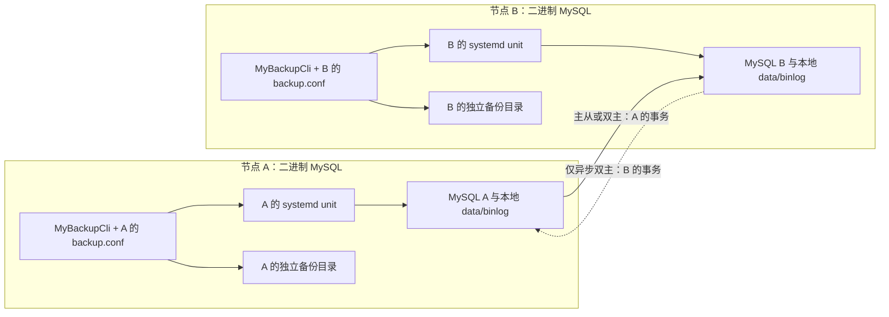
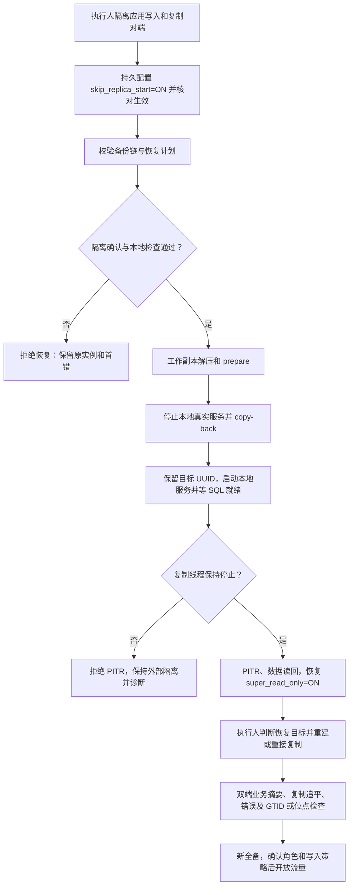

# MySQL 工具：物理备份恢复与原生参数使用指南

本文面向数据库运维人员。物理备份章节说明 MyBackupCli 如何操作 MySQL 容器或由 systemd 管理的二进制实例，区分单机、主从与异步双主的备份、隔离恢复和复制重建；后续章节保留三个独立工具的原生参数入口。执行人应理解 MySQL 事务、binlog 和 Docker bind mount，具备备份文件及实例启停权限。

三个工具彼此独立。以下命令假定相应可执行文件已安装到 PATH；使用源码时，把 `MyBackupCli` 换成 `python3 tools/mysqltools/MyBackupCli.py`，另外两个工具同理。

| 要完成的任务 | 入口 |
| --- | --- |
| 查看普通命令及常用示例 | `MyBackupCli --help`、`MyLogiBackupCli --help` |
| 二进制单机、主从及异步双主的配置与恢复边界 | [二进制部署与复制](#二进制部署主从与异步双主) |
| 为单 MySQL 容器配置物理备份 | [执行位置与路径](#物理备份执行位置与路径) |
| 完成全备、增量和恢复演练 | [物理备份与恢复主线](#物理备份与恢复主线) |
| 恢复中途失败或进入下一备份周期 | [物理恢复异常与保留策略](#物理恢复异常与保留策略) |
| 查看导出、前置检查或定时任务选项 | `MyLogiBackupCli backup --help`、`preflight --help`、`timer install --help` |
| 查看迁移任务配置、预演及失败处理 | `MigrationCli --guide`、`MigrationCli --help` |
| 查命令/阶段、完整拒绝清单和替代配置入口 | 任一工具的 `--help-native`，无需 root、数据库连接或备份目录 |
| 临时添加参数 | [命令行使用](#命令行使用) |
| 保存参数供以后使用 | [配置与定时任务](#配置与定时任务) |
| 参数被拒绝或上游报错 | [失败判断与恢复](#失败判断与恢复) |

## 物理备份执行位置与路径

本节针对 AMD64、Rocky Linux 8.10/9.8、单 MySQL 8.0.33 或 8.0.46 容器、未加密 InnoDB，数据、binlog 和临时目录分别 bind mount 的部署。这里说明当前实现与操作条件；完整验收以 `tests/tools-test-matrix.yaml` 的 TL-MBK-07～09 及其原始证据为准，不能从 MySQL 8.4 或某一个模式的通过推定全部版本通过。外置 general tablespace、独立 undo/redo 目录、keyring、复制拓扑和跨版本恢复没有纳入本节的验证范围。存在这些配置时应停止套用本主线，先制定对应恢复方案。

XtraBackup 通过 socket 查询运行实例，同时直接读取本地文件。SQL 返回的 `@@datadir` 是 MySQL 进程看到的路径，宿主机上的同一批文件可能位于另一个目录。仅能连上数据库不能证明备份到了正确目录。MyBackupCli 的全备、增量均显式传入配置中的 `--datadir`、`--log-bin` 和 `--log-bin-index`；启用容器管理时，还会核对运行实例的 SQL 路径与 Docker writable bind mounts 是否映射到配置的真实目录。

以以下挂载为例，表内两列不能混用：

| 对象 | MySQL 容器内路径 | 宿主机路径 |
| --- | --- | --- |
| datadir | `/var/lib/mysql` | `/data/deploy/mysql8.0.33/data` |
| socket | `/var/lib/mysql/mysql.sock` | `/data/deploy/mysql8.0.33/data/mysql.sock` |
| binlog 目录 | `/var/lib/mysql-logs` | `/data/deploy/mysql8.0.33/logs` |
| binlog index | `/var/lib/mysql-logs/mysql-bin.index` | `/data/deploy/mysql8.0.33/logs/mysql-bin.index` |
| tmpdir | `/var/lib/mysql-tmp` | `/data/deploy/mysql8.0.33/tmp` |

MySQL 的 `log_bin=/var/lib/mysql-logs/mysql-bin.log` 通常生成 `mysql-bin.000001` 和 `mysql-bin.index`；应以运行实例的 `@@log_bin_basename`、`@@log_bin_index` 及实际文件为准，不能直接把配置字符串末尾的 `.log` 当成归档文件前缀。

在宿主机执行以下只读核对。将容器名设为实际 `docker compose ps` 所列实例；不要根据镜像名猜容器名：

```bash
MYSQL_CONTAINER=mysql8.0.33
docker inspect --format '{{.Id}} {{json .Mounts}}' "$MYSQL_CONTAINER"
docker exec -it "$MYSQL_CONTAINER" mysql -uroot -p -e \
  'SELECT VERSION(),@@datadir,@@socket,@@log_bin_basename,@@log_bin_index,@@gtid_mode,@@global.time_zone;'
```

这里 `-p` 交互输入凭据，不将密码写入终端参数或文档。若目录不是 writable bind、路径无法一一对应，或启停属于另一 Docker daemon，先停止配置备份。不要增加宿主机 `/var/lib/mysql` 的软链接来掩盖路径错误。

**宿主机执行。** MyBackupCli、`mysql`、`mysqlbinlog`、`xtrabackup` 及压缩解压依赖须在执行环境中可用；不能假定官方 MySQL server 镜像包含 `mysqlbinlog`。本节 8.0 测试依赖为 Percona XtraBackup 8.0.35-36，使用前核对其支持版本说明与服务端版本；不要使用关闭版本检查的参数绕过兼容要求。运行 `mysql --version`、`mysqlbinlog --version`、`xtrabackup --version` 并记录结果。备份账号需具备该版本 XtraBackup 文档列出的权限（包括备份锁和日志刷新所需权限）；恢复导入还需要相应写入权限，应单独管理恢复凭据。

本节使用 `xtrabackup_lock_ddl=AUTO`，在 PXB 8.0.35-36 上选择 `ON`。这是 MySQL 8.0.33 旧版本备份的必要条件之一；不要把其它版本支持的 `REDUCED` 或关闭锁的配置照搬过来。PXB 从 8.0.34 起已取消原有服务端版本比较检查，命令没有报版本错误本身不能证明兼容；应同时核对[固定版本兼容说明](https://github.com/percona/pxb-docs/blob/f8a15e8e73028742f92f63bddb6fe365bca5e311/docs/server-backup-version-comparison.md)和对应恢复读回结果。

下面是宿主机配置模板。密码为待替换示例，必须在受控编辑器中替换；文件归执行人所有且权限 `0600`。目录、前缀、index 和容器名都必须来自上面的实值核对。备份目录不得位于 datadir 或 binlog 目录内部。

```json
{
  "backup_base": "/mybackup",
  "mysql_user": "mysql_backup",
  "mysql_password": "REPLACE_WITH_CONTROLLED_SECRET",
  "mysql_socket": "/data/deploy/mysql8.0.33/data/mysql.sock",
  "mysql_container": "mysql8.0.33",
  "mysql_datadir": "/data/deploy/mysql8.0.33/data",
  "mysql_binlog_dir": "/data/deploy/mysql8.0.33/logs",
  "mysql_binlog_prefix": "mysql-bin",
  "mysql_binlog_index": "/data/deploy/mysql8.0.33/logs/mysql-bin.index",
  "xtrabackup_parallel": 4,
  "xtrabackup_compress_threads": 4,
  "xtrabackup_use_memory": "1G",
  "xtrabackup_lock_ddl": "AUTO"
}
```

`mysql_container` 非空时，通过本机 Docker 管理目标容器，固定容器 ID 后再操作；不使用 `mysql_service` 启停数据库。对于容器部署，配置宿主机 `mysqld.service` 会管理错误的对象。只有 MySQL 本身由 systemd 管理时，才保持 `mysql_container` 为空并配置真实 `mysql_service`。

**独立工具容器执行。** 工具容器需要同一套二进制与依赖，且连接本机 Docker daemon。把宿主机数据、日志、备份目录以**相同绝对路径**挂进工具容器，沿用上述配置，避免 Docker inspect 返回的宿主机路径在工具容器中不可见。恢复需要写权限和原数字 UID/GID 的所有权恢复能力；只读数据挂载只能用于备份，不能直接用于恢复。Docker socket 访问赋予宿主机管理能力，仅允许可信运维镜像和管理员使用。

下面是**自备完整运维镜像的替代模板**。本次交付的是独立 MyBackupCli 可执行文件，没有交付名为 `MYSQL_BACKUP_TOOL_IMAGE` 的组合镜像；不要把该变量当成产品自带镜像名，也不要直接填官方 MySQL 或 XtraBackup 镜像。采用此模板前，运维方须准备包含 MyBackupCli、Docker CLI、mysql/mysqlbinlog/XtraBackup 及解压依赖的可信镜像，在相同系统/架构上验证各命令版本、时区、socket 与目录访问，再将变量设为该镜像的完整 digest 引用。尚未准备这些输入时，使用前面的宿主机执行方式。

```bash
: "${MYSQL_BACKUP_TOOL_IMAGE:?请设置已验证的工具镜像完整digest引用}"
docker run --rm --user 0 --entrypoint MyBackupCli \
  -e TZ=Asia/Shanghai \
  -v /usr/share/zoneinfo/Asia/Shanghai:/usr/share/zoneinfo/Asia/Shanghai:ro \
  -v /var/run/docker.sock:/var/run/docker.sock \
  -v /data/deploy/mysql8.0.33:/data/deploy/mysql8.0.33 \
  -v /mybackup:/mybackup \
  -v /etc/mysql/backup.conf:/etc/mysql/backup.conf:ro \
  "$MYSQL_BACKUP_TOOL_IMAGE" full -c /etc/mysql/backup.conf
```

工具在独立容器中运行，才能在恢复时停止并重新启动 MySQL 容器。不要在将被停止的 MySQL 容器里运行完整恢复，否则停止目标容器也会终止恢复进程。直接在 MySQL 容器里进行备份需要工具及依赖真实存在、使用该容器可见路径；该执行方式没有等同于本节的独立工具容器生命周期验收。

本项目的工具容器验收采用另一种组合方式：固定 digest 的 XtraBackup 镜像，挂载冻结的 MyBackupCli、校验过的静态 Docker CLI、保留原参数的原生客户端适配器，以及同绝对路径的目录和 Docker socket；适配器调用固定镜像中的真实原生命令。它验证独立进程/挂载命名空间与目标容器启停的交接，不代表任意自备镜像已经通过验收。执行环境的组成发生变化时，仍需在隔离实例完成全生命周期演练。

## 物理备份与恢复主线

先在隔离恢复实例演练完整流程，再用于生产恢复。执行人必须核对 SQL 实例、挂载、版本、账号权限、可用空间和时区；恢复窗口内停止应用写入并隔离流量。`xtrabackup_use_memory=1G` 是 prepare 内存预算示例，线程数并非性能或容量保证。空间需要同时容纳原始压缩链、解压/prepare 工作副本、恢复后的数据以及保留的原目录，须按实际数据量和压缩比测量峰值，不能只给一个压缩全备的空间。

备份读取账号与恢复管理账号分开使用。以下 `full/incr/binlog/purge` 使用 `/etc/mysql/backup.conf`；恢复窗口由管理员通过受控编辑器另建 `/etc/mysql/backup-restore.conf`，保留同一目标的全部路径、服务/容器、topology 和 `backup_base`，只将 `mysql_user/mysql_password` 改为恢复专用账号。两份文件均归执行人所有、权限 `0600`。恢复账号须能完成 SQL 导入、复制状态检查，以及复制场景的全局只读设置；操作系统执行人还须能管理实际服务和文件所有权。工具不会自动提升一个仅具备备份读取权限的账号。恢复期间暂停这些目录的定时备份和 purge，完成读回及新全备后再恢复计划，避免并发任务修改归档。

以下命令在配置对应的同一执行环境中运行。先将 `MYSQL_SOCKET`、`MYSQL_BACKUP_USER` 分别设置为该目标 `backup.conf` 中的实际 `mysql_socket`、`mysql_user`。前面的容器宿主机 socket 例子为 `/data/deploy/mysql8.0.33/data/mysql.sock`，二进制部署则使用本机实际路径；不要混用两个场景的路径。后续 `BACKUP_DATE` 使用本次全备实际生成的日期，不能把示例日期直接用于另一批备份：

```bash
: "${MYSQL_SOCKET:?请先设置本目标 backup.conf 中的实际 mysql_socket}"
: "${MYSQL_BACKUP_USER:?请先设置本目标 backup.conf 中的实际 mysql_user}"
sudo MyBackupCli full -c /etc/mysql/backup.conf
sudo MyBackupCli incr -c /etc/mysql/backup.conf
sudo MyBackupCli incr -c /etc/mysql/backup.conf
mysql --socket="$MYSQL_SOCKET" -u"$MYSQL_BACKUP_USER" -p \
  -e 'FLUSH BINARY LOGS;'
sudo MyBackupCli binlog -c /etc/mysql/backup.conf
```

每一步检查退出码为 0 及对应完成日志；全备和增量目录应有 `.backup_ok`。失败的目录不能作为下次增量基线。两次增量均属于最近一次有效全备，LSN 必须前后连续。`binlog` 日常入口只复制已关闭日志；上面的 MySQL 管理命令用于关闭物理快照坐标所在的当前日志，执行人须有相应刷新权限。若漏掉刷新和归档，恢复可能在停库前拒绝并报告 `Archived binlogs do not include the physical snapshot position`。此时补齐日志关闭、归档和重新审计，不能删除坐标检查绕过。业务环境中应按恢复点目标定期归档 binlog，不能用全备/增量成功代替持续日志保护。

```bash
BACKUP_DATE=2026-11-25
sudo MyBackupCli checksum -c /etc/mysql/backup-restore.conf --date "$BACKUP_DATE"
sudo MyBackupCli restore-dry-run -c /etc/mysql/backup-restore.conf --date "$BACKUP_DATE"
sudo cat "/mybackup/restore_audit/$BACKUP_DATE/restore.plan.json"
```

核对计划中的 `full`、全部 `incr` 和 `binlog` 为本次恢复点所属链，`status` 为 `READY`，且文件没有缺失。`restore-dry-run` 会检查备份、日志连续性及容器路径并生成计划，但没有执行解压、prepare 或实际恢复。计划可生成不等于数据可恢复。不要手工改计划以绕过校验。

恢复时，工具先复制备份到工作目录，解压并验证物理 binlog 坐标，再 prepare 全备与增量；这些步骤在停库之前完成，原始备份保留以便重试。随后停止真实实例、确认 SQL 已不可用、保存原数据与外置 binlog，再 copy-back、恢复所有权、启动并等待 SQL 就绪，最后执行 binlog 重放。

恢复时间采用 **mysqlbinlog 执行环境的本地时区**，与数据库 session 时区不同。下面例子要求执行端实际 `date +%z` 为 `+0800`；容器只有 `TZ=Asia/Shanghai` 而没有相应 zoneinfo 时可能仍按 UTC 解析，必须先核对。起始时间应不晚于所选物理快照的 binlog 坐标对应时刻，文件/位置下界由工具从最终物理备份坐标确定；把起始时间设在其后会跳过本应重放的事务。结束时间为业务确认的恢复截止边界，同一秒内的交易无法仅凭时间区分，需另行评估位置级恢复。

```bash
date '+%Y-%m-%d %H:%M:%S %z %Z'
BACKUP_DATE=2026-11-25
RECOVERY_START='2026-11-25 09:00:00'
RECOVERY_STOP='2026-11-25 10:00:00'
sudo MyBackupCli restore -c /etc/mysql/backup-restore.conf --date "$BACKUP_DATE" \
  --confirm-destructive-restore \
  --binlog-start-time "$RECOVERY_START" --binlog-stop-time "$RECOVERY_STOP"
```

三个时间值均为待替换输入，须依据备份记录和业务事件确定。省略结束时间会重放到归档日志末尾，只适合明确要求恢复至该末尾的任务。只有退出 0 并出现 `MYSQL RESTORE COMPLETED SUCCESSFULLY!`，才表示工具完成流程；仍须用受控账号核对关键业务表、账目总额、事务完整性，并验证截止前记录存在、截止后记录不存在。必要时运行应用只读检查；未完成读回前不得恢复写流量。

## 物理恢复异常与保留策略

| 停止位置 | 数据状态与处置 |
| --- | --- |
| 版本、映射、客户端、解压或 prepare 失败 | 尚未覆盖原实例。保留首错和计划，核对版本、路径、权限、空间或缺档；修复后重新审计，不能接受没有完成标志的备份 |
| copy-back 失败 | 工具尝试恢复本次保存的原数据与外置 binlog；只有回滚成功才允许重新启动。若回滚本身失败，保持停库，先核对原目录、目标目录和日志保存位置，不手工启动半成品 |
| 启库或 PITR 失败 | copy-back 可能已经完成，PITR 也可能已经导入部分事务。保持应用写入隔离，保留退出码、计划、mysql 错误日志；修复原因后从保留的原始备份重新恢复，不能对部分导入结果盲目追加重放 |
| 服务停止后仍能执行 SQL | 启停对象与连接实例不一致，工具拒绝覆盖。核对容器 ID、socket 和 Docker daemon，不改保护逻辑继续执行 |

原 datadir 保存在同级 `data.bak_时间戳`；外置 binlog/index 保存在日志目录下 `.mysql-bin.before_restore_时间戳`（名称前缀随配置变化）。error/slow 日志保留。恢复的 binlog index 会改写为 MySQL 容器实际可见路径，所有权沿用原数字 UID/GID。上述保存目录不是自动永久归档：先完成读回、独立备份和恢复点签收，再按变更单回收；不要在排查期间删除它们。

恢复会形成新的数据库历史。工具以 `lock/restore-needs-full` 拒绝随后直接追加增量或 binlog，必须先完成一次新的 `full`，再安排新的 `incr`、`binlog`。每次全备具有独立 binlog 分代，避免恢复后重新编号的日志混入旧链。不要删除该保护文件强行续接旧链。

保留策略按备份日期目录管理，并保留窗口之前最近的有效全备作为增量恢复基线。定期核对仍需使用的恢复点、其增量与日志依赖后再运行：

```bash
sudo MyBackupCli purge -c /etc/mysql/backup.conf --backup-days 15 --binlog-days 30
```

15/30 天是示例，须满足业务 RPO、审计及灾备要求。`purge` 会删除过期归档，没有预演模式；执行前核对独立副本与最后成功恢复演练记录。不能通过删除近期备份内 mtime 较旧的表空间文件来节省空间，也不要让 MySQL 自身日志过期早于归档周期。

本节机制依据：[PXB 8.0 支持版本](https://docs.percona.com/percona-xtrabackup/8.0/supported-versions.html)、[增量 prepare](https://docs.percona.com/percona-xtrabackup/8.0/prepare-incremental-backup.html)、[恢复与权限](https://docs.percona.com/percona-xtrabackup/8.0/restore-a-backup.html)、[PITR](https://docs.percona.com/percona-xtrabackup/8.0/point-in-time-recovery.html)、[MySQL 8.0.33 mysqlbinlog 时间解析](https://github.com/mysql/mysql-server/blob/mysql-8.0.33/client/mysqlbinlog.cc)、[Docker bind mounts](https://docs.docker.com/engine/storage/bind-mounts/)。上游支持条件、工具实现和实验室验收是三个不同层次；本节不承诺零数据损失或未经测量的恢复时长。

## 二进制部署、主从与异步双主

本节适用目标为 AMD64、Rocky Linux 8.10/9.8、MySQL 8.0.33/8.0.46、未加密 InnoDB，拓扑限定二进制单机、一主一从和异步双主。各拓扑分别在两套系统、两个精确 MySQL 版本、GTID OFF/ON 下完成了全备、两级增量、日志归档、在线和停机 PITR、目标身份及数据读回、恢复后新备份周期；复制场景还完成了 donor 重建和重接读回。上述分项证据对应 `tests/tools-test-matrix.yaml` 的 TL-MBK-10～12，最终完整验收另由 TL-MBK-13 判定。它们不替代客户现场演练或变更签署。Galera、Group Replication、多源复制、跨版本恢复、外置 general tablespace/undo/redo 不属于此流程。

二进制安装描述 MySQL 如何安装，systemd 描述谁负责启停，两者不是同一概念。二进制单机必须由真实 systemd unit 管理；仅用 shell、`nohup` 或 `mysqld_safe` 启动且没有 unit 的实例，不能直接使用本工具的完整恢复。工具每次只处理一个本地实例，不自动发现所有节点、选择主库、关闭应用入口或切换流量。

下图区分工具控制路径与数据库复制路径。A、B 各有自己的配置和备份目录；即使字段名称相同，值也必须对应执行所在节点。



主从通常只有 A 向 B 传播业务事务；异步双主还有反向复制。异步复制不保证写入确认时对端已经持久化，也不自动解决双端写入冲突。备份完成不等于全拓扑一致，恢复一个节点也不等于其它节点已经回到同一恢复点。

### 选择配置及理解空值

完整、可解析的配置见 [mybackup.conf.example](mybackup.conf.example)。它使用标准 JSON：`_comment_*` 是被忽略的说明字段，实际配置在紧随其后的字段中。不要加入 JSON 不支持的 `#`、`//` 行注释，也不要把下面的合并片段当作完整配置覆盖凭据、路径和原生选项。

| 部署/角色 | `mysql_container` | `mysql_service` | `mysql_topology` | 结果 |
| --- | --- | --- | --- | --- |
| 二进制单机 | `""` | 真实 unit，例如 `mysqld.service` | `standalone` | 管理本机服务；检测到入站复制通道即拒绝 |
| 一主一从的主库 | `""` | 本机主库 unit | `primary-replica` | 无入站通道时普通物理备份；恢复仍需隔离确认 |
| 一主一从的从库 | `""` | 本机从库 unit | `primary-replica` | 对真实单通道检查接收/应用线程，自动增加安全备份及上游坐标选项 |
| 异步双主的 A、B | `""` | 各自本机 unit | `dual-primary` | 备份要求各自只有一个入站通道；不管理另一端 |
| 单 MySQL 容器 | 实际目标容器名/ID | 忽略 | `standalone` | 通过 Docker 启停目标；沿用前面的 bind mount 规则 |

`mysql_container` 默认空，表示选择 systemd；它不是“自动判断安装方式”。`mysql_service` 默认 `mysqld`，在 systemd 模式不能为空。`mysql_topology` 默认 `standalone`，空字符串非法；主从两端都必须显式选择 `primary-replica`，不能让主库因为没有入站通道而仍按单机恢复。

路径全部由运行 MyBackupCli 的执行环境解释。二进制部署应与 SQL 查询的实际路径一致。以下为单机的合并示例，所有目录必须实际存在、属于目标实例：

```json
{
  "mysql_container": "",
  "mysql_service": "mysqld.service",
  "mysql_topology": "standalone",
  "mysql_socket": "/data/mysql/mysql.sock",
  "mysql_datadir": "/data/mysql",
  "mysql_binlog_dir": "/data/mysql-logs",
  "mysql_binlog_prefix": "mysql-bin",
  "mysql_binlog_index": "/data/mysql-logs/mysql-bin.index"
}
```

主从两端将 `mysql_topology` 改为 `primary-replica`；异步双主两端改为 `dual-primary`，其它值按各节点实值配置。`mysql_binlog_dir` 缺省或空字符串时回落到 `mysql_datadir`，`mysql_binlog_index` 缺省或空字符串时回落到该目录的 `<mysql_binlog_prefix>.index`。外置日志不能留空后期待自动发现。`mysql_password` 空字符串时读取执行端 `MYSQL_BACKUP_PASSWORD`；两者都为空则拒绝。每实例独享 `backup_base`，不能让两个实例共用增量基线或锁。

使用受控账户、交互密码做只读核对；`MYSQL_SOCKET` 必须先设置为目标真实路径，后续归档主线沿用同一个值：

```bash
: "${MYSQL_SOCKET:?请设置本机目标实例的真实 socket}"
mysql --socket="$MYSQL_SOCKET" -uroot -p -e \
  'SELECT VERSION(),@@server_id,@@server_uuid,@@datadir,@@log_bin_basename,@@log_bin_index,@@gtid_mode,@@skip_replica_start,@@log_replica_updates,@@read_only,@@super_read_only; SHOW REPLICA STATUS\G'
systemctl cat mysqld.service
```

最后一个命令中的服务名也须替换为配置中的真实 unit。核对 ExecStart/配置文件指向同一数据目录和 socket，不能只看服务名包含 mysql。工具对非容器部署检查 SQL 返回的 data/binlog/index 与配置路径一致；对容器部署使用前文 Docker mount 映射核对。

备份账号除 XtraBackup 的官方备份权限外，需要读取 `performance_schema.replication_connection_configuration`、`replication_connection_status`、`replication_applier_status`、`replication_group_members` 和 `global_variables`；安全从库备份还涉及停止/启动复制线程的权限。恢复账户需要启停服务及本地文件权限、PITR 写入权限，并能设置全局只读状态。不要把主从复制账户、备份读取账户和恢复管理账户当作同一个角色直接复用。

### 备份与复制恢复的控制边界

全备、增量、binlog 归档、校验及恢复审计沿用[物理备份与恢复主线](#物理备份与恢复主线)。从库和双主备份要求 `log_replica_updates=ON`，使复制应用的事务进入本地 binlog，才能使用本地日志完成后续 PITR。GTID OFF 时尤其不能把本机 binlog 坐标误认为上游坐标。

工具根据真实入站通道给 XtraBackup 增加 `--slave-info`、`--safe-slave-backup`。前者保存上游坐标，后者由 XtraBackup 暂停并恢复 SQL 应用线程，等待安全备份条件；它可能使复制短暂落后，需安排备份窗口。它不隔离应用、不证明从库历史数据与主库一致，也不代替恢复时的复制隔离。缺少上游坐标文件的从库备份不能发布成功标志。`.mysql_topology.json` 记录备份来源身份和拓扑；增量来源 UUID、GTID 模式或拓扑变化时，必须重新全备，不续接旧链。

日常复制备份要求接收和应用线程健康。恢复后的节点尚未重接时，只允许一个受限例外：本仓库已有工具恢复产生的 `lock/restore-needs-full`、所有复制线程停止且 `super_read_only=ON`，才可生成恢复后新全备。双主此时可以暂时没有通道，供下面的权威点重建流程使用；新全备完成后恢复日常检查。不要手工创建保护标记、删除通道或关闭只读来套用这个例外。

复制恢复的顺序如下。隔离是执行人的实际运维动作，确认参数只是声明已经完成，工具无法替执行人证明远端应用已经停止写入。



`skip_replica_start=ON` 必须写入实例实际读取的 `[mysqld]` 配置并重启确认，不是给 MyBackupCli 的 JSON 参数，也不能用恢复前执行一次 `STOP REPLICA` 替代。后者不会阻止下一次 mysqld 启动时自动复制。对于已有实例，配置重启前先安排维护窗口、停写并停止入站通道；不要在生产上为试参数直接重启。恢复期间也须保证 `read_only=ON`、`super_read_only=ON` 的持久启动策略，防止节点重启时先接受应用写入。

只有上述隔离和当前审计计划真实完成后，复制恢复才使用下面的额外确认；日期和时间仍须来自本次恢复点，完整命令参照前文：

```bash
sudo MyBackupCli restore -c /etc/mysql/backup-restore.conf --date "$BACKUP_DATE" \
  --confirm-destructive-restore --confirm-replication-isolated \
  --binlog-start-time "$RECOVERY_START" --binlog-stop-time "$RECOVERY_STOP"
```

工具不会自动执行 `START REPLICA`，也不会修改另一端、清理复制元数据或自动解除写入隔离。复制模式下，PITR 窗口仅关闭 `super_read_only`，保留 `read_only=ON`，允许具备管理权限的恢复账户重放；无论重放成功或失败，都尝试恢复 `super_read_only=ON`。具有管理权限的其它账户仍可能写入，因此外部隔离不能省略。失败时保留首错；若只读保护本身设置失败，继续保持流量隔离并人工核对。

恢复 copy-back 保留**目标节点原有** `auto.cnf`，维持该节点 UUID；另一节点必须拥有不同的 `server_id` 和 `server_uuid`。目标节点的 `mysqld-auto.cnf` 也按目标原配置保留；原来没有此文件时，不引入 donor 的持久变量，避免覆盖该节点的启动保护。此行为不授权复制运行中的数据目录来克隆实例。

从另一节点的备份重建本节点时，工具通过备份来源 UUID 与目标 UUID 区分 donor 恢复。目标原数据和 binlog 保留在本次 `.bak_*` / `.before_restore_*` 目录，不能追加到 donor 的归档中；重放只使用已审计的 donor 备份链和对应 binlog。恢复后的新全备必须回到该节点独享的备份目录，不能继续让两个节点共享增量基线。

### 已停机的二进制实例如何恢复

正常在线恢复仍从 SQL 核验版本。实例已经停机、原 SQL 无法查询时，显式加 `--offline-restore`；工具从真实 systemd unit 的 mysqld 二进制获取版本，再用该二进制的 `--verbose --help` 核验有效启动路径。它不会先创建空库或猜测版本。

此入口要求保留原数据目录的普通目录本身及目标 `auto.cnf`，并在工具 JSON 中填写 `mysql_defaults_file`。默认空值不影响在线操作；它指向服务端实际 my.cnf，不能指向 backup.conf。systemd 的 `ExecStart` 必须直接为 `绝对路径/mysqld --defaults-file=绝对路径/my.cnf`；wrapper、额外启动参数和容器暂不支持这个停机入口，应使用已明确验证的对应恢复路径，不能绕过检查。

停机入口还要求该 my.cnf 显式提供与工具配置一致的绝对 `datadir`、`socket`、`log-bin` 和 `log-bin-index`。这里比较的是 mysqld `--verbose --help` 输出的启动选项原值，不推断相对路径、默认文件名或扩展名转换；例如二进制部署应将 `log-bin` 直接写成实际绝对前缀 `/data/mysql-logs/mysql-bin`，不要照搬前面容器示例的 `mysql-bin.log` 写法。相对值或带扩展名的有效 MySQL 配置可能被此保守入口拒绝。上线演练时即核对这一条件；现有实例若需改配置，应按维护流程先核实当前实际日志路径并演练，不能在故障时临时改名或关闭校验。此限制不改变普通在线备份及容器路径映射的含义。

复制节点的有效启动参数还必须包含 `skip_replica_start=ON` 和 `super_read_only=ON`。持久变量文件若覆盖路径或关闭这些保护，工具拒绝执行。先确认应用与对端已隔离，服务已停机，配置与备份的精确 MySQL 版本、GTID 和拓扑一致，再执行：

```bash
# 在本次恢复的目标节点执行；BACKUP_DATE/RECOVERY_START/RECOVERY_STOP
# 使用前文已选定的备份日期、快照后的重放起点和业务确认的截止时间。
sudo MyBackupCli checksum -c /etc/mysql/backup-restore.conf --date "$BACKUP_DATE" --offline-restore
sudo MyBackupCli restore-dry-run -c /etc/mysql/backup-restore.conf --date "$BACKUP_DATE" --offline-restore
sudo MyBackupCli restore -c /etc/mysql/backup-restore.conf --date "$BACKUP_DATE" \
  --offline-restore --confirm-destructive-restore --confirm-replication-isolated \
  --binlog-start-time "$RECOVERY_START" --binlog-stop-time "$RECOVERY_STOP"
```

单机省略 `--confirm-replication-isolated`，其它确认、备份审计和数据读回不省略。命令会在 copy-back 完成后启动目标 unit，等待 SQL 就绪，再按恢复点重放；复制线程必须保持停止，结束后仍只读。缺少新备份的拓扑/版本元数据、目标配置无法证明安全、备份链或日志不完整时，应停在拒绝点，保留首错，不切换为一个未经验证的启动方式继续覆盖。

### 选择重接还是按恢复点重建

修复一个从库、并希望它回到健康主库的**当前**状态时，重接会继续接收主库的新事务。GTID 模式要核对来源、已执行集合及是否存在本地额外事务；文件/位点模式必须使用与备份一致的**上游**坐标，不能拿 `xtrabackup_binlog_info` 的本机坐标代替 `xtrabackup_slave_info`。有复制错误、来源不符、缺失上游日志或额外事务时停止重接，保留诊断并从确认的权威备份重建。单独的 `Seconds_Behind_Source=0` 不能证明数据一致。

如果业务目标是让整个系统回到某个历史时刻，直接把已恢复节点接回仍保留新事务的对端，会把截止时间之后的数据重新带回来。应保持两端隔离，由业务与运维确认权威恢复点，以它为依据重建其它成员，再检查复制。异步双主还必须核对两个方向的复制线程、错误、GTID/位点、唯一键及自增策略，验证 A 写入能在 B 读回、B 的许可写入能在 A 读回，并比较业务数据摘要。工具不选择哪端数据为准，不执行双主自动回切。

恢复完成日志仅表示单节点工具流程完成，不表示拓扑恢复完成。下面给出人工控制复制的连续流程。对应主从和双主实测中，恢复边界之前的验证记录存在，之后的记录被排除；重建后两端业务摘要相同，双主两个许可方向的写入均在对端读回，并完成新的 full/incr。这个结果证明所测数据与恢复边界成立，不能外推为任意业务数据量、复制冲突或无停写恢复的保证。

### 从权威恢复点重建一主一从或异步双主

本流程用于两端都保持隔离、A 已恢复到业务确认的状态、以 A 重建 B 的情况。它会丢弃 B 当前数据作为服务数据；B 原目录由工具保存供故障调查和回退，不用于合并两个冲突历史。开始前保存两端的 `SHOW REPLICA STATUS\G`、`SHOW MASTER STATUS`、`@@server_uuid`、`@@server_id`、`@@gtid_executed` 及恢复计划，确认不同的 UUID/server_id，备份与目标精确 patch 版本、GTID 和拓扑相同。不能用本流程在不同 MySQL 版本之间迁移。

以下约定 A/B 都由各自的 systemd unit 管理，管理员在**对应节点**连接其实际 socket。`/etc/mysql/backup.conf` 始终描述本机；只有 B 的临时 donor 配置改为读取 A 的归档。IP、端口、socket、复制账号及业务表均须替换为当前环境实值。SQL 通过受控管理员会话执行，口令不放到 shell 命令行；包含复制凭据的 SQL 不应进入本地命令历史：

```bash
MYSQL_SOCKET=/data/mysql/mysql.sock
MYSQL_HISTFILE=/dev/null mysql --socket="$MYSQL_SOCKET" -uroot -p
```

1. **两端保持只读和复制停止。** 已配置通道的节点先执行 `STOP REPLICA;`；无通道的主库不执行该语句。持久 my.cnf 中保留 `skip-replica-start=ON`、`read-only=ON`、`super-read-only=ON`，按前文维护窗口重启并核对。这时停止应用入口及对端复制连接的外部隔离仍然有效。A 的数据已经按前文恢复、读回并确认后，再在两端执行：

   ```sql
   SET GLOBAL super_read_only=ON;
   RESET REPLICA ALL;
   SELECT @@server_uuid,@@server_id,@@gtid_mode,@@gtid_executed,
          @@skip_replica_start,@@read_only,@@super_read_only;
   SHOW REPLICA STATUS\G
   ```

   `RESET REPLICA ALL` 删除本地通道的连接配置及 relay log；此后需重新填写上游和凭据，因此必须先保存诊断。它不清除 GTID 已执行历史。不要执行 `RESET MASTER`、设置 `gtid_purged` 或跳过复制错误来制造一致。此时 `SHOW REPLICA STATUS` 应无通道；只读/启动保护都应为 ON。任何不符都停在这里。

2. **在 A 生成独立的新全备及归档。** A 保持无业务写入，使用 A 的本地配置：

   ```bash
   sudo MyBackupCli full -c /etc/mysql/backup.conf
   mysql --socket="$MYSQL_SOCKET" -uroot -p -e 'FLUSH BINARY LOGS; SHOW MASTER STATUS;'
   sudo MyBackupCli binlog -c /etc/mysql/backup.conf
   ```

   记录此次全备日期及刷新后 A 的 `File`/`Position`，作为下面的 `A_FILE`/`A_POS`。A 此后保持无写入直到 B 重建、坐标核对和复制建立完成。GTID OFF 时，这个坐标成立的前提是全备后 A 没有数据变化；不能在 A 继续写入时拿稍后查询的当前位置配旧快照。若不能停写，须另用与快照准确对应的复制建库流程，不套用此简化维护主线。

3. **将 A 的整套归档复制至 B 的独立 donor 目录。** 用受控传输工具复制 A 的 `backup_base`，保留符号链接和文件属性，逐文件核对 SHA256；B 上使用与 A 相同的绝对归档路径，且该路径不得覆盖 B 原备份目录。传输期间 A 不得 purge、写入新增量或修改该归档。这里复制的是完成的备份仓库，绝不是运行中的 datadir。保存 B 原配置，以 B 的 `/etc/mysql/backup-restore.conf` 为基础建立权限 `0600` 的 `/etc/mysql/backup-donor.conf`：保留 B 的服务名、socket、datadir、binlog/index、恢复凭据、topology，仅将 `backup_base` 指向这份 A 仓库。不要把 A 的连接及服务配置整体复制给 B。

4. **在 B 审计并通过工具恢复 donor。** B 若已停机，三个命令均加 `--offline-restore`，并满足前文 direct unit 和 `mysql_defaults_file` 要求。下列在线例子读取步骤 2 新生成的全备；`DONOR_START` 为该全备完成之后、且两端仍无业务写入的实测本地时间，因此只恢复新全备的内容，不引入新业务事务：

   ```bash
   BACKUP_DATE=2026-11-25
   DONOR_START='2026-11-25 14:30:00'
   sudo MyBackupCli checksum -c /etc/mysql/backup-donor.conf --date "$BACKUP_DATE"
   sudo MyBackupCli restore-dry-run -c /etc/mysql/backup-donor.conf --date "$BACKUP_DATE"
   sudo MyBackupCli restore -c /etc/mysql/backup-donor.conf --date "$BACKUP_DATE" \
     --confirm-destructive-restore --confirm-replication-isolated \
     --binlog-start-time "$DONOR_START"
   ```

   日期和时间是示意，不能照抄。检查计划确实指向 A 新全备、无旧增量，归档含快照坐标。恢复后核对 B UUID 等于恢复前 B UUID，A/B 的业务内容一致，B 为只读且没有运行的复制线程。B 可能从 donor 获得通道元数据，连接复制前在 B 再执行 `RESET REPLICA ALL;`。任何数据、身份或保护检查失败都继续隔离，不进入下一步。

5. **先建立 B 从 A 的方向。** 在 B 的管理员会话执行下列两种语句之一，不能混用 GTID 和文件/位点参数。复制账户应已存在于 A，授权 B 的真实连接地址；示例使用 `REPLACE_*` 强制标明待替换输入。沿用生产已有 TLS 策略及证书，不能为重建关闭 TLS；若账户使用 caching_sha2_password 且无 TLS，须按 MySQL 官方安全连接要求提供已验证的 RSA 公钥，不能直接套用连接示例。

   ```sql
   -- GTID ON：先核对两端 @@gtid_executed，B 不应包含 A 没有的额外事务。
   CHANGE REPLICATION SOURCE TO
     SOURCE_HOST='REPLACE_A_HOST',SOURCE_PORT=3306,
     SOURCE_USER='REPLACE_REPLICATION_USER',SOURCE_PASSWORD='REPLACE_SECRET',
     SOURCE_AUTO_POSITION=1;
   START REPLICA;
   SHOW REPLICA STATUS\G
   ```

   ```sql
   -- GTID OFF：使用步骤 2 冻结状态记录的 A_FILE/A_POS，替换文件名和位置。
   CHANGE REPLICATION SOURCE TO
     SOURCE_HOST='REPLACE_A_HOST',SOURCE_PORT=3306,
     SOURCE_USER='REPLACE_REPLICATION_USER',SOURCE_PASSWORD='REPLACE_SECRET',
     SOURCE_AUTO_POSITION=0,SOURCE_LOG_FILE='REPLACE_A_FILE',SOURCE_LOG_POS=REPLACE_A_POS;
   START REPLICA;
   SHOW REPLICA STATUS\G
   ```

   `REPLACE_A_POS` 必须替换为记录的十进制 `A_POS`，例如记录为 `157` 就填 `SOURCE_LOG_POS=157`；未替换的模板故意不能执行，不能任取日志起始位置 4。接收与应用线程均须为 Yes，`Last_IO_Error`、`Last_SQL_Error` 为空，并比较完整业务内容。若上游所需日志已清理、认证失败或存在额外 GTID，应停止并诊断，不能使用跳事务绕过。

6. **仅异步双主增加 A 从 B 的方向。** 两端仍不接受业务写入时，在 B 记录 `SHOW MASTER STATUS` 的 B_FILE/B_POS；在 A 使用与步骤 5 相同的 GTID ON 语句，或 GTID OFF 语句中的 B_HOST/B_FILE/B_POS，建立 A 从 B 的复制。两端 `server_id` 和 UUID 必须不同，`log_replica_updates=ON`，业务唯一键和自增分配策略保持经评审的生产设置。双向复制可用不表示任意双端并发写入都不会冲突。

7. **验收角色、数据和新备份周期。** 主从只在 A 解除只读，B 保持只读；双主按业务既定写入策略，在允许的节点解除只读。先从受控业务验证表提交唯一测试记录：A 提交后在 B 读回；双主再在 B 提交另一唯一记录并在 A 读回。比较关键业务表的条数、主键范围和规范化内容摘要，检查两个方向无复制错误；不能只看延迟为 0。失败时立即恢复只读、停止相关通道并保持外部隔离，保留首错与旧目录，重新判断权威数据，不盲目反向重放。

   最后在**每个节点**切回本机原 `/etc/mysql/backup.conf`，各自执行新 `full`，再按计划执行 `incr`、binlog 归档及审计；不得把 B 的增量继续写入 donor 仓库。新全备和首次增量 LSN 应衔接。角色、业务及新备份都通过后，才按变更单开放流量；持久只读策略按最终角色调整，`skip-replica-start=ON` 是否保留须纳入重启后人工启动复制的运维约定。

单个从库希望追到主库当前状态时，可以省略“整个拓扑历史回退”的权威点选择，但仍要证明恢复快照与上游坐标的对应关系。若对从库做过本地 PITR，本机归档中的事件未必能映射为可直接重接的上游 file/position；不能把 `xtrabackup_slave_info` 的旧位置与 PITR 后的新数据混用。没有这个证明时，采用上面的权威全备重建路径。

国内制品入口也须核对精确版本与 ABI。华为 Downloads 地址不是“所有 MySQL 版本均存在”的保证。只有 EL9 的包不能作为 Rocky 8.10 的兼容证据；下载由固定 runner 以国内 HTTPS 源、可信摘要和原子替换管理，缺包、摘要不符或境外重定向时应在现场变更前拒绝，不关闭校验或换相近版本继续。

机制依据：[固定版本 Percona 复制环境备份](https://github.com/percona/pxb-docs/blob/f8a15e8e73028742f92f63bddb6fe365bca5e311/docs/make-backup-in-replication-env.md)、[固定 PXB 8.0.35-36 复制检查实现](https://github.com/percona/percona-xtrabackup/blob/percona-xtrabackup-8.0.35-36/storage/innobase/xtrabackup/src/backup_mysql.cc)、[MySQL 复制启动参数](https://dev.mysql.com/doc/refman/8.0/en/replication-options-replica.html)、[CHANGE REPLICATION SOURCE TO](https://docs.oracle.com/cd/E17952_01/mysql-8.0-en/change-replication-source-to.html)、[GTID 自动定位](https://docs.oracle.com/cd/E17952_01/mysql-8.0-en/replication-gtids-auto-positioning.html)、[RESET REPLICA](https://docs.oracle.com/cd/E17952_01/mysql-8.0-en/reset-replica.html)、[MySQL 8.0.33 UUID 初始化源码](https://github.com/mysql/mysql-server/blob/mysql-8.0.33/sql/mysqld.cc)。

## 先选择参数要交给谁

例如 `--native-option mysqldump=--extended-insert` 的含义是“给 mysqldump 增加 `--extended-insert`”。等号左边是命令或阶段，右边是这个命令自己的选项。它不会自动给其它命令添加同一选项。

| 工具 | 等号左侧填写 | 实际用途 |
| --- | --- | --- |
| MigrationCli | `mysqldump` | 源库 SQL 导出，包括结构导出和逐表数据导出 |
| MigrationCli | `mysql` | 目标库 SQL 导入；不作用于源库或 PyMySQL 连接 |
| MyLogiBackupCli | `mysql` | 前置检查、版本与数据库信息查询 |
| MyLogiBackupCli | `mysqldump` | 导出 SQL |
| MyBackupCli | `mysql` | 版本、备份信息查询，以及恢复时写入 binlog；不是 XtraBackup 的连接配置 |
| MyBackupCli | `mysqlbinlog` | 恢复时解析 binlog；不作用于 binlog 文件复制 |
| MyBackupCli | `xtrabackup-backup` | `full`、`incr` 的备份阶段 |
| MyBackupCli | `xtrabackup-prepare` | `restore` 内部的全量及增量 prepare 阶段 |
| MyBackupCli | `xtrabackup-decompress` | `restore` 内部的解压阶段 |
| MyBackupCli | `xtrabackup-copy-back` | `restore` 内部的数据复制阶段 |

必须完整填写上表名称，例如 `prepare` 不能代替 `xtrabackup-prepare`。参数只在所选命令实际执行时使用：给 `full` 指定 prepare 参数并不会启动 prepare，也不能证明该参数已经生效。

## 命令行使用

每次 `--native-option` 只接收一个原生长参数；多个参数重复写。带值时使用 `--参数=值`，无值开关直接写 `--参数`。不接受 `-e` 这类短参数、独立位置参数或整串 shell 命令。

下面的逻辑备份示例要求已有 `mysql-backup` 登录路径、独立挂载的 `/backups`、可写备份目录，以及主次版本与服务端相同的 mysql/mysqldump 客户端。`app` 必须是备份账号可见的真实数据库。

```bash
# 仅给前置 mysql 查询设置连接超时；预检不执行 SQL 导出。
sudo MyLogiBackupCli preflight --database app \
  --native-option mysql=--connect-timeout=15

# 只改变 mysqldump 的 INSERT 输出形式。
sudo MyLogiBackupCli backup --database app \
  --native-option mysqldump=--extended-insert

# 同时给两个不同命令设置各自的选项。
sudo MyLogiBackupCli backup --database app \
  --native-option mysql=--connect-timeout=15 \
  --native-option mysqldump=--max-allowed-packet=256M
```

预检成功应输出 `MYSQL_BACKUP_PREFLIGHT_OK`；备份必须退出 0 并输出 `MYSQL_BACKUP_OK archive=...`，才表示工具完成了导出、归档回读和发布。预检成功不能替代实际备份成功；归档完成仍须按既定流程演练恢复和业务读回。

`15` 秒和 `256M` 是参数语法示例，不是生产统一配置。默认仍使用逐行 INSERT；显式添加 `--extended-insert` 会改变输出组织，但不能消除查询等待或 1412，也不会让 `--single-transaction` 隔离所有 DDL。

物理工具要求已有权限为 `0600`、通过版本兼容检查的配置文件；其中服务名、数据目录、socket 和备份目录必须对应实际实例。下面只给备份阶段添加限速，不改变 prepare：

```bash
sudo MyBackupCli full -c /etc/mysql/backup.conf \
  --native-option xtrabackup-backup=--throttle=100
```

`100` 是语法示例，应按实际 XtraBackup 版本的限速定义和备份窗口选择。检查本次日志中的 `RUN:` 是否包含 `--throttle=100`，同时确认命令退出码和备份完成结果；只有参数出现在命令行不能证明数据可恢复。默认日志为 `/var/log/mysqlbackup.log`，以实际 `MYSQLBACKUP_LOG_FILE` 设置为准。

### 观察物理备份与恢复进度

全备、增量、解压、prepare 和 copy-back 默认将 XtraBackup 原生 stdout、stderr 实时写入终端和工具日志，无需新增配置。`RUN:` 显示脱敏后的实际命令与目标目录；`XtraBackup[stderr]:` 或 `XtraBackup[stdout]:` 后面保留原生消息，可据此观察正在复制的文件、检查点和原生完成结果。配置中的密码在输出前替换为 `***`。日志默认按每份 10 MiB 轮转，保留当前文件和 5 份历史文件；定时任务还应保留其服务日志和退出状态。

日志文件无法打开时，工具改向 stderr 输出单份诊断；这不表示文件日志已保存。定时任务应保留服务日志，或先修复日志目录权限再启动。确认停库与等待 SQL 就绪期间可能出现连接拒绝，应结合该阶段的状态、最终退出码和业务读回判断，不凭一条探测诊断判定整个恢复失败。

其它命令和文件操作也有可见的阶段状态。下面区分操作诊断与程序数据，避免将 SQL 内容混入日志：

| 操作 | 终端和日志中可见的内容 | 数据与完成判据 |
| --- | --- | --- |
| `mysql`，包括配置检测和 SQL 就绪检查 | stderr 诊断即时输出；长时间静默有 PID、耗时心跳；失败显示退出码 | 查询 stdout 返回给工具解析，不打印结果；`RUN` 中的 `-e` SQL 用 `<SQL>` 代替 |
| `docker inspect`、`systemctl show/is-active` | stderr 即时输出，静默心跳可见；正常短探测不反复刷屏 | JSON、服务状态和启动配置供工具核对，不当作日志输出 |
| `systemctl start/stop/restart/status`、`docker start/stop/restart`、`chown`、客户端版本检查 | 开始命令、原生 stdout/stderr、退出码和耗时；服务启停另核对实际状态与 SQL 就绪 | 命令退出成功不等于 MySQL 已能处理查询，工具继续执行就绪检查 |
| `mysqlbinlog → mysql` 时间点恢复 | 回放文件数、起始文件和位置、时间边界；两端 stderr 同时实时输出；静默时报告两个客户端 PID；结束分别列出两端退出码 | SQL 直接通过管道传输，不进入工具日志；任一端失败即停止另一端，恢复不能标记完成 |
| binlog 归档、恢复工作区复制与回收、校验、恢复审计、过期清理 | `STAGE START`、每 30 秒存活心跳、结束或中断/失败及耗时；归档文件完成后列出字节数 | 阶段完成只说明该步骤结束；完整备份、恢复仍按下述最终标志和业务数据验收 |

回放结束行形如 `BINLOG REPLAY finished: mysqlbinlog_rc=0 mysql_rc=0 elapsed=...s`。必须同时检查两端：只看 `mysql` 的退出码，无法排除前端 binlog 解码失败。工具同时排空两端错误管道，避免前端错误输出填满管道后，后端一直等待 SQL。退出码非 0、阶段报告中断/失败或缺少最终恢复标志时，停止后续上线动作，保留日志、原备份链和恢复计划，按本手册恢复失败分支检查数据及只读/复制隔离状态；不得直接改计划为完成后重新开放写入。

原生程序连续 30 秒没有输出时，工具报告 `XtraBackup still running`，包含当前阶段、子进程 PID、累计耗时和没有原生输出的时长。这只证明进程仍在运行，不能证明数据正在推进，也不会估算不存在依据的完成百分比。锁等待、存储延迟或程序阻塞均可能出现静默；持续静默时应结合该 PID、MySQL 锁等待及磁盘状态诊断，不因心跳仍在就判定备份正常。

其它命令的心跳沿用这一含义；文件操作的 `STAGE still running` 表示该阶段尚未返回。日志不承诺备份完成时间或磁盘吞吐。能力探测和离线启动配置检查设有 30 秒命令超时，长时间的备份、prepare、回放及文件复制不因没有新日志而自动终止。Ctrl+C 会回收本工具启动的本地客户端后退出，回放会同时回收两端；它不撤销已经在 MySQL 提交的回放事务。不要以此作为安全回滚手段，继续恢复前仍需重新核对恢复计划和隔离状态。

直接运行备份命令即可看到实时输出；需要从另一个终端观察文件时，执行：

```bash
tail -F /var/log/mysqlbackup.log
```

若设置了 `MYSQLBACKUP_LOG_FILE`，将上述路径替换为执行端的实际日志路径。工具容器中的该路径属于工具容器，需提前持久化挂载。`XtraBackup finished: ... rc=0` 表示该原生阶段退出成功；全备或增量还必须退出 0、出现 `FULL BACKUP DONE SUCCESSFULLY!` 或 `INCREMENTAL BACKUP DONE SUCCESSFULLY!` 并具备对应 `.backup_ok`。恢复仍以工具的最终恢复完成标志、退出码及业务读回为准，不能把 prepare 的 `completed OK!` 当作完整恢复成功。

路径含空格时，把整个参数值用单引号包住。例如在已经配置好 TLS 的环境中：

```bash
sudo MyLogiBackupCli backup --database app \
  --native-option 'mysqldump=--ssl-ca=/etc/mysql/backup CA.pem'
```

该文件必须真实存在、可读并符合当前 TLS 配置。单引号保护终端里的空格和 `$`；工具收到的是一个参数，不执行其中的 shell 代码。此例只设置 mysqldump 的 CA 路径，不配置前置 mysql 查询；需要两者一致时分别传入。设置 CA 路径也不等于已经完成服务端身份校验。

## 迁移任务中的使用

MigrationCli 的 `mysql` 是目标导入客户端；它的预检、建库和迁移后校验通过 Python 的 PyMySQL 连接执行。给 `mysql` 设置 `--connect-timeout` 只改变导入客户端的连接超时，不改变 PyMySQL 的预检连接。给 `mysqldump` 设置参数会作用于该任务实际执行的结构和数据导出命令。三个工具保持同一语法，命令所承担的任务见上表。

先复制 `migration_config.json.example` 并按照 `MigrationCli --guide` 填写真实的 source/target、账号环境变量和迁移模式，设置配置权限 `0600`。确认目标库为空、客户端版本经过预检，并已安排迁移窗口及应用写入控制。随后先预演，再使用相同参数迁移：

```bash
MigrationCli -c migration_config.json --dry-run \
  --native-option mysqldump=--net-buffer-length=32768 \
  --native-option mysql=--connect-timeout=45

MigrationCli -c migration_config.json \
  --native-option mysqldump=--net-buffer-length=32768 \
  --native-option mysql=--connect-timeout=45
```

`32768` 字节和 `45` 秒只是语法示例。预演会连接数据库并预检，不导出和导入 SQL，因此不能证明附加参数已经被客户端接受。正式迁移应退出 0，审计 JSON 的 `summary.failed` 为 0，各任务 `status` 为 `completed`，数据迁移任务的 `validation.passed` 为 true；再按业务要求核对关键表、视图、程序对象和应用查询。日志中的完整命令可用于确认参数送到了哪个客户端；仅看到命令或“预检通过”不足以签收迁移。

在现有 JSON 的 `options` 中添加以下字段可保存参数：

```json
{
  "options": {
    "native_options": {
      "mysqldump": ["--net-buffer-length=32768"],
      "mysql": ["--connect-timeout=45"]
    }
  }
}
```

这是合并片段，仍须保留原配置的 `migrations` 任务。每个 `migrations[].options.native_options` 可以按命令替换全局数组：只声明 `mysqldump` 时仍继承全局 `mysql`；声明 `"mysqldump": []` 时清除该命令的继承参数。CLI 参数随后追加到所有任务，不受任务空数组清除。需要撤回调整时，检查全局、任务和 CLI 三处，删除相应值，再预演核对实际命令。

迁移账号、库范围、GTID、结构模式、输出和兼容策略继续使用原有配置或 CLI 入口；原生参数不能覆盖这些约束。迁移失败可能留下部分目标数据。先保留首错、报告和目标状态，按 `--guide` 的失败处理确认后再清理或重试；不要直接对非空目标重跑，也不要把 `--force` 当作修复方法。`rollback_on_failure` 会删除目标库，只能在确认目标为本次迁移专用且无须保留时启用。

## 配置与定时任务

MyBackupCli 可以在现有 JSON 配置中合并下面的 `native_options` 字段；不要用这个片段替换整个配置文件：

```json
{
  "native_options": {
    "mysql": ["--connect-timeout=15"],
    "xtrabackup-backup": ["--throttle=100"],
    "xtrabackup-prepare": [],
    "xtrabackup-decompress": [],
    "xtrabackup-copy-back": [],
    "mysqlbinlog": []
  }
}
```

键名对应上表的命令或阶段，值必须是字符串数组；可省略不用的键或使用空数组。保存后仍保持配置权限 `0600`。配置参数先传入，CLI 参数追加在后；同一参数重复出现时由原生命令解释，不应依赖所有参数都具有“最后一个覆盖”的行为。撤回某项调整时，移除对应数组元素及命令行中的同名参数。

MyLogiBackupCli 不读取这个 JSON。一次 `backup` 的参数不会自动保存到定时任务，须在 `timer install` 时明确写入需要的全部选项：

```bash
sudo MyLogiBackupCli timer install --at 01:01 \
  --exec-path /usr/local/bin/MyLogiBackupCli \
  --database app --compression gz \
  --native-option mysqldump=--extended-insert
sudo MyLogiBackupCli timer status
```

`--exec-path` 必须是实际安装的可执行文件绝对路径。看到 `MYSQL_BACKUP_TIMER_INSTALLED` 和 `MYSQL_BACKUP_TIMER_OK` 表示任务已安装且 timer 状态正常，不表示业务备份已经完成；还须检查实际执行记录中的 `MYSQL_BACKUP_OK` 和 service 退出结果。

修改已安装任务时重新执行 `timer install`，同时声明完整的库范围、压缩方式和原生参数；新配置只影响以后启动的任务。回退时用上一个已验证参数集重新安装。停止计划任务使用 `sudo MyLogiBackupCli timer remove`，预期 `MYSQL_BACKUP_TIMER_REMOVED`；它不删除历史备份归档。

## Python 调用的扩展入口

维护 Python 集成时，三个独立脚本均提供 `native_arguments(target, *args, **kwargs)`，返回经同一保护规则校验的 argv 数组。例如 `native_arguments("mysqldump", "--net-buffer-length=32768", max_allowed_packet="256M")` 返回两个长参数；关键字中的下划线转为连字符，列表或元组生成重复参数，`True`/`None` 生成无值开关，`False` 生成 `=OFF`。这些参数仍须由对应客户端支持。

MigrationCli 的 `MySQLDumpManager.build_mysqldump_command()` 和 `build_mysql_command()` 也接受额外的 `*args`、`**kwargs`，在配置参数之后、数据库位置参数之前追加，并沿用保护规则。面向运维人员交付时直接使用本文的 CLI 和 JSON，不需要调用 Python 接口。

## 失败判断与恢复

扩展入口不能覆盖工具负责的凭据、输出位置、备份范围、一致性和恢复流程。完整清单直接从当前工具版本读取：

```bash
MyBackupCli --help-native
MyLogiBackupCli --help-native
MigrationCli --help-native
```

清单不是所有可用参数的白名单；未列出的选项仍须由对应版本的原生命令支持。保护检查也覆盖缩写、下划线和常见开关变体，另拒绝名称含密码、token 或密钥内容标识的参数；不要尝试换一种拼写绕过。

| 客户看到的问题 | 判断与正常入口 |
| --- | --- |
| “不支持的原生命令或阶段” | 对照阶段表，完整填写名称；逻辑工具不能接收 `xtrabackup-backup` |
| “格式错误”或“不接受短参数、位置参数” | 使用 `命令或阶段=--完整长参数名=值`；多个参数分别重复 `--native-option` |
| 连接或密码参数被拒绝 | 物理工具用现有 `mysql_*` 配置；逻辑备份用 `setup-login` 和 `--login-path`；迁移用 JSON `source`/`target`；不把密码放进原生参数 |
| 库范围参数被拒绝 | 逻辑备份使用 `--database`、`--exclude-database`；迁移使用 `source/target.database` 和迁移模式；当前没有原生表过滤绕过入口 |
| `--result-file`、`--target-dir`、`--datadir` 被拒绝 | 输出由工具管理；物理工具使用 `backup_base`、`mysql_datadir` 配置；逻辑工具使用既定备份挂载配置 |
| `--lock-ddl` 或恢复时间范围被拒绝 | 物理工具使用 `xtrabackup_lock_ddl`、`--binlog-start-time`、`--binlog-stop-time`；恢复仍须审计及显式确认 |
| `--force`、`--ignore-error` 或关闭一致性保护被拒绝 | 没有绕过入口；移除该选项，排查原失败原因，不能以忽略错误签完整备份 |
| mysql/mysqldump/XtraBackup 报 unknown option、非法取值或连接错误 | 参数已交给原生命令，但实际版本或环境不接受；保留首错、工具及原生命令版本，按对应版本官方说明纠正或移除本次参数 |

参数被拒绝时停止本次操作，不修改脚本绕过保护。回退到之前验证过的参数集，再执行预检和最小备份验证；失败后没有新的成功标记时不能把该轮当作完整备份。保留既有可用备份，不因排查删除归档。物理恢复具有覆盖数据的副作用，不应用执行恢复来试探一个参数是否有效。

上游参数的含义、默认值和版本限制分别参考 [MySQL 8.0 mysqldump](https://dev.mysql.com/doc/refman/8.0/en/mysqldump.html)、[XtraBackup 8.0](https://docs.percona.com/percona-xtrabackup/8.0/) 和 [XtraBackup 8.4](https://docs.percona.com/percona-xtrabackup/8.4/)。另见 [MySQL 8.4 mysql 客户端](https://dev.mysql.com/doc/refman/8.4/en/mysql-command-options.html) 及 [PyMySQL 1.1.2 连接实现](https://github.com/PyMySQL/PyMySQL/blob/v1.1.2/pymysql/connections.py)，后者使用 Python 连接关键字参数，不能接收 MySQL CLI 参数。本工具负责参数路由和保护，不使不兼容的服务端、客户端或架构组合自动兼容。
