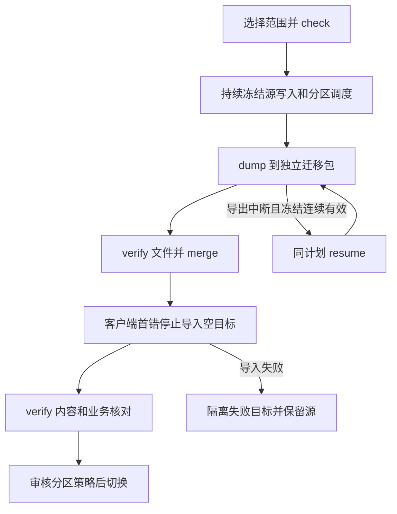

# StarMigrtCli：StarRocks 离线逻辑迁移工具

`StarMigrtCli.py` 2.0.0 通过 FE 的 MySQL 协议只读导出 StarRocks **3.5.7 普通内表**，生成可携带的 SQL 迁移包。源、目标无需互通，也不需要对象存储；目标使用 Navicat 或 MySQL 命令行客户端导入。工具提供多库筛选、表级续传、合并 SQL 和目标只读校验，不自动连接目标执行 DDL/DML。

工具名称固定为 `StarMigrtCli`，源码文件为 `StarMigrtCli.py`，冻结后的可执行文件为 `StarMigrtCli`，迁移包清单的 `tool` 字段为 `StarMigrtCli`。自动化结果标志统一使用 `STARMIGRT_` 前缀；仓库回归参数使用小写 `--starmigrt-*`。目录保留 `tools/starrocks/starmigration/`。

适合离线跨环境迁移、选库选表复制、结构交付和可接受 SQL INSERT 吞吐的全量迁移。它不是集群备份、增量同步或 CDC 工具。大规模低停机迁移应评估官方集群迁移工具或对象存储数据通路，不能单靠增加 Python 并发解决。官方集群迁移工具对源集群形态有要求；3.5.7 存算分离集群不支持数据 `BACKUP/RESTORE`，因此这些方案不能互相直接替换。

**2.0.0 已完成本工具 GA 验收**：StarRocks 3.5.7 存算一体源、目标实例的真实多库往返，Linux 源码执行及 x86_64 独立可执行文件均通过。具体环境、数据量、恢复与安全结果见[验收范围与实测结果](#验收范围与实测结果)。生产迁移仍须满足本文的持续停写、空目标和校验条件。

## 任务导航

- [首次使用与完整迁移](#首次使用与完整迁移)
- [单库、多库、全库与表筛选](#单库多库全库与表筛选)
- [只导结构、只导数据与副本数](#只导结构只导数据与副本数)
- [断点续传和失败恢复](#断点续传和失败恢复)
- [校验与切换](#校验与切换)
- [性能与资源规划](#性能与资源规划)
- [安全与参数速查](#安全与参数速查)
- [排障与退出码](#排障与退出码)
- [支持边界与官方依据](#支持边界与官方依据)

## 首次使用与完整迁移



这条主线将源端读取、离线文件和目标写入分开。只有导出阶段支持续传；目标导入失败后保持隔离，不能沿用导出续传命令重放已提交的数据。

### 1. 准备客户端与权限

需要 Python 3.9+ 和固定依赖 `PyMySQL==1.1.2`。脚本可单独复制到能访问源 FE 的电脑，不依赖 kubeauto、StarCli 或相邻工具。源 FE 默认 MySQL 端口为 `9030`。真实服务端、客户端 TLS 配置和网络策略需先由管理员确认。

在脚本所在目录运行。Linux 可把虚拟环境放在工具目录之外：

```bash
python3 -m venv "$HOME/.venvs/starmigrt"
. "$HOME/.venvs/starmigrt/bin/activate"
python -m pip install 'PyMySQL==1.1.2'
python StarMigrtCli.py --help
```

源码包含 Windows 文件锁分支，但 Windows 执行及冻结产物尚未现场验收；本次 GA 平台为 Linux。工具目录只交付源码与 README，不需要额外的 requirements 文件。

源账号需要选中库表的 `SELECT`、对应元数据可见性，以及读取 `SHOW CREATE TABLE` 的权限；不需要源端写权限。`--all-databases` 仅表示**当前账号可见**的业务库，账号看不到的库表无法由脚本发现，不能据此声明整实例已完整导出。目标导入账号需要创建库、表和写入数据的权限；校验账号只需要查询及元数据权限。恢复动态分区管理还需要对应目标表的 `ALTER` 权限，应由目标管理员执行。

未提供密码文件或密码环境变量时，脚本交互询问密码，不回显。使用非交互作业时见[凭据与 TLS](#凭据与-tls)。不要把密码作为命令行参数。

### 2. 先检查实际范围

贯穿示例将 `sales`、`audit` 两个库迁到新的 `sales_mig`、`audit_mig`。下面的主机名是占位符，请换成自己的 FE；每条连接命令都会单独读取凭据。

```bash
python StarMigrtCli.py check --host source-fe.example.internal --user migration_reader \
  --databases sales audit \
  --database-map sales=sales_mig --database-map audit=audit_mig
```

`check` 只读取版本、对象、DDL 和列元数据，不扫描表数据，不创建输出目录。它输出每张表的源、目标映射，并在成功时输出 `STARMIGRT_CHECK_PASS`。遇到视图、外表、未适配数据类型或分区保留策略，会列出原因并停止，不静默漏对象。若这些对象确实不在本次范围，显式排除后重新检查。

`check` 不证明每个实际值均可编码，也不检查目标集群容量或现有表。管理员仍需核对表模型、分区、索引、Colocate、存储卷等目标依赖和磁盘空间。若 DDL 使用了集群特定属性，必须先在隔离目标小表验证。

### 3. 冻结源端后导出

导数据前，暂停选中对象的写入、导入任务、DDL 和会改变分区的自动调度，等待在途写入结束。这个状态须**连续保持到整个导出完成；中断后续传也必须保持**。正式切换如需保证业务无遗漏，应维持写入暂停到目标校验和应用切换完成。

脚本逐表执行 SELECT，**不建立跨表、跨库一致性快照**。`--source-quiesced` 是操作者对上述前提的声明，脚本不能证明业务已停写。只观察行数或 DDL 没变化，不能证明期间没有更新。如果写入已恢复或无法确认冻结连续性，保留旧包，使用新目录重新全量导出。

```bash
python StarMigrtCli.py dump --host source-fe.example.internal --user migration_reader \
  --databases sales audit \
  --database-map sales=sales_mig --database-map audit=audit_mig \
  --source-quiesced --output ./sales-audit-export --workers 2 --gzip
```

输出目录必须不存在。成功时输出 `STARMIGRT_PASS`；每张表完成时输出行数与耗时，长任务每 15 秒输出累计进度心跳。进度写 stderr，结果 marker 写 stdout，便于作业系统区分。脚本完成后关闭连接；源端只发生查询和会话级变量设置。

对于明确允许各表处于不同读取时点的分析样本，可以用 `--allow-inconsistent` 替代 `--source-quiesced`。包中会记录 `consistent=false`，它不能作为一致性切换依据。没有声明时，数据导出在建连前拒绝执行。

### 4. 检查包并生成一个 SQL 文件

```bash
python StarMigrtCli.py verify --input ./sales-audit-export
python StarMigrtCli.py merge --input ./sales-audit-export --output ./sales-audit-migration.sql
```

本地验证要求清单为完成状态、所有表都有完成记录，且文件大小和 SHA-256 一致；成功输出 `STARMIGRT_VERIFY_PASS scope=local-files`。`merge` 按“全部建表 → 按计划顺序写入各表”的顺序流式合并，自动解压 gzip，不把大文件全部读入内存；它不合并分区管理恢复脚本。目标 SQL 必须是包目录之外的新文件，不覆盖已有文件。成功输出 `STARMIGRT_MERGE_PASS` 及合并文件 SHA-256。

迁移包内容如下，用户无需修改这些文件：

| 文件 | 用途 |
| --- | --- |
| `manifest.json` | 版本、连接身份（不含密码）、筛选后的固定计划、原始与目标 DDL、任务 ID、完成记录、行数、行摘要和文件校验值 |
| `schema.sql` | 会话设置、建库和建表；数据模式不生成建库建表语句 |
| `table-000001.sql[.gz]` 等 | 单表分批 INSERT；数字与清单表顺序对应，文件名不采用用户库表名 |
| `verify.sql` | 数据模式下逐表比较导出行数与目标 `COUNT(*)`；结构模式没有行数查询 |
| `restore_dynamic_partitions.sql` | 审核分区保留范围后，恢复本次为导入而关闭的动态分区管理 |
| `.lock` | 操作系统文件锁载体；进程退出自动释放锁，保留空锁文件不代表仍被占用 |

完整包及合并 SQL 都含业务数据或结构信息，应通过受控渠道传输。SHA-256 只证明与所信任清单的一致性，不提供加密或签名认证；不能用一份来源不明的清单为同目录文件背书。传输合并 SQL 后，也要与 `merge` 打印的校验值核对：Linux 用 `sha256sum`，PowerShell 用 `Get-FileHash -Algorithm SHA256`。

### 5. 在目标导入一次，首错停止

先在隔离的同版本目标验证一张有代表性的小表，再进行正式操作。目标 `sales_mig`、`audit_mig` 必须是本次迁移专用的空库，不能有同名表；按源 DDL 规划副本、分区、依赖与空间。默认保留源副本数，单 BE 目标必须显式选择 `--replication-num 1` 后重新导出。

Navicat 使用“运行 SQL 文件”，选择 UTF-8 的 `sales-audit-migration.sql`。**关闭“出错时继续”，保持自动提交，不启用 MySQL 特有的禁用外键、锁表或事务包装选项**。不要把大文件整体粘贴到查询编辑器，也不要随意拆成并行导入。

有 MySQL 命令行客户端的 Linux 环境也可运行：

```bash
mysql --host=target-fe.example.internal --port=9030 --user=migration_writer \
  --password --default-character-set=utf8mb4 --show-warnings \
  < ./sales-audit-migration.sql
```

`--password` 不带值，会提示输入。不要使用 `--force` 或 `--one-database`，它们分别可能跳过错误或遗漏本包中的其它目标库。需要 TLS 时按所用客户端版本配置 CA 和主机名验证；脚本的 `--ssl-ca` 不会替其它客户端配置 TLS。

普通模式不生成 `DROP`、`TRUNCATE`、`INSERT OVERWRITE`，`CREATE TABLE` 也不带 `IF NOT EXISTS`，因此同名表会报错。**离线工具无法强制导入客户端停错**；若客户端忽略建表错误继续写入，仍可能污染既有数据。结构与数据不是整库事务，目标端导入失败后的处置见[恢复](#断点续传和失败恢复)。

## 单库、多库、全库与表筛选

这些选择参数对 `check` 和 `dump` 相同。表模式支持大小写敏感的 shell 通配符 `*`、`?`、`[...]`；它不是 SQL LIKE。请用引号避免 shell 提前展开。包含条件先执行，排除条件后执行；包含模式完全未匹配时会报错。

| 任务 | 选择参数 |
| --- | --- |
| 单库 | `--database sales` |
| 多库 | `--databases sales audit`，或重复 `--database` |
| 全部可见业务库 | `--all-databases`；不能与显式库列表同用 |
| 排除库 | `--exclude-database 'tmp_*'`，可重复 |
| 多个库的同类表 | `--table 'orders_*'`，不含库名的模式应用于所有选中库 |
| 指定库表 | `--table 'sales.orders' --table 'audit.events'` |
| 排除对象 | `--exclude-table 'sales.old_*' --exclude-table '*.view_*'` |
| 单库重命名 | `--database sales --target-database sales_mig` |
| 多库重命名 | `--database-map sales=sales_mig --database-map audit=audit_mig` |

全库选择排除 `information_schema`、`sys`、`_statistics_` 和 `starrocks_monitor`；其它自建管理库请自行显式排除。不能把多个源库映射到同一目标库，不能映射到系统库，源映射必须属于已选择且未排除的库。库映射只修改建表和数据目标，不重写 SQL 文本中的任意业务字符串或集群属性引用。

名称含点号时，模式仍按完整 `库.表` 字符串匹配；`--table` 采用模式语义，不提供任意标识符的逐字匹配开关。请通过 `check` 的实际映射核对结果。空库可以随其它有表的库建出；完全未选中任何普通内表时停止，不生成容易被误认为成功的空包。

## 只导结构、只导数据与副本数

```bash
# 只导结构：无需停写声明；源端DDL变化仍可能使检查失败。
python StarMigrtCli.py dump --host source-fe.example.internal --user migration_reader \
  --database sales --target-database sales_mig --schema-only --output ./sales-schema

# 只导数据：目标结构必须已经准备好，且不得有业务写入。
python StarMigrtCli.py dump --host source-fe.example.internal --user migration_reader \
  --database sales --target-database sales_mig --data-only \
  --source-quiesced --output ./sales-data
```

`--schema-only` 与 `--data-only` 互斥。结构模式仍只接受普通内表，但不要求数据类型可由本工具编码，也不会为后续数据导入而关闭动态分区。它不是账号、视图或整实例定义的导出。

数据模式不生成任何建库建表语句。操作者必须先确认目标为空、列类型/精度/顺序、表模型和分区与源一致，并自行暂停目标动态分区及其它分区删除策略。`manifest.json` 中的目标 DDL 供审核，不会被数据模式自动执行。不要将此模式当作增量同步或“向已有业务表补数据”：主键表可能更新原值，重复键表可能重复数据，聚合表可能重复累计。

目标副本数默认保持源值。仅在明确符合目标可靠性与节点数量规划时加 `--replication-num N`，它只适用于包含结构的导出，同时修改源 DDL 中存在的 `replication_num` 和 `dynamic_partition.replication_num`。没有普通副本数属性的表会拒绝此覆盖，不猜测另一种存储形态的等价配置。单副本会降低数据保护能力，不应为了快速导入而作为生产默认。

数据迁移时，建表 DDL 中已启用的 `dynamic_partition.enable` 暂改为 `false`，源集群不会被修改。含活跃 TTL/retention 属性的表直接拒绝数据迁移，避免目标自动删除历史数据；仅导结构可以保留这些属性。动态分区恢复文件只能在数据校验、保留范围审核和切换计划确认后运行，不能直接放到合并 SQL 末尾自动执行。

## 断点续传和失败恢复

### 源端导出中断

失败包保留 `status=incomplete` 和已经落盘的完成记录，不输出成功标志。当前未完成表的 `.partial` 文件会在正常错误、Ctrl+C、SIGTERM 后删除；硬断电或 SIGKILL 可能留下临时文件，下次持包锁续传时仅清理已知的本工具临时文件。

确认原有停写/停 DDL 条件一直有效，然后使用**相同数据库、筛选、映射、模式、批次、压缩和副本数参数**续传：

```bash
python StarMigrtCli.py dump --host source-fe.example.internal --user migration_reader \
  --databases sales audit \
  --database-map sales=sales_mig --database-map audit=audit_mig \
  --source-quiesced --output ./sales-audit-export --workers 1 --gzip --resume
```

可调整工作线程数和连接/查询超时；计划身份不依赖密码、密码来源或线程数。完成表先核对文件大小、SHA-256 和当前元数据，再复用；未完成表从头查询，不使用无稳定排序的行偏移续读。所有表完成后再次检查所选对象、列和 DDL，才生成完成清单。

这只能证明元数据和已保存文件未变，不能证明源数据在停写声明之外没有变化。检测到计划变化、损坏、符号链接或不支持的旧格式时拒绝续传，不自动重签旧文件。若源端已恢复写入，重新冻结并用新输出目录导出，不拼接前后两个时点的文件。旧版 `ioc_dump` 包不能直接续传。

检测到一个失败后不再启动后续表；已经开始的其它表会被取消，只有写入完成清单的结果可复用。取消会关闭流式读取连接，避免驱动为关闭游标而读完剩余全表；源端查询资源是否已释放还应由管理员观察确认。网络和认证不做无限重试，数据库错误只显示错误类型/代码，不回显可能包含业务行或凭据的原始错误。

### 目标端导入失败或提交结果未知

**`dump --resume` 只恢复导出，不恢复 SQL 导入。** SQL 包不是一个事务，每个成功的 INSERT 可能已经提交。禁止重放整个合并文件，也不要跳过建表错误继续执行。

每个 INSERT 含 `WITH LABEL sr_<任务ID>_t<表序号>_b<批次序号>`。label 在本包及其续传中稳定，不同导出包使用不同任务 ID。连接中断时，可以从故障语句读取 label，在对应目标库只读查询：

```sql
USE sales_mig;
SHOW LOAD WHERE LABEL = '将这里替换为故障语句中的完整label';
```

查询结果用于区分已可见、仍处理、失败或记录不可查；记录不可查不能直接解释为“从未提交”。label 的保留时间由集群配置决定，它不是永久去重账本，脚本也不会自动判断后重试。保留导入客户端的首错、label 和时间，先诊断集群、分区、容量、权限及输入兼容问题。

常规恢复路径是：保留失败目标供调查 → 准备另一组全新的迁移专用空库 → 用新的库映射和输出目录重新导出 → 导入一次并校验。重新导出须重新满足源端一致性前提。若业务要求复用同名目标库，只能在明确确认所有权、已有备份和清理范围后由管理员清理本次迁移专用对象；本工具不会自动删库、删表或替用户决定哪些已提交批次可以重放。

## 校验与切换

先通过本地包验证，再在能连接目标的电脑上进行只读校验：

```bash
# 目标列名称、基础原生类型、顺序，以及数据模式下的行数。
python StarMigrtCli.py verify --input ./sales-audit-export \
  --host target-fe.example.internal --user migration_reader

# 再扫描目标全部选中数据，核对无序行摘要。
python StarMigrtCli.py verify --input ./sales-audit-export \
  --host target-fe.example.internal --user migration_reader --content
```

不匹配返回非零，且不修改目标。行数成功 marker 为 `scope=target-rows`；加 `--content` 成功为 `scope=target-content`。结构模式返回 `scope=target-columns`，不检查行数，并拒绝 `--content`；其目标验证只检查列名称、基础原生类型和顺序，**不等价于完整 DDL、精度、索引、分区或表模型一致性验收**。

导出时对每行的类型化 SQL 表示计算 SHA-256，再将所有行摘要按模 2^256 求和；目标按同样方法复算。结果不依赖查询顺序，重复行按出现次数参与。它已在真实目标的同数改值场景中检出差异，但仍是概率性摘要，不是数学上的逐行等价证明，不检查账号、索引或业务关联正确性。本次同版本真实往返已覆盖数值边界、JSON、二进制和日期；业务自己的特殊值及跨环境依赖仍须按相同流程核对。

目标应保持无业务写入和结构变化直到校验完成；否则 COUNT 与内容扫描的读取时点也可能不同。`verify.sql` 适合在 Navicat 逐表查看 `ok=1`，但只有行数比较，不能代替内容与业务检查。该文件包含所需会话设置，可以单独运行。

上线前至少核对：全部导入语句首错停止且没有未处理 warning、包内全部表读回符合预期、关键业务 SQL 与边界值正确、目标表模型/分区/索引/副本及依赖正确。然后审核并恢复动态分区，切换应用，再按切换方案解除停写。校验失败则保持目标隔离，不切换应用；保留源端为权威数据，按已确认的业务回退方案恢复源服务，不能在两端继续接受未协调的写入。

包内 `restore_dynamic_partitions.sql` 包含需要恢复的目标表 `ALTER` 语句；没有动态分区时只有注释。
管理员先逐表核对 `SHOW PARTITIONS FROM 目标库.目标表`、目标时间及保留窗口。若窗口会删除仍需保留的历史数据，停止恢复调度，先制定保留范围的调整方案；不能通过忽略校验失败来完成切换。
确认策略能够保留本次全部迁移数据后，使用同一目标客户端执行，并重新进行内容校验：

```bash
mysql --host=target-fe.example.internal --port=9030 --user=target_admin \
  --password --default-character-set=utf8mb4 --show-warnings \
  < ./sales-audit-export/restore_dynamic_partitions.sql
python StarMigrtCli.py verify --input ./sales-audit-export \
  --host target-fe.example.internal --user migration_reader --content
```

通过 `SHOW DYNAMIC PARTITION TABLES FROM sales_mig` 及 `audit_mig` 查看调度状态和创建/删除错误，按目标集群的实际调度间隔观察一轮后再次核对分区和业务。任一语句或复验失败即停止切换，由管理员修复目标策略；本工具不会替用户关闭整个集群的分区调度。

## 性能与资源规划

默认两张表并发，每条 INSERT 最多 500 行且最多约 1 MiB UTF-8。每个工作线程只持有当前行和当前批次，使用 PyMySQL 的无缓冲 `SSCursor`，不做全表 `fetchall()` 或 OFFSET 翻页。默认不排序，避免额外的源端排序成本；结果文件顺序与行摘要不依赖行顺序。

提高 `--workers` 会增加源集群同时扫描数、客户端内存和磁盘写入，不能超过源端可承受的查询压力。可从 1–2 开始观察源查询延迟、磁盘、CPU 和网络；此工具没有自动负载控制或带宽限速器。批次大小只控制生成的 SQL 大小，不控制源端扫描量。内存还包括 Python 字符串/缓冲和单行解码开销，不能把 `workers × batch-mib` 当作严格 RSS 上限。

单行超过 `--batch-mib` 会停止，既不截断也不把它拆成无效 SQL。可以在源端冻结仍连续有效的前提下调整批次，但批次属于计划：需使用新输出目录，不能对原包改变批次后续传。单个超大值本身仍须能放入客户端内存。

`--gzip` 使用低压缩级别，减少传输和磁盘用量。合并会生成额外的非压缩 SQL 文件，需要同时容纳原包与合并文件；空间预算应按实际样本的 SQL 膨胀率估算，不能直接用 StarRocks 压缩后存储量代替。多次 SHA-256 检查和目标内容校验也会带来顺序读 I/O 与全表扫描成本。

`--query-timeout` 设置源端/校验端会话查询超时，默认 3600 秒，网络读取超时为其值加 30 秒；它不改变目标导入客户端的 `insert_timeout`。大批次导入应在客户端按官方配置调整 INSERT 超时并观察事务状态。SQL INSERT 通常不适合作为大规模迁移的最高吞吐路径。[本次实测](#验收范围与实测结果)仅提供小规模条件下的耗时参考，不构成生产吞吐或耗时 SLA。

## 安全与参数速查

### 凭据与 TLS

凭据读取顺序为 `--password-file` → `--password-env` 指定的环境变量（默认 `SR_PASSWORD`）→ 终端隐藏输入。空密码也须显式设置空环境变量，避免非交互作业意外挂起。Linux 密码文件必须由当前用户拥有、为普通文件且权限不高于 0600，拒绝符号链接。文件使用 UTF-8，仅移除末尾一组换行，保留密码中的空格。

非交互进程可由作业系统临时注入密码环境变量；运行后清理该变量，不将密码写进 shell 历史或仓库。Windows 需使用 ACL 保护密码文件和迁移包，POSIX 的 0600/0700 不能替代 Windows 权限管理。

需要加密链路时，为每个 `check`、`dump` 或目标 `verify` 命令增加 `--ssl-ca /受控路径/ca.pem`。它验证证书链与主机名，服务端未声明 TLS 时在认证前拒绝降级。未指定该参数时不强制 TLS，只适用于已经确认的可信隔离网络；不能把“隐藏输入密码”理解为链路加密。这里的保护依赖固定 PyMySQL 1.1.2 的握手实现，升级依赖后必须重新验证。

Linux 新建包目录为 0700、文件为 0600。所有包操作持有操作系统排他锁，要求目录可写；只读介质需先复制到受控可写目录。不要删除正在使用的 `.lock` 文件来绕过锁，否则可能产生两个并发写者。密码不会写入清单、SQL 或错误信息，但库表名称、DDL、数据和连接身份都属于敏感交付资料。

### 参数

每个子命令的 `--help` 是完整语法；下表列出会影响生产行为的选项。

| 参数 | 默认值/范围 | 作用与约束 |
| --- | --- | --- |
| `--host`、`--user` | check/dump 必填 | verify 同时省略时仅验证本地包，同时提供时连接目标 |
| `--port` | 9030；1–65535 | FE MySQL 端口，不是 8030 HTTP 端口 |
| `--password-env` | SR_PASSWORD | 环境变量名称，不是密码本身 |
| `--password-file` | 无 | 优先于环境变量；权限限制见上文 |
| `--ssl-ca` | 无 | 强制证书链、主机名验证及拒绝 TLS 降级 |
| `--connect-timeout` | 15 秒；1–120 | 每个连接建连等待上限 |
| `--query-timeout` | 3600 秒；1–86400 | 会话查询超时；读取超时额外加 30 秒 |
| `--database` / `--databases` / `--all-databases` | 无默认库 | 必须显式选择范围；后者与显式列表互斥 |
| `--table` / `--exclude-table` / `--exclude-database` | 无 | 可重复，大小写敏感的 shell 通配符 |
| `--database-map` / `--target-database` | 保留源库名 | 多库映射/单库快捷方式；不能混用或合并目标库 |
| `--schema-only` / `--data-only` | 结构与数据 | 互斥；数据模式须自行保证空目标与相同结构 |
| `--replication-num` | 保留源值；显式值 1–32767 | 实际还须符合目标集群配置；单副本降低可靠性 |
| `--source-quiesced` / `--allow-inconsistent` | 不默认承诺一致 | 导数据时二选一；前者是操作者声明，不会自动停写 |
| `--output` | 必填 | dump 为新目录；merge 为包外新文件；默认不覆盖 |
| `--resume` | 关闭 | 只恢复同格式导出包，不能恢复导入 |
| `--workers` | 2；1–16 | 并发读表数；预检/最终检查串行，实际同时连接数有界 |
| `--batch-rows` | 500；1–1000000 | 每条 INSERT 最大行数 |
| `--batch-mib` | 1 MiB；1–256 | INSERT 的 UTF-8 字节上限，含表头及分隔符 |
| `--gzip` | 关闭 | 压缩逐表文件，合并自动解压 |
| `--input` | verify/merge 必填 | 只接受完整的新格式迁移包 |
| `--content` | 关闭 | verify 连接目标后全量扫描并核对无序行摘要 |

旧式 `python StarMigrtCli.py --host ... --user ... --database ... --check-only` 仍可作为预检入口。旧式导出参数也会转入 `dump`，但必须补齐显式数据库、`--output` 和一致性声明；不再默认 `ioc`，不再强制副本数为 1，不再生成固定 `ioc.sql` 文件名。

## 排障与退出码

| 现象 | 最小检查与根因分叉 | 处置与复验 |
| --- | --- | --- |
| 参数错误、退出 2 | 查看该子命令 `--help`，核对范围、模式、超时和一致性声明 | 修正参数后先 check；不会因参数错误启动导出 |
| 预检报告未适配对象/类型 | 核对实际表模型、字段、TTL，而非只看表名 | 需要迁移则先适配并验收；明确不迁移才显式排除，再 check |
| TLS 拒绝或认证失败 | 检查 FE TLS 能力、CA/主机名、账号权限；错误只展示类型和代码 | 修复连接配置，不能以关闭验证作为生产常规解法 |
| 文件/网络错误 | 核对输出父目录权限、空间、文件系统 fsync 能力及 FE 可达性 | 按层定位环境问题；维持源冻结后才考虑 resume |
| 输出已存在/计划变化 | 核对是否确为同一包、输入与 DDL 是否相同 | 同一计划才 resume；否则新目录，不篡改清单消除错误 |
| 已完成文件校验失败 | 保留原包，检查传输或存储损坏；对照可信副本 | 恢复可信副本或新建目录重导，不重算哈希冒充原文件 |
| 包正在使用 | 检查本机仍在运行的 dump/verify/merge 进程 | 等待或正常终止拥有者；不能删除锁文件绕过 |
| 目标同名表或 INSERT 失败 | 保存首错语句、label、时间及客户端 warning；查询事务和目标结构 | 不盲目重放；按目标失败恢复路径新建空目标并复验 |
| 行数一致、内容摘要不同 | 保持目标停止写入，复查源冻结、编码、目标类型/精度、导入 warning | 不切换业务；定位具体业务差异，保留两端结果再决定重迁 |

退出码 `0` 表示本次指定操作完成，`1` 表示连接、兼容、导出、包校验或目标校验失败，`2` 表示命令参数错误，`130` 表示 Ctrl+C/SIGTERM 中断。只有 `dump` 完整导出成功才输出 `STARMIGRT_PASS`；`check`、本地 verify 和 merge 的成功均不能代替迁移验收。

失败导出包是可恢复的数据制品，不是自动清理垃圾。成功后也不会删除用户包或目标数据；确认迁移、回退保留期和合规要求后，再由所有者清理指定包。脚本不会清理其它目录、库或其它工具的资源。

## 支持边界与官方依据

### 数据与对象范围

数据路径支持普通内表的 BOOLEAN、整数（含 LARGEINT）、有限 FLOAT/DOUBLE、DECIMAL、CHAR/VARCHAR/STRING、DATE/DATETIME、JSON、VARBINARY。NULL、空字符串和文本 `NULL` 区分；精确数值不转 JSON 浮点，LARGEINT 用显式 CAST，JSON 用 `parse_json`，VARBINARY 用 `unhex`。异常返回类型、非有限浮点、返回列数不一致均停止，不输出截断结果。

视图、异步物化视图、外表、Catalog、账号权限、资源组、UDF、导入任务和集群配置不在迁移范围。ARRAY/MAP/STRUCT、BITMAP/HLL 等未适配类型及生成列不支持数据导出；结构模式只保留普通内表的原生 DDL，不表示已验收这些类型的目标运行行为。同步物化视图/rollup、Colocate、索引、存储卷与集群相关属性必须另行清点，不能仅靠列和行数校验认定它们完整迁移。

源、目标均为 3.5.7 是当前**适配限制**；本次现场验收使用两个存算一体实例。存算分离、跨拓扑、跨版本以及其它平台尚未获得本工具的 GA 认证，不能外推本次结果。自己的目标环境仍应先用隔离小表核对 DDL 属性、INSERT 行为和业务语义；不提供跳过版本校验的生产开关。

### 官方资料到实现的对应

本工具是 SQL/MySQL 协议接口消费者，研究范围为所调用接口及其认证、错误、并发、数据表示与恢复条件，不重新交付 StarRocks 的部署或集群管理功能。以下均以固定 `3.5.7` 或 `v1.1.2` 为依据：

| 来源主题 | 已采用的结论与边界 |
| --- | --- |
| [3.5 发布说明的 3.5.7 条目](https://docs.starrocks.io/docs/3.5/release_notes/release-3.5/#357) | 核对扫描、数值边界及部分更新等修复；官网为滚动 3.5 系列资料，接口行为仍以固定 tag 源码为准，不外推其它版本 |
| [SHOW CREATE TABLE](https://github.com/StarRocks/starrocks/blob/3.5.7/docs/en/sql-reference/sql-statements/table_bucket_part_index/SHOW_CREATE_TABLE.md) | SELECT 权限、原生 DDL、分桶/属性原貌；只改确定的目标名和显式属性 |
| [INSERT](https://github.com/StarRocks/starrocks/blob/3.5.7/docs/en/sql-reference/sql-statements/loading_unloading/INSERT.md) | 显式列列表、VALUES、WITH LABEL、提交/可见状态及超时；主键表列列表语义需与全列导出一致 |
| [DESC](https://github.com/StarRocks/starrocks/blob/3.5.7/docs/en/sql-reference/sql-statements/table_bucket_part_index/DESCRIBE.md) 与 [ScalarType](https://github.com/StarRocks/starrocks/blob/3.5.7/fe/fe-core/src/main/java/com/starrocks/catalog/ScalarType.java) | 使用原生列类型；information_schema 将 LARGEINT 映射为 bigint unsigned、BOOLEAN 映射为 tinyint，不能据此判定真实类型 |
| [DECIMAL](https://github.com/StarRocks/starrocks/blob/3.5.7/docs/en/sql-reference/data-types/numeric/DECIMAL.md)、[LARGEINT](https://github.com/StarRocks/starrocks/blob/3.5.7/docs/en/sql-reference/data-types/numeric/LARGEINT.md) 与 [AstBuilder](https://github.com/StarRocks/starrocks/blob/3.5.7/fe/fe-core/src/main/java/com/starrocks/sql/parser/AstBuilder.java) | 保留数值十进制文本；固定 sql_mode 下科学计数法按精确十进制解析；LARGEINT 显式 CAST 避免整数字面量类型推断改变边界值 |
| [SqlModeHelper 源码](https://github.com/StarRocks/starrocks/blob/3.5.7/fe/fe-core/src/main/java/com/starrocks/qe/SqlModeHelper.java) | 固定会话 sql_mode，避免引号和反斜杠转义随客户端模式改变 |
| [动态分区](https://github.com/StarRocks/starrocks/blob/3.5.7/docs/en/table_design/data_distribution/dynamic_partitioning.md) | 导入期间延后目标动态分区管理；保留范围审核后恢复，源端不变 |
| [备份恢复](https://github.com/StarRocks/starrocks/blob/3.5.7/docs/en/administration/management/Backup_and_restore.md) | 与本工具的逻辑导出区分；数据备份恢复的集群形态、覆盖及一致性限制 |
| [官方集群迁移工具](https://github.com/StarRocks/starrocks/blob/3.5.7/docs/en/administration/data_migration_tool.md) | 大规模/持续同步的替代方案；源集群形态、网络及目标写入约束，不由本工具自动调用 |
| [PyMySQL 连接实现](https://github.com/PyMySQL/PyMySQL/blob/v1.1.2/pymysql/connections.py) | 认证前验证 TLS 能力，证书/主机名校验，有界超时、取消时唤醒 socket；固定版本内部接口变更须重验 |
| [PyMySQL 流式游标](https://github.com/PyMySQL/PyMySQL/blob/v1.1.2/pymysql/cursors.py) | 无缓冲读取；失败时放弃连接并禁用结果析构排空，不继续读取整表 |

### 验收范围与实测结果

仓库内仅为这个新工具增加测试和独立矩阵项，工具目录仍只有 `StarMigrtCli.py` 与本 README。维护者可在仓库根目录执行：

```bash
bash tests/run_tools_regression.sh --starmigrt-preflight
bash tests/run_tools_regression.sh --starmigrt-status
```

2026-11-23，`TL-SD-01`–`TL-SD-07` 全部通过；最终运行 `369814d0d2344d409cdde0665c35140d` 的退出及最终状态均为 0，并通过所属容器、网络、运行时、挂载、进程和防火墙清理核验。正式证据见[最终验收记录](../../../tests/evidence/starmigrt-full.json)。本工具独立验收，未回归其它工具。

| 条件或场景 | 本次真实结果与可用结论 |
| --- | --- |
| 环境 | Rocky Linux 9.8，8 CPU、16 GiB 主机；Python 3.9.25、glibc 2.34、x86_64；两个 StarRocks 3.5.7 存算一体实例，每容器上限 6 GiB、FE 堆 1 GiB、BE 内存预算 2 GiB。Linux/Python 3.12.14 另通过 46 项本地合同 |
| 多库与模型 | 两业务库、6 表、65,547 行；包含重复键、主键更新后状态、聚合结果、范围分区；全可见库选择后显式排除不迁移对象，并映射到两个新库 |
| 数据表示 | LARGEINT 正负边界、DECIMAL(38,9)/(38,38) 极小值、BOOLEAN、DOUBLE、JSON、NULL/空值、Unicode/转义、VARBINARY、日期时间完成往返；未适配 ARRAY 和视图被拒绝 |
| 导出与校验 | 冻结程序运行，2 个工作线程、250 行批次、gzip；其中 65,536 行表每行含 300 字节 UTF-8 文本。全包导出 2.575 秒，合并 0.529 秒，导入后的全量内容校验 2.246 秒；分别为单次 CLI 墙钟时间，不含外部客户端导入耗时 |
| 内容反例 | 保持目标行数相同，仅更新一个主键表字段，内容校验返回非零；恢复原值后再次通过。行数相等不能替代内容校验 |
| 恢复 | 第一张表提交清单后发送 SIGTERM，包保持 incomplete；同计划续传复用完成表且其文件时间/摘要不变；损坏文件与变化计划均被拒绝 |
| 安全 | 真实只读账号授权前拒绝、SELECT 授权后导出与校验成功；通过运行器拥有的 TLS 协议代理连接真实数据库，正确 CA/主机名通过，错误 CA/主机名及明文降级拒绝。此场景验证客户端 TLS 行为，不代表已部署 StarRocks 原生 TLS |
| 分区 | 历史与未来范围数据均保留；目标动态分区管理保持关闭，恢复 SQL 的目标与语句核对通过。自动恢复调度会受当前保留窗口影响，必须继续执行本文的人工审核流程 |

这些耗时来自小规模、同主机隔离实例的单次场景，不是长时压力测试；未采集吞吐分位数或进程 RSS 峰值，不能据此估算 TB 级停机窗口。生产先用有代表性的样本，分别测量导出、文件传输、目标 INSERT 和内容校验，再规划窗口与余量。Windows、ARM 冻结和其它集群拓扑未在本次验收范围内。
