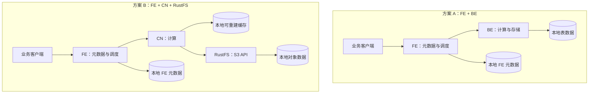

# StarRocks 3.5.7 部署技术文档

## 1. 架构选型

部署采用以下两种架构之一。当前本地存储需求采用 **FE + BE**；采用 RustFS 对象存储、需要存算分离时选择 **FE + CN + RustFS**。

| 项目 | FE + BE | FE + CN + RustFS |
| --- | --- | --- |
| 部署目录 / 安装包 | `fe-be/` / `fe-be.zip` | `fe-cn/` / `fe-cn.zip` |
| 运行模式 | `shared_nothing`，存算一体 | `shared_data`，存算分离 |
| FE 职责 | 元数据、客户端连接、查询规划和调度 | 元数据、客户端连接、查询规划和调度 |
| 数据节点职责 | BE 负责计算及本地表数据存储 | CN 负责计算及本地缓存 |
| 表数据位置 | BE 本地磁盘 | RustFS S3 桶 |
| FE 元数据位置 | FE 本地磁盘 | FE 本地磁盘 |
| StarRocks 镜像 | `hub.talkedu.cn/kubeauto/starrocks-allin1:3.5.7` | `hub.talkedu.cn/kubeauto/starrocks-fe:3.5.7`、`hub.talkedu.cn/kubeauto/starrocks-cn:3.5.7` |
| 对象存储镜像 | 无 | `hub.talkedu.cn/kubeauto/rustfs:1.0.5` |
| 部署规模 | 单宿主机、单 FE、单 BE、单副本 | 单宿主机、单 FE、单 CN、单 RustFS |



FE + BE 使用官方 allin1 镜像，FE、BE 由容器内 supervisor 管理；官方将该镜像定位为开发测试。FE + CN 将组件分容器部署，表数据通过 S3 API 写入 RustFS。两种方案均存在宿主机、磁盘和单 FE 故障点，本地持久化不提供高可用。

生产可用性要求涉及主机容错、FE 仲裁、数据冗余及对象存储容错时，应采用多主机部署并单独设计备份恢复。单机 RustFS 不构成跨主机高可用对象存储。RustFS `1.0.5` 为官方非预发行版本；StarRocks 与 RustFS 的读写兼容性仍须通过现场验收。

两套架构的数据目录、FE 元数据和运行模式相互独立。禁止共用 FE 元数据目录，禁止通过直接修改 `run_mode` 将已有 BE 库切换为 CN 库；架构迁移需另行执行数据迁移和校验。

## 2. 目录与安装包

```text
starrocks_3.5.7_compose/
├── README.md                         # 唯一技术文档
├── fe-be/
│   ├── .env.be.example
│   ├── docker-compose-be.yml
│   └── conf/
│       ├── fe-be.conf
│       └── node-be.conf
├── fe-cn/
│   ├── .env.cn.example
│   ├── docker-compose-cn.yml
│   ├── conf/
│   │   ├── fe-cn.conf
│   │   └── node-cn.conf
│   └── scripts/
│       ├── healthcheck-cn.sh
│       ├── init-rustfs-cn.sh
│       └── init-storage-volume-cn.sh
├── fe-be.zip
└── fe-cn.zip
```

每个安装包仅包含所选架构目录和外层同一份 `README.md`，可独立解压部署；无需获取另一套架构文件。两个架构目录各自包含 `.gitignore` 和 `.gitattributes`，用于排除真实环境文件及数据目录、保持 LF 换行。

文件名称使用一致的 `-be` / `-cn` 架构后缀。`node-be.conf` 对应 BE 配置，`node-cn.conf` 对应 CN 配置。容器内文件名保留官方要求的 `fe.conf`、`be.conf`、`cn.conf`，通过 Compose 显式挂载。

## 3. 部署条件与资源配置

宿主机使用 Linux、Docker Engine、Docker Compose V2（建议至少 2.20）。配置与数据路径按所选 Compose 文件所在目录解析。安装目录示例为 `/opt/starrocks`，进入 `fe-be` 或 `fe-cn` 后执行相应命令。

| 配置项 | FE + BE | FE + CN + RustFS |
| --- | --- | --- |
| 默认 Compose 项目名 | `starrocks-be` | `starrocks-cn` |
| 环境文件 | `.env.be` | `.env.cn` |
| 环境变量前缀 | `BE_` | `CN_` |
| 样例 StarRocks 数据根目录 | `/data/starrocks-be` | `/data/starrocks-cn` |
| 未设置路径变量时的回退目录 | `fe-be/data-be` | `fe-cn/data-cn` |
| MySQL 宿主机端口 | `9030` | `9030` |
| FE HTTP 宿主机端口 | `8030` | `8030` |
| 节点 HTTP 宿主机端口 | `8040` | `8040` |
| RustFS S3 / 控制台宿主机端口 | 无 | `9000` / `9001` |
| FE 堆 / 节点进程内存限制 | `4 GiB` / `6 GiB` | `4 GiB` / `6 GiB` |
| 容器内存上限 | allin1：`16 GiB` | FE：`6 GiB`；CN：`10 GiB`；RustFS：`4 GiB` |

内存数值为初始配置，需结合实际负载验收。宿主机另需为操作系统、初始化容器和其他服务预留内存。调整容器上限时同步核对 FE 配置中的 `-Xmx` 和节点配置中的 `mem_limit`，保留堆外内存及进程开销空间。

所有宿主机端口默认绑定 `127.0.0.1`。远程访问时将相应 `*_BIND_IP` 设置为宿主机内网 IP，限制访问来源。容器内部使用 Compose DNS 和内部端口通信。

两种架构使用相同的业务端口，按选定方案部署，不在同一监听地址同时启动。

镜像默认从 TalkEdu 拉取，首次拉取前在执行 Compose 的主机使用受控账号完成
`docker login hub.talkedu.cn`；凭据不写入 Compose 或环境样例。CN 桶初始化镜像为
`hub.talkedu.cn/kubeauto/aws-cli:2.27.49`。备用来源通过环境文件中的镜像变量显式选择：

| 变量 | Docker Hub 备用 | 官方上游备用 |
| --- | --- | --- |
| `BE_IMAGE` | `brinnatt/starrocks-allin1:3.5.7` | `starrocks/allin1-ubuntu:3.5.7` |
| `CN_FE_IMAGE` | `brinnatt/starrocks-fe:3.5.7` | `starrocks/fe-ubuntu:3.5.7` |
| `CN_NODE_IMAGE` | `brinnatt/starrocks-cn:3.5.7` | `starrocks/cn-ubuntu:3.5.7` |
| `CN_RUSTFS_IMAGE` | `brinnatt/rustfs:1.0.5` | `rustfs/rustfs:1.0.5` |
| `CN_AWS_CLI_IMAGE` | `brinnatt/aws-cli:2.27.49` | `amazon/aws-cli:2.27.49` |

同一正式 tag 的双推副本应具有相同的多架构索引及平台摘要；上游备用保持原软件版本，
不承诺与带有交付标签的双推副本具有相同摘要。切换来源后先执行 `config --quiet` 和
`pull`，核对来源与版本，再按原数据目录重建容器；不通过更换数据目录处理拉取失败。

首次启动前确认本地数据盘已经挂载、容量足够，路径指向正确磁盘。修改已有实例的数据根目录不会迁移数据，空目录会产生新实例。配置文件必须存在；不得将空目录覆盖镜像程序目录。SELinux enforcing 主机按现场策略设置挂载标签，不使用 `chmod -R 777` 替代权限管理。

## 4. 方案 A：FE + BE 部署

### 4.1 配置

```bash
cd /opt/starrocks/fe-be
cp .env.be.example .env.be
chmod 600 .env.be
```

编辑 `.env.be`：

| 变量 | 配置要求 |
| --- | --- |
| `BE_COMPOSE_PROJECT` | 新部署默认 `starrocks-be`，后续保持一致 |
| `BE_HOSTNAME` | 新部署默认 `starrocks-be`，持久化 FE 后保持不变 |
| `BE_DATA_ROOT` | 样例为 `/data/starrocks-be`，使用本地数据盘绝对路径 |
| `BE_BIND_IP` | 默认仅本机，远程连接时填写宿主机内网 IP |
| `BE_QUERY_PORT` / `BE_FE_HTTP_PORT` / `BE_NODE_HTTP_PORT` | 宿主机 MySQL、FE HTTP、BE HTTP 端口 |
| `BE_MEMORY_LIMIT` | allin1 容器内存上限，默认 `16g` |
| `BE_ROOT_PASSWORD` | 新库首次启动留空，已有库填写当前 root 密码 |

### 4.2 启动与检查

```bash
docker compose --env-file .env.be -f docker-compose-be.yml config --quiet
docker compose --env-file .env.be -f docker-compose-be.yml pull
docker compose --env-file .env.be -f docker-compose-be.yml up -d --wait --wait-timeout 300
docker compose --env-file .env.be -f docker-compose-be.yml ps -a
docker compose --env-file .env.be -f docker-compose-be.yml logs --tail=100 starrocks-be
docker compose --env-file .env.be -f docker-compose-be.yml exec starrocks-be mysql -h 127.0.0.1 -P 9030 -u root
```

在 SQL 客户端执行 `SHOW FRONTENDS;`、`SHOW BACKENDS;`，确认 FE、BE 的 `Alive=true`。默认副本数为 `1`，单 BE 无法满足三副本建表要求。

官方 allin1 entrypoint 每次启动会向 FE、BE 配置追加 `priority_networks = 127.0.0.1/32`，因此配置必须可写，不能将其改为只读挂载。多次启动出现重复配置行属于该官方脚本行为。

## 5. 方案 B：FE + CN + RustFS 部署

### 5.1 配置

```bash
cd /opt/starrocks/fe-cn
cp .env.cn.example .env.cn
chmod 600 .env.cn
```

编辑 `.env.cn`：

| 变量 | 配置要求 |
| --- | --- |
| `CN_COMPOSE_PROJECT` | 新部署默认 `starrocks-cn`，后续保持一致 |
| `CN_DATA_ROOT` | 样例为 `/data/starrocks-cn`，不得共用 BE 目录 |
| `CN_BIND_IP` | StarRocks 宿主机监听地址 |
| `CN_QUERY_PORT` / `CN_FE_HTTP_PORT` | 默认 `9030` / `8030`；CN HTTP 内外均固定 `8040` |
| `CN_FE_MEMORY_LIMIT` / `CN_NODE_MEMORY_LIMIT` | FE、CN 容器上限，默认 `6g` / `10g` |
| `CN_RUSTFS_MEMORY_LIMIT` | RustFS 容器上限，默认 `4g` |
| `CN_RUSTFS_DATA_ROOT` | 样例为 `/data/starrocks-cn/rustfs`，其 `data/` 子目录保存对象数据 |
| `CN_RUSTFS_LOG_ROOT` | 样例为 `/data/starrocks-cn/logs/rustfs` |
| `CN_RUSTFS_BIND_IP` | RustFS 宿主机监听地址 |
| `CN_RUSTFS_S3_PORT` / `CN_RUSTFS_CONSOLE_PORT` | 默认 `9000` / `9001` |
| `CN_RUSTFS_BUCKET` / `CN_RUSTFS_REGION` | 默认 `starrocks` / `us-east-1`；使用合法 S3 桶名和实际区域 |
| `CN_RUSTFS_ACCESS_KEY` / `CN_RUSTFS_SECRET_KEY` | 必须填写有效凭据，空值阻止启动 |
| `CN_ROOT_PASSWORD` | 新 FE 首次启动留空，已有 FE 填写当前 root 密码 |

RustFS 以官方运行用户 `10001:10001` 启动。以下命令对应样例路径；如修改环境文件，应同步修改实际目录：

```bash
sudo mkdir -p /data/starrocks-cn/rustfs/data /data/starrocks-cn/logs/rustfs
sudo chown 10001:10001 /data/starrocks-cn/rustfs/data /data/starrocks-cn/logs/rustfs
sudo chmod 750 /data/starrocks-cn/rustfs/data /data/starrocks-cn/logs/rustfs
```

采用单节点单数据路径，不将同一磁盘的多个目录作为多盘冗余。FE、CN 使用官方镜像的 root 运行方式，其本地数据目录由 Docker 创建。

### 5.2 启动与初始化

```bash
docker compose --env-file .env.cn -f docker-compose-cn.yml config --quiet
docker compose --env-file .env.cn -f docker-compose-cn.yml pull
docker compose --env-file .env.cn -f docker-compose-cn.yml up -d --wait --wait-timeout 300
docker compose --env-file .env.cn -f docker-compose-cn.yml ps -a
docker compose --env-file .env.cn -f docker-compose-cn.yml logs --tail=100 rustfs rustfs-init starrocks-fe starrocks-init starrocks-cn
docker compose --env-file .env.cn -f docker-compose-cn.yml exec starrocks-fe mysql -h 127.0.0.1 -P 9030 -u root
```

初始化按以下依赖顺序执行：

1. RustFS 的 S3 API 与控制台健康检查通过。
2. `rustfs-init` 使用 AWS CLI `2.27.49` 检查并按需创建桶，成功后退出。
3. FE 以 FQDN、`run_mode=shared_data` 启动；`enable_load_volume_from_conf=false`，不自动生成内置存储卷。
4. `starrocks-init` 等待 FE 健康和桶创建成功，创建 `rustfs_volume` 并设置为默认存储卷，成功后退出。
5. CN 通过官方 `cn_entrypoint.sh` 注册 `starrocks-cn:9050` 并启动；健康检查确认本机 HTTP 存活，并经 FE 查询 `information_schema.be_configs` 返回一个有效的节点 ID。

FE 会持久化 CN 状态。容器重建后，旧实例的 `Alive=true` 或已登记的 `WorkerId`
不代表 StarMgr worker 已经恢复调度。`healthcheck-cn.sh` 的系统表查询经过
warehouse/StarMgr 选择 worker 并在 CN 执行，检查只读，不创建业务对象。
健康检查通过后仍须执行第 9 节的实际表读写，确认对象存储数据通路恢复。

一次性初始化容器显示 `Exited (0)` 为成功。存储卷采用 `http://rustfs:9000`、path-style、`enable_ssl=false` 和静态凭据，禁用实例角色及 AWS 默认凭据链。SQL 从标准输入传入，脚本不打印带密钥的 SQL。

检查 SQL：

```sql
SHOW FRONTENDS;
SHOW COMPUTE NODES;
SHOW STORAGE VOLUMES;
DESC STORAGE VOLUME rustfs_volume;
```

FE、CN 应为 `Alive=true`，默认存储卷应为 `rustfs_volume`。`CREATE STORAGE VOLUME IF NOT EXISTS` 保留已有配置；修改 `.env.cn` 不会更新已有卷的 endpoint、桶或密钥，须执行受控的 `ALTER STORAGE VOLUME` 变更。

### 5.3 接入已有 RustFS

内置 RustFS 使用单机 Docker 网络中的 HTTP。接入已有客户 RustFS 时，须同步修改两份初始化脚本中的 endpoint，配置实际桶、区域和专用访问凭据，移除内置 `rustfs` 服务及其依赖；已有桶不需要创建权限时，取消创建桶步骤，改为验证桶访问。

endpoint 必须能从 FE、CN、初始化容器访问；容器内 `127.0.0.1` 不代表宿主机或外部 RustFS。HTTPS 接入需设置 `aws.s3.enable_ssl=true`，为 FE、CN、AWS CLI 配置信任链并验证证书，不通过关闭证书校验处理信任问题。

轮换凭据需协调 RustFS、环境文件及已有存储卷的生效顺序，并验收已有表读写。将卷改为另一个空桶不会迁移数据，禁止据此替代数据迁移。

## 6. 持久化与数据边界

| 架构 | 宿主机路径 | 容器路径 | 用途与恢复要求 |
| --- | --- | --- | --- |
| FE + BE | `${BE_DATA_ROOT}/fe/meta` | `/data/deploy/starrocks/fe/meta` | FE 元数据，必须备份 |
| FE + BE | `${BE_DATA_ROOT}/be/storage` | `/data/deploy/starrocks/be/storage` | 表数据，必须备份 |
| FE + BE | `${BE_DATA_ROOT}/logs/fe`、`logs/be` | `/data/deploy/starrocks/fe/log`、`be/log` | 应用日志 |
| FE + BE | `${BE_DATA_ROOT}/logs/supervisor`、`logs/feproxy` | `/data/deploy/starrocks/supervisor/log`、`feproxy/log` | 管理及代理日志 |
| FE + CN | `${CN_DATA_ROOT}/fe/meta` | `/opt/starrocks/fe/meta` | FE 元数据，必须备份 |
| FE + CN | `${CN_DATA_ROOT}/cn/cache` | `/opt/starrocks/cn/storage` | 本地缓存，可重建 |
| FE + CN | `${CN_DATA_ROOT}/logs/fe`、`logs/cn` | `/opt/starrocks/fe/log`、`cn/log` | 应用日志 |
| FE + CN | `${CN_RUSTFS_DATA_ROOT}/data` | `/data` | RustFS 对象数据，必须备份 |
| FE + CN | `${CN_RUSTFS_LOG_ROOT}` | `/logs` | RustFS 日志 |

CN 无状态指计算节点不承担表数据的最终存储，不代表 FE 元数据和 RustFS 对象数据可以删除。3.5.7 默认将 Starlet 缓存放入 `storage_root_path` 下，现有挂载覆盖该路径。

FE 配置分别挂载至官方 FE 的 `conf/fe.conf`，节点配置分别挂载至 BE 的 `conf/be.conf`、CN 的 `conf/cn.conf`。修改内部数据目录时必须同步修改挂载，禁止仅修改一侧。

两套均配置文件描述符上限、60 秒停止宽限、服务退出重启、健康检查及 Docker 日志轮转。`unhealthy` 本身不会触发 Docker 自动重启。Docker 日志轮转仅覆盖标准输出，应用文件日志需独立滚动与磁盘监控；CN 的 `LOG_CONSOLE=1` 将 glog 输出到标准错误。

## 7. 密码与网络访问

### 7.1 数据库密码

`BE_ROOT_PASSWORD`、`CN_ROOT_PASSWORD` 通过 `MYSQL_PWD` 提供登录凭证，**不会初始化或修改数据库密码**。新库启动后，进入所选架构的交互式 SQL 客户端执行：

```sql
SET PASSWORD FOR 'root'@'%' = PASSWORD('替换为实际密码');
```

随后将对应环境文件中的 root 密码设置为同一值，并按第 8 节重建容器。密码变更到环境更新期间健康检查可能失败。后续改密始终同步数据库、环境文件、健康检查及节点注册凭据。

环境文件中的值建议使用单引号保留 `$`、`#` 等字符；值自身含单引号时按 Compose 语法转义。真实环境文件不得纳入版本库或安装包。凭据存在于环境文件、容器环境及 FE 存储卷元数据中，应限制主机、Docker 和备份介质的访问权限。

### 7.2 查询与导入

FE + BE 默认通过 `宿主机:9030` 查询，FE HTTP 为 `8030`，BE HTTP 为 `8040`。官方 allin1 使用回环地址，远程 Stream Load 经 FE 可能被重定向至客户端不可达的 `127.0.0.1:8040`；单机部署可直接使用 `http://宿主机内网IP:8040/api/数据库/表/_stream_load`。

FE + CN 默认通过 `宿主机:9030` 查询，FE HTTP 为 `8030`。Stream Load 经 FE 会重定向至 `starrocks-cn:8040`，须在发起导入的客户端配置 DNS 或 hosts：`宿主机内网IP starrocks-cn`，并允许访问 `8040`。本机访问可使用 `127.0.0.1 starrocks-cn`。CN HTTP 内外端口均为 `8040`，修改时必须同步配置、映射与客户端网络。

JDBC、Spark、Flink 等连接器按实际连接、重定向和导入行为验收。

## 8. 日常启停与配置变更

在所选架构目录中执行对应命令：

| 操作 | FE + BE | FE + CN + RustFS |
| --- | --- | --- |
| 状态 | `docker compose --env-file .env.be -f docker-compose-be.yml ps -a` | `docker compose --env-file .env.cn -f docker-compose-cn.yml ps -a` |
| 停止 | `docker compose --env-file .env.be -f docker-compose-be.yml down` | `docker compose --env-file .env.cn -f docker-compose-cn.yml down` |
| 启动 | `docker compose --env-file .env.be -f docker-compose-be.yml up -d --wait --wait-timeout 300` | `docker compose --env-file .env.cn -f docker-compose-cn.yml up -d --wait --wait-timeout 300` |
| 配置变更后重建 | `docker compose --env-file .env.be -f docker-compose-be.yml up -d --force-recreate --wait --wait-timeout 300` | `docker compose --env-file .env.cn -f docker-compose-cn.yml up -d --force-recreate --wait --wait-timeout 300` |

`down` 删除容器及 Compose 网络，不删除 bind mount 数据。恢复必须使用原项目名、主机名、数据路径、配置和凭据。配置变更后重建容器可确保编辑器替换文件 inode 的修改生效。已有存储卷属性变更另按第 5.3 节执行，不由容器重建覆盖。

CN 初始化失败后，确认 RustFS 和 FE 已健康，在 `fe-cn/` 中按顺序重试：

```bash
docker compose --env-file .env.cn -f docker-compose-cn.yml run --rm --no-deps rustfs-init
docker compose --env-file .env.cn -f docker-compose-cn.yml run --rm --no-deps starrocks-init
docker compose --env-file .env.cn -f docker-compose-cn.yml up -d --wait --wait-timeout 300
```

## 9. 验收与故障定位

### 9.1 数据保留验收

先检查 FE、所选节点的 `Alive` 状态；CN 额外检查默认存储卷和 RustFS 对象写入。验收库名已存在时先确认归属并更换名称，不覆盖已有数据。

FE + BE 验收 SQL：

```sql
CREATE DATABASE compose_be_acceptance;
CREATE TABLE compose_be_acceptance.probe (
    id BIGINT NOT NULL,
    payload VARCHAR(64)
)
DUPLICATE KEY(id)
DISTRIBUTED BY HASH(id) BUCKETS 1
PROPERTIES ("replication_num" = "1");
INSERT INTO compose_be_acceptance.probe VALUES (1, 'be-persisted');
SELECT * FROM compose_be_acceptance.probe;
```

FE + CN 验收 SQL：

```sql
CREATE DATABASE compose_cn_acceptance;
CREATE TABLE compose_cn_acceptance.probe (
    id BIGINT NOT NULL,
    payload VARCHAR(64)
)
DUPLICATE KEY(id)
DISTRIBUTED BY HASH(id) BUCKETS 1;
INSERT INTO compose_cn_acceptance.probe VALUES (1, 'rustfs-persisted');
SELECT * FROM compose_cn_acceptance.probe;
```

停止并重建所选架构，确认同一行仍可查询；完成实际客户端导入和备份恢复演练。验收结束仅删除本次创建的库：BE 执行 `DROP DATABASE compose_be_acceptance;`，CN 执行 `DROP DATABASE compose_cn_acceptance;`。禁止删除共享桶或默认卷清理验收数据，系统统计等也可能使用默认卷。

### 9.2 故障定位

| 现象 | 检查入口与处理范围 |
| --- | --- |
| Compose 配置失败 | 检查环境文件、必填凭据、配置文件路径及 Compose 版本 |
| FE 无法启动 | 检查 FE 日志、内存、数据盘、元数据权限及固定主机名 |
| 健康检查认证失败 | 核对数据库实际密码与所选环境文件，检查登录错误 |
| BE 不存活 | 检查 allin1 supervisor、BE 日志、内存和数据盘 |
| RustFS 不健康 | 检查数据及日志目录的 `10001:10001` 权限、磁盘、S3 API 与控制台日志 |
| 桶初始化失败 | 检查 endpoint、凭据、区域、桶名及 S3 权限错误 |
| 存储卷初始化失败 | 检查 FE 到 RustFS 的网络、卷属性及初始化日志 |
| CN 不存活 | 检查 FE 凭据、FQDN、注册日志及节点进程 |
| 远程导入失败 | 检查 FE 重定向地址、客户端 DNS/hosts、绑定地址及端口 |

失败修复不得以删除 FE 元数据、清空 RustFS 或切换到空数据目录代替根因处理。

## 10. 备份恢复与旧版 BE 调整

### 10.1 备份恢复

FE + BE 备份覆盖 FE 元数据、BE 表数据；FE + CN 备份覆盖 FE 元数据、RustFS 完整数据及配置。两套均备份 Compose、`conf/`、初始化脚本及受保护的环境文件。CN 缓存可重建，不能代替对象数据备份。

单机冷备时先停止业务写入，执行所选架构的 `down`，再将实际数据路径及配置复制到独立备份介质，随后启动并验证。不得对运行中的数据目录普通复制后假设其一致。恢复时同时恢复匹配的元数据、表数据或对象数据，并使用原路径、主机名、配置和凭据；升级前完成恢复演练。

allin1 官方 supervisor 对 BE 配置了 `stopsignal=KILL`，Compose 停止超时不改变该行为。客户共享 RustFS 的备份和停止范围按其运行手册执行。

### 10.2 已部署旧版 BE

旧版文件为 `docker-compose.yml`、`.env`、`conf/fe.conf`、`conf/be.conf`。目录调整不会迁移实际数据库数据，也不会自动继承旧环境变量。

1. 保留旧配置与备份；在旧目录、使用旧环境文件和旧 Compose 执行 `down`。
2. 将部署文件放入 `fe-be/`，将旧环境变量的实际值迁入 `.env.be` 的对应 `BE_*` 变量。
3. 保留原项目名、主机名、数据绝对路径、端口、密码和内存配置；旧默认值对应：

```dotenv
BE_COMPOSE_PROJECT=starrocks-single
BE_HOSTNAME=starrocks-single
BE_DATA_ROOT=/data/starrocks
```

4. 若旧部署使用相对 `./data`，先解析原目录的绝对路径，将 `BE_DATA_ROOT` 指向该位置，不使用新目录的相对路径。
5. 确认 `fe/meta`、`be/storage` 挂载的是已有数据，再按 FE + BE 启动和验收步骤执行。

禁止在旧实例运行时，以新项目名启动另一套容器同时访问同一数据目录。

## 11. 验证状态与官方依据

已完成 Compose 离线渲染、环境变量覆盖、依赖与挂载、端口及持久化路径、脚本语法和 22 项聚焦合同检查。
2026-11-18，FE + BE、FE + CN + RustFS 两条线路在 Rocky Linux 9.8 / AMD64、
Docker Engine 28.5.2、Compose 2.40.3 的隔离环境中分别通过聚焦验证，随后在重新建立的干净环境中
完成仅覆盖这两条线路的完整回归。所需五个镜像均已核验 TalkEdu 与 Docker Hub 的 AMD64/ARM64 索引及摘要。

| 验证行为 | FE + BE | FE + CN + RustFS |
| --- | --- | --- |
| 初始化与业务读写 | SQL 插入两行、Stream Load 导入一行，按 id 排序后三行内容精确一致 | 同左，并在 RustFS 桶中检查到 6 个实际对象 |
| 数据库改密后强制重建容器 | 使用新密码连接，原三行数据精确一致 | 使用新密码连接，原三行数据精确一致 |
| 停机冷备、移除原数据目录并恢复 | 恢复后三行数据精确一致 | 恢复后三行数据精确一致 |

两条线路的最终退出状态均成功，临时容器、网络、私有运行时及测试数据已回收，宿主机原防火墙规则保持一致。
三行读回内容依次为 `1/first`、`2/second`、`3/stream-loaded`；该数据规模用于验证功能和恢复路径。

本次恢复实测中，CN 的 HTTP 和 FE 心跳先于调度黑名单解除而恢复；健康探针等待可调度后才放行业务，
冷备恢复的 CN 就绪等待约两分钟。该耗时是本次单机环境的观察值，不是恢复时间保证。
上述验证不覆盖生产负载、长期稳定性、多主机容错或 ARM64 运行；双架构镜像发布也不等同于 ARM64 现场验收。
投用前须按第 9 节在目标环境完成业务验收，并按第 1 节判断单机故障域是否满足业务要求。

- [StarRocks 3.5.7 Docker 源码](https://github.com/StarRocks/starrocks/tree/3.5.7/docker/dockerfiles)
- [allin1 官方用途与配置](https://github.com/StarRocks/starrocks/tree/3.5.7/docker/dockerfiles/allin1)
- [3.5.7 FE 镜像](https://github.com/StarRocks/starrocks/blob/3.5.7/docker/dockerfiles/fe/fe-ubuntu.Dockerfile)
- [3.5.7 BE/CN 镜像](https://github.com/StarRocks/starrocks/blob/3.5.7/docker/dockerfiles/be/be-ubuntu.Dockerfile)
- [3.5.7 CN 注册脚本](https://github.com/StarRocks/starrocks/blob/3.5.7/docker/dockerfiles/be/cn_entrypoint.sh)
- [3.5.7 CN 状态字段](https://github.com/StarRocks/starrocks/blob/3.5.7/docs/en/sql-reference/sql-statements/cluster-management/nodes_processes/SHOW_COMPUTE_NODES.md)、[心跳与持久化状态源码](https://github.com/StarRocks/starrocks/blob/3.5.7/fe/fe-core/src/main/java/com/starrocks/system/ComputeNode.java)
- [3.5.7 系统表 CN 扫描](https://github.com/StarRocks/starrocks/blob/3.5.7/fe/fe-core/src/main/java/com/starrocks/planner/SchemaScanNode.java)、[存算分离 worker 选择](https://github.com/StarRocks/starrocks/blob/3.5.7/fe/fe-core/src/main/java/com/starrocks/lake/qe/scheduler/DefaultSharedDataWorkerProvider.java)
- [3.5.7 存算分离、FQDN 与客户端网络](https://github.com/StarRocks/starrocks/blob/3.5.7/docs/en/quick_start/shared-data.md)
- [3.5.7 FE 基础配置](https://github.com/StarRocks/starrocks/blob/3.5.7/conf/fe.conf)、[BE 基础配置](https://github.com/StarRocks/starrocks/blob/3.5.7/conf/be.conf)、[CN 基础配置](https://github.com/StarRocks/starrocks/blob/3.5.7/conf/cn.conf)
- [3.5.7 S3 属性解析源码](https://github.com/StarRocks/starrocks/blob/3.5.7/fe/fe-core/src/main/java/com/starrocks/credential/aws/AwsCloudConfigurationProvider.java)
- [3.5.7 缓存路径初始化源码](https://github.com/StarRocks/starrocks/blob/3.5.7/be/src/runtime/exec_env.cpp)
- [CREATE STORAGE VOLUME](https://docs.starrocks.io/docs/sql-reference/sql-statements/cluster-management/storage_volume/CREATE_STORAGE_VOLUME/)、[SET DEFAULT STORAGE VOLUME](https://docs.starrocks.io/docs/sql-reference/sql-statements/cluster-management/storage_volume/SET_DEFAULT_STORAGE_VOLUME/)、[ALTER STORAGE VOLUME](https://docs.starrocks.io/docs/sql-reference/sql-statements/cluster-management/storage_volume/ALTER_STORAGE_VOLUME/)
- [SET PASSWORD](https://docs.starrocks.io/docs/sql-reference/sql-statements/account-management/SET_PASSWORD/)、[Stream Load](https://docs.starrocks.io/docs/loading/StreamLoad/)
- [RustFS 1.0.5 正式发行记录](https://github.com/rustfs/rustfs/releases/tag/1.0.5)、[RustFS 1.0.5 官方 Compose](https://github.com/rustfs/rustfs/blob/1.0.5/docker-compose-simple.yml)
- [Docker Compose 服务规范](https://docs.docker.com/reference/compose-file/services/)
