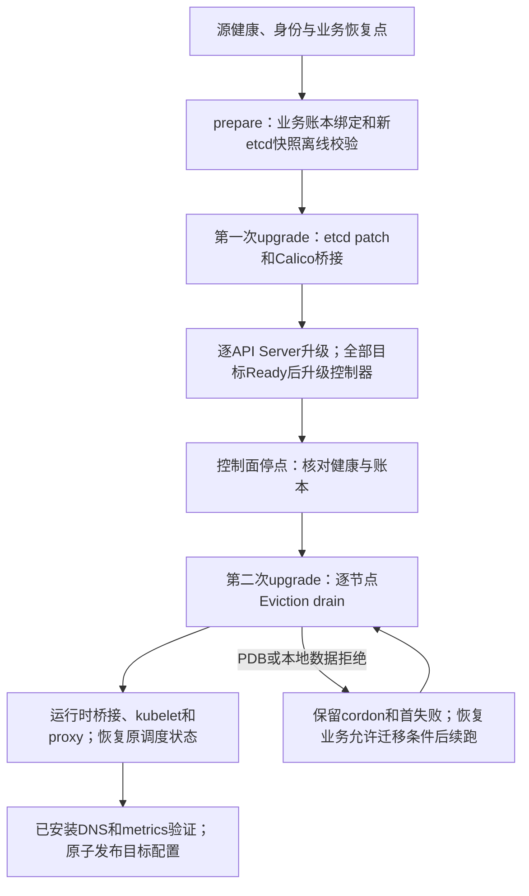

# Kubernetes v1.34.13 升级到 v1.35.10

任务入口：[适用范围](#适用集群与维护窗口) · [版本与行为变化](#本跳改变什么) ·
[准备输入与恢复点](#准备输入并核对恢复点) · [执行升级](#从产品入口执行) ·
[停止、诊断和续跑](#失败时停止诊断和续跑) · [验收与来源](#验收独立实验室入口和来源)。

## 适用集群与维护窗口

本手册用于 kubeauto 已管理、当前 Kubernetes 精确版本为 `v1.34.13` 的集群。
升级目标固定为 `v1.35.10`，不跨过 minor，也不使用浮动版本。执行人需要集群
管理员权限、源配置和证书、目标发行包，以及能够恢复控制面与业务数据的恢复点。
本分支的实际验收状态以 [升级矩阵](test-matrix.yaml) 为准；手册的命令说明不代替
矩阵验收、上游认证或客户签收。

在原 kubeauto 控制机执行，沿用原节点 SSH 密钥和安装时的受支持 Ansible 环境；
不要换到一台没有源集群库存、证书和密钥的机器。以下示例的工作目录为目标分支
源码根目录；使用发行包时直接调用该包的 `kubecli`。数据根目录缺省为
`/usr/local/kubeauto`，已有自定义路径时必须继续使用原值。

自动迁移入口当前接受经过核验的 Calico、IPv4、直接 etcd datastore 组合。
其它网络不自动切换为 Calico；即使目标新建安装提供该网络，也不能据此推导其
原地迁移已经交付。先核对 [固定组合](release.yaml) 的对应组件和迁移边。

逐节点 drain 会迁移 Pod。单副本服务、local-path 卷和节点本地数据可能造成
暂时不可用；此路径不承诺零停机。安排维护窗口，先确认 PDB、应用副本、卷的节点
约束与可用容量。遇到不能驱逐的业务，先按业务自身运行手册恢复可迁移条件，
不能删除 PDB、强删 Pod 或清空本地目录来绕过产品拒绝。

## 本跳改变什么

| 项目 | 实际源状态 | 本跳处理与限制 |
| --- | --- | --- |
| Kubernetes | 六项二进制 `v1.34.13` | 更新至 `v1.35.10`；先全部 API Server，再控制器，最后逐节点 |
| etcd | 已核验的 `3.6.4` 或 `3.6.16` | 同 minor patch 至 `3.6.16`，逐成员串行；保持成员身份、TLS 与数据目录 |
| containerd | `2.1.4` 或已迁移的 `2.3.7` | 前者 drain 后经过 `2.2.10` 到 `2.3.7`；后者读回验证；runc 目标 `1.5.2` |
| Calico | `v3.28.4`、`v3.31.7` 或 `v3.32.4` | 旧组合经 `v3.31.7` 到 `v3.32.4`；不切换 datastore、IP 池或数据面模式 |
| CoreDNS / node-local-dns | `1.12.4` / `1.26.4` | 已安装的消费者更新至 `1.15.0` / `1.26.8`，保留既有配置与对象归属 |
| metrics-server | `v0.8.0` | 已安装时更新至 `v0.9.1`，验证聚合 API 及真实节点、Pod 指标 |
| 可选中间件、存储与共享控制器 | 当前已交付 GA 的实际配置 | 本入口不重放这些安装角色，不迁移数据库 schema，不因候选版本表而更新未安装组件 |

Calico 3.32 的主机内核下限是 5.10；旧 Rocky 8 默认 4.18 内核不能直接进入此
路径。Kubernetes 1.35 的 kubelet 默认 `failCgroupV1=true`，应使用 cgroup v2。
将其设为 false 只是上游已弃用的过渡，不能理解为长期兼容保证。

Calico 3.32 在源集群缺少 `default` BGPConfiguration 时会创建默认对象，包含
`logSeverityScreen=Info` 和 `serviceLoadBalancerAggregation=Enabled`。后者在
字段或对象缺失时原本也按 Enabled 处理；这个默认对象没有新增 Service 地址
宣告范围。产品只接受这项有官方依据的精确新增，并固定其新身份与内容；已有
BGP 配置、mesh、AS 号、地址范围和策略继续保留，出现其它变化时停止。
依据为 [固定版本的 node 启动逻辑](https://github.com/projectcalico/calico/blob/v3.32.4/node/pkg/lifecycle/startup/startup.go)
及来源记录中的 `CALICO-3324-CREATED-DEFAULT-BGP`，不表示允许自动改写客户路由。

Kubernetes 1.35 会拒绝“client CA 与 request-header CA 相同、但代理允许名称
为空”的认证配置。项目使用证书 CN `aggregator`，将允许名称明确限定为
`aggregator`；不扩大发证信任范围。升级后必须验证 metrics 聚合 API，不能只看
API Server 进程启动。IPVS 在 1.35 已弃用但尚未移除；本跳保留源模式，不隐式换用
另一种 Service 实现。

旧 `storagemigration.k8s.io/v1alpha1`、`storage.k8s.io/v1alpha1` 以及
`certificates.k8s.io/v1alpha1/podcertificaterequests` 消费者必须先迁移，产品会在
变更前拒绝这些仍在服务的接口。证书 alpha 组内的 ClusterTrustBundle 不因此被
误判为移除。DRA 的 alpha 分区设备 counter 数据也需要独立迁移，不随本跳处理。
CSI 新 token 门控虽默认启用，驱动的 `serviceAccountTokenInSecrets` 字段仍须
显式选择；未设置或 false 时保持原 VolumeContext 传递。本跳不引入该字段，
也不把功能门控默认值误写为所有现有 CSI 驱动都改变了 token 接口。

Kubernetes 1.35 默认启用镜像拉取凭据校验。默认策略为
`NeverVerifyPreloadedImages`：首次启用前已经缓存的镜像视为预拉取镜像；后续需要
凭据拉取的镜像会记录凭据，新的或轮换的凭据需要重新拉取验证。因此升级前应确认
私库可达、节点与 Pod 的凭据可用；不能仅凭“节点已有该 tag”判断未来重建一定成功。
本入口保留既有凭据及缓存，不自动清空镜像或关闭安全门控。这不改变以完整
`image:tag` 作为交付身份的规则，也不要求重新构建该 tag。

CSI 卷数量上限的动态刷新在 1.35 默认启用；周期刷新仍需驱动设置
`CSIDriver.spec.nodeAllocatableUpdatePeriodSeconds`。此外，挂卷返回
`ResourceExhausted` 时，上游可立即刷新卷上限并将受影响 Pod 标为 Failed，由其
控制器重建。遇到这种情况应先检查真实卷上限、CSI 控制器和 Pod 事件，不能把
“Pod 被重建”直接归因于卷数据丢失。本跳不添加该字段，不把旧版本的故障恢复
时间或确切 Pod 状态序列外推为 1.35 的实测保证。

StatefulSet 的 `MaxUnavailableStatefulSet` 门控在 1.35.0 曾默认启用，但上游在
1.35.4 为修复 `Parallel` 管理策略的回归，将默认值改回 false；本次固定的
1.35.10 也默认关闭。版本分支手册中的“1.35 默认启用”不能直接作为精确补丁版
依据。本入口不启用该门控，不改业务 Pod 模板或扩大变更批次。客户显式启用时，
需另行评估；门控生效后的 `maxUnavailable` 缺省为 1，且不能将它与节点 drain
使用的 PDB 保护混为一谈。

`kuberc` 是 kubectl 的用户偏好文件，源 1.34 已提供该能力。1.35 新增凭据插件
执行策略：未配置时保留 `AllowAll`；客户显式设置 `DenyAll` 或 `Allowlist` 后，
需要相应插件的 kubeconfig 可能被拒绝。遇到客户端认证错误，先核对自己的
`kuberc`、插件路径和错误信息；本入口不覆盖偏好或自动放开插件执行权限。

Dashboard 仓库归档、Harbor 2.13 停止维护的限制继续保留，不能把过渡运行写成
仍受上游维护。kube-router、Kube-OVN、NFS 和 RocketMQ 的依据分别按官方资料的
实际力度记录：最低版本、稳定 API 或明确支持声明不等于逐版测试认证。对应组件
替换、数据迁移及后续 minor 另行安排。

## 准备输入并核对恢复点

使用目标分支构建的发行包或目标分支源码入口，保留源集群目录。不要先改源
`config.yml` 中的 `K8S_VER`，也不要用目标模板覆盖原配置；产品最终完成时才发布
目标配置。目标 Kubernetes 六文件和扩展二进制包必须就绪，版本与校验和匹配
[制品固定记录](artifact-pins.json)。外部镜像以完整 `image:tag` 判断复用，已有 tag
不覆盖；Git 提交变化不会自动要求重建已有镜像。

源集群应满足：所有 API 后端、etcd 成员及六类核心进程健康，节点 Ready，无未
处理故障，主机时间正确；证书、节点 UID、CA 和库存均可对应。确认 stream/exec
等业务权限包含目标版本要求的 `create` 授权。旧的 get-only 显式 RBAC 会被保守
拒绝，项目不自动拓权；权限分散在多个绑定中时也应先人工核清，不能以接口偶尔
可调用代替授权审计。

先核对当前执行文件的发行默认值及源配置是否同时存在。将下面的集群名替换为
原集群目录名；数据根目录只在原安装使用自定义值时修改。

```bash
export KUBEAUTO_BASE_PATH=/usr/local/kubeauto
export CLUSTER=实际源集群名
test -f "$KUBEAUTO_BASE_PATH/clusters/$CLUSTER/config.yml"
test -f "$KUBEAUTO_BASE_PATH/clusters/$CLUSTER/kubectl.kubeconfig"
kubecli version
```

输出中 `kube-apiserver`、`kubelet`、`kubectl` 的发行默认值应为 `v1.35.10`。
这只是确认用对目标执行文件；源配置和现场仍应为 `v1.34.13`，由准备入口逐后端
检查，不能因版本命令显示目标值就把集群当成已经升级。

除控制面快照外，按所用数据库、消息和存储组件的原运行手册保存应用一致的业务
恢复点。控制面快照不包含卷内数据；离线还原校验也不等于业务灾备演练成功。

准备一项已经存在的业务账本：同 namespace 下的 Service、Bound PVC、唯一 Ready
客户端 Pod，客户端容器中有 `wget`，通过 `http://SERVICE:8080/ledger` 读取固定
账本。产品只读取已有对象和数据，不为客户创建测试业务。读取结果包含的换行也
参与 SHA256。下面的文件需替换为真实业务名称、标签和预先核验的账本摘要：

```json
{
  "namespace": "upgrade-ledger",
  "service": "ledger",
  "pvc": "ledger",
  "client_selector": "app=upgrade-client",
  "ledger_sha256": "<原始HTTP响应字节的64位SHA256>"
}
```

将该文件私有保存为 `continuity.json`，禁止把生产凭据、证书私钥、Secret 或完整
备份提交到仓库。摘要须来自升级前已确认正确的业务内容，替换为 64 位小写十六
进制值；不要把任意当前响应的摘要当成业务正确性证明。执行前将文件转换为绝对
路径，供下面的 `--continuity` 参数使用；产品准备会验证实际响应和原卷绑定。

## 从产品入口执行



`CLUSTER` 必须是 kubeauto 已管理的源集群名，并沿用上节的 `KUBEAUTO_BASE_PATH`。
源码维护人员先在目标分支根目录检查验收状态：

```bash
.venv/bin/python -B upgrade/validate.py upgrade/v1.35.10/test-matrix.yaml --status
```

客户使用发行包时，无需安装源码 `.venv` 或复制实验室日志树；发行包以其内嵌的
已验收策略与运行数据身份准入。确认目标版本、原数据根目录和集群名后，两种
运行方式均通过以下产品入口准备：

```bash
kubecli upgrade "$CLUSTER" --prepare --continuity /绝对路径/continuity.json
```

准备成功应出现 `UPGRADE_PREPARE_PASS`。准备阶段读取实际库存和全部 API 后端，
检查新版本接口、认证、内核与 cgroup，绑定 namespace、Service、PVC、PV 和节点
身份，并从源 etcd TLS 端点保存一个新快照。产品使用精确 `etcdutl` 检查 revision、
键数及快照摘要，再在隔离临时目录执行离线 restore 校验，不启动恢复成员。

本机状态位于 `/var/tmp/kubeauto-upgrade-CLUSTER`，旁边保存 `.receipt.json` 和
`.lease`。这些文件是本次源身份、恢复点及后续排他执行的依据。目录已存在时，
准备入口拒绝覆盖：先检查原状态并决定续跑或按所属恢复流程处理，不能删除它们
来伪造一次新开始。准备前置失败只回收本次新建的本地准备材料，不修改集群资源。

准备通过后执行：

```bash
kubecli upgrade "$CLUSTER"
```

第一次调用串行完成 etcd、Calico 桥接和 HA 控制面，出现
`UPGRADE_CONTROL_PLANE_STAGE_PASS` 后明确停止。此时 API Server 为目标版本，
kubelet 仍为源版本；核对业务账本和健康状态后，再执行同一命令进入节点阶段：

```bash
kubecli upgrade "$CLUSTER"
```

节点阶段依次执行 `cordon → policy/v1 Eviction drain → 运行时桥接 →
kubelet/kube-proxy → Ready → 恢复原调度状态`。保持原先不可调度的控制节点；
PDB 或本地数据保护失败时停在该节点，不自动 uncordon。仅已核清完整归属链的
metrics-server 单实例临时缓存采用限定驱逐处理；驱逐请求成功后，等待原 Pod
删除完成才继续 drain。等待超时会保持 cordon 并停止，不全局放宽 emptyDir 保护。

全部节点和已安装 DNS/metrics 消费者验证通过后，产品原子更新源配置为目标
版本，输出 `UPGRADE_NEXT_HOP_STAGE_PASS` 和 `KUBERNETES_STAGE_SCOPE_VERIFY_PASS`。
这些标志表示该命令的声明范围完成；再执行同一入口应核验已经接受的状态，
不重复迁移、不更换业务卷或成员身份。

## 失败时停止、诊断和续跑

先保留首失败日志、退出码、journal、当前配置与只读资源状态。区分环境或镜像
供应问题、运行时问题、Kubernetes/PDB 拒绝、产品问题和测试门禁问题。不要在
原因未知时重装整个集群，也不要同时改多个因果层。

在原控制机、同一 shell 中读取当前停点和实际版本；下面只输出 journal 的进度
字段，不输出绑定中的完整输入。`journal.json` 尚不存在，表示还没有进入该
持久化执行计划，应先检查准备阶段的首个错误，不创建或补写 journal。

```bash
python3 - "$CLUSTER" <<'PY'
import json
from pathlib import Path
import sys

path = Path('/var/tmp') / ('kubeauto-upgrade-' + sys.argv[1]) / 'journal/journal.json'
data = json.loads(path.read_text())
print(json.dumps({key: data[key] for key in ('active', 'completed', 'failures', 'updated_at')},
                 ensure_ascii=False, indent=2))
PY
"$KUBEAUTO_BASE_PATH/kube-bin/kubectl" \
  --kubeconfig "$KUBEAUTO_BASE_PATH/clusters/$CLUSTER/kubectl.kubeconfig" get nodes -o wide
```

`active` 是未完成的当前步骤，`completed` 只记录已核验的顺序前缀；两者不能
代替当前健康。`failures` 保留每次失败的步骤、非零退出码、分类和时间，即使
后续续跑成功也不删除。出现解析错误、未知步骤、节点身份或输入漂移时，保留
整个私有状态目录并停步，不编辑这些字段来解除拒绝。

PDB 拒绝意味着 Eviction 保护正在生效。先观察应用副本、业务健康与 PDB 允许
中断数；由业务负责人恢复允许迁移的条件。确认原节点和集群身份、配置、目标
二进制、已完成 journal 步骤均未改变，再调用同一 `kubecli upgrade`。产品保留
首失败并从限定边界续跑，已完成步骤重新读回，不被一次重试覆盖为“从未失败”。

身份不一致、journal 输入变化、数据账本不同或原卷被替换时必须停止；此时不能
盲重试或手工修改 journal。部署未验收代码后也不能直接沿用旧 journal，先完成
影响分析。恢复依赖原始私有快照、证书、配置及应用恢复点；禁止将快照恢复进仍在
服务的 etcd 数据目录。

本产品不提供通过简单二进制降级恢复已写入新 API 或数据格式的承诺。需要灾难
恢复时，先隔离故障集群，按原组件运行手册恢复控制面和业务数据，再检查外部
系统一致性、原始账本、身份、安全与服务。该流程沿用组件已 GA 的恢复能力；
本跳的离线快照检查不能替代它。

## 验收、独立实验室入口和来源

产品入口与实验室入口分工不同。客户执行上述 `kubecli` 命令；开发验收使用
`upgrade/lab/next-control.sh` 的固定清单、共享池租约和独立控制目录。它不接管
控制机原集群，不格式化裸盘。资格链每阶段保留锁、原始日志和 durable 状态，
收取证据后才进入下阶段。清理通过 namespace UID 前置、原集群 CA、节点 owner
及空卷检查限定范围；先释放本次卷，再调用产品 destroy。产品销毁成功后，实验室
固定入口在同一六节点租约内调用既有清理 helper，回收运行时遗留子进程并清除已
删除 unit 的失败状态，再检查服务、数据目录、完整进程参数与租约。任何一步失败
均保留归属和首错，不把主进程退出当成整个运行时已经清理。此衔接只属于独立
实验室，不增加客户升级命令的销毁动作。

已接受的迁移验证使用独立三主三从 Rocky Linux 9.8、cgroup v2、Calico IPv4
直接 etcd 组合，启用 CoreDNS、node-local-dns、metrics-server 和 local-path。
下表用于说明这一路径可判断的结果；其它拓扑、CSI 数据与未部署业务不从它推导
为本次实测。

| 检查点 | 实际结果及判断边界 |
| --- | --- |
| 源健康与恢复点 | 三 API、六 kubelet 为 v1.34.13；新 etcd 快照 revision 2881、678 keys，摘要与隔离离线 restore 校验通过。该快照不包含卷内数据。 |
| 控制面停点 | etcd 3.6.16、Calico v3.32.4 和三 API v1.35.10 通过；控制器在全部 API Ready 后更新，六 kubelet 仍为 v1.34.13。 |
| 节点保护与续跑 | 测试 PDB 在 worker193 拒绝驱逐，原 kubelet 和 cordon 保持；原 runner 按同 UID 解除测试条件后，沿原 journal 完成，拒绝记录仍在。客户业务 PDB 继续按业务手册处理。 |
| 目标节点与附件 | 六 kubelet v1.35.10、containerd 2.3.7；三主保留不可调度状态，三从恢复可调度。DNS 与六节点、一个业务 Pod 的真实指标在完成及幂等调用均通过。 |
| 原卷与账本 | 只有一对 local-path PV/PVC；维护前后 namespace、Service、PV/PVC UID、Bound 引用和 HTTP 账本 SHA256 保持。单副本本地卷仍有维护窗口，不是零停机或 CSI 灾备证明。 |
| 独立目标新建与幂等 | 在源集群销毁并验证清理后，连续两次通过产品 `setup` 安装 v1.35.10；两次节点 UID 保持，且与源集群 UID 完全不同。三 API Ready，六节点与 16 个 Pod 的指标有效，DNS 有就绪后端，28 个初始化／运行容器的实际镜像摘要与已准入的 AMD64 制品一致。该项没有新建中间件或 CSI 业务。 |

升级矩阵的 15 个父项保持独立主张。原 GA 的中间件业务、存储故障/备份/灾备、
性能与长稳证据按精确依赖复用，不重新运行全部深测。本跳新增现场证据只覆盖
源健康与恢复点、相邻 minor 迁移、变化核心附件、原 PVC 账本、拒绝续跑、干净
目标安装及幂等。最终验收必须前置全部当前有效，并有独立干净全链、durable
两份零退出、零失败标志和 `LAB_CLEAN_VERIFY_PASS`；子项成功不等于最终 GA。

官方来源及固定副本见 [来源记录](../official-sources.yaml)、
[本跳研究记录](research.yaml) 与 [本跳快照](../official-snapshots/2026-11-16-next-hop/)。
Kubernetes 的版本偏差、精确发布说明和源码约束、containerd 官方相邻版本迁移
策略、Calico 3.31/3.32 升级说明分别是本跳顺序和主机准入的依据；本手册没有将
官方支持下限改写为上游逐版认证。具体实测结果只引用矩阵所接受的原始证据，
不从手册文字推导尚未完成的验收。
