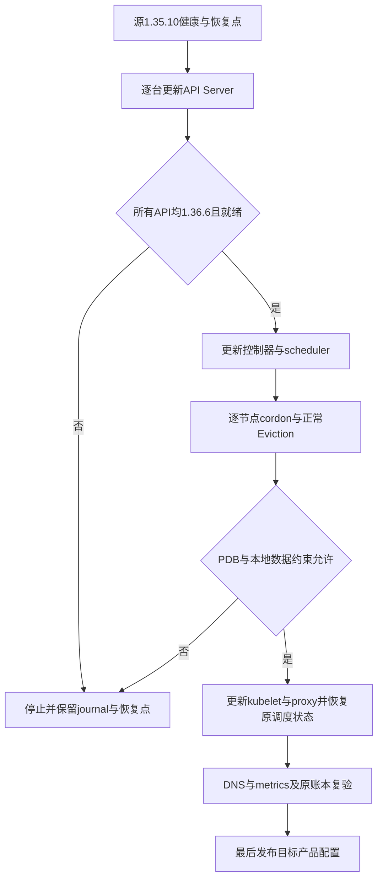
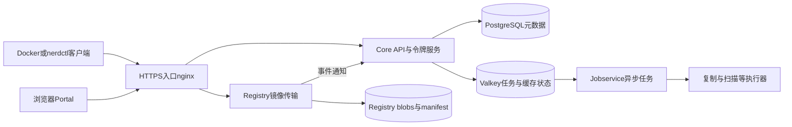
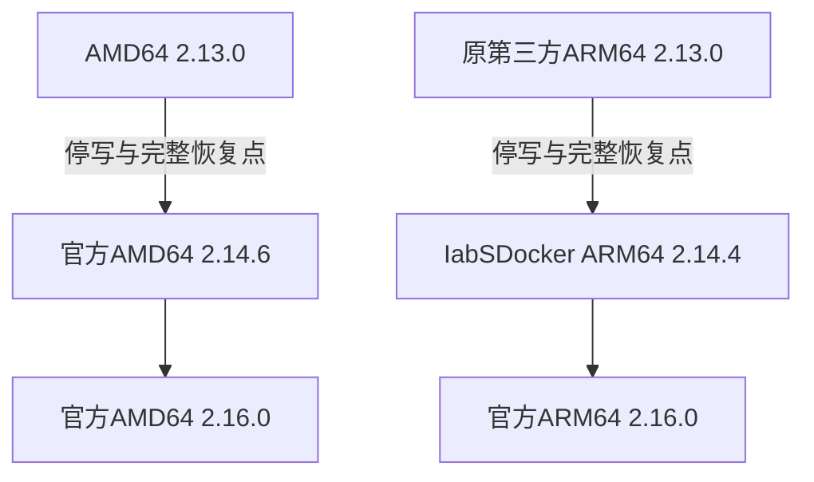

# Kubernetes 1.36 与 Harbor 2.16 技术白皮书

本文面向平台架构师与运维负责人，解释 `v1.35.10 → v1.36.6` 的迁移边界，以及
Harbor `2.13 → 2.14 → 2.16.0` 的数据、安全与架构约束。版本选择以
[固定组合](release.yaml)为准，实际项目验收以[本跳矩阵](test-matrix.yaml)为准。
上游发布 GA、项目集成验收、客户生产签收是三个独立结论。

阅读路径：[控制面与节点](#控制面与节点) → [Harbor请求与状态](#harbor请求与状态)
→ [权限与信任](#权限与信任) → [数据保护与架构迁移](#数据保护与架构迁移)
→ [运维与容量决策](#运维与容量决策)。操作入口见
[运维手册](operations-manual.md)，维护接口见[开发手册](development-manual.md)。

## 控制面与节点

Kubernetes 的 API Server 提供资源 API，etcd 保存集群声明与状态；控制器据此协调，
scheduler 选择节点，kubelet 与 CRI 运行时落实容器和挂卷。更新 API Server 不会更新
节点容器，恢复 etcd 也不会恢复 PVC 中的数据库文件。升级必须分别验证控制面状态、
节点运行条件及业务已确认数据。

本跳保持已接受的 etcd `3.6.16`、containerd `2.3.7`、Calico `3.32.4`，只推进
Kubernetes 六项二进制到 `1.36.6`。已安装 DNS/metrics 进入各自收敛检查；未安装
消费者不会因升级被自动安装。保持版本仍需核对目标支持依据，但不重复执行旧版
桥接，也不重新编译或覆盖已有精确 tag。

下面的箭头表示产品变更顺序，业务读回检查贯穿各交接点。

所有 API 后端达到目标后才更新控制器，避免负载均衡隐藏仍旧的后端。
节点更新先调用 Eviction API，让 PDB 约束可用副本。产品不靠强删 Pod 或删除
业务 PDB 继续推进。失败节点保持 cordon，journal 保留当前步骤；修复其前提后
续跑已经完成的步骤，不能将失败尝试当成新的源基线。

本跳资格运行在三 master、三 worker 的 Rocky 9 六节点环境，控制面阶段已观察到
三 API 到 `1.36.6`、六 kubelet 仍为 `1.35.10`，etcd 成员及原 PVC/Service 账本保持。
恢复快照 revision 为 2721、683 keys，并执行了独立离线恢复校验。这些结果证明
相应控制面交接与快照完整性，不能外推为应用灾备恢复或零停机保证。

Kubernetes 1.36 的 gitRepo 卷及 DRA 变化由产品源预检约束。发现 gitRepo 卷或非空
DRA claim/slice 时停止，由对应工作负载/驱动负责人先完成迁移。自动入口只接受
已评审的 Calico 直接 etcd 组合，不将其它 CNI 自动改成 Calico。其它受支持新建路径
及原功能深测的证据去向在组合记录中分别保留，不能从一个 CNI 的成功推导全部 CNI
原地升级已经通过。依据为官方
[版本偏差政策](https://kubernetes.io/releases/version-skew-policy/)及固定
[1.36.6变更记录](https://github.com/kubernetes/kubernetes/blob/v1.36.6/CHANGELOG/CHANGELOG-1.36.md)。

## Harbor请求与状态

Harbor 是在 OCI Distribution 镜像传输之上提供身份、项目权限、制品元数据和管理
策略的仓库。镜像仓库路径 `school/ability` 中，`school` 是项目，`ability` 是仓库；
tag 是可读名称，digest 标识 manifest 内容。项目以完整 `image:tag` 作为交付身份，
digest 用于核对这次消费内容与架构，Git SHA 变化不会自动要求重建镜像。

一个多架构 tag 通常指向 OCI index/manifest list，再分别指向 AMD64 与 ARM64 的
manifest、配置和层。客户端按本机平台选择子 manifest。把同一个 AMD64 安装包放进
两个架构的包装镜像，只能证明包装镜像可以分发，不能证明其内部服务能在 ARM64
运行。Harbor 2.16 官方分别提供两种 CPU 的完整离线安装包；2.14.6 桥接包仅为 AMD64。

下面区分管理面与镜像数据面。箭头代表请求或状态依赖，不表示部署成多个高可用副本。

Core 管理项目、成员、机器人、制品记录和权限，PostgreSQL 保存这些权威元数据；
Registry 保存镜像 blob 与 manifest。两者缺一都会造成“页面有记录但拉不下来”或
“有 blob 却没有项目身份”的不一致。Jobservice 执行复制、扫描等异步任务，队列及
缓存与数据库、镜像文件属于同一次恢复边界。2.16 的内部队列镜像改为 Valkey，
不能继续把旧 Redis 主版本和 RDB 格式不加核对地视为等价。

一次私有镜像拉取先访问 `/v2/`，收到 Bearer challenge 后向令牌服务提交身份与
repository scope，获得短期令牌，再携令牌下载 manifest 和缺失层。Registry校验
令牌的签名与 scope，TLS保护传输和服务端身份。原有 tag 在客户端已缓存时，普通
“pull成功”可能没有真正取回层；本项目迁移验证清除精确测试制品的本地引用后，
再用原用户和机器人按原 digest 拉取并验证文件内容。

OCI artifact 不局限于运行镜像。Helm Chart 可按 OCI 方式存储，签名、SBOM 等可与
制品关联。旧文档中的独立 ChartMuseum、Notary、Clair 或 MySQL 架构不代表本固定
版本的实际部署。这里采用固定 2.16 的 API、配置与 Compose 模板校正旧官网文字，
本项目不因此交付所有可选扩展。

## 权限与信任

系统管理员管理全局配置、认证和项目，项目管理员管理项目内部成员和策略。开发者、
访客与机器人按项目授权，私有项目匿名用户不能拉取。机器人用于自动化，secret只在
创建或刷新时交付，应保存到密码管理系统；不能在迁移验证时重新创建机器人来掩盖
身份或密钥丢失。使用只拉取机器人时，拉取应成功，推送必须被权限系统拒绝。

本地用户、LDAP/AD 与 OIDC 是不同的认证模式。外部身份服务故障不会因 Registry
仍在运行而自动消失；更换认证模式也不是普通版本升级步骤。OIDC交互式登录与
CLI secret分工不同，不能直接把浏览器密码当成所有客户端的通用密码。项目此次
升级保持源认证方式、成员和原 secret，不自动拓宽权限或轮换身份。

本地DB认证由Harbor保存用户；`harbor.yml`中的管理员初始密码只在首次初始化时生效，
修改该字段不会重置已存在的管理员密码。LDAP的搜索DN、过滤器、组及TLS，OIDC的
用户/组映射与令牌刷新都依赖原身份服务；本地快照不能证明这些外部依赖已经恢复。
已有本地用户还会限制认证模式切换，因此版本升级不得夹带身份源迁移。

系统机器人可以跨项目授权，项目机器人限定在所属项目，默认名称前缀为`robot$`；
上游默认有效期为30天，实际期限须读取原配置，不能假定迁移会续期。授予push时还
必须授予pull。最小权限不能只看是否勾选删除制品：更新项目成员可能提升授权，管理
保留策略也可能间接删除制品。原有只拉身份必须以允许pull、拒绝push两条业务路径
验证，过期或失效时按独立凭据维护流程处理，不重新创建身份掩盖迁移问题。依据为
[固定版机器人说明](https://goharbor.io/docs/2.16.0/administration/robot-accounts/)。

2.2以前的旧JWT机器人不能直接转换为新格式；若源环境仍保留此类身份，应单独
安排替换和调用方切换，不能把“保留2.13既有身份”的验证外推到旧JWT格式迁移。

外部 HTTPS 证书的SAN必须匹配真实仓库域名，CA必须进入客户端信任库；仓库URL
的端口还须与实际HTTPS监听对应，端口不是证书SAN的一部分。
HTTP401可能是正常challenge，持续401/403才需沿认证与scope定位；连接失败、
证书失败和权限拒绝分别处置。不得为消除登录错误启用 insecure registry。
Harbor 服务间 internal TLS 是另一层证书体系；当前自动本地快照路径会拒绝启用
internal TLS、外置DB/Redis或外置对象存储的源，需要先制定对应协调恢复方案。

扫描、签名与下载阻断是不同控制。Trivy报告已知漏洞；项目可按阈值阻止有漏洞
制品被拉取；签名/信任策略决定发行身份是否可信。漏洞库需要更新且扫描有时效，
“未发现漏洞”不等于未来持续安全。此跳不自动启用未使用的扫描器或额外策略，
迁移前后的实际策略应保持不变。

## 数据保护与架构迁移

Harbor 2.16 官方升级指南只覆盖从2.14及以后进入2.16；因此本项目的2.13不能
直接跳到2.16。AMD64走官方2.14.6桥接；ARM64使用固定的第三方IabSDocker
2.14.4过渡，最终两种架构都落到官方2.16.0。整个原地过程保持同一CPU，避免为取得
ARM桥接而增加两次跨架构逻辑传输。迁移器根据受管主机CPU选择，不能根据控制机CPU
选包，也不能在ARM上运行AMD桥接镜像。

官方2.14接受2.11及以后版本、2.16接受2.14及以后版本，提供版本顺序依据；它不
认证IabSDocker的ARM构建。项目固定其完整包SHA，核查包内CPU、版本和关键迁移脚本，
并通过独立的原生ARM补充范围检验数据、身份、权限与恢复。供应商指向的完整构建源码
当前不可公开读取，不能据已检查脚本或包checksum宣称全部源码等同官方。第三方仅为
短期桥接，目标官方包仍按官方签名和发行身份验真。原生补充是否已接受以本跳矩阵及
[ARM补充记录](evidence/harbor-arm64-supplement.json)为准；跨CPU逻辑迁移仍保留独立
验证边界，不能由本次同CPU运行外推。

Harbor升级会迁移数据库schema及配置，内部PostgreSQL主版本也可能变化。
恢复原版必须先停止目标写入，用同一个原始恢复点恢复整套旧配置、旧服务镜像、
数据库、密钥、队列和blob，再读回原业务。把旧容器挂到已经迁移的数据库不是恢复，
上游不支持这种降级。恢复点之后在目标产生的新写入不会自动合入旧库，正式切换前
应保持维护窗口，明确唯一写入端，不能让两端同时接收推送。

项目备份把恢复目录放在数据树之外，盘点Compose挂载、容器所有权及CPU，停止
写入服务，保存队列一致状态，停止剩余服务后归档完整数据与原镜像。备份还绑定
机器、原配置、CA/证书及每份文件SHA256。逻辑迁移只接受审计过的内部单registry库、
角色和表空间条件；额外数据库、角色全局设置或不明队列格式会拒绝，不能静默漏迁。
恢复资料包含凭据和密钥，必须私有保存、异机复制、按恢复保留期回收。

上游依据为[2.16升级指南](https://goharbor.io/docs/2.16.0/administration/upgrade/)
及[完整回滚边界](https://goharbor.io/docs/2.16.0/administration/upgrade/roll-back-upgrade/)；
固定包和项目路径以本跳组合为准。相关产品操作见
[Harbor运维任务](operations-manual.md#harbor)。

## 运维与容量决策

项目提供单主机 Compose Harbor，此主机的数据库、队列和本地存储属于共同故障域。
restart策略和健康检查能恢复进程，不构成主机容灾。Harbor复制策略可把制品复制到
另一个仓库，但不复制全部系统身份、全局配置及数据库事务，因此不能替代完整备份。
Helm/外部服务高可用属于另一部署体系，本跳不自动迁移到该体系。

推送首先消耗网络、Registry写入与存储；大镜像的层复用可减少传输，但扫描、复制及
垃圾回收会产生额外I/O和后台任务。磁盘规划应同时计入blob、数据库、日志、扫描缓存、
原镜像包及恢复副本。上游安装下限是2CPU、4GB内存、40GB磁盘，推荐4CPU、8GB、
160GB；最低规格不是生产容量承诺，迁移所需空闲空间还要按真实已用数据单独计算。

官方演示站会定期重置，限制容量且不提供完整系统管理权限，不能保存客户镜像或
作为生产验收环境。社区Registry功能对照也不是固定2.16兼容认证或性能基准；
选型依据应是实际部署、权限、恢复与制品需求，不能从旧功能表推导已移除组件仍受支持。

删除tag、删除artifact、保留策略与垃圾回收不是同一步：取消引用先改变可见对象，
未被引用的blob随后才由GC回收。不可变tag规则可保护发行名，保留策略也可能批量
删除历史版本；升级窗口不应同时变更这些策略或启动额外GC。项目配额是项目资源
约束，不能代替宿主机磁盘告警。监控至少同时看API健康、磁盘/增长率、数据库、
队列积压、任务失败、扫描库时效与真实私有拉取，不以Portal能打开作为上线判据。

本跳未进行新的性能、长稳或全量业务故障测量，不给出吞吐、RPO、RTO或可用性SLA。
原功能证据仅在其版本、依赖及场景边界内复用；目标变化的迁移、恢复和业务接口
必须取得本跳实际证据后才接受。

## 制品与策略的职责边界

下列是固定版本的上游能力及其与升级的关系；本跳不自动启用新策略，也不把功能
目录当成已经通过的项目场景。迁移的首要任务是保留原策略、身份及确认制品，新增
策略另按其消费者确定验证范围。

### 名称、附件与信任

同一manifest可以有多个tag；添加或重打tag改变名称引用，不必重传已有blob。
删除一个tag不等于删除其它引用的manifest；删除artifact可能影响多个名称及其附件。
标签label用于组织和筛选，不是权限、签名或完整性证明。不可变tag防止符合规则的
名称被改写，保留规则则选择要留下的制品；两类规则需分别评审，不能以一种替代另一种。

不可变规则按“或”组合，上游每项目最多15条；保留规则同样按“或”选取要保留的
制品，不能误认为多条规则会逐层收紧。多tag指向同一artifact时需一起判断删除影响。
index父对象添加或移除tag不会递归改变child的tag；仍被index引用的child不能直接
删除。删除parent也不能删除仍被其它parent引用的共享child。这些引用约束解释了
为何删除一个名称既不一定删除内容，也不一定立即释放空间。

OCI制品还可关联签名、SBOM等附件。SBOM描述软件组成，漏洞报告把组成与某时点的
漏洞库匹配，签名证明某身份认可指定内容；三者回答不同问题。只复制主体镜像不等于
复制并验证全部附件。Harbor内容信任可使用Cosign、Notation；若同时启用多个要求，
拉取需满足全部已启用的检查，不能因其中一个签名存在就认为策略通过。

Helm3的OCI Chart同样以repository和版本tag存放，客户端经过registry认证后推拉
Chart包；Chart名称/版本约束其路径和tag。它不恢复旧ChartMuseum接口，也不意味着
Compose安装方式变成Helm部署。当前项目未新增Chart或签名策略的自动化入口。

用户自定义OCI制品通过manifest/config的media type等元数据分类。支持存储和展示
一种类型，不等于Harbor能够执行它或扫描其中所有内容；验收需按客户端实际协议、
主体及附件分别确认，不能以页面出现一个名称替代内容与权限验证。

### 扫描、例外与安全视图

扫描先形成异步任务，再由扫描器访问制品和漏洞数据库，最后写入报告。单次扫描、
全量扫描、定时扫描及取消任务有不同的生命周期；停止任务不代表已完成的报告被
撤销。扫描器私有CA、离线漏洞库及报告时效都影响结果，旧Clair离线数据导入步骤
不能直接用于2.16默认Trivy。

下载防护依据严重等级及被请求的具体架构制品作判断；多架构index的汇总展示不代表
每个child的策略结果都相同。全局与项目CVE allowlist是带范围和有效期的风险例外，
不修复漏洞。Security Hub汇总已有风险信息，不替代扫描器和漏洞库更新；未启用
扫描器时不能声称已经完成漏洞检查。本跳默认不新增扫描配置，保留源选择及限制。

项目可以继承或覆盖全局allowlist；“Copy From System”是一次复制，不会随着全局
列表的后续删除自动同步收回例外。例外必须指定有效期及维护责任。增加扫描器还会
引入适配器能力、健康、认证和私有CA依赖；全库或定时任务完成，只证明其支持范围
内的任务终态，不证明不支持的制品、陈旧报告或未刷新漏洞库也已安全。

### 复制、缓存与预热

复制通过端点、规则、执行和子任务协同：端点定义对端类型、URL、身份和TLS；规则
决定过滤、目标路径、触发及覆盖/删除语义；执行记录说明实际哪些制品完成或失败。
重试前先查对端digest，避免把响应超时当成“对端未写入”。复制不包含完整的系统
身份、数据库事务和全局配置，故不能作为整站恢复点。

代理缓存项目在首次拉取时访问上游并保留内容，仍受上游认证、限流和本地保留策略
影响；它的角色是加速消费，不能替代项目正式发行制品的权威来源。P2P预热则把候选
制品交给外部provider分发；provider连通、任务完成和客户端真正命中缓存分别判断。
规则可能选中零个候选，任务成功也不能证明特定镜像已经预热。本地备份不恢复远端
P2P缓存。本跳不增加复制对端、代理项目或P2P后端。

Webhook把push、pull、delete、扫描、配额、复制或保留等事件交给外部接收方，负载
格式可为Default、CloudEvents或Slack，接收方必须匹配实际格式。超时或非2xx响应
可能触发重试，因此按事件身份与digest幂等处理，不能假定只投递一次。2.16的
`webhook_egress`还约束出站及私网访问；端点无法连接时先核对此安全边界，不直接
放开全部私网。Webhook通知既不复制blob，也不提供整站备份。

### 配置权威与观测

Harbor首次初始化配置与数据库中的后续系统设置分工不同。若使用
`CONFIG_OVERWRITE_JSON`，其中字段在启动时覆盖系统配置，不能再靠UI/API更改相同
字段；恢复时必须保存这份真实配置来源。定制项目角色决定细粒度操作权限，迁移
不能只检查管理员登录，还要保持原成员/机器人角色及最小允许、拒绝行为。

同一用户的个人和组授权按并集生效，修改一个角色不一定撤销其它途径的授权。
自定义角色赋权不能超过操作者已有权限，角色定义的变更会影响所有引用它的项目；
OIDC组名输入不保证该组真实存在。迁移前应记录实际成员及角色关系，迁移后按原身份
核验有效权限，不能仅比较界面显示的角色名称。

Core令牌签名私钥与Registry验证证书建立镜像授权信任，外部HTTPS证书保护客户端
连接，两者不能互换。更换令牌服务、internal TLS或认证后端会改变恢复输入；这些
定制路径未纳入本次本地自动迁移，不通过修改模板绕过拒绝。

观测需连接请求、队列和实际任务：Core/Registry HTTP计数、时延，Jobservice积压，
exporter健康各有来源；counter的增量/速率与gauge当前值不能混用。直方图桶的分位
计算和summary已计算的分位也不能混用。分布式tracing还需要后端和采样配置，并可能
携带请求上下文；本跳不新增该后端。审计用于追溯身份操作，日志轮转用于限制文件
增长，二者都不替代业务探针或完整备份。

Jobservice的队列暂停只停止消费，仍可能有新任务进入，也不等于所有运行任务已经
结束。停止整体执行需要分别停止排队、释放worker并确认Stopped；释放worker可能
持续数分钟。Registry只读同样不能停止全部后台数据库写入。因此本项目一致备份
先停止外部写入和后台任务，再持久化队列并停止整套服务，不以“队列Paused”或
“仓库只读”替代停写边界。依据为
[Jobservice任务管理](https://goharbor.io/docs/2.16.0/administration/jobservice-dashboard/)。
